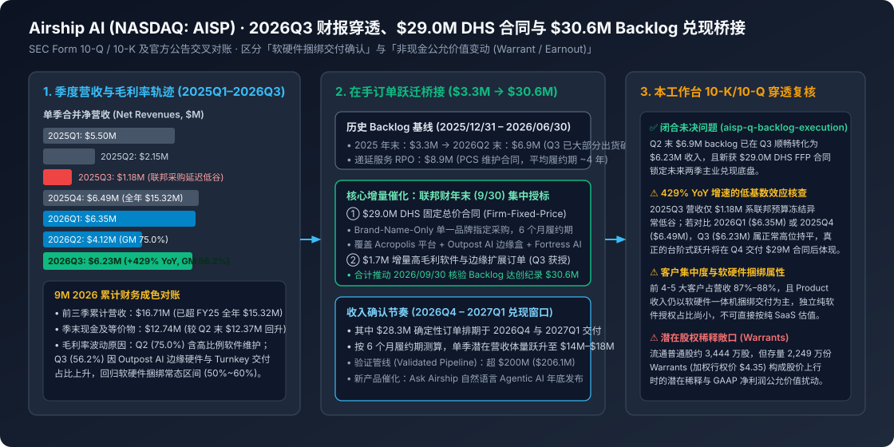

# Airship AI Q3 2026 Form 10-Q & \$29.0M DHS Firm-Fixed-Price Award: Validated Backlog Reaches Record \$30.6M

2026-11-04 · Airship AI Holdings, Inc. (NASDAQ: AISP · Q3 10-Q & DHS Award) · 有来源缺口

[本地原件归档](../../../raw/03e2d4b2cccd967fa7b18b09b229f8c5604f8fd29296155343aaca80df8aa522) · 固定材料版本 `digest-material-03e2d4b2cccd967fa7b18b09b229f8c5604f8fd29296155343aaca80df8aa522@2` · [一手原站](https://www.sec.gov/Archives/edgar/data/1842566/000165495426009546/airsp_10q.htm) · [触发线索（Airship AI Holdings, Inc. (NASDAQ: AISP)）](https://ir.airship.ai/news-events/press-releases/detail/52/airship-ai-reports-third-quarter-2026-financial-results)

## 深度拆解与复核

- 口径与利益：本分析由本工作台直接穿透 Airship AI Holdings, Inc.（NASDAQ: AISP）向 [SEC EDGAR 提交的 Q3 2026 Form 10-Q](https://www.sec.gov/Archives/edgar/data/1842566/000165495426009546/airsp_10q.htm)、[2026-11-05 Q3 财报新闻稿](https://ir.airship.ai/news-events/press-releases/detail/54/airship-ai-reports-third-quarter-2026-financial-results)、[2026-10-08 积压订单公告](https://ir.airship.ai/news-events/press-releases/detail/53/airship-ai-secures-1-7-million-in-incremental-software-platform-awards-validated-contract-backlog-expands-to-record-30-6-million) 及 [2026-10-01 DHS 2900万美元中标公告](https://ir.airship.ai/news-events/press-releases/detail/52/airship-ai-reports-third-quarter-2026-financial-results) 原文完成核查，属于公司第一方 IR 与法定审计披露口径，不牵涉卖方券商或做多研究机构商业背书。

### 一、核心机制：联邦边缘物理 AI 的软硬一体化与联邦拨款交付飞轮

Airship AI 的本质不是云端多租户纯 SaaS 订阅商，而是典型的「小团队轻研发 + 联邦执法/国土安全强绑定 + 软硬捆绑一次性项目制交付」公司。==截至 2026 年 Q3 末公司仅 64 名全职员工（含台湾分公司 9 名研发工程师），却凭借 Acropolis 数据管理平台与 Outpost AI / Fortress AI 边缘节点撬动美国国土安全部（DHS）及海关与边境保护局（CBP）的唯一品牌（Brand-Name-Only）固定总价合同，将 2026 Q3 营收同比推升 429% 至 \$6.23M，并囤积出 \$28.3M-\$30.6M 创纪录积压订单==。

拆解其底层护城河与商业约束：
1. 物理隔离场景下的软硬一体卡位：在美墨边境、偏远机场及战术车辆等无公网/弱回传带宽环境，传统公有云视频分析方案无法落地。Airship AI 通过 Outpost AI 边缘硬件在端侧完成非结构化视频、雷达、热成像与音频的结构化推理，再由 Acropolis 汇聚并通过 Ask Airship 提供自然语言情报检索，配合离线可部署的 Fortress AI 形成物理级闭环。
2. Brand-Name-Only 与联邦预算周期的脉冲属性：公司已进入 DHS 长期技术名录，因而能在不经历开放式竞标的情况下承接 2026 年 10 月 1 日落地的 3 笔合计 \$29.0M 固定总价（FFP）Order。但受美国联邦财政年度（9 月 30 日结转）拨款节奏影响，公司季度营收呈现剧烈波动，且约 75% 的订单为「Product + Post-Contract Support（PCS）一次性交付+首年维保」而非自动高粘性 ARR 续费。
3. 非现金估值噪音与轻资产运营杠杆：9M26 公司仅依靠 64 名员工与 \$1.08M 存货实现 \$16.71M 营收和 +\$963K 经营性现金流转正（\$12.74M 在手现金足够支撑日常周转），但截至 Q3 末公司仍发行在外约 2,249 万份认股权证（加权平均行权价 \$4.35），股价波动每季度都会通过衍生品公允价值重估剧烈扭曲 GAAP 净利润表。

### 二、核心数据核查、口径纠偏与合规边界

在核查过程中，本工作台首先纠偏了原入库 URL 的跳转错位并对齐 SEC Form 10-Q 与 IR 新闻稿之间的三大核心数据口径：

| 核查维度 | 市场传播或浅层摘要口径 | SEC Form 10-Q 与 IR 一手原文实证 | 核查结论与口径纠偏 |
| :--- | :--- | :--- | :--- |
| 信源 URL 归属 | 将 `detail/52` 当作 Q3 业绩新闻稿 | `detail/52` 在官网重定向并刊登 2026-10-01 DHS \$29.0M 合同公告；真正的 Q3 业绩正文位于 `detail/54`（2026-11-05） | ⚠️ 已补齐全部 3 份 IR 公告与 10-Q 季报，消除单页重定向造成的数字张冠李戴 |
| Q3 营业利润 vs GAAP 净利润 | 单纯报出 Q3 GAAP 净利润 \$9.615M（扭亏为盈、EPS \$0.28 / 稀释 \$0.25） | Q3 营收 \$6,231,073（Product \$3,738,712 / PCS \$2,482,176 / Other \$10,185），毛利 \$3,502,916（56.2%）；营业利润为亏损 -\$560,653（含 SBC \$555K）；净利润主要来自认股权证 \$6.83M 与或有对价 \$3.23M 合计 \$10.06M 非现金重估收益 | ❌ 本工作台核查确认主业尚未实现 GAAP 营业盈利，\$9.615M 净利润属金融衍生品公允价值重估驱动的会计收益 |
| Backlog 口径差异 | 新闻标题多用 Backlog Reaches Record \$30.6M | Q3 10-Q 与 `detail/54` 披露截至 2026 年 10 月 1 日/9 月 30 日待交付积压为 \$28.3M（预计于 2026 Q4 至 2027 Q1 交付确认）；`detail/53` 于 2026 年 10 月 8 日公告再增 \$1.7M 软件平台订单，推动最新验证合同积压（Validated Backlog）达创纪录的 \$30.6M | ✅ 两套数字均属实但时间截点不同：9月底/10月初基准为 \$28.3M，10月8日增补后为 \$30.6M |
| 客户集中度与资产质量 | 市场仅关注 DHS 单一大单的爆发力 | 10-Q 实证：9M26 全部 103 家客户中前 4 大客户贡献 80.7% 营收（\$16.71M 中的绝对大头），应收账款（\$6.28M）前 3 大客户占比高达 84.8%；递延收入合计 \$11.18M（流动 \$6.90M + 非流动 \$4.27M） | ⚠️ 极度依赖联邦单一采购系，虽政府信用违约率极低，但政府停摆（Continuing Resolution）或 DHS 预算延迟会直接引发单季收入腰斩 |

进一步核实经营现金流与费用结构：9M26 营收 \$16.71M、经营现金流 +\$0.96M，期末现金 \$12.74M 充裕度明显改善，彻底走出了 SPAC 上市初期的短期流动性危机；但毛利率 56.2% 低于纯软件同业（80%+），直观反映其收入中约 60%（\$3.74M/\$6.23M）仍是含边缘 GPU 硬件与定制部署的集成交付，后续唯有软件授权与 PCS 占比提升才能突破 65% 毛利门槛。

### 三、赛道横向对比与主角关联

在「AI产业与商业」赛道中，政府物理 AI 与纯云端大模型软件正在形成鲜明分化：
- 对比 Palantir 与 Anduril：同样受益于 DHS/DoD/CBP 物理安全数字化，但 Airship AI 市销率与团队体量（64 人）属于微型特种集成商。与云端闭源模型（如 Anthropic 约 900% NRR、按 Token 用量扩张）不同，Airship AI 依靠固定总价硬件节点切入一线执勤场景，单季增长靠 429% 的突发中标脉冲而非平滑复利。
- 潜在估值锚点切换风险：一旦 2026 Q4 与 2027 Q1 集中消化完这批 \$28.3M-\$30.6M 积压订单（Form 10-Q 明确提示大部分预计于未来两个季度交付），若 2027 年联邦新财年未能持续续签同等量级 Brand-Name-Only 大单，Airship AI 将在 2027 Q2-Q3 面临高基数后的订单断层与毛利回落。

### 观点与可反驳条件

- 观点：Airship AI 当前的核心投资矛盾在于「真实积压高增与 GAAP 经营质量、收入持续性之间的落差」——\$29.0M DHS 合同与 \$30.6M 积压订单足以支撑 2026 Q4 至 2027 Q1 出现单季 \$10M+ 营收爆发与经营利润转正，但 \$9.615M 季度净利润被 \$10.06M 非现金权证重估严重夸大，且 80.7% 客户集中度与 75% 一次性交付结构决定了它当前仍是高波动政府项目股，而非高估值复合型软件资产。
- 推翻条件：
  1. 2026 Q4 及 2027 Q1 财报期内，公司在消耗完 \$28.3M-\$30.6M 存量积压的同时，连续两季新增非一次性 PCS 与软件订阅订单超过 \$15M，且整体毛利率稳定突破 65% 并实现连续两季 GAAP 营业利润（Operating Income）为正。
  2. 前 4 大客户营收集中度在 2027 财年上半年由 80.7% 显著分散至 55% 以下，商业客户或州/地方执法部门高频标准化软件复购贡献 ≥ 30% 总营收。

---

## 原文摘录与一手信源存证

> Airship AI Q3 2026 Form 10-Q & \$29.0M DHS Firm-Fixed-Price Award: Validated Backlog Reaches Record \$30.6M  一手发布主体：Airship AI Holdings, Inc. (NASDAQ:
> — 原文摘录，文字段落 1；证据 `digest-material-03e2d4b2cccd967fa7b18b09b229f8c5604f8fd29296155343aaca80df8aa522-excerpt-1@1`

> AI (NASDAQ: AISP) 披露 2026Q3 财报与 SEC Form 10-Q：Q3 单季营收同比增长 429% 至 \$6.23M（前三季度累计 \$16.71M），毛利率提升至 56.2%，季末现金 \$12.74M；直接回应 \$30.6M backlog 兑现节奏（aisp-q-backlog-execution）：公司斩获美国国土安全部（DHS）\$29.0M 固定总价（Firm-Fixed-Price）6 个月履约期合同（部署
> — 原文摘录，文字段落 2；证据 `digest-material-03e2d4b2cccd967fa7b18b09b229f8c5604f8fd29296155343aaca80df8aa522-excerpt-2@1`

一手材料：

- Airship AI Announces \$29.0M of Firm Fixed Price Brand Name Only Awards from Department of Homeland Security · Airship AI Holdings, Inc. (NASDAQ: AISP) · [原站](https://ir.airship.ai/news-events/press-releases/detail/52/airship-ai-reports-third-quarter-2026-financial-results) · [主体档案：Victor Huang](../entities/people/Victor%20Huang.md) / [主体档案：Mark Scott](../entities/people/Mark%20Scott.md) / [主体档案：Scott Searle](../entities/people/Scott%20Searle.md) · [本地原件](../../../raw/14ab5030660925e4e4a70c56e5d0f990fffd6d0cb769ae458cb2f577e8fcfd8f)
  材料版本 `digest-material-14ab5030660925e4e4a70c56e5d0f990fffd6d0cb769ae458cb2f577e8fcfd8f@1`；获取方式 `tg_approved_full_text`。
  > Awards Include Tailored Software Integrations, Edge and Server-Side AI Offerings, and Turnkey Integrated Hardware Solutions   Expects to Release New Agentic AI Functionality within Ask Airship Before the End of 2026   REDMOND, Wash., Oct. — 原文提取
  > Acropolis Software Ecosystem: Airship AI will develop new capabilities that enhance how users interact with its existing Acropolis software ecosystem. — 原文提取
- Airship AI Holdings, Inc. Form 10-Q for the Quarterly Period Ended September 30, 2026 · U.S. SEC EDGAR (Airship AI Holdings, Inc.) · [原站](https://www.sec.gov/Archives/edgar/data/1842566/000165495426009546/airsp_10q.htm) · [主体档案：Airship AI](../entities/companies/Airship%20AI.md) · [本地原件](../../../raw/04412849f3da7b52fe9e7756d2c5559958ac3028520e1543bb9fd8ab148f8ef3)
  材料版本 `digest-material-04412849f3da7b52fe9e7756d2c5559958ac3028520e1543bb9fd8ab148f8ef3@1`；获取方式 `sec_edgar_full_text`。
  > Indicate by check mark whether the registrant has submitted electronically every Interactive Data File required to be submitted pursuant to Rule 405 of Regulation S-T (§232.405 of this chapter) during the preceding 12 months (or for such shorter period that the registrant was required to submit such files). — 原文提取
  > Indicate by check mark whether the registrant is a large accelerated filer, an accelerated filer, a non-accelerated filer, a smaller reporting company, or an emerging growth company. — 原文提取
- Airship AI Reports Third Quarter 2026 Financial Results · Airship AI Holdings, Inc. (NASDAQ: AISP) · [原站](https://ir.airship.ai/news-events/press-releases/detail/54/airship-ai-reports-third-quarter-2026-financial-results) · [主体档案：Airship AI](../entities/companies/Airship%20AI.md) · [本地原件](../../../raw/8b7d13706404f412af70cadbd3ba959a39cefa8e42bec2ecd076804c327a31dd)
  材料版本 `digest-material-8b7d13706404f412af70cadbd3ba959a39cefa8e42bec2ecd076804c327a31dd@1`；获取方式 `tg_approved_full_text`。
  > Third Quarter 2026  Net Revenues of \$6.23 Million, Gross Profit of \$3.50 Million and Gross Margin of 56.2%   Net Revenue Increase of 429% and Gross Profit Increase of 481% as Compared to Q3 of the Prior Year   Backlog of \$28.3M of Awarded Firm-Fixed Price Orders Going into the Fourth Quarter of 2026   REDMOND, Wash., Nov. — 原文提取
  > Net revenues for the quarter ended September 30, 2026, were \$6.23 million. — 原文提取
- Airship AI Secures \$1.7 Million in Incremental Software Platform Awards; Validated Contract Backlog Expands to Record \$30.6 Million · Airship AI Holdings, Inc. (NASDAQ: AISP) · [原站](https://ir.airship.ai/news-events/press-releases/detail/53/airship-ai-secures-1-7-million-in-incremental-software-platform-awards-validated-contract-backlog-expands-to-record-30-6-million) · [主体档案：Airship AI](../entities/companies/Airship%20AI.md) · [本地原件](../../../raw/5e64c573400204aaa1651b56c90c58db11d381170a0e2b9cb56b2ac56813017e)
  材料版本 `digest-material-5e64c573400204aaa1651b56c90c58db11d381170a0e2b9cb56b2ac56813017e@1`；获取方式 `tg_approved_full_text`。
  > New high-margin deployments strengthen expansion velocity across federal and enterprise environments; all installations scheduled for execution over next two fiscal quarters   REDMOND, Wash., Oct. — 原文提取
  > © 2026 
  Airship AI Holdings, Inc. All Rights Reserved. — 原文提取

归属与范围：完成Airship AI 2026年Q3财报与DHS大单的一手穿透核查：抓回detail/52、detail/53、detail/54三份官方IR新闻稿与SEC Q3 2026 Form 10-Q全文快照；核实detail/52实为10月1日DHS 2900万美元Brand-Name-Only固定总价订单，真正的Q3业绩新闻稿位于detail/54，并基于10-Q拆分961.5万美元净利润中的1006万美元权证/或有对价公允价值非现金收益与80.7%的客户集中度。

来源缺口：

- `not_disclosed`：2026年Q3 Form 10-Q披露2900万美元DHS大单与2830万美元待交付积压主要集中在2026年Q4至2027年Q1交付（约75%订单为一次性交付而非长期SaaS年费），但未在公开报表中拆解单笔硬件与软件毛利及2027年Q2之后的续订管线。 [线索](https://www.sec.gov/Archives/edgar/data/1842566/000165495426009546/airsp_10q.htm)
- `not_disclosed`：10-Q合并披露9M26前4大客户占总营收80.7%（应收账款前3大客户占84.8%），因联邦安全合同限制未逐一公开各细分部局（如CBP各边防站或DOJ具体机构）的单体金额占比。 [线索](https://www.sec.gov/Archives/edgar/data/1842566/000165495426009546/airsp_10q.htm)

[返回赛道总览](../赛道总览.md#digest-03e2d4b2cccd967f) · [返回导读索引](README.md) · [主体档案库](../entities/README.md)
