
# Anthropic 路演纪要全文+PPT

2026-11-11 · Anthropic, PBC (IPO 路演 · S-1/A) · 有来源缺口

[本地原件归档](../../../raw/c1c709f9ecf44e24ffb038a71f9f905baf7ef3348858bf16565da08937b9a4ec) · 固定材料版本 `digest-material-c1c709f9ecf44e24ffb038a71f9f905baf7ef3348858bf16565da08937b9a4ec@1` · [一手原站](https://www.sec.gov/edgar/browse/?CIK=0002130357) · [触发线索（PodsAI）](https://mp.weixin.qq.com/s/oz7-GyJ28BX1SK8K38W_yw)

> [!IMPORTANT]
> 用户关注点（TG）：Anthropic要上市了，AI era的阶段性高潮还是周期性顶部？ 基本沿用原文就行了，他们转载得很忠实

## 针对性追查与回应

- 一手信源穿透：Anthropic, PBC 拟议 IPO 投资者路演视频实录与 57 页演示文稿（2026-11-10 正式启动，全长 42 分 43 秒、11 个章节）及同日向美国 SEC 提交的 Form S-1/A（Amendment No. 2，CIK 0002130357，Accession No. 0001628280-26-072484，拟挂牌代码 NASDAQ: ANT）。转载号 PodsAI 仅作为触发线索保留于底层 `trigger_source`；经逐段比对，其正文中译本忠实还原了官方路演全部 11 章发言并内嵌了第 1–53 页路演 PPT 高清原图（1285×722，仅文末图注文字在 幻灯片 53/5 处截断，未含第 54–57 页；本导读已在第 二 节完整保留原文全部章节、按演讲时间线逐张原位嵌入全部 53 张本地化 PPT 原图，并在文末同步整理 PPT 附录报表与 S-1/A 法定附注的结构化核对表）。
- ==核心结论（正面回答用户提问）==：Anthropic 上市不是企业级 AI 生产力渗透的周期顶部（按量 API 与自主智能体正处换挡加速中继），但确实构成了本轮“一级市场估值狂热 + 无上限举债囤算力 + 二线缺电数据中心信贷扩张”的阶段性流动性高潮与分化分水岭。支撑“产业中继”的一阶硬数据是：9M26 收入达 \$332.42 亿（26Q3 单季 \$169.60 亿、10 月末 ARR 约 \$810 亿），约 80% 来自按 Token 实际消耗计费，年支出超 10 万美元客户逾 11,900 家，净收入留存率（NRR）高达约 900%；触发“资本与信贷分水岭”的一阶硬约束则是：路演主打的 85.5% GAAP 毛利率仅扣除了付费客户推理算力（\$48.12 亿），若把计入 R&D 的预训练、强化学习与内部算力一并扣除，全口径算力利润率降至 43%（9M26 GAAP 营业亏损 -\$12.60 亿），且账外背负延续至 2045 年的 \$8,954 亿（\$895.4B） 算力与电力租赁承诺（未来 12 个月刚性兑付约 \$700 亿），叠加最高 \$643.5 亿 公开募资与 \$260 亿 上游供应商同步私募的循环注资结构，对二级市场科技多头流动性形成实质抽水。
- 本库交叉锚点：[主体档案：Anthropic](../entities/companies/Anthropic.md) · [前沿闭源模型市场测算](%E5%89%8D%E6%B2%BF%E9%97%AD%E6%BA%90%E6%A8%A1%E5%9E%8B%E7%9A%84%E5%B8%82%E5%9C%BA%E8%83%BD%E6%9C%89%E5%A4%9A%E5%A4%A7%E3%80%81%E6%B8%97%E9%80%8F%E8%83%BD%E6%9C%89%E5%A4%9A%E5%BF%AB.md) · [The Commanding Heights 控制点假说](%E7%A1%85%E8%B0%B7%E6%95%99%E7%88%B6%E8%92%82%E5%B0%94%E9%97%A8%E5%BE%92145%E9%A1%B5%E9%9B%84%E6%96%87%E9%9C%87%E5%8A%A8%E5%8D%8E%E5%B0%94%E8%A1%97%EF%BC%9A%E5%A4%A7%E6%A8%A1%E5%9E%8B%E5%8F%AA%E6%98%AF%E5%85%8D%E8%B4%B9%E8%B5%A0%E5%93%81%EF%BC%81%E5%B7%B4%E8%8F%B2%E7%89%B9%E4%B9%B0%E6%8A%A5%E7%A4%BE%E4%BA%8F%E6%8E%8960%25%E7%9A%84%E6%95%99%E8%AE%AD%E6%AD%A3%E5%9C%A8AI%E9%87%8D%E6%BC%94.md) · [Akamai 116 亿美元专属 CPU 合约核验](../../%E5%88%86%E5%B8%83%E5%BC%8F%E8%AE%A1%E7%AE%97/akamai/research.md) · [Anthropic 1.7GW 燃气发电机排期实证](../../%E5%88%86%E5%B8%83%E5%BC%8F%E8%AE%A1%E7%AE%97/blogs/Anthropic%20%E4%B8%BA%E4%BB%80%E4%B9%88%E8%A6%81%E4%BA%B2%E8%87%AA%E4%B8%8B%E5%9C%BA%E4%B9%B0%E5%8F%91%E7%94%B5%E6%9C%BA%EF%BC%9F.md) · [华尔街 AI CDS 信贷对冲拆解](../../%E5%AE%8F%E8%A7%82%E4%B8%8E%E9%87%91%E8%9E%8D/blogs/2008%E5%86%8D%E7%8E%B0%EF%BC%81%E4%B8%80%E6%96%87%E8%AF%BB%E6%87%82%E5%8D%8E%E5%B0%94%E8%A1%97%E6%9C%80%E7%83%AD%E9%97%A8%E4%BA%A4%E6%98%93%EF%BC%9AAI%20CDS.md) · [OpenAI 企业的未来（NBER w34834）](../../AI%E5%BA%94%E7%94%A8%E4%B8%8E%E5%BC%80%E5%8F%91%E5%B7%A5%E5%85%B7/blogs/OpenAI%E6%9C%80%E6%96%B0%E6%96%87%E7%AB%A0%EF%BC%9A%E4%BC%81%E4%B8%9A%E7%9A%84%E6%9C%AA%E6%9D%A5%EF%BC%88The%20Future%20of%20the%20Firm%EF%BC%89.md)

### 一、场景激励核查与核心命题裁决：Anthropic 上市是 AI Era 阶段性高潮还是周期性顶部？

#### 1. 场景与利益标注（IPO 路演卖方激励口径）

本材料系 Anthropic, PBC 为拟议公开发行 8.25 亿 股 A 类普通股（发行价区间 \$70.00–\$78.00/股，基础发行最高募资 \$643.5 亿，含 1.2375 亿 股超额配售权最高 \$740.0 亿，预计 2026 年 11 月 18 日定价、11 月 19 日挂牌）制作的官方投资者路演演示，由高盛（主左账簿管理人）、摩根士丹利（绿鞋稳定市场代理人）及摩根大通等 22 家投行承销。材料具有明确的卖方募资激励：
- 标杆客户幸存者偏差：三位外部演讲嘉宾——百时美施贵宝（BMS）高管 Greg Meyers、埃森哲（Accenture）掌门人 Julie Sweet（核心系统集成与渠道分销伙伴）、美国国际集团（AIG）CEO Eric Andersen——均代表头部早期灯塔客户或利益共享渠道商，其工期压缩比例（如临床跨库查询从 1–2 个月缩至 4–5 分钟、核保报价缩短 55%）反映头部最佳实践而非全行业平均迁移速度。
- 利润率与现金流口径选择：CFO Krishna Rao 重点展示的“毛利率 >85%、经调整营业利润率 12%、正自由现金流”均依赖特定会计科目归集（将训练算力计入研发费用、用经营租赁替代自有资本开支），阅读时须对照同日提交的 SEC Form S-1/A 法定合并报表穿透复核。

#### 2. 上游法定招股书（SEC Form S-1/A）五维穿透核查

| 核查维度 | 路演展示口径 | SEC Form S-1/A 法定披露与本库交叉核验结论 | 复核标记 |
| --- | --- | --- | --- |
| 收入体量与企业留存质量 | 26Q3 收入近 \$170 亿（同比增 12 倍，较 25Q1 增 >45 倍）；10 月 ARR 约 \$810 亿；NRR 约 900%；>11,900 家年支出超 \$10 万 客户 | 本工作台核查：S-1/A 披露 FY24 收入 \$3.86 亿、FY25 \$45.85 亿、9M26 \$332.42 亿（26Q1 \$47.30 亿 → 26Q2 \$115.52 亿 → 26Q3 \$169.60 亿）；约 80% 为按量 Token/API 计费、约 20% 为订阅；26Q3 超 80% 收入由 2026 年 4–9 月新发布模型与产品贡献。企业按量消耗与 ~900% NRR 有法定账单支撑。 | ✅ 法定坐实 |
| 85% 毛利率 vs 43% 算力利润率拆分 | 年初至今毛利率 >85%（去年同期 29%），算力利润率 43%，经调整营业利润率 12% | 本工作台核查：S-1/A 附注 8 揭示关键科目错位——9M26 营业成本（\$48.12 亿）仅含付费客户推理服务算力（对应 GAAP 毛利率 85.52%）；而预训练、强化学习（RL）、安全对齐及内部员工高频调用 Claude 的算力悉数计入研发费用（R&D 达 \$192.40 亿，占收入 57.88%），免费用户算力与云渠道分成计入 S&M（\$66.19 亿，占收入 19.91%）。合并扣除全部算力（约占收入 57% 即 \$189.5 亿）后即为 43% 算力利润率；9M26 GAAP 营业亏损实为 -\$12.60 亿（-3.79%），GAAP 净亏损达 -\$1,040 亿（含约 \$943 亿 可转债/SAFE 公允价值重估非现金减值）。 | ⚠️ 口径错位 |
| 正自由现金流 vs \$8,954 亿 表外租约 | 实现正自由现金流；多元化算力组合（Anthropic Direct + 云合约）降低总拥有成本 | 本工作台核查：1H26 经营现金流 +\$39.3 亿、直接 CapEx 仅 \$4.82 亿、自由现金流 +\$34.5 亿，系因服务器与机房以云合约及 Anthropic Direct 租赁入账而非资产负债表自建资本开支。与之对应，S-1/A 披露延续至 2045 年的不可撤销及有条件算力/基础设施承诺总额高达 \$8,954 亿（未来 12 个月到期约 \$698 亿–\$707 亿，2030 年底前累计约 \$4,516 亿），实质属于表外重资产准负债。 | ⚠️ 准负债刚性 |
| \$260 亿 同步私募的供应商内循环 | 发行概要列出同步 \$260 亿 战略私募（按 IPO 价格认购无投票权股份） | 本工作台推断：S-1/A 披露该 \$260 亿 Class N 私募出资方 100% 为上游核心芯片与云供应商——Google \$100 亿、NVIDIA \$100 亿、AMD \$25 亿、Broadcom \$10 亿、Microsoft \$10 亿、Micron \$10 亿、TSMC Partners \$5 亿；与此同时 Anthropic 向 Google Cloud 承诺采购至少 \$1,213 亿、AWS \$1,100 亿、Azure \$449 亿、SpaceXAI（NVIDIA GPU）最高 \$1,205 亿。上游巨头以资本金认购换取下游长期高毛利算力锁单，这部分交叉绑定使 \$1.25 万亿–\$1.40 万亿 估值带有产业内循环支撑成分。 | ⚠️ 循环注资 |
| CPU 沙箱与离网燃气轮机微观互证 | 路演提及四大 GPU/ASIC 统一算力池与 Anthropic Direct 专用数据中心 | 本工作台核查：S-1/A 细项同步验证了本库两项跨赛道研究：① 披露与 Akamai 签署 7 年 \$116 亿 专属 CPU 承诺，坐实智能体代码沙箱与编排层对通用 CPU 的刚需，同时证伪外部峰会传闻“90% 大模型推理直接跑在 CPU 上”的夸大口径；② 披露耗资 \$34 亿 承接 OnePWR 持有的卡特彼勒 1.7 GW 天然气发电机组排期并提供 \$47 亿 开发商电力设备担保，印证北美主网并网瓶颈已迫使模型厂直接兜底表后发电资产。 | ✅ 跨库闭环 |

#### 3. 正面回答核心问题：阶段性高潮（中继换挡），还是周期性顶部？

综合 S-1/A 账本结构与宏观信贷环境，本工作台推断不能用单一维度的“见顶”或“起点”概括，而应拆解为三个错位周期的交汇点：

1. 企业需求与产品形态：确属“阶段性换挡中继”，远未见顶。与 1999–2000 年缺乏终端现金流支撑的电信光纤泡沫不同，Anthropic 过去 6 个季度收入从 \$3.76 亿 跃升至 \$169.60 亿（45.1 倍），且 ~80% 来自企业按 Token 实际调用付费、~900% NRR 来自存量客户从单一 Claude Code 编程用例向安全审计（Mythos）、保险核保、临床医药等核心生产流横向扩席位。当前《财富》500 强客户在 Claude 上的平均支出占其总费用仍 <0.1%（前十大客户 <1%），从软件工程向 40 万亿美元 广义知识工作的替代才刚走完第一棒。
2. 算力基础设施与私募信贷周期：二线高杠杆玩家的“周期性顶部”已现。值得高度警惕的信号有二：一是 Anthropic 将 IPO 估值从此前一级市场风传的 \$2.0 万亿 主动下调约 30% 至 \$1.25 万亿–\$1.40 万亿，抢在利率与数据中心信贷窗口进一步收紧前锁定近 \$900 亿（公开+私募）现金储备；二是其 \$8,954 亿 算力承诺中多达 \$2,138 亿（23.9%）附带对手方融资到位或电力获批先决条件，甚至需要 Anthropic 亲自出面为开发商担保 \$47 亿 长周期电力设备。这与华尔街近期热炒 AI CDS 对冲直接呼应——没有顶级模型厂信用背书和落袋电力的二线 Neocloud 及投机性机房开发商，其加杠杆扩张周期已经见顶。
3. 二级市场估值与资金面：一级向二级派发的“阶段性流动性高潮”与定价锚重塑。2026 年 6 月 SpaceX IPO 刚抽走 \$860 亿 资金，5 个月后 Anthropic 再度启动最高 \$643.5 亿 公开募资（含绿鞋 \$740 亿），按 \$810 亿 10 月 ARR 计约 16–17x EV/ARR，但按 43% 全口径算力利润率折算则高达 ~38–40x EV/算力毛利，且公司采用长期利益信托（LTBT）选任董事会多数席位的公益公司（PBC）架构，普通股股东无权否决管理层出于安全使命做出的商业受限决策（如限制 Mythos 商业分发范围、承诺永久无广告）。短期内巨量新股供给叠加每年约 \$700 亿 算力刚性支出检验，使本次 IPO 成为 AI 资产从“按远期叙事定价”切换至“按扣除训练算力后的真实经营杠杆定价”的分水岭。

---

### 二、Anthropic IPO 路演纪要全文与 57 页 PPT 逐章忠实归档（2026-11-10）

> [!NOTE]
> 以下完整保留 PodsAI 译自 Anthropic 2026 年 11 月 10 日官方 IPO 投资者路演视频（42 分 43 秒）的全文，并按原稿精确位置逐张嵌入第 1–53 页路演 PPT 高清原图（本地静态归档 1285×722 PNG，不作删减压缩）；文末附录同时汇总第 45、49–53 页 PPT 原图报表与 SEC Form S-1/A 核心财务及算力承诺分期核对表。

- 日期：2026 年 11 月 10 日
- 时长：42 分 43 秒（ 11 个章节，配套 57 页幻灯片）

- 发言人：
- Dario Amodei ：首席执行官、联合创始人
- Daniela Amodei ：总裁、联合创始人
- Ami Vora ：首席产品官
- Jared Kaplan ：首席科学官、联合创始人
- Greg Meyers ：百时美施贵宝（ BMS ）高管
- Sam McCandlish ：首席架构师、联合创始人
- Tom Brown ：首席算力官、联合创始人
- Julie Sweet ：埃森哲（ Accenture ）
- Paul Smith ：首席商务官
- Eric Andersen ： AIG 总裁兼首席执行官
- Krishna Rao ：首席财务官

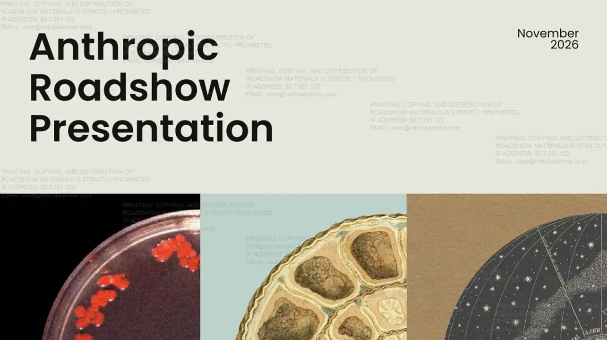

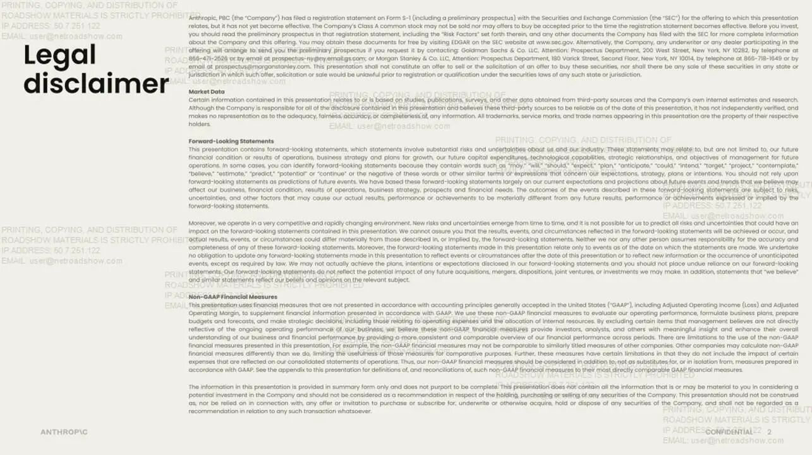

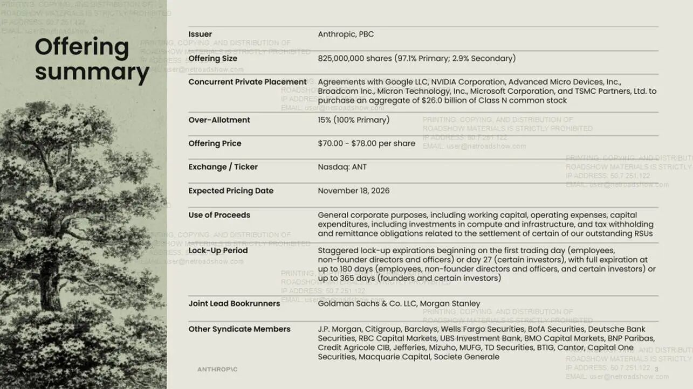

#### 一、开场（ 00:00:00 – 00:01:20 ）

Dario Amodei （ CEO ）：这将是人类历史上最有前景的技术。 AI 正在捕捉认知的本质。 2024 到 2025 年， AI 写代码变得可行。现在我们开始发现，在知识工作的其他领域，端到端完成任务的智能体也已经可行。再往近处看，我们开始看到，生物、数学、物理等领域的基础性发现正在变得可能。如果人类能用 AI 治愈癌症，心怀恶意的人也能用 AI 制造生物武器或发动网络攻击。不处理好这些风险，我们就不可能成功。我们下定决心要把这件事做对，因为这正是我、也是 Anthropic 许多同事投身这项技术的原因。

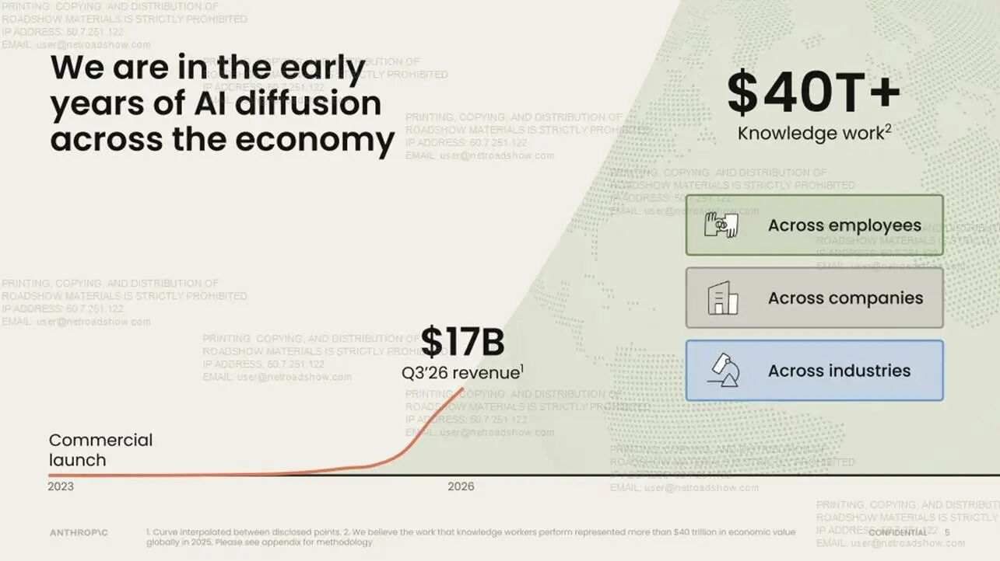

#### 二、我们的机会与核心优势（ 00:01:20 – 00:07:36 ）

Daniela Amodei （总裁）：智能如今已经是人类可以构建的东西，其影响极为深远。我们相信，它会让每个人的能力大幅提升，扩大全世界的认知劳动容量，改变每一个行业、每一门学科。这种巨大的经济影响，起点是前沿智能，也就是 Claude 能做什么。

2024 年， Claude 能回答问题、检索信息、总结文档。到 2025 年底， Claude 已经能做深度研究和多步骤项目，比如重构整个代码库，这类任务过去需要人花几个小时甚至几天。今天， Claude 能承接复杂、开放式的项目，这些项目过去需要很多人花几个月甚至几年做研究、分析和执行，而 Claude 几天就能完成。

在不远的将来，我们看到前沿 AI 有潜力推动人类一些最伟大的突破，并开辟全新的市场。我们迄今的成功来自五项核心优势：使命与专注、人才与文化、前沿研究与安全工作、我们的算力策略，以及我们的企业战略。

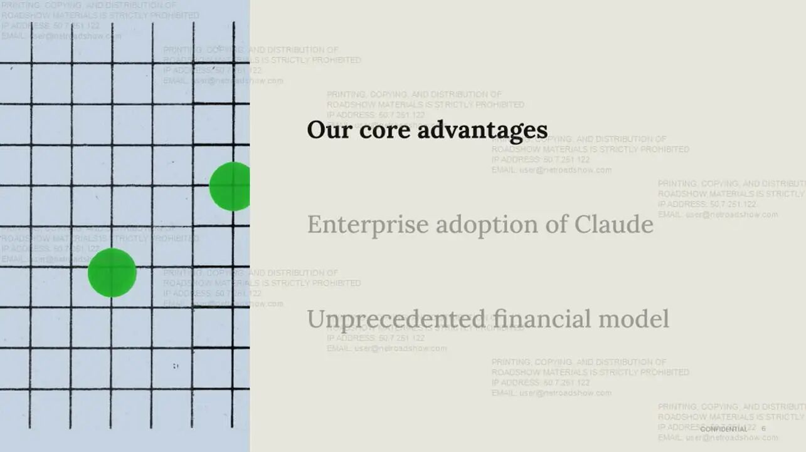

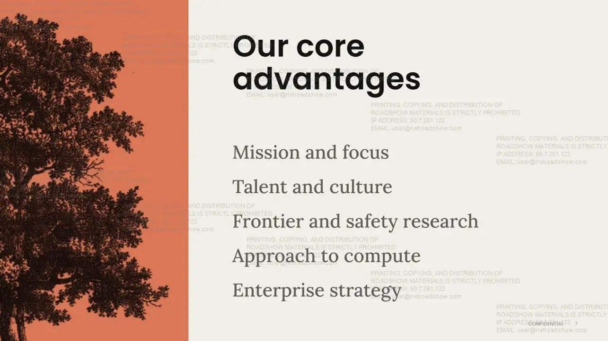

一切始于我们的使命：负责任地开发和维护先进 AI ，使其造福人类的长远利益。使命是一种组织力量，也是我们专注执行的关键。我们管理的是一组有限资源：算力、人才和研究产能。使命让团队清楚方向，把这些资源用到最有效的地方。

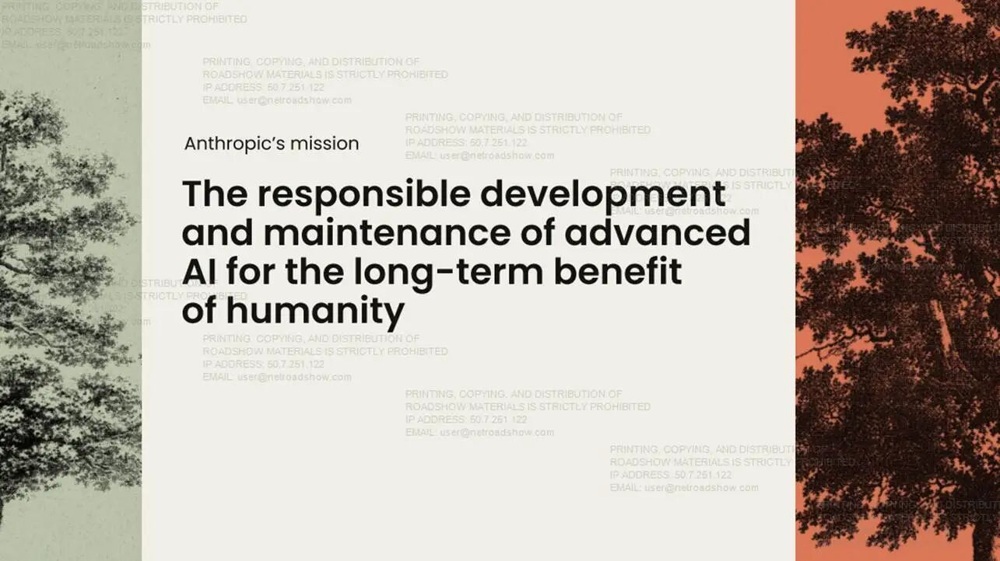

在需要艰难抉择的关键时刻，使命让我们的决策更加清晰。正是它让我们把 Mythos 这样的模型只部署给网络防御方，也让我们承诺 Claude 永远不放广告。

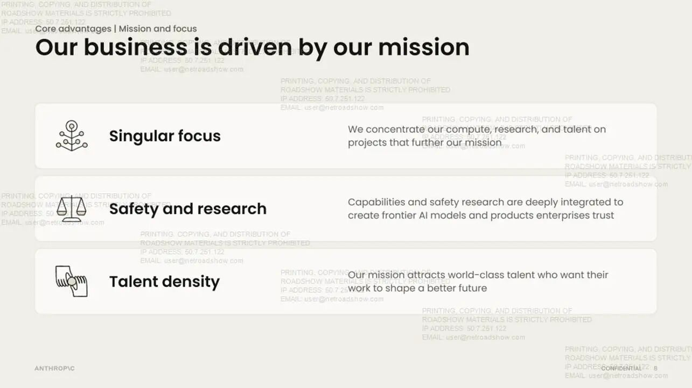

这种使命和专注持续吸引着业内最顶尖的人才，从创立之初就是如此。我们的七位联合创始人中，有人提出了如今构成整个 AI 行业基础的那些想法。这种顶尖人才的密度延伸到组织的每一层，我们在吸引和留住这一领域最聪明的人方面领先全行业。

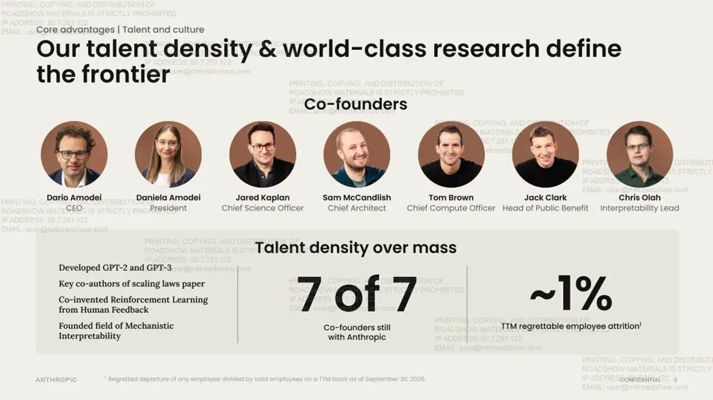

Anthropic 员工：我为什么在 Anthropic 工作？（多位员工依次发问）

Anthropic 员工：因为我是个乐观主义者。我希望我的家人、希望全人类拥有一个更安全、更美好的世界。

Anthropic 员工：三年前，我哥哥因脑瘤去世，那年他 42 岁，也就是我现在的年纪。我深信，通过我们的使命和这项技术，终有一天，像我哥哥这样的人不必再死去。总得有人扛起把这件事做对的重担，我不想站在场边旁观。

Anthropic 员工：这里的人会先问 " 这件事该不该做 " ，再问 " 我们能不能做到 " 。

Anthropic 员工：这是一种很少见的组合：一群人既深切在意让 AI 往好的方向发展，也同样在意能力、一致性、正直和质量。所以每个人都认同那些真正让组织高效运转的理念。

Anthropic 员工：这些好处和这些风险，这些光亮与阴影，恰恰是我选择来 Anthropic 工作的原因。

Daniela Amodei （总裁）：让模型安全可靠的工作，和让模型更有能力的工作，是同一件事。我们关心的是 " 有用的智能 " ：模型处理真实任务的效果如何，能给客户带来多少价值。我们执着于回答一个问题： Claude 能为我做哪些其他模型做不到的事？

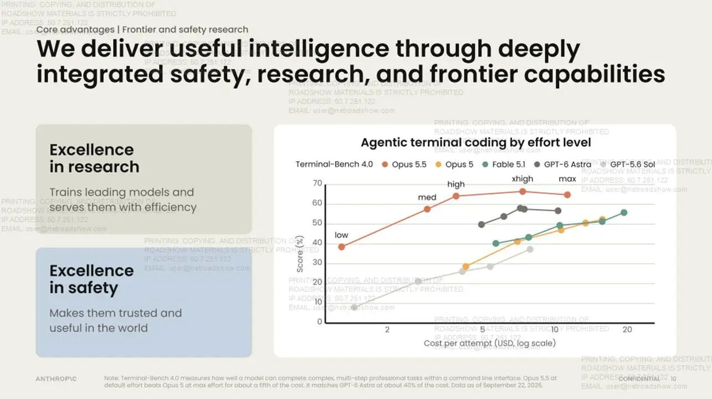

算力是支撑这项工作的关键基础设施。我们在这里建立了差异化优势，不只在于如何建设算力，更在于如何通过发现 " 算力乘数 " （ compute multipliers ）把这些算力用到极致。

我们是从第一天起就专注于服务企业的领先 AI 实验室。我们训练前沿模型去处理知识工作，因此客户能同时得到最好的能力和最好的性价比。正是这些客户推动了我们历史性的增长，他们遍布金融服务、科技、制药、医疗、政府、制造等行业。

这也是我们的公益使命和安全专注天然契合的地方。企业和我们一样在意前沿技术是否安全、可信、有用。前沿智能越强，我们对安全研究的专注就越重要。这对客户至关重要，也是实现 AI 全部潜力的必要条件。 Anthropic 全力以赴，要把这项工作做到最好。

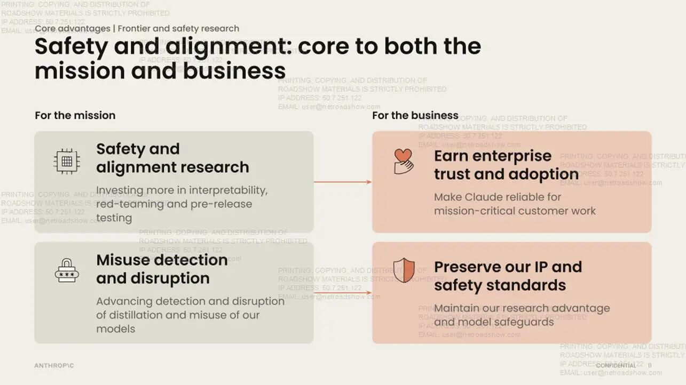

公益使命把我们带到了今天，也将继续塑造我们的工作，包括治理层面。除了管理层和董事会， Anthropic 还接受长期利益信托（ Long-Term Benefit Trust ， LTBT ）的指导。这是一个独立、与公司没有财务利益关系的机构，负责选任董事会多数席位。 LTBT 的职责是在公司成长过程中，帮助 Anthropic 规划并履行公益使命。

我们相信， AI 的未来应当由民主社会来塑造和主导。我们希望成为政府的好伙伴，帮助政府适应 AI 能力提升带来的变化。在高管层面，我们通过政策团队开展这项工作，也通过 Anthropic Institute 这样的机构分享研究，说明前沿 AI 如何改变我们的生活。

我们相信这将是现代以来人类经验最大的一次变革，而我们仍处在早期。这不只是巨大的经济潜力，更在于 AI 能以种种方式帮助人类繁荣：从治愈疾病、加速增长，到帮助人们过上更充实、更丰裕的生活。

#### 三、产品与平台（ 00:07:36 – 00:11:15 ）

Ami Vora （首席产品官）：Claude 模型家族的设计，是为了在你可能追求的各种目标上都提供价值，无论你优化的是成本、速度还是智能。在最高端， Mythos 和 Fable 推动前沿向前。我们看到客户用它来加固网络基础设施，或者做出新的科学发现。在另一端，我们有能力很强、性价比很高的模型，企业可以大规模依赖它们完成定义清晰的常规任务。

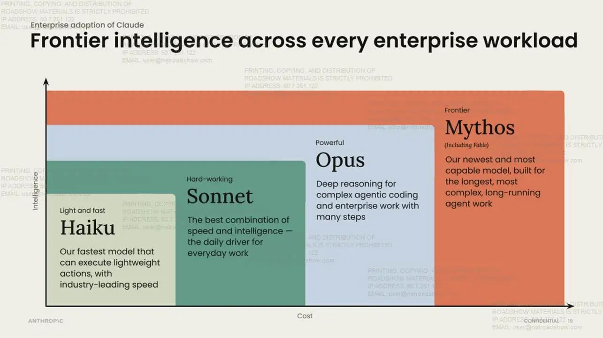

我们重点思考的一件事是，怎样让每个人都能从这一整套模型谱系中受益。因为即便模型能力呈指数级提升，大多数人用模型做的事情并没有变得那么快。

我们在构建产品时遵循三条原则。第一条是在客户所在的地方服务客户。使用 Claude 有几种方式：一是通过我们自己的应用，比如 Claude Code ，或者 Claude 桌面端和移动端应用； Claude 也可以在 Word 、 Excel 这样的企业应用里使用。我们深入各个垂直行业，试图弄清楚：这个领域的专家需要什么才能立刻上手见效？比如你是律师，我们有 Claude for Legal 套件，直接连接你需要的工具。每个领域我们都这样考虑，我们还有面向医疗、金融服务、生命科学等领域的套件。

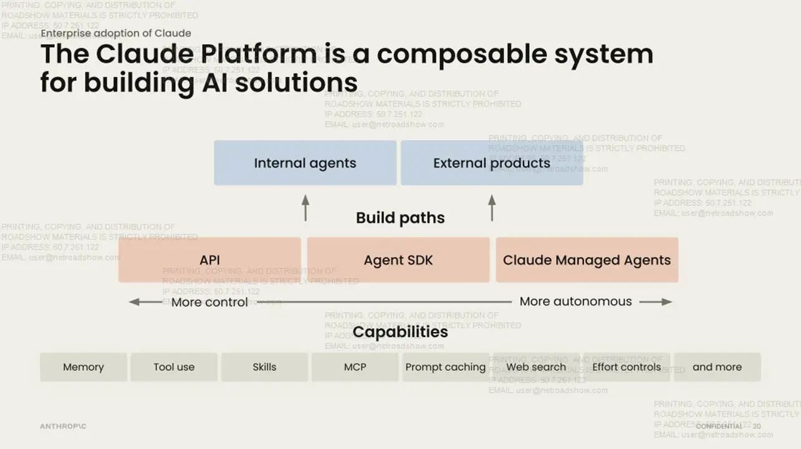

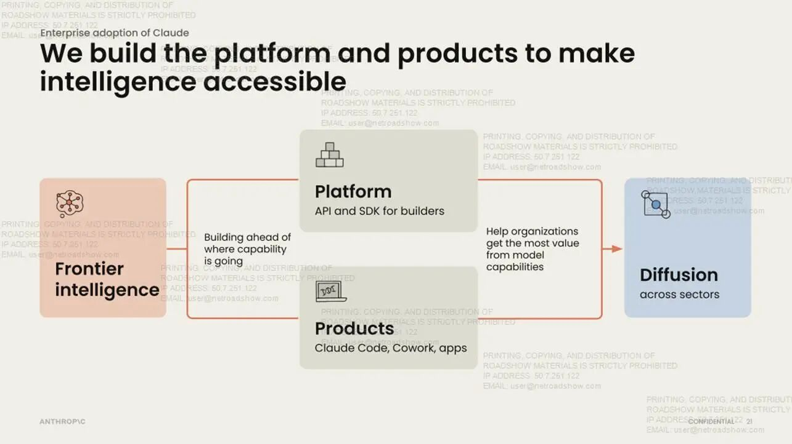

第二条原则是模型和产品并行构建。我们为明天的模型开发产品，而不只是为今天的模型。 Claude Code 很好地说明了这一点为什么重要。几年前，我们看到预发布模型理解代码的能力在变强，那时还做不到所有事，但趋势线已经很清楚。我们围绕这个判断做了产品，几个月后 Claude Code 就发布了。它让人们认识了一种全新的编程方式，也重新认识了 AI 能做什么。模型和产品之间的这个飞轮，是我们构建方式上的持久优势：模型变强，我们用这些进步开发新功能，再训练模型更好地完成人们想做的事，从而强化整个系统。我们在编程领域这样做，在编程之外也这样做。

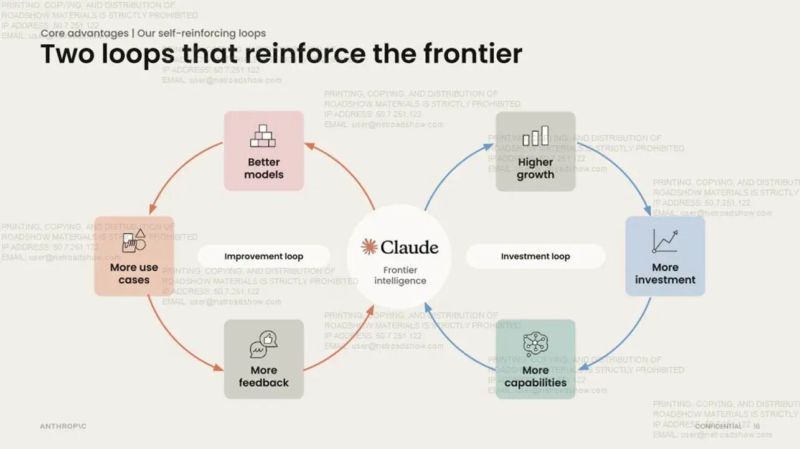

第三条原则是缩小前沿能力和客户日常使用之间的差距。大多数人仍然把 AI 工具当作搜索的替代品或简单的问答工具。它当然可以是这些，但这低估了人们用这种智能真正能做到的事。产品在这里成为有意义的竞争差异点。没有强大的产品，不断增长的智能和用户实际用法之间的差距只会越拉越大。我们认为，未来要让 Claude 用起来尽可能简单自然，让各地的人都可以像对待同事一样对待 Claude ，每次都得到高质量的产出。

我们认为，这三条原则就是把前沿智能带给每个人的方式。这就是我们说 " 给人们超能力 " 的含义。 Claude 先帮你把需要做的事做得更好更快；然后，它承接那些你因为太难而从来不会去尝试的事；到了未来，它意味着我们所有人都能做过去不可能做到的事，让我们都过上更好、更充实的生活。

#### 四、前沿与安全研究（ 00:11:15 – 00:13:19 ）

Jared Kaplan （首席科学官）：当我们发现 AI 的扩展定律（ scaling laws ）时，我们意识到 AI 能力可能提升得非常快。这就是我们创立 Anthropic 的原因：确保如果 AI 成为一项变革性技术，它是安全且有益的。我们的根本判断是， AI 会在这个十年取得巨大进展。正因为这些能力具有变革性，研究和安全必须同步推进，这是我们实现这项技术红利的唯一途径。

我们从三个维度评估模型：能力、效率和安全。我们优化模型，使其能够在数小时乃至数天的时间跨度里，准确地规划并完成复杂工作。 Opus 5.5 就是一个好例子：我们的一位用户在不到一天的时间里完成了 68 万行代码的迁移，而就在几年前，这需要一个工程团队花上几周。我们认为，在这种对准确性要求很高的长周期工作上，我们的模型是最好的。

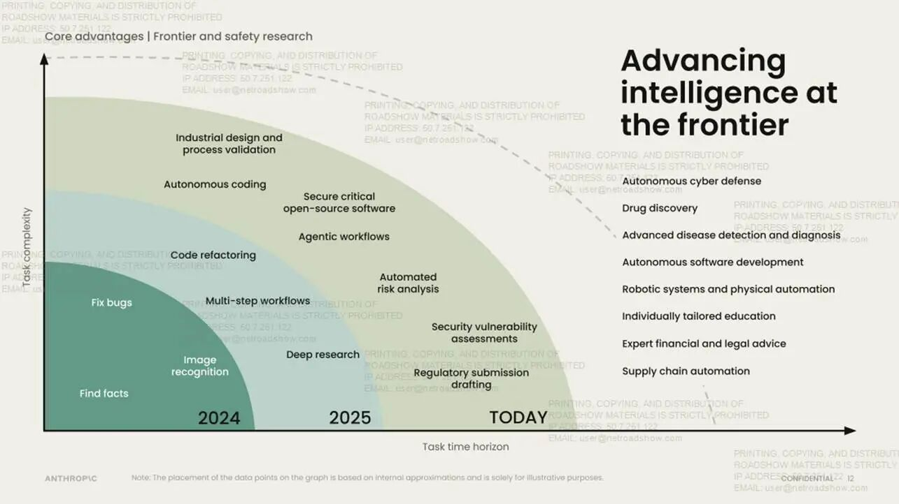

能力始于模型训练过程。在预训练阶段，模型从人类知识的全部积累中学习：文本、图像、科学论文、代码。模型在这一阶段理解人类的基本概念和思想。第二阶段是强化学习， Claude 在这里学会有帮助、诚实、无害，我们也在这里激发它在编程、知识工作和科学上的实用能力。随着模型从对话助手转向自主智能体，强化学习已经成为研究投入最大的领域之一，这一点对客户非常重要。

2021 年，我写过一份内部备忘录，提出我们最可能做出的产品也许是一个 " 对齐的 AI 程序员 " 。我也写了很多别的东西，但这一条后来被证明相当准确。 Claude 的训练过程是 Anthropic 使命不可分割的一部分。我们需要弄清楚如何训练前沿智能、如何让它安全，这就是我们交付 AI 红利的方式。

#### 五、百时美施贵宝与前沿研究的规模化（ 00:13:19 – 00:18:45 ）

Greg Meyers （ BMS ）：我们认为 AI 能帮我们把开展一项临床试验的时间缩短 20% 到 30% 。如果一款药能提前两三年上市，那些目前没有解决方案的患者就能更早得到治愈或治疗手段。所以我们认为这对患者是巨大的利好，对 BMS 也是巨大的利好。我们选择 Anthropic 有几个原因。其一是他们的企业级能力最成熟。拥有一个能用的聊天机器人是一回事，真正把它放进一个环境里，让它访问公司最机密的一些信息，同时能做可观测性、管理安全、精细控制给用户开放的权限，那完全是另一回事。这些就是 IT 部门非常看重的企业级管控。我们把它推广到了全部 3 万名员工，这是我们历来推广过的 AI 工具中最快、采用度最好的一个。现在你可以提一个非常复杂的问题，它会自己去判断该查询哪个或哪些数据库，因为它能跨库查询，然后生成一份已经内嵌流行病学背景的报告。过去回答一个简单问题通常要一到两个月，现在四五分钟就能拿到。我们终于走到了这样一个阶段：借助高通量计算，也借助大语言模型，可以把计算和分析的规模扩大到与生物学的复杂程度相匹配。这有助于为诊疗标准提供依据，并推动它改变。

Sam McCandlish （首席架构师）：想一想前沿 AI 实验室需要高效使用算力的种种理由。研究和模型训练的每个阶段都要用算力；我们给客户提供模型服务要用算力；我们在内部大规模使用 Claude 也要用算力。通过训练我们认为最高效的模型，我们可以用同样的算力把这些事都做得更多。这也是我们降低成本的方式，既降低客户的成本，也降低我们自身的底层成本。我们正在通过研究流程加速这些效率提升。我们的发现速度在加快，其中很大一部分加速来自 Claude 本身。

部署前沿模型时，安全至关重要。正是这个理念把几位联合创始人聚到了一起，它从一开始就是 Anthropic 的基础。卓越的安全能力，是管理组织风险和系统性风险的方式，是在编程、医疗等领域安全释放前沿能力的方式，也是客户所看重的。它给了客户把 AI 用在重要工作上所需的信任。我们在每个阶段都内建安全：通过对齐训练，让模型遵循用户意图、避免有害行为；同时设置合适的防护措施，防止滥用。我们还开创了可解释性等研究领域，让我们能洞察模型 " 大脑 " 内部在发生什么。

在 Anthropic 内部，我们越来越多地把前沿模型反过来用于改进自己的流程，我们称之为 " 闭环 " ，它推动着我们全部三个研究重点。 Claude 越来越成为我们平等的合作伙伴。 Claude 越强，对我们所有工作的帮助就越大：它提升我们的安全，让训练和推理更高效，推动安全研究，帮我们更快尝试更多研究想法，让整个组织更有效率。我们最重要的工作还在前面。只要研究和安全齐头并进，我们相信就能帮助带来人类历史上一些最重大的突破。

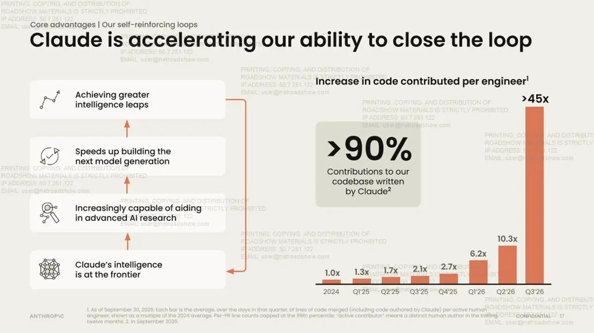

旁白：取一个数，把它翻倍；再翻倍；再翻倍。这条曲线就是 Anthropic 所做一切的核心。我们很早就注意到，模型性能似乎会随着算力非常平滑地提升。我们的赌注是：互联网上有海量文本，如果模型规模的限制就此消失，会怎样？于是在 2022 或 2023 年，我们有了聊天机器人。你可以让它讲讲武士的历史，它会交回一篇小短文。 2024 年，写代码变得可行，但 Claude 在难题上仍然吃力。 2025 年，模型开始能做一些令人惊讶的事。编程能力大幅提升。 Claude 甚至能玩电子游戏，虽然玩得很烂。同一年，它在 OpenBSD 里找到了一个 27 年无人察觉的漏洞。突然之间，它能完成多步骤流程，能做知识工作了。它为一家量子计算公司搭建了激光锁定控制器，这项任务过去需要一组博士花一周，而它在一夜之间、无需人工干预就完成了。我们开始看到 Claude 在数学上做出基础性发现，在生命科学前沿开展工作。这种加速可能让人眩晕。但我们仍然感觉自己才刚刚出发。那条指数曲线还在前方向上延伸，一切才刚刚开始。

#### 六、算力策略（ 00:18:45 – 00:22:23 ）

Tom Brown （首席算力官）：实现 Anthropic 的使命需要始终站在前沿，而站在前沿取决于算力。我们在这方面的做法，可以追溯到我和其他几位联合创始人关于扩展定律的研究。我们发现，只要配方正确，更多算力就会可靠、可预测地带来更高的智能。后来我们又发现，这个配方可以随时间不断改进，用同样多的物理算力获得更高的智能。

所以到 2021 年创立 Anthropic 时，我们已经明白两件事：第一，算力是这门生意的基础；第二，把每一单位算力的价值榨干，是做出越来越智能的模型的关键。这就是我们如此专注效率的原因，也是我们相信同样一美元算力，在 Anthropic 能比在任何其他前沿实验室发挥更大作用的原因。

我们通过两种方式获得这一优势。先说第一种：我们自有的芯片导入和部署方法。我们现在在全部四大芯片体系上训练和服务 Claude 。之所以能做到，是因为我们很早就在多芯片策略上下了一个非常规的赌注。当时很多人认为，让 AI 模型跑在不同芯片上不值得。每种芯片都需要专门的软件栈和推理栈，开发既昂贵又困难。我们已经这样做了很多年，现在做得非常好。

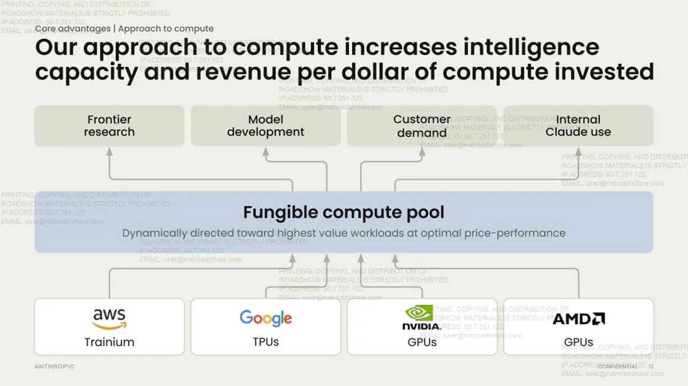

这带来两个关键优势。在算力供给受限的市场中，多芯片策略让我们可以不论供应商是谁，只看最佳性价比。我们可以让每种芯片做它最擅长的工作，有的更适合训练，有的更适合推理。多芯片策略意味着，我们可以把跨供应商、跨架构、跨地点的所有芯片当作一个可互换调度的统一算力池。

这也让我们非常擅长导入新芯片。举个例子，今年我们第一次开始使用 AMD GPU 。过去，导入一个新芯片平台需要几十名工程师花几个月。这一次，我们让 Mythos 来试。它只用三天就让 Claude 跑在了 AMD 上，基本没有人工干预。 Claude 移植或编写了几乎 100% 的内核（ kernels ）。

在承载芯片的数据中心上，我们也有独特的做法。过去我们以云服务的形式购买算力。现在我们增加了第二种方式：租赁芯片，放在为我们专门设计建造的数据中心里运行，我们称之为 Anthropic Direct 。这种方式有几个好处：有助于降低算力的总拥有成本，还能把对数据中心的承诺和对芯片的承诺分开。

我们算力优势的第二个来源，是发现算力乘数的速度。我们关注的是 " 总有效算力 " ，也就是物理算力乘以我们所发现的算力乘数。每发现一个乘数，总有效算力池就变得更大。举例来说，假设训练一个具有某种智能水平的模型需要 100 单位算力，一个 4 倍的算力乘数意味着你只用 25 单位算力就能训练出完全相同的模型；或者，你可以用这 100 单位物理算力，训练一个过去需要 400 单位才能训练出来的更智能的模型。

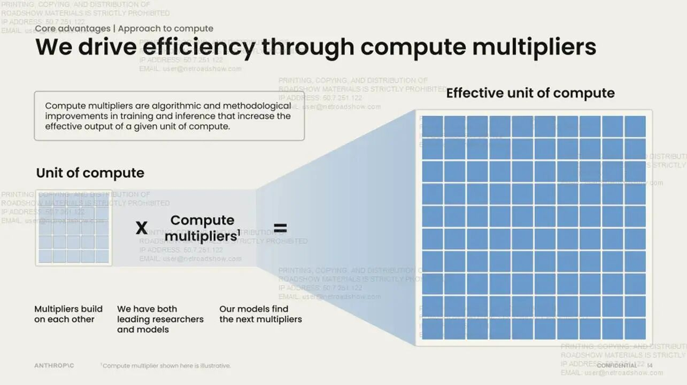

算力乘数为我们创造了难以复制的竞争优势。它们相互叠加，每个新发现的乘数都会对之前的乘数产生正向作用，层层累积。我们相信，随着我们接近递归式自我改进，这种效应还会进一步加速。 Claude 将能够完全独立地发现算力乘数，让乘数的数量增长得越来越快。我们相信，明智的投资、突破性的研究加上 Claude 不断提升的能力，已经让 Anthropic 在前沿实验室中处于领先地位。

#### 七、埃森哲（ 00:22:23 – 00:23:37 ）

Julie Sweet （埃森哲）：AI 是一项突破性创新，但只有彻底重塑业务，才能拿到 AI 所承诺的价值。在埃森哲，我们的工作是在技术和客户的实际成果之间架起桥梁。我很喜欢别人问我们是不是在用 Claude ，因为我们有数万名工程师每天都在用它。我们在整个软件开发生命周期中使用它，它释放了时间，让我们更快，也让工程师能把更多时间花在解决客户难题、主导决策和制定战略上。我们为数千家客户抵御网络攻击，并把 Claude Code 和 Claude 的智能体开发工具包（ Agent SDK ）与我们用于保护客户的前沿平台 Cyber.ai 结合起来。仅举一个成果：过去需要几天的扫描，现在一小时内就能完成。我们专注于客户的成功与安全，我们的想法是，通过这次合作，客户能更快地实现价值。

#### 八、企业战略（ 00:23:37 – 00:25:09 ）

Paul Smith （首席商务官）：我们早期的判断是，智能是企业能从 AI 中获得的最高价值资产。我们相信前沿智能能解决最棘手的问题，因此带来的影响也最大。 AI 能力不是渐进式提升的。模型一旦越过某个门槛，就会出现阶跃式变化，一整类工作的做法随之改变。

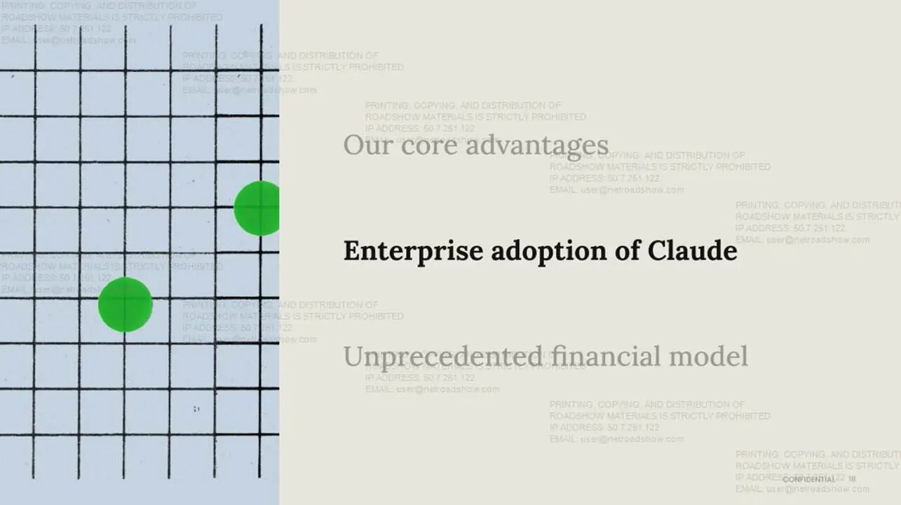

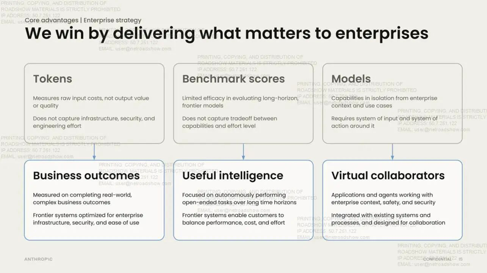

编程是我们最熟悉的例子，变化的速度惊人。仅仅一年时间，我们就从自动补全几行代码，走到了成队的智能体全天候工作。对乐天（ Rakuten ）这样的公司来说，这意味着它们推出新功能的速度比竞争对手快四到五倍。

编程之后是网络安全。借助 Mythos 和 Project Glasswing ， Claude 帮助网络防御方以社会级规模识别和修补漏洞。以 Mozilla 为例，过去他们每个版本修复 20 多个安全缺陷；用了 Mythos Preview 后，他们发现并修复了 271 个。

知识工作正处在类似的曲线上。科学研究、投资分析、核保承保，都是我们在各行业看到的很好的例子。 Claude 帮助 AIG 这样的保险公司把报价时间缩短了 55% 。在每个领域，我们都看到先是改进，然后是阶跃变化，接着一整类工作快速转变。

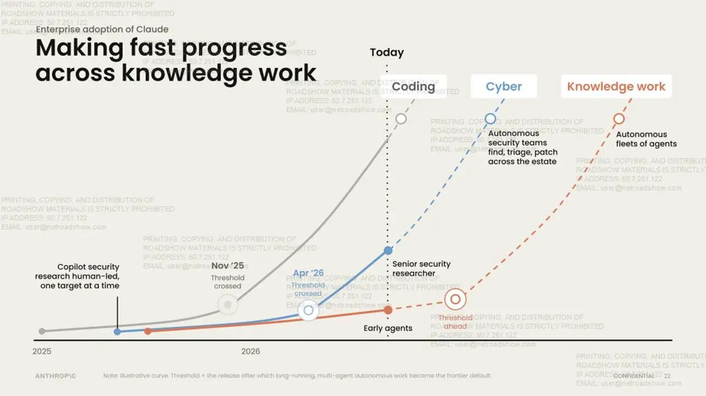

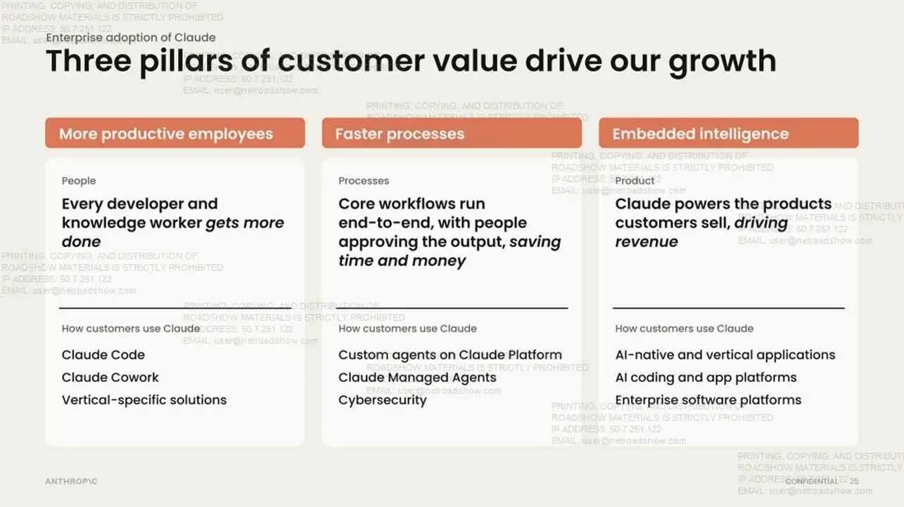

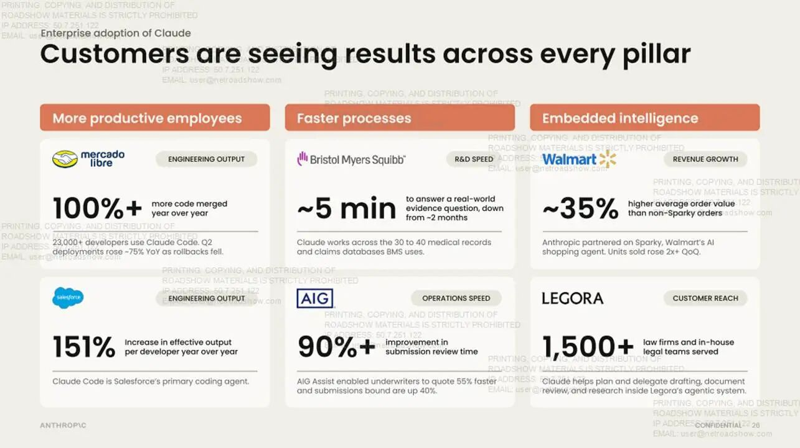

#### 九、 AIG 与前沿智能的现实影响（ 00:25:09 – 00:30:09 ）

Eric Andersen （ AIG 总裁兼 CEO ）：很难想象 Anthropic 和 Claude 嵌入 AIG 内部的速度有多快。它帮我们培养了更好的核保人员。我们能更频繁地发挥他们的专业能力，因为我们能把投保申请信息提取出来，整理成他们可以直接核保的格式。他们做决策的速度明显提升，这意味着我们能以更一致的方式处理更多投保申请。对客户来说，我们的响应也更快了。

Eric Andersen （ AIG 总裁兼 CEO ）：我认为 Anthropic 和 Claude 的价值主张，与我们在安全、韧性和技术能力方面努力提供的价值非常相似。我们和监管机构就我们如何使用 AI 保持着相当密切的沟通。人的因素和人工监督对我们、对监管机构显然都非常重要，并且已经嵌入流程之中。

Paul Smith （首席商务官）：Anthropic 所做的一切，从研究到产品再到市场推广，最终都汇聚到我们如何服务客户上。今天，我们与《财富》 500 强企业有深度合作，覆盖全部《财富》 10 强。超过 50% 的《财富》 500 强在我们这里的支出超过 10 万美元，全球 2000 强中这一比例也超过 30% 。对所有这些客户，我们相信我们仍处在一场持续数十年的变革早期。平均而言，这些《财富》 500 强客户的 AI 支出不到其总费用的 0.1% ；即便是前 10 大客户，也仍不到其总费用的 1% 。

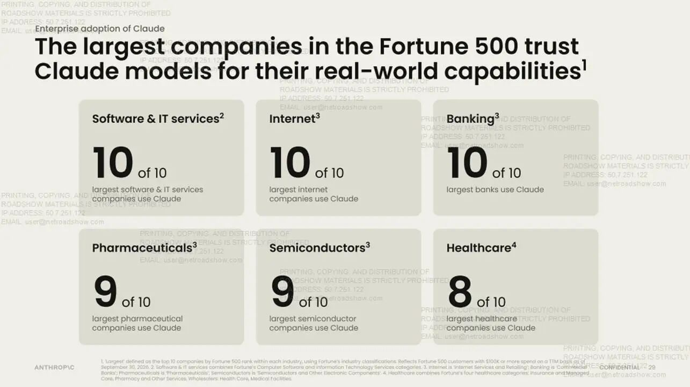

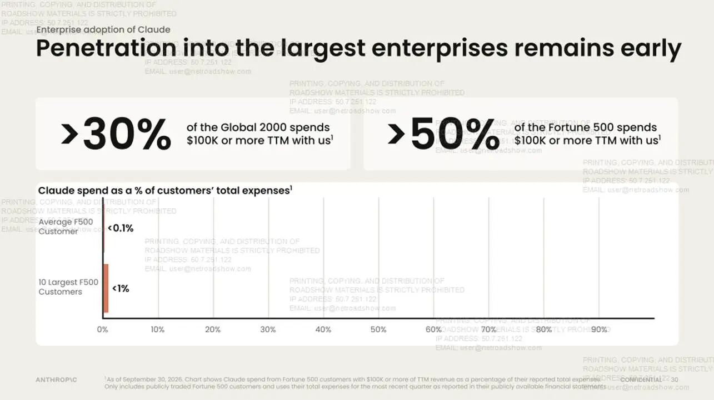

我们放大看一个典型客户的旅程。它从一个单一用例开始，通常是开发者和工程师使用 Claude Code ，很快扩展到相邻岗位。知识工作者开始把 Claude 用在价值最高的工作上，接着团队自动化更多业务流程、把 AI 建进核心基础设施，最终把 Claude 嵌入全新的产品和服务。这个过程发生得很快，所以我们看到了约 900% 这一前所未有的净收入留存率。让我兴奋的是，最有意思、最具变革性的用例还在后面。我们在编程和网络安全领域看到的一切，现在开始出现在几乎每一个职能、每一家公司、每一个行业。他们希望与 Anthropic 合作，是因为相信我们会帮他们率先看到未来，让他们始终站在前沿，帮助他们完成转型、赢得竞争。

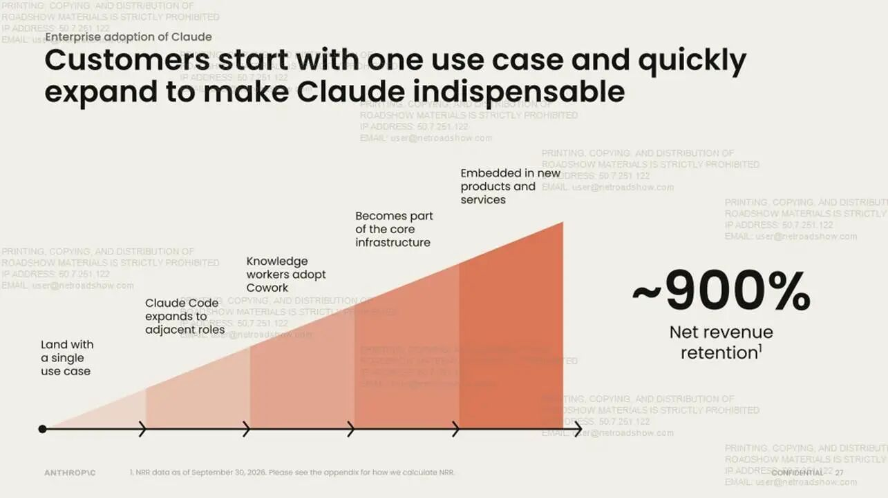

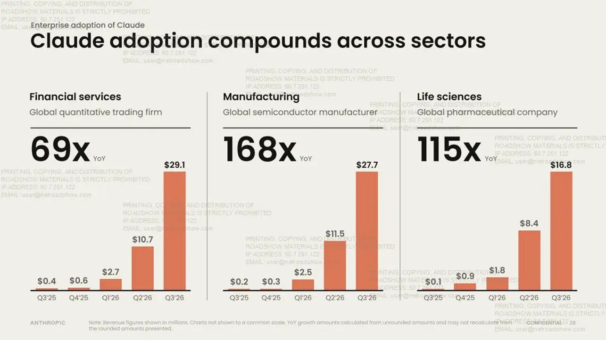

旁白：当 Claude 带来的发现进入我们的世界，甚至走出这个世界时，激动人心的事情就会发生。 2025 年 12 月， Claude 帮助规划了 " 毅力号 " 火星车在火星上的行驶路线。它用火星车自己的标记语言编写了代码，工程师在指令发出前逐一检查。行驶 400 米，任务完成。

旁白：2026 年夏天， Claude 处理海量数据的能力再次显现。大约 950 个 Claude 智能体用 21 个小时筛查了 19 亿个蛋白质簇。其中一个发现了一个不寻常的模式：一个带有类 CRISPR 重复阵列的系统。我们的科学家在实验室里验证了 Claude 的发现。这个新阵列此前从未被发表过，是一项真正的发现。

旁白：在资源匮乏的地方，快速理解新信息的能力尤其重要。 2026 年 9 月，应对刚果东部埃博拉疫情的团队，能在一小时内处理完各地区的每日报告，从而更清楚地掌握疫情全貌，也腾出了更多时间照护病人。

旁白：影响现实世界的能力，让安全变得更加重要。这就是为什么 Claude 完整的生物学能力只开放给经过我们验证的机构，为什么 Claude 有一部 " 宪法 " ，让它在从未遇到过的情境中也能做出判断，也是为什么我们在可解释性和对齐上投入如此多的精力，让 Claude 在人们依赖它的情境中始终可以被问责。我们一次又一次发现，安全并没有拖我们的后腿。恰恰相反，正因为我们能信任 Claude 的工作，才能把它的发现应用到现实世界中，让所有人受益。

#### 十、财务模型（ 00:30:09 – 00:40:36 ）

Krishna Rao （首席财务官）：我们相信， AI 对全球经济的改造是历史上最大的经济机遇，而 Anthropic 处于把握这一机遇的独特位置。我们在 AI 前沿占据领先地位，我们预计价值将差异化地向前沿集中。我们商业模式的韧性，使我们能够持续投入以推进前沿，同时为客户提供更多价值、为股东创造优异回报。最清楚的证明就是我们的财务表现。第三季度，我们实现了近 170 亿美元收入，同比增长 12 倍。年初至今，我们的算力利润率为 43% ，毛利率为 85% ，经调整营业利润率为 12% ，并实现正自由现金流。这些业绩来自我们的前沿领先地位，也给了我们大力投入、继续扩大领先优势的能力。因此，尽管我们的盈利能力很强，我们仍处在积极投入期，专注于把这门生意做深做长远。

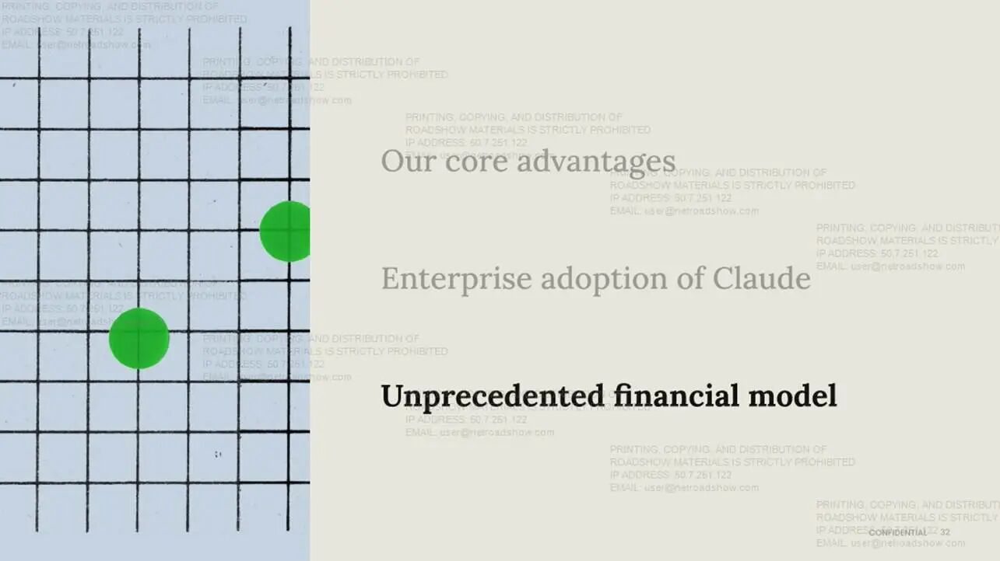

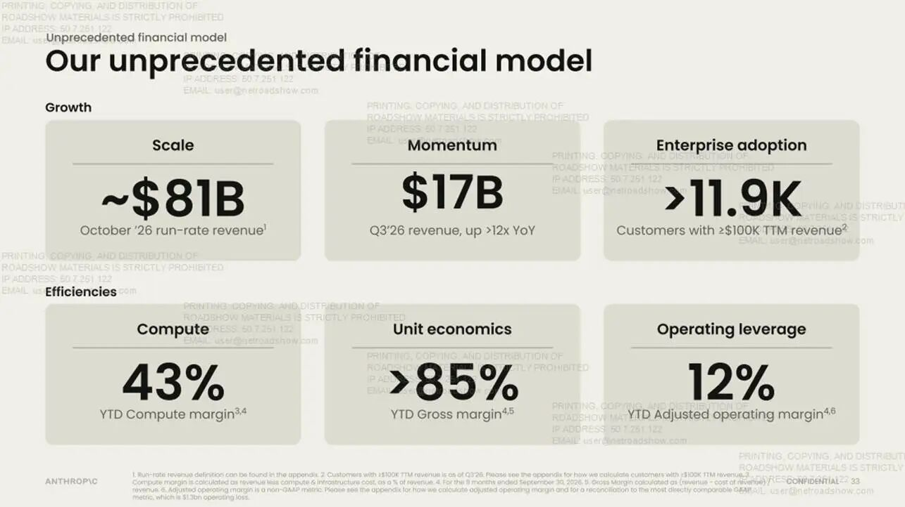

Anthropic 的商业模式有五个差异化要素。第一，我们构建能够提供最有用智能的模型。随着我们不断推进前沿，客户为 Claude 找到了更有价值的工作，收入增长随之而来。我们称之为 " 模型驱动型增长 " 。我们业务的发展轨迹证明了这一点：季度收入从 2025 年一季度的 3.76 亿美元增长到 2026 年三季度的近 170 亿美元，背后正是我们的模型在编程、智能体工作流和真实任务上的能力大幅提升。站在前沿能够解锁新的用例和能力，也让我们在大多数客户工作负载上走向帕累托最优，使我们能在给定成本下提供能力最强的模型。这是因为更聪明的模型效率更高，它们可以在更低的思考强度（ effort levels ）下完成任务，从而消耗更少的 token 。我们还会把前沿智能从大模型层层传导到小模型中，从而覆盖成本、能力和速度的完整谱系。每一代模型都把这一点往前推进一步。我们近期发布的 Claude 5 系列模型，相比几个月前发布的 Claude 4 系列能力大幅跃升，而按单次任务成本计算却便宜得多。这就是在前沿构建的力量。我们相信我们以最低的成本提供了最高价值的智能，这意味着我们能够高效地服务整个市场。

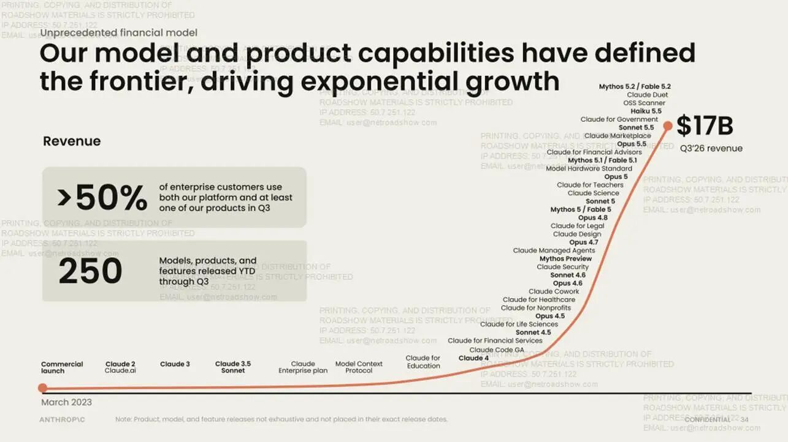

尽管我们在大多数基准测试中领先，衡量我们成功的真正标准仍然是客户。这就引出了我们的第二个差异化要素：我们构建领先的平台和产品，让客户能够用上前沿智能。平台解决方案是我们业务的基础，客户在我们的 API 和 SDK 之上构建产品、重塑流程的空间非常大。与此同时，我们自己的产品也成为推动普及的关键引擎。举例来说， Claude Code 本质上是对模型指数级进步的一次下注。把它交到客户手中，使我们在智能体编程能力急剧提升时得以及时把握红利。我们在 Claude Cowork 上沿用了同样的打法，它在研究预览发布后的同期采用速度已经超过了去年的 Claude Code 。产品与平台结合，使我们能够全面满足客户需求。今天，大多数企业客户同时使用我们的平台和至少一款产品，而这一比例在 2025 年四季度还只有 30% 。随着我们在内部扩大 Claude 的使用，产品迭代速度也在加快。每名工程师日均贡献代码量较 2024 年均值提升了 45 倍，这直接体现在产品发布上： 2026 年前 9 个月，我们发布了 250 个模型、产品和功能。 Claude 加速的不只是工程团队； 2026 年 1 月至 9 月间，全公司员工对 Claude 的使用量增长了超过 250 倍。这些因素共同解释了为什么我们的人均创收增长超过 4.5 倍，从 2025 年三季度的 140 万美元提升至 2026 年三季度的超过 660 万美元。

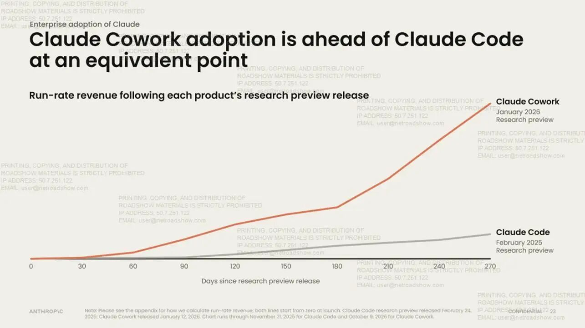

Anthropic 的第三个差异化要素，是我们对算力的使用极其高效。我们把算力当作一个可互换调度的统一算力池，同时用于服务客户、训练模型以及支撑我们内部使用 Claude 。我们专注于榨干每一单位算力的价值，这为我们带来了服务成本优势和再投资优势。正如 Tom 所说，这种效率来自两个驱动力：一是多芯片策略，使我们能够采购性价比最高的芯片，并把它们当作单一算力池运行；二是持续复利累积的算力乘数，使我们的总有效算力增长远快于物理产能增长。这在财务结果中一目了然：过去 6 个季度，我们的收入增长了超过 45 倍，而算力与基础设施成本仅增长 10 倍，每美元算力创造的收入提升了 4 倍以上。年初至今，我们的毛利率已提升至 85% 以上，而去年同期为 29% 。我们把这些效率收益看作可以主动配置的资本：有时我们通过降价把它让渡给客户，推动 Claude 在客户内部普及；有时我们留存这部分利润，再投资于更多算力，从而让这一优势不断复利累积。

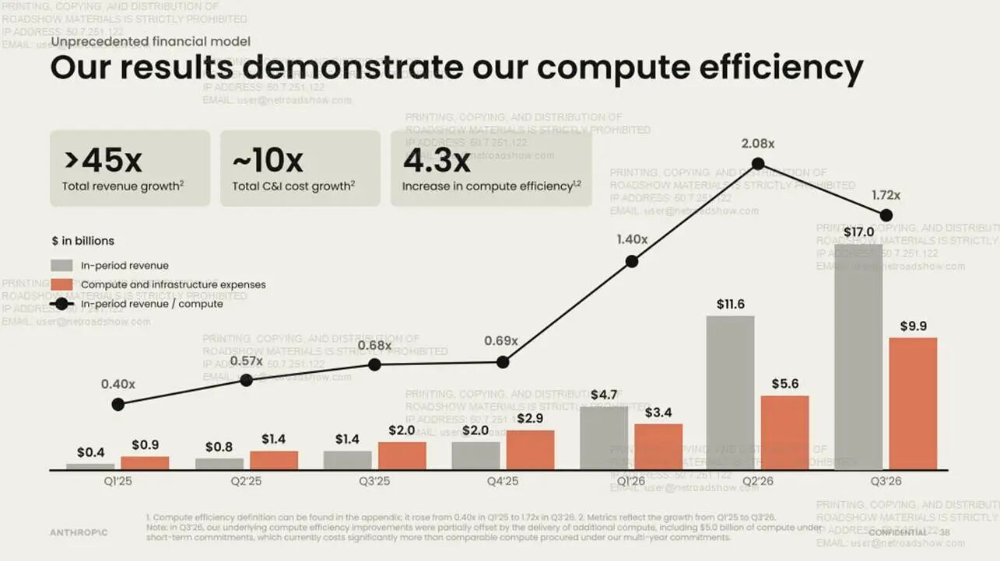

第四个差异化要素，是我们对服务企业的持续专注。我们很早就判断，企业将成为 AI 最大也最好的客户群体。自 2023 年一季度商业化发布以来，我们一直专注于服务这一市场，并看到了快速的采用。截至 2026 年三季度，我们拥有超过 11,900 家企业客户，较年初增长近 8 倍。

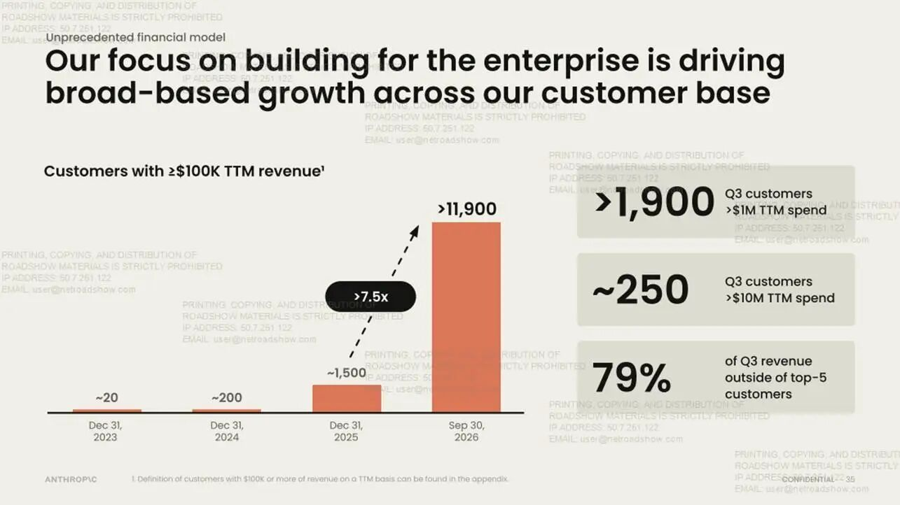

作为第一家同时入驻三大云厂商的前沿实验室，我们让企业能够在自己原有的环境中部署 Claude ，同时我们与终端客户保持直接关系，包括对定价的掌控。我们认为，这些合作使我们的市场推广效率远高于行业其他公司。事实上，我们全部的非算力费用（包括销售与营销、人员以及行政和其他营业费用）占收入的比例，比企业软件公司中位数仅在销售与营销一项上的占比还要低。我们预计将在市场推广上做有分量的投入以支持增长，同时在获客和与客户共同成长的方式上保持高效率。

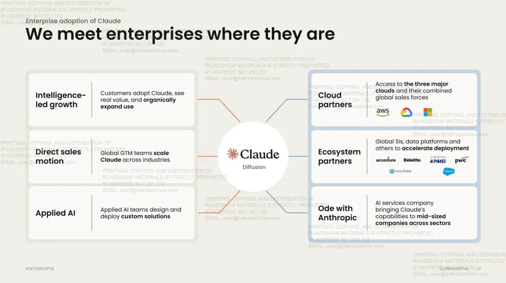

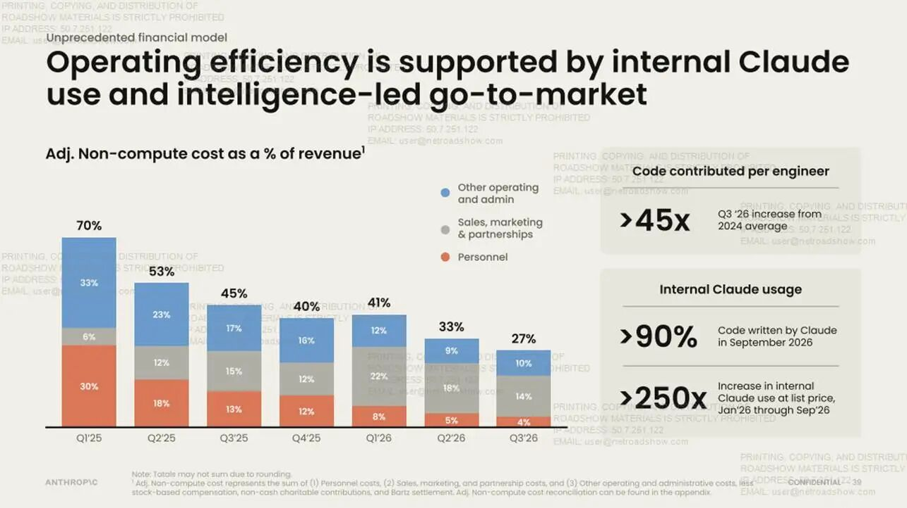

最后一个差异化要素，是我们不断扩大的市场空间。我们相信，每个行业的每一家公司都将被强大的 AI 改造。这一进程从编程开始，正在向知识工作扩散 —— 那是一个高达 40 万亿美元、我们才刚开始渗透的市场。我们的客户涵盖了全球许多规模最大、业务最复杂的企业，包括超过 50% 的《财富》 500 强和超过 30% 的全球 2000 强。正如 Paul 所说，我们的《财富》 500 强客户在 Claude 上的支出还不到其总费用的 0.1% 。

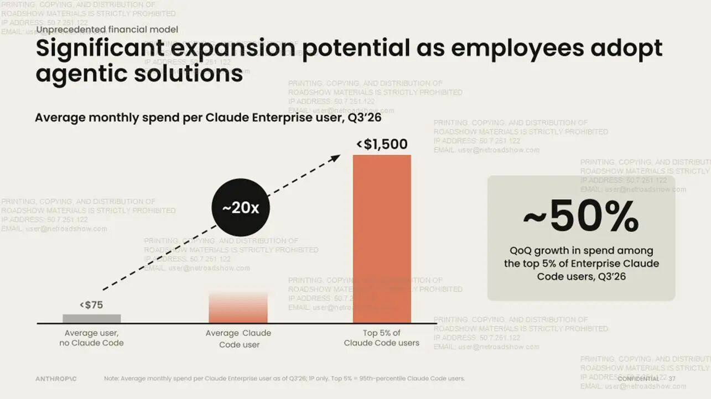

随着 AI 前沿不断推进，我们预计它将开辟全新的业务线。这已经在网络安全领域开始发生，我们预计未来几年还将延伸到生命科学和机器人领域。

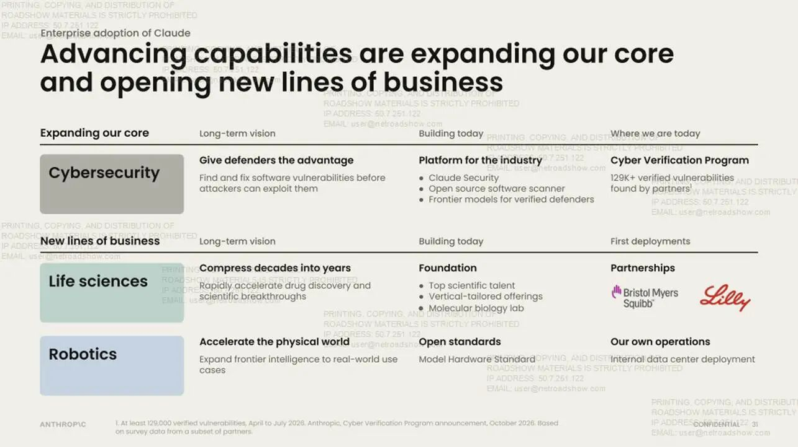

鉴于我们看到的机会规模以及业务的强劲表现，我们正在三个方向上大举投资：算力、客户价值，以及安全与对齐。

算力是我们增长的关键支撑。它支持我们的研发，也使我们能够满足不断扩大的客户需求。鉴于我们看到的可观回报，我们计划在未来几年对算力进行重大投资，既包括短期和多年期云合作协议，也包括我们直接租赁的数据中心和芯片。后面这一部分我们称为 Anthropic Direct ，我们预计未来几年它在算力底座中的占比将不断提升。

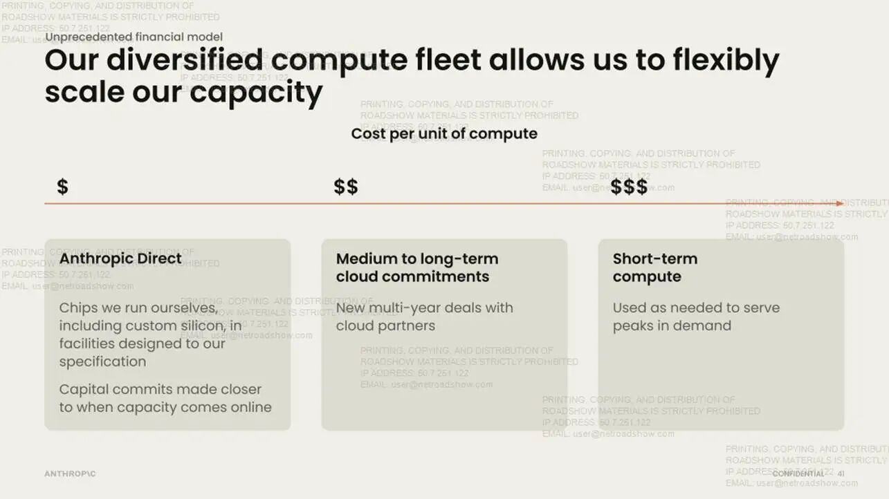

第二个投资方向是客户价值。我们极度专注于确保客户在 Claude 上的支出获得最强回报，途径是开发能力最强、对齐最好、最实用的模型，并在模型效率提升时降低客户成本。例如，今年 9 月发布的 Opus 5.5 模型在能力大幅提升的同时，把客户成本降低了 40% 。这次降价对我们的利润率是中性的，因为 Opus 5.5 的服务成本本身低得多。虽然降低客户成本会牺牲一些近期收入，但按我们的经验，更低的智能成本会推动更广泛的使用和普及，很快就会转化为收入顺风。

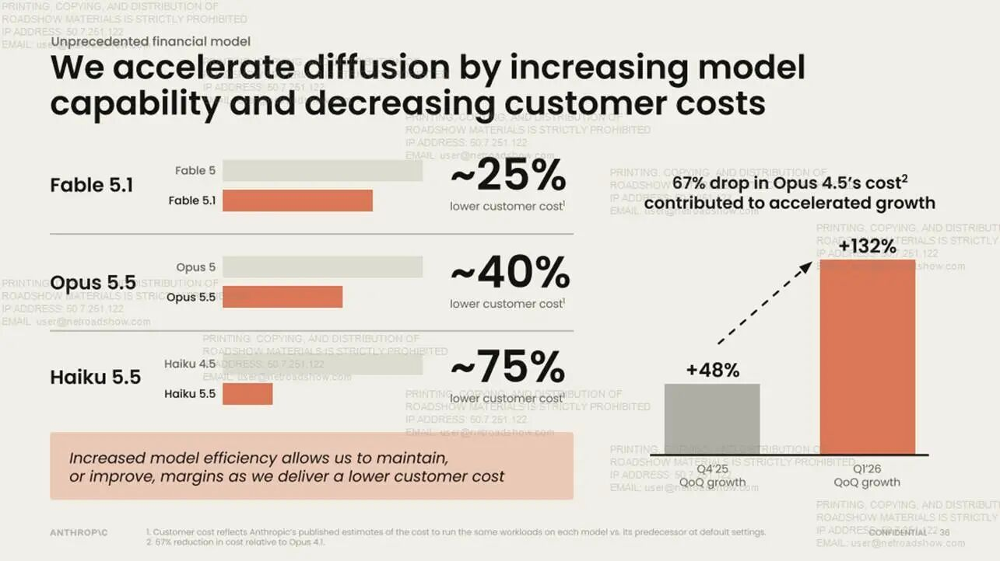

第三个投资方向是安全与对齐。安全是 Anthropic 运营方式的核心，公司创立以来我们一直在这一领域投入。随着模型能力快速提升，我们在人员、流程和算力上投入更多资源来支持安全与对齐工作。综合来看，我们预计对安全的专注将持续构成商业优势，因为客户和开发者需要他们能够信任的模型和产品。

我们在算力、客户价值以及安全与对齐上的投入，将强化我们的业务并拓宽我们的机会。

长期来看，我们相信 Anthropic 能够实现 35% 以上的经调整营业利润率。随着效率持续提升、 Anthropic Direct 算力占比提高，以及更多算力转向推理，我们看到算力与基础设施费用占收入比例有望趋向约 45% 至 50% ；第二，随着规模扩大、渠道分成占收入比重下降，销售、营销与合作伙伴费用占收入比例预计趋向 7% 至 10% ；第三，随着 Claude 提升团队生产力、人员规模高效增长，人员及其他营业费用合计占收入比例预计趋向 7% 至 10% 。

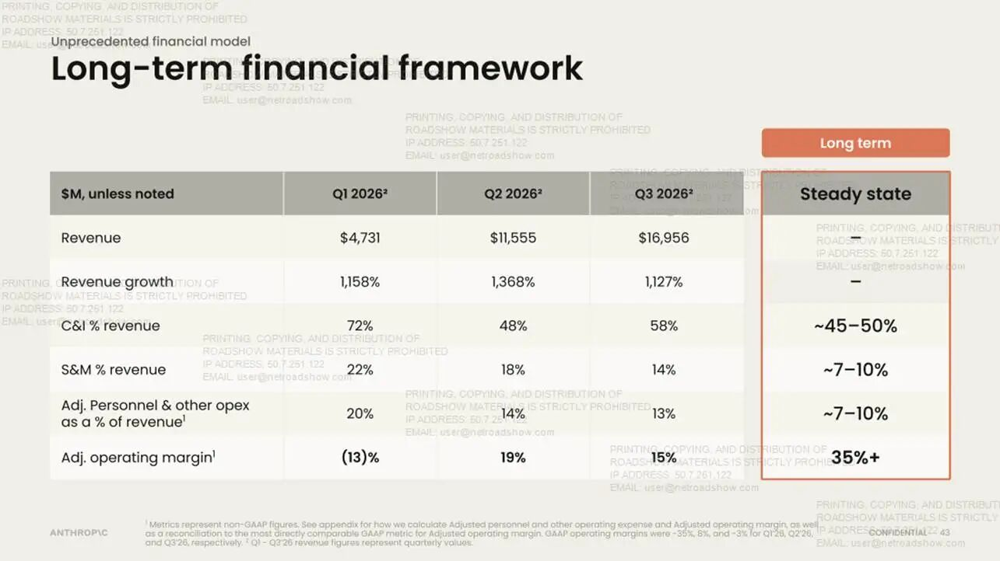

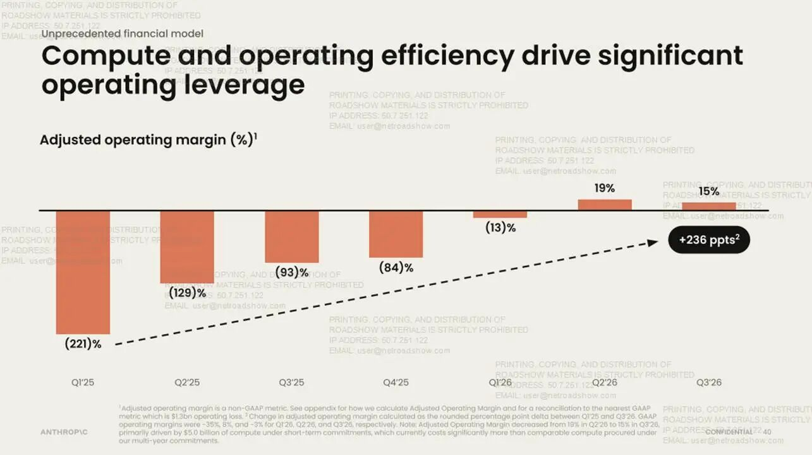

我们相信，我们拥有最好的财务模型、领先的算力效率、最高的人才密度，以及让我们始终聚焦于为企业创造最大价值的文化。 AI 对全球经济的改造有潜力成为历史上最大的经济机遇，而今天我们才刚刚站在山脚下。

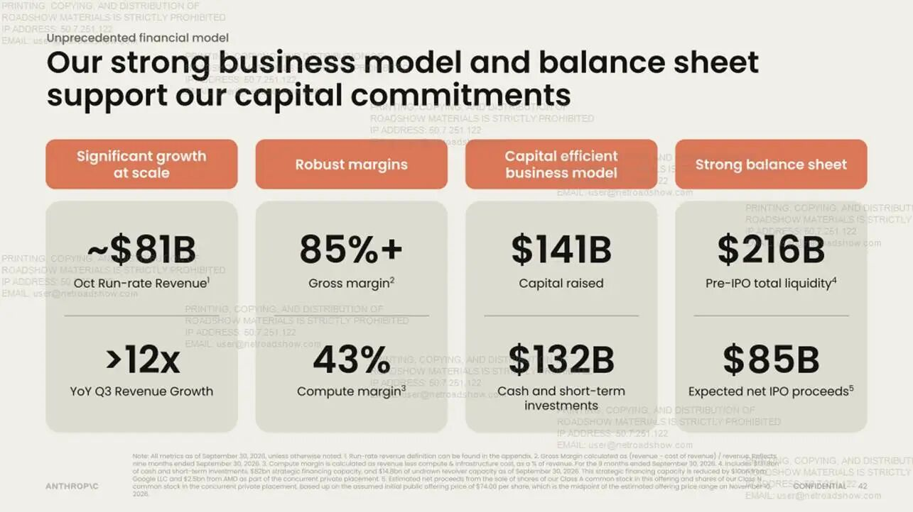

#### 十一、结语（ 00:40:36 – 00:42:43 ）

Dario Amodei （ CEO ）：今天我们看到的癌症、阿尔茨海默病、心脏病、精神疾病，我认为在不到十年内都会成为过去。我也相信，能把风险处理好的公司，才会是拿到社会运营许可的公司，是社会信任、并且相信它能以正确方式创造福祉的公司。如果我们把这件事做对，就能开创一个奇迹时代，让人类解决那些困扰了我们数千年的难题。我们必须非常审慎地应对这项技术所有的风险、所有可能出错的方式，同时把它的福祉带给世界，并建立起一门可持续的生意。我邀请各位与我们一起踏上这段旅程的下一程。

#### 附录：财务报表与补充披露（幻灯片 44–57 ）

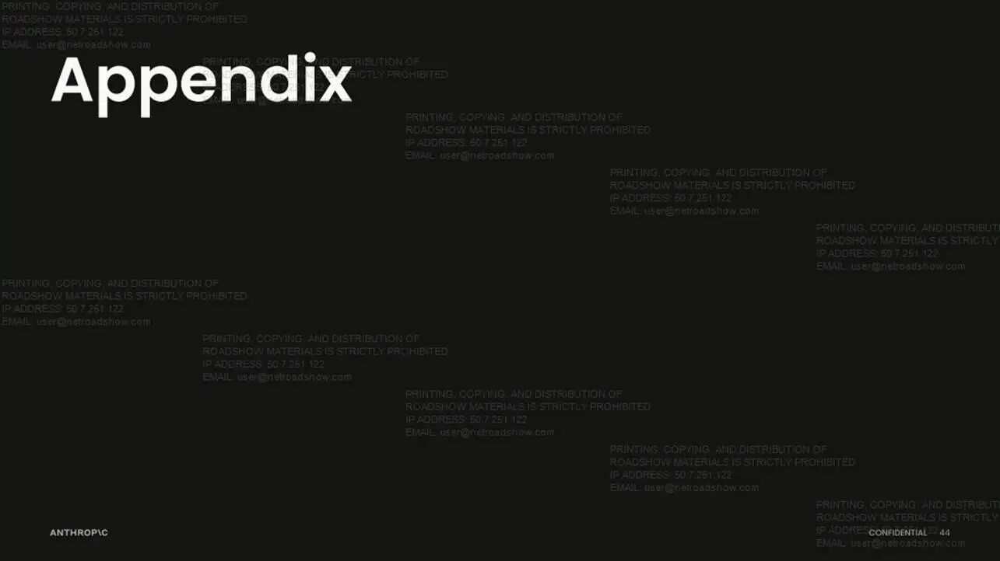

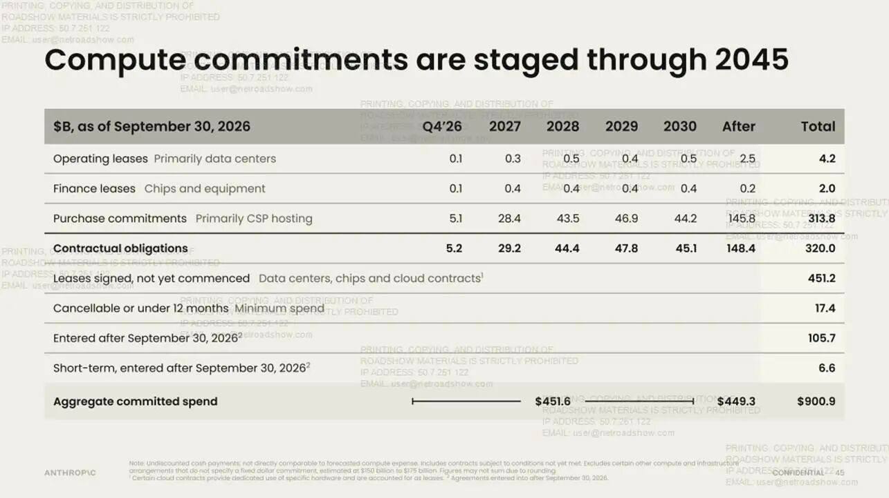

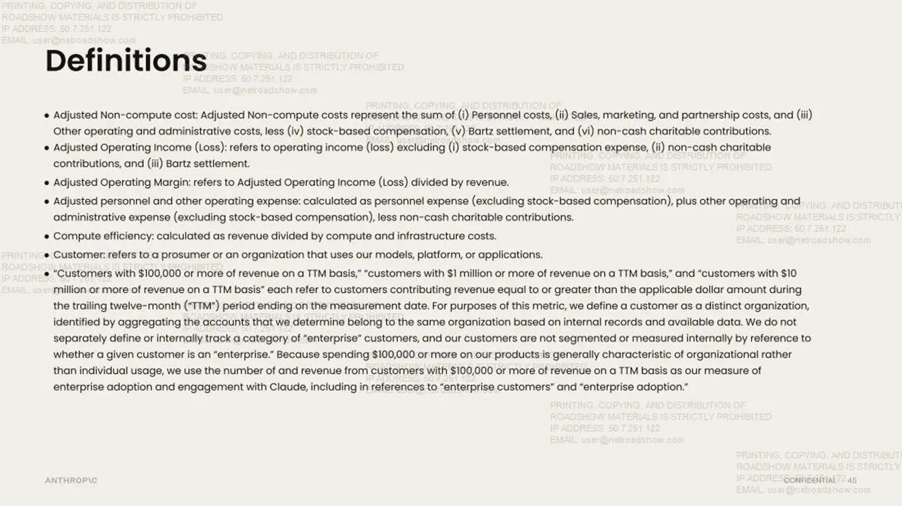

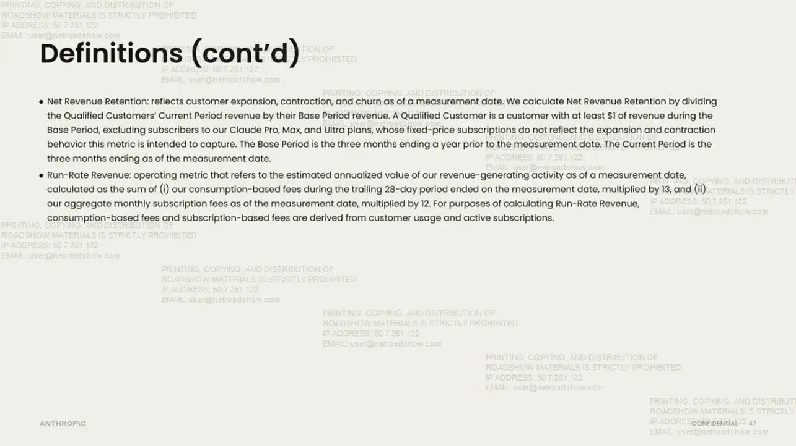

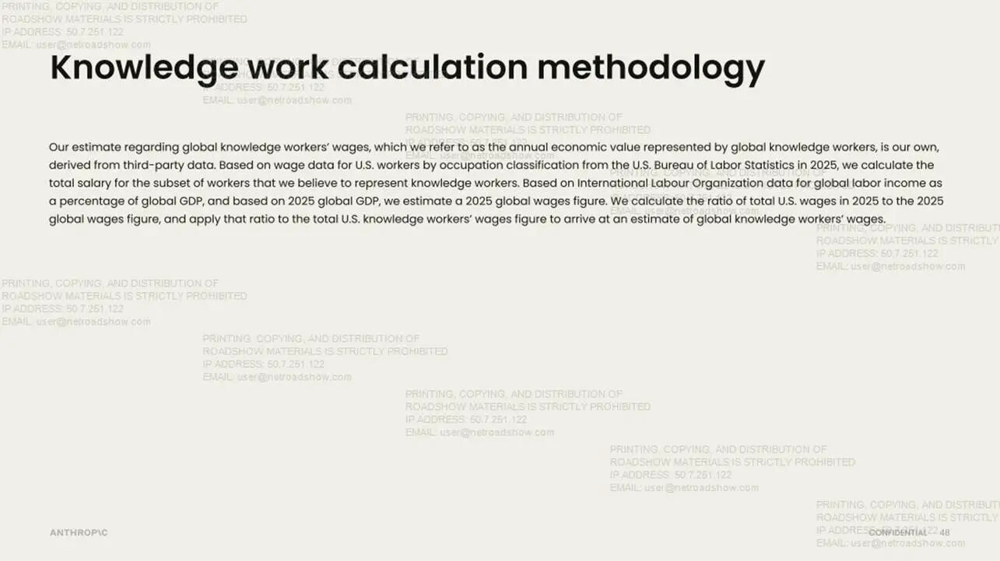

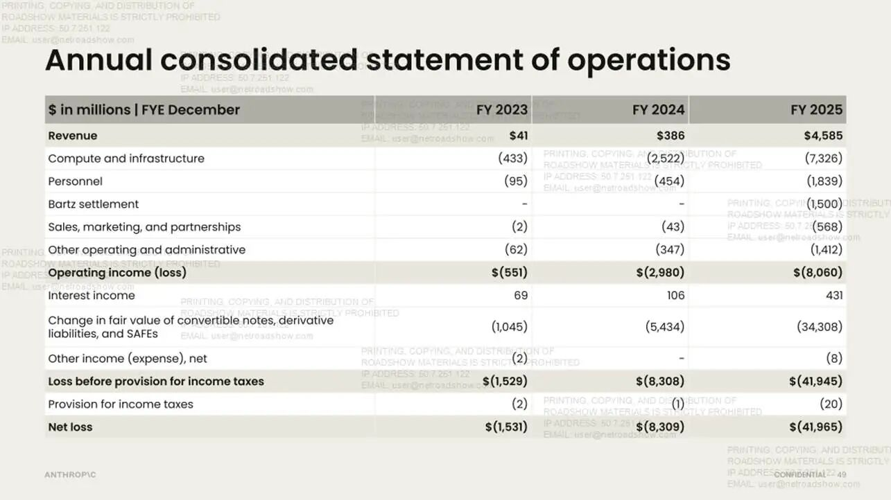

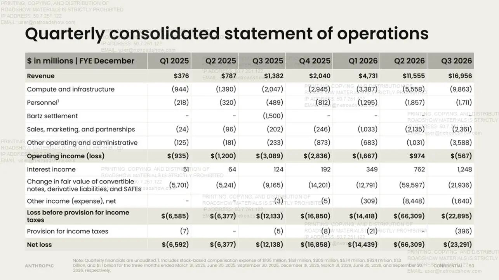

> 幻灯片 54/57 – 57/57 截断说明：原文转载在上传完第 53 页原图（Adj. Non-compute cost reconciliation）后文字截断于 幻灯片 53/5，未附最后第 54–57 页幻灯片（其余关键现金流、资产负债与算力承诺分期明细见下方 SEC Form S-1/A 核对表）。

---

#### 附录补充核验：SEC Form S-1/A（Amendment No. 2）核心财务与算力承诺全表（补齐原稿第 44–57 页定量数据）

> [!TIP]
> 本工作台核查说明：上方已完整嵌入第 44–53 页附录 PPT 原图（含第 45 页至 2045 年算力承诺分期总表 \$900.9B、第 49–50 页年度与季度合并经营报表〔其中 26Q2 单季已实现 GAAP 营业利润 +\$974M，26Q3 因计入 -\$1,960M 员工股权配捐非现金慈善支出致 GAAP 营业亏损 -\$567M〕、第 51–52 页 Non-GAAP 营业利润调节表〔9M26 经调整营业利润 +\$4,081M〕及第 53 页经调整非算力成本调节表〔9M26 \$10,353M，占收入比由 25Q1 70% 降至 26Q3 27%〕），原稿仅未包含最后第 54–57 页。以下四张结构化核对表结合同日提交的 Form S-1/A（CIK 0002130357，2026-11-10） 法定正文与附注对手方明细交叉对齐。

##### 表 A-1：IPO 发行结构、估值区间与 \$260 亿 上游供应商同步私募明细（对应幻灯片 3/57）

| 项目 | 法定披露数值 / 结构（Form S-1/A） | 核查与治理备注 |
| --- | --- | --- |
| 拟挂牌交易所与代码 | Nasdaq Global Select Market：ANT | 发行主体为特拉华州公益公司 Anthropic, PBC |
| 公开发行基础股数 | 825,000,000 股 Class A 普通股（每股 1 票） | 新股发行 801,351,354 股（97.13%）；老股转让 23,648,646 股（2.87%） |
| 承销商超额配售权（绿鞋） | 最高 123,750,000 股 Class A 普通股 | 30 天期，由摩根士丹利担任稳定市场代理人 |
| 拟议发行价区间 | \$70.00 – \$78.00 / 股（中位数 \$74.00） | 完全稀释估值约 \$1.25 万亿 – \$1.40 万亿（较 \$2.0 万亿 传闻下调约 30%） |
| 公开发行募资总额 | 中位数 \$610.5 亿；上限 \$643.5 亿（含全额绿鞋最高 \$740.0 亿） | 扣除老股后归属公司新股毛募资上限约 \$625.1 亿（未含绿鞋） |
| 同步战略私募（Class N 无投票权股） | 合计 \$260.0 亿（按 IPO 最终发行价认购） | Google \$100 亿、NVIDIA \$100 亿、AMD \$25 亿、Broadcom \$10 亿、Microsoft \$10 亿、Micron \$10 亿、TSMC Partners \$5 亿 |
| 公开+私募合计总注资规模 | 基础上限 \$903.5 亿（含全额绿鞋约 \$1,000 亿） | 继 2026-06-12 SpaceX IPO（\$860 亿）后年内第二宗近千亿美元级股本融资 |
| 特殊公司治理架构 | 长期利益信托（LTBT）持 Class T 股；7 位联创持超级投票权 Class F 股 | LTBT 独立于财务利益并选任董事会多数席位，公众 Class A 股东无法单独改组董事会 |

##### 表 A-2：季度收入演进、ARR 与客户效率指标（对应幻灯片 33–38、50/57）

| 期间 / 指标 | 2025Q1 | 2025Q2 | 2025Q3 | 2025Q4 | 2026Q1 | 2026Q2 | 2026Q3 | 2026 年 10 月末 |
| --- | --- | --- | --- | --- | --- | --- | --- | --- |
| 季度营业收入（百万美元） | \$376 | \$787 | \$1,380 | \$2,042 | \$4,730 | \$11,552 | \$16,960 | — |
| 环比增速（QoQ） | — | +109.3% | +75.3% | +48.0% | +131.6% | +144.2% | +46.8% | — |
| 年化收入运行率（ARR，十亿美元） | ~\$1.5B | ~\$3.1B | ~\$5.5B | ~\$8.2B | ~\$18.9B | ~\$46.2B | ~\$71.0B | ~\$81.0B（约 810 亿美元） |
| 年支出 >\$100k 企业客户数 | — | — | ~950 | ~1,500 | — | — | >11,900 | 年初至今增长近 8 倍 |
| 年化人均创收（员工数 Q3'26 约 5,300 人） | — | — | \$1.40M | — | — | — | >\$6.60M | 同比提升 >4.5 倍 |

##### 表 A-3：合并利润表与 GAAP 毛利率（85.5%）vs 全口径算力利润率（43%）调节桥（对应幻灯片 40、43、49–52/57）

| 财务与利润率指标 | FY 2024 | FY 2025 | 9M 2026（前九月） | 长期稳态目标框架（幻灯片 43/57） | 会计归集与核查说明 |
| --- | --- | --- | --- | --- | --- |
| 营业收入 | \$386M | \$4,585M | \$33,242M | 100% | ~80% 按量 API/Token 计费，~20% 订阅 |
| 营业成本（Cost of Revenue） | — | — | \$4,812M（14.48%） | 合并入算力总盘子 | 仅含付费客户推理服务算力与直接基础设施 |
| GAAP 毛利 / 毛利率 | — | — | \$28,430M / 85.52% | — | 路演口径“年初至今毛利率 >85%”（去年同期 29%） |
| 研发费用（R&D） | — | — | \$19,240M（57.88%） | — | 含预训练、RL 后训练、安全研究、内部 Claude 算力及研发人员 SBC |
| 销售与营销费用（S&M） | — | — | \$6,619M（19.91%） | 7% – 10%（经调整） | 含三大云市场渠道分成、免费版 Claude 推理算力及 GTM 团队 |
| 一般及行政费用（G&A） | — | — | \$3,831M（11.52%） | 与人员费用合计 7% – 10% | 含职能人员薪酬、法务合规与股权激励 |
| GAAP 营业亏损 / 营业利润率 | — | < -\$8,000M | -\$1,260M / -3.79% | — | 尚未实现 GAAP 营业盈利 |
| 全口径算力利润率（Compute Margin） | — | — | 43% | 50% – 55%（算力占收入 45%–50%） | 扣除付费推理 + R&D 训练/研究 + 内部 + 免费版全部算力成本（9M26 占收入约 57%） |
| Non-GAAP 经调整营业利润率 | — | 深度为负 | 12%（26Q3 约 15%） | 35%+ | 加回大额股权激励（SBC）等非现金项目后转正，较基期改善 236 个百分点 |
| GAAP 净亏损 | — | ~ -\$42,000M | ~ -\$104,000M | — | 9M26 含约 \$94,300M 可转债/优先股随估值暴涨产生的公允价值重估非现金账面亏损 |

##### 表 A-4：截至 2045 年的 \$8,954 亿 算力与电力承诺分期及主要对手方明细（对应幻灯片 41–42、45/57）

| 承诺期限 / 核心对手方 | 合同承诺金额（十亿美元） | 占总额比例 / 关键履约条款与交叉印证 |
| --- | --- | --- |
| 算力与基础设施采购/租赁承诺总额（至 2045 年） | \$895.4B（约 8,954 亿美元） | 截至 2026-09-30 账面现金及有价证券 \$131.65B、总流动性 \$146.6B（IPO 募资前） |
| 其中：未来 12 个月内到期（2026Q4–2027Q3） | ~\$69.8B – \$70.7B | 短期刚性现金流出锚点，需由经营现金流持续覆盖 |
| 其中：截至 2030 年 12 月 31 日累计到期 | ~\$451.6B | 前五年集中兑付约 50.4% 的总承诺额 |
| 其中：2031–2045 年远期分期承诺 | ~\$443.8B | 中长期数据中心与直租机房长约 |
| 其中：附带先决条件/可终止份额 | \$213.8B（23.9%） | 取决于对手方项目融资闭合、电网并网许可或按期通电交付 |
| 对手方 ①：Fluidstack（Anthropic Direct 专用机房租赁） | ~\$125.2B | 5 年期定制数据中心与裸金属芯片直租底座 |
| 对手方 ②：Google Cloud（TPU / 云算力最低承诺） | ≥ \$121.3B | Google 同步出资 \$10.0B 参与本次 IPO 战略私募 |
| 对手方 ③：SpaceXAI（NVIDIA GPU 算力租赁） | 最高 \$120.5B | 满载爬坡后月租金约 \$3.1B/月 |
| 对手方 ④：Amazon Web Services（Trainium / 云最低承诺） | ≥ \$110.0B | 多芯片统一算力池核心训练与推理底座之一 |
| 对手方 ⑤：Microsoft Azure（云算力最低承诺） | ≥ \$44.9B | Microsoft 同步出资 \$1.0B 参与本次战略私募 |
| 对手方 ⑥：Akamai（专属通用 CPU 承诺，7 年期） | \$11.6B | 支撑 Claude Code / Managed Agents 大规模代码沙箱与编排环境 |
| 对手方 ⑦：表后电力兜底（OnePWR 燃机 + 开发商电力设备担保） | \$3.4B + \$4.7B | 承接卡特彼勒 1.7 GW 天然气发电机排期（\$3.4B）+ 开发商长周期电力设备担保（\$4.7B） |

---

### 观点与可反驳条件

- ==观点==：Anthropic 以 \$1.25 万亿–\$1.40 万亿 稀释估值推进最高 \$643.5 亿 IPO（叠加 \$260 亿 上游供应商同步私募），在产业需求侧属于企业级智能体从编程向广义知识工作扩散的阶段性换挡中继，但在资本定价与基础设施扩张侧则构成一级市场算力军备竞赛的阶段性流动性高潮与二线高杠杆算力信贷顶部；上市后其二级市场表现将由“ARR 叙事”切换为对“全口径算力利润率（当前 43%）能否跑赢每年约 \$700 亿+ 刚性租约与模型折旧”的硬约束检验。
- ==推翻条件==：
  1. ① 向上推翻“估值与流动性阶段性高潮”判断（确立二级市场主升浪）：若 2027 年上半年（27Q1–27Q2 季报）Anthropic 在季度收入环比增速维持 >25%（ARR 突破 \$1,300 亿）的同时，将扣除 R&D 训练与 RL 算力后的全口径算力利润率从 43% 提升至 ≥52%，并实现单季 GAAP 营业利润转正（不依赖剔除 SBC 调节），则证明“算力乘数 + Anthropic Direct”具备超预期规模效应，当前 \$1.3 万亿 级定价实为折价起点。
  2. ② 向下推翻“企业需求处于中继换挡”判断（确认为全行业周期性顶部）：若未来 2–3 个季度内，存量企业净收入留存率（NRR）从约 900% 快速回落至 <180%，或同业与开源模型价格战迫使主力模型单价再降 >50% 却未能激发足够 Token 增量，导致单季经营现金流跌破当季刚性算力租赁承诺（约 \$175 亿/季）并开始持续消耗 IPO 募资本金补窟窿，则标志着企业 AI 预算渗透与闭源模型定价权同步见顶。
  3. ③ 基础设施信贷分化证伪条件：若 \$8,954 亿 承诺中附带融资与电力先决条件的 \$2,138 亿 份额在 2027 年底前按期通电交付率超过 85%，且北美数据中心高收益债与 AI CDS 利差显著收窄，则推翻“二线高杠杆算力与缺电开发商已见信用周期顶部”的子判断。

---

## 原文摘录与一手信源存证

> Dario Amodei （ CEO ）： 这将是人类历史上最有前景的技术。 AI 正在捕捉认知的本质。 2024 到 2025 年， AI 写代码变得可行。现在我们开始发现，在知识工作的其他领域，端到端完成任务的智能体也已经可行。再往近处看，我们开始看到，生物、数学、物理等领域的基础性发现正在变得可能。如果人类能用 AI 治愈癌症，心怀恶意的人也能用 AI 制造生物武器或发动网络攻击。
> — 原文摘录，文字段落 1；证据 `digest-material-c1c709f9ecf44e24ffb038a71f9f905baf7ef3348858bf16565da08937b9a4ec-excerpt-1@1`

> Daniela Amodei （总裁）： 智能如今已经是人类可以构建的东西，其影响极为深远。我们相信，它会让每个人的能力大幅提升，扩大全世界的认知劳动容量，改变每一个行业、每一门学科。这种巨大的经济影响，起点是前沿智能，也就是 Claude 能做什么。
> — 原文摘录，文字段落 2；证据 `digest-material-c1c709f9ecf44e24ffb038a71f9f905baf7ef3348858bf16565da08937b9a4ec-excerpt-2@1`

> 2024 年， Claude 能回答问题、检索信息、总结文档。到 2025 年底， Claude 已经能做深度研究和多步骤项目，比如重构整个代码库，这类任务过去需要人花几个小时甚至几天。今天， Claude 能承接复杂、开放式的项目，这些项目过去需要很多人花几个月甚至几年做研究、分析和执行，而 Claude 几天就能完成。
> — 原文摘录，文字段落 3；证据 `digest-material-c1c709f9ecf44e24ffb038a71f9f905baf7ef3348858bf16565da08937b9a4ec-excerpt-3@1`

一手材料：

- Anthropic, PBC IPO Investor Roadshow Presentation (2026-11-10) & SEC Form S-1/A (Amendment No. 2, CIK 0002130357) · Anthropic, PBC (IPO 路演 · S-1/A) · [原站](https://www.sec.gov/edgar/browse/?CIK=0002130357) · [主体档案：Anthropic](../entities/companies/Anthropic.md) · [本地原件](../../../raw/73dbfd7199bceeb013ab9c168748de9705a9f68d7f1bb34d24ae5d4f46029158)
  材料版本 `digest-material-73dbfd7199bceeb013ab9c168748de9705a9f68d7f1bb34d24ae5d4f46029158@1`；获取方式 `sec_edgar_s1a_and_roadshow_dossier`。
  > - \*\*Issuer & Corporate Form\*\*: Anthropic, PBC (a Delaware Public Benefit Corporation). - \*\*Proposed Exchange & Ticker\*\*: Nasdaq Global Select Market — Symbol: \*\*\`ANT\`\*\*. — 原文提取
  > ### 2.1 Roadshow Roster (42:43 Video, 11 Chapters) 1. \*\*Dario Amodei\*\* — Chief Executive Officer & Co-Founder (Ch. 1 Opening 00:00–01:20; Ch. 11 Closing 40:36–42:43) 2. \*\*Daniela Amodei\*\* — President & Co-Founder (Ch. — 原文提取

归属与范围：主信源穿透至 Anthropic, PBC 于 2026-11-10 启动的官方 IPO 投资者路演视频实录（42分43秒，11个章节，57页幻灯片）及同日向美国 SEC 提交的 Form S-1/A（Amendment No. 2, CIK 0002130357）；路演中管理层与站台客户（BMS、埃森哲、AIG）表述具有明确公开发行募资激励，全部经营与财务主张在研究库中均按 verification=pending 登记并与法定报表附注交叉核对。

来源缺口：

- `unavailable`：触发转载稿已包含第 1–53 页路演 PPT 高清原图（1285×722，已全部本地化归档并原位嵌入导读），但文末在『幻灯片 53/5』处截断、未包含最后第 54–57 页幻灯片，且官方 57 页原始矢量 PDF 演示文稿尚未作为独立可直链附件公开下载（核心财务报表、利润率调节与算力承诺分期已结合第 45–53 页 PPT 原图与同日提交的 SEC Form S-1/A 完整核实）。 [线索](https://www.sec.gov/edgar/browse/?CIK=0002130357)

[返回赛道总览](../赛道总览.md#digest-c1c709f9ecf44e24) · [返回导读索引](README.md) · [主体档案库](../entities/README.md)
