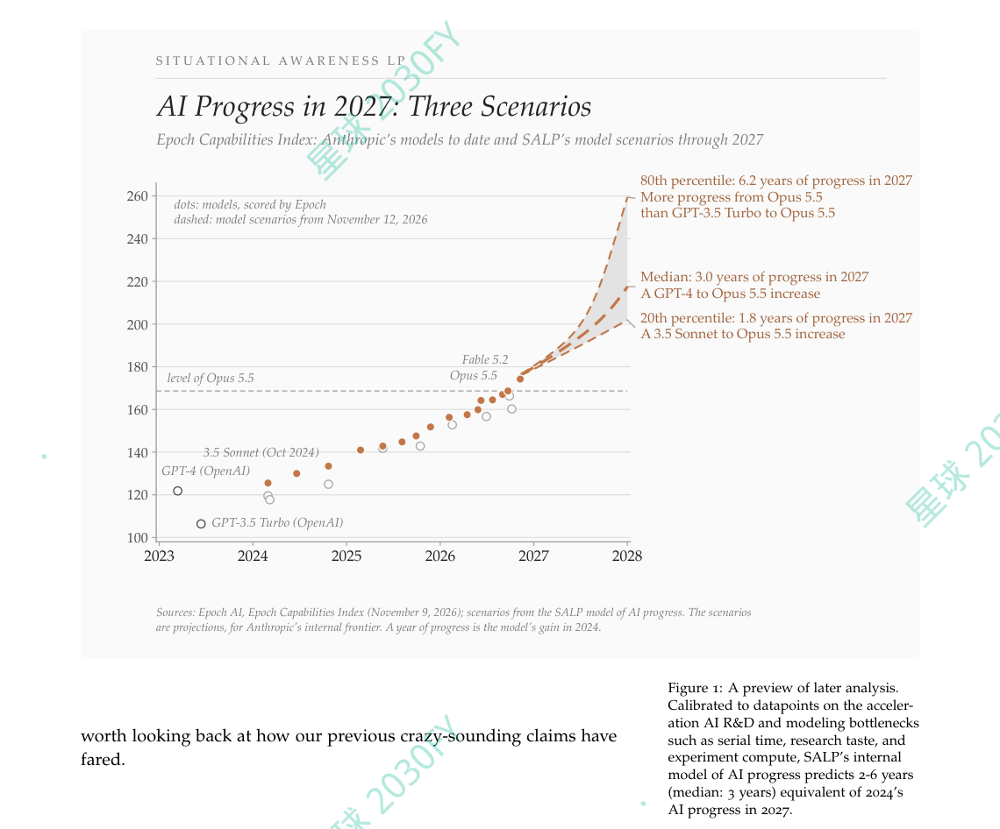
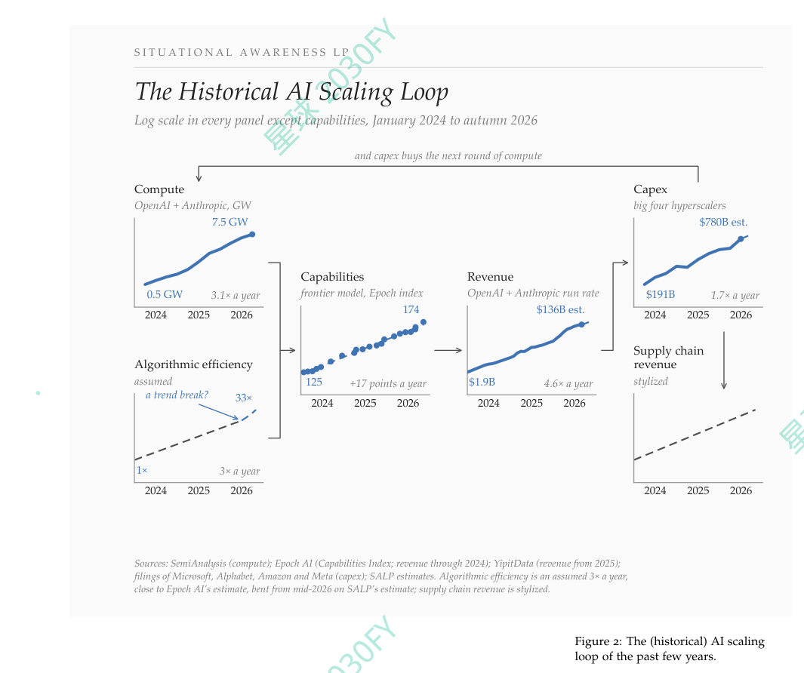

# Leopold三季度投资者信

2026-11-28 · Situational Awareness LP · Letter 5 Q3 2026 · 有来源缺口

[本地原件归档](../../../raw/881203565cf8952b41bf03255a380bd0c4cb18047304c3c2d9018aef7ac80d7d) · 固定材料版本 `digest-material-881203565cf8952b41bf03255a380bd0c4cb18047304c3c2d9018aef7ac80d7d@1` · [一手原站](https://situational-awareness.ai/) · [触发线索（2030FY）](https://mp.weixin.qq.com/s/Tj1Q95yb2GZJQyFJ61lNsg)

> [!IMPORTANT]
> 用户关注点（TG）：哇 leopold的信来了

## 针对性追查与回应

- ==核心结论==：对照 2026-11-24 发布的 167 页 Situational Awareness LP（SALP）Letter 5 英文原信，基金在 2026 Q3 交出「单季毛跌 67.0% / 净跌 65.0%、7 月单月净回撤 67%、截至 9 月末 YTD 仍净赚 +88.5%、成立以来累计净回报 +477.6%（毛回报 +691.9%，较 6 月末峰值 +1,550.5% 净回吐但仍跑赢同日 NVDA +5% 与 SMH +71%）」的完整成绩单。原信不仅在 Part I 押注「递归自我改进（RSI）已启动、2027 年将是 3 倍进展年（算法 3–12 倍 / 整体 1.5–6 倍）、前沿实验室年底年化收入破 \$1T」，更在此前微信摘要整段漏掉的 Part II、Part III 与 Appendix 中首次披露了 Anthropic（\$60B 估值入股至 IPO 涨约 14.8 倍）、SK Hynix（₩180K 至 ₩2.9M 翻 16 倍后回撤三分之二，且 SALP 牵线其与 Anthropic 首次会面并基石参投美股 ADR）、即期算力 Spot Compute（SpaceX 以 \$3.50→\$5.50/kWh 向 Anthropic/Google 短租 435k GPU；SALP 领投 Sharon AI）、Fluidstack（独占领投 \$7.5B A 轮并联合领投 \$21B B 轮）、Physical Intelligence 等完整押注矩阵，以及「ASI 将摧毁约 \$500T 存量企业 IP 与人力资本价值（含 NVDA、ASML、SaaS 与长久期美债）」的极端选股框架。对照 [SEC Form 13F-HR（CIK 0002045724）](https://www.sec.gov/edgar/browse/?CIK=0002045724)、[METR 2026-11-05 审计报告](https://metr.org/blog/2026-11-05-anthropic-ai-rd-acceleration-assessment/) 与 [Anthropic Form S-1/A-3（2026-11-17）](https://www.sec.gov/Archives/edgar/data/2130357/000162828026074338/anthropicpbc-sx1ax3.htm)，信中 Anthropic 1.9–2 倍研发加速、RSP 阈值触发与 7 月强平去杠杆均获一手证实，但信件同时直接披露了 SEC 已就 7 月事件展开问询、Leopold 配偶任 Dario Amodei 幕僚长的利益冲突隔离，且将千禧年数学难题突破与内部算力目录价线性外推至 2027 年万亿美元商业收入仍跨越了实证边界。
- 口径与利益：本次重做已获取 167 页英文原信全文 PDF（2026-11-24），原触发线索微信公众号「2030 / 2030FY」此前 AI 摘要完全遗漏了 Part II（约 54 页投资案例与 ASI 估值框架）、Part III（组织风控与 SEC 问询）及 Appendix A/B（约 17 页 Fluidstack/Lumentum/Siemens Energy/Bloom Energy 复盘与 28 人履历），现均已按原信补全。利益立场方面，SALP 重仓 Anthropic 一级股权、Fluidstack、Sharon AI、Physical Intelligence 与 AI 存储/即期算力标的，Leopold 本人及合伙人 Carl Shulman 几乎全部净资产均投于基金内，且其配偶任职 Anthropic CEO 幕僚长（需经 CCO Kimberly Summe 事前审批交易）。
- 本工作台交叉档案：[主体档案：Situational Awareness LP](../../%E5%AE%8F%E8%A7%82%E4%B8%8E%E9%87%91%E8%9E%8D/entities/funds/Situational%20Awareness%20LP.md) · [主体档案：Anthropic](../entities/companies/Anthropic.md) · [主体档案：OpenAI](../entities/companies/OpenAI.md) · [被杠杆干趴后，「AI股神」换了个赌法（Q1–Q3 13F 复核）](../../%E5%AE%8F%E8%A7%82%E4%B8%8E%E9%87%91%E8%9E%8D/blogs/%E8%A2%AB%E6%9D%A0%E6%9D%86%E5%B9%B2%E8%B6%B4%E5%90%8E%EF%BC%8C%E3%80%8CAI%E8%82%A1%E7%A5%9E%E3%80%8D%E6%8D%A2%E4%BA%86%E4%B8%AA%E8%B5%8C%E6%B3%95.md) · [Anthropic, PBC · SEC Form S-1/A (2026-11-17)](Anthropic%2C%20PBC%20%C2%B7%20SEC%20Form%20S-1_A%20%282026-11-17%29.md)

### 一、完整业绩表、7 月强平机制与组织风控重建（原信 p.3 · Part III · Appendix B · SEC 13F 核验）

此前二手摘要仅含混提及「2026 初 NAV >\$4B、上半年增近 10 倍、7 月净跌 67%」，原信第 3 页首次给出成立以来完整逐季审计口径（2024-11-01 成立、2024-11-12 实质建仓，初始规模略超 \$100M）：

| 报告期 | 单季回报（毛 / 净） | 年初至今 YTD（毛 / 净） | 成立以来累计（毛 / 净） | 原信对照与本工作台核查 |
| :--- | :--- | :--- | :--- | :--- |
| 2024 Q4 | +5.9% (+4.5%) | — | +5.9% (+4.5%) | 2024-11-12 开始大额配置，建仓 SK Hynix 与电力基建 |
| 2025 Q1 | -11.8% (-12.3%) | -11.8% (-12.3%) | -6.6% (-8.3%) | DeepSeek 冲击窗口逆势加仓 Anthropic（\$60B 估值首轮入场） |
| 2025 Q2 | +81.3% (+67.2%) | +59.9% (+46.8%) | +69.3% (+53.3%) | 顶住卖空报告加仓存储；同期 Hynix 占公开多头达 41.9% 峰值 |
| 2025 Q3 | +39.2% (+33.3%) | +122.6% (+95.6%) | +135.8% (+104.4%) | 建仓 Lumentum（LITE）与 Bloom Energy（BE） |
| 2025 Q4 | +56.1% (+49.9%) | +247.5% (+193.3%) | +268.0% (+206.4%) | 10 月独占领投 Fluidstack \$7.5B A 轮；年初 NAV 跨过 \$4B |
| 2026 Q1 | +48.7% (+38.6%) | +48.7% (+38.6%) | +447.3% (+324.7%) | ✅ 13F 核查：靠 \$8.46B 半导体 Put 哑铃对冲；季末清仓 Lumentum |
| 2026 Q2 | +338.1% (+288.6%) | +551.5% (+438.7%) | +2,297.5% (+1,550.5%) | ✅ 13F 核查：撤掉全部 Put 并叠高倍杠杆，NAV 上半年增近 10 倍（约 90% 来自 P&L） |
| 2026 Q3 | -67.0% (-65.0%) | +115.2% (+88.5%) | +691.9% (+477.6%) | 7 月单月净回撤 -67%，8–9 月微幅修复使 Q3 全季净亏 -65.0% |

对照原信 Table 1（2024-11-12 至 2026-11-24）：同期 NVDA 累计仅 +5%（截至 6 月末 +35%）、NVDL -47%（+7%）、SMH +71%（+162%）、USD 两倍半导体 +16%（+194%），证明即使经历 7 月重挫，SALP 的「AI 阶段性押注序列」仍大幅跑赢单纯买入 AI Beta。

1. ✅ 本工作台核查（7 月强平机制的完整微观过程）：原信 Part IIIa 披露，7 月初组合总 Delta 敞口约 1.6 倍多头对 1.0 倍空头（不含零风险箱式套利），风险约束仅校准至「DeepSeek 式」单日因子暴跌与「互联网泡沫破裂」40–50% 周级回撤；实际走势中，许多 AI 多头跌超 50%–60%，「空 Micron 对冲多 Hynix/Kioxia」仅跌 30% 对 -55%/-65%，极端下跌的标的反而恰是缺乏深价外 Put 保护的仓位；更致命的是空头端每亏 \$1 消耗超过 \$1 流动性（多头因期权 Gamma 仅消耗约 \$0.30 流动性），Cognizant、Workday 等「AI 颠覆空头」组合逆势暴涨 30%–50%。截至 7 月 22 日 MTD 已毛跌约 31%，随着卖掉高流动性仓位后残余空头流动性恶化及纽约交易传闻发酵，SALP 于 7 月 29/30 日大宗出清（对应 [WSJ/13F 复核](../../%E5%AE%8F%E8%A7%82%E4%B8%8E%E9%87%91%E8%9E%8D/blogs/%E8%A2%AB%E6%9D%A0%E6%9D%86%E5%B9%B2%E8%B6%B4%E5%90%8E%EF%BC%8C%E3%80%8CAI%E8%82%A1%E7%A5%9E%E3%80%8D%E6%8D%A2%E4%BA%86%E4%B8%AA%E8%B5%8C%E6%B3%95.md) 披露向 Citadel 折价出售约 \$16B 公募组合），Q3 13F 正股骤缩 97.4% 至 \$533M，8 月公私比从 70% 公开 / 30% 私募被动翻转为 30% 公开 / 70% 私募，直至 11 月 Anthropic IPO 后才恢复常态（注：原信脚注 1 明确，基金大部分 Anthropic 一级仓位本身即由 H1 公募盈利再投资购入）。
2. ✅ 本工作台核查（SEC 问询、配偶隔离与「保时捷 911」组织重构）：原信 Part IIIb 与 Appendix B 首次披露多项过去未见于媒体的机构化举措：（1）SEC 已就 7 月事件展开监管问询，SALP 称正全面配合；（2）Leopold 首次在信中直面合规冲突——其配偶在 Anthropic 员工不足百人时入职并现任 Dario Amodei 幕僚长（Chief of Staff），现由新任 CCO Kimberly Summe（前 Sequoia Capital Global Equities COO/GC/CCO）与 GC Jim Frolik 制定参照配偶就职隔离先例的合规方案，所有 Anthropic 交易必须由 CCO 事前审批（preclearance）；（3）团队已从 3 人扩编至 2026-11-18 的 28 人（投资 5 人、量化 4 人、财务运营 4 人、合规风控/法务/交易/财资/安全 6 人等，另正招募独立首席风险官 CRO 主持第二道防线风险委员会），核心新援包括 CFO Pat DeGraca（前 Freestone Grove / Two Sigma）、财资策略主管 Sven Khatri（前 Citadel 财资量化主管）、股票主管 Michael Wang（前 Avala / Point72）、经济学家 Zach Mazlish、期权策略师 Anjalie Kini（前 Morgan Stanley）与安全主管 David Pigott（前美国特勤局特工）；（4）组合自 7 月末起实行「全额付清、零主经纪商杠杆、暂停做空（仅保留期权最大损失抵押对冲）」，并已暂停接受新外部募资进入「dry dock」内修；（5）SALP 内部自建名曰 GRIMM 的多智能体研究系统，截至 2026-11-18 年化 Claude 支出已达 \$18M/年（占管理公司运营开支超 10%，人均约 \$600K+/年），过去 30 天主分支新增代码量飙升至 430 万–450 万行，自评投研分析提速 2–3 倍。

### 二、RSI 启动、HPMA 范式与 2027 预测的逐条一手核查（Part I · METR · Anthropic S-1/A-3）

原信 Part I 以「旧金山认为明年失业 vs 华尔街认为 AI 泡沫破裂」切入，完整数据与公开一手信源核查如下：

| 原信核心主张与精细数据（Part I） | 一手信源核查结果 | 核查结论（本工作台复核） |
| :--- | :--- | :--- |
| 实验室内部算力与遥测：Anthropic 员工目录价内部 token 支出月翻倍，4 月起超越不含 SBC 的人力成本，1–9 月暴涨 >250 倍；SALP 估算全口径人均月耗 \$2.2M（\$560K–\$7.6M）、交互式研究员人均 \$1.4M/月（OpenAI 为 \$380K/月）；Q3 内部消耗占 Anthropic 总算力约 13%（9 月 15 日达 16%，占全球 Claude 用量 >1/3）；8 月底智能体工时为人工 6.2 倍、研究员 19 倍（2 月 0.2 倍），OpenAI 为 8.0 个智能体工作日（5 月初 0.7）；Anthropic 单仓日合入峰值 30,401 次（9 月 9 日），研究员产出代码 >45 倍（OpenAI 约 5.1 倍），实验数仅 1.7–2 倍 | [Anthropic S-1/A-3](https://www.sec.gov/Archives/edgar/data/2130357/000162828026074338/anthropicpbc-sx1ax3.htm) 确认 9M26 研发费用 \$19.24B 远超付费推理成本 \$4.81B，并披露内部目录价用量逾越人力开支；但 \$2.2M/月、13%/16% 内部算力占比与 OpenAI \$380K/月系 SALP 基于 S-1 与博客图形的三角推算，非直接审计数值 | ⚠️ 本工作台核查：原信清晰标注了目录价推算口径，且坦承实验算力受限导致「代码增 45–50 倍但实验数仅增 1.7–2 倍」，但内部遥测仍不可线性等同为净科研产出 |
| 算法加速与 METR 审计：Dario Amodei 称 2025 秋提速 5%、今春 15–20%、9 月大幅加快；路演未标刻度图表显示预训练算力乘数呈超指数上弯；Slack 自评达 12 倍（每 3.4 个月翻倍）；METR 测得截至 10 月能力增速达基线 2 倍（80% 归因 AI）；S-1 更新称可能即将触及 RSP >2 倍阈值；SALP 估算当前算法加速 2–3 倍、整体 1.5–2 倍（年初 5% → 春 15–25% → 夏末 1.5 倍 → 年末 2 倍） | [METR 2026-11-05 报告](https://metr.org/blog/2026-11-05-anthropic-ai-rd-acceleration-assessment/) 直接证实 AECI 基准提速 1.9 倍（95% CI 1.5–2.8 倍）、主观估计 ~2 倍（80% 归因 AI）及 Slack 12 倍投票；[Anthropic S-1/A-3](https://www.sec.gov/Archives/edgar/data/2130357/000162828026074338/anthropicpbc-sx1ax3.htm) 第 36 页亦确认触发 RSP 门槛 | ✅ 本工作台核查：1.9–2 倍加速与 RSP 触发均获一手确证，但 METR 明确警示当前仍属「AI 辅助」而非「完全自主」，且 Anthropic 删节了多数核心证据 |
| HPMA 与千禧年数学突破：提出 2027 年从「虚拟实习生」跃迁至「高持久多智能体（HPMA / 虚拟部门）」（类似 SALP 内部 GRIMM 调度数百个 Claude 并由教练 Claude 协调）；并称 OpenAI 10,000 智能体蜂群解决 Navier-Stokes 问题，Claude 协助 Levent Alpöge 解决黎曼猜想（Riemann Hypothesis），实现「一月十年进展」；预计 2027 年 6 月/11 月 Claude 全自动完成 50%/95% 研发（AL5） | OpenAI 与 Anthropic 近期确有推进大规模科研智能体蜂群与代码自动化报道，且原信引用了 RoboDojo 与 Epoch 索引；但「解决 Navier-Stokes 与黎曼猜想两项千禧年难题」未附同行评议期刊链接或 Clay 数学研究所/独立数学界验证定论 | ❌ 本工作台核查：在缺乏同行评议与独立数学共同体核证前，将「解决黎曼猜想与 Navier-Stokes」作为 RSI 外推至 2027 年 95% 研发自动化的核心论据存在显著过度归因风险 |
| 2027 万亿收入两条路径与 Pacing 情景：截至 2026-10 Anthropic ARR 达 \$81B（OpenAI 9 月末 \$50B，合计 \$136B），市场共识预期 Anthropic 2027 年底 ARR \$120B–\$200B（隐含 AI 进展放缓至 0.3–0.6 倍）；SALP 模型在「3 倍年（2–6 年进展、中位数 3 倍、年末瞬时增速 5.2 倍）」下给出 \$2T 扩散调整合计收入，两条抓手为（1）全球 \$30T 白领工资 2% 渗透 = \$600B（按编码 10% 渗透率 = \$3T）、（2）5 万人（占美国劳动力 0.03%）年消费 \$20M HPMA = \$1T；Pacing 情景下 Anthropic 2027 年底收入为「无节奏」\$1.2T / 「轻节奏」\$780B / 「重节奏」\$420B；同时点名德州新任民主党州长主张暂停数据中心审批、Bernie Sanders 提出 AI 禁令法案、白宫曾阻止 Claude Mythos 发布及中美「护栏」磋商 | [Anthropic S-1/A-3](https://www.sec.gov/Archives/edgar/data/2130357/000162828026074338/anthropicpbc-sx1ax3.htm) 证实 9M26 营收 \$33.242B（26Q3 单季 \$16.96B，10 月 ARR ~\$81B），且披露「过去 6 个月内发布模型贡献 Q3 超 80% 营收」与「Pacing」政策倡导；但 5 万人人均 \$20M/年消费（对应外部买单 \$1T）将实验室内部算力目录价直接等同于企业现金支出，忽略了采购审批、合规审计与串行组织摩擦 | ❌ 本工作台推断：即使「3 倍进展年」部分兑现，企业端从「实验室内部目录价消耗」转化为「外部 \$600B–\$1T 现金付费」仍受组织吸收速度与监管 Pacing 约束，\$420B–\$780B 的 Pacing 区间已隐含极高商业化兑现率 |

### 三、原文核心补全：Part II 与 Appendix A 投资序列全拆解（2030FY 摘要未覆盖部分）

原信 Part II 与 Appendix A 占全篇逾四成篇幅，系统复盘了 SALP 自 2024 年 11 月以来的「押注序列」逻辑，是本次补齐英文原信的最大增量：

1. ✅ Anthropic（Part IIa，最大私募持仓）：2025 年初以 \$60B 估值首次入场并跟投此后每一轮私募，至 IPO 发行价账面回报约 14.8 倍。SALP 总结三条逆向押注：人才流向（OpenAI 人才外流而 Anthropic 吸纳顶流）、产品范式从 Chatbot 切换至「虚拟同事」（让 ChatGPT 成为 OpenAI 的消费级包袱）、以及「模型层即应用层」带来的算力经济性跃升——按其核算，Anthropic 推理毛利率达 85%–86%（包括低端模型 Haiku 亦约 85%），计入训练与内部研发算力后利润率仍达 42%–43%（每总 GW 创造 \$24B 收入 vs \$14B 算力成本，单推理 GW 创收达 \$96B），近期新模型在一季度内即可数倍收回前季训练算力支出。针对市场三大担忧：模型靠「最后 6–12 个月领先窗口」垄断超 80% 营收且具低成本蒸馏防御力；S-1 披露的 \$900B 算力承诺在未来 12 个月仅到期 \$71B、至 2030 年均约 \$117B/年，且账面备考现金超 \$200B（仅次于 Berkshire Hathaway）；IPO 定价对应卖方 2027 预期收入约 9.3 倍（对比同期 Cloudflare 29 倍 / 34% 增速、Palantir 31 倍 / 63% 增速）。
2. ✅ SK Hynix 与存储复合体（Part IIb，曾占公开多头 41.9%）：2024-11 于约 ₩180K（约 \$100B 市值、1 倍远期 P/B、较 Micron 折价 30%–50%）建仓。核心技术逻辑在于：RL 训练本质是「试错推理」，工作负载由 FLOPS 转向受限于显存带宽（GPU 利用率常低于 5%），且长上下文 Agent 令 KV Cache 指数膨胀，叠加 HBM 消耗传统 DRAM 晶圆比超 3:1，引爆存储供给刚性短缺。SALP 于 2025-03 及秋冬两次赴韩会见 CEO Kwak Noh-Jung，并亲自牵线促成 SK Hynix 与 Anthropic 的首次高管会晤，且于 2026-07 作为基石投资人认购 Hynix 美股 ADR IPO。Hynix 股价于 2026-06-22 冲至 ₩2.9M 峰值（16 倍）后随板块回调三分之二（存储股自高点跌 45%–80%，当前按 SALP 预测约 1 倍 2027E 市盈率与 1 倍 EOY27 P/B），但其单季营业利润已增 7 倍、年化运行率超 \$200B，且最新长协 LTA 已转为「设价格下限、不设价格上限」。
3. ✅ 即期算力 Spot Compute（Part IIc）与 Fluidstack（Appendix A）：SALP 将每千瓦时算力产值（\$/kWh）类比为人脑时薪（1 台 H100 功耗约 1kW）：OpenAI 时期稳定在 \$1.2/kWh 总算力（\$2.4/kWh 推理），Anthropic 领跑后已跳升至 \$2.70/kWh 总算力与 \$11/kWh 推理算力，从而引爆「浮动利率」即期算力溢价（\$50K/kW 建造成本摊销约 \$1.2/kWh，在 \$5/kWh 短租下毛利率从长协 15% 跳升至 ~75%，一年内回本）。原信首次披露两笔标杆短租口径：SpaceX 于 2026-05 向 Anthropic 出租约 325k GPU（\$1.25B/月，估算 ~\$3.50/kWh，10 月重定价至 ~\$5.50/kWh）及 2026-06 向 Google 出租约 110k GPU（\$920M/月，~\$5.50/kWh），虽名义至 2029 年但双方均享 90 天退出条款；Nebius 与 Meta 签 \$12B 承诺 + \$15B 可要求兜底协议并开展 \$40–50M/MW-年（~\$4.50–5.50/kWh）短租；Sharon AI（SHAZ）获 Nvidia AICP 6 年 40,000 GPU 最低 \$4.9B（~\$1.30/kWh）兜底且五五分成上行收益，SALP 在其 6 月公告大跌 13% 后领投股权（与 Q3 13F 持股 21.1% 印证）。私募端，SALP 于 2025-10 独占领投 Fluidstack \$7.5B A 轮、2026 春联合 Jane Street 领投 \$21B B 轮，后者 TPU 部署较 GCP 快 62%–73%、在凤凰城建 100 万平方英尺模块化工厂并获 Google/Meta/Anthropic/美国国防部大单，目标单 GW 创造 \$10B–30B 股权价值。
4. ⚠️ 通用机器人「ChatGPT 时刻」（Part IId）与功率/光互连案例（Appendix A）：原信披露 OpenAI GPT-6 Astra（2026-09）未做机器人微调即在 RoboDojo 拿 29 分、Anthropic Claude Fable 5.2（2026-11）拿 65 分，OpenAI 已解散专职机器人团队并入通用大模型，SALP 于 2026 春小额投资 Physical Intelligence。公开股方面，Lumentum（LITE）因光互连 Scale-up 逻辑在 2025-Q3 建仓并于 2026-Q1 末随 Nvidia \$2B 投资与 Rubin Ultra 落地后清仓；Siemens Energy（€50 持有至 €120）于 2026 年初清仓；Bloom Energy（BE）于 2025-09 以 ~\$65 建仓（高见 \$345，撰写时 \$142），2026-05 起随估值兑现大幅减持，仅指出其获 Oracle 2.8GW 协议与 Brookfield \$25B 融资额度（2026 年营收指引 ~\$4.5B）。
5. ⚠️ 押注 ASI 而非 AGI——存量资产「\$500T 毁灭清单」（Part IIe）：Leopold 提出全篇最具争议的资产定价论断——全球正在经历 >\$500T 财富创造与 ~\$500T 存量财富毁灭（美国非金融企业 \$77T 市值中仅 \$28T 为有形资产，\$44T 系将被超人智能迅速贬值的人力资本、IP 与客户关系；标普 500 P/B 达 5.5 倍远超历史 1–2 倍）。即便公认的「AI 赢家」亦面临 DCF 久期被腰斩风险：点名 NVDA（OpenAI 9 个月流片 Jalapeno 芯片并重写 AMD GPU 电路；Anthropic 首席算力官 Tom Brown 披露 Claude 仅用 3 天几乎无人工干预即跑通 AMD 平台，削弱 CUDA 护城河）、AVGO/AMD/ASML（极紫外光刻机最终亦将被 ASI 重构设计）、Eli Lilly（专利药被超人生物研发绕过）、Apple/Microsoft/SpaceX/TSLA，甚至 TSMC（若不趁窗口期激进提价收回资本，后续亦面临机器人建厂冲击）与长久期美债（实际利率因高资本回报率飙升而崩塌）。在该框架下，唯有「能在技术过时前数年内以现金收回多倍市值的紧缺实物/周期资产」（存储、即期算力）或「历史文化孤品（蒙娜丽莎）」具备长期防御性。

### 观点与可反驳条件

- ==观点==：167 页原信完整揭示了 Situational Awareness LP 并非单纯的「高杠杆多头赌徒」，而是一家以「算法进度与算力物理瓶颈」为自上而下锚点、极度擅长切入产业链早期错配（SK Hynix 1x P/B、Anthropic \$60B、Fluidstack \$7.5B、即期算力 \$/kWh 重定价）的 Crossover 基金；其 2026 年 7 月的实质溃败源于组织成熟度与风控模型严重滞后于 10 倍膨胀的资金规模及做空流动性错配，而非产业判断失误。但在投资端，从「AI 辅助研发加速 2 倍（METR 实证）」跳向「2027 年实验室年化收入破 \$1T 且 95% 研发自动化、存量科技龙头 DCF 几年内归零」，把技术奇点时间线压缩得过于激进，低估了监管 Pacing、企业采购组织摩擦与硬科技制造折旧周期的缓冲效应。
- ==推翻条件==：
  1. 超预期验证条件（支持 Leopold 的 RSI 与即期算力路径）：若 2027 上半年 METR 后续审计证实 Anthropic/OpenAI 已脱离「人工主导辅助」跨入「自主端到端算法创新并实现年化能力增速连续两季 >3 倍」，同时 Anthropic 2027H1 年化收入突破 \$250B 且 SpaceX/Nebius/Fluidstack 等即期算力成交均价稳居 \$5/kWh 以上，则本工作台对外部扩散摩擦与商业化折现保守修正将被证伪。
  2. 线性外推证伪条件（削弱万亿收入与 ASI 短期毁灭论）：若 Anthropic 2027Q1/Q2 季报显示 \$81B ARR 基数增速明显放缓（环比跌破 15%），或推理/短租算力价格随供给释放回落至 \$2/kWh 以下、政府强制执行严格算力上限与模型 Pacing 导致商业化延迟，则 2027 年 \$600B–\$1T 实验室收入与存量科技股短期 DCF 坍缩论断将被证伪。
  3. 基金治理与仓位证伪条件：若 2026 Q4 SEC 13F-HR 或后续投资者信显示 SALP 未能落定独立 CRO 并再度重启高倍主经纪商融资杠杆，或核心重仓股如 SHAZ、Anthropic 公开估值在 2027H1 出现基本面恶化并引发 LP 大规模赎回，则原信「只承受波动、绝不承受生存性风险」的机构化重塑承诺将被证伪。

---

## 原文摘录与一手信源存证

> 今天海外流传 Leopold 写的investor letter三季度投资者信。看完才知道为什么他敢加杠杆、能亏这么多...有时候相信得太早，可能也不是好事儿，尤其是有一个可以给自己 conviction 这么高的老婆...
> — 原文摘录，文字段落 1；证据 `digest-material-881203565cf8952b41bf03255a380bd0c4cb18047304c3c2d9018aef7ac80d7d-excerpt-1@1`

> • 该基金 2024 年 11 月成立，初始规模略超 1 亿美元。到 2026 年开盘时，NAV 增至 40 亿美元以上；此后至 6 月收盘的半年里，NAV 又增长近 10 倍，其中约 90% 来自投资收益（P&L）。
> — 原文摘录，文字段落 2；证据 `digest-material-881203565cf8952b41bf03255a380bd0c4cb18047304c3c2d9018aef7ac80d7d-excerpt-2@1`

一手材料：

- Situational Awareness LP · Letter 5 (Q3 2026, Nov 24, 2026) · Situational Awareness LP · [原站](https://situational-awareness.ai/) · [主体档案：Situational Awareness LP](../entities/funds/Situational%20Awareness%20LP.md) · [本地原件](../../../raw/741a3f48f049ca61770f8a1bcd9ef24a0ee89fa8926f768ffc29e8a3d9051057)
  材料版本 `digest-material-741a3f48f049ca61770f8a1bcd9ef24a0ee89fa8926f768ffc29e8a3d9051057@1`；获取方式 `tg_media_pdf`。
  > This document is confidential and subject to copyright protection. — PDF p.1
  > SEE THE IMPORTANT PERFORMANCE-RELATED AND OTHER DISCLOSURES AT THE END OF THIS PRESEN- TATION. — PDF p.1
- Independent Assessment of AI R&D Acceleration at Anthropic in October 2026 · METR (Model Evaluation and Threat Research) · [原站](https://metr.org/blog/2026-11-05-anthropic-ai-rd-acceleration-assessment/) · [主体档案：METR](../entities/labs/METR.md) · [本地原件](../../../raw/f17dc76de0630f492e29c182bcbb903152abadd56eda04babd53d857aed11eae)
  材料版本 `digest-material-f17dc76de0630f492e29c182bcbb903152abadd56eda04babd53d857aed11eae@1`；获取方式 `web_fetch_full_text`。
  > URL: https://metr.org/blog/2026-11-05-anthropic-ai-rd-acceleration-assessment/ Title: Independent Assessment of AI R&D Acceleration at Anthropic in October 2026 Date: 2026-11-05  Independent Assessment of AI R&D Acceleration at — 原文提取
  > the acceleration rate is the ratio of growth rates. If a variable is growing 3x/year, then to make 2 years of progress in 1 year the growth rate must be (3 2 )x/yr = 9x/yr (and acceleration can be written as ln(9)/ln(3) = 2). — 原文提取
- Anthropic, PBC · SEC Form S-1/A Amendment No. 3 (2026-11-17) · Anthropic, PBC · [原站](https://www.sec.gov/Archives/edgar/data/2130357/000162828026074338/anthropicpbc-sx1ax3.htm) · [主体档案：Anthropic](../entities/companies/Anthropic.md) · [本地原件](../../../raw/ed307581f99222be232c1566563a0733450ea5e9b18dab67a1538370341ee831)
  材料版本 `digest-material-ed307581f99222be232c1566563a0733450ea5e9b18dab67a1538370341ee831@1`；获取方式 `sec_edgar_full_text`。
  > Approximate date of commencement of proposed sale to the public: As soon as practicable after this registration statement becomes effective. — 原文提取
  > Act registration statement number of the earlier effective registration statement for the same offering. — 原文提取
- Situational Awareness LP — SEC Form 13F-HR & Schedule 13D Filings (Q1 2026, Q2 2026 & Q3 2026 Comparison) · Situational Awareness LP · SEC Form 13F-HR · [原站](https://www.sec.gov/edgar/browse/?CIK=0002045724) · [主体档案：Situational Awareness LP](../entities/funds/Situational%20Awareness%20LP.md) · [本地原件](../../../raw/858f0b8cb78a460f64aacaf53327d5b4d0dd8560f491a4f4a3b9375552d88310)
  材料版本 `digest-material-858f0b8cb78a460f64aacaf53327d5b4d0dd8560f491a4f4a3b9375552d88310@1`；获取方式 `web_search_verified_primary`。
  > 2. QUARTERLY SEC FORM 13F-HR TRAJECTORY (Q4 2024 – Q3 2026)  - Q4 2024: ~\$225M reported 13F public portfolio value. - Q4 2025 (reported Feb 2026): ~\$5.5B reported 13F public portfolio value. — 原文提取
  > \[A\] Q1 2026 Form 13F-HR (Period Ended 2026-03-31; SEC Filing Window Mid-May 2026 / Deadline 2026-05-15, 13f.info submission timestamp May 18, 2026) - Total 13F Reported Value: \$13.68B across 42 line items. — 原文提取

归属与范围：已通过 Telegram 补齐 Situational Awareness LP Letter 5（Q3 2026，2026-11-24，167 页）完整英文原信 PDF 并升格为第一一手信源，替换此前仅凭 2030FY 微信 AI 摘要的二手口径；全文核对完整基金业绩表、Part II 投资序列（Anthropic、SK Hynix、Spot Compute、Robotics、ASI 淘汰框架）、Part III 7 月回撤处置/SEC 问询/配偶合规隔离/组织扩编及 Appendix A（Fluidstack、Lumentum、Siemens Energy、Bloom Energy）一手披露，并与 SEC EDGAR CIK 0002045724（Q1–Q3 13F-HR / Schedule 13D/A）、METR 2026-11-05 审计报告及 Anthropic 2026-11-17 Form S-1/A-3 交叉校验。

来源缺口：

- `unavailable`：Letter 5 原信声称前沿模型已解决两项千禧年大奖难题（OpenAI 10,000 智能体求解 Navier-Stokes 与 Claude 协助 Levent Alpöge 求解黎曼猜想），并援引 Anthropic 内部目录价 token 支出月翻倍、90 分位研究者月耗数百万美元、以及 SpaceX 向 Anthropic/Google 出租 GPU 的具体 \$/kWh 与 90 天退出条款估算；除 Anthropic S-1/A-3 已披露 SpaceX 协议框架外，上述数学突破同行评议全文与实验室内部遥测明细尚未在独立公开文献中完整核证。 [线索](https://situational-awareness.ai/)
- `not_disclosed`：167 页 LP 原信虽补齐了完整季报业绩表与主要私募/非美标的投资脉络，但仍未披露主经纪商实际 Margin Debt 余额与融资利率、Q3 四项看涨期权的具体行权价/到期日与权利金成本，以及 Anthropic、Fluidstack、Physical Intelligence、SK Hynix 等仓位的精确净值权重。 [线索](https://www.sec.gov/edgar/browse/?CIK=0002045724)

[返回赛道总览](../赛道总览.md#digest-881203565cf8952b) · [返回导读索引](README.md) · [主体档案库](../entities/README.md)
