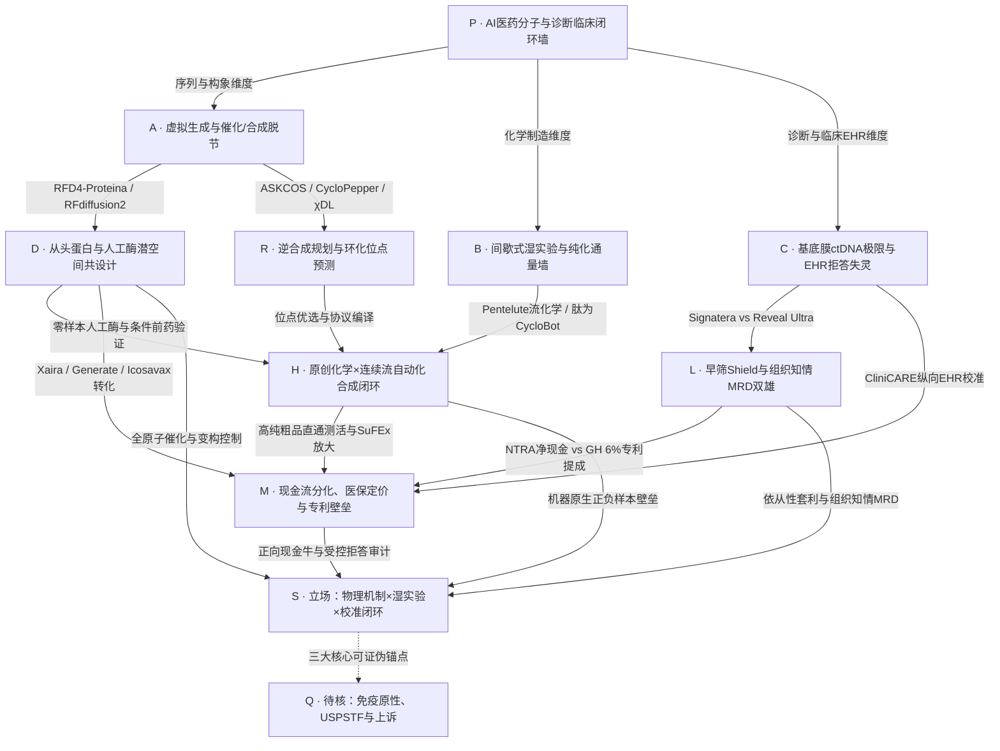

> **交互式认知地图与主体档案（GitHub Pages）**：[打开网页版交互画布 ↗](https://mojojolite-sketch.github.io/AI%E5%8C%BB%E8%8D%AF/index.html)

<!-- m-overview-meta: {"schema_version": 1, "updated_at": "2026-11-13"} -->
# AI医药

聚焦从头蛋白质与人工酶生成设计（De Novo Protein & Enzyme Design）、逆合成路线规划、自动化连续流湿实验闭环（Self-Driving Labs）、肿瘤液体活检（癌症早筛与超微量 MRD 复发监测）、纵向电子病历（EHR）临床推理校准及商业化兑现的逻辑演变。

## 当前研究重点与核心判断

- ==核心矛盾==：AI 医药、精准分子诊断与临床智能体的第一性瓶颈早已不是“虚拟空间能生成多少亿个分子结构、测序仪能产出多少 TB 碱基或静态医考能刷多高分”，而是物理、生物解剖、临床不确定性校准与商业准入的四重硬约束——（1）从头设计的蛋白质与合成酶能否在亚埃级（$<0.5\text{ \AA}$）精度预组织催化过渡态并规避人体免疫原性；（2）算法生成的多肽/小分子能否跨过间歇式湿实验与制备级 HPLC 纯化通量墙；（3）肿瘤液体活检能否突破肠黏膜基底膜无 ctDNA 入血的解剖极限（癌前腺瘤灵敏度仅 13.2%）以及 MolDx 医保审批与双链测序专利提成的盈利枷锁；（4）临床医疗智能体能否在缺失与噪声并存的真实纵向电子病历（EHR）中杜绝违规推理捷径并在证据不足时校准拒答。
- 架构收敛（D + R → H + L → M）：
  1. D 从头蛋白质与人工酶潜空间共设计层（Baker IPD / RFD4-Proteina / Xaira）：2024 诺贝尔化学奖得主 [David Baker](entities/people/David%20Baker.md) 领衔的[华盛顿大学蛋白质设计研究所（UW IPD）](entities/labs/UW%20Institute%20for%20Protein%20Design%20%28IPD%29.md)在 [2026 年 11 月英国皇家学会克鲁尼安讲座（Croonian Lecture）](blogs/%E8%AF%BA%E5%A5%96%E5%BE%97%E4%B8%BBBaker%E6%9C%80%E6%96%B0%E6%BC%94%E8%AE%B2%EF%BC%9AAI%E6%AD%A3%E5%9C%A8%E9%A2%A0%E8%A6%86%E7%94%9F%E5%91%BD%E7%A7%91%E5%AD%A6%EF%BC%81.md)及与 NVIDIA 联合发布的旗舰模型 RFD4-Proteina（2026.10）中，彻底终结了此前“RFdiffusion 先画骨架 + ProteinMPNN 后填序列”的两步割裂范式，通过统一潜空间测试时推理（Test-Time Latent Reasoning）实现序列、全原子结构与配体的联合共设计，设计速度与首轮湿实验成功率提升 5–10 倍[^13]。其五大实证标杆已全面跑通：① 10 µM 效应物触发变构促进解离的可开关 IL-2（*Nature* 2025，5 分钟脉冲即可使人 T 细胞 3 天存活率翻倍）[^14]；② 肿瘤蛋白酶条件激活的 IL-21 前药 Prokine（*bioRxiv* 2026.09，胰腺癌小鼠肿瘤压制至 ~0 mm³ 且消除常开型 -20% 体重暴跌毒性）[^15]；③ 零健康人脑背景交叉反应的阿尔茨海默病磷酸化 Tau pT231 凹槽结合蛋白（*bioRxiv* 2026.10）[^16]；④ 从头设计 CYS-HIS-ASP 催化三联体合成艾滋病长效新药 Lenacapavir 手性酰胺键的人工连接酶（67 选 4 显活，52 号设计对 (S)-构型底物转化率达 79% vs (R)-构型 8.8%）[^13]；⑤ 偶氮苯 365 nm / 450 nm 光控蛋白质铰链马达。
  2. R / H 逆合成规划与原创化学×连续流自动化合成闭环层（Peptway / Pentelute / Chemify）：MIT Bradley Pentelute 实验室开创的自动快流固相合成（AFPS）将 Sarepta 反义 PMO 寡核苷酸合成从 1 周 压缩至 3–3.5 小时[^3]；其博后[李承喜](entities/people/%E6%9D%8E%E6%89%BF%E5%96%9C%20%28Chengxi%20Li%29.md)归国创立的[肽为生物（Peptway）](blogs/%E8%9E%8D%E8%B5%84%E6%95%B0%E5%8D%83%E4%B8%87%E5%85%83%EF%BC%8CMIT%E5%BD%92%E5%9B%BD%E7%A7%91%E5%AD%A6%E5%AE%B6%E8%A6%81%E8%AE%A9AI%E4%BB%8E%E3%80%8C%E8%AE%BE%E8%AE%A1%E8%8D%AF%E3%80%8D%E5%8F%98%E6%88%90%E3%80%8C%E9%80%A0%E5%87%BA%E8%8D%AF%E3%80%8D.md)通过原创 DAN / PMDA 固载连接子配合 CycloBot 70 通道自动化合成仪，将头尾环肽环化裂解压缩至 20–27 分钟、粗品纯度从 <65% 提升至 >95%，并以 306 条标准化环肽正负样本训练 CycloPepper（前瞻盲测一致率 86%），配合 100 mM SuFEx 酰基氟高浓环化打通公斤级放大路径[^2][^4][^6]。
  3. L / M 液体活检癌症早筛、MRD 三雄法定报表对账与纵向临床 EHR 校准层（Natera / Guardant Health / Exact Sciences / GRAIL；Scale AI CliniCARE-Bench）：
     - 液体活检四强 2026Q3 Form 10-Q 法定正面对账：穿透 [Guardant Health 26Q3 Form 10-Q 法定拆解](blogs/Guardant%20Health%20Q3%202026%20Form%2010-Q_%20Total%20Revenue%20%24361.0M%20%28%2B36%25%20YoY%29%2C%20Shield%20Blood%20CRC%20Screening%20Volume%20%2B246%25%20t.md)（另见[早筛临床与竞争综述](blogs/Guardant_%E7%99%8C%E7%97%87%E6%97%A9%E7%AD%9B%E5%A5%BD%E5%95%8A%EF%BC%8C%E5%BE%97%E5%81%9A%E5%95%8A.md)）、[Natera 26Q3 Form 10-Q 法定拆解](blogs/Natera%20Q3%202026%20Financial%20Results%20%26%20Form%2010-Q_%20Revenue%20%24794.0M%20%28%2B34.1%25%20YoY%29%2C%20Signatera%20Clinical%20MRD%20Volume%20%2B56%25.md) 与 [GRAIL 26Q3 Form 10-Q 与 NHS-Galleri 深度拆解](blogs/GRAIL%20Q3%202026%20Form%2010-Q%20%26%20NHS-Galleri%20Readout_%20Galleri%20Volume%20%2B24%25%20YoY%20%28_56%2C000%20Tests%2C%20%2437.3M%20Revenue%29%2C%20%24788.7.md)，四家龙头呈现出清晰的商业阶段与资产负债表分野：[Natera](entities/companies/Natera.md) 单季总营收达 \$794.0M（+34.1% YoY），全年官方营收指引上调至 \$3.005B–\$3.035B，肿瘤总检测 339,500 例（+60.9% YoY），其中肿瘤知情（Tumor-informed 16-plex PCR）旗舰 Signatera 临床 MRD 达 316,000 例（+56% YoY，均价 ~\$1,290），凭妇幼遗传现金牛（Panorama）与泛癌种 MolDx 医保先发壁垒实现 64.7% GAAP 毛利率、全司正向现金流与 +\$1,016.9M 净现金（\$1,097.2M 现金 vs \$80.3M 债务）[^20]；[Guardant Health](entities/companies/Guardant%20Health.md) 单季总营收 \$360.975M（+36.1% YoY；Note 2 四分部：Oncology \$231.264M、Screening \$67.614M、Biopharma & data \$58.972M、Licensing & other \$3.125M），虽然剔除早筛分部后的核心业务在 2026 全年已实现正向自由现金流，且血液肠癌早筛 Shield 单季放量至 83,000 例（+246% YoY，均价 \$814.6 > \$800，单检 COGS 提前降至 \$330，10 癌种 Shield MCD 入选美国国家癌症研究所 NCI Vanguard Study）、MRD 产品 Reveal 检测量同比翻倍并以 <1 ppm 全基因组 Reveal Ultra 反攻药企，但受困于 ECLIPSE 试验癌前腺瘤灵敏度瓶颈（13.2% vs [Exact Sciences](entities/companies/Exact%20Sciences.md) Cologuard Plus 43.4%）[^18][^19]、早筛销售扩编导致的 $(37.2)M 单季 FCF 净流出、账面 \$1,502.413M 可转债及 TwinStrand 专利终审判赔 \$245.2M+ 与 6% 持续提成（冻结 \$110.2M 受限现金保函抵押），全司 FCF 盈亏平衡仍需待 2027 年底[^17]；泛癌种早筛先驱 [GRAIL](entities/companies/GRAIL.md)（NASDAQ: GRAL，CIK 0001699031）单季总营收 \$37.535M（+3.7% YoY），其中 Galleri 商业筛查 \$37.269M（+14% YoY）、检测量 >56,000 例（+24% YoY；9M 累计筛查 \$119.743M / >174,000 例，合并总营收 \$123.007M），受 9 月促销拉动渗透影响确认 ASP 同比回落约 9% 至 ~\$660–\$666/例，单季 GAAP 毛亏 $(18.111)M（含 \$33.473M 无形资产摊销；Non-GAAP 毛利 \$15.914M 同比 -20%）、R&D 降本 9.4% 至 \$44.073M 而 S&M 激增 +63.5% 至 \$41.695M，GAAP 净亏损 \$103.6M、Adjusted EBITDA 亏损 $(92.6)M；凭 \$788.7M 现金及短期有价证券与零有息长债支撑跑道至 2028 年末—2029 年，NHS-Galleri 14.2 万人试验虽未达全体癌种 III–IV 期减量主要终点（CCGA I 期灵敏度 16.8%），但 12 高致死癌种末轮 IV 期降 26% 且总检出率升 4 倍，FDA PMA 获专家组 7:2 支持预期 2027Q1 初迎来最终裁决，惟美国 MCED Act 法定 Medicare 报销要到 2029 年方才启动[^22]。
     - 临床医疗智能体纵向 EHR 推理校准硬约束：穿透 [Scale AI Labs](entities/companies/Scale%20AI%20Labs.md) 联合斯坦福、埃默里、范德堡发布的 [CliniCARE-Bench（arXiv:2608.07796）](blogs/CliniCARE-Bench_%20Clinical%20Calibrated%20Audit%20of%20Medical%20Reasoning%20in%20Longitudinal%20Electronic%20Health%20Records%20%28arX.md)，在真实 MIMIC-IV (v3.1) 住院/ICU 纵向多表电子病历的 750 例受控工具沙箱审计中，16 个前沿及开源智能体的四分类原始准确率从静态 MedQA/USMLE 的 >90% 骤降至 65.3%–76.1%；扣除违规推理捷径后的无缺陷准确率（Defect-Free Accuracy）进一步暴跌 4.8–14.8 个百分点（最高约 ~20% 表面正确裁决系因错误理由蒙对），且全部 16 个系统均存在系统性拒答不足（Under-Abstention），在缺数或医学模糊病历上强行输出确定性 Yes/No 臆断[^21]。

## 逻辑演变图谱

展开 GitHub 原生 Mermaid 逻辑图

### 五问总览（2026-11-13；question-ai-pharma-wetlab-closed-loop@1）

1. 核心未解决问题：AI 从头设计的生物大分子、高敏液体活检与临床推理智能体，如何跨过从虚拟生成/测序信号/静态题库到真实湿实验免纯化交付、临床成药验证、医保正向现金流及纵向病历安全部署的物理与制度高墙？当前受制于四大断层：（1）虚拟生成缺乏过渡态亚埃级预组织与真实反应负样本约束；（2）间歇式合成与制备级 HPLC 纯化锁死湿实验通量，且非天然设计蛋白面临人体抗药抗体（ADA）免疫原性风险；（3）外周血早期肿瘤与癌前病变游离 ctDNA 丰度逼近泊松抽样极限（<1–10 ppm），且商业化面临高昂地推费用、专利诉讼提成与医保准入时滞；（4）结果导向 RL 训练的大模型在残缺纵向电子病历中普遍走捷径且丧失不确定性拒答边界。
2. 解决设想与实质机制：
   - 从头蛋白质与人工酶设计（UW IPD / Xaira / Generate / Chai）：以 RFD4-Proteina 潜空间测试时推理与 RFdiffusion2 + PLACER 全原子构象系综预组织直接固定催化三联体（CYS-HIS-ASP）与变构铰链，零样本造出 Lenacapavir 合成酶、肿瘤蛋白酶条件激活细胞因子 Prokine 与阿尔茨海默病 Tau pT231 凹槽阅读器[^13][^15][^16]。
   - 自动化环肽/多肽合成闭环（肽为生物 / MIT Pentelute）：以 DAN/PMDA 选择性环化裂解连接子 + CycloBot 70 通道流合成仪 在 20–27 分钟 内直接产出 >95% 纯度粗品，免去 HPLC 纯化并回传正负样本训练 CycloPepper[^2][^4]。
   - 液体活检早筛与组织知情超微量 MRD（Natera / Guardant / Exact Sciences）：MRD 端依托患者基线肿瘤测序锁定个体化突变先验（Natera Signatera 16-plex PCR / Signatera Genome 64 位点 WGS 对决 Guardant Reveal Ultra 2,000+ 位点 WGS <1 ppm），配合 III 期临床证据（如 IMvigor011）打通 MolDx \$1,290+ 高均价报销；早筛端通过 cfDNA 甲基化+片段组学（Shield）配合 \$1,495 ADLT 定价与规模降本（COGS \$410 → \$330 → \$200）转化拒做肠镜人群，并以 10 癌种 Shield MCD 切入 NCI Vanguard Study[^17][^20]。
   - 纵向 EHR 受控取证与校准拒答审计（CliniCARE-Bench）：通过凭证隔离工具沙箱、病例级加权过程量表（Defect-Free Accuracy）及区分缺数（Lack of Data）与医学模糊（Medically Ambiguous）的四元拒答空间，强制临床智能体逐项核对原始化验与时间轴并在证据不足时转交人类医生[^21]。
3. 观点演变与修正：
   - 第一阶段（2018–2022，静态结构预测、纯免组织液体活检与静态医考热潮）：认为 AlphaFold2 预测结构即可直接转化为新药，纯靠免肿瘤组织血液甲基化即可通吃 MRD 与泛癌种早筛，或大模型通过 USMLE 医考即可上岗临床诊疗。
   - 第二阶段（2023–2024，两步法扩散生成与早筛临床基底膜撞墙）：RFdiffusion + ProteinMPNN 跑通刚性靶点结合蛋白，但在多步酶催化上受阻；液体活检端 ECLIPSE 试验揭露血液 Shield 对癌前腺瘤灵敏度仅 13.2%，GRAIL Galleri 在英国 NHS 14.2 万人随机对照试验中未达 III–IV 期减量主要终点（I 期灵敏度仅 16.8%）。
   - 第三阶段（2025–2026，全原子潜空间推理×原创流化学×肿瘤知情 MRD 双雄分化×纵向 EHR 过程审计）：大分子设计收敛至 RFD4-Proteina 全原子共设计；湿实验收敛至“专利连接子化学 + 70 通道流合成硬件”；MRD 收敛至肿瘤组织知情全基因组路线（Natera 凭 31.6 万例/季 规模与 +\$10.17 亿 净现金领跑，Guardant 以 <1 ppm Reveal Ultra 及剔除早筛后核心业务 FCF 转正追赶）；医疗 AI 评测从静态多选题转向 CliniCARE-Bench 纵向病历过程合规与校准拒答审计。
4. 开放争议：
   - 争议一：完全从头设计的非天然微型蛋白（Minibinders）vs 从头设计人源化单抗 CDR（Chai / Generate）：非天然小蛋白具备极高热稳定性与微生物低成本发酵优势，但在人体内多次注射后的免疫原性（ADA）尚待大规模 II/III 期临床验证；而 [Generate:Biomedicines（NASDAQ: GENB）](entities/companies/Generate%20Biomedicines.md) 的从头设计长效抗 TSLP 单抗 GB-0895（半年一针）已率先进入全球 III 期哮喘临床。
   - 争议二：肿瘤知情定制 PCR 扩增子（Natera Signatera / Signatera Genome）vs 基线 WGS + 免定制大 Panel 捕获（Guardant Reveal Ultra）：定制引物路线复测边际成本极低且已锁死临床医生工作流与医保目录，而免定制捕获路线首检周转更快且天然覆盖 2,000+ 位点与耐药克隆演化，双方胜负取决于 Reveal Ultra 的 MolDx 准入速度与 TwinStrand 6% 专利提成上诉结果。
   - 争议三：血液早筛 Shield（依从性优先，癌前灵敏度 13.2%）vs 粪便 DNA Cologuard Plus（预防性优先，癌前灵敏度 43.4%）：USPSTF 指南更新是否会将血液检测列与肠镜/粪便检测同等的一线 A 级推荐，直接决定 Shield 商业保险定价权。
5. 必须逐项否定或限定边界的早期错误：
   - AlphaFold 预测自然蛋白结构 $\neq$ 从头设计功能新药：正向折叠模型不能直接生成自然界不存在的变构开关或人工酶，必须依赖 RFdiffusion2 / RFD4-Proteina 等逆向生成架构。
   - 结直肠癌血液早筛获批 FDA $\neq$ 具备癌前息肉阻断能力：Shield 对进展期腺瘤灵敏度仅 13.2%（假阳性率 10.4%），不能替代结肠镜或 Cologuard Plus 的癌前预防价值。
   - MRD 检测量暴增 $\neq$ 利润与自由现金流无条件释放：Natera 之所以实现正向现金流，核心在于 Signatera 已跨过 31.6 万例/季 规模阈值并有成熟妇幼遗传业务托底；而新进入适应症在获 MolDx 审批前存在 12–18 个月收入确认时滞，且 Guardant 仍需消化早筛地推与 TwinStrand 诉讼担保压力。
   - 大模型 USMLE 医考 >90% $\neq$ 可用于真实医院纵向病历自动化审核：CliniCARE-Bench 证实前沿智能体在 MIMIC-IV 纵向病历上存在 4.8–14.8 个百分点的违规捷径泡沫且全员拒答失灵，未经校准拒答改造严禁无人值守部署。

### 节点机制与证据锚点

- P / A / B / C · 干湿脱节、纯化通量墙、基底膜ctDNA极限与纵向EHR拒答失灵：分子制造端，常规环肽间歇合成耗时 7 天、粗品纯度 <65%，公开文献逾 90% 缺失失败负样本；分子设计端，自然进化仅采样约 $10^{12}$ 种蛋白，初代两步法生成无法维持多步酶催化所需的亚埃级过渡态几何精度；早筛诊断端，结直肠癌前腺瘤位于肠上皮基底膜内侧未侵入毛细血管，导致血液 ctDNA 早筛极难捕获癌前病变；临床医疗 AI 端，真实医院纵向 EHR 分散于跨时间轴异构多表且充斥缺失值，结果导向训练的前沿模型普遍跳过原始化验核验并在证据缺失时强行臆断（[《融资数千万元，MIT归国科学家要让AI从「设计药」变成「造出药」》](blogs/%E8%9E%8D%E8%B5%84%E6%95%B0%E5%8D%83%E4%B8%87%E5%85%83%EF%BC%8CMIT%E5%BD%92%E5%9B%BD%E7%A7%91%E5%AD%A6%E5%AE%B6%E8%A6%81%E8%AE%A9AI%E4%BB%8E%E3%80%8C%E8%AE%BE%E8%AE%A1%E8%8D%AF%E3%80%8D%E5%8F%98%E6%88%90%E3%80%8C%E9%80%A0%E5%87%BA%E8%8D%AF%E3%80%8D.md) · [《诺奖得主Baker最新演讲：AI正在颠覆生命科学！》](blogs/%E8%AF%BA%E5%A5%96%E5%BE%97%E4%B8%BBBaker%E6%9C%80%E6%96%B0%E6%BC%94%E8%AE%B2%EF%BC%9AAI%E6%AD%A3%E5%9C%A8%E9%A2%A0%E8%A6%86%E7%94%9F%E5%91%BD%E7%A7%91%E5%AD%A6%EF%BC%81.md) · [《CliniCARE-Bench (arXiv:2608.07796)》](blogs/CliniCARE-Bench_%20Clinical%20Calibrated%20Audit%20of%20Medical%20Reasoning%20in%20Longitudinal%20Electronic%20Health%20Records%20%28arX.md)）。
- D · 从头蛋白质与人工酶潜空间共设计（UW IPD / RFD4-Proteina / Xaira / Chai）：[David Baker](entities/people/David%20Baker.md) 与 [UW IPD](entities/labs/UW%20Institute%20for%20Protein%20Design%20%28IPD%29.md) 联合 NVIDIA 推出的 RFD4-Proteina（2026.10）通过潜空间测试时推理联合生成序列、全原子结构与配体：在艾滋病长效新药 Lenacapavir 手性酰胺连接酶设计中，排布 CYS-HIS-ASP 催化三联体与 GLN 氧阴离子洞抑制水相水解，67 个零样本设计中 4 个显活，52 号设计对 (S)-底物转化率达 79% 而 (R)-底物仅 8.8%[^13]；在免疫调控中，Broerman 等（*Nature* 2025）设计出 10 µM 效应物促进解离的可开关 IL-2（5 分钟信号脉冲翻倍 T 细胞 3 天存活率）[^14]，Shin 等（*bioRxiv* 2026）设计出肿瘤蛋白酶激活的 IL-21 前药 Prokine（消除 -20% 体重损失全身毒性并实现胰腺癌小鼠完全消退）[^15]；在神经退行性疾病中，吴可嘉（Kejia Wu）等（*bioRxiv* 2026）设计出特异识别阿尔茨海默病磷酸化 Tau pT231 的凹槽阅读器，消除商业抗体的健康人脑假阳性[^16]。产业转化端，Baker 联合创立的 [Xaira Therapeutics](entities/companies/Xaira%20Therapeutics.md) 募资超 10 亿美元，Icosavax 被阿斯利康以 11 亿美元 收购，竞对 [Generate:Biomedicines](entities/companies/Generate%20Biomedicines.md) 完成 4 亿美元 IPO 并将抗 TSLP 单抗推进至 III 期，[Chai Discovery](entities/companies/Chai%20Discovery.md) 完成 4 亿美元 C 轮融资（估值 38 亿美元）。
- R / H · 逆合成规划与原创化学×连续流自动化湿实验闭环（Peptway / Pentelute / Chemify）：[肽为生物（Peptway）](entities/companies/%E8%82%BD%E4%B8%BA%E7%94%9F%E7%89%A9%20%28Peptway%29.md)依托 [李承喜](entities/people/%E6%9D%8E%E6%89%BF%E5%96%9C%20%28Chengxi%20Li%29.md) 团队发表于 *JACS*（2026，10.1021/jacs.5c16902）的 DAN 固载连接子与 CycloBot 70 通道自动化合成仪，在 20–27 分钟 内完成重氮化激活与自纯化头尾环化裂解，粗品纯度 >95%，配合 *Nat. Commun.*（2026）的 CycloPepper 环化预测模型（74 条前瞻盲测一致率 86%）与 100 mM SuFEx 酰基氟活化化学，构建了环肽大分子的物理闭环[^2][^4][^6]。
- L · 液体活检早筛与组织知情 MRD 四强对决（Natera / Guardant Health / Exact Sciences / GRAIL）：MRD 战场呈现“规模霸主 vs 全基因组追赶者”正面交锋：[Natera](entities/companies/Natera.md) 依托肿瘤知情 16-plex PCR Signatera（及 64 位点全基因组 Signatera Genome + 免组织 Latitude），在 2026Q3 实现肿瘤总检测 339,500 例（+60.9% YoY）、临床 MRD 316,000 例（+56% YoY，单检均价 ~\$1,290），并以 III 期 IMvigor011 临床阳性结果巩固伴随诊断护城河（[《Natera Q3 2026 Form 10-Q》](blogs/Natera%20Q3%202026%20Financial%20Results%20%26%20Form%2010-Q_%20Revenue%20%24794.0M%20%28%2B34.1%25%20YoY%29%2C%20Signatera%20Clinical%20MRD%20Volume%20%2B56%25.md)）[^20]；[Guardant Health](entities/companies/Guardant%20Health.md) 在 2026Q3 实现肿瘤临床检测 117,000 例（+58% YoY、Reveal MRD 同比翻倍），推出基线肿瘤 WGS 追踪 2,000+ 位点、检出限 <1 ppm 的 Reveal Ultra，同时在结直肠癌血液早筛端凭 Shield 交付 83,000 例（+246% YoY、ASP \$814.6 > \$800、单检 COGS 降至 \$330、商保覆盖 >80%）并将 10 癌种 Shield MCD 送入 NCI Vanguard Study，但癌前进展期腺瘤灵敏度（13.2%）仍显著受制于基底膜解剖极限（对比 [Exact Sciences](entities/companies/Exact%20Sciences.md) Cologuard Plus 43.4%、季度 >120 万例）（[《Guardant Health Q3 2026 Form 10-Q》](blogs/Guardant%20Health%20Q3%202026%20Form%2010-Q_%20Total%20Revenue%20%24361.0M%20%28%2B36%25%20YoY%29%2C%20Shield%20Blood%20CRC%20Screening%20Volume%20%2B246%25%20t.md) · [《Guardant|癌症早筛好啊，得做啊》](blogs/Guardant_%E7%99%8C%E7%97%87%E6%97%A9%E7%AD%9B%E5%A5%BD%E5%95%8A%EF%BC%8C%E5%BE%97%E5%81%9A%E5%95%8A.md)）[^17][^18][^19]；[GRAIL](entities/companies/GRAIL.md) 则依托 Galleri 在 2026Q3 交付 >56,000 例（+24% YoY、9M >174,000 例 +36%） 并打通 Quest Diagnostics（~7,400 采血点）及 Epic Aura 原生点单，虽在 NHS-Galleri 14.2 万人试验未达全体癌种 III–IV 期减量主终点（I 期 16.8%），但 12 高致死癌种末轮 IV 期降 26% 且总检出率升 4 倍，获 FDA 专家组 7:2 支持并预期 2027Q1 初迎来 PMA 最终裁决（[《GRAIL Q3 2026 Form 10-Q & NHS-Galleri Readout》](blogs/GRAIL%20Q3%202026%20Form%2010-Q%20%26%20NHS-Galleri%20Readout_%20Galleri%20Volume%20%2B24%25%20YoY%20%28_56%2C000%20Tests%2C%20%2437.3M%20Revenue%29%2C%20%24788.7.md)）[^22]。
- M · 平台现金流分化、医保定价、专利诉讼与临床 EHR 合规审计：AI 制药湿实验平台端，[晶泰科技（2228.HK）](entities/companies/%E6%99%B6%E6%B3%B0%E7%A7%91%E6%8A%80%20%28XtalPi%29.md)（2025 首盈 1.35 亿元）与[英硅智能（3696.HK）](entities/companies/%E8%8B%B1%E7%A1%85%E6%99%BA%E8%83%BD%20%28Insilico%20Medicine%29.md)（26H1 营收 1.063 亿美元）验证了 BD 造血能力[^7][^8]；分子诊断端 2026Q3 法定报表揭示剧烈现金流与支付制度分化——[Natera](entities/companies/Natera.md) 单季营收 \$794.0M、GAAP 毛利率 64.7%（剔除回款补确认为 63.2%）、单季现金净增 +\$5.7M、坐拥 +\$1,016.9M 净现金并将全年营收指引上调至 \$3.005B–\$3.035B[^20]；[Guardant Health](entities/companies/Guardant%20Health.md) 单季营收 \$360.975M（GAAP 毛利率 65.4% / Non-GAAP 67.0%），虽剔除早筛后核心业务 2026 全年已实现正向 FCF，但因早筛推广拖累合并 FCF $(37.2)M（全年指引 $(205)M–$(220)M），且背负 \$1,502.413M 可转债与 TwinStrand \$245.2M+ 判赔及 6% 持续提成（冻结 \$110.2M 受限现金保函）[^17]；[GRAIL](entities/companies/GRAIL.md) 单季总营收 \$37.535M（Galleri \$37.269M +14%）、9 月促销压低 ASP 约 9% 至 ~\$660–\$666/例，GAAP 毛亏 $(18.111)M（含 \$33.473M 无形资产摊销；非 GAAP 毛利 \$15.914M 同比 -20%）、R&D 降本 9.4% 但 S&M 激增 63.5% 致单季净亏 \$103.6M / Adj. EBITDA $(92.6)M，依靠 \$788.7M 现金与零长债将跑道延至 2028/2029 年以渡过美国 MCED Act 2029 年 Medicare 开闸前的两年商业真空期[^22]。临床 AI 审计端，[Scale AI Labs](entities/companies/Scale%20AI%20Labs.md) CliniCARE-Bench 证明 16 个医疗智能体在 750 例 MIMIC-IV 纵向病历上扣除违规捷径后准确率下跌 4.8–14.8 个百分点且全员拒答失灵，确立了过程合规与校准拒答的商业准入门槛[^21]。
- S · 研究立场与可反驳条件（本工作台推断）：AI 医药、精准诊断与临床 AI 的护城河不在于通用基础模型参数量，而在于*“能否卡住物理、生物与临床合规的不可绕过关隘——分子设计端掌控全原子过渡态预组织与高通量免纯化流合成负样本闭环（RFD4-Proteina / CycloBot），分子诊断端掌控肿瘤组织个体化先验锚点与泛癌种医保规模飞轮（Signatera 正向现金流壁垒 vs Reveal Ultra <1 ppm 追赶 vs Galleri 跨越 2029 支付真空），临床 AI 端掌控真实纵向 EHR 原始数值核验与不确定性校准拒答（CliniCARE-Bench）”*。推翻条件：① 若非天然从头设计蛋白在人体 II 期临床中抗药抗体（ADA）发生率超 30%；② 若 USPSTF 指南拒绝将血液 Shield 列入一线 A/B 级推荐，或联邦巡回上诉法院维持 TwinStrand 6% 持续提成原判导致 Guardant 无法在 2027 年底实现全司 FCF 转正；③ 若 GRAIL 在 2027Q1 获批 FDA PMA 后年内商保覆盖突破 5,000 万人且 ASP 回稳至 \$750+ 打破两年支付真空期；④ 若下一代原生拒答强化学习模型无需专科过程监督即可在纵向 EHR 审计中实现 >85% 无缺陷准确率与 >80% 待定样本召回率。
- Q · 待验证问题：（1）RFD4-Proteina 从头设计的 Lenacapavir 连接酶在 >100 g/L 工业级底物浓度下的总周转数（TTN）与时空产率；（2）肽为生物 70 通道 CycloBot 与 SuFEx 100 mM 工艺在药企百克—公斤级 GMP 环肽生产中的商业化放量速度；（3）USPSTF 结直肠癌指南对血液早筛 Shield 的正式定级、NCI Vanguard Study 中 Shield MCD 前瞻读数、联邦巡回上诉法院（No. 26-2377）对 TwinStrand 专利案的二审裁决，以及 GRAIL Galleri 在 2027Q1 初 FDA PMA 最终裁决与商保/雇主渠道放量能否在 2029 年 MCED Act 开闸前守住现金跑道。

## 一手来源与参考文献

[^1]: Connor W. Coley, Klavs F. Jensen et al., *Autonomous Flow Chemistry Systems and ASKCOS Retrosynthetic Planning*, *Accounts of Chemical Research* / arXiv:2501.01835 (2025).
[^2]: Chengxi Li (李承喜) et al., *CycloPepper: a machine learning platform for predicting cyclization outcomes and optimizing synthesis of therapeutic cyclopeptides*, *Nature Communications* 17, 1528 (2026), DOI: 10.1038/s41467-026-69441-w.
[^3]: Chengxi Li, Alexander J. Callahan, M. D. Simon, Bradley L. Pentelute et al., *Fully automated fast-flow synthesis of antisense phosphorodiamidate morpholino oligomers*, *Nature Communications* 12, 4396 (2021), DOI: 10.1038/s41467-021-24598-4.
[^4]: Chengxi Li et al., *Automated Rapid Synthesis of High-Purity Head-to-Tail Cyclic Peptides via a Diaminonicotinic Acid Scaffold*, *Journal of the American Chemical Society* (2026), DOI: 10.1021/jacs.5c16902；对应中国发明专利申请 CN202410573195.2。
[^5]: Chengxi Li et al., *A Modular PMDA Linker Enables Lysine-Selective Cyclization of Unprotected Peptides and Automated Macrocycle Assembly*, *Journal of the American Chemical Society* (2026), DOI: 10.1021/jacs.6c09909.
[^6]: Chengxi Li et al., *SuFEx-Enabled Acyl Fluoride Chemistry for High-Concentration Minimal-Oligomerization Peptide Macrocyclization*, *Journal of the American Chemical Society* (2026), DOI: 10.1021/jacs.6c12217.
[^7]: 晶泰控股（XtalPi Holdings Limited，2228.HK），《截至 2025 年 12 月 31 日止年度之全年业绩公告》（港交所披露易，2026 年 3 月）。
[^8]: 英硅智能（Insilico Medicine Cayman TopCo，3696.HK），《全球发售招股章程》（2025 年 12 月）及《2026 年中期业绩公告》（2026 年 8 月）。
[^9]: Recursion Pharmaceuticals, Inc. (NASDAQ: RXRX), *Form 10-Q & Pipeline Prioritization Update* (May 2025 – Nov 2026).
[^10]: Lee Cronin et al., *Chemify Unveils First Chemifarm and Completes \$50M+ Series B & Scottish Enterprise Grant Expansion* (chemify.io, 2025–2026).
[^11]: Emerald Cloud Lab (emeraldcloudlab.com), *Symbolic Lab Language (SLL) & Cloud Lab Infrastructure Restructuring* (2024–2026).
[^12]: Lila Sciences (lila.ai), *Flagship Pioneering Launches Lila Sciences and Closes \$350M Series A for Autonomous Science Units* (2025–2026).
[^13]: David Baker, *Advances in computational protein design* (Royal Society Croonian Prize Lecture, Nov 3, 2026) & Nathaniel Corley*, Kieran Didi*, Maxwell W. Kazman*, Rafael I. Brent*, David Baker et al., *Biomolecular design through latent reasoning with RFD4-Proteina* (rfd4-proteina.org, UW IPD & NVIDIA Preprint, Oct 2026).
[^14]: Adam Broerman, Florian Praetorius, Jacob Piehler, David Baker et al., *Design of facilitated dissociation enables timing of cytokine signalling*, *Nature* 647, 528–535 (2025), DOI: 10.1038/s41586-025-09549-z.
[^15]: Hojeong Shin, Stephanie K. Dougan, Michael Dougan, David Baker et al., *De novo design of protease-activatable cytokine prodrugs*, *bioRxiv* (Sept 22, 2026), DOI: 10.64898/2026.09.19.752834.
[^16]: Kejia Wu, Yuyu Song, David Baker et al., *Design of readers for pathological PTM proteoforms in Alzheimer's disease*, *bioRxiv* (Oct 21, 2026), DOI: 10.64898/2026.10.20.760520.
[^17]: Guardant Health, Inc. (NASDAQ: GH, SEC CIK 0001576280), *Form 10-Q for the Quarterly Period Ended September 30, 2026* (filed Nov 5, 2026; Note 2 Disaggregation of Revenue, Note 7 Convertible Senior Notes, Note 8/9 TwinStrand Litigation & Surety Bond) & *Q3 2026 Earnings Release* (Nov 4, 2026).
[^18]: Daniel C. Chung et al., *A Cell-free DNA Blood-Based Test for Colorectal Cancer Screening (ECLIPSE Study)*, *New England Journal of Medicine* 390, 973–983 (2024), DOI: 10.1056/NEJMoa2304714; FDA PMA P230043.
[^19]: Thomas F. Imperiale et al., *Next-Generation Multitarget Stool DNA Test for Colorectal Cancer Screening (BLUE-C Study, Exact Sciences Cologuard Plus)*, *New England Journal of Medicine* 390, 984–993 (2024), DOI: 10.1056/NEJMoa2310336.
[^20]: Natera, Inc. (NASDAQ: NTRA, SEC CIK 0001604821), *Form 10-Q for the Quarterly Period Ended September 30, 2026* & *Q3 2026 Financial Results Press Release* (Nov 2026).
[^21]: Scale AI Labs (SEAL), Stanford University School of Medicine, Emory University, Vanderbilt University Medical Center & UC Santa Cruz, *CliniCARE-Bench: Clinical Calibrated Audit of Medical Reasoning in Longitudinal Electronic Health Records*, arXiv:2608.07796 (Aug 2026).
[^22]: GRAIL, Inc. (NASDAQ: GRAL, SEC CIK 0001699031), *Form 10-Q for the Quarterly Period Ended September 30, 2026* & *Q3 2026 Financial Results Press Release* (Nov 4–5, 2026); *NHS-Galleri 142,000-Participant RCT Readout* (ASCO 2026), *FDA Molecular and Clinical Genetics Devices Panel Review* (Sept 23, 2026, 7–2 vote) & *Nancy Gardner Sewell Medicare MCED Screening Coverage Act* (H.R. 842 / S. 339, enacted Feb 3, 2026).

<!-- daily-digest:begin -->
归档：[交互图谱](https://mojojolite-sketch.github.io/AI%E5%8C%BB%E8%8D%AF/index.html) · [主体档案（31）](entities/README.md) · [单篇导读（9）](blogs/README.md)
<!-- daily-digest:end -->
