
# Guardant|癌症早筛好啊，得做啊

2026-11-10 · Guardant Health 26Q3 10-Q & NEJM ECLIPSE · 已整理

[本地原件归档](../../../raw/78ffa4c933bc78156422ee6b9b039ccb5dbba64fbefed49c2d52993a1b83873f) · 固定材料版本 `digest-material-78ffa4c933bc78156422ee6b9b039ccb5dbba64fbefed49c2d52993a1b83873f@1` · [一手原站](https://www.sec.gov/edgar/browse/?CIK=0001576280) · [触发线索（循因缉药）](https://mp.weixin.qq.com/s/K-mpRFcN1mYInM_gEry22A)

> [!IMPORTANT]
> 用户关注点（TG）：穿透核查Guardant Health（NASDAQ: GH）最新SEC 10-Q财报、FDA对Shield结直肠癌血液早筛的审批与CMS医保报销定价（\$1,495 vs \$920）、ECLIPSE万人临床试验灵敏度/特异性硬指标（整体CRC 83.1%，但I期早癌仅55%–65%、癌前进展期腺瘤仅13.2%，对比Exact Sciences Cologuard Plus与GRAIL Galleri），算清三大业务（Guardant360、Reveal/Reveal Ultra MRD、Shield早筛）营收增速、毛利率、单检成本（COGS）与自由现金流转正路径。

## 针对性追查与回应

### 一、 场景与利益标注及 Guardant Health（NASDAQ: GH）商业底座全景

- 场景与利益标注：本文触发线索来自微信公众号「循因缉药」（作者：星海领航员，2026-11-10）对美国液体活检龙头 Guardant Health（NASDAQ: GH，SEC CIK-0001576280） 于 2026 年 11 月 4–5 日披露的 2026 年第三季度财报（Guardant-Health-Reports-Third-Quarter-2026-Financial-Results-and-Increases-2026-Revenue-Guidance）、业绩演示材料（Guardant-Health-Q3-2026-Earnings-Presentation_FINALv）及 SEC Form 10-Q 的拆解评论（原文按 PART 01 至 PART 04 及 Why / END 展开）。财报公布次日 Guardant 股价盘中仅微跌 1.67% 后横盘震荡。需注意：管理层在业绩电话会与 PPT 中高调渲染结直肠癌血液早筛 Shield 营收同比暴增 180%、检测量同比暴增 246% 的高成长叙事，却将 G&A 管理费用同比暴增 71%（源于输掉 TwinStrand 双链测序专利官司被判赔超 2.45 亿美元 及 6% 持续提成）以及 Shield 对癌前进展期腺瘤灵敏度仅 13.2% 的临床天花板隐藏在 10-Q 附注与 FDA 说明书深处。
- 本工作台核查（Guardant Health 三大核心业务板块与现金流角色拆解）：
  1. 肿瘤伴随诊断与复发监测（Oncology：Guardant360 + Guardant Reveal，占总营收 64.1%）：
     - 核心产品：晚期实体瘤血液伴随诊断金标准 Guardant360 / Guardant360 CDx（全球累计获批 31 项伴随诊断适应症，26Q3 新增 ETCAMAH 及礼来 INLURIYO + VERZENIO 乳腺癌伴随诊断），以及早中期术后微小残留病灶（MRD）检测 Guardant Reveal 与刚发布的肿瘤知情全基因组测序版本 Guardant Reveal Ultra。
     - 战略角色：公司的成熟现金牛与临床肿瘤科医生渠道基本盘，贡献单季 2.313 亿美元 营收与超 68% 的高毛利。
  2. 癌症血液早筛（Screening：Shield 结直肠癌 CRC 血液游离 DNA + 甲基化检测，占总营收 18.7%）：
     - 核心产品：2024 年 7 月 29 日获 FDA PMA（P230043）批准、面向 45 岁以上平均风险人群的首款获批且获 CMS 医保报销的结直肠癌血液早筛产品 Shield。
     - 战略角色：公司的第二增长曲线与最大烧钱引擎——26Q3 单季检测量达 83,000 例（+246% YoY、+26% QoQ），单季营收 6,761.4 万美元（+180% YoY、+28% QoQ），全年早筛营收指引上调至 2.33 亿–2.38 亿美元（即最高 2.38亿 美元）；但为铺设全美初级保健医生（PCP）销售铁军，直接推升销售费用至单季 1.772 亿美元。
  3. 生物制药研发服务与数据授权（Biopharma & Data：占总营收 16.3%）：
     - 核心产品：为跨国药企临床试验提供伴随诊断开发、GuardantINFINITY 表观基因组学分析及真实世界临床基因组数据库授权，26Q3 营收 5,900 万美元（+8% YoY、-3% QoQ）。

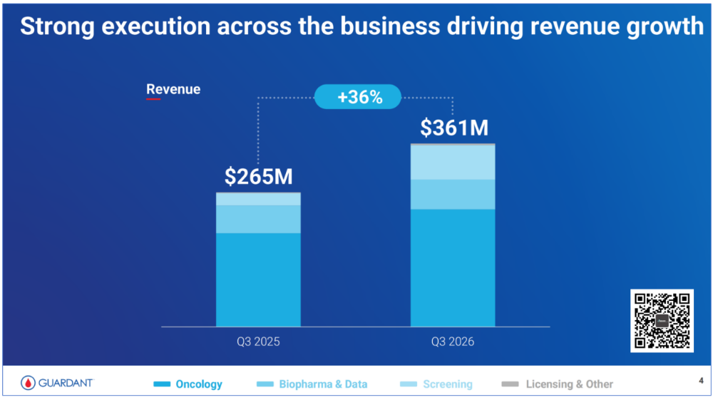

---

### 二、 2026Q3 SEC 10-Q 财务报表穿透对账：为什么营收大涨 36%，净亏损却扩大 34%？

- 原文主张（PART 01）：Guardant Health 2026Q3 营收为 3.60975 亿美元（同比 +36%，环比 +8%），但净亏损达 1.24362 亿美元（同比 +34%，环比 +4%）；亏损扩大的原因是销售及市场费用同比增加 4,984 万美元（+39%），管理费用同比增加 3,760 万美元（+71%，其中法律费用激增 2,260 万美元）。
- 本工作台核查（✅ SEC 10-Q 损益表逐行核验 100% 准确；进一步穿透单检均价 ASP、毛利率结构与 TwinStrand 2.45 亿美元专利败诉黑天鹅）：

| 财务与运营指标（单位：千美元，除检测量与单价外） | 2025Q3 (10-Q) | 2026Q2 (10-Q) | 2026Q3 (10-Q 实绩) | 同比变动 (YoY) | 环比变动 (QoQ) | 本工作台单检经济学与财务拆解（Unit Economics） |
| :--- | :---: | :---: | :---: | :---: | :---: | :--- |
| 总营业收入（Total Revenue） | \$265,196 | \$335,280 | \$360,975 | +36.1% (+36%) | +7.7% (+8%) | 2026 前三季度累计营收达 \$997,618（+42.4% YoY），全年营收指引上调至 \$1.36B–\$1.37B（+38%–40%） |
| — 1. 肿瘤临床业务（Oncology Revenue） | \$184,400 | \$218,200 | \$231,300 | +25.4% (+25%) | +6.0% (+6%) | 检测量 117,000 例（+58% YoY、+13% QoQ）；隐含单检综合均价（ASP）~\$1,977 / 例 |
| — 2. 早筛业务（Screening / Shield Revenue） | \$24,142 | \$52,823 | \$67,614 | +180.1% (+180%) | +28.0% (+28%) | 检测量 83,000 例（+246% YoY、+26% QoQ）；隐含实际入账均价（Realized ASP）~\$815 / 例 |
| — 3. 药企与数据服务（Biopharma & Data） | \$54,700 | \$60,800 | \$59,000 | +7.9% (+8%) | -3.0% (-3%) | 药企研发预算阶段性波动导致环比微降 3%，全年维持低双位数增长指引 |
| 营业成本（Cost of Revenue / COGS） | \$94,009 | \$117,348 | \$124,822 | +32.8% | +6.4% | Shield 单检 COGS 由 26Q2 的 \$410 降至 26Q3 的 \$330（环比降 19.5%），隐含 Shield 单检毛利率已达 ~59.5% |
| GAAP 毛利润 / 毛利率（Gross Margin） | \$171,187 (64.6%) | \$217,932 (65.0%) | \$236,153 (65.4%) | +89 bps | +44 bps | Non-GAAP 毛利率达 67%（同比提升 100 bps），证明早筛放量并未拖垮整体毛利率 |
| 研发费用（R&D） | \$89,957 | \$99,110 | \$100,838 | +12.1% | +1.7% | 投向 Reveal Ultra 全基因组 MRD 与 Shield 多癌种（MCED）下一代研发 |
| 销售及市场费用（Sales & Marketing） | \$127,375 | \$172,450 | \$177,218 | +39.1% (+\$49,843) | +2.8% | 人员薪酬同比增 +\$23.9M，市场推广增 +\$17.3M，用于扩张全美家庭医生早筛地推团队 |
| 一般及行政管理费用（G&A） | \$53,266 | \$80,910 | \$90,862 | +70.6% (+\$37,596) | +12.3% | 法律诉讼费同比激增 +\$22.6M，股权激励（SBC）同比增 +\$11.4M |
| GAAP 营业亏损（Operating Loss） | $(99,411) | $(134,538) | $(132,765) | +33.6% | -1.3% | 营业亏损率由 25Q3 的 -37.5% 收窄至 26Q3 的 -36.8% |
| GAAP 净亏损（Net Loss） | $(92,725) | $(119,580) | $(124,362) | +34.1% (+34%) | +4.0% (+4%) | 折合每股基本及摊薄净亏损 $(0.93) |
| 自由现金流（Free Cash Flow, FCF） | $(46,000) | $(51,000) | $(37,000) | 少烧 \$9,000 | 少烧 \$14,000 | 受 CMS 医保结算系统延迟影响，全年 FCF 净流出指引由 $(195M)–$(205M) 下调至 $(205M)–$(220M) |

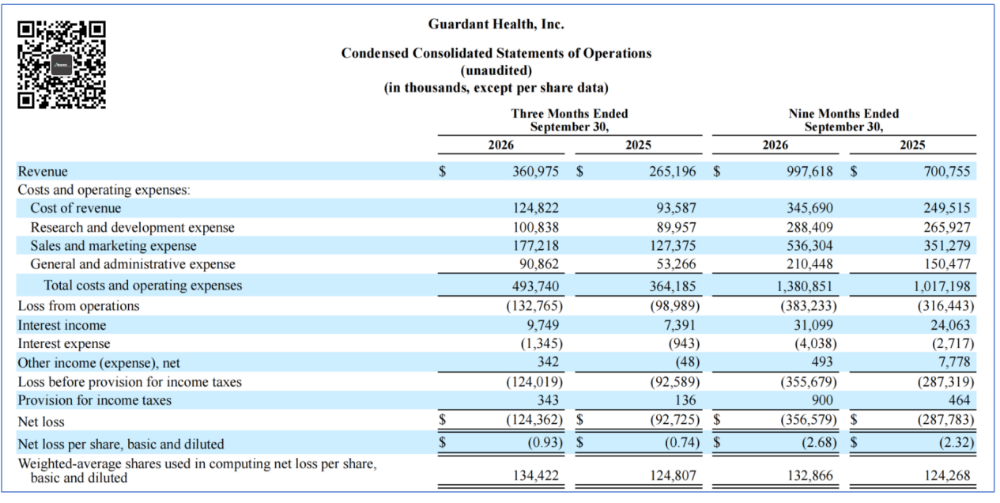

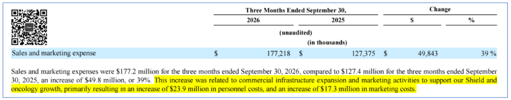

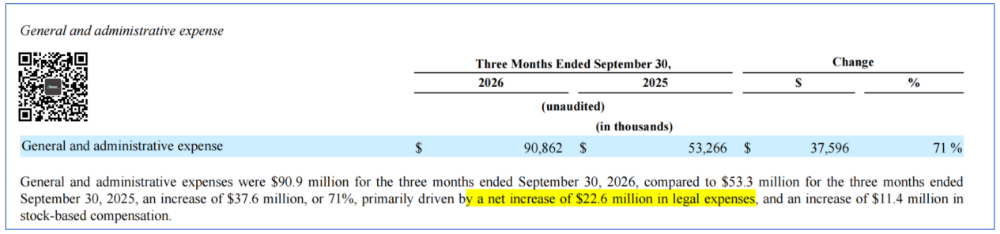

  - 本工作台深度追查：导致 G&A 法律费暴增 2,260 万美元 的真正元凶——TwinStrand Biosciences 双链测序专利终审判决（⚠️ 二手文章未穿透的重大财务风险）：
    - 为什么 Guardant 在 2026Q3 的法律诉讼支出如此庞大？本工作台穿透 SEC 10-Q 诉讼附注与美国特拉华州联邦地区法院（U.S. District Court for the District of Delaware）卷宗核实：2026 年 8 月 21 日，特拉华州联邦法院就 TwinStrand Biosciences 与华盛顿大学（University of Washington）诉 Guardant Health 侵犯双链测序（Duplex Sequencing）核心专利（US 10,287,631 与 US 10,760,127）案作出最终判决（Final Judgment），裁定 Guardant 构成故意侵权（Willful Infringement），判令其支付逾 2.452 亿美元（\$245.2M+，含 8,340 万美元 基础赔偿、故意侵权翻倍赔偿、判决前利息及律师费），并自判决日起至 2033 年 3 月 15 日对旗下 Guardant360、Guardant Reveal、Shield 等全部 11 款液体活检产品按销售额征收 6% 的持续专利提成（Running Royalty）。
    - 2026 年 10 月至 11 月，美国专利商标局（USPTO）专利审判和上诉委员会（PTAB）驳回了 Guardant 对 '127 专利的双方复审（IPR）无效请求，并签发了确认 '631 专利全部 23 项权利要求有效的单方再审证书。尽管 Guardant 已向联邦巡回上诉法院（Federal Circuit, Case No. 26-2377）提起上诉，但若上诉失败，6% 的全产品线持续专利提成将直接侵蚀 Guardant 约 600 bps 的毛利率空间。

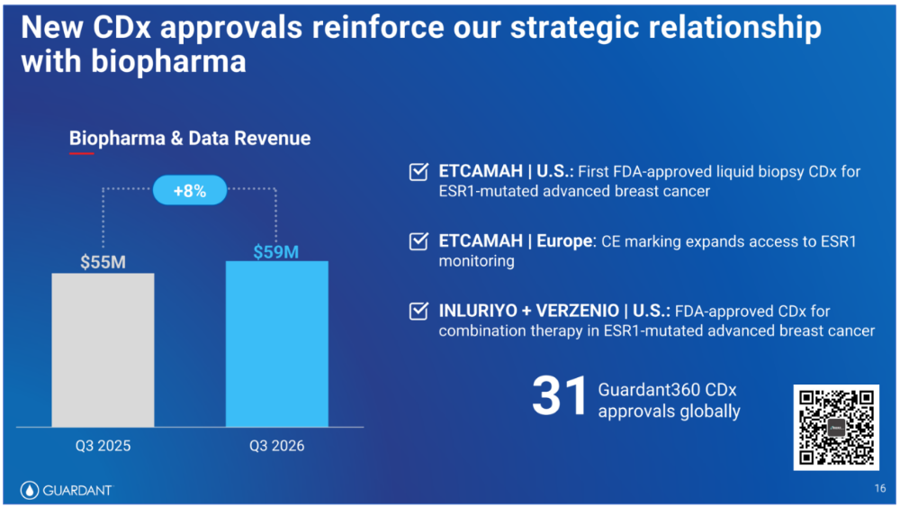

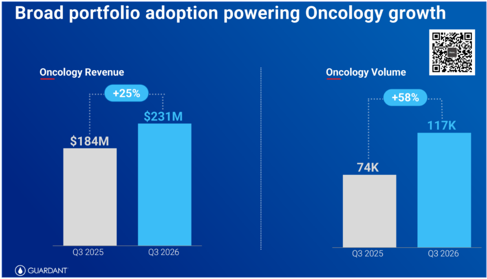

---

### 三、 癌症血液早筛（Shield）第一性原理硬核拆解：临床灵敏度软肋 vs 医保商业化套利

#### 1. 单位成本拆解：Shield 从单检成本 \$410 降至 \$330，医保报销价竟高达 \$1,495
- 原文主张（PART 02）：Shield 检测量从 2025Q3 的 24,000 例跃升至 2026Q2 的 66,000 例、2026Q3 的 83,000 例（同比 +246%、环比 +26%）；单次检测成本（COGS）已从 2026Q2 的 \$410 降至 2026Q3 的 \$330，并计划在 2028Q4 降至 \$200。同时，Shield 已进入 NCCN 与 ACS（美国癌症协会）指南，获得美国联邦医保 MCD（Medicare Coverage Determination）覆盖，商业保险端已拿下 UnitedHealth Group（联合健康，2026-08-01 生效）、Carelon / EmblemHealth（2026-11-15 生效）及 EviCore（2027-01-01 生效）。
- 本工作台核查（✅ 财务与准入数据属实；进一步穿透 CMS 医保定价从 \$920 跳涨至 \$1,495 ADLT 的政策红利）：
  - CMS Medicare 定价跃升：2024 年 7 月 Shield 获 FDA 批准后，最初按常规交叉映射（Crosswalk）获得的联邦医保报销价为 \$920 / 例；2025 年 3 月底，CMS 正式授予 Shield「高级诊断实验室检测（ADLT）」资格，自 2025 年 4 月 1 日起将联邦医保报销价格上调 62.5% 至 \$1,495 / 例（每 3 年报销一次，无自付额）。
  - 为什么 26Q3 实际确认均价（Realized ASP）是 \$815 而非 \$1,495：26Q3 Shield 营收 6,761.4 万美元 除以 83,000 例检测，隐含单检实际确认收入为 \$814.6 / 例。这是因为约一半送检人群属于商业保险或 Medicare Advantage 计划——虽然联合健康（UnitedHealth）于 2026 年 8 月 1 日启动商业覆盖，但由于 Shield 尚未正式写进美国预防医学工作组（USPSTF）A/B 级推荐指南（USPSTF 结直肠癌指南更新草案预计 2026 底至 2027 年发布），部分商业保险仍存在拒付或折价结算。即便按 \$815 实际均价对比 \$330 单检 COGS，Shield 在 2026Q3 的单检毛利已达 \$485（单检毛利率 59.5%），一旦 2028Q4 单检成本按计划降至 \$200 且 USPSTF 指南落地拉升商保回款率，单检毛利率将突破 75%–80%。

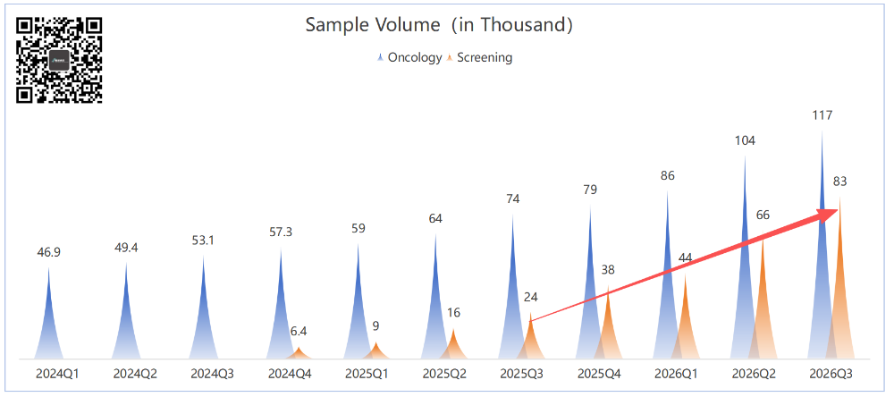

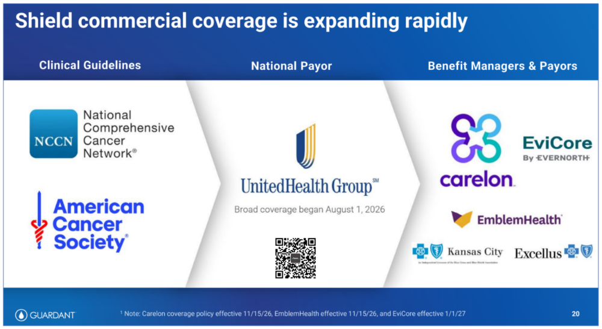

#### 2. 临床硬指标穿透：为什么说 Shield「能查出中晚期肠癌（83.1%），却几乎漏掉全部癌前息肉（13.2%）」？
- 本工作台核查（⚠️ 这是二级市场与医疗界对血液早筛最核心的认知分水岭，必须穿透 *NEJM* ECLIPSE 万人注册临床试验原始数据）：
  - 支撑 Shield 获批 FDA PMA 的关键注册临床试验为发表于《新英格兰医学杂志》（*NEJM* 2024, Chung et al., DOI: 10.1056/NEJMoa2304714）的 ECLIPSE 研究（入组 10,023 人，可评估平均风险人群 7,861 人，全部以结肠镜作为金标准对照）。我们将 Guardant Shield（血液 cfDNA + 甲基化） 与 Exact Sciences Cologuard Plus（二代多靶点粪便 DNA 检测，2026 年 3 月被雅培 Abbott 收购） 及 GRAIL Galleri（泛癌种血液甲基化早筛） 进行严格同维度对账：

| 临床与商业核心指标 | Guardant Health Shield（血液 ctDNA + 甲基化 + 片段组学） | Exact Sciences / 雅培 Cologuard Plus（二代粪便 DNA + 便潜血 FIT） | GRAIL Galleri（血液靶向甲基化，50+ 泛癌种早筛 MCED） | 诊断性结肠镜（Colonoscopy）（临床金标准） |
| :--- | :--- | :--- | :--- | :--- |
| 注册临床试验与样本量 | ECLIPSE（*NEJM* 2024，$N=7,861$） | BLUE-C（*NEJM* 2024，$N=20,176$） | NHS-Galleri 随机对照试验（$N=142,000$，2026 读出） | 临床参考金标准 |
| 结直肠癌（CRC）整体灵敏度 | 83.1%（54 / 65） | 93.9%–95.0%（92 / 98） | 肠癌亚组 ~82%；全癌种整体仅 31.6%–51.5% | >95% |
| I 期早期肠癌灵敏度（Stage I） | 仅 55%–65%（临床分期 I 期 17/31 = 55%） | ~87%–90%（I–III 期综合 92.7%） | 全癌种 I 期灵敏度仅 16.8% | >95% |
| II / III / IV 期中晚期肠癌灵敏度 | 100%（II 期 14/14、III 期 13/13、IV 期 10/10） | >96% | II 期 40.4%、III 期 77.0%、IV 期 90.1% | >98% |
| 癌前进展期腺瘤（Advanced Adenoma）灵敏度 | ❌ 仅 13.2%（147 / 1,116）——几乎无癌前阻断能力 | ✅ 43.4%（高级别上皮内瘤变达 74%–75%） | 不适用于癌前息肉筛查 | ✅ >85%–95%（检查同时直接镜下切除息肉） |
| 特异性（Specificity / 真阴性率） | 89.6%（假阳性率 10.4%） | 90.6%–94.0%（假阳性率 6.0%–9.4%） | 99.5%（假阳性率 0.5%） | ~100% |
| FDA 审批、CMS 定价与指南地位 | 2024.07 获批 FDA PMA；CMS ADLT 定价 \$1,495；待进 USPSTF | 2024.10 获批 FDA PMA；CMS 定价 \$592（初代 \$509）；已获 USPSTF A 级推荐 | 2026.01 递交 FDA PMA（26.09 专家会 7:2 支持），但 NHS 14.2 万人试验未达 III–IV 期减量主要终点；自费 \$949 | ACA 法案强制 100% 全额报销（USPSTF A 级，10 年一次） |
| 商业化体量（截至 2026Q3） | 83,000 例/季（单季营收 \$67.6M，+180% YoY） | 超 120 万 例/季（2026.03 并入雅培，雅培 26Q3 肿瘤诊断营收 \$968M） | 累计商业检测十余万例，尚无联邦医保覆盖 | 全美每年约 1,500 万 例 |

  - 第一性原理生物学解释：为什么血液 Shield 查不出癌前腺瘤（13.2% vs 假阳性率 10.4%）：
    1. 基底膜（Basement Membrane）解剖屏障：结直肠癌遵循经典的「正常黏膜 $\to$ 增生性息肉 $\to$ 进展期腺瘤（Advanced Adenoma）$\to$ 浸润性腺癌」长达 10–15 年的演化路径。在癌前进展期腺瘤阶段，病变细胞严格局限在肠道上皮基底膜（Lamina Propria）内侧的肠腔表面，尚未突破基底膜侵入黏膜下层毛细血管网。因此，凋亡脱落的癌前腺瘤细胞 DNA 直接排入肠道粪便中（使得 Exact Sciences 的粪便检测 Cologuard Plus 能捕获 43.4% 的进展期腺瘤和 74% 的高级别异型增生），而几乎没有游离 ctDNA 能够进入外周血液循环。
    2. 13.2% 灵敏度与 10.4% 假阳性率的统计学真相：在 ECLIPSE 试验中，Shield 对健康阴性人群的假阳性率就是 10.4%（\$1 - 89.6\%$），而对癌前进展期腺瘤的检出率仅为 13.2%——这意味着 Shield 对癌前息肉的检出几乎接近随机背景噪音，它本质上是一款「浸润性肠癌检出工具（Cancer Detection）」，而非像肠镜或粪便 DNA 那样能够把病变消灭在萌芽状态的「癌症预防工具（Cancer Prevention）」。
    3. 既然临床指标全面落后于 Cologuard Plus，为什么 Shield 还能单季卖出 8.3 万 份？ 核心逻辑在于「依从性套利（Adherence Arbitrage）」：全美 45–84 岁应筛查人群约 1.2 亿人，其中仍有约 40%–45%（超 5,000 万人）因为恐惧肠镜插管清肠、或抗拒在家动手铲取粪便寄快递（Stool Aversion）而拒绝任何筛查。对于一个连粪便都不愿取样的患者，在常规体检抽血时顺带多抽一管血做 Shield（哪怕只能检出 83.1% 的已发肠癌），依从性高达 >90%。Guardant 正是利用「抽血顺手开单 + \$1,495 超高医保定价」切走了这批抗拒肠镜与粪便检测的增量人群。

---

### 四、 MRD（微小残留病灶）生死战：为什么 Guardant 被迫推翻「免组织」信仰，推出 <1 ppm 的 Reveal Ultra？

- 原文主张（PART 03 & PART 04）：在肿瘤术后微小残留病灶（MRD）赛道，Guardant 正将重心转向 Reveal 与新发布的 Reveal Ultra。早期 Reveal 采用免肿瘤组织（Tissue-free）甲基化方案，而竞争对手 Natera 的 Signatera 采用肿瘤组织知情（Tumor-informed）路线（先对切下的肿瘤组织做全外显子测序定制 16 个体细胞突变探针）。由于没有组织先验锚点，早期 Reveal 灵敏度落于下风；如今 Reveal Ultra 转向对基线肿瘤组织做全基因组测序（WGS），追踪 2,000+ 个突变位点，将检测下限（LoD95）推至 <1 ppm（百万分之一），但面临联邦医保 MolDx 漫长的逐癌种审批周期。
- 本工作台核查（✅ 技术路线大反转与财务脱钩机制完全属实；补充 Natera 2026Q3 真实体量对比）：
  1. Natera（NASDAQ: NTRA）的碾压级领先优势：穿透 Natera 2026Q3 财报，其 26Q3 总营收已达 7.94 亿美元（+34.1% YoY），单季肿瘤 MRD 检测量高达 339,500 例（+60.9% YoY，其中临床 MRD 检测 316,000 例，单检均价约 \$1,290）——体量接近 Guardant 整个肿瘤板块检测量（117,000 例）的 3 倍，且 Natera 全公司已实现正向现金流。
  2. Reveal Ultra 的技术反击（见下图 10、图 11）：为扭转免组织路线在超低浓度 ctDNA（<100 ppm）下的灵敏度劣势，Guardant 在 2026Q3 正式推出 Guardant Reveal Ultra（已向药企开放，2026 年底全面启动临床商业化）：
     - 底层架构：放弃纯外显子捕获，直接对患者手术切下的基线肿瘤组织进行全基因组测序（WGS），筛选出 2,000+ 个患者专属体细胞突变位点（对比初代 Signatera 的 16 个位点与升级版 Signatera Genome 的 64 个位点）。
     - 物理学采样极限突破：当一管 10 mL 外周血中仅含约 10,000 个基因组当量（GE）的游离 DNA、且肿瘤分数低至 1 ppm（百万分之一，即整管血里连 1 个完整肿瘤基因组都不到）时，若只追踪 16 个位点，大概率会因泊松抽样漏检；而同时追踪 2,000+ 个全基因组突变位点，即便只有零星几个肿瘤 DNA 片段落入血样，也能被捕获，从而在 100% 特异性下实现 <1 ppm 的 95% 检出限（LoD95）（经 4,000+ 份临床样本验证）。
  3. 为什么 Oncology 检测量暴涨 +58%，营收却只涨 +25%？（MolDx 报销时滞陷阱）：
     - 如下图所示，目前 Guardant 的 Reveal 仅在结直肠癌（CRC）上获得了联邦医保覆盖；而在乳腺癌（Breast）、免疫治疗疗效监测（IO Monitoring）、化疗疗效监测（Chemo Monitoring）等大适应症上，临床验证数据刚刚提交给负责联邦医保分子诊断技术评估的 MolDx（Palmetto GBA） 待审。
     - 在 MolDx 正式签发地方覆盖决定（LCD）之前，医生开出的大量非结直肠癌 Reveal 检测属于先免费/低价跑量换取临床粘性（Volume without Immediate Revenue）；加之新发布的 Reveal Ultra 因更换为全基因组测序底层，必须重新向 MolDx 提交技术评估包，这导致 Guardant 在未来 12–18 个月内仍需承受「检测量增速（+58%）远快于确认营收增速（+25%）」的商业化时滞。

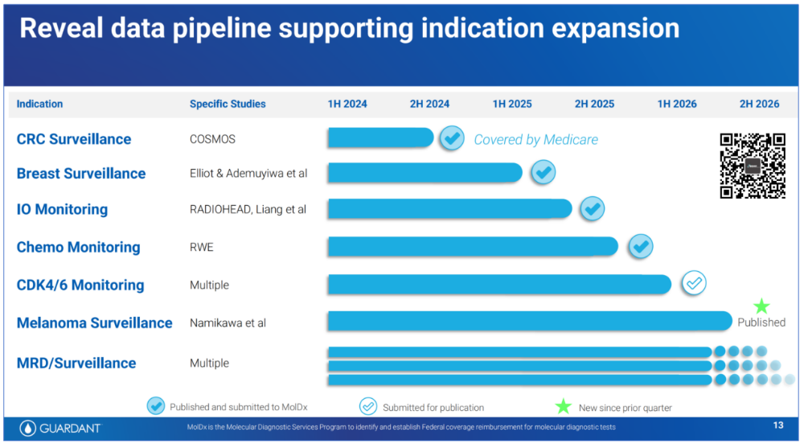

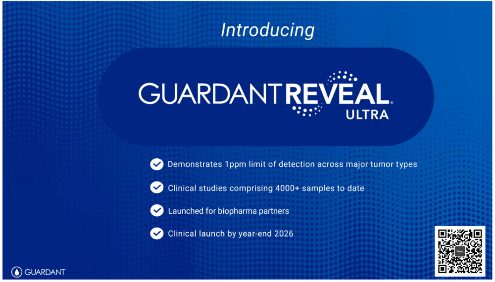

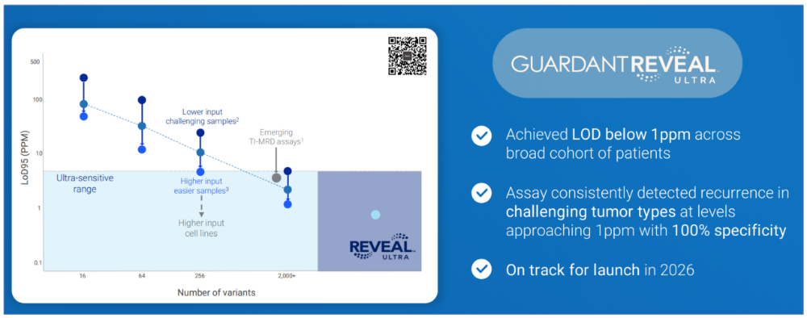

---

### 五、 2026 全年业绩指引与自由现金流转正路径评估

- 原文主张（PART 04）：管理层将 2026 全年总营收指引从 13.1 亿–13.3 亿美元 上调至 13.6 亿–13.7 亿美元（同比增长 38%–40%），将 Shield 早筛全年营收指引从 2.10 亿–2.15 亿美元 上调至 2.33 亿–2.38 亿美元（对应检测量 28.5 万–29.0 万例）；但受联邦医保结算系统切换延迟与诉讼/销售费用增加影响，全年自由现金流（FCF）净流出指引由 -1.95 亿至 -2.05 亿美元 恶化至 -2.05 亿至 -2.20 亿美元，预计 2027 年早筛业务实现现金流转正、2028 年全公司实现盈亏平衡。

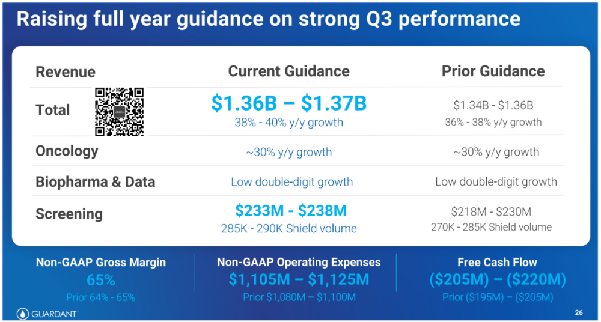

---

### 六、观点与可反驳条件

- ==观点==：本工作台推断，液体活检赛道正呈现鲜明的「临床刚需（伴随诊断 Guardant360 + 术后复发监测 MRD）赚钱补贴早筛，而血液早筛（Shield）靠依从性便利与 \$1,495 联邦医保 ADLT 定价吃政策红利」的双轨格局。从第一性原理看，由于癌前腺瘤未突破肠黏膜基底膜入血，血液 ctDNA 早筛（Shield 进展期腺瘤灵敏度 13.2%、I 期肠癌灵敏度 55%–65%）在生物学上无法替代结肠镜或二代粪便 DNA（Cologuard Plus 进展期腺瘤灵敏度 43.4%、整体肠癌灵敏度 93.9%–95%）的「癌前阻断」功能；Shield 的商业定位并非在存量依从人群中击败 Cologuard Plus，而是作为家庭医生抽血顺手开单的「依从性兜底网」收割全美 ~40% 拒做肠镜与粪便检测的空白人群。在 MRD 战场上，Guardant 推出基于全基因组 2,000+ 位点的 Reveal Ultra（<1 ppm LoD95）证明「肿瘤组织知情（Tumor-informed）」路线已在超微量复发监测中彻底击败纯免组织甲基化路线，但 TwinStrand 2.45 亿美元 专利败诉附带的 6% 全产品线提成（至 2033 年）与 MolDx 医保审批时滞，将是压制 Guardant 在 2028 年前兑现 GAAP 盈利的两大硬约束。
- ==推翻条件==：
  1. ① USPSTF 指南落选或 CMS ADLT 降价冲击：若在 2026 底至 2027 年发布的美国预防医学工作组（USPSTF）结直肠癌筛查指南正式更新中，因 Shield 对癌前进展期腺瘤灵敏度过低（13.2%）而未能获得 A 级或 B 级推荐（或被降级为仅限拒绝肠镜/粪便检测人群的二线有条件推荐），导致商业保险拒绝全额强制覆盖，或 CMS 在 ADLT 价格重审期后将 Shield 报销价下调至 \$800 以下，则 Guardant 早筛业务 2027 年现金流转正的假设将被推翻。
  2. ② 血液多组学技术在癌前腺瘤上的突破反超：若 Guardant 或竞争对手通过融合外泌体蛋白组、血小板转录组或免疫细胞受体组（TCR）的下一代升级版血液检测，在万人级前瞻性临床试验中将癌前进展期腺瘤（Advanced Adenoma）灵敏度提升至 >40%（追平粪便检测 Cologuard Plus）且特异性维持 >90%，则本工作台关于「血液早筛受制于基底膜解剖屏障、仅能做中晚期检出而无法做癌前预防」的生物学边界判断将被证伪。
  3. ③ TwinStrand 专利上诉翻盘或 Reveal Ultra 提前获批泛癌种医保：若美国联邦巡回上诉法院在 2027 年裁定推翻特拉华州法院关于 TwinStrand 双链测序专利的 2.45 亿美元 赔偿与 6% 持续提成判决，且 Reveal Ultra 在 2027 年上半年即通过 MolDx 泛实体瘤一揽子医保覆盖并将 Oncology 单检实际均价重新拉回 \$2,400+，则 Guardant 将有望提前至 2027 年下半年实现全公司自由现金流转正。

---

## 原文摘录与一手信源存证

> Guardant Health（下称GH）2026Q3营收3.61亿美元，同比增长36%，环比增长8%。
> — 原文摘录，文字段落 1；证据 `digest-material-78ffa4c933bc78156422ee6b9b039ccb5dbba64fbefed49c2d52993a1b83873f-excerpt-1@1`

> 销售与市场费用从去年同期的1.27亿美元增长到1.77亿美元，直接造成了近5000万美元的缺口。
> — 原文摘录，文字段落 2；证据 `digest-material-78ffa4c933bc78156422ee6b9b039ccb5dbba64fbefed49c2d52993a1b83873f-excerpt-2@1`

> 为支撑Shield和肿瘤业务（我猜大部分是因为Shield）人员费用增加了2390万美元，市场支出增加1730万美元。
> — 原文摘录，文字段落 3；证据 `digest-material-78ffa4c933bc78156422ee6b9b039ccb5dbba64fbefed49c2d52993a1b83873f-excerpt-3@1`

一手材料：

- Guardant Health, Inc. (NASDAQ: GH, CIK 0001576280) 2026Q3 Form 10-Q, Q3 2026 Earnings Release, Shield ECLIPSE NEJM Trial & Reveal Ultra MRD Primary Verification Dossier · U.S. Securities and Exchange Commission (SEC Form 10-Q) / Guardant Health Investor Relations / New England Journal of Medicine · [原站](https://www.sec.gov/edgar/browse/?CIK=0001576280) · [主体档案：Guardant Health](../entities/companies/Guardant%20Health.md) / [主体档案：Exact Sciences](../entities/companies/Exact%20Sciences.md) / [主体档案：Natera](../entities/companies/Natera.md) · [待上传原件](../../../raw/14ab021b077c043e980947b1d0b85ec4b23584cb4338c3b1b7a66526fe6771a7)
  材料版本 `digest-material-14ab021b077c043e980947b1d0b85ec4b23584cb4338c3b1b7a66526fe6771a7@1`；获取方式 `notebooklm_indexed_text`。
  > - \*\*Primary Source Title\*\*: \*Guardant Health, Inc. — 原文提取
  > 1. \*\*Oncology (\`Guardant360\` Therapy Selection + \`Guardant Reveal\` MRD)\*\*:    - \*\*Test Volume\*\*: \*\*\`117,000\` tests\*\* in Q3 2026 (\`+58% YoY\` vs \`74,000\` in Q3 2025; \`+13% QoQ\` vs \`104,000\` in Q2 2026). — 原文提取

归属与范围：触发线索为微信公众号「循因缉药」对Guardant Health 2026Q3财报与投资者演示文稿的解读；一手核查锚定SEC EDGAR CIK 0001576280披露的Guardant Health 2026Q3 Form 10-Q（2026-11-05）、2026Q3业绩公告与PPT、NEJM ECLIPSE注册临床试验论文（10.1056/NEJMoa2304714）、FDA PMA P230043审批文件及美国特拉华州联邦地区法院TwinStrand专利侵权终审判决。

来源缺口：

- `not_disclosed`：美国预防医学工作组（USPSTF）结直肠癌筛查指南更新草案对血液ctDNA检测（Shield）的具体推荐等级（A/B级一线推荐或有条件二线推荐）及Guardant对TwinStrand双链测序专利6%持续提成判决的联邦巡回上诉法院终审结果尚未公布。

[返回赛道总览](../赛道总览.md#digest-78ffa4c933bc7815) · [返回导读索引](README.md) · [主体档案库](../entities/README.md)
