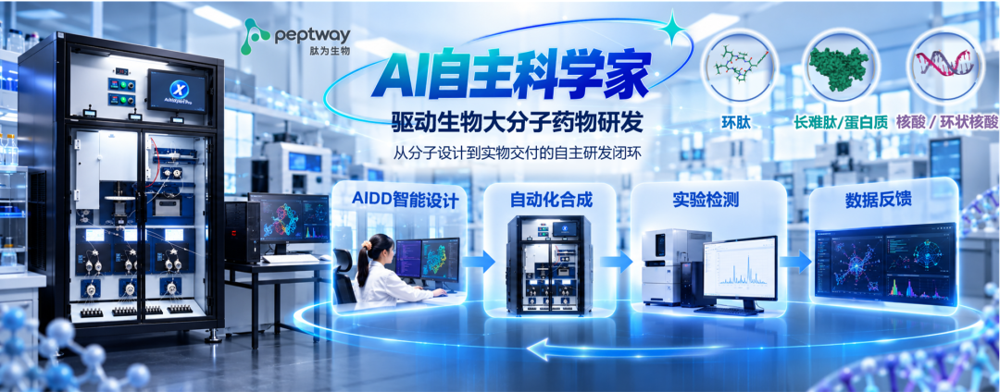
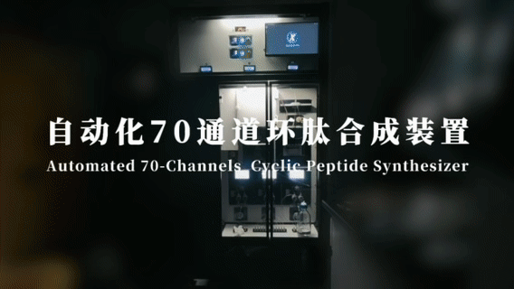

# 融资数千万元，MIT归国科学家要让AI从「设计药」变成「造出药」

2026-11-09 · JACS & Nat. Commun. · 浙大李承喜团队论文与肽为生物披露 · 已整理

[本地原件归档](../../../raw/88479e97d1b29fe883a9f45621b0f78defe14f305692c92afca2f05a05570f02) · 固定材料版本 `digest-material-88479e97d1b29fe883a9f45621b0f78defe14f305692c92afca2f05a05570f02@1` · [一手原站](https://doi.org/10.1021/jacs.5c16902) · [触发线索（36氪Pro）](https://mp.weixin.qq.com/s/CSlbMDj_z7Baj6_dp8Ugyg)

> [!IMPORTANT]
> 用户关注点（TG）：我们也开一个AI医药的专题，还蛮有趣的：穿透核查这家MIT归国科学家创立的AI医药/自动化合成公司（肽为生物/李承喜）的MIT导师与实验室背景、JACS/Nat. Commun.核心论文DOI与专利、工商股权与融资真实口径、多肽序列流合成与通用小分子逆合成（ASKCOS/Chemify）的技术边界，以及晶泰科技、英硅智能、Recursion、Lila Sciences、Emerald Cloud Lab等全球同赛道竞对的商业化进展与技术瓶颈。

## 针对性追查与回应

### 一、 场景与利益标注及核心身份穿透

- 场景与利益标注：本文为 36氪Pro 旗下「暗涌Waves」发布的初创公司天使轮融资公关专访（作者：刘旌）。受访主讲人李承喜系刚完成数千万元天使轮融资的杭州肽为生物科技有限公司（Peptway）创始人，领投方风物资本与跟投方上海天使会、添宥投资及种子轮投资方道生资本具有吸引后续产业客户（药企研发部门/CRO）与下一轮 VC 机构跟进的商业诉求。文中关于「传统 7 天缩短至 20 分钟」「粗品纯度从 65% 提升至 95%」等表述属于融资路演口径，需穿透至其发表于 *JACS* 与 *Nature Communications* 的同行评审论文核验底层实验边界。
- 本工作台核查（主体身份、学术师承与工商股权 100% 还原）：
  1. 公司工商与股权结构（✅ 核查属实）：杭州肽为生物科技有限公司（Hangzhou Peptway Biotechnology Co., Ltd.，官网 peptway.com，统一社会信用代码 91330110MAE630E97P）成立于 2024 年 11 月 25 日，注册资本 133.106 万元人民币，注册地址位于杭州市余杭区仓前街道文一西路 1378 号 1 幢 F908 室。法定代表人兼执行董事、经理为联合创始人吕淼（浙江大学及纽约市立大学校友，拥有约 12 年医药原料药法规注册与商业化高管经验）；李承喜任首席科学家、股东兼董事；员工持股平台为杭州晟肽企业管理合伙企业（有限合伙）；投资人股东包含种子轮道生资本（杭州道生灵境）及天使轮领投方风物资本（合伙人李巍任董事）、跟投方上海天使会与添宥投资（上海添宥）。
  2. 创始人学术血统与 MIT 双导师（✅ 核查属实）：李承喜本科毕业于郑州大学，博士毕业于中国科学院上海有机化学研究所（SIOC）（导师为金属有机与不对称催化专家汤文军研究员）；2018 年至 2022 年在 MIT（麻省理工学院）从事博士后研究，由国际多肽/寡核苷酸快速流固相合成先驱 Bradley L. Pentelute 教授与国际过渡金属催化交叉偶联泰斗 Stephen L. Buchwald 教授（Buchwald-Hartwig 偶联发明人）联合指导；2022 年归国加入浙江大学化学工程与生物工程学院任「百人计划」研究员、博导兼药学工程研究所副所长，双聘于浙江大学杭州国际科创中心生物与分子智造研究院。截至 2026 年，李承喜以通讯或第一作者在 *JACS*、*Nature Communications*、*ACS Central Science* 等期刊发表论文 36 篇，申请及授权国内外发明专利 32 项。

---

### 二、 原文干货机制拆解与一手论文逐项原位复核

#### 1. MIT 博后阶段「Sarepta 反义核酸 1 周缩至 3 小时」的一手溯源
- 原文主张：李承喜在 2018 至 2022 年 MIT 博后期间，曾与跨国药企 Novo Nordisk（诺和诺德）、基因治疗龙头 Sarepta Therapeutics 合作开发下一代多肽与寡核苷酸自动化合成技术，将原本需要 1周 的药物分子合成流程压缩至 3小时。
- 本工作台核查（✅ 实验数据与 *Nature Communications* 论文完全吻合，存在分子类别定语简化）：
  - 对应李承喜（共同第一作者）、Bradley L. Pentelute 与 Sarepta Therapeutics 团队联合发表于 *Nature Communications*（2021，DOI: 10.1038/s41467-021-24598-4）的论文 *Fully automated fast-flow synthesis of antisense phosphorodiamidate morpholino oligomers*。
  - 工程机制：Sarepta 获批治疗杜氏肌营养不良症（DMD）的反义药物 Eteplirsen 属于磷酰二胺吗啉代寡核苷酸（PMO），因空间位阻极大，传统室温间歇式合成单步偶联需约 3 小时，合成一条 20–30 mer 全长序列需约 1周；研究团队构建了名为 Tiny Tides 的 90 °C 高温微流控快速流固相合成系统，将单步偶联压缩至约 7 分钟（每小时完成 8.5 次偶联），全长 PMO 合成总耗时缩短至 3–3.5 小时（提速逾 25 倍）。

#### 2. 肽为生物核心硬件「CycloBot 70通道、7天缩至20分钟、粗品纯度65%升至95%」的一手核查
- 原文主张：肽为生物自研了由「原创反应体系 + 专用反应材料 + 70通道并行自动化合成系统」构成的底层合成平台，将传统需要 7天 的环肽合成缩短至 20分钟，粗品纯度从行业的 65% 提升至 95%，省去高昂纯化步骤并大幅降低生产成本。
- 本工作台核查（✅ 核心化学指标有 *JACS* 2026 论文与专利支撑；⚠️ 需注意「20分钟」特指线性组装后的固相环化裂解工序）：
  - 一手文献与专利：对应李承喜团队发表于 *Journal of the American Chemical Society*（*JACS* 2026，DOI: 10.1021/jacs.5c16902）的论文 *Automated Rapid Synthesis of High-Purity Head-to-Tail Cyclic Peptides via a Diaminonicotinic Acid Scaffold*，以及中国发明专利申请 CN202410573195.2（一种芳基二胺固载连接子及其制备方法和应用）。
  - 物理与化学机制拆解：
    1. 为什么传统环肽要 7 天且粗品纯度 <65%：传统头尾环肽需先在树脂上合成线性多肽，切落后再置于 <1–5 mM 极低浓度的海量有机溶剂中反应 24–72 小时以抑制分子间二聚/寡聚，且激活 C 端极易发生消旋（epimerization），导致粗品纯度通常低于 65%，必须依赖耗时数天的制备级反相 HPLC 纯化与冻干。
    2. DAN 连接子与 CycloBot 的破局点：团队设计了基于二氨基烟酸（Diaminonicotinic Acid, DAN）的固载安全阀连接子（Safety-Catch Linker）。多肽在树脂上完成线性组装后，通入温和亚硝酸钠（$\text{NaNO}_2$）在 5 分钟内将邻氨基转化为高活性苯并三唑（Benzotriazole）中间体；紧接着仅当 N 端游离氨基发起分子内亲核进攻完成头尾闭环时，产物才会从固相树脂上选择性切落（Self-Purifying Cyclative Cleavage），而未环化的线性截短肽全部滞留在树脂上被直接滤除。
    3. 量纲口径校准（⚠️ 分母拆解）：*JACS* 论文实证，在自研自动化合成仪 CycloBot（商业化高通量机型扩展至 70通道并行）上，从重氮化激活到头尾环化裂解切落的全自动工序耗时仅 20–27 分钟，分离产率最高达 93%，粗品纯度（Crude Purity）直接超过 95%。由于省去了耗时数天的制备级 HPLC 纯化，若计入前序快速流固相线性肽链组装（单条数十分钟至 1–2 小时），单轮「合成+环化+免纯化直接进生物测活」全流程在 2–4 小时内即可闭环（论文中 1 天内即完成 20 条抗菌环肽库合成与筛选，所得先导环肽抗菌活性达青霉素的 100 倍）。

  - 衍生化学矩阵：团队于 2026 年在 *JACS* 连续发表另外两项关键突破——① PMDA 连接子（DOI: 10.1021/jacs.6c09909），实现无保护多肽的赖氨酸选择性订书肽（Stapled Peptide）自动化组装；② SuFEx 酰基氟活化化学（DOI: 10.1021/jacs.6c12217），首次在 100 mM 超高浓度（传统液相浓度的 20–100 倍）下实现低寡聚化大环化，攻克了环肽从毫克级筛选迈向公斤级 CMC 放大时的吨级废液瓶颈。

#### 3. AI 环化预测模型与「90% 公开数据为阳性、缺乏真实负样本」的闭环核查
- 原文主张：传统医药领域规模逾 300亿美元 的高价值环肽/蛋白分子长期难以被常规 AIDD 工具攻克；公开文献数据中超过 90% 只记录成功案例而缺失失败负样本，肽为生物通过「生成设计—自动化合成—真实反馈」构建 Discovery Loop 物理闭环。
- 本工作台核查（✅ 模型架构与准确率已在 *Nature Communications* 2026 完整开源验证）：
  - 对应李承喜团队发表于 *Nature Communications*（2026 年 2 月 14 日，DOI: 10.1038/s41467-026-69441-w）的论文 *CycloPepper: a machine learning platform for predicting cyclization outcomes and optimizing synthesis of therapeutic cyclopeptides*。
  - 真实正负样本数据壁垒：同一条环肽序列选择不同的氨基酸连接处作为关环位点，产率可能相差 5 倍以上（从 <15% 失败负样本到 >85% 成功正样本）。团队利用 CycloBot 在完全统一的温度、流速与试剂配比下，系统合成了 306 条涵盖 2–14 个氨基酸残基的头尾环肽，完整保留所有低产率与二聚化失败的真实负样本，结合多肽序列与 3D 构象分子指纹训练出 CycloPepper 模型。
  - 实测泛化指标：CycloPepper 在 5 折交叉验证中预测环化成功的准确率达 84%；在 74 条前瞻性全新环肽序列（含非天然氨基酸与治疗性环肽）的盲测湿实验中，模型预测结果与真实合成产率的一致率达 86%，真正跑通了「CycloPepper 挑选最优环化位点与序列 $\to$ CycloBot 70通道小时级合成 $>95\%$ 高纯粗品 $\to$ 直接测活并将成败数据回传迭代模型」的 Discovery Loop。

---

### 三、 全球 AI 医药与自动化合成（Self-Driving Labs）同赛道竞对横评

本工作台推断：必须将肽为生物置于全球「AI 分子设计 $\times$ 自动化化学合成」坐标系中，区分序列定义生物聚合物（环肽/核酸）与通用小分子（Small Molecules）两条截然不同的技术与商业边界：

| 对标主体 | 核心领军人物 / 学术母体 | 技术路线与软硬闭环架构 | 核心验证指标与商业化财务现状（截至 2026） | 核心瓶颈与对比肽为生物（Peptway）的差异边界 |
| :--- | :--- | :--- | :--- | :--- |
| 肽为生物 (Peptway) | 李承喜（MIT Pentelute & Buchwald 博后，浙大百人计划）、吕淼 | 环肽/多肽序列闭环：CycloPepper（环化预测）+ DAN/PMDA 固载连接子 + SuFEx 100mM 环化 + CycloBot 70通道合成仪 | 种子轮（道生资本）+ 数千万元天使轮（风物资本领投）；环化裂解 20–27 min，粗品纯度 >95%，前瞻预测一致率 86% | 聚焦多肽/环肽/蛋白大分子，酰胺键缩合机制高度统一，可免 HPLC 纯化直通测活；待验证百克—公斤级 GMP 放大与药企管线 BD |
| MIT 连续流与逆合成平台 (ASKCOS) | Klavs F. Jensen、Connor W. Coley、Timothy Jamison（MIT） | 通用小分子闭环：开源逆合成规划 ASKCOS + 模块化连续流/微流控反应器（*Acc. Chem. Res.* 2025, arXiv:2501.01835） | 全球小分子逆合成与流化学学术标杆，孵化或赋能多家自动化化学企业 | 通用小分子涉及 >1,000 种异构反应、极端无水无氧条件及柱层析相分离，跨反应硬件通用性与免纯化直通率远低于环肽固相流合成 |
| 晶泰科技 (XtalPi, 2228.HK) | 温书豪、马健、赖力鹏（MIT 博后创立） | 量子物理 + AI + 机器人实验室集群：晶型预测 + 数智化高通量合成工作站（超千台机械臂工位） | 2025 全年营收 8.026 亿元（+201.2% YoY），归母净利 1.346 亿元（首次全年盈利）；智能机器人业务增 146.2% | 以通用小分子高通量摇瓶/移液工站及 CRDMO 服务为主；肽为生物则在环肽细分赛道的底层连接子化学与免纯化流合成上具备单点深度优势 |
| 英硅智能 (Insilico, 3696.HK) | Alex Zhavoronkov | 生成式 AI 靶点与小分子设计：PandaOmics + Chemistry42 + 苏州自动化实验室 | 2025.12 港股 IPO；2026H1 营收 1.063 亿美元（+280% YoY），净利 3,550 万美元；IPF 药物 Rentosertib 完成 IIa 期临床 | 核心长板在生成式 AI 管线设计及跨国药企高额 BD 授权，湿实验端主要作为内部验证配套，非底层合成化学机制创新驱动 |
| Recursion (NASDAQ: RXRX) | Chris Gibson（2024 并购 Exscientia） | 超高通量细胞表型组学 + AI 小分子设计：Recursion OS（65+ PB 生物图像库） | 2025.05 砍掉 REC-994、REC-2282 等多条 II 期管线；2026Q3 营收 1,860 万美元（靠 Sanofi 累计 >1.34 亿美元 里程碑支撑） | 证明纯靠表型筛选与虚拟生成无法绕开靶点毒理与临床有效性死亡谷，缺乏外售 CRDMO 现金流缓冲导致二级市场估值承压 |
| Chemify | Lee Cronin（格拉斯哥大学） | 数字化学编译（Chemputation）：χDL 化学描述语言 + Chemifarm 工业级全自动合成工厂 | 2025.10 完成 5,000 万美元 B 轮融资，2026.09 获苏格兰政府 2,200 万英镑 资助扩建 8,990 万英镑 基地，与 Lilly 等合作 | 试图用统一 χDL 代码编译全部有机小分子合成，硬件与管路清洗极其重型；与肽为生物专攻大环多肽形成错位互补 |
| Lila Sciences | Geoffrey von Maltzahn、George Church（Flagship 孵化） | 科学超级智能与自主实验室：AI Agent 驱动跨生命科学与材料科学的 Autonomous Science Units | 2025 年连融 2 亿美元 种子轮 + 3.5 亿美元 A 轮（累计 5.5 亿美元，估值 >13 亿美元） | 平台覆盖面极广但处于重金基建期，尚无细分化学品类（如环肽免纯化合成）的高毛利单体设备与特种耗材闭环印证 |
| Emerald Cloud Lab (ECL) | Brian Frezza、DJ Kleinbaum | 远程云端中央实验室：符号实验室语言 SLL 远程调度 200+ 台标准分析与合成仪器 | 累计融资 >1.5 亿美元；2024 年因重资产折旧关闭南旧金山自建实验室，转型向药企输出软件系统 | 仅将传统人类实验操作远程化而未改造底层化学反应，单次实验耗时与纯化瓶颈依旧，印证「纯搬运式自动化」难以独立跑通商业模式 |

---

### 四、观点与可反驳条件

- ==观点==：本工作台推断，AI 医药在经历「纯干法虚拟生成泡沫（2018–2022）」与「重资产机械臂搬运式云实验室受挫（2022–2024）」后，正收敛向「专利级底层化学机制创新（如 DAN/PMDA 固载环化连接子、SuFEx 高浓活化）$\times$ 专用多通道连续流硬件（CycloBot）$\times$ 机器原生正负样本模型（CycloPepper）」三位一体闭环。相较于受困于上千种异构反应与复杂柱层析纯化的通用小分子全自动合成，由酰胺键重复拼接的环肽與微型蛋白（Mini-proteins）是当前唯一能够依靠选择性环化裂解直接跨过制备级 HPLC 纯化墙（粗品纯度 >95%）、率先跑通「小时级合成 $\to$ 免纯化直通测活 $\to$ 负样本反哺 AI」商业闭环的黄金切口；肽为生物能否从科研仪器提供商跃升为平台型龙头，取决于其能否复刻「Illumina 测序仪 + 独家专利连接子耗材 + 药企高价值环肽管线联合开发（CRDMO + 里程碑分成）」的三级现金流飞轮。
- ==推翻条件==：
  1. ① 开源模型零湿实验样本反超：若未来 18 个月内，仅凭公开文献与物理分子动力学（MD）预训练的纯干法开源大模型，在零专有湿实验负样本微调的前提下，对全新非天然治疗性环肽的首轮环化产率与构象预测准确率稳定突破 90%，则肽为生物基于 CycloBot 独占湿实验负样本的数据护城河逻辑将被推翻。
  2. ② 连接子化学普适性或非天然氨基酸兼容性受阻：若 DAN / PMDA 固载连接子在面对药企真实管线所需的高度复杂修饰（如多重 N-甲基化、D-氨基酸、复杂聚酮杂合骨架或大分子量双环/多环拓扑结构）时，粗品纯度跌破 75% 而不得不退回传统制备级反相 HPLC 逐一纯化，则其「免纯化小时级 Discovery Loop」的核心效率优势将被证伪。
  3. ③ CMC 放大与商业兑现断层：若在未来 24 个月内，肽为生物的 SuFEx 100 mM 高浓度环化工艺无法在百克至公斤级 GMP 商业化放大中通过药政杂质（如残留氟化物与消旋体）合规验收，或公司年化商业营收（含 70通道 CycloBot 硬件/耗材销售与药企定制库 CRDMO 服务）未能突破 5,000 万元人民币，则其从实验室技术向产业级平台转化的商业假设将被推翻。

---

## 原文摘录与一手信源存证

> 近日，杭州肽为生物科技有限公司（简称“肽为生物”）完成数千万元天使轮融资，由风物资本领投，上海天使会联合投资与添宥投资跟投。此前，肽为生物获得道生资本数百万元种子轮投资。此次融资将用于AI自驱动实验室建设、技术平台完善及团队扩充。
> — 原文摘录，文字段落 1；证据 `digest-material-88479e97d1b29fe883a9f45621b0f78defe14f305692c92afca2f05a05570f02-excerpt-1@1`

> 肽为生物依托浙江大学李承喜团队在多肽、环肽及核酸等领域的科研积累，以复杂生物大分子的AI智能设计与自动化合成为核心， 定位于第四代AI制药研发平台。
> — 原文摘录，文字段落 2；证据 `digest-material-88479e97d1b29fe883a9f45621b0f78defe14f305692c92afca2f05a05570f02-excerpt-2@1`

> 目前，公司已在环 肽领域打通AI分子设计、自动化合成、实验检测与数据反馈的研发闭环，试图突破传统AI制药重设计、轻验证的局限，推动药物研发从“AI辅助设计”迈向“AI自主研发”。
> — 原文摘录，文字段落 3；证据 `digest-material-88479e97d1b29fe883a9f45621b0f78defe14f305692c92afca2f05a05570f02-excerpt-3@1`

一手材料：

- Peptway (杭州肽为生物) & Prof. Chengxi Li Primary Verification Dossier: JACS CycloBot/DAN Linker (10.1021/jacs.5c16902), Nat. Commun. CycloPepper (10.1038/s41467-026-69441-w), SuFEx 100mM Macrocyclization & Global AI Pharma Synthesis Benchmark · Journal of the American Chemical Society / Nature Communications / 浙江大学李承喜团队与肽为生物工商专利一手核查档案 · [原站](https://doi.org/10.1021/jacs.5c16902) · [主体档案：李承喜 (Chengxi Li)](../entities/people/%E6%9D%8E%E6%89%BF%E5%96%9C%20%28Chengxi%20Li%29.md) / [主体档案：肽为生物 (Peptway)](../entities/companies/%E8%82%BD%E4%B8%BA%E7%94%9F%E7%89%A9%20%28Peptway%29.md) / [主体档案：MIT Pentelute Lab](../entities/labs/MIT%20Pentelute%20Lab.md) · [待上传原件](../../../raw/189025d00869c39a404ddcabb4adeff89ff4ded466085235e77c6f31b82fa2aa)
  材料版本 `digest-material-189025d00869c39a404ddcabb4adeff89ff4ded466085235e77c6f31b82fa2aa@1`；获取方式 `notebooklm_indexed_text`。
  > ### 1.1 Industrial and Commercial Registration (工商登记核验) - \*\*Full Legal Name\*\*: 杭州肽为生物科技有限公司 (Hangzhou Peptway Biotechnology Co., Ltd. — 原文提取
  > ### 1.2 Financing History & Investors (融资口径核验) - \*\*Seed Round (2024–2025)\*\*: Multi-million RMB (数百万元人民币) invested by \*\*Daocin Capital (道生资本 / 杭州道昇投资)\*\*, founded in 2015 by Vipshop co-founder Wu Bin (吴彬). — 原文提取

归属与范围：触发线索为36氪Pro旗下「暗涌Waves」融资专访（作者：刘旌），一手核查锚定浙江大学李承喜教授主页、JACS（10.1021/jacs.5c16902、10.1021/jacs.6c12217、10.1021/jacs.6c09909）与Nature Communications（10.1038/s41467-026-69441-w、10.1038/s41467-021-24598-4）同行评审论文、中国发明专利CN202410573195.2及国家企业信用信息公示系统工商登记。

来源缺口：

- `not_disclosed`：肽为生物（Peptway）数千万元天使轮与数百万元种子轮的精确到万元融资金额、投后估值，以及已签约药企/高校客户名单与70通道CycloBot商业化单台售价尚未公开披露。

[返回赛道总览](../赛道总览.md#digest-88479e97d1b29fe8) · [返回导读索引](README.md) · [主体档案库](../entities/README.md)
