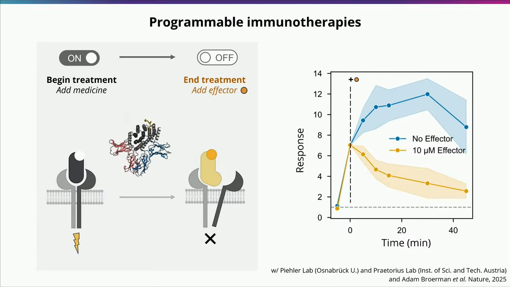
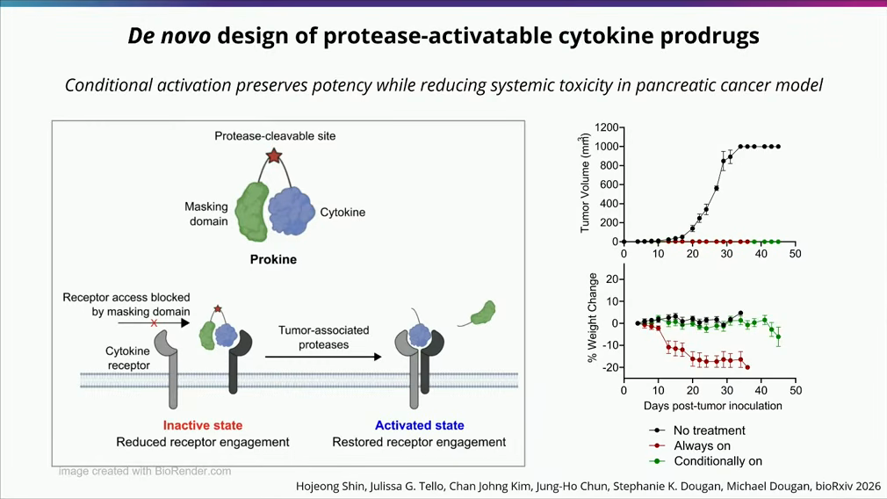
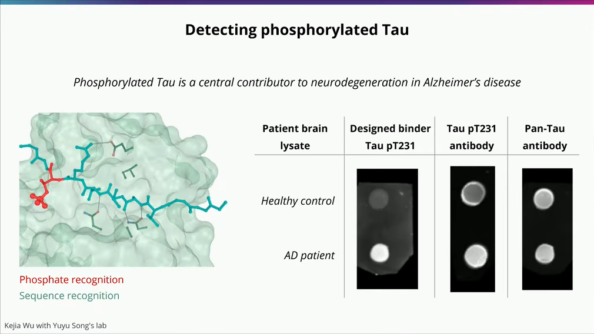
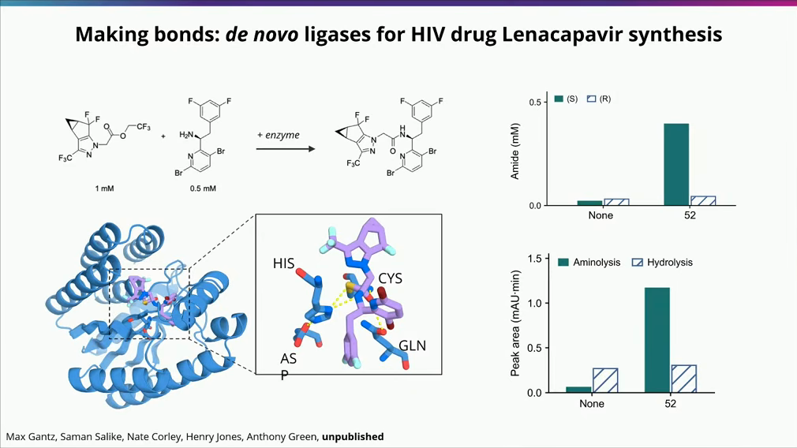
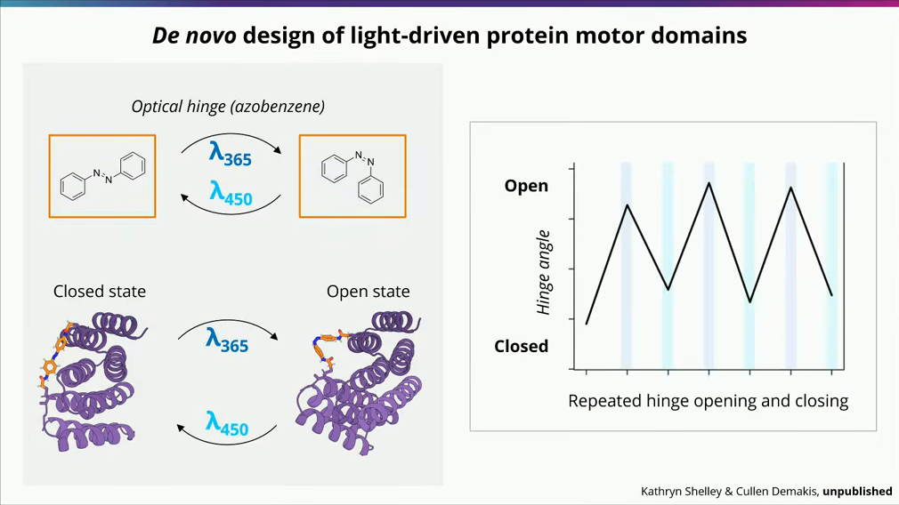

# 诺奖得主Baker最新演讲：AI正在颠覆生命科学！

2026-11-06 · Royal Society · David Baker Croonian Lecture & RFD4-Proteina · 已整理

[本地原件归档](../../../raw/cd3ffd75100c8bf6427bdf3e8b1856fed7d4f75acdd3bd03a702781d19c29bea) · 固定材料版本 `digest-material-cd3ffd75100c8bf6427bdf3e8b1856fed7d4f75acdd3bd03a702781d19c29bea@1` · [一手原站](https://rfd4-proteina.org/) · [触发线索（AlphaDrug）](https://mp.weixin.qq.com/s/lgXt_5g2syTczS5xMHypCg)

> [!IMPORTANT]
> 用户关注点（TG）：因为我没有background knowledge，所以先不给comment了哈

## 针对性追查与回应

### 一、 第一性原理入门框架（Background Primer）：从「预测自然蛋白」到「无中生有造新药」

- 场景与利益标注：本文触发线索来自微信公众号 AlphaDrug（2026-11-06）对 2024 年诺贝尔化学奖得主、华盛顿大学蛋白质设计研究所（UW Institute for Protein Design, IPD）所长 David Baker 于 2026 年 11 月 3 日 18:30–19:30 (UTC) 在英国皇家学会（The Royal Society）发表的生物学最高荣誉讲座——克鲁尼安讲座（Croonian Prize Lecture: *Advances in computational protein design*）的编译整理。David Baker 既是学术界从头蛋白质设计（*De Novo* Protein Design）学派的奠基人，也是 Xaira Therapeutics（超 10 亿美元 种子轮）、Icosavax（被阿斯利康以 11 亿美元 收购）、Outpace Bio、Monod Bio 等 20 余家生物技术公司的联合创始人。阅读本演讲需区分「已在 *Nature* / *Science* 发表的同行评审实验数据」与「尚处于 bioRxiv 预印本或实验室早期筛选阶段（67 个设计中命中 4 个活性酶）的前沿探索」。
- 本工作台推断（零背景读者的「蛋白质从头设计」第一性原理坐标系）：
  1. 正向折叠预测（Forward Folding）vs 逆向从头设计（Inverse *De Novo* Design）：
     - 自然界的抽样偏差：地球生命 40 亿年进化仅探索了大约 $10^{12}$ 种蛋白质序列，而一条仅含 100 个氨基酸的多肽链（每位点 20 种天然氨基酸）在数学上存在 $20^{100} \approx 10^{130}$ 种可能序列。自然界现存蛋白是为了物种生存演化而来，并非为了治疗人类阿尔茨海默病、胰腺癌或催化工业化学合成而设计。
     - 正向问题（AlphaFold2 / AlphaFold3 / RoseTTAFold）：输入一条自然界已知的氨基酸序列，利用多重序列比对（MSA）中的进化共变信号预测其三维空间坐标（$	ext{Sequence} \to 	ext{3D Structure}$）。它擅长「看懂自然界已有的积木」，但本身并不是直接按治疗功能定制新分子的生成器。
     - 逆向从头设计（RFdiffusion + ProteinMPNN $\to$ RFdiffusion2 $\to$ RFD4-Proteina）：倒转因果链条——先根据临床或工业需求定义目标功能与几何约束（例如：死死卡住磷酸化 Tau 蛋白第 231 位苏氨酸的凹槽，或按亚埃级精度排布催化酰胺键合成的四个活性残基），用三维去噪扩散模型在 $SE(3)$ 刚体空间中无中生有地「幻觉（Hallucinate）」出自然界从未存在过的全新蛋白质骨架（Backbone），再反推能在大肠杆菌或哺乳动物细胞中高溶解度折叠成该骨架的氨基酸序列（$	ext{Function / Active Site} \to 	ext{Novel 3D Backbone} \to 	ext{Amino Acid Sequence}$）。
  2. 三代计算蛋白质设计技术栈的跃迁（1998–2026）：

| 代际与时间窗 | 核心代表模型 / 工具链 | 底层数学与物理机制 | 湿实验首轮命中率（Zero-Shot Hit Rate）与核心局限 |
| :--- | :--- | :--- | :--- |
| 第一代：物理能量函数时代（1998–2020） | Rosetta / RosettaDesign（David Baker 实验室） | 截取 PDB 已知蛋白片段拼接骨架 + 蒙特卡洛（Monte Carlo）侧链旋转异构体（Rotamer）能量最小化搜索 | 命中率常低于 0.01%–0.1%，需构建数万至百万级酵母表面展示库反复定向进化（Directed Evolution）筛选 |
| 第二代：深度学习骨干生成与序列解耦（2022–2024） | RFdiffusion（*Nature* 2023）+ ProteinMPNN（*Science* 2022）+ RoseTTAFold All-Atom（*Science* 2024） | 先由 RFdiffusion 在三维坐标空间扩散生成粗粒度蛋白骨架，再交给图神经网络 ProteinMPNN 填涂氨基酸序列 | 靶点结合蛋白（Minibinder）湿实验命中率跃升至 10%–30%；但「先画骨架、后填序列」两步割裂，难以精准预组织需要亚埃级（$<0.5\text{ \AA}$）精度的酶催化过渡态 |
| 第三代：全原子催化预组织与潜空间测试时推理（2025–2026） | RFdiffusion2（*Nature* 2026）+ PLACER（*Science* 2025）+ RFD4-Proteina（UW IPD $\times$ NVIDIA, 2026.10） | 直接以活性中心全原子基团为锚点，在统一潜空间（Latent Space）中联合共设计「序列 + 全原子 3D 结构 + 小分子配体」，并引入测试时潜空间推理（Test-Time Latent Reasoning）沿物理势能面迭代修正构象系综 | 设计速度与多状态功能蛋白首轮湿实验成功率再提升 5–10 倍，首次实现无需定向进化（Zero-Shot）从头造出高活性丝氨酸水解酶、金属水解酶与手性药物连接酶 |

  3. 四类正在改写新药研发范式的从头设计分子形态：
     - ① 微型结合蛋白（Minibinders，50–100 个氨基酸）替代传统单抗（mAb，~1,300 个氨基酸）：分子量仅为单抗的 1/15，热稳定性极高（熔解温度 $T_m > 90\,^\circ\text{C}$，耐受极端酸碱与蛋白酶），可由微生物发酵廉价生产，且能设计出精密「凹槽（Groove）」特异识别传统抗体极难区分的无序多肽翻译后修饰（如阿尔茨海默病磷酸化 Tau pT231）。
     - ② 变构开关与条件激活前药（Switchable & Conditional Biologics）：利用受控构象变化实现「时间开关」（加入小分子/多肽效应物在数分钟内拆散受体复合物）或「空间逻辑门」（仅在肿瘤微环境高表达蛋白酶切割后释放细胞因子活性，消除全身毒性）。
     - ③ 从头设计人工酶（*De Novo* Enzymes）：按照化学反应过渡态（Transition State）几何构型排布催化三联体（如 CYS-HIS-ASP）与氧阴离子洞（Oxyanion Hole），用 PLACER 校验整个催化循环构象系综，催化自然界毫无进化先例的合成药物反应（如艾滋病长效新药 Lenacapavir 关键手性酰胺键合成）。
     - ④ 可编程分子机器（Molecular Machines）：将化学能或光能（如偶氮苯 365 nm / 450 nm 光异构化）转化为纳米级机械运动，或定制序列特异性 DNA 识别与切割酶。

---

### 二、 演讲五大前沿实验突破逐项穿透与一手文献核查

#### 1. 突破一：细胞因子信号的「时间脉冲控制器」——促进解离型可开关 IL-2（*Nature* 2025）
- 原文主张：传统生物药要么一直开、要么一直关，David Baker 团队设计了可开关的白细胞介素-2（Switchable IL-2），平时处于激活状态，一旦加入特定小分子或效应物，就会把复合体拆开而失活；借此首次精确回答了「T 细胞需要接收多久的信号才开始分裂」。
- 本工作台核查（✅ 已发表于 *Nature* 2025，机制为「变构促进解离 Facilitated Dissociation」）：
  - 一手文献：对应 UW IPD 的 Adam Broerman、Florian Praetorius、奥斯纳布吕克大学 Jacob Piehler 与 David Baker 等人发表于 *Nature*（2025 年，Vol. 647, pp. 528–535，DOI: 10.1038/s41586-025-09549-z）的论文 *Design of facilitated dissociation enables timing of cytokine signalling*。
  - 物理与免疫学机制拆解：高亲和力细胞因子与受体结合后（$K_D$ 处于纳摩尔至皮摩尔级），自然解离半衰期长达数小时，即使洗脱培养液或停止给药，受体仍持续向下游发送信号。团队将从头设计的变构铰链蛋白（cs201 / cs221）嵌入 IL-2 模拟物（Neo-2/15）：在 ON 状态下，sIL-2 同时桥接受体亚基 $\text{IL-2R}\beta$（青色）与 $\gamma_c$（洋红色），激活下游 pSTAT5 磷酸化；当加入 10 µM 效应多肽（Effector）时，效应物结合复合体暴露边缘并触发变构构象「动力冲程（Power Stroke）」，在数分钟内强制撬开并拆散已结合的受体复合物（OFF 状态）。
  - 定量生物学发现（见下图右）：在原代人类 T 细胞中，仅给予 5 分钟的 sIL-2 脉冲刺激（随后立即加入 10 µM Effector 关停信号），就足以使 3 天后的 T 细胞存活率翻倍（Relative T-cell count 达 ~2.0x vs 未刺激组 1.0x），同时避免触发过度增殖与耗竭——直接证明 T 细胞存活与增殖由不同的信号持续时间阈值编码。

#### 2. 突破二：肿瘤微环境蛋白酶激活的「零全身毒性」IL-21 前药（*bioRxiv* 2026.09）
- 原文主张：在癌症免疫治疗中，白细胞介素（如 IL-21）能唤醒免疫系统杀伤肿瘤，但全身给药毒性极大。团队给细胞因子装上「保护罩」，只有在肿瘤内部被肿瘤特异蛋白酶切开后才激活；在胰腺癌小鼠模型中，未改造药物令小鼠体重暴跌（毒副作用），而条件激活型药物既完全抑制了肿瘤生长，又保持小鼠体重正常。
- 本工作台核查（✅ 对应 2026 年 9 月 bioRxiv 预印本 Prokine 平台，小鼠体内疗效与毒性解耦数据完全吻合）：
  - 一手文献：对应 UW IPD Hojeong Shin、哈佛医学院丹娜-法伯癌症研究所 Stephanie K. Dougan 与 Michael Dougan 及 David Baker 于 2026 年 9 月 22 日发布的预印本 *De novo design of protease-activatable cytokine prodrugs*（DOI: 10.64898/2026.09.19.752834）。
  - 实验对照与量纲核验（见下图）：团队在高稳定性 IL-21 模拟物（21h10）外围从头设计了空间位阻遮蔽域（Masking Domain），中间以肿瘤基质金属蛋白酶（MMP）可切割连接子串联。在同系小鼠胰腺导管腺癌（PDAC）模型中设置四组对照：
    1. PBS 对照组与 Non-cleavable（不可切割死锁组）：第 21 天肿瘤体积失控暴涨至 600–650 mm³，证明遮蔽域在未切开时完全封闭 IL-21 活性。
    2. Always-on（未遮蔽常开型 IL-21，橙色曲线）：虽能将肿瘤体积压制在 ~0–30 mm³，但在给药第 10–12 天引发剧烈全身免疫毒性，小鼠体重暴跌 -18% 至 -20%（, $p < 0.0001$）。
    3. Cleavable (Conditional)（肿瘤蛋白酶条件激活型 IL-21，蓝色曲线）：肿瘤体积同样被彻底压制在 ~0 mm³（与常开型疗效相当， vs PBS），同时小鼠在整个 16 天疗程中体重变化保持在 0% 至 +3%（与 PBS 组无显著差异 ns），在活体层面验证了空间逻辑门前药的治疗窗口扩展能力。

#### 3. 突破三：精准抓捕阿尔茨海默病「磷酸化无序 Tau 蛋白（pT231）」并靶向清除（*bioRxiv* 2026.10）
- 原文主张：阿尔茨海默病（AD）的核心致病元凶是发生异常磷酸化的无序 Tau 蛋白（像一根没有固定形状的煮熟面条上挂着微小磷酸基团），传统商业抗体经常把健康人的正常蛋白也误认出来（假阳性）；团队从头设计的结合蛋白像「精密卡槽」一样完美卡住带磷酸基团的 Tau 片段，在人类患者脑组织样本中展现出远超商业抗体的零背景特异识别，还能拆解淀粉样纤维或引导细胞垃圾回收系统将其降解。
- 本工作台核查（✅ 对应吴可嘉 Kejia Wu 等人 2026 年 10 月预印本，人脑匀浆斑点印迹实证显著优于商业单抗）：
  - 一手文献：对应 UW IPD Kejia Wu（吴可嘉）、哈佛医学院/麻省总医院 Yuyu Song（宋雨雨） 实验室与 David Baker 于 2026 年 10 月 21 日发布的预印本 *Design of readers for pathological PTM proteoforms in Alzheimer's disease*（DOI: 10.64898/2026.10.20.760520）。
  - 为什么传统抗体搞不定无序区翻译后修饰（IDR-PTM）：Tau 蛋白属于天然无序蛋白（IDP），其早期病理标志位点（如 pT231、pT217）暴露在柔性肽链上。动物免疫产生的传统单抗往往只识别局部电荷或短序列基序，极易与健康人脑内高丰度的未磷酸化野生型 Tau（Tau224-239 WT）发生交叉反应。
  - 从头设计「凹槽阅读器（Groove Reader）」与人脑样本实测（见下图）：团队利用全原子生成模型设计出螺旋束凹槽骨架，通过预设氢键网络精密配位第 231 位苏氨酸上的负电磷酸基团（$\text{PO}_4^{2-}$），同时迫使两侧 Tau 肽段以特定延展构象嵌入凹槽，对 Tau224-239 pT231 的亲和力较未磷酸化野生型提升逾百倍。在 6 例阿尔茨海默病患者（AD Patients 1–6）与 6 例健康对照（Control 1–6）的人脑组织裂解液斑点印迹（Dot-Blot）对比中：
    - 商业化磷酸化抗体（Tau pT231 antibody）与泛 Tau 抗体（Pan-Tau antibody）在 Control 1–6 健康人脑样本中均出现严重黑斑假阳性；
    - 从头设计的 Tau pT231 binder 在 AD Patients 1–5 中呈现强阳性信号，而在 Control 1–6 健康人脑样本中背景几乎全白（零交叉反应）。团队进一步证明，将该结合蛋白耦联胞内 E3 泛素连接酶结构域或分子伴侣模块后，可在体外直接解聚病理性 Tau 纤维并在细胞内选择性清除病理性磷酸化 Tau。

#### 4. 突破四：RFD4-Proteina 从头设计「艾滋病长效新药 Lenacapavir 合成酶」（2026.10）
- 原文主张：酶催化需要将底物与活性位点控制在亚埃级精度；团队与 NVIDIA 联合开发了最新模型 RFD4-Proteina，针对抗艾滋病新药 Lenacapavir 的合成反应，首次完全从零设计出自然界不存在的合成酶——不仅高产率促成酰胺键连接，还实现了极高的手性选择性，仅对目标 (S)-构型底物起效，而对镜像 (R)-构型转化率仅 8.8%。
- 本工作台核查（✅ 模型对应 2026.10 UW IPD $\times$ NVIDIA 预印本，酶实验由 Max Gantz 与曼彻斯特大学 Anthony Green 团队联合完成；⚠️ 需关注首轮 67 选 4 的工程命中率边界）：
  - 一手文献与合作团队：对应 UW IPD（Nathaniel Corley\*、Kieran Didi\*、Maxwell W. Kazman\*、Rafael I. Brent\*、David Baker）与 NVIDIA（*Proteina-Complexa* 团队）于 2026 年 10 月联合发布的旗舰论文 *Biomolecular design through latent reasoning with RFD4-Proteina*（项目主页 rfd4-proteina.org），其中 Lenacapavir 连接酶实验由 Max Gantz、Saman Salike、Nate Corley、Henry Jones 与英国曼彻斯特大学生物技术研究所（MIB）Anthony Green 教授团队合作完成。
  - 化学反应难点与活性中心原子级设计（见下图）：
    1. 为什么水相合成酰胺键极难：目标反应是将三氟乙基酯底物（1 mM）与手性伯胺底物（0.5 mM）偶联生成 Lenacapavir（吉利德研发的半年一针长效 HIV-1 衣壳抑制剂）的核心手性酰胺中间体。在 55 M 水分子包围的水相缓冲液中，天然酯酶形成酰基-酶中间体后会瞬间被水分子进攻发生水解（Hydrolysis，变成废酸），而非与仅有 0.5 mM 的胺发生氨解（Aminolysis，形成酰胺键）。
    2. RFD4-Proteina 的解法：模型在潜空间推理中围绕过渡态构型排布了 CYS-HIS-ASP 催化三联体（半胱氨酸 CYS 亲核进攻形成硫酯中间体，组氨酸-天冬氨酸 HIS-ASP 传递质子）与 GLN（谷氨酰胺）氧阴离子洞，并构建疏水口袋排斥水分子、精准预取向手性胺亲核试剂。
    3. 湿实验命中率与手性转化率复核（⚠️ 工程边界）：在未经过任何定向进化的首轮湿实验测试（Zero-Shot）中，团队共表达测试了 67 个计算设计序列，其中 4 个设计（#10、#19、#44、#52，首轮命中率 6.0%）表现出显著高于阴性对照的催化活性；最优设计 #52 在 16 小时反应后对药用活性 (S)-构型底物的转化率高达 79%，而对非目标镜像 (R)-构型底物的转化率仅为 8.8%（零样本对映选择性比值约 9:1），证明 RFD4-Proteina 已能直接跨越「从 0 到 1 创造非天然药物合成酶活性」的最高能垒。

#### 5. 突破五：光控分子铰链马达与序列特异性 DNA 切割酶
- 原文主张：团队展示了按指定序列识别并切割 DNA 的人工核酸酶、将光能转化为机械开合运动的光控蛋白质马达，以及可沿轨道定向移动的蛋白质行走器。
- 本工作台核查（✅ 光控铰链马达由 Kathryn Shelley 与 Cullen Demakis 研发）：
  - 如下图所示，团队将从头设计的双稳态铰链蛋白（Hinge Protein）与光异构化小分子偶氮苯（Azobenzene）共价交联：在 365 nm 紫外光照射下，偶氮苯由反式（*trans*）异构为顺式（*cis*），驱动蛋白质构象切换至 Open（张开）状态；切换至 450 nm 蓝光照射后，偶氮苯恢复反式构型，驱动蛋白质回到 Closed（闭合）状态，实现了人造蛋白质机器对外部光信号的纳米级可逆机械做功。

---

### 三、 UW IPD 商业化衍生军团与全球计算蛋白质设计竞争格局横评

本工作台推断：评估 David Baker 与 UW IPD 的产业冲击力，不能只看单一论文，而必须审视其孵化的商业化矩阵以及与 Generate:Biomedicines、Chai Discovery、Cradle、Boltz 等全球头部玩家的竞合分野：

| 机构 / 公司主体 | 核心人物与学术血缘 | 底层模型与核心技术栈 | 融资规模 / 并购退出 / 二级市场估值 | 代表管线与商业化兑现进度（截至 2026.11） |
| :--- | :--- | :--- | :--- | :--- |
| UW IPD（华盛顿大学蛋白质设计研究所） | David Baker（2024 诺奖得主、所长），累计孵化 20+ 家 Biotech 初创企业 | Rosetta $\to$ RFdiffusion / ProteinMPNN $\to$ RFdiffusion2 / PLACER $\to$ RFD4-Proteina | 获 HHMI、Open Philanthropy、Audacious Project、NVIDIA 与 DARPA 数亿美元资助 | 全球从头蛋白质设计开源模型与人才黄埔军校，2025–2026 在 *Science* / *Nature* 连续攻克丝氨酸水解酶与金属水解酶（$k_{\text{cat}}/K_M$ 达 53,000 M⁻¹s⁻¹） |
| Xaira Therapeutics | Marc Tessier-Lavigne（CEO，前基因泰克 CSO/斯坦福校长）、David Baker、Hetu Kamisetty | RFdiffusion All-Atom + X-Atlas/Orion（800 万细胞 Perturb-seq 图谱）+ X-Cell 虚拟细胞模型 | 2024.04 携超 10 亿美元（\$1B+）种子轮横空出世（ARCH、Foresite、Sequoia、NEA 等领投） | 2025 开源最大规模单细胞扰动数据集 X-Atlas；2026 年中首次公开内部自免与肿瘤学从头设计抗体/功能蛋白临床前管线矩阵 |
| Icosavax（已被阿斯利康收购） | Neil King、David Baker（UW IPD 衍生企业） | 双组分二十面体自组装病毒样颗粒（VLP）疫苗计算设计平台 | 2024.02 被阿斯利康（AstraZeneca）以最高 11 亿美元（首付 8 亿美元）全资收购 | 全球首款获批上市的计算设计蛋白药物 SKYCovione（新冠疫苗）之后，核心 RSV/hMPV 双价 VLP 疫苗 IVX-A12 已推进至 III 期临床 |
| Generate:Biomedicines (NASDAQ: GENB) | Flagship Pioneering 孵化（Gevorg Grigoryan、Molly Gibson） | Chroma 蛋白质生成扩散模型 + 冷冻电镜（Cryo-EM）高通量干湿闭环 | 2026.02 完成 4 亿美元 纳斯达克 IPO；坐拥安进 19 亿美元 与诺华 >10 亿美元（首付 6,500 万美元）合作 | 从头设计的超长效抗 TSLP 单抗 GB-0895（半年给药一次）已进入全球 III 期临床（SOLAIRIA-1/2，拟入组 1,600 例重度哮喘患者） |
| Chai Discovery | Joshua Meier（前 Meta ESM / OpenAI）、Jack Dent | Chai-1 / Chai-2 / Chai-3 全原子生物分子基础模型（零样本从头抗体设计） | 2026.07 完成 4 亿美元 C 轮融资，估值达 38 亿美元（累计融资超 6 亿美元；General Catalyst、Thrive、OpenAI 参投） | 从头设计全长抗体首轮湿实验命中率达 ~20%；2026 年已与礼来（Eli Lilly）、辉瑞（Pfizer）、诺华（Novartis）达成商业授权合作 |
| Cradle | Stef van Grieken（前 Google）、Elise de Reus | 基于序列生成式 LLM 的多属性蛋白优化（稳定性/亲和力/表达量）云端 SaaS | 2024.11 完成 7,300 万美元 B 轮融资（IVP 领投），累计融资超 1 亿美元 | 走纯软件 B2B 路线，已向诺和诺德（Novo Nordisk）、强生（J&J）、Grifols 商业交付，将湿实验迭代轮次压缩 2–10 倍 |
| Boltz（Boltz-1 / Boltz-2） | Regina Barzilay、Tommi Jaakkola、Gabriele Corso（MIT Jameel Clinic） | MIT 开源协议全原子生物分子结构 + 结合亲和力（$\Delta G$ / $\text{IC}_{50}$）联合预测基座 | MIT 学术开源联盟（2025.06 联合 Recursion 发布 Boltz-2；2026 推出生成模型 BoltzGen） | 打破 AlphaFold3 商业使用限制，结合自由能预测速度较传统物理自由能微扰（FEP）快 1,000 倍 |

---

### 四、观点与可反驳条件

- ==观点==：本工作台推断，以 UW IPD × NVIDIA RFD4-Proteina 为标志，计算蛋白质设计在 2026 年已正式跨越「静态结构预测（AlphaFold2）」与「刚性靶点结合蛋白生成（初代 RFdiffusion）」，进入「多状态构象系综控制（时间/空间变构开关）+ 全原子过渡态酶催化共设计」的第三代工程化纪元。在商业转化路径上，工业生物催化合成酶（如 Lenacapavir 手性酰胺连接酶）与体外诊断高特异捕获探针（如阿尔茨海默病 Tau pT231 凹槽阅读器）由于无需经历长达 8–10 年的人体免疫原性与系统毒理临床长跑，将在未来 24–36 个月内率先实现规模化商业落袋；而在体内治疗性药物端，完全自然界不存在的从头设计蛋白（*De Novo* Minibinders / Prokine 条件细胞因子）能否击败 Chai Discovery / Generate:Biomedicines 主攻的「人源化单抗骨架 + 从头设计 CDR 环」路线，核心胜负手不在于体外皮摩尔级亲和力，而在于人体多次给药后的抗药抗体（ADA，免疫原性）发生率与药代动力学（PK）半衰期控制。
- ==推翻条件==：
  1. ① 人体临床免疫原性（ADA）证伪：若在未来 24–36 个月内，以 UW IPD / Outpace Bio / Xaira Therapeutics 为代表的非天然拓扑从头设计治疗蛋白（如条件激活细胞因子 Prokine 或微型结合蛋白 Minibinders）在 I/II 期人体临床试验中，因外源非天然序列激发强烈的人体T细胞表位免疫应答，导致超过 30% 的受试者在多周期给药后产生中和性抗药抗体（ADA）并丧失药效，则「完全抛弃天然抗体骨架从头造药」的体内治疗逻辑将被迫退守至人源化抗体 CDR 局部设计或胞内/局部给药场景。
  2. ② 从头设计人工酶的工业放大活性天花板：若 RFD4-Proteina 与 RFdiffusion2 从头设计的药物合成酶（如 Lenacapavir 酰胺连接酶）在零样本（Zero-Shot）下虽能跑通毫摩尔级（0.5–1 mM 底物、16 小时 79% 转化率）概念验证，但在不依赖大规模传统定向进化文库筛选的前提下，无法在工业级高底物浓度（>100 g/L）下达到商业化生物催化所需的时空产率（Space-Time Yield）与周转数（$\text{TTN} > 10,000$），则计算酶设计「取代传统定向进化湿实验」的论断将被推翻。
  3. ③ 闭源商业模型对开源生态的代差碾压：若 Chai Discovery（Chai-3） 或 Xaira Therapeutics 凭借海量专有高通量湿实验数据构建的闭源模型，在全长人源化单抗与跨膜 GPCR/离子通道功能激动剂的零样本湿实验命中率上突破 50%，并拉开对 RFD4-Proteina / Boltz-2 等开源/学术基座 3 倍以上的代差，则学术界主导底层生成模型的格局将向头部重资本闭源 Biotech 集中。

---

## 原文摘录与一手信源存证

> 在皇家学会最新演讲中，诺奖得主David Baker展示了AI如何帮助研究者按功能设计蛋白质：识别什么目标、遇到什么信号才启动、催化哪一步反应，都可以成为设计要求。新方法让氨基酸序列、空间结构和分子间的相互作用一起优化，再由实验检验功能。演讲中的案例已经有了具体结果：按条件激活的抗癌蛋白在小鼠中兼顾控瘤与减轻体重下降，另一组设计酶则催化了来那卡帕韦潜在合成路线中的一步反应。
> — 原文摘录，文字段落 1；证据 `digest-material-cd3ffd75100c8bf6427bdf3e8b1856fed7d4f75acdd3bd03a702781d19c29bea-excerpt-1@1`

> 让免疫蛋白遇到特定信号再启动，让酶把药物原料连接起来。David Baker在最近一场演讲中，把这两类研究放在了同一条线上：按照人们需要的功能，设计新的蛋白质。
> — 原文摘录，文字段落 2；证据 `digest-material-cd3ffd75100c8bf6427bdf3e8b1856fed7d4f75acdd3bd03a702781d19c29bea-excerpt-2@1`

> 北京时间（UTC+8）11月4日凌晨，这位2024年诺贝尔化学奖得主、华盛顿大学蛋白质设计研究所主任，在伦敦皇家学会发表Croonian奖项演讲。他展示的进展跨越多个项目，许多设计已经进入实验，用来回答一个具体问题：AI生成的分子，能否执行研究者交给它的任务？
> — 原文摘录，文字段落 3；证据 `digest-material-cd3ffd75100c8bf6427bdf3e8b1856fed7d4f75acdd3bd03a702781d19c29bea-excerpt-3@1`

一手材料：

- David Baker 2026 Royal Society Croonian Lecture (Advances in Computational Protein Design) & RFD4-Proteina / De Novo Enzyme & Switchable Cytokine Primary Verification Dossier · UW Institute for Protein Design (IPD) / The Royal Society / Nature / Science / bioRxiv Primary Verification Dossier · [原站](https://rfd4-proteina.org/) · [主体档案：David Baker](../entities/people/David%20Baker.md) / [主体档案：UW Institute for Protein Design (IPD)](../entities/labs/UW%20Institute%20for%20Protein%20Design%20%28IPD%29.md) / [主体档案：Xaira Therapeutics](../entities/companies/Xaira%20Therapeutics.md) · [待上传原件](../../../raw/5c1097539bcdf11ce81f6fa5aca0a8375ac81958330a93b502a6f8cf0715e677)
  材料版本 `digest-material-5c1097539bcdf11ce81f6fa5aca0a8375ac81958330a93b502a6f8cf0715e677@1`；获取方式 `notebooklm_indexed_text`。
  > - \*\*Primary Source Title\*\*: \*Advances in computational protein design\* (Royal Society Croonian Prize Lecture, Nov 3–4, 2026) & \*Biomolecular design through latent reasoning with RFD4-Proteina\* (UW IPD / NVIDIA Preprint, Oct 2026) - \*\*Principal Investigator\*\*: Prof. — 原文提取
  > 1. \*\*Generation 1 — Physics-Based Energy Minimization (\`Rosetta\`, 1998–2020)\*\*:    - Built on Anfinsen's thermodynamic hypothesis (native proteins fold into their global free-energy minimum). — 原文提取

归属与范围：触发线索为微信公众号AlphaDrug对David Baker于2026年11月3日英国皇家学会Croonian Prize Lecture演讲的编译整理；一手核查锚定英国皇家学会官方演讲记录、UW IPD与NVIDIA联合发布的RFD4-Proteina预印本（2026.10）、Nature 2025促进解离可开关IL-2论文（10.1038/s41586-025-09549-z）、bioRxiv 2026肿瘤蛋白酶激活IL-21前药论文（10.64898/2026.09.19.752834）及阿尔茨海默病磷酸化Tau pT231结合蛋白论文（10.64898/2026.10.20.760520）。

来源缺口：

- `not_disclosed`：Lenacapavir从头设计酰胺连接酶（Max Gantz、Anthony Green与David Baker团队合作）的完整同行评审正刊论文、动力学常数（kcat/KM）及工业级底物浓度放大数据尚未正式发表。

[返回赛道总览](../赛道总览.md#digest-cd3ffd75100c8bf6) · [返回导读索引](README.md) · [主体档案库](../entities/README.md)
