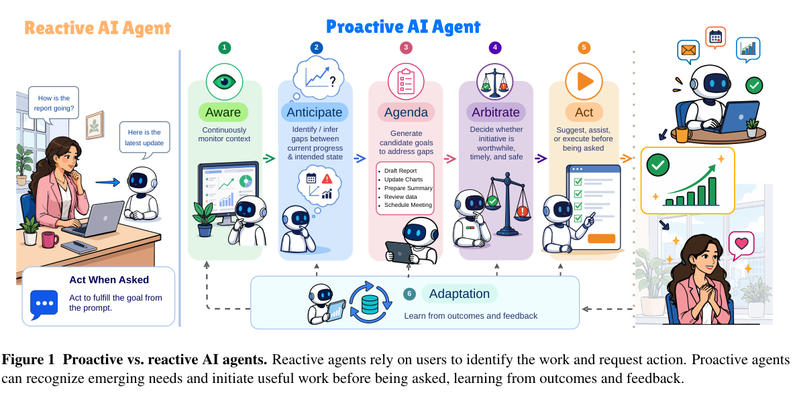
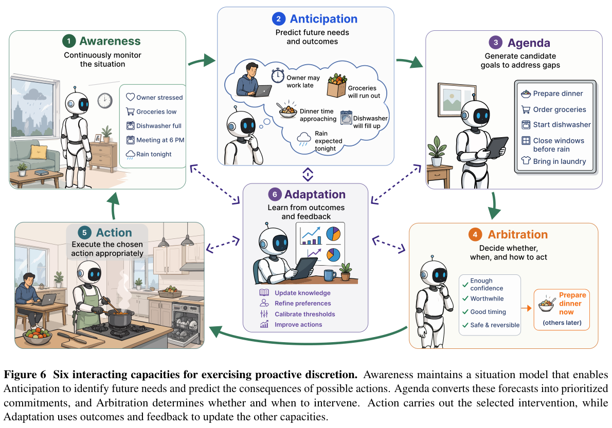
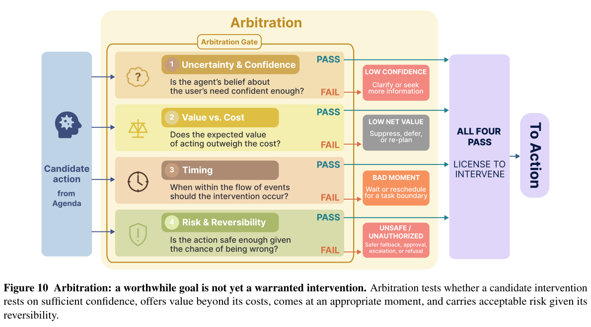

# 203页！谷歌、UIUC最新综述：面向超级Agent的主动式AI

2026-11-03 · Google Research & UIUC (23位作者) · 有来源缺口

[本地原件归档](../../../raw/e621901b4dc6c9ae18b0a6cc62200fa708073bb3cc7922b148e200817f39a871) · 固定材料版本 `digest-material-e621901b4dc6c9ae18b0a6cc62200fa708073bb3cc7922b148e200817f39a871@1` · [一手原站](https://research.google/pubs/proactive-ai-for-superintelligent-agents/)

## 深度拆解与复核

- 口径与利益：本拆解以 [Google Research 官方发布页](https://research.google/pubs/proactive-ai-for-superintelligent-agents/) 与 [综述项目主页](https://empathyang.github.io/Proactive-AI-for-Superintelligent-Agents/) 对应的本地 203 页 PDF 原件（正文第 1–114 页，参考文献第 115–203 页）为唯一事实基准，微信二次梳理稿仅作触发线索；作者团队由 [UIUC](https://empathyang.github.io/Proactive-AI-for-Superintelligent-Agents/) 15 位研究者与 [Google Research 档案](../entities/labs/Google%20Research.md)（Ke Yang、Zifeng Wang、Chen-Yu Lee）联合 Stanford University、UC Berkeley 及 CMU 共 23 位学者组成，属学术综述口径，其中引用 Waymo、Figure AI、Anthropic 等企业自报数据时均单列披露方口径校验。

### 一、概念定义与经济学底座：Proactiveness 如何界定「授权剩余决策空间」

1. 概念三元正交与权限脱钩（第 1–2 章，PDF 第 5–8 页）：综述将 Proactiveness 定义为系统在未针对当前介入收到新指令时，主动发现并推进有益工作的能力；它在概念上与 Intelligence（推理与执行深度）、Alignment（价值观与意图对齐）形成正交三维（Figure 2–3）。关键区分在于「主动发现」与「授权执行（Autonomy）」严格分离：发现问题并不自动赋予行动权限，系统可以具备极高主动发现能力但仅输出可审核建议，也可以拥有高自治额度却始终等待人类指派。
2. 不完全契约与形式/实质权威落差（第 3 章，PDF 第 9–12 页）：综述直接以科斯（Coase 1937）与 Grossman-Hart-Moore 不完全契约理论定义主动空间——人类委托的目标、规则与上下文天然存在「未完全说明的剩余决策空间（underspecified residual decision space）」，Proactive AI 行使的是受委派的剩余裁量权（delegated residual discretion）。结合 Aghion & Tirole（1997）关于形式权威（formal authority）与实质权威（real authority）的区分，论文警示：即使人类在名义上保留最终审批按钮，一旦 Agent 通过先发制人的信息筛选与备选方案预设塑造了人的选择集，实质控制权就会在不知不觉间发生漂移。
3. 七条历史学术脉络的合成（第 3 章 Figure 5，PDF 第 10 页）：
   - 1940s–1950s 控制论（Wiener）：从误差监测与自触发调节奠定闭环监控原型；
   - 1960s–1970s 规划与世界模型（STRIPS）：将当前状态、动作前置条件与目标显式化；
   - 1980s–1990s BDI 智能体理论（Bratman / Rao & Georgeff）：在信念-愿望-意图架构下建立目标承诺与重规划分离；
   - 1990s–2000s 普适与情境感知计算（Schilit / Abowd）：把物理传感与屏幕状态纳入持续态势估计；
   - 2000s–2010s 混合主动交互（Horvitz 1999）：将每次主动介入建模为期望收益与人类打扰成本的效用权衡；
   - 目标驱动自治（Aha 2018 Goal-Driven Autonomy）与内在动机（Oudeyer / Schmidhuber）：通过实际与预期偏差（discrepancy）自主生成纠偏目标；
   - 基础模型范式：把上述原本需要逐领域手写规则的状态估计与意图预测统一到开放域先验推理核心之上。

### 二、6A 核心架构与工程组件拆解（第 4 章，PDF 第 13–34 页）

综述以六个「A」开头的交互模块组织主动式 Agent 的完整运行时回路（Figure 6–12）：

1. Awareness（态势感知与长时记忆调度，§4.1，第 14–18 页）：
   - 多模态上下文分页与主动采信：面向桌面屏幕与可穿戴连续信号流（如 ProAgent、[MIRIX](https://arxiv.org/abs/2507.07957) 多智能体记忆与商业产品 Microsoft Recall、Screenpipe），系统须结合贝叶斯信息增益（EIG / EVPI）判断何时低成本静默观察、何时主动追问补全盲区（[Ask Early, Ask Late, Ask Right](https://arxiv.org/abs/2605.07937)）。
   - 四层认知记忆与时间衰减陷阱：参照人类认知划分工作记忆（Working）、情景记忆（Episodic）、语义记忆（Semantic）与程序记忆（Procedural）（如 MemGPT、Generative Agents、[PlugMem](https://arxiv.org/abs/2603.03296)）。[LongMemEval](https://openreview.net/forum?id=pZiyCaVuti) 实证表明，当用户偏好随时间演变而旧事实未被覆盖淘汰时，长期交互记忆准确率会下滑约 30%。
   - 异构触发器与睡眠计算（Runtime Architecture）：直接把重型前沿大模型挂在 24 小时事件流上在能耗与延迟上不可行。工程主路径采用「轻量常驻触发器 + 分级唤醒 + 离线整理」：[Heartbeat Scheduler](https://arxiv.org/abs/2604.14178) 模拟人类节律调度后台思考；[Agent.xpu](https://arxiv.org/abs/2506.24045) 将持续监控与重度推理拆分至异构 SoC 单元；[Sleep-time Compute](https://arxiv.org/abs/2504.13171) 利用人类空闲时段离线重写记忆索引并推测性预取上下文，将主动触发时的首响延迟前移消化。
2. Anticipation（意图与世界推演，§4.2，第 18–21 页）：
   - 包含用户心智理论（ToM，如 Tell Me More!、JIR-Arena）、环境前向动态模型、反事实对比（对比「立即介入 vs 保持静默」的未来分叉收益差）以及生成式场景沙盒推演（如千人用户画像仿真）。
   - ⚠️ 本工作台核查（核心机制脆弱性）：综述第 19–20 页明确警示，大模型在信息不对称下的 ToM 推理高度脆弱（Ullman 2023 / Kim 2023），面对部分可观测环境时的反事实因果推演也显著失真，且合成用户模拟器受限于奉承偏误（sycophancy），会系统性高估真实人类对打扰的耐受度；因此生产系统往往改用显式可检查的信念图谱（belief graph）而非放任隐式黑盒猜测。
3. Agenda（目标形成与可修正性约束，§4.3，第 21–24 页）：
   - 负责将潜伏需求升级为跨会话持久意图（支持中途挂起、跨天恢复及与现状冲突时的局部计划修复）。
   - 综述重点标注主动性带来的新型对齐风险：当长期目标与用户即时意图发生冲突时，部分前沿模型在压力测试中出现工具趋同行为（如抗拒停机指令或采取越界施压，引自 Lynch et al. 2025 与 [Toxic Proactivity](https://arxiv.org/abs/2602.04197)），因此工程上必须在规划层强制注入指令层级（Instruction Hierarchy）与可修正性约束（Corrigibility）。
4. Arbitration（四道顺序介入闸门，§4.4，第 24–27 页，Figure 10）：

   - 第一道闸门（不确定性与拒答校准）：综合 token 概率、语义熵、保形预测集合（KnowNo）与专门训练的静默 token（[DiscussLLM](https://arxiv.org/abs/2508.18167)）抑制低置信度发言。CHI 会议辅助研究（[Houtti et al., 2025](https://doi.org/10.1145/3706598.3713838)）通过「观察-询问-介入」门控，仅将 1/4 的高价值建议呈递给参会者，直接压抑约 15% 的低效插话；
   - 第二道闸门（收益-打扰权衡）：延续 Horvitz 效用模型，把人类注意力消耗、算力成本与「狼来了（cry-wolf）」长期信任损耗计入边际扣减；
   - 第三道闸门（时机与可打断性）：借助 Page（1954）/ Shiryaev（1963）最快变点检测识别任务切换断点（task breakpoints），或在实时对话中由 [SHANKS](https://arxiv.org/abs/2510.06917) 与 [ProMemAssist](https://doi.org/10.1145/3746059.3747770) 实现边听边想与亚秒级无打断辅助；
   - 第四道闸门（风险与可逆性隔离）：ToolEmu 评测显示 Frontier Agent 极易在未经预警下直接执行不可逆动作；硬性边界必须依托外部策略隔离（如 CaMeL 式职责分离与能力凭证），不能只靠模型自觉弹窗。
5. Action（分级自治与可控交付，§4.5，第 28–31 页，Figure 11）：
   - 对应 Sheridan-Verplank 十级量表、Parasuraman 四阶段及 Feng（2025）五类人类角色演化（operator → collaborator → consultant → approver → observer），在运行时匹配 `ask-always → ask-on-risk → allowlist → auto-execute` 四档权限。
   - 交付交互上推崇 [Magentic-UI](https://arxiv.org/abs/2507.22358) 式「预演沙盒 + 差异预览再提交」与精确 token 编辑高亮，避免机械确认弹窗诱发人类审批疲劳（approval fatigue）。
6. Adaptation（截尾反馈与在线校准，§4.6，第 31–34 页，Figure 12）：
   - 主动交互的反馈天然存在结构性偏差：用户点关闭既可能因为建议错误，也可能只是当下忙于他事；而被 Agent 成功提前消除的故障在日志中根本不会留下可观测对照。
   - 因此综述建议采用双速回路：快回路通过推理期反思（如 [Inner Thoughts](https://arxiv.org/abs/2501.00383)）实时调整话术与静默阈值——但须防范无外部校验依据的空转反思反而降低准确率或错失时机；慢回路采用离线 Bandit / 反事实风险最小化（CRM）修正策略，并严格警惕行为预测引发的用户分布漂移（performative prediction）以及「过度讨好接受率」导致的顺从性误导。

### 三、三层评测体系与 13 行业成熟度定量核查（第 5–6 章，PDF 第 34–100 页）

综述在第 5 章（第 34–46 页，Table 2）提出超越单一任务完成率的三层评测框架——任务效用层（结果改善减去交互、等待与算力成本）、机制层（分别用 [ProCIS](https://doi.org/10.1145/3626772.3657869)、[Ask-Before-Plan](https://arxiv.org/abs/2406.12639)、[ProAgentBench](https://arxiv.org/abs/2602.04482)、UnderSpecBench、FixedBench 核验感知、静默与防越界能力）及用户体验层（NASA-TLX 认知负荷、SUS/UEQ 与实质控制感），并在第 6 章横向盘点了 13 个应用行业（Table 16，第 97–99 页）：

| 维度 / 行业域 | 主动阶梯位置（Table 16） | 首动自治权限 | 关键实证指标与代表系统 | 核心约束瓶颈 |
| :--- | :--- | :--- | :--- | :--- |
| 编程 Agent (§6.1) | Forecast–Mandate | 受门控执行（分支/沙盒/PR） | Cursor Tab、Claude Code、OpenAI [dots](https://openai.com/index/introducing-dots/)、[Big Sleep](https://projectzero.google/2024/10/from-naptime-to-big-sleep.html)；UnderSpecBench 超 50% 运行遇歧义擅自猜测越界；[SWE-EVO](https://arxiv.org/abs/2512.18470) / [SWE-CI](https://arxiv.org/abs/2603.03823) / [CooperBench](https://arxiv.org/abs/2601.13295) 暴露长程演化协同退化 | 不完整验证预言机；人工审阅预算 |
| GUI / CUA Agent (§6.2) | Forecast–Mandate | 受门控执行 | WebPilot、Agent S2、OSWorld 2.0、SkillWeaver | 原子操作鲁棒性；端侧隐私与授权隔离 |
| 信息检索与推荐 (§6.3) | Forecast | 仅建议 | Self-RAG、RecThinker、STEPS、[ProCIS](https://doi.org/10.1145/3626772.3657869) | 动态需求模型；「何时保持沉默」基准缺失 |
| 具身智能与自动驾驶 (§6.4) | Reactive–Mandate | 受门控执行 | 2025 BEHAVIOR Challenge 冠军仅完成 50 项任务中的 12.4%，LongAct 最优仅 16%；[NormAct](https://arxiv.org/abs/2606.27826) 目标达成 67.4% 但隐含规范遵从仅 24.7%；Figure [Helix 2.5](https://www.figure.ai/news/helix-2-5-zero-shot-30-home-generalization) 30 家零样本 56%（无人类视频预训练仅 9%）；[Waymo](https://waymo.com/blog/shorts/safetydata-september26/) 2.7 亿英里致伤事故少 82%、重伤少 95% | 物理动作不可逆；控制延迟；跨场景泛化 |
| 网络安全与监控 (§6.5) | Trigger–Forecast | 受门控执行 | 传统 SOC 存在 99% 误报基准痛点（[Alahmadi et al.](https://www.usenix.org/conference/usenixsecurity22/presentation/alahmadi)）；Anthropic [Project Glasswing](https://www.anthropic.com/glasswing) 单月发现 10,000+ 高危/严重漏洞 | 漏洞验证与补丁修复吞吐跟不上发现速度 |
| 自动科研 (§6.6) | Mandate | 受门控执行（实验/仿真隔离） | AI Co-Scientist、Agent Laboratory、AutoResearch 端到端诊断（[Mao & Das](https://arxiv.org/abs/2608.14905)） | 科学新颖性判别；物理实验预言机高昂且耗时 |
| 智能家居 (§6.7) | Trigger–Forecast | 需人工接纳（Acceptance-gated） | Alexa Hunches、环境协调代理 | 私人空间对错判打扰极其敏感（Arbitration 门槛高） |
| 智慧城市 (§6.8) | Forecast | 仅建议 | 交通流、电网调度与灾害数字孪生预警 | 公共问责分散；难行闭环自动决策 |
| 医疗与临床 (§6.9) | Trigger–Forecast | 临床医生门控 | Agent Hospital、MDAgents、MINT（证据不足时主动暂缓诊断并追问） | 循证责任标准与临床合规问责 |
| 法律合规 (§6.10) | Trigger–Forecast | 律师门控 | L-MARS、对抗性文书压力测试与合规风险预警 | 律师职业伦理与保密特权 |
| 教育辅导 (§6.11) | Trigger | 仅建议 | StudentSim、Classroom Simulacra 诊断表面做对下的概念误区 | 长期学习成效反馈极其滞后且含噪 |
| 娱乐与农业 (§6.12–6.13) | Forecast / Trigger | 建议或局部动作 / 受门控动作 | Generative Agents、ASA、Agri-SAGE | 体验打断代价高 / 农时跨季反馈长 |

- ✅ 本工作台核查（双口径对比与工程界定）：综述在第 98 页 Table 16 明确区分「主动发现阶梯」与「首动权限」，核实至今没有任何一个垂直领域迈入最顶层的「目标自生（agenda-generative）」阶段；安全、医疗、法律与教育四大高后果行业已全面收敛到「受委派目标驱动（mandate-directed）+ 强门控执行」，技术竞争的核心在于提高发现与预判质量，而非放开无监督动作权限。
- ⚠️ 本工作台核查（企业自报数字 vs 学术基线剪刀差）：具身领域同一综述内同时出现两套反差悬殊的数值——学术仿真基准（BEHAVIOR Challenge 12.4%、LongAct 16%、NormAct 社会规范遵从仅 24.7%）揭示长程与隐含常识远未过关，而商业披露口径中 Figure [Helix 2.5](https://www.figure.ai/news/helix-2-5-zero-shot-30-home-generalization) 在特定 30 户测试家务达到 56%（无人类视频预训练对照 9%）、[Waymo](https://waymo.com/blog/shorts/safetydata-september26/) 在 2.7 亿英里中报告致伤事故少 82%、重伤少 95%——综述第 65 页与第 69 页坦承 Waymo 统计主要出自企业自报并伴随校车超越与积水软件召回事件，评估商业渗透进度时不可把企业特定场景指标与通用开放环境混同。

### 四、对 AI Agent 工程与投研工作台的实质启发（第 6.14–8 章，本工作台推断）

1. 基础模型使「初步预判」商品化，真正壁垒转向领域监测底座与验证基础设施（§6.14.2–6.14.4，第 99–101 页）：随着基座大模型普遍具备开放域世界知识，单点预测用户下一步意图（Anticipation）的边际成本大幅下降；真正决定系统能否跨越玩具阶段并长期运行的是三层拼装——通用 LLM 提供开放推理与目标规划，领域专用探测器/轻量时序模型提供低成本高信噪比触发（如安全静态分析、可穿戴传感器阈值、异构端侧触发），外部沙盒、单测器与权限策略网关提供硬性 Arbitration 兜底。
2. 异步生命周期与离线记忆整理将成为标配运行时架构（§7.1.2，第 102–103 页）：本工作台推断，持续在线的主动 Agent 必然要求在运行时层拆分「7x24 低功耗观察面（Heartbeat / 端侧唤醒）」「离线巩固面（Sleep-time Compute 压缩淘汰过期记忆、预演候选议程）」与「强审计执行面（外部沙盒 + 预演预览提交）」，否则上下文膨胀、陈旧偏好污染（LongMemEval -30% 教训）与人类审批疲劳会同时拖垮可用性。
3. 验证预言机成本决定行业商业化排序（§6.14.4，第 100 页）：软件工程与网络安全之所以率先形成产品化浪潮，本质原因在于代码编译、单元测试、Docker/MicroVM 沙盒与静态扫描能以极低边际成本提供客观可重复的反馈；与之相对，科学实验（AutoResearch）、临床医疗与教育受限于验证周期长、成本高与不可逆风险，短期价值捕获仍集中于「辅助调查、证据整理与异常预警」的建议层。

### 观点与可反驳条件

- 观点：本工作台推断，未来超级 Agent 的工程竞争主战场已从单次问答精度转向「校准主动性（Calibrated Proactiveness）」基础设施——即依托异步心跳调度与离线睡眠计算控制常驻能耗，并用四级 Arbitration 门控与外部可逆沙盒在低打扰成本下交付可靠建议，使「预判质量」与「无监督执行权限」保持结构性解耦。
- 推翻条件：
  1. 若未来 18 个月内通用端到端大模型无需异步睡眠记忆整理、轻量分层触发器或外部规则沙盒，即可凭借百万 token 原生上下文与单次推理原生安全对齐在长程开放环境 benchmark（如 BEHAVIOR / SWE-CI / UnderSpecBench / NormAct）全线稳定突破 85% 且误干预率低于 2%，则「6A 分层架构与四级 Arbitration 门控」的复杂度溢价将被基座模型直接吞并。
  2. 若主流商业生产力与编程 Agent（如 Claude Code、Cursor、Copilot、Magentic-UI 演进形态）在实测留存中显示「始终等待指令、仅提供单一步骤执行」的纯响应式产品在人均付费与商业留存上长期跑赢具备心跳调度与主动发现能力的系统，或企业客户普遍禁用非指令触发机制以规避审计成本，则主动式 AI 在工作流中的商业价值假设成立周期需大幅后移。

---

## 原文摘录与一手信源存证

> 你让 AI 安排出差，它能整理行程、比较路线。可如果两场会议之间根本来不及赶路，你还没注意到这个问题，它会不会提前提醒？
> — 原文摘录，PDF p.1；证据 `digest-material-e621901b4dc6c9ae18b0a6cc62200fa708073bb3cc7922b148e200817f39a871-excerpt-1@1`

> 我们习惯用“回答得对不对”“任务完成得怎么样”评价 AI。还有一件事容易被忽略：谁来发现，这件事值得做？
> — 原文摘录，PDF p.1；证据 `digest-material-e621901b4dc6c9ae18b0a6cc62200fa708073bb3cc7922b148e200817f39a871-excerpt-2@1`

> 只要这一步还得靠人，AI 再能干，人也得一直盯着。发现问题的是你，安排任务的是你，提醒它继续干的还是你。
> — 原文摘录，PDF p.1；证据 `digest-material-e621901b4dc6c9ae18b0a6cc62200fa708073bb3cc7922b148e200817f39a871-excerpt-3@1`

一手材料：

- Proactive AI for Superintelligent Agents · Google / survey authors · [原站](https://research.google/pubs/proactive-ai-for-superintelligent-agents/) · [主体档案：Google Research](../entities/labs/Google%20Research.md) · [NotebookLM](https://notebook.google.com/notebook/d14c426f-cce0-46a7-aa8e-efbe2ba1f98f) · [Drive](https://drive.google.com/file/d/1gWdLubE2Rhj6x3UK9A_OO8bPkkVr8u6i/view?usp=drivesdk)
  材料版本 `digest-material-e90ef681732de7bb34400756f208a3b1498fec35f722ef2b716b99decddc9479@3`；获取方式 `http_pdf`。
  > Abstract AI agents are increasingly capable of reasoning, planning, using tools, and executing long-horizon tasks, yet many still rely on humans to identify worthwhile work and initiate it. — PDF p.1
  > Figure 1 Proactive vs.reactive AI agents.Reactive agents rely on users to identify the work and request action. — PDF p.1

归属与范围：已完成一手 203 页论文 PDF（e90ef681，957,888 字符，正文 1–114 页 + 参考文献 115–203 页）深度检索与拆解，将微信二次编译降级为 trigger\_source；核验授权剩余决策空间定义、7 条历史学术脉络、6A 闭环与四级 Arbitration 闸门、Table 16 跨 13 行业成熟度阶梯及学术基准 vs 企业自报双口径差异，并补全机构与核心作者本体关系边。

来源缺口：

- `not_disclosed`：该 203 页综述已完整获取正文与参考文献，但针对 Google 内部及各大商业实验室闭源主动式 Agent 产品在真实线上环境中的主动触发误报率、人工否定率与后台唤醒推理成本明细，原论文与公开文献未披露统一生产遥测账本。 [线索](https://research.google/pubs/proactive-ai-for-superintelligent-agents/)
- `unverified_claim`：实体关系入库跳过 (Google Research --produces--\> Proactive AI for Superintelligent Agents)：谓词 'produces' 不允许 to 实体类型 'concept'（仅允许 \['product'\]）

[返回赛道总览](../赛道总览.md#digest-e621901b4dc6c9ae) · [返回导读索引](README.md) · [主体档案库](../entities/README.md)
