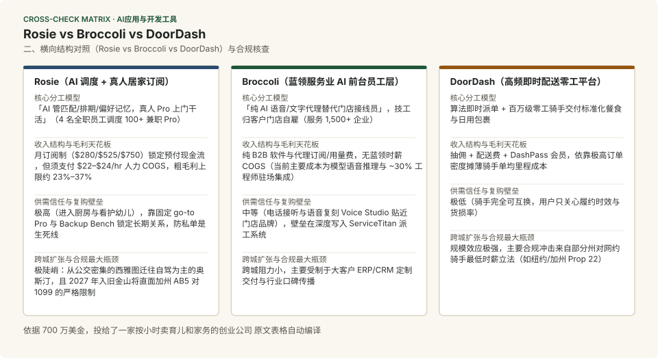

# 700 万美金，投给了一家按小时卖育儿和家务的创业公司

2026-10-24 · Rosie 官方发布（PR Newswire / rosiematch.com）· GeekWire (via TechBytes) · 有来源缺口

[本地原件归档](../../../raw/a39fedef1ab4cdc951ed6bdc48ef3aee3256d8c0c577449e1c84c4ca451124e9) · 固定材料版本 `digest-material-a39fedef1ab4cdc951ed6bdc48ef3aee3256d8c0c577449e1c84c4ca451124e9@1` · [一手原站](https://www.rosiematch.com/)

## 深度拆解与复核

- 口径与利益：触发线索为微信公众号「深思SenseAI」（2026-10-24）的商业分析稿；本篇已穿透核对 [PR Newswire 官方通稿（2026-10-20）](https://www.prnewswire.com/news-releases/rosie-raises-7-million-to-bring-flexible-childcare-and-household-support-beyond-seattle-302913603.html)、[Rosie 官网](https://www.rosiematch.com/)、[会员定价页](https://www.rosiematch.com/membership)、[Pro 招募页](https://www.rosiematch.com/rosiepro) 与 [TechBytes 对 GeekWire 报道的转载全文（2026-10-21）](https://techbytes.app/posts/from-dishes-to-diapers-seattle-home-help-startup-rosie-raises/)。七位数 ARR、17,000+ 小时交付与每周节省 4 小时均属公司融资公告自报口径，下文先拆解其 AI 调度与线下履约单位经济，再对历史价格调整、1099 风险及同赛道对照展开核查。

### 一、业务机制与单位经济拆解：「AI 管协调摩擦 + 真人做高信任履约」

1. 产品楔子与 Jetson 调度引擎：消灭「找人并管理阿姨」的隐性劳动
   - 创始人 Mitra Raman（前 Amazon 软件工程师、YC 校友）与 Karthika Shankar（12+ 年 Amazon 一线招聘运营经验），联手 Maddie Hartog（Founding Ops）与 Sridhar Kashyap（Founding Engineer）于 2026 年 1 月在西雅图上线 Rosie；两位创始人先亲自充当首批 Rosie Pro 上门叠衣、整车库与陪娃以摸清家庭动线。据 [Rosie 官网](https://www.rosiematch.com/)，产品打破传统「保姆市场 vs 钟点清洁市场」割裂，卖给双职工父母的是每月固定时长额度（以 2 小时为最小步长），可混合用于 4 个月以上儿童看护（4–12 个月家长须在家，12 个月以上可离家）以及叠衣、清空洗碗机、切菜备餐与整理玩具等日常家务（明确排除深度清洁、刷马桶、重物搬运与全职保姆）。
   - ==AI 在 Rosie 中的真实角色不是替代人干活，而是把家庭「雇人协调税」压缩到一条短信==：内部引擎 Jetson 记录每个家庭的房间布局、作息规律、饮食偏好与喜爱 Pro 排序，在后台自动完成匹配、改期、付款与上下文交接（Pro 上门前已读取偏好无需家长在场交代），同时以「固定周频专属帮手（go-to Pro）+ 受邀制备用名单（Backup Bench）+ 老带新跟班（shadow）」建立复购信任，并通过封禁私下跳单条款（违者终止双方会员与合同）锁定平台协调租金。
   - 极致精益的人效杠杆：全公司仅 4 名全职员工加少量兼职运营，却在西雅图 King County 协调 100+ 名活跃 Pro、服务 250+（近 300）户会员家庭并达成 99% 当日急单（甚至 1 小时内）履约率，工程招聘明确瞄准「100% 自动化匹配排期 + 人工意识把关」。

2. 单位经济测算（本工作台测算）与官网定价核查
   - ⚠️ 价格口径更新纠偏：TechBytes 转载 GeekWire（2026-10-21）记录 Rosie 早期三档月费为 $250（8h）/ $500（16h）/ $750（24h）；经本工作台直采当前实时 [Rosie 会员定价页](https://www.rosiematch.com/membership) 核查，三档月费已调升为 $280（每月 8 小时，折合 $35.00/hr）、$525（每月 16 小时，省 6%，折合 $32.81/hr）与 $750（每月 24 小时，省 10%，折合 $31.25/hr），超时按 $32/hr 月底结算，每增加 1 名儿童加收 0.1x 时长；取消规则为 24 小时前免费、24 小时内扣 50%、12 小时内扣 100%。
   - 单位小时毛利差与履约成本（本工作台测算）：据 [TechBytes（转引 GeekWire）](https://techbytes.app/posts/from-dishes-to-diapers-seattle-home-help-startup-rosie-raises/)，西雅图 Pro 基础时薪为 $22–$24/hr 外加奖金（偶尔接单每周赚数百美元，活跃者周入 $500–$1,000），完成服务后即刻发薪（[rosiematch.com/rosiepro](https://www.rosiematch.com/rosiepro) 披露 Pro Career Ladder 随积分提薪与优先派单）。对照 $31.25–$35.00/hr 的会员折合单价，Rosie 的直接小时毛差（gross spread before ops）仅为 $7.25–$13.00/hr，即粗毛利率约 23%–37%；扣除 Stripe/支付手续费、Capitol Hill 线下实操考场、AI 背调、儿童接送保险核验及带薪跟班培训（Paid Shadow Sessions）后，真实贡献毛利对「单小时空驶通勤成本」极度敏感。这正是其用 8 个月、17,000+ 小时（推算户均月耗约 8.5 小时，紧贴 8h 入门档）换来「七位数 ARR」后，仍必须融资 $7M（Bling Capital 与 Reach Capital 领投，Graham & Walker、Marketplace Capital、Ingeborg Investments、Precursor Ventures、Mother Ventures、Yonder Ventures 及 DoorDash 联合创始人 Evan Moore 等参投）加密同城路线密度并在 2027 年推奥斯汀与旧金山的关键原因。

### 二、横向结构对照（[Rosie](../entities/companies/Rosie.md) vs [Broccoli](../entities/companies/Broccoli.md) vs DoorDash）与合规核查

| 对比维度 | Rosie（AI 调度 + 真人居家订阅） | Broccoli（蓝领服务业 AI 前台员工层） | DoorDash（高频即时配送零工平台） |
| :--- | :--- | :--- | :--- |
| 核心分工模型 | 「AI 管匹配/排期/偏好记忆，真人 Pro 上门干活」（4 名全职员工调度 100+ 兼职 Pro） | 「纯 AI 语音/文字代理替代门店接线员」，技工归客户门店自雇（服务 1,500+ 企业） | 算法即时派单 + 百万级零工骑手交付标准化餐食与日用包裹 |
| 收入结构与毛利天花板 | 月订阅制（$280/$525/$750）锁定预付现金流，但须支付 $22–$24/hr 人力 COGS，粗毛利上限约 23%–37% | 纯 B2B 软件与代理订阅/用量费，无蓝领时薪 COGS（当前主要成本为模型语音推理与 ~30% 工程师驻场集成） | 抽佣 + 配送费 + DashPass 会员，依靠极高订单密度摊薄骑手单均里程成本 |
| 供需信任与复购壁垒 | 极高（进入厨房与看护幼儿），靠固定 go-to Pro 与 Backup Bench 锁定长期关系，防私单是生死线 | 中等（电话接听与语音复刻 Voice Studio 贴近门店品牌），壁垒在深度写入 ServiceTitan 派工系统 | 极低（骑手完全可互换，用户只关心履约时效与货损率） |
| 跨城扩张与合规最大瓶颈 | 极陡峭：从公交密集的西雅图迁往自驾为主的奥斯汀，且 2027 年入旧金山将直面加州 AB5 对 1099 的严格限制 | 跨城阻力小，主要受制于大客户 ERP/CRM 定制交付与行业口碑传播 | 规模效应极强，主要合规冲击来自部分州对网约骑手最低时薪立法（如纽约/加州 Prop 22） |

- ❌ 本工作台核查（1099 独立承包人归类与历史前车之鉴）：触发稿与 [TechBytes 报告](https://techbytes.app/posts/from-dishes-to-diapers-seattle-home-help-startup-rosie-raises/) 均指向同一颗制度暗雷——Homejoy（融资约 $40M 做按需保洁）于 2015 年因 1099 工人错误归类集体诉讼倒闭，Hello Alfred（2018 年融资 $40M）被迫改用全职 W-2 雇员并缩进高端公寓合作模式。Rosie 虽以「Pro 可自主决定接单时间与家庭」主张 1099 独立承包人属性，但现实中平台同时制定了消费者统一小时费率（$280/$525/$750）、算法动态定价 Pro 报酬、强制 Capitol Hill 线下实操考核（用创始人家里衣物叠衣测试）、限定工作清单（不刷马桶等）并审查车辆保险。按照美国劳工部经济现实测试与加州（Rosie 计划 2027 年进军旧金山）ABC 严苛测试，这种高度运营控制极易被认定为事实雇员（W-2）；一旦被迫转为 W-2（附加约 20%–30% 薪资税、工伤险与排班法定工时），现有 $280–$750 订阅定价与 $22–$24/hr 薪酬之间的 23%–37% 粗毛利空间将被瞬间击穿。
- ✅ 本工作台推断：与用 AI 直接替代人的叙事不同，Rosie 验证了在「高信任、非标物理家庭劳务」场景里，消费者真正愿意为订阅制付费的增量价值在于消除协调沟通与筛选信任摩擦（Jetson 引擎 + 专属 Pro + Backup Bench）；但正因为每一小时收入都对应真实的真人时薪支出，Rosie 无法享有像 Broccoli 那样的纯软件估值倍数，其跨城扩张本质上是对「同城密度降通勤 + 高留存摊销获客成本 + 1099 法律边界」的精算考验。

### 观点与可反驳条件

- ==观点==：==Rosie 的核心商业创新是用「月度订阅预付 + Jetson 后台全自动记忆调度 + 专属 Pro 固定搭配」把传统一锤子介绍费模式（Care.com）重塑为可预测的家庭支持 SaaS 现金流；但受制于 $22–$24/hr 履约人工成本（粗毛利仅 ~23%–37%）及从西雅图向奥斯汀自驾型城市和旧金山强劳动法州扩张的约束，它在本质上仍是一个对本地密度与用工合规极度敏感的轻运营家政网络，而非高毛利纯 AI 软件公司==。
- ==推翻条件==：
  1. 若截至 2027-Q4，Rosie 在奥斯汀与旧金山成功落地且维持全公司全职管理/研发人效杠杆（单城全职人员 <=3 人、Jetson 调度 100% 自动化），同时未引发加州 AB5 或华盛顿州 W-2 用工重分类诉讼或被迫全面上调客单价逾 25% 导致月度留存下降，则「强运营控制与 1099 合规难以兼容跨州扩张」的判断将被推翻。
  2. 若 Rosie 后续披露通过多孩附加费、取消违约金、高毛利增值生态（宠物照看/老人陪伴/代办跑腿）及路线密度压缩，将真实平台综合毛利率稳定拉升至 >=45% 且 M12 会员净收入留存率 >=100%，则其「单位经济天花板受限于低毛利劳务中介区间」的论断应予以修正。

---

## 原文摘录与一手信源存证

> 你有没有想过，在 AI 什么都能做的今天，一家刚融到 700 万美元的创业公司，押注的却是"真人上门"？它不做机器人，也不做又一个聊天助手，卖的是一个会来你家叠衣服、陪孩子写作业、把厨房收拾回原样的人。
> — 原文摘录，PDF p.1；证据 `digest-material-a39fedef1ab4cdc951ed6bdc48ef3aee3256d8c0c577449e1c84c4ca451124e9-excerpt-1@1`

> 这家公司叫 Rosie ，总部在西雅图，由两位妈妈 Mitra Raman 和 Karthika Shankar创办，前 Amazon 和 YC 的人。今年 1 月它悄悄上线，十月宣布完成两轮、共 700 万美元的融资，由 Bling Capital 和 Reach Capital 领投，接下来要走出西雅图。Mitra和投资人 James Kim 都说过几句让我印象很深的话。
> — 原文摘录，PDF p.2；证据 `digest-material-a39fedef1ab4cdc951ed6bdc48ef3aee3256d8c0c577449e1c84c4ca451124e9-excerpt-2@1`

> Rosie 给自己的定位是"灵活的育儿与家务支持会员制"。家庭按月买会员，换来每个月一定小时数的服务，可以用在孩子身上，也可以用在家务上，比如照看孩子、叠衣服、整理厨房，用 Mitra 的话概括，就是"只要是能让一个家和一个家庭继续运转的事"。具体的场景也很细：洗衣、叠衣、蒸熨，从约会夜的看护到备用的临时托管，洗碗机清空、台面擦净，切好蔬菜、装好午餐盒，倒垃圾、整理玩具。
> — 原文摘录，PDF p.2；证据 `digest-material-a39fedef1ab4cdc951ed6bdc48ef3aee3256d8c0c577449e1c84c4ca451124e9-excerpt-3@1`

一手材料：

- Rosie Raises \$7 Million to Bring Flexible Childcare and Household Support Beyond Seattle · PR Newswire / Rosie · [原站](https://www.prnewswire.com/news-releases/rosie-raises-7-million-to-bring-flexible-childcare-and-household-support-beyond-seattle-302913603.html) · [主体档案：Rosie](../entities/companies/Rosie.md) · [NotebookLM](https://notebook.google.com/notebook/a5a6cb11-e073-464c-ae6c-a945ef70f174) · [Drive](https://drive.google.com/file/d/1ta7bPHDE4qagAwamQtgPHlMON7pij9eN/view?usp=drivesdk)
  材料版本 `digest-material-31e379ab89c5a317952bc9155fedd7bc86252e6da976faf7eba875053a3a0afa@1`；获取方式 `http_html`。
  > After scaling from zero to seven-figure ARR in eight months, the former YC & Amazon leaders behind Rosie are betting that in an age of AI, the future of family support is still human. — 原文提取
  > SEATTLE, Oct. 20, 2026 /PRNewswire/ -- Rosie, the membership for flexible childcare and household support, today announced that it has raised \$7 million across two oversubscribed financing rounds. — 原文提取
- Rosie Official Site: Flexible Childcare & House Support for Families · Rosie · [原站](https://www.rosiematch.com/) · [主体档案：Rosie](../entities/companies/Rosie.md) · [本地原件](../../../raw/afee6f36bb6038c7ce3ba487fdb7c1d29e01e04b7bdc36dfa086bd69f8582eb7)
  材料版本 `digest-material-afee6f36bb6038c7ce3ba487fdb7c1d29e01e04b7bdc36dfa086bd69f8582eb7@1`；获取方式 `http_full_text`。
  > Rosie: Flexible Childcare & House Support for Families Home Services Membership Rosie Pros Locations FAQs LOG IN LOG IN Home Services Membership Rosie Pros Locations FAQs LOG IN LOG IN ROSIE ROSIE ROSIE ROSIE Flexiblefamilysupport.Forreallife. — 原文提取
  > Rosie isn't for deep cleaning, heavy lifting, junk removal, full-time nannying, or infant care for children under 4 months. — 原文提取
- Rosie Membership Plans & Pricing Tiers · Rosie · [原站](https://www.rosiematch.com/membership) · [主体档案：Rosie](../entities/companies/Rosie.md) · [本地原件](../../../raw/7d63af70e310038cf6c6bcd1a095d7a7e1b2c399e7da5209da4ab5e3ccecafc7)
  材料版本 `digest-material-7d63af70e310038cf6c6bcd1a095d7a7e1b2c399e7da5209da4ab5e3ccecafc7@1`；获取方式 `http_full_text`。
  > Rosie isn't designed for deep cleaning, heavy lifting, junk removal, full-time nannying, or infant care for children under 4 months. — 原文提取
  > Before a booking is accepted, we'll clarify the tasks, care needs, and qualifications required to make sure everyone knows what to expect. — 原文提取
- Rosie Pro: Caregiver Application, Vetting & Career Ladder · Rosie · [原站](https://www.rosiematch.com/rosiepro) · [主体档案：Rosie](../entities/companies/Rosie.md) · [本地原件](../../../raw/f8f112530c42b7e8851fed22d8f92b965c9dcf72363e5c0b8bf088163e29050a)
  材料版本 `digest-material-f8f112530c42b7e8851fed22d8f92b965c9dcf72363e5c0b8bf088163e29050a@1`；获取方式 `http_full_text`。
  > Rosie: Flexible Childcare & House Support for Families Home Services Membership Rosie Pros Locations FAQs LOG IN LOG IN Home Services Services Membership Rosie Pros Locations LOG IN LOG IN Meaningfulwork,builtaroundyourlife Rosie connects you with local families who need a hand with kids, home, and everything in between. — 原文提取
  > Plus, its flexible and consistent work that Rosie finds for you. What kind of hours do I work? What's my schedule? Tell us when you're available, and we'll help connect you with session opportunities that fit. — 原文提取
- From dishes to diapers: Seattle home-help startup Rosie raises \$7 million (GeekWire Startups Mirror) · Tech Bytes (citing GeekWire Startups) · [原站](https://techbytes.app/posts/from-dishes-to-diapers-seattle-home-help-startup-rosie-raises/) · [主体档案：Tech Bytes](../entities/labs/Tech%20Bytes.md) · [本地原件](../../../raw/e464f0d4b90700933599976da4e7ce0b3c8a0b75ce9522fa509e979c163651e0)
  材料版本 `digest-material-e464f0d4b90700933599976da4e7ce0b3c8a0b75ce9522fa509e979c163651e0@1`；获取方式 `http_full_text`。
  > Seattle domestic care startup Rosie raised \$7M from Bling Capital and Reach Capital to expand its subscription home-help platform to Austin and San Francisco. — 原文提取
  > This report examines Rosie's operational model, financial mechanics, and technology stack for technology executives, labor marketplace operators, and dual-income working parents seeking structured domestic support. — 原文提取

归属与范围：在已归档 PR Newswire（2026-10-20）\$7M 融资官方通稿基础上，补齐并核验 Rosie 官网主页、实时会员定价页（rosiematch.com/membership）、Pro 招募页（rosiematch.com/rosiepro）以及转载 GeekWire 深度专访的 TechBytes 全文（2026-10-21）。核查厘清官网最新 8h/16h/24h 月费已由早期媒体报道的 \$250/\$500/\$750 上调至 \$280/\$525/\$750（多子女按 +0.1x 计费），对比 Pros 时薪 \$22–\$24 推算出 23%–37% 粗毛利区间，并与 Broccoli（纯软件）及 DoorDash（标准化高频零工）完成横向结构对比；GeekWire 原站 403 阻断及 1099 劳动法合规与财务审计缺口保持登记。

来源缺口：

- `unavailable`：GeekWire 记者 Charlotte Schubert 于 2026-10-21 刊发的原站专访报道（geekwire.com）存在 HTTP 403 反爬阻断，原文核心数字已通过 TechBytes 转载版及 rosiematch.com 官方页交叉核对，仍保留 GeekWire 原站页面全文缺口。 [线索](https://www.geekwire.com/)
- `pending_verification`：通稿宣称 8 个月实现七位数 ARR、超 17,000 小时履约及家庭每周节省 4 小时均未附经审计财务报表与留存曲线（M3/M6 Churn），且 1099 独立承包人分类在美国华盛顿州与加利福尼亚州（AB5 法规，拟 2027 年进军旧金山）的法律合规性未经判例检验。 [线索](https://www.prnewswire.com/news-releases/rosie-raises-7-million-to-bring-flexible-childcare-and-household-support-beyond-seattle-302913603.html)
- `not_disclosed`：Rosie 未公开披露单客履约毛利率（扣除 Pro 薪酬、即时发薪手续费、商业责任险、背景调查及带薪跟班成本后）、月度会员未用完小时结转/作废率（breakage）及 AI 调度引擎 Jetson 的人工介入率（human-in-the-loop override rate）。 [线索](https://www.rosiematch.com/membership)

[返回赛道总览](../赛道总览.md#digest-a39fedef1ab4cdc9) · [返回导读索引](README.md) · [主体档案库](../entities/README.md)
