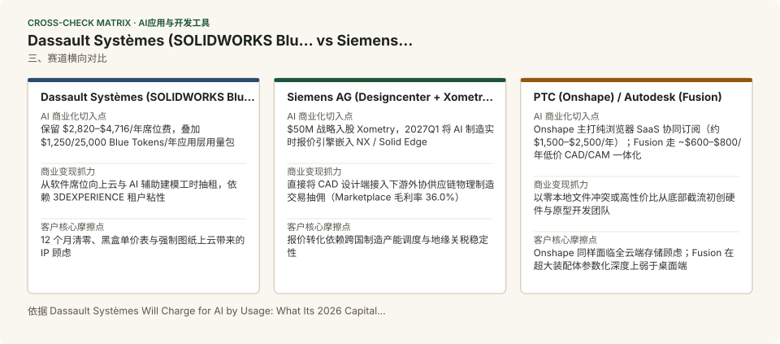

# Dassault Systèmes Will Charge for AI by Usage: What Its 2026 Capital Markets Day Means for SOLIDWORKS Blue Tokens, Licences and Design Data

2026-11-17 · Dassault Systèmes · 2026 Capital Markets Day & Blue Tokens · 有来源缺口

[本地原件归档](../../../raw/db0565016ac2617d64c4cc93fa0c08a140ce11831086b7cfac6ba6c36b6815a4) · 固定材料版本 `digest-material-db0565016ac2617d64c4cc93fa0c08a140ce11831086b7cfac6ba6c36b6815a4@1` · [一手原站](https://www.3ds.com/store/blue-tokens) · [触发线索（SolidBoris）](https://solidboris.com/our-blog/tpost/solidworks-ai-pricing)

## 深度拆解与复核

- 口径与利益：本文触发源为 [SolidBoris 博客（2026-11-17）](https://solidboris.com/our-blog/tpost/solidworks-ai-pricing)，其作者 Violetta Bonenkamp 系荷兰 CADChain 联合创始人，全文在解读达索系统（Dassault Systèmes，Euronext Paris: DSY.PA）2026 Capital Markets Day（CMD）的同时两次嵌入自研插件 BORIS for SOLIDWORKS 商业购买按钮（主打 CAD 文件区块链时间戳与所有权存证），天然倾向放大“云端 AI 数据出境与协议隐私风险”以促成存证转化。核心定价条款已穿透对照 [Dassault Systèmes 官方 Blue Tokens 商店页面](https://www.3ds.com/store/blue-tokens) 及库内已归档的 SOLIDWORKS AI 101（2026-08-13）、Q3 2026 业绩通稿（2026-10-28）与 GoEngineer 代理商 FAQ。
- ==核心结论==：达索系统在 2026-11-17 Vélizy-Villacoublay 举办的 Capital Markets Day 提出 2029 年营收超 €8B（€8 billion）、Non-IFRS 稀释每股收益（EPS）€1.80 及当年恒定汇率双位数增长目标，并正式将“席位订阅 + AI 虚拟伙伴（AURA、LEO、MARIE）按工作量（Usage）计费”确立为集团级增长模板。不过现场并未公布新的 SOLIDWORKS 席位或单次技能价格变动，==现行落地的 SOLIDWORKS Blue Tokens（$1,250 美元/年买 25,000 tokens、合格商业用户一次性赠 2,100 tokens、12 个月到期作废且企业租户共享池）实质是在保留席位入口的前提下再设一层消费计量收银台，其 2026–2029 年隐含营收 CAGR 仅 7.5%–7.8%，意味着“双位数增长”高度后置依赖 2028–2029 年上云率与 Generation 7 代理工作流放量==。

### 一、业务切口与核心机制

#### 1. 2026 Capital Markets Day 财务路标与“席位 + 用量”双轨制
达索系统管理层（CEO Pascal Daloz 与 CFO Rouven Bergmann）在 2026-11-17 CMD 上明确，订阅（Subscriptions）现已占集团经常性收入的 50%，且订阅 ARR 增速达到总 ARR 增速的 2 倍以上；3D UNIV+RSES 与 AI 原生 Generation 7 平台正通过 AURA、LEO 与 MARIE 虚拟伙伴（Virtual Companions）推进工业 AI 化。据 Q3 2026 电话会披露，Virtual Companions 已在 12%–14% 的装机基数上启用，但 CMD 通稿仅将其定性为“对席位许可（Seat-based Licences）的补充”，未宣布取消或调价现有 SOLIDWORKS Design 席位。

#### 2. SOLIDWORKS Blue Tokens 计费规则与 Design Data 上云边界
依据 [Dassault Systèmes Blue Tokens 官方商店与条款](https://www.3ds.com/store/blue-tokens) 及 SolidBoris 梳理，当前商业规则围绕“结果扣费、租户共享、期限清零、上云耦合”四条轴线运转：

| 规则维度 | 一手核实条款与量化参数 | 对工程团队与采购预算的实际约束 |
| :--- | :--- | :--- | 
| 计费触发原则 | 按技能交付结果扣费（Outcome-based）；仅在虚拟伙伴面板聊天提问不扣费 | 存在多轮返工损耗风险：自动生成工程图或参数化模型若不达标需反复重跑，每次交付均消耗额度 |
| 三级技能消耗梯度 | Simple（简单问答/材质应用）/ Moderate（装配分析/导入体转参数化）/ Complex（全套工程图/复杂零件生成） | 官方迄今未公布单次 Skill 扣除 Token 明细表（per-skill price list），团队无法事前精确测算单价 |
| 套餐定价与有效期 | 25,000 Blue Tokens 年包定价 US$1,250/年（不含税），折合 $0.05/token；12 个月到期作废并默认自动续费 | 强制年度清零形成运营商式“流量沉淀（Breakage）”，推高实际有效单 Token 采购成本 |
| 初始赠送与排除范围 | 合格商业用户一次性赠 2,100 tokens（Design 2,000 + 3DSwymer 100），不续赠；教育/创客/学生版暂排除 | 一次性体验池耗尽后即需企业管理员在 Members Control Center 统筹增购共享包 |
| 云端设计数据依赖 | 基础交互可不存云端，高阶 AI 技能要求将图纸（Design Data）托管至 3DEXPERIENCE 平台 | 2026-11-21 至 11-22 R2027x 升级期间公有云离线，云端 AI 技能同步不可用；数据出境与合规需书面确认 |

### 二、核心数据核查、口径纠偏与合规/工程边界

- ✅ 本工作台核查（CMD 2029 目标隐含增速算术复核）：以库内已核实的达索系统 FY2026 全年营收指引中值 €6.429B（€6.399B–€6.459B，Q3 2026 公告）对比 CMD 2029 目标 €8.0B+，三年复合年均增长率（CAGR）为 (€8.0B / €6.429B)^(1/3) - 1 = 7.56%。管理层宣称“2029 年实现双位数营收与 EPS 增长”，意味着 2027–2028 年集团整体营收仍可能维持中高个位数爬坡，AI 用量计费对表观收入的拉动并非即刻爆发，而是作为后置期权。
- ⚠️ 本工作台核查（触发源 SolidBoris 与达索官方博客版本及主体口径差异）：第一，[SolidBoris 原文](https://solidboris.com/our-blog/tpost/solidworks-ai-pricing) 援引 wiki 称启用虚拟伙伴需 SOLIDWORKS 2026 SP3.2 或更高版本，而此前库内入库的 SOLIDWORKS AI 101 官方博客明确起点为 2026 SP3.0+（R2026x FD03）；第二，SolidBoris 聚焦 SOLIDWORKS Design 内的 AURA 与 LEO，忽略了 [3ds.com/store/blue-tokens](https://www.3ds.com/store/blue-tokens) 明确列出的第三位伙伴 MARIE（材料与生命科学），忽视了 Blue Tokens 实为达索跨工业与生命科学平台的统一货币。
- ⚠️ 本工作台核查（平台安全与商用激励边界）：SolidBoris 一方面准确点出企业端对云端设计数据（Design Data）的治理焦虑——包括 3DEXPERIENCE Station Launcher App 曾曝出 CVSS 10.0 远程代码执行漏洞、第三方插件 MecAgent 条款允许收集本地打开的 CAD 文件，以及 Notion AI 曾因供应商泄露暴露对话；但另一方面，该文借上述风险直接推销自研区块链存证工具 BORIS for SOLIDWORKS，而忽略了达索 CEO Manish Kumar 2026 年 10 月已公开承诺不用客户数据训练 AI 模型（SolidBoris 亦建议将此写入书面补充协议）。
- 本工作台推断：当前工业软件客户对按用量计费的核心阻力并非 $1,250/年的绝对金额，而是“黑盒费率 + 私有图纸上云 + 工程师仍在环兜底”的三重摩擦。若达索在 2027-02-03 下次财报前仍不公布各 Skill 的 Token 价目清单，企业 CAD 管理员大概率会限制普通工程师调用复杂技能权限，从而抑制初期 Token 消费斜率。

### 三、赛道横向对比

| 对比维度 | Dassault Systèmes (SOLIDWORKS Blue Tokens) | Siemens AG (Designcenter + Xometry) | PTC (Onshape) / Autodesk (Fusion) |
| :--- | :--- | :--- | :--- | 
| AI 商业化切入点 | 保留 $2,820–$4,716/年席位费，叠加 $1,250/25,000 Blue Tokens/年应用层用量包 | $50M 战略入股 Xometry，2027Q1 将 AI 制造实时报价引擎嵌入 NX / Solid Edge | Onshape 主打纯浏览器 SaaS 协同订阅（约 $1,500–$2,500/年）；Fusion 走 ~$600–$800/年低价 CAD/CAM 一体化 |
| 商业变现抓力 | 从软件席位向上云与 AI 辅助建模工时抽租，依赖 3DEXPERIENCE 租户粘性 | 直接将 CAD 设计端接入下游外协供应链物理制造交易抽佣（Marketplace 毛利率 36.0%） | 以零本地文件冲突或高性价比从底部截流初创硬件与原型开发团队 |
| 客户核心摩擦点 | 12 个月清零、黑盒单价表与强制图纸上云带来的 IP 顾虑 | 报价转化依赖跨国制造产能调度与地缘关税稳定性 | Onshape 同样面临全云端存储顾虑；Fusion 在超大装配体参数化深度上弱于桌面端 |

### 观点与可反驳条件

- ==观点==：达索系统 2026 Capital Markets Day 宣布的 AI 用量计费战略是对现有 3DEXPERIENCE 上云漏斗与 Blue Tokens 年包制度的资本市场叙事升级，短期内（2026–2027 年）并不会颠覆 SOLIDWORKS 的席位收费底座，反因单次 Skill 扣费不透明及“2,100 枚免费额度耗尽即停”的共享池管理门槛，使多数制造企业处于试点测算而非规模放量阶段。
- ==推翻条件==：
  1. ① 费率透明化与复购加速条件：若达索系统在 2027-02-03 Q4 财报或 2027H1 内公布各 Virtual Companion 技能的精确 Blue Token 价目表，且披露 Virtual Companions 启用率从 12%–14% 跳升至 >=30%、带动订阅 ARR 增速连续两季加速，则“黑盒扣费与上云顾虑制约初期放量”的判断将被修正。
  2. ② 商业模式替代席位条件：若达索系统在 2027–2028 年公布的新用量模型中正式推出取消固定桌面/云端席位年费、纯按 AI 生成模型或仿真算力用量计价的 SOLIDWORKS 商业套餐并被 >=10% 商业客户采纳，则“用量计费仅作席位之上增量抽租”的判断将被推翻。

---

## 原文摘录与一手信源存证

> 【信源巡检核心摘要】 拆解达索系统 2026 资本市场日与 SOLIDWORKS AI 助手（AURA 与 LEO）Blue Tokens 按结果计费规则：合格商业席位一次性获赠 2,100 Blue Tokens，增购包定价 25,000 tokens/1,250 美元/年（12 个月到期、企业租户共享池），仅在 AI 技能成功交付设计/分析结果时扣费。
> — 原文摘录，文字段落 1；证据 `digest-material-db0565016ac2617d64c4cc93fa0c08a140ce11831086b7cfac6ba6c36b6815a4-excerpt-1@1`

一手材料：

- Virtual Companion Units (Blue Tokens) Pricing & FAQ · Dassault Systèmes · [原站](https://www.3ds.com/store/blue-tokens) · [主体档案：Dassault Systèmes](../entities/companies/Dassault%20Syst%C3%A8mes.md) · [本地原件](../../../raw/fbd5b01395994c3acd6f32cd80015c81562ac894f2ceba1bb8bdfadac5e53449)
  材料版本 `digest-material-fbd5b01395994c3acd6f32cd80015c81562ac894f2ceba1bb8bdfadac5e53449@1`；获取方式 `http_full_text`。
  > AURA, LEO and MARIE run on one principle: Blue tokens consumption reflects value delivered. — 原文提取
  > This value-based model means blue tokens track real engineering productivity, not just usage. — 原文提取
- Dassault Systèmes Will Charge for AI by Usage: What Its 2026 Capital Markets Day Means for SOLIDWORKS Blue Tokens, Licences and Design Data · SolidBoris · [原站](https://solidboris.com/our-blog/tpost/solidworks-ai-pricing) · [主体档案：SolidBoris](../entities/people/SolidBoris.md) · [本地原件](../../../raw/954d9de408e223aa158a9b85a5a4b455e69ea032b7a80d0cfc27641ea9185e2f)
  材料版本 `digest-material-954d9de408e223aa158a9b85a5a4b455e69ea032b7a80d0cfc27641ea9185e2f@1`；获取方式 `http_full_text`。
  > Dassault Systèmes, the company behind SOLIDWORKS, told investors on 17 November 2026 that it will complement seat-based licences with usage-based models that charge for the work its AI Virtual Companions perform. — 原文提取
  > does not name SOLIDWORKS prices, products or dates for the new models. But SOLIDWORKS users do not have to imagine what usage-based AI looks like. — 原文提取

归属与范围：完成 SolidBoris 全文抓取并穿透对比 Dassault Systèmes 官网 Blue Tokens 商店条款（3ds.com/store/blue-tokens）与 2026 Capital Markets Day 核心目标（\>€8B 营收、€1.80 EPS）；识别出 SolidBoris 作为 CADChain/BORIS 区块链存证插件厂商的导流激励，纠正其 2026 SP3.2 版本门槛差异与遗漏 MARIE 伙伴的盲区，并以固定汇率算术验证 2026→2029 年隐含 CAGR（\>=7.56%）对后置年份高增长的依赖。

来源缺口：

- `unavailable`：达索系统 2026-11-17 Capital Markets Day 完整新闻稿（GlobeNewswire 返回 403 Forbidden、3ds.com 对应新闻路径返回 404）及 11 月 18 日回放逐字稿未取回全文；solidworks.com/solution/ai-tokens 直连超时。CMD 财务指标已通过 SolidBoris 现场引述及外部检索交叉印证，Blue Tokens 条款已直连 3ds.com/store/blue-tokens 验证。 [线索](https://www.globenewswire.com/news-release/2026/11/17/3404259/0/en/dassault-syst%C3%A8mes-2026-capital-markets-day-a-new-industrial-era-a-new-growth-cycle-targeting-double-digit-revenue-and-eps-growth-in-2029.html)
- `not_disclosed`：达索系统 2026 CMD 尚未公布新用量计价模型将覆盖的具体产品线、计费单位、费率标准及正式启动日期，亦未披露 SOLIDWORKS 各 AI Skill 的精确 Blue Token 消耗价目表。 [线索](https://www.3ds.com/store/blue-tokens)

[返回赛道总览](../赛道总览.md#digest-db0565016ac2617d) · [返回导读索引](README.md) · [主体档案库](../entities/README.md)
