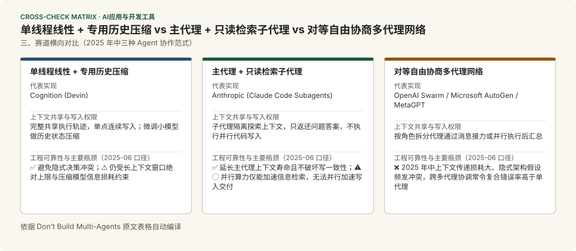

# Don’t Build Multi-Agents

2025-06-12 · Cognition · 有来源缺口

[本地原件归档](../../../raw/a9d5002900ea060af7ba29d9a9c4c64b0f7a70265ae49dff54c0fef4ba3bbb13) · 固定材料版本 `digest-material-a9d5002900ea060af7ba29d9a9c4c64b0f7a70265ae49dff54c0fef4ba3bbb13@1` · [一手原站](https://cognition.com/blog/dont-build-multi-agents)

## 深度拆解与复核

- 口径与利益：本文为 Cognition 联合创始人 Walden Yan 于 2025-06-12 在 [Cognition 官方博客](https://cognition.com/blog/dont-build-multi-agents) 发表的工程架构方法论文章，立场直接服务于 Devin 的长程异步单线程沙盒设计哲学，并明确批评 OpenAI Swarm（`github.com/openai/swarm`）与 Microsoft AutoGen（`github.com/microsoft/autogen`）等并行多代理框架；文末附产品试用入口与招聘邮箱 `walden@cognition.ai`。交叉对比同期发布的 [Anthropic《Building effective AI agents》（2024-12-19）](https://www.anthropic.com/research/building-effective-agents) 及 [Cognition 企业档案](../entities/companies/Cognition.md)，原文侧重定性故障归因，未公开内部对照实验数据。
- 核心判断：==2025 年生产级长程 AI Agent 的第一性约束是 Context Engineering（动态上下文工程）而非角色拆分的并行数量；在跨代理通信协议与状态共享机制成熟前，把写操作收束进单线程线性轨迹 + 专用压缩模型，并仅将子代理限定在只读信息检索，才是控制复合错误（compounding errors）的现实工程解==。

### 一、业务切口与核心机制（Context Engineering 两条铁律）

1. 从 Prompt Engineering 到 Context Engineering 的定位迁移：Walden Yan 将 2025 年的 Agent 工程比作 1993 年 HTML/CSS 诞生后、2013 年 Facebook 推出 React 之前的探索期——早期开发者只关注静态提示词（Prompt Engineering），但生产级 Building Long-running Agents（如 Devin）在多轮工具调用下极易因上下文失真触发复合错误，核心工程命题转为在动态系统中自动组织全量执行上下文（Context Engineering）。
2. 两条架构原则（Principles）与典型失效模式：
   - Principle 1（共享全量轨迹而非单条指令）：并行拆分子任务（Subtask 1/2）时，即便复制了原始用户目标，多轮工具调用中隐含的中间决策若不传递，子代理仍会各自误解需求（原文以克隆 Flappy Bird 为例：Subtask 1 误建成 Super Mario Bros 背景，Subtask 2 造出不匹配风格的飞鸟素材，汇总代理无法无损缝合）。因此必须共享完整 Agent 行动轨迹（traces），而非仅传摘要消息。
   - Principle 2（动作携带隐式决策）：即使彼此看到前置上下文，两个并行写代码的子代理仍会在代码风格、边界异常处理与架构假设上做出互不兼容的隐式选择（Actions carry implicit decisions），导致冲突且不可合并的产出。
3. 符合两条原则的工程替代路线：最稳妥的基线架构是单线程线性 Agent（Single-threaded linear agent），让每一次动作都能看见完整前序决策；当超长程任务逼近上下文窗口上限时，Cognition 引入了微调后的小型专用 LLM，专门将冗长的历史动作与对话压缩为关键事件、状态细节与已做决策，再回填给主模型继续执行。

### 二、核心数据核查、口径纠偏与工程边界

- ✅ 行业框架对齐核查（Claude Code 与 Edit Apply Models）：本工作台对照 [Anthropic《Building effective AI agents》](https://www.anthropic.com/research/building-effective-agents) 核实，截至 2025 年 6 月，Anthropic 的 Claude Code Subagents 确如文中所言采取克制策略——子代理不与主代理并行写代码，仅用于执行只读问题检索，目的是把繁杂的探索过程隔离在子代理独立窗口内、延长主代理有效上下文寿命。同时 2024 年诸多 IDEs 与 Devin 曾流行「大 LLM 输出 Markdown 修改说明 + 小型 Edit Apply Models 重写整文件」的两段式架构，该模式因小模型误读细微指令而故障频发，2025 年随基座代码编辑能力跃升已回归单模型一步完成决策与写入。
- ⚠️ 量纲与实证边界核查（0/10 定量对照披露）：全篇 10,653 字符仅涵盖 2 篇行业指南（脚注 [1][2]）与 2 篇多代理早期研究（Generative Agents `arXiv:2304.03442` 与 MetaGPT 脚注 [3][4]），未给出任何定量基准数字（如 Devin 内部上下文压缩模型的参数规模、Token 压缩率、压缩前后任务通过率变化，或并行多代理 vs 单线程代理的具体故障率对比）。Flappy Bird 案例属于作者构造的直觉模型，不能替代生产级回归测试。
- 本工作台推断：Walden Yan 这篇 2025 年 6 月文章的关键预判在「并行写手冲突」与「人类级低熵沟通尚待单代理能力成熟」；但其「暂不建议构建多代理」的结论高度受限于 2025 年中期的模型上下文遵循能力与只读/写入解耦缺失，10 个月后 Cognition 自身即在 2026-04-22 发文（参见同期收录的 Multi-Agents 演进复盘）以及通过 [Devin Review 与嵌套管理架构](快速冲击%20750%20亿美元估值，Cognition凭什么？.md) 对这一边界进行了条件修正。

### 三、赛道横向对比（2025 年中三种 Agent 协作范式）

| 架构范式 | 代表实现 | 上下文共享与写入权限 | 工程可靠性与主要瓶颈（2025-06 口径） |
| :--- | :--- | :--- | :--- |
| 单线程线性 + 专用历史压缩 | Cognition (Devin) | 完整共享执行轨迹，单点连续写入；微调小模型做历史状态压缩 | ✅ 避免隐式决策冲突；⚠️ 仍受长上下文窗口绝对上限与压缩模型信息损耗约束 |
| 主代理 + 只读检索子代理 | Anthropic (Claude Code Subagents) | 子代理隔离探索上下文，只返还问题答案，不执行并行代码写入 | ✅ 延长主代理上下文寿命且不破坏写一致性；⚠️ 并行算力仅能加速信息检索，无法并行加速写入交付 |
| 对等自由协商多代理网络 | OpenAI Swarm / Microsoft AutoGen / MetaGPT | 按角色拆分代理通过消息接力或并行执行后汇总 | ❌ 2025 年中上下文传递损耗大、隐式架构假设频发冲突，跨多代理协调常令复合错误率高于单代理 |

### 观点与可反驳条件

- ==观点==：2025 年 AI 编程代理的核心分水岭在于是否严格隔离「只读上下文压缩/检索」与「单线程状态写入」；在模型具备跨实例主动对齐隐式架构假设的能力之前，多代理角色编排框架（Swarm/AutoGen 式）增加的协调失真代价普遍大于并行收益。
- ==推翻条件==：
  1. 在 SWE-bench Verified 或同级别真实多文件代码库长程重构基准（单任务修改 >= 5 个关联文件）中，若对等并行写代码的多代理框架在同等 Token 预算下的任务一次通过率（Pass@1）稳定高于单线程压缩代理 >= 10 个百分点且无需人工解决合并冲突，则「并行写入必然触发隐式决策碰撞」的论断将被直接推翻。
  2. 若 2026–2027 年主流生产级编码产品（Devin、Claude Code、Cursor）普遍采用无中心约束的多写手协商群落（Unstructured Swarms）替代单线程或层级汇总路线并实现商业留存提升，则 Context Engineering 两条铁律的适用周期将被证伪。

---

## 原文摘录与一手信源存证

> When agents have to actually be reliable while running for long periods of time and maintain coherent conversations, there are certain things you must do to contain the potential for compounding errors.
> — 原文摘录，文字段落 1；证据 `digest-material-a9d5002900ea060af7ba29d9a9c4c64b0f7a70265ae49dff54c0fef4ba3bbb13-excerpt-1@4`

> The actions subagent 1 took and the actions subagent 2 took were based on conflicting assumptions not prescribed upfront.
> — 原文摘录，文字段落 2；证据 `digest-material-a9d5002900ea060af7ba29d9a9c4c64b0f7a70265ae49dff54c0fef4ba3bbb13-excerpt-2@4`

一手材料：

- Don’t Build Multi-Agents · Cognition · [原站](https://cognition.com/blog/dont-build-multi-agents) · [主体档案：Cognition](../entities/companies/Cognition.md) · [本地原件](../../../raw/a9d5002900ea060af7ba29d9a9c4c64b0f7a70265ae49dff54c0fef4ba3bbb13)
  材料版本 `digest-material-a9d5002900ea060af7ba29d9a9c4c64b0f7a70265ae49dff54c0fef4ba3bbb13@2`；获取方式 `http_full_text`。
  > When agents have to actually be reliable while running for long periods of time and maintain coherent conversations, there are certain things you must do to contain the potential for compounding errors. — 原文提取
  > The actions subagent 1 took and the actions subagent 2 took were based on conflicting assumptions not prescribed upfront. — 原文提取
- Building effective AI agents · Anthropic · [原站](https://www.anthropic.com/research/building-effective-agents) · [主体档案：Anthropic](../entities/companies/Anthropic.md) · [本地原件](../../../raw/b7b4af7cdc35812aab72583aea4ae77f1c638e0387a9f428c8e66633213dd387)
  材料版本 `digest-material-b7b4af7cdc35812aab72583aea4ae77f1c638e0387a9f428c8e66633213dd387@1`；获取方式 `http_full_text`。
  > Note: Much of the tooling landscape described in this post has changed since December 2024. For our current approach, see how we built Claude Managed Agents and the Managed Agents documentation. — 原文提取
  > In this post, we share what we’ve learned from working with our customers and building agents ourselves, and give practical advice for developers on building effective agents. — 原文提取

归属与范围：已采集 Cognition 官方工程博客原件（2025-06-12，Walden Yan），并交叉核验 Anthropic《Building effective AI agents》（2024-12-19）、OpenAI Swarm、Microsoft AutoGen 与 MetaGPT 等引用框架背景（2/6 条重点架构文献完成正文核验）；原文未披露内部历史压缩模型的参数规模及单线程对比多代理的定量任务成功率，已登记 not\_disclosed 缺口。

来源缺口：

- `not_disclosed`：Cognition 未披露文中内部微调上下文压缩小模型的参数规模、训练语料配比与压缩延迟，亦未提供并行多代理对比单线程代理在生产任务上的定量失败率统计（文中 Flappy Bird 克隆与 Edit Apply Models 案例均为架构推演说明）。 [线索](https://cognition.com/blog/dont-build-multi-agents)

[返回赛道总览](../赛道总览.md#digest-a9d5002900ea060a) · [返回导读索引](README.md) · [主体档案库](../entities/README.md)
