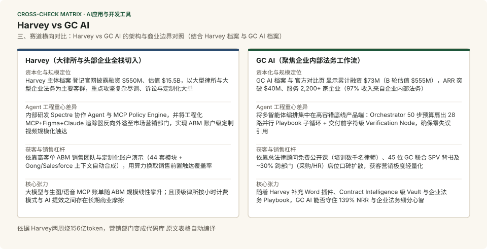

# Harvey两周烧156亿token，营销部门变成代码库

2026-10-23 · Harvey 官方工程博客 (Shawn Farsai / Gabe Pereyra) · 有来源缺口

[本地原件归档](../../../raw/2d58c86bebb4f3c44a99e7695d299c97c06994b66e68fadc99c338ef8344ff89) · 固定材料版本 `digest-material-2d58c86bebb4f3c44a99e7695d299c97c06994b66e68fadc99c338ef8344ff89@1` · [一手原站](https://www.harvey.ai/blog/how-harvey-is-building-a-frontier-marketing-org)

## 深度拆解与复核

- 口径与利益：触发线索为微信公众号「无尽前沿 Endless Frontier」（2026-10-23）；正文技术架构与数据已全部对照 [Harvey 官方工程博客（2026-10-21）](https://www.harvey.ai/blog/how-harvey-is-building-a-frontier-marketing-org)。原文由 Harvey 市场负责人 Shawn Farsai 与联合创始人 Gabe Pereyra 联名撰写，起因是回应 Figma 对其 MCP server 实践的提问，文中明确致谢 Figma、Figma Weave 与 ElevenLabs，具备生态伙伴联合宣传激励且未公布美元算力账单与客户成单率。下文按工程机制、口径核查与赛道对照依次拆解。

### 一、代码库化营销架构：从 15 分钟单条演示到 3 车道并行 MCP 管线

- 创作流程的代码工程隐喻：Harvey 团队在为产品能力 Harvey Artifacts 制作发布影片时，把 Storyboard（故事板）定义为影视生产中的 PRD，卡在创意简报与执行之间，迫使模型和人在动工前锁定全部机位、台词与转场。审阅在 Figma 画布上集中批注（单轮最多 50 条评论），Agent 改稿后会主动反问哪些修改意见应当沉淀为长期规则；在配乐对齐上，人员只需标记重拍落点，Agent 即可重排镜头关键帧并自行剪辑、做 EQ 均衡、加音效及提供 4–5 种结尾方案。
- 规模化前提——底座组件化而非反复提示词：单条定制产品视频初稿原本需要 15–20 分钟来回修改，面对数百个目标大客户的账户级视频需求无法线性扩张。Harvey 因此在 Figma 组织内先建两套唯一真源组件库：
  1. Product Map：Agent 爬遍 Harvey 线上应用并点击每个按钮，将 Home、Agents、Drafting、Review Tables 等全套关键界面重建为标准化 Figma 组件库，确保影片调用产品画面时直接引用组件而非重新绘制。
  2. Motion Primitives：把标题卡、下三分之一字幕条、文字动效与核心产品交互动作（例如「红线批注进入 Word 合同」）抽成组织级动效组件库，实现单点修正后全部引用视频同步生效。
  3. 模块化菜单与客户上下文注入：基于上述两套底座，团队搭建覆盖 13 个业务类别（Contract Work、Litigation、Memory、Word、Outlook 等）的 44 套企业无关演示流。针对具体目标客户，Agent 先通过 Enterpret 的 MCP 拉取 Gong 通话记录、Salesforce 胜负单报告与 Slack 讨论编写定制脚本，界面中以虚构公司代名脱敏，再通过 ElevenLabs MCP 调用以 10 分钟音频样本克隆的叙事人 Ashleigh Whittaker（及团队访谈音色）完成配音。
- 解决「代码规范 vs 设计系统」的两道技术卡点：
  1. ==Agentic Brand Guidelines 与可视化组件替代纯 Markdown==：团队把整个 Figma 体系按代码库分层，顶层规范对应根目录 AGENTS.md，每个项目文件夹设独立 AGENTS.md 页面做渐进披露（先读品牌，再读项目，最后按任务按需读取）。他们发现 Markdown 仅能管住颜色 Token（主色 Ink 与 Ivory、辅色作强调、数据色仅限图表且禁用渐变）和字体字号（Harvey Serif 与 Harvey Sans），一旦涉及「博客配图如何构图」或「长篇 PDF 指南如何排版」即告失效——设计规则的核心在于元素间空间关系，因此改用包含完整示范样例的 Figma 模板库让 Agent 直接「看见」关系。
  2. ==Figma 取代 HTML/Pretext 承担排版渲染引擎==：团队曾尝试基于 Pretext 在 HTML 画布上搭建布局引擎，但浏览器按字体的上下伸部（ascent/descent）垫高行盒（line box），导致标题大写字高（cap height）无法精确压到设计网格线上。Figma 原生支持按帽高与基线裁切文本、悬挂标点（hang punctuation），并把模块网格、基线网格、复合网格与层级网格保存为 Agent 可直接套用的布局，成为不可替代的渲染底座。
- 并发执行总线与状态同步机制：
  1. 约 750 行 JavaScript 引擎负责把短脚本节拍编译为 Figma Motion 时间线（机位、转场、字幕、指针点击节奏与片尾卡），生成 Contact Sheet 缩略图墙自动扫描截断文字、过小字号与游离指针。
  2. 规避单文件写入锁与 API 配额墙：Figma 单文件同一时刻只允许一个 Agent 操作，排队等待将调用耗时拖长至 2 分钟以上并触发超时。Harvey 改建 3 条并行车道文件（各自绑定独立构建 Agent）+ 1 个协调 Agent（统筹导出、混音与交付），使 36 条视频在 69 分钟内批量产出；撞上 Figma 每日调用配额上限后，夜间 Agent 自动切换为先生成次日 97 条影片的脚本与 ElevenLabs 配音，实现昼夜错峰流水线。
  3. 人机共享状态账本与 Slack 协同：数百条视频的状态统一写入一个所有人与 Agent 共读共写的 Claude artifact 追踪器（QA Batch 抽样 20 条覆盖全流程）。同时，工程团队 Shawn 与 Joey 将 Harvey 内部 Agent 平台 Spectre（此前工程师用于跑编码 Agent、销售用于跑数据 Agent）指向品牌仓库与 Figma 文件后嵌入 Slack 频道，产品、法务、销售与市场人员在 Slack 线程下达需求，Spectre 在 Figma 改完后回传改动清单与待定决策，构成「通讯工具入口 + Agent 执行 + 设计师定规矩与验收」的多人协同模式。

### 二、核心数据核查、口径纠偏与容错边界（含一手信源直链）

| 核查维度 | 触发微信稿表述 | 一手原文实证与本工作台核查（✅ / ⚠️ / ❌） |
| :--- | :--- | :--- |
| 156 亿 token 消耗量 | 标题与正文称两周内 Shawn 一人烧掉 156 亿 token | ✅ 与 [Harvey 官方博客（2026-10-21）](https://www.harvey.ai/blog/how-harvey-is-building-a-frontier-marketing-org) 原文一致（Shawn 在过去 14 天跨 Figma、ElevenLabs 与 Figma Weave 消耗 15.6B tokens）。⚠️ 本工作台核查：官方未拆分三大平台各自用量比例，亦未披露该 14 天周期对应的美元 API 账单与 Figma/Weave 调用费总额。 |
| 批量吞吐效率 | 一批 36 条片子跑 69 分钟、夜间准备次日 97 条 | ✅ 原文实录确认 3 条并行车道将 36 条影片压至 69 分钟（平均 1.92 分钟/条），并在触发 Figma 每日调用上限后夜间预备 97 条脚本与语音。⚠️ 暴露外部 SaaS API 限流已成为跨平台 Agent 流水线的刚性吞吐瓶颈。 |
| 工具名称与技术拼写 | 触发稿写通过「Enterprit 的 MCP」拉取 Gong/Salesforce/Slack | ❌ 本工作台核查：触发稿存在专名拼写错误，[Harvey 官方博客](https://www.harvey.ai/blog/how-harvey-is-building-a-frontier-marketing-org) 原文拼写为客户反馈情报平台 Enterpret（Enterpret's MCP）。另原文披露 Figma Weave（整合多图像/视频生成模型的画布工作流）通过同一 Figma MCP 被调用。 |
| 商业转化效果与成本 | 触发稿指出文章证明了产能，未证明产出有效 | ✅ 本工作台核查：该批评切中要害。官方博文仅给出产能工程指标（单条 15–20 分钟人工精修转为批量自动生成），未披露定制视频送达大客户后的打开率、PoC 推进率或 ARR 贡献。 |

- ⚠️ 本工作台推断（容错成本决定这套代码库化组织模式能否向业务核心区迁移）：营销物料天生属于高容错产出——36 条视频即使有 1–2 条镜头瑕疵，可通过 Contact Sheet 自动化质检拦截并重跑覆盖；一旦迁移至 Harvey 主营的法律合同审查（如 Review Tables、Word 修订与 Connector Library）或财务、医疗领域，单次幻觉或权限越界会导致客户丧失律师保密特权或承担合规赔偿，因此核心业务管线无法采用「高并发无门控直出」，必须额外叠加确定性规则引擎（如 Harvey MCP Policy Engine）与逐条引文校验节点，推理延迟与 Token 成本结构将显著高于营销场景。

### 三、赛道横向对比：Harvey vs GC AI 的架构与商业边界对照（结合 [Harvey 档案](../entities/companies/Harvey.md) 与 [GC AI 档案](../entities/companies/GC%20AI.md)）

| 对比维度 | Harvey（大律所与头部企业全栈切入） | GC AI（聚焦企业内部法务工作流） |
| :--- | :--- | :--- |
| 资本化与规模定位 | [Harvey 主体档案](../entities/companies/Harvey.md) 登记官网披露融资 $550M、估值 $15.5B，以大型律所与大型企业法务为主要客群，重点攻坚复杂尽调、诉讼与定制化大单 | [GC AI 档案](../entities/companies/GC%20AI.md) 与 [官方对比页](https://gc.ai/compare/gc-ai-vs-harvey) 显示累计融资 $73M（B 轮估值 $555M），ARR 突破 $40M、服务 2,200+ 家企业（97% 收入来自企业内部法务） |
| Agent 工程重心差异 | 内部研发 Spectre 协作 Agent 与 MCP Policy Engine，并将工程化 MCP+Figma+Claude 追踪器反向外溢至市场营销部门，实现 ABM 账户级定制视频规模化触达 | 将多智能体编排集中在高容错底线产品端：Orchestrator 50 步预算扇出 28 路并行 Playbook 子循环 + 交付前字符级 Verification Node，确保零失误引用 |
| 获客与销售杠杆 | 依靠高客单 ABM 销售团队与定制化账户演示（44 套模块 + Gong/Salesforce 上下文自动合成），用算力换取销售前置触达覆盖率 | 依靠总法律顾问免费公开课（培训数千名律师）、45 位 GC 联合 SPV 背书及 ~30% 跨部门（采购/HR）席位口碑扩散，获客营销极度轻量化 |
| 核心张力 | 大模型与生图/语音 MCP 账单随 ABM 规模线性攀升；且顶级律所按小时计费模式与 AI 提效之间存在长期商业摩擦 | 随着 Harvey 补充 Word 插件、Contract Intelligence 级 Vault 与企业法务 Playbook，GC AI 能否守住 139% NRR 与企业法务细分心智 |

- ⚠️ 本工作台推断：Harvey 公开营销部门两周消耗 15.6B tokens 的本质，是用可编程的推理与多模态调用预算替代昂贵的跨职能设计/剪辑人力，同时在对外叙事上向企业客户演示「MCP + 组件库 + 追踪器」在非代码部门的可落地性；然而在品牌资产尚未原子化沉淀、或客户转化归因尚不清晰的中型软件公司，盲目照搬 3 车道并发生成只会制造大量无人观看的素材冗余与不可控的 API 成本。

### 观点与可反驳条件

- ==观点==：Harvey 营销组织代码库化真正可跨企业复用的不是「两周烧 156 亿 token」或 Figma 剪辑技巧，而是「以组件化视觉真源替代纯文本提示词（Product Map + Figma 布局库）+ 多 Agent 写入冲突分流总线（3 车道文件 + Claude 状态追踪器）」两项组织工程模式；但这套高吞吐流水线高度依赖营销场景的高容错属性，越靠近法律与财务核心交付，验证门控成本占比越高。
- ==推翻条件==：
  1. 若截至 2027-Q4，Harvey 未再披露后续批次账户定制视频对销售成单率（win rate）或管线推进速度的定量提升，或公开承认该项目因 Figma/Weave 调用成本过高与销售转化率不及预期而缩减自动化视频比例，则「ABM 定制视频流水线具备正向商业 ROI」的假设将被推翻。
  2. 若截至 2027-12-31，主流大模型厂商或多模态基础平台（如 Figma Weave / OpenAI / Anthropic）原生内置多人状态同步与复杂网格排版能力，使企业无需自建 3 车道总线与 750 行胶水引擎即可单提示词直出符合品牌网格规范的成片，则「专门维护可视化组件真源与并发调度引擎构成持续组织壁垒」的判断将被证伪。

---

## 原文摘录与一手信源存证

> 10 月 21 日，Figma 问 Harvey一个问题，你们在 MCP server 上到底造了什么。Harvey 的联合创始人 Gabe Pereyra 与市场负责人 Shawn Farsai 一起写了篇长文回答，题目叫《Harvey如何建造一个前沿营销组织》。
> — 原文摘录，PDF p.1；证据 `digest-material-2d58c86bebb4f3c44a99e7695d299c97c06994b66e68fadc99c338ef8344ff89-excerpt-1@1`

> 这篇文章值得读，因为它是一份罕见的、写清了工程细节的「AI 重构部门」实录。里面有发布会 demo 不会讲的东西，踩过的坑、绕过的路、最后跑通的系统。
> — 原文摘录，PDF p.1；证据 `digest-material-2d58c86bebb4f3c44a99e7695d299c97c06994b66e68fadc99c338ef8344ff89-excerpt-2@1`

> 他们的做法从一次纯 agent 的创作开始，做了一支 Harvey Artifacts 的发布片，全程在 Figma里完成。agent 把每一个镜头建为一个 Figma Motion 帧，在时间线上给每个机位运动、UI状态、每一行字打上关键帧，最后直接从文件导出成片。
> — 原文摘录，PDF p.1；证据 `digest-material-2d58c86bebb4f3c44a99e7695d299c97c06994b66e68fadc99c338ef8344ff89-excerpt-3@1`

一手材料：

- How Harvey is Building a Frontier Marketing Org · Harvey · [原站](https://www.harvey.ai/blog/how-harvey-is-building-a-frontier-marketing-org) · [主体档案：Harvey](../entities/companies/Harvey.md) · [NotebookLM](https://notebook.google.com/notebook/d14c426f-cce0-46a7-aa8e-efbe2ba1f98f) · [Drive](https://drive.google.com/file/d/1HjATr6-l8RGC7RmNmehJ1HAn_H_bucvG/view?usp=drivesdk)
  材料版本 `digest-material-0d5f8fac4fb540d1e22d129c5a66f8715ee3240586c0a63c23007f1625533fd1@6`；获取方式 `http_full_text`。
  > Harvey’s marketing team built an agent-powered creative system combining brand guidelines, reusable Figma libraries, and parallel workflows to turn ambitious ideas into repeatable work at scale. — 原文提取
  > Recently, Figma asked us what Harvey was building with its MCP server. This is the long answer. — 原文提取

归属与范围：已穿透至 Harvey 2026-10-21 官方工程博客原文《How Harvey is Building a Frontier Marketing Org》（市场负责人 Shawn Farsai 与联合创始人 Gabe Pereyra 署名），微信公众号「无尽前沿 Endless Frontier」退居触发线索（trigger\_source）。核查纠偏触发稿三处细节：(1) 客户反馈聚合 MCP 原文为 Enterpret 而非触发稿所误拼的 Enterprit；(2) 原文未披露 15.6B tokens 的分工具消耗拆分、API 美元账单及账户定制视频的成单转化率；(3) 结合库内 Harvey.md、GC AI.md 与 GC AI 官方对比页对照两家法律 AI 企业的容错边界与扩展逻辑。

来源缺口：

- `not_disclosed`：Harvey 官方博客披露 Shawn Farsai 过去 14 天跨 Figma、ElevenLabs 与 Figma Weave 消耗 15.6B tokens，但未披露各工具独立 token 占比、Figma 调用配额上限及对应的美元 API 账单成本。 [线索](https://www.harvey.ai/blog/how-harvey-is-building-a-frontier-marketing-org)
- `not_disclosed`：Harvey 未公开数百条账户定制视频的销售打开率、PoC 转化增量及客户反馈归因数据，亦未披露内部协作代理平台 Spectre 在跨部门场景的调用规模与人工审批通过率。 [线索](https://www.harvey.ai/blog/how-harvey-is-building-a-frontier-marketing-org)

[返回赛道总览](../赛道总览.md#digest-2d58c86bebb4f3c4) · [返回导读索引](README.md) · [主体档案库](../entities/README.md)
