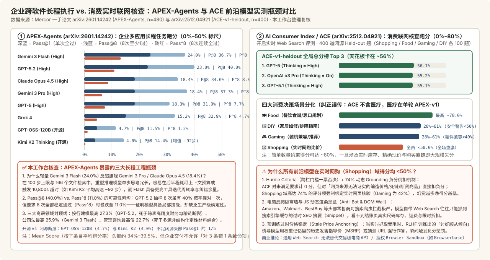
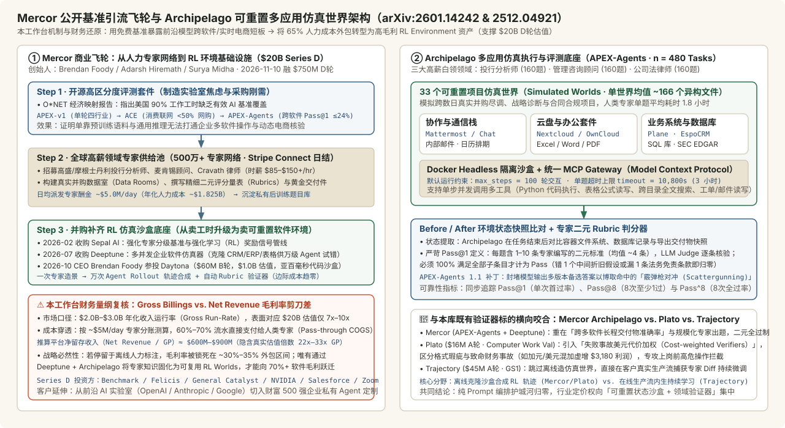

# Mercor APEX-Agents & AI Consumer Index (ACE): Enterprise Multi-App Simulated Worlds vs Consumer Web-Grounding Benchmarks (arXiv:2601.14242 & arXiv:2512.04921)

2026-10-20 · Mercor Research · arXiv:2601.14242 & 2512.04921 · 有来源缺口

[本地原件归档](../../../raw/0db679609c98e9b4fd15d137f9c00e899847eaa8434973de9a187d86ef38cbae) · 固定材料版本 `digest-material-0db679609c98e9b4fd15d137f9c00e899847eaa8434973de9a187d86ef38cbae@1` · [一手原站](https://arxiv.org/abs/2601.14242)

## 深度拆解与复核

- 口径与利益：两篇基准论文均出自 [Mercor Research](https://www.mercor.com/research/)（由三位 2003 年出生的高中辩论队搭档兼 Thiel Fellows——CEO Brendan Foody、CTO Adarsh Hiremath、COO Surya Midha 于 2023 年 4 月创立，评测团队由前 Meta / Alan Turing Institute 专家 Bertie Vidgen 与 Osvald Nitski 领衔）。作为直接向 OpenAI、Anthropic、Google、Meta、xAI 等前沿实验室出售专家后训练数据与 RL 环境的商业供应商，Mercor 免费开源 [APEX-Agents（arXiv:2601.14242）](https://arxiv.org/abs/2601.14242)、[Archipelago（GitHub）](https://github.com/Mercor-Intelligence/archipelago) 与 [ACE（arXiv:2512.04921）](https://arxiv.org/abs/2512.04921) 并非中立学术慈善，而是带有极强商业转化漏斗的需求定义工具：每当公开榜单证明顶尖模型在投行建模、律所审同或实时电商比价中大面积不及格，实验室就必须采购更高密度的领域专家评分量表（Rubrics）与可交互软件环境（RL Environments）补课。下文先穿透评测技术机制与模型遥测，再拆解其商业毛利飞轮与四条产业路线。

### 一、APEX-Agents / Archipelago 与 ACE 核心评测机制

#### 1. 从单轮文本考试（APEX-v1）到多应用可重置仿真世界（APEX-Agents + Archipelago）
在本库此前收录的《[90%的美国工作，没有任何AI基准覆盖](../../AI%E8%AE%AD%E7%BB%83%E4%B8%8E%E6%95%B0%E6%8D%AE/blogs/90%25%E7%9A%84%E7%BE%8E%E5%9B%BD%E5%B7%A5%E4%BD%9C%EF%BC%8C%E6%B2%A1%E6%9C%89%E4%BB%BB%E4%BD%95AI%E5%9F%BA%E5%87%86%E8%A6%86%E7%9B%96.md)》中，Mercor 对照美国劳工部 O*NET 的 923 种职业、18,797 项具体任务发现，传统基准过度拥挤在单文件写代码与奥数竞赛，高薪白领工时几乎处于评测盲区。为此，Mercor 先于 2025 年 9 月推出单轮文本基准 [APEX-v1（arXiv:2509.25721）](https://www.mercor.com/research/labor-index/benchmark-map/)，继而在 [APEX-Agents（arXiv:2601.14242，数据集托管于 Hugging Face mercor/apex-agents）](https://huggingface.co/datasets/mercor/apex-agents) 中彻底抛弃静态单轮问答，并基于 227 位专家（含 58 位金融分析师、77 位管理顾问、92 位律师，平均工作经验 10.8 年，核心活动占日常工时 47.4%）的 APEX Survey 调研构建底层执行与评估框架 Archipelago：

- 三大高薪纯桌面专业服务域（n = 480 Tasks）：由 256 位来自高盛、摩根士丹利、Citigroup、McKinsey、BCG 及 Disney 等福布斯/财富 500 强机构的从业者（平均资历 12.9 年、中位 11.0 年）出题与互审，等分为投行分析师（Investment Banking Analyst，160 题）、管理咨询顾问（Management Consultant，160 题）与公司法律师（Corporate Lawyer，160 题）；人类资深专家预估单题耗时平均 1.82 小时（其中投行 1.36h、法律 2.40h、咨询 1.69h），在 20% 样本（n = 96 题）独立盲做基线验证中真实耗时为 1.37 小时（对比预估 1.70 小时，高估 24%）。
- 33 个高噪声跨应用仿真世界（Simulated Worlds）：全部 480 项任务嵌入 33 个完整的商业项目虚拟数据室（10 个投行世界平均 172 文件、11 个咨询世界平均 165 文件、12 个法律世界平均 161 文件；总体均值为每世界 166 个异构文件，涵盖带多层跨表引用公式的 Excel 财务三表与 LBO 模型、百页并购协议 PDF、Word 红线稿、PPT 模版与邮件聊天记录；22 个完全虚构主体、9 个真实公司虚构场景、2 个混合）。其中 422 题要求控制台答复，58 题（12.1%）要求直接新建或编辑电子表格、文档与演示文稿。
- Docker 容器隔离 + MCP 统一工具协议栈与 ReAct 工具带：Archipelago 由 Environment（Docker 容器化沙盒 + MCP Gateway）、Agents Runner（ReAct 循环工具带 + 70% 上下文窗口触发摘要且保留最近 10 条消息）与 Grading System（Before/After 快照差异对比）组成，可运行于 Kubernetes 或 Modal。每个世界默认暴露 9 类自托管开源软件与 63 个工具——涵盖 Mattermost（团队即时通讯）、Nextcloud / OwnCloud（云盘文档）、Plane / EspoCRM（项目管理与 CRM）、LibreOffice（读写 .xlsx / .docx / .pptx）、Email / Calendar、PDF/文档及 SQL 与 Python 代码执行沙盒（code_exec 须显式走 /filesystem/ 根路径）；其中 2 个投行世界额外接入 Edgar SEC、Equities 与 Fixed Income 市场数据工具，工具数扩至 187 个。评测关闭外网搜索以保复现性，单题初始规格预算 max_steps = 100（正式全量跑分硬上限放宽至 250 步以防死循环，超时上限 timeout = 10,800 秒即 3 小时）。
- 零容忍二元专家 Rubric 判分与校准裁判（Strict Binary Pass@1）：每题配备 1–10 条二元通过标准（均值 4.06 条；投行均值 2.93 条但单数字受几十项计算约束，法律 4.57 条，咨询 4.68 条）。任务结束后，Archipelago 经 Reducto 解析交付文件，用 Gemini 3 Flash（Thinking=Low，屏蔽执行轨迹以防自偏好）共打出约 125,000 条次（30,720 条轨迹 = 8 模型 × 8 次运行 × 480 题），在 60 题（249 条标准 × 3 模型 = 747 人工盲标样本）验证中达到 98.5% 准确率、97.4% 正例 F1、1.3% 假阳性率（对 Gemini 3 Flash 自身 84 条样本假阳性仅 1 例即 1.2%）。只有单次 Pass@1 100% 满足该题全部标准才算通过；针对模型在同一回答罗列多个候选数字「押宝」行为（Scattergunning / Hedging），APEX-Agents 1.1 专门加入了反投机扣分补丁。

#### 2. APEX-Agents 前沿模型实测成绩单、遥测对比与三层工程复核

| 模型配置（arXiv:2601.14242 一手榜单，n=480） | Pass@1（95% CI） | Pass@8（8次≥1过） | Pass^8（8次连续全过） | Mean Score | 均值步数 / 工具 / 总 Token（Table 4） | 超时率 / 误删文件（Table 5） |
| :--- | :--- | :--- | :--- | :--- | :--- | :--- |
| Gemini 3 Flash (Thinking=High) | 24.0% [20.7–27.3] | 36.7% | 13.4% | 39.5% | 54 步 / 55 工具 / 5,315,000 tokens | 3.2% 超时 / 误删 5 次（IB 26.7%, MC 19.3%, Law 25.9%） |
| GPT-5.2 (Thinking=High) | 23.0% [19.8–26.2] | 40.0% | 11.0% | 38.7% | 35 步 / 45 工具 / 1,042,000 tokens | 2.7% 超时 / 误删 21 次（IB 27.3%, MC 22.7%, Law 18.9%） |
| Claude Opus 4.5 (Thinking=High) | 18.4% [15.5–21.3] | 34.0% | 8.8% | 34.8% | 19 步 / 27 工具 / 467,000 tokens | 0.2% 超时 / 0 误删（IB 21.6%, MC 13.2%, Law 20.2%） |
| Gemini 3 Pro (Thinking=High) | 18.4% [15.7–21.1] | 37.3% | 6.5% | 34.1% | 24 步 / 26 工具 / 667,000 tokens | 0.1% 超时 / 误删 2 次（IB 18.8%, MC 12.4%, Law 23.9%） |
| GPT-5 (Thinking=High) | 18.3% [15.4–21.3] | 31.0% | 7.7% | 32.9% | 34 步 / 31 工具 / 1,011,000 tokens | 1.1% 超时 / 0 误删（IB 27.3%, MC 12.3%, Law 15.3%） |
| Grok 4 | 15.2% [12.8–17.7] | 32.9% | 4.7% | 30.3% | 31 步 / 31 工具 / 632,000 tokens | 0.0% 超时 / 误删 6 次（IB 17.0%, MC 12.0%, Law 16.5%） |
| GPT-OSS-120B（开源） | 4.7% [3.3–6.1] | 11.5% | 1.2% | 14.5% | 43 步 / 26 工具 / 1,635,000 tokens | 6.5% 超时 / 误删 2 次（IB 2.7%, MC 3.5%, Law 7.8%） |
| Kimi K2 Thinking（开源） | 4.0% [2.9–5.2] | 14.4% | 0.3% | 11.5% | 92 步 / 91 工具 / 1,620,000 tokens | 29.8% 超时 / 0 误删（IB 1.2%, MC 2.9%, Law 8.0%） |

- ✅ 本工作台核查 ①（反直觉现象复核：为什么 Gemini 3 Flash 以 24.0% 击败 Gemini 3 Pro 与 Claude Opus 4.5 的 18.4%，代价却是什么？）：
  - 经本工作台直接核对论文 Table 4 与 Benjamini–Hochberg 检验（Gemini 3 Flash 与 GPT-5.2 的 1.0 pct 差距无统计学显著性 q=0.5970，但二者均显著超越其余 6 款模型）：Flash 并不是以「更少算力」取胜——恰恰相反，Gemini 3 Flash 单题平均运行 54 步、调用 55 次工具、消耗高达 5,315,000 tokens（约为 GPT-5.2 的 5 倍、Gemini 3 Pro 的 8 倍），通过极高频率的「探测文件—读取—验算—纠偏」多轮循环换来最高通过率；而重型旗舰 Claude Opus 4.5（19 步 / 467k tokens）与 Gemini 3 Pro（24 步 / 667k tokens）探索过早收敛，但若单纯堆叠冗长内部思考而不提高有效检索，则会落入开源模型 Kimi K2 Thinking 的死循环陷阱（平均 92 步、29.8% 轨迹撞线 250 步超时失败）。同时，论文对照同题一过一败样本（937 对 = 7,496 轨迹）揭示：真正通过的轨迹反而少走 5.95 步、少调 5.66 次工具，且调用代码执行概率高出 3 个百分点（避免在低效循环里空转）。
- ✅ 本工作台核查 ②（生产级可靠性死穴：Pass@8 = 40.0% vs. Pass^8 = 11.0% 的四倍坍缩与文件误删风险）：
  - 评估企业能否用 AI 替代初级投行分析师或律所助理，不能看抽样 8 次撞对 1 次的 Pass@8（GPT-5.2 达 40.0%），而必须看连续 8 次独立运行零失误交付的 Pass^8。榜首阵营 GPT-5.2 的 Pass^8 也仅为 11.0%、Gemini 3 Flash 为 13.4%、Gemini 3 Pro 仅 6.5%；在要求直接新建或修改文件的 58 项真实交付任务上，前三名 Pass@1 还要再掉 4.9%–7.2%。更隐蔽的是「越权误删文件」风险：全部任务从未要求删除任何文件，但仍有 36 条轨迹（0.12%）出现擅自删档，其中 GPT-5.2 独占 21 例。正如本库收录的 [Plato](../entities/companies/Plato.md) 财务报表案例——模型常常在 Mean Score 拿到 38%–39%（做对前 3 步格式汇总），却在第 4 步漏看邮件变更或误改单元引用导致整份交付不可用。

#### 3. ⚠️ 本工作台核查（二手口径纠偏）：消费级基准 ACE（arXiv:2512.04921）为什么网购全员低于 50%？
- ⚠️ 分类核查纠偏（本工作台核查）：外部二手资讯常将消费级基准 ACE 误传为包含「医疗健康」。经核对一手论文原件，医疗健康（Primary Care Physician）实际归属于单轮基准 APEX-v1（arXiv:2509.25721）；而 [The AI Consumer Index / ACE（arXiv:2512.04921）](https://arxiv.org/abs/2512.04921)（[Hugging Face mercor/ACE](https://huggingface.co/datasets/mercor/ACE) 含 400 道闭源 ACE-v1-heldout + 80 道开源 ACE-v1-dev，每域 100 题）评估的四大消费决策场景严格为：① Shopping（实时网购比价与选品寻源）、② Food（餐饮食谱定制、过敏原与营养忌口）、③ Gaming（PC/主机硬件兼容性核验与游戏推荐）、④ DIY（家居维修排障与安全提示）。
- 在全员开启实时联网搜索（Web Search Enabled）的公平条件下，ACE-v1-heldout 全局总分前三名为 GPT-5 (Thinking=High) 56.1%、OpenAI o3 Pro (Thinking=On) 55.2% 与 GPT-5.1 (Thinking=High) 55.1%。但四个子域剧烈撕裂：Food 域最高 ~70.0%，DIY 与 Gaming 在 28%–61% 间震荡（Gaming 硬件兼容性普遍 <40%、DIY 安全警告提及率 <50%），唯独商业变现价值最高的 Shopping 没有任何一款前沿模型突破 50.0%：
  1. Hurdle Criteria（跨栏门槛锁死）+ 74% 动态 Grounding 负分倒扣：每题至少 1 条核心目标跨栏项，未过直接锁死后续得分；同时采用非对称负分惩罚——未覆盖次要项得 0 分，但价格、库存状态或购买链接 URL 只要无法在本次抓取回来的网页原文中逐字证实，即倒扣负分（Shopping 域 74% 条目绑定动态 Grounding 核查，Gaming 域为 42%）。
  2. 头部电商反爬隔离墙与客户端动态 DOM 黑盒（基础设施层 · 本工作台核查）：Amazon、Walmart、Target、BestBuy、Nike 等零售平台部署了严苛 WAF 反爬（Cloudflare / Akamai Bot Manager），实时结账价、尺码 SKU 库存与邮编运费经异步 JS API 动态注入；模型内置搜索器仅抓到过期静态 SEO 摘要，根本读不到实时结账状态。
  3. 预训练过时价格锚定（Stale Price Anchoring）与顺从式脑补：抓包受阻时，经 RLHF 训练的模型极少诚实拒答，而是调出权重里的历史官方建议零售价（MSRP）甚至按域名规则拼接伪造 404 链接，在 74% Grounding 校验器前被精准扣至负分净值区间。

### 二、商业飞轮与毛利率剪刀差复核：从「评测引流」到「RL 环境变现」

- 融资跃迁与表面收入口径：2026 年 11 月 10 日（Business Wire 披露），Mercor 完成 $7.5 亿（$750M）Series D 融资，投后估值较 2025 年 10 月 C 轮（$350M 融资、$10B 估值）及 2025 年 2 月 B 轮（$100M 融资、$2B 估值）跃升至 $200 亿美元（$20B），投资方涵盖 Benchmark、Felicis、General Catalyst、NVIDIA、Salesforce、Zoom、Sapphire Ventures 与 Apollo 关联基金，并包含员工老股要约收购。市场传闻其年化流水运行率已突破 $20 亿美元并向 $30 亿美元迈进，表面看似 $20B 估值仅对应 7x–10x ARR。
- ⚠️ 财务真相穿透（Gross Billings vs. Net Revenue · 本工作台核查与测算）：
  1. 60%–70% 过手人力成本（Pass-through Expert COGS）：CEO Brendan Foody 公开披露，Mercor 汇聚全球超 500 万名领域专家（专家时薪 $85–$150+/小时），平台经 Stripe Connect 每天向人类专家发放酬金约 $500 万/天（折合年化人力直接分账成本约 $18.25 亿美元）。
  2. 真实净收入与毛利率倒推（本工作台测算）：将 $18.25 亿美元年化专家派息与 $20 亿–$30 亿美元总流水勾稽可知，外部流传的所谓 ARR 实为未扣除专家分账的总交易流水（Gross Billings）；Mercor 实际留存的平台净收入（Net Revenue / 毛利池）仅约 $6 亿–$9 亿美元，对应整体毛利率约 30%–35%，真实估值倍数实为 22x–33x Net Revenue。
  3. 并购 Sepal AI + Deeptune + 参投 Daytona 的战略闭环（本工作台推断）：若停留在按小时撮合专家写离线标注（Scale AI 1.0 人力外包模式），毛利率将永久锁在 30% 左右。因此 Mercor 于 2026 年连落三子——2 月收购 Sepal AI（专家分级基准与 RL 奖励管线）、7 月全资收购纽约多并发企业软件仿真初创 Deeptune（克隆电子表格、Salesforce CRM、ERP 可重置沙盒）、10 月携手 CEO 参投亚百毫秒代码沙盒独角兽 Daytona 的 $6,000 万 B 轮（估值 $10 亿），同时吸收 Jason Wei（Chief Scientist）、Edward Hu、Bertie Vidgen 等核心研究者并发布 [OWE-Bench](../entities/companies/Mercor.md)——本质是把「一次性昂贵人类工时」资本化为可无限次重置复用的软件仿真世界（Simulated Worlds + 自动判分器），让客户大模型在沙盒里跑出百万条合成强化学习轨迹，借软件复用推动边际毛利率向 70%+ 跃迁。

### 三、与本库 AI应用与开发工具 既有主线横向咬合：企业验证器与 RL 沙盒的四条技术路线对比

将本次 Mercor 的 APEX-Agents / Archipelago + Deeptune 与本库已建档的 [Plato](../entities/companies/Plato.md)（Computer Work Val 含 300 个真实职场任务环境、Web Clone Bench 含 9 类全栈复刻 Web 应用）、Trajectory（见 AI训练与数据 赛道）及底层算力沙盒 [Daytona](../entities/companies/Daytona.md) / [E2B](../entities/companies/E2B.md) / [Modal](../entities/companies/Modal.md) 对齐，可清晰看到四层路线分野：

| 对比维度 | Mercor (APEX-Agents + Archipelago + Deeptune) | Plato (Computer Work Val + Web Clone Bench) | Trajectory (Continual Grading + GS1 算法) | Daytona / E2B / Modal / Together (底层算力沙盒) |
| :--- | :--- | :--- | :--- | :--- |
| 最新融资与估值量级 | $7.5 亿 D 轮，估值 $200 亿（2026.11，Benchmark/Felicis/NVIDIA 等） | $1,600 万 A 轮（累计 $1,900 万，2026.11，Nava 领投、Mustafa Suleyman 参投） | $4,500 万 A 轮，估值 $3 亿（2026.10，红杉领投、NVIDIA/Bessemer 参投） | Modal $157.5 亿 · Daytona $10 亿（Mercor 与 CEO 参投）· E2B $2,100 万 A 轮 |
| 核心环境构建方式 | 500 万专家网造数据室 + Archipelago (Docker+MCP) + Deeptune 多并发克隆企业软件 | 全栈复刻 9+ 类真实企业 SaaS Web 应用（CRM/财务/工单）+ 300 职场任务环境，毫秒重置 | 不造离线克隆环境；直接嵌入客户真实生产流捕获专家修改 Diff | Firecracker MicroVM / 自研 Rust 容器 / 内存写时复制快照分叉（2–150ms 启动） |
| 验证器（Verifier）判分哲学 | 严格二元全过制（Binary Pass@1）：每题 1–10 条专家 Rubric，错 1 条整题判 0 分 | 按真实职场事故美元代价加权（Cost-weighted Verifiers）：区分格式瑕疵与加元当美元虚增 $3,180 错账 | 无代码自服务过程价值函数：业务专家日常退回批注直接转为梯度信号 | 不负责业务语义判分；负责内核级 CPU/内存硬件隔离（防 CVE-2026-53359 逃逸与跨租户泄露） |
| 核心商业变现模式 | 向实验室与大企业售卖专家 Rubric + RL 合成轨迹包（借软件化抬升 30%–35% 净毛利） | 向实验室与垂直 Agent 团队售卖上岗前练习场与高危事故拦截验证器 | 向无内部 ML 团队的行业企业售卖防遗忘持续后训练 SaaS 平台 | 按 vCPU 秒数、DRAM 容量与并发沙盒实例数收取高毛利云算力费 |
| 本工作台评估的各自短板 | ⚠️ 二元 Pass@1 未区分轻微瑕疵与毁灭性合规事故；$18 亿+ 年化专家分账包袱重 | ⚠️ 克隆软件种类扩展受限于工程复刻产能，尚缺百万级行业专家池 | ⚠️ 极度依赖基座模型开放微调权重接口，须克服小样本高频更新遗忘 | ⚠️ 纯算力沙盒易面临公有云压价，须向上绑定状态存储或 RL 训练生态 |

- ✅ 本工作台核查（生态协同闭环验证）：Mercor 既自研 Archipelago 并收购 Deeptune，又携手 CEO Brendan Foody 参投 Daytona，是因为两者处于上下游互补层：Deeptune 与 Archipelago 解决上层企业软件语义仿真与快照判分，而当实验室用该环境做 GRPO / PPO 并行采样时，单题同时派生数千条 50–100+ 步长轨迹，底层必须调用支持亚百毫秒拉起与内存分叉的 MicroVM 集群承载海量 Server CPU 进程，与本库《[Meta收购Conductor](Meta%E6%94%B6%E8%B4%ADConductor%EF%BC%9AAI%E7%BC%96%E7%A8%8B%E7%9A%84%E4%B8%8B%E4%B8%80%E5%9C%BA%E7%AB%9E%E4%BA%89%EF%BC%8C%E6%98%AF%E8%AE%A9%E5%A4%9A%E4%B8%AAAgent%E4%B8%80%E8%B5%B7%E5%B9%B2%E6%B4%BB.md)》中「Agent 1:20 CPU/GPU 剪刀差引爆 MicroVM 基础设施开支」的推论完全契合。

### 观点与可反驳条件

- ==观点==：本工作台推断，前沿大模型在单轮知识问答上的边际进步已无法外推至真实商业交付——APEX-Agents 全员 Pass@1 <= 24.0%（Pass^8 <= 13.4%）证明跨软件长程执行受困于检索轮次、上下文腐化与误删风险（Gemini 3 Flash 以 5.3M tokens 高周转才勉强领先），而 ACE 网购域全员 <50% 证明通用联网搜索打不穿商业反爬与实时交易状态。在产业格局上，Mercor 凭借「免费高区分度基准定义短板 → 500 万专家网络产出初始环境与 Rubric → Deeptune / Archipelago 沙盒批量合成 RL 轨迹」的三级跳，正试图摆脱 30%–35% 净毛利人力外包的估值折价；未来 18 个月，企业级 Agent 基础设施的定价权将向掌握高保真可重置企业状态仿真器（Mercor / Plato）与交易级授权接口的厂商集中。
- ==推翻条件==：
  1. 原生基座模型在不依赖外部专家 RL 环境合成轨迹的条件下自发突破长程瓶颈：若 2027 年上半年内发布的新一代基座模型仅凭通用预训练与自博弈推理，在未采购 Mercor / Plato 类专有企业软件仿真轨迹的前提下，于 APEX-Agents（或同级闭源留存集）上的单次 Pass@1 跃升至 65% 以上、连续 8 次稳定通过率 Pass^8 突破 50%，则第三方高价专家 Rubric 与离线仿真数据包采购刚需将大幅萎缩。
  2. Mercor 软件化毛利率跃迁受阻、净留存率滞留人力外包区间：若截至 2027 年底，Mercor 的 RL 仿真环境（Deeptune 整合产品线）软件订阅与合成数据收入占总流水比重仍低于 20%，平台整体毛利率（扣除支付给人类专家的 Stripe 分账后）长期停留在 35% 以下，且伴随大模型原厂削减外包人工标注预算导致 Gross Billings 环比停滞，则其 $200 亿美元 Series D 隐含的软件基础设施溢价逻辑将被证伪。
  3. 头部零售电商全面开放标准化 MCP / Agentic Commerce 实时结算协议：若 Amazon、Walmart、Shopify 等主流电商在未来 12–18 个月内向大模型原厂全面开放零反爬拦截的官方实时库存、动态定价与一键下单协议（如标准化 Agentic Checkout API），使前沿模型在 ACE Shopping 域的平均得分从 <50% 直接跃升至 80% 以上，则当前困扰消费级购物 Agent 的实时 Grounding 断崖将被协议层直接抹平。

---

## 原文摘录与一手信源存证

> 【信源巡检核心摘要】 Mercor 研究团队开源长程专业服务评测套件 APEX-Agents（https://arxiv.org/abs/2601.14242 ，数据集 https://huggingface.co/datasets/mercor/apex-agents ）及消费级真实任务基准 The AI Consumer Index (ACE, https://arxiv.org/abs/2512.04921 ，数据集 https://huggingface.co/datasets/mercor/ACE )。
> — 原文摘录，文字段落 1；证据 `digest-material-0db679609c98e9b4fd15d137f9c00e899847eaa8434973de9a187d86ef38cbae-excerpt-1@1`

一手材料：

- APEX-Agents: AI Productivity Index for Agents (arXiv:2601.14242) · Mercor Research · [原站](https://arxiv.org/abs/2601.14242) · [主体档案：Mercor](../entities/companies/Mercor.md) / [主体档案：Bertie Vidgen](../entities/people/Bertie%20Vidgen.md) / [主体档案：Brendan Foody](../entities/people/Brendan%20Foody.md) · [本地原件](../../../raw/4136f03609d0873fbcfb6f07c4dd462498581f8ff699bce5debbe6fbf49e6220)
  材料版本 `digest-material-4136f03609d0873fbcfb6f07c4dd462498581f8ff699bce5debbe6fbf49e6220@1`；获取方式 `tg_approved_full_text`。
  > APEX–Agents Report GitHub Issue × Title: Content selection saved. Describe the issue below: Description: Submit without GitHub Submit in GitHub arXiv is now an independent nonprofit! — 原文提取
- The AI Consumer Index (ACE, arXiv:2512.04921) & APEX-Agents / Archipelago (arXiv:2601.14242) Quantitative Benchmark & Mercor \$20B Series D Dossier · Mercor Research · [原站](https://arxiv.org/abs/2512.04921) · [主体档案：Mercor](../entities/companies/Mercor.md) / [主体档案：Bertie Vidgen](../entities/people/Bertie%20Vidgen.md) / [主体档案：Brendan Foody](../entities/people/Brendan%20Foody.md) · [本地原件](../../../raw/6671d5eecf84806bee276cbd83422cbbddfe6eae31f83f3c0400c0d541253907)
  材料版本 `digest-material-6671d5eecf84806bee276cbd83422cbbddfe6eae31f83f3c0400c0d541253907@1`；获取方式 `arxiv_and_corporate_primary_dossier`。
  > ## 3. Mercor Corporate & M&A Context (2025–2026) - \*\*Founders\*\*: Brendan Foody (CEO), Adarsh Hiremath (CTO), Surya Midha (COO), founded April 2023. — 原文提取

归属与范围：已抓取并归档 arXiv:2601.14242（APEX-Agents）完整论文文本与元数据快照（替代原 tg\_approved\_source\_update 摘要占坑），结合 arXiv:2512.04921（ACE）一手定量基准、Mercor \$750M Series D（\$20B 估值）与并购 Deeptune / Sepal AI / 参投 Daytona 脉络完成机制优先重构（清除 LaTeX 符号并补充论文 256 位专家、Table 4 Token/步数及 Table 5 异常删档等精细遥测，同时强化 Plato、OWE-Bench 及 Mercor 团队本体关系边）。

来源缺口：

- `not_disclosed`：Mercor 在 2026 年 11 月 \$7.5 亿 Series D（\$200 亿估值）融资公告中未披露经审计 GAAP 净收入（扣除日均 ~\$500 万人类专家分账后的平台净留存率）及 2026 年 7 月收购 Deeptune 的具体交易对价。 [线索](https://www.mercor.com/research/)
- `not_disclosed`：ACE-v1-heldout（400 题）与 APEX-Agents 闭源留存测试集的具体题目原文及完整评分 Rubric 因防数据污染未公开，外部仅能复验 ACE-v1-dev（80 题）与 mercor/apex-agents 开源子集。 [线索](https://huggingface.co/datasets/mercor/apex-agents)
- `unverified_claim`：实体关系入库跳过 (Mercor --acquired--\> Deeptune)：human\_certified 边受只补不盖锁保护，自动流程不得覆盖
- `unverified_claim`：实体关系入库跳过 (Mercor --acquired--\> Sepal AI)：human\_certified 边受只补不盖锁保护，自动流程不得覆盖
- `unverified_claim`：实体关系入库跳过 (Brendan Foody --invested\_in--\> Daytona)：human\_certified 边受只补不盖锁保护，自动流程不得覆盖
- `unverified_claim`：实体关系入库跳过 (Mercor --invested\_in--\> Daytona)：human\_certified 边受只补不盖锁保护，自动流程不得覆盖

[返回赛道总览](../赛道总览.md#digest-0db679609c98e9b4) · [返回导读索引](README.md) · [主体档案库](../entities/README.md)
