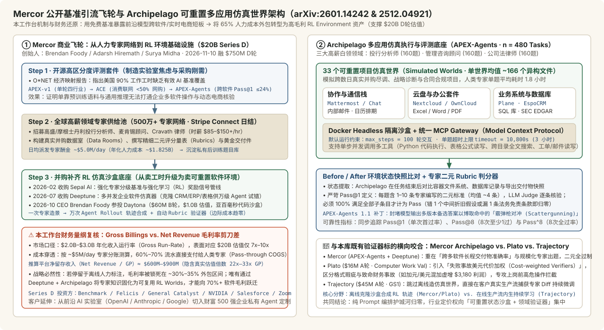
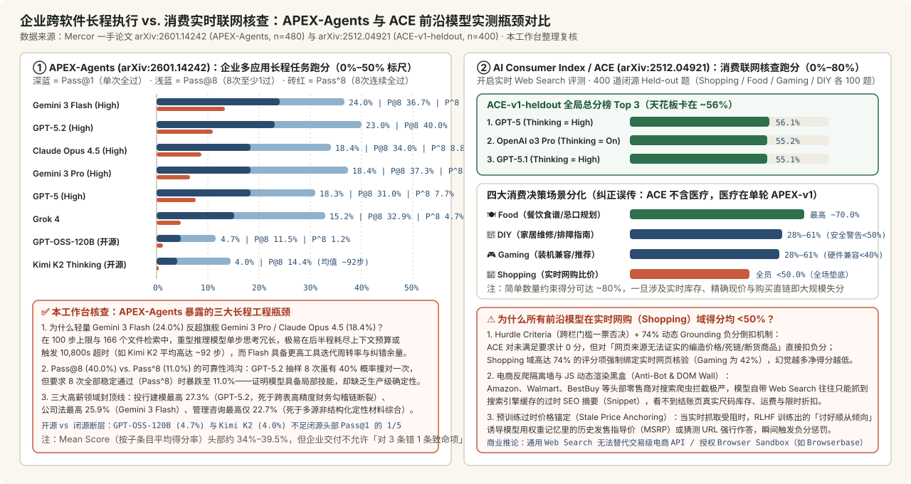

# Mercor APEX-Agents & AI Consumer Index (ACE): Enterprise Multi-App Simulated Worlds vs Consumer Web-Grounding Benchmarks (arXiv:2601.14242 & arXiv:2512.04921)

2026-10-20 · Mercor Research · arXiv:2601.14242 & 2512.04921 · 待云端同步

[本地原件归档](../../../raw/0db679609c98e9b4fd15d137f9c00e899847eaa8434973de9a187d86ef38cbae) · 固定材料版本 `digest-material-0db679609c98e9b4fd15d137f9c00e899847eaa8434973de9a187d86ef38cbae@1` · [一手原站](https://arxiv.org/abs/2601.14242)

## 深度拆解与复核

- 来源：[Mercor APEX-Agents 论文原件（arXiv:2601.14242 · Bertie Vidgen, Brendan Foody et al.）](https://arxiv.org/abs/2601.14242) · [Mercor The AI Consumer Index (ACE) 论文原件（arXiv:2512.04921 · Julien Benchek, Brendan Foody, Bertie Vidgen et al.）](https://arxiv.org/abs/2512.04921) · [Hugging Face 开源数据集与 Archipelago 执行底座（mercor/apex-agents & mercor/ACE）](https://huggingface.co/datasets/mercor/apex-agents) · [Mercor APEX-v1 单轮专家基准（arXiv:2509.25721）与 O*NET 美国经济基准覆盖图谱](https://www.mercor.com/research/labor-index/benchmark-map/) · [Mercor 2026-11-10 \$750M Series D（\$20B 估值）官方融资披露及并购 Deeptune / Sepal AI 公告](https://www.mercor.com/research/)
- ==核心结论==：Mercor 连续开源企业级跨软件长程基准 APEX-Agents（arXiv:2601.14242）与消费级实时联网核查基准 AI Consumer Index / ACE（arXiv:2512.04921），表面是学术公益评测，实质是支撑其 \$200 亿美元 Series D 估值的核心商业获客与毛利率改造飞轮——用高区分度公开基准精准刺破前沿模型在「企业多软件协同（最高 Pass@1 仅 24.0%、Pass^8 连续稳定率 ≤13.4%）」与「实时网购比价/库存核验（全员得分 <50%）」上的能力泡沫，进而向头部 AI 实验室与财富 500 强高价出售“人类高薪行业专家 Rubrics + 可重置 RL 仿真环境合成轨迹”后训练数据包。在技术机制上，APEX-Agents 依托开源 Archipelago（Docker + MCP 网关）在 33 个仿真企业项目世界（单世界平均 ~166 个文件）中测试投行、管理咨询、公司法 480 项长程任务，揭示重型慢思考模型（Gemini 3 Pro / Claude Opus 4.5 均仅 18.4%）因单步冗长在 100 步上限内反被高周转轻量模型 Gemini 3 Flash（24.0%）反超；ACE 则在 Shopping / Food / Gaming / DIY 四大消费场景（400 题闭源评测）中证明，受制于电商反爬 DOM 隔离墙、预训练过时指导价锚定及 74% 条目的动态 Grounding 负分倒扣，通用 Web Search 根本无法充当交易级购物代理。在商业闭环上，Mercor 借并购 Sepal AI 与多并发 RL 仿真沙盒 Deeptune（配合 CEO 参投代码沙盒独角兽 Daytona），正将自身从 60%–70% 流水被迫分给人类专家（日发酬金 ~\$5M）的低毛利人力外包网，重构为“一次专家造景、万次 Agent 合成轨迹复用”的高毛利软件验证器底座。
- 关联主体档案：[Mercor](../entities/companies/Mercor.md) · [Plato](../entities/companies/Plato.md) · [Daytona](../entities/companies/Daytona.md) · [E2B](../entities/companies/E2B.md) · [Modal](../entities/companies/Modal.md) · [Together AI](../entities/companies/Together%20AI.md) · [OpenAI](../entities/companies/OpenAI.md) · [Bertie Vidgen](../entities/people/Bertie%20Vidgen.md) · [Brendan Foody](../entities/people/Brendan%20Foody.md)

---

### 一、场景与利益标注：拆解 Mercor $200 亿 估值背后的「评测引流 $\to$ RL 环境变现」商业飞轮

#### 1. 场景与利益相关披露（Editorial Attribution & Commercial Incentives）
- 发布主体与创始人背景：两篇论文均出自 Mercor Research（由三位 2003 年出生的高中辩论队搭档兼 Thiel Fellows——CEO Brendan Foody、CTO Adarsh Hiremath、COO Surya Midha 于 2023 年 4 月创立，评测团队由前 Meta / Alan Turing Institute 安全与基准专家 Bertie Vidgen 与 Osvald Nitski 领衔）。作为直接向 OpenAI、Anthropic、Google、Meta、xAI 等前沿大模型实验室出售专家后训练数据与 RL 环境的商业供应商，Mercor 免费开源 APEX-Agents、Archipelago 与 ACE 并非中立学术慈善，而是自带极强商业转化漏斗的“需求定义工具”：每当公开榜单证明最顶尖基座模型在投行建模、律所审同或实时电商比价中大面积不及格，实验室就必须采购更高密度的领域专家评分量表（Rubrics）与可交互软件环境（RL Environments）进行后训练补课。

#### 2. ⚠️ 本工作台核查（商业量纲与毛利率剪刀差复核）：为什么 Mercor 必须收购 Deeptune 并布局沙盒？
- 融资跃迁与表面收入口径：2026 年 11 月 10 日（Business Wire 披露），Mercor 宣布完成 \$7.5 亿美元（\$750M）Series D 融资，投后估值较 2025 年 10 月 C 轮（融 \$3.5 亿美元、估值 \$100 亿美元）翻倍至 \$200 亿美元（\$20B），投资方涵盖 Benchmark、Felicis、General Catalyst、NVIDIA、Salesforce、Zoom、Sapphire Ventures 与 Apollo 关联基金，并包含员工老股要约收购。市场报道普遍引述其年化收入运行率（Annualized Revenue Run-Rate）已突破 \$20 亿美元（向 \$30 亿美元 迈进），表面看似 \$20B 估值仅对应 7x–10x ARR。
- ⚠️ 财务真相穿透（Gross Billings vs. Net Revenue · 本工作台核查与测算）：
  1. 60%–70% 过手人力成本（Pass-through Expert COGS）：CEO Brendan Foody 公开披露，Mercor 平台汇聚了全球超 500 万名（5M+） 经筛选的领域专家（投行分析师、执业律师、资深顾问、主治医师与软件工程师，专家时薪普遍达 \$85–\$150+/小时），且平台通过 Stripe Connect 每天向人类专家发放的酬金高达约 \$500 万美元/天（~\$5M/day，折合年化人力直接分账成本约 \$18.25 亿美元）。
  2. 真实净收入与毛利率倒推（本工作台测算）：将 \$18.25 亿美元 年化专家派息与 \$20 亿–\$30 亿美元 总账单流水勾稽可知，市场流传的“ARR”实质是未扣除专家分账的 总交易流水（Gross Billings），其中 60%–70% 直接流向兼职专家口袋；Mercor 实际留存的平台净收入（Net Revenue / 毛利池）约为 \$6 亿–\$9 亿美元，对应整体毛利率仅 30%–35%，真实估值倍数实为 22x–33x Net Revenue。
  3. 并购 Sepal AI + Deeptune + 参投 Daytona 的战略闭环（本工作台推断）：如果 Mercor 永远停留在“按小时撮合人类专家写离线 Prompt-Response”（传统 Scale AI 1.0 人力外包模式），其毛利率将永久锁死在 30% 左右且面临专家供给边际枯竭。为此，Mercor 在 2026 年连续落子三步棋——2026 年 2 月收购 Sepal AI（专家分级基准与 RL 奖励信号管线）、2026 年 7 月全资收购纽约多并发企业软件仿真初创 Deeptune（在云端克隆电子表格、Salesforce CRM、ERP 等可重置软件环境供万级 Agent 并行试错）、以及 2026 年 10 月由 CEO Brendan Foody 参投亚百毫秒级 Agent 代码沙盒独角兽 Daytona 的 \$6,000 万 B 轮（估值 \$10 亿）。其商业本质是将“一次性昂贵的人类专家工时”资本化为可无限次重置复用的软件仿真世界（Simulated Worlds + 自动判分器），让实验室模型在环境里自主跑出百万条强化学习合成轨迹（Synthetic RL Rollouts），从而推动边际业务毛利率向 70%+ 纯软件基础设施跃迁。

---

### 二、穿透企业级基准 APEX-Agents（arXiv:2601.14242）：为什么跨软件长程任务让前沿模型首过率跌破 25%？

#### 1. 从单轮文本考试（APEX-v1）到多应用可重置仿真世界（APEX-Agents + Archipelago）
在本库此前收录的《[90%的美国工作，没有任何AI基准覆盖](../../AI%E8%AE%AD%E7%BB%83%E4%B8%8E%E6%95%B0%E6%8D%AE/blogs/90%25%E7%9A%84%E7%BE%8E%E5%9B%BD%E5%B7%A5%E4%BD%9C%EF%BC%8C%E6%B2%A1%E6%9C%89%E4%BB%BB%E4%BD%95AI%E5%9F%BA%E5%87%86%E8%A6%86%E7%9B%96.md)》中，Mercor 对照美国劳工部 O\*NET 的 923 种职业、18,797 项具体任务发现，传统基准过度拥挤在单文件写代码与奥数竞赛，而真实高薪白领工时几乎处于评测盲区。为此，Mercor 先于 2025 年 9 月推出单轮文本基准 APEX-v1（arXiv:2509.25721），继而在 APEX-Agents（arXiv:2601.14242）中彻底抛弃静态单轮问答，开源了底层的企业环境执行与评估框架 Archipelago：

- 三大高薪纯桌面专业服务域（n = 480 Tasks）：由来自高盛、摩根士丹利、麦肯锡、Cravath 等顶级机构的在职或前资深从业者亲自造景出题，等分为 投行分析师（Investment Banking Analyst，160 题）、管理咨询顾问（Management Consultant，160 题） 与 公司法律师（Corporate Lawyer，160 题）；人类资深专家完成单题的平均耗时高达 1.8 小时（跨度 1–2+ 小时）。
- 33 个高噪声跨应用仿真世界（Simulated Worlds）：全部 480 项任务嵌入在 33 个完整的商业项目虚拟数据室（Worlds） 中，每个 World 平均塞有 ~166 个多格式异构文件（含带多层跨表引用公式的 Excel 财务三表与 LBO 模型、长达百页的并购协议 PDF、Word 红线修订稿、PPT 汇报模版、历史聊天记录与邮件往来）。
- Docker 容器隔离 + MCP 统一工具协议栈：Archipelago 将整套开源自托管企业软件克隆栈封装在无头 Docker 沙盒内，并通过 MCP（Model Context Protocol）Gateway 向 Agent 暴露标准化工具调用接口——涵盖团队即时通讯（Mattermost，对标 Slack）、企业云盘与文档协作（Nextcloud / OwnCloud，对标 Google Drive / Box）、项目管理与 CRM（Plane / EspoCRM，对标 Jira / Salesforce）、办公文档引擎（LibreOffice 读写 `.xlsx/.docx/.pptx`）、邮件与日历组件（Email / Calendar）以及 SQL 数据库查询、SEC EDGAR 财报检索与 Python 代码执行沙盒。每次评测开始前可毫秒级重置回初始状态快照，默认单题预算上限为 max_steps = 100 轮交互、超时硬上限 timeout = 10,800 秒（3 小时）。
- 零容忍的二元专家 Rubric 判分机制（Strict Binary Pass@1）：每道任务配备由出题专家撰写的 1–10 条二元通过标准（平均每题约 4 条 Criteria）。任务终止后，Archipelago 提取容器环境 Before/After 文件系统与数据库差异快照，交由校准后的 Judge LLM 逐条核对；只有当 Agent 在第一次尝试中 100% 满足该题名下全部二元标准（例如客户就绪级交付物中既算准调整后 EBITDA、又剔除一次性汇兑损益、且同步在 Mattermost 指定频道通知合伙人），才计为 Pass@1 通过。此外，针对部分聪明模型试图在同一份报告中罗列多个备选数值以“押宝”命中判分点的投机行为（Scattergunning / Hedging），Mercor 在后续 APEX-Agents 1.1 中专门加入了反投机扣分补丁。

#### 2. APEX-Agents 前沿模型实测成绩单与三层工程复核

| 模型配置（arXiv:2601.14242 一手榜单，`n=480`） | 模型类型 | Pass@1（单次全过率 / 95% CI） | Pass@8（8次至少1过） | Pass^8（8次连续全过） | Mean Score（子条目均分） | 核心长程行为特征 |
| :--- | :--- | :--- | :--- | :--- | :--- | :--- |
| Gemini 3 Flash (Thinking=High) | 闭源高周转 | 24.0% [20.7–27.3] | 36.7% | 13.4% | 39.5% | 全场总榜第一，公司法域领跑（~25.9%），单步轻量、多工具试错纠偏周转最快 |
| GPT-5.2 (Thinking=High) | 闭源旗舰推理 | 23.0% [19.8–26.2] | 40.0% | 11.0% | 38.7% | Pass@8 上限全场最高，投行精确建模（~27.3%）与咨询（~22.7%）最强 |
| Claude Opus 4.5 (Thinking=High) | 闭源旗舰推理 | 18.4% [15.5–21.3] | 34.0% | 8.8% | 34.8% | 长文档理解扎实，但跨多应用长链切换时后半程目标漂移 |
| Gemini 3 Pro (Thinking=High) | 闭源旗舰推理 | 18.4% [15.7–21.1] | 37.3% | 6.5% | 34.1% | 单次 Pass@1 落后自家 Flash 达 5.6 pct，8 次连续稳定率仅 6.5% |
| GPT-5 (Thinking=High) | 闭源推理 | 18.3% [15.4–21.3] | 31.0% | 7.7% | 32.9% | 较迭代版 GPT-5.2 在长程电子表格公式链与状态保持上低 4.7 pct |
| Grok 4 | 闭源前沿 | 15.2% [12.8–17.7] | 32.9% | 4.7% | 30.3% | Pass@8 翻倍至 32.9%，但单次执行方差大、稳定性偏弱 |
| GPT-OSS-120B | 开源权重 | 4.7% [3.3–6.1] | 11.5% | 1.2% | 14.5% | 开源模型面对 166 文件跨软件 MCP 调用出现断崖式掉点 |
| Kimi K2 Thinking | 开源权重推理 | 4.0% [2.9–5.2] | 14.4% | 0.3% | 11.5% | 过度冗长思考，单题平均消耗高达 ~92 步，逼近 100 步硬上限 |

- ✅ 本工作台核查 ①（反直觉现象复核：为什么更便宜的 Gemini 3 Flash 以 24.0% 击败旗舰 Gemini 3 Pro 与 Claude Opus 4.5 的 18.4%？）：
  - 本工作台推断与工程机制归因：在单轮数学或短代码基准上，参数更大、单步推理链更长的 Pro / Opus 往往稳压 Flash；但在 Archipelago 这种包含 ~166 个背景噪声文件、需跨越云盘翻找 PDF 附注再去改 Excel 报表并核对聊天记录的长程环境里，重型慢思考模型在每一步工具调用前都会吐出数千 Token 的冗余内部推演（Over-thinking）。这带来双重反噬：一是快速填满有效注意力窗口（Context Rot），导致第 40 步以后遗忘最初聊天频道里的关键口径修订；二是单步延迟高、步数消耗重（极端案例如开源推理模型 Kimi K2 Thinking 单题平均消耗 ~92 步，几乎贴着 `max_steps=100` 撞线超时）。相反，Gemini 3 Flash (Thinking=High) 以更紧凑的单步推理换取了更高的“探测—读取—验算—回滚”环境交互频率，在有限步数与上下文预算内完成了更多实质性跨文件交叉核验。
- ✅ 本工作台核查 ②（生产级可靠性死穴：Pass@8 = 40.0% vs. Pass^8 = 11.0% 的四倍坍缩）：
  - 评估企业能否真正用 AI 替代初级投行分析师或律所助理，不能看抽样 8 次撞对 1 次的 Pass@8（GPT-5.2 已达 40.0%，证明模型并非完全不懂金融或法律知识），而必须看 连续 8 次独立运行全部零失误交付的 Pass^8（Pass-to-the-power-of-8）。数据显示，哪怕是榜首阵营，GPT-5.2 的 Pass^8 也仅为 11.0%，Gemini 3 Pro 更是低至 6.5%。在真实投行并购估值（最高单域 Pass@1 仅 27.3%）或管理咨询汇报（最高仅 22.7%）中，近 80% 的失败并非完全写不出报告，而是像本库收录的 [Plato](../entities/companies/Plato.md) 财务报表案例那样——Mean Score 拿到了 38%–39%（做对了前 3 步格式与基础汇总），却在第 4 步漏看了某封邮件里的口径变更或搞错跨表单元格公式引用，导致最终交付件不可用。

---

### 三、穿透消费级基准 AI Consumer Index / ACE（arXiv:2512.04921）：为什么所有前沿模型在实时网购比价域全部 <50%？

#### 1. ⚠️ 本工作台核查（二手口径纠偏）：ACE 四大消费场景的真实构成
- ⚠️ 分类核查纠偏（本工作台核查）：外部二手资讯在传播 Mercor 基准体系时，常将消费级基准 ACE 误传为包含“医疗健康（Healthcare/Medical）”。经本工作台直接核对一手论文原件：
  - 医疗健康（Primary Care Physician 临床全科医生） 实际归属于 Mercor 2025 年 9 月发布的单轮专业知识基准 APEX-v1（arXiv:2509.25721，覆盖投行、咨询、律所、临床医疗四大职业）；
  - 而 The AI Consumer Index / ACE（arXiv:2512.04921，由 400 道闭源 ACE-v1-heldout + 80 道开源 ACE-v1-dev 组成，每域严格均分 100 道闭源测试题） 评估的四大真实日常消费决策场景严格为：① Shopping（实时网购比价与选品寻源）、② Food（餐饮食谱定制、过敏原与营养忌口规划）、③ Gaming（PC/主机装机硬件兼容性核验与游戏推荐）、④ DIY（家居维修排障、工具选型与安全规范提示）。

#### 2. ACE-v1 联网搜索成绩单与「实时网购 <50% 断崖」的三大物理/机制根因
在全员开启实时联网搜索（Web Search Enabled） 的公平条件下，ACE-v1-heldout 全局总分最高的前三名依次为 GPT-5 (Thinking=High) 56.1%、OpenAI o3 Pro (Thinking=On) 55.2% 与 GPT-5.1 (Thinking=High) 55.1%。然而拆开四个子域，模型表现呈现剧烈撕裂：Food 域最高可达 ~70.0%（因菜谱与营养配比多属静态先验知识），DIY 与 Gaming 在 28%–61% 间大幅震荡（其中 Gaming 硬件接口兼容性核验普遍 <40%、DIY 关键安全警告提及率 <50%），唯独商业变现价值最高的 Shopping（实时网购比价与库存核验）成为全场坟场——没有任何一款前沿模型得分突破 50.0%。

本工作台结合 arXiv:2512.04921 评分器源码逻辑与现代电商基础设施架构，拆解导致全员 <50% 的三重硬壁垒：

1. Hurdle Criteria（跨栏门槛锁死）+ 74% 动态 Grounding 负分倒扣设计（评测机制层）：
   - 传统评测中，模型若答出 5 个推荐理由但买错型号，仍能骗取部分印象分；ACE 引入了强制性的 Hurdle Criteria（核心目标跨栏项）——若未满足核心硬约束（如预算上限、指定尺码有货、兼容接口型号），后续附加分直接清零。
   - 更关键的是 非对称负分惩罚（Negative Scoring for Ungrounded Hallucinations）：未覆盖某项次要标准仅得 0 分，但只要模型输出的商品价格、促销折扣、有货状态或购买直链 URL 无法在其实际检索抓回的网页原文（Retrieved Web Sources）中得到逐字证实，评分器立即倒扣负分。在 ACE-v1-heldout 中，Shopping 域高达 74% 的评分条目绑定了动态网页 Grounding 核查（Gaming 域为 42%），导致幻觉越严重的模型在单项价格与链接题上直接跌入负分净值区间。
2. 头部电商平台的反爬隔离墙与客户端动态 DOM 黑盒（基础设施层 · 本工作台核查）：
   - 大模型原厂自带的通用 Web Search 工具底层依赖搜索引擎索引快照（Bing / Google Search API）或轻量静态 HTML 抓取器。然而，Amazon、Walmart、Target、BestBuy、Nike 等主流零售电商对自动化爬虫部署了极严苛的 WAF 反爬风控（Cloudflare / Akamai Bot Manager），且商品实时结算价、尺码/颜色级 SKU 库存状态（In-stock / Out-of-stock）、会员领券折后价与邮政编码运费均通过客户端异步 JavaScript API 动态注入。模型搜索工具抓回的往往是数天乃至数周前缓存的静态 SEO 摘要（Meta Snippet），根本拿不到此时此刻结账页的真实库存与现价。
3. 预训练权重过时价格锚定（Stale Price Anchoring）与顺从式编造（模型行为层）：
   - 当实时网页抓取因反爬受阻或返回残缺文本时，经过常规 RLHF 训练的模型极少诚实回答“当前无法读取该零售商实时库存”，而是受“有用性偏好（Helpfulness Bias）”驱使，自动调用预训练权重记忆中的历史官方建议零售价（MSRP） 充当实时现价，甚至按域名规律拼接出一个看似合理实则返回 404 或已下架的伪造商品 URL——在 ACE 的 74% Grounding 校验器面前，这类“顺从式脑补”被精准捕获并重罚。

---

### 四、与本库 AI应用与开发工具 既有主线横向咬合：企业验证器与 RL 沙盒的四条技术路线对比

将本次 Mercor 的 APEX-Agents / Archipelago + Deeptune 与本库已深度建档的 [Plato](../entities/companies/Plato.md)、Trajectory（见 AI训练与数据 赛道）及底层沙盒基础设施 [Daytona](../entities/companies/Daytona.md) / [E2B](../entities/companies/E2B.md) / [Modal](../entities/companies/Modal.md) 对齐，可以清晰看到 2026 年企业 Agent 落地基础设施的四层分工与路线分野：

| 对比维度 | Mercor (APEX-Agents + Archipelago + Deeptune) | Plato (Computer Work Val + Web Clone Bench) | Trajectory (Continual Grading + GS1 算法) | Daytona / E2B / Modal / Together (底层算力沙盒) |
| :--- | :--- | :--- | :--- | :--- |
| 最新融资与估值量级 | \$7.5亿 D轮，估值 \$200亿（2026.11，Benchmark/Felicis/NVIDIA 等） | \$1,600万 A轮（累计 \$1,900万，2026.11，Nava 领投、Mustafa Suleyman 参投） | \$4,500万 A轮，估值 \$3亿（2026.10，红杉领投、NVIDIA/Bessemer 参投） | Modal \$157.5亿 · Daytona \$10亿（Mercor CEO 参投）· E2B \$2,100万 A轮 |
| 核心环境构建方式 | 500 万专家网造数据室 + Archipelago（Docker+MCP）+ Deeptune 多并发克隆企业软件 | 全栈复刻 9+ 类真实企业 SaaS Web 应用（CRM/财务/工单），支持毫秒级状态重置 | 不造离线克隆环境；直接嵌入客户真实生产工作流捕获人类专家修改痕迹（Diff） | Firecracker MicroVM / 自研 Rust 容器 / 内存写时复制快照分叉（2–150ms 启动） |
| 验证器（Verifier）判分哲学 | 严格二元全过制（Binary Pass@1）：每题 1–10 条专家 Rubric，错 1 条即整题判 0 分 | 按真实职场事故美元代价加权（Cost-weighted Verifiers）：区分无害排版瑕疵与致命财务错账（如加元当美元直加虚增 \$3,180） | 无代码自服务过程价值函数（Continual Grading）：业务专家日常退回批注直接转为梯度信号 | 不负责业务语义判分；负责内核级 CPU/内存硬件隔离（防 CVE-2026-53359 逃逸与跨租户泄露） |
| 核心商业变现模式 | 向大模型实验室与大企业售卖专家 Rubric + RL 环境合成轨迹包（借软件化抬升 30%–35% 净毛利） | 向 AI 实验室与垂直 Agent 团队售卖上岗前练习场与高危事故拦截验证器 | 向无内部 ML 团队的垂直行业企业售卖防遗忘持续后训练 SaaS 平台 | 按 vCPU 秒数、DRAM 容量与并发沙盒实例数收取高毛利云基础设施算力费 |
| 本工作台评估的各自短板 | ⚠️ 二元 Pass@1 未区分“轻微瑕疵”与“毁灭性合规事故”；\$18亿+ 年化专家分账包袱重 | ⚠️ 克隆软件种类（初期 9 类基准）扩展速度受限于工程复刻产能，尚缺百万级行业专家池 | ⚠️ 极度依赖基座模型开放微调权重接口，且需克服小样本高频更新引发的灾难性遗忘 | ⚠️ 纯算力沙盒易面临公有云巨头捆绑压价，需向上绑定状态存储或 RL 训练生态（如 Daytona 联手 Mercor） |

- ✅ 本工作台核查（生态协同闭环验证）：为什么 Mercor 既自己收购了 Deeptune，CEO Brendan Foody 又在 2026 年 10 月个人参投 Daytona？因为两者处于上下游互补层：Deeptune 与 Archipelago 解决的是“上层业务应用语义仿真与状态快照判分”（把 Nextcloud、EspoCRM、投行三表与律所数据室组装成业务考场），而当大模型实验室拿这套环境做强化学习（GRPO / PPO）并行采样时，单道题同时派生出数千条长度为 50–100 步的探索分支，底层必须调用像 Daytona / E2B / Modal 这样支持亚百毫秒级拉起与内存分叉的 MicroVM 沙盒集群来承载海量 Server CPU 进程。这也再次验证了本库在《[Meta收购Conductor](Meta%E6%94%B6%E8%B4%ADConductor%EF%BC%9AAI%E7%BC%96%E7%A8%8B%E7%9A%84%E4%B8%8B%E4%B8%80%E5%9C%BA%E7%AB%9E%E4%BA%89%EF%BC%8C%E6%98%AF%E8%AE%A9%E5%A4%9A%E4%B8%AAAgent%E4%B8%80%E8%B5%B7%E5%B9%B2%E6%B4%BB.md)》中的核心推论：长程企业 Agent 的规模化训练与推理，必然同步引爆“上层领域仿真验证器 + 底层高密 CPU 微虚拟机沙盒”的双重基础设施开支。

---

### 观点与可反驳条件

- ==观点==：本工作台推断，前沿大模型在单轮知识问答上的边际进步已无法自然外推至真实商业交付——APEX-Agents 上全员 Pass@1 ≤ 24.0%（Pass^8 ≤ 13.4%）证明跨多软件长程执行受困于上下文腐化与单步慢思考超时，而 ACE 上网购域全员 <50% 证明通用联网搜索打不穿商业反爬隔离墙与实时交易状态。在产业格局上，Mercor 凭借「免费高区分度基准定义短板 $\to$ 500 万专家网络产出初始环境与 Rubric $\to$ Deeptune / Archipelago 容器化沙盒批量合成 RL 轨迹」的三级跳，正试图摆脱传统人力数据标注商（~30% 净毛利）的估值折价；未来 18 个月，企业级 Agent 的定价权将向掌握高保真可重置企业状态仿真器（Mercor / Plato）与交易级授权接口/浏览器隔离沙盒的厂商集中。
- ==推翻条件==：
  1. ① 原生基座模型在不依赖外部专家 RL 环境合成轨迹的条件下自发突破长程瓶颈：若 2027 年上半年内发布的新一代基座模型仅凭通用预训练与自博弈推理，在未采购 Mercor / Plato 类专有企业软件仿真轨迹的前提下，于 APEX-Agents（或同级闭源留存集）上的单次 Pass@1 跃升至 65% 以上、连续 8 次稳定通过率 Pass^8 突破 50%，则第三方高价“专家 Rubric + 离线仿真环境数据包”的采购刚需将大幅萎缩。
  2. ② Mercor 软件化毛利率跃迁受阻、净留存率滞留人力外包区间：若截至 2027 年底，Mercor 的 RL 仿真环境（Deeptune 整合产品线）软件订阅与合成数据收入占总流水比重仍低于 20%，平台整体毛利率（扣除支付给人类专家的 Stripe 分账后）长期停留在 35% 以下，且伴随大模型原厂削减外包人工标注预算导致 Gross Billings 环比停滞，则其 \$200 亿美元 Series D 隐含的软件基础设施溢价逻辑将被证伪。
  3. ③ 头部零售电商全面开放标准化 MCP / Agentic Commerce 实时结算协议：若 Amazon、Walmart、Shopify 等主流电商在未来 12–18 个月内向大模型原厂全面开放零反爬拦截的官方实时库存、动态定价与一键下单协议（如标准化 Agentic Checkout API），使前沿模型在 ACE Shopping 域的平均得分从 <50% 直接跃升至 80% 以上，则当前困扰消费级购物 Agent 的实时 Grounding 断崖将被协议层直接抹平。

---

## 原文摘录与一手信源存证

> 【信源巡检核心摘要】 Mercor 研究团队开源长程专业服务评测套件 APEX-Agents（https://arxiv.org/abs/2601.14242 ，数据集 https://huggingface.co/datasets/mercor/apex-agents ）及消费级真实任务基准 The AI Consumer Index (ACE, https://arxiv.org/abs/2512.04921 ，数据集 https://huggingface.co/datasets/mercor/ACE )。
> — 原文摘录，文字段落 1；证据 `digest-material-0db679609c98e9b4fd15d137f9c00e899847eaa8434973de9a187d86ef38cbae-excerpt-1@1`

一手材料：

- Mercor APEX-Agents & AI Consumer Index (ACE): Enterprise Multi-App Simulated Worlds vs Consumer Web-Grounding Benchmarks (arXiv:2601.14242 & arXiv:2512.04921) · Mercor · [原站](https://arxiv.org/abs/2601.14242) · [主体档案：Mercor](../entities/companies/Mercor.md) / [主体档案：Bertie Vidgen](../entities/people/Bertie%20Vidgen.md) / [主体档案：Brendan Foody](../entities/people/Brendan%20Foody.md) · [待上传原件](../../../raw/0db679609c98e9b4fd15d137f9c00e899847eaa8434973de9a187d86ef38cbae)
  材料版本 `digest-material-0db679609c98e9b4fd15d137f9c00e899847eaa8434973de9a187d86ef38cbae@1`；获取方式 `tg_approved_source_update`。
  > 【信源巡检核心摘要】 Mercor 研究团队开源长程专业服务评测套件 APEX-Agents（https://arxiv.org/abs/2601.14242 ，数据集 https://huggingface.co/datasets/mercor/apex-agents ）及消费级真实任务基准 The AI Consumer Index (ACE, https://arxiv.org/abs/2512.04921 ，数据集 https://huggingface.co/datasets/mercor/ACE )。 — 原文提取
- The AI Consumer Index (ACE, arXiv:2512.04921) & APEX-Agents / Archipelago (arXiv:2601.14242) Quantitative Benchmark & Mercor \$20B Series D Dossier · Mercor Research · [原站](https://arxiv.org/abs/2512.04921) · [主体档案：Mercor](../entities/companies/Mercor.md) / [主体档案：Bertie Vidgen](../entities/people/Bertie%20Vidgen.md) / [主体档案：Brendan Foody](../entities/people/Brendan%20Foody.md) · [待上传原件](../../../raw/6671d5eecf84806bee276cbd83422cbbddfe6eae31f83f3c0400c0d541253907)
  材料版本 `digest-material-6671d5eecf84806bee276cbd83422cbbddfe6eae31f83f3c0400c0d541253907@1`；获取方式 `arxiv_and_corporate_primary_dossier`。
  > ## 3. Mercor Corporate & M&A Context (2025–2026) - \*\*Founders\*\*: Brendan Foody (CEO), Adarsh Hiremath (CTO), Surya Midha (COO), founded April 2023. — 原文提取

归属与范围：穿透核查 Mercor 两篇一手基准论文 APEX-Agents (arXiv:2601.14242, n=480, 33 个可重置跨软件仿真世界 Archipelago, 最高 Pass@1 为 Gemini 3 Flash 24.0% / GPT-5.2 23.0% / Claude Opus 4.5 18.4%) 与 AI Consumer Index / ACE (arXiv:2512.04921, n=400 held-out, 纠正医疗分类误传并拆解 Shopping 域全员 \<50% 的反爬与 74% Grounding 负分惩罚根因)，并结合 2026-11-10 \$750M Series D (\$20B 估值)、~\$5M/天专家派息与并购 Deeptune / 参投 Daytona 还原其从低毛利人力外包向高毛利 RL 环境转型的商业飞轮。

来源缺口：

- `not_disclosed`：Mercor 在 2026 年 11 月 \$7.5 亿 Series D（\$200 亿估值）融资公告中未披露经审计 GAAP 净收入（扣除日均 ~\$500 万人类专家分账后的平台净留存率）及 2026 年 7 月收购 Deeptune 的具体交易对价。 [线索](https://www.mercor.com/research/)
- `not_disclosed`：ACE-v1-heldout（400 题）与 APEX-Agents 闭源留存测试集的具体题目原文及完整评分 Rubric 因防数据污染未公开，外部仅能复验 ACE-v1-dev（80 题）与 mercor/apex-agents 开源子集。 [线索](https://huggingface.co/datasets/mercor/apex-agents)

[返回赛道总览](../赛道总览.md#digest-0db679609c98e9b4) · [返回导读索引](README.md) · [主体档案库](../entities/README.md)
