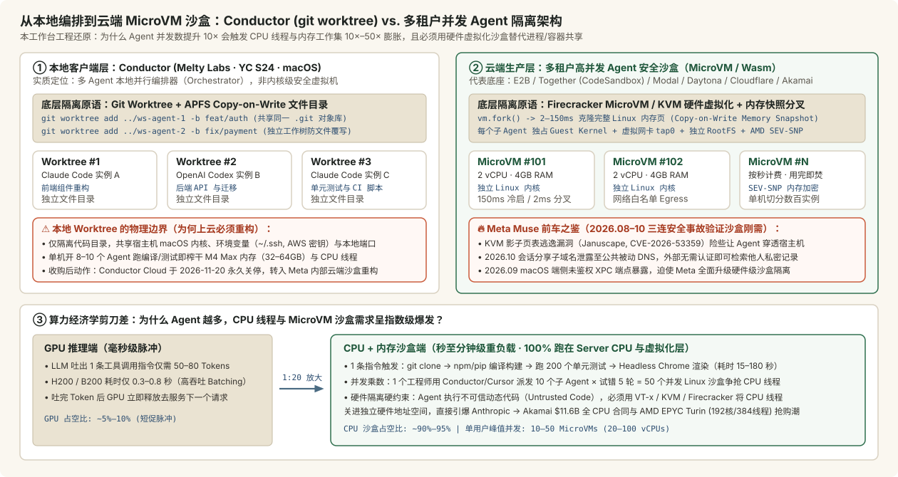
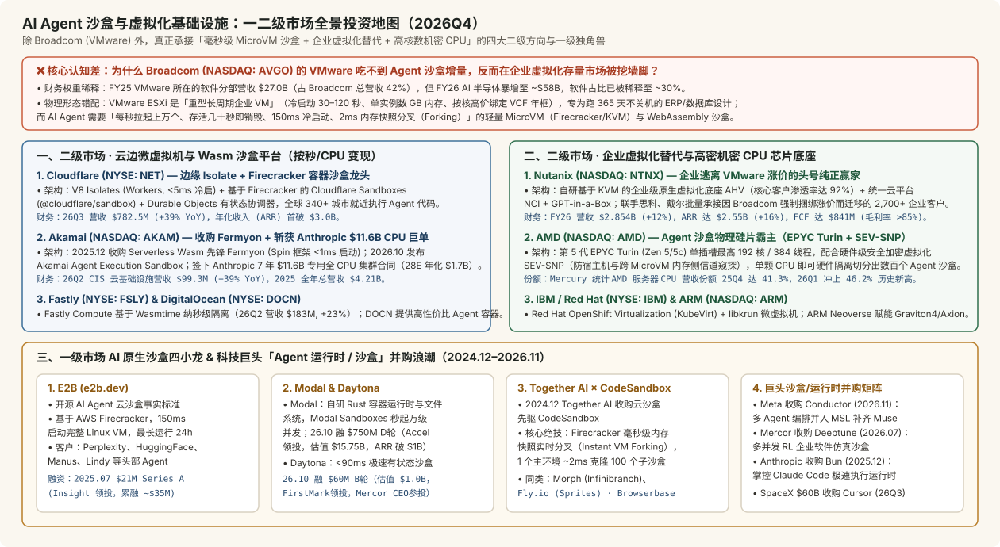

# Meta收购Conductor：AI编程的下一场竞争，是让多个Agent一起干活

2026-11-05 · Conductor (Melty Labs) · Nutanix / C · 已整理

[本地原件归档](../../../raw/41f4e81b9b058fbe2a476d37c1d7f8fea1f6a2824a916d935a568ef83699a7c9) · 固定材料版本 `digest-material-41f4e81b9b058fbe2a476d37c1d7f8fea1f6a2824a916d935a568ef83699a7c9@1` · [一手原站](https://conductor.build/) · [触发线索（赛博译栈）](https://mp.weixin.qq.com/s/1A7o_47IPqNEAackmt7YFw)

> [!IMPORTANT]
> 用户关注点（TG）：所以是个沙盒？类似mersor之前也收购了一个多并发沙盒，沙盒/虚拟机技术的需求好像浮现了出来，i.e. Agent越多对CPU的需求越高，CPU的线程依赖沙盒拆分，不然就会导致之前Muse的用户访问到了别人的数据，所以沙盒技术也变得重要，但是我之前看沙盒/虚拟机，好像只有Broadcom收购了VMware这个消息（当然我很看好broadcom，但是虚拟机业务对broadcom来说太小了），还有别的相关公司吗？

## 针对性追查与回应

- 来源：[Conductor (conductor.build) 官方停服与并购公告（2026-11-04）](https://conductor.build/) · [TechCrunch / Axios 关于 Meta Superintelligence Labs 收购 Melty Labs (Conductor) 报道（2026-11-04）](https://techcrunch.com/) · [Mercor 收购 RL 仿真沙盒 Deeptune 公告（2026-07）](https://www.mercor.com/research/) · [Together AI 收购 CodeSandbox 公告（2024-12）](https://www.together.ai/) · [Nutanix (NASDAQ: NTNX) FY2026 10-K 年报（截至 2026-07-31）](https://www.nutanix.com/) · [Cloudflare (NYSE: NET) 2026Q3 财报（2026-11-05）](https://www.cloudflare.com/) · [Akamai (NASDAQ: AKAM) 收购 Fermyon 公告与 Anthropic \$11.6B 全 CPU 集群 8-K（2025.12–2026.10）](https://www.akamai.com/)
- ==核心结论==：Conductor 本身不是底层虚拟机沙盒，而是跑在开发者 Mac 本地的「多 Agent 并行编排器（基于 `git worktree` 文件目录隔离）」；但当多 Agent 从个人电脑走向云端生产环境（如 Meta 关停 Conductor Cloud 并入 Muse 体系）时，目录级隔离必须升级为「硬件级 MicroVM 沙盒（Firecracker / KVM / Wasm）」。每增加 10 个并发子 Agent，GPU 仅增加毫秒级脉冲推理，而代码编译、测试执行与无头浏览器渲染会将 Server CPU 线程与内存需求放大 10×–50×，且若不通过硬件虚拟化将 CPU 线程关进独立沙盒，就会直接触发类似 Meta Muse 的 KVM 逃逸隐患（CVE-2026-53359 Januscape）与跨用户会话数据泄露。在投资标的层面，Broadcom (AVGO) 的 VMware 属于分钟级冷启动的「重型企业长周期虚拟机」，根本吃不到毫秒级瞬态 Agent 沙盒增量；二级市场真正的纯正受益方集中在四大方向：① 吃下 VMware 涨价流失份额的企业虚拟化替代龙头 Nutanix (NTNX，FY26 ARR \$2.55B、毛利率 >85%、FCF \$841M)；② 直接按秒售卖边缘/云端 Agent 沙盒的 Cloudflare (NET，26Q3 营收 \$782.5M [+39%]、ARR 破 \$3B) 与 Akamai (AKAM，收购 Fermyon Wasm 沙盒 + 斩获 Anthropic \$11.6B 全 CPU 大单)；③ 为高密沙盒提供物理硅片与硬件加密隔离（SEV-SNP）的 AMD (AMD，EPYC Turin 192核/384线程，26Q1 服务器 CPU 营收份额达 46.2%)；以及一级市场四大 AI 原生沙盒独角兽 Modal（估值 \$15.75B，ARR 破 \$1B）、Daytona（估值 \$1.0B）、E2B 与 Together AI (CodeSandbox)。
- 关联主体档案：[Conductor (Melty Labs)](../entities/companies/Conductor%20%28Melty%20Labs%29.md) · [Charlie Holtz](../entities/people/Charlie%20Holtz.md) · [Meta](../entities/companies/Meta.md) · [Cursor (Anysphere)](../entities/companies/Cursor%20%28Anysphere%29.md) · [Mercor](../entities/companies/Mercor.md) · [E2B](../entities/companies/E2B.md) · [Together AI](../entities/companies/Together%20AI.md) · [Daytona](../entities/companies/Daytona.md) · [Modal](../entities/companies/Modal.md) · [Cloudflare](../entities/companies/Cloudflare.md) · [Nutanix](../entities/companies/Nutanix.md) · [Akamai](../entities/companies/Akamai.md) · [AMD](../entities/companies/AMD.md)

---

### 一、场景与利益标注及核心问题一：Conductor 到底是不是沙盒？

#### 1. 场景与利益标注（Editorial Attribution & Incentives）
- 触发线索与上游信源归属：微信稿《Meta收购Conductor：AI编程的下一场竞争，是让多个Agent一起干活》（赛博译栈，2026-11-05）编译自 Axios / TechCrunch 2026 年 11 月 4 日首发并购报道 及 Conductor (conductor.build) 官方停服迁移公告。
- 利益相关与路演口径核查：Conductor（母公司 Melty Labs, Inc.，YC S24 孵化，由 CEO Charlie Holtz 与 CTO Jackson de Campos 于 2024 年创立，核心产品 2025 年夏上线）在 2026 年 3 月刚完成由 Spark Capital 与 Matrix Partners 领投的 2,200 万美元 Series A 融资。当时公司宣称“用户高速增长、获知名科技团队采用”属于典型的融资路演口径；而在融资仅 8 个月后即选择卖身 Meta Superintelligence Labs (MSL)（向 Meta 首席 AI 官 Alexandr Wang 与产品负责人 Nat Friedman 汇报），反映出纯客户端多 Agent 编排层面临底层大模型原厂（Anthropic Claude Code、OpenAI Codex）向上垂直整合的生存挤压。

#### 2. 穿透 Conductor 的真实架构：本地 `git worktree` 编排器 vs. 云端 MicroVM 安全沙盒

- 本工作台核查（✅ 核心架构定性）：Conductor 的主力产品不是虚拟机或内核级安全沙盒，而是运行在 macOS 上的「多 Agent 并行工作流编排客户端（Orchestration Client）」；它解决的是“文件防冲突”，而非“内核与多租户安全隔离”：
  1. Conductor 底层怎么实现“多个隔离副本”？ 当开发者在同一个代码仓库中同时唤醒 5 个或 10 个 Anthropic Claude Code 或 OpenAI Codex 实例并行写前端、后端与测试时，如果共用同一个目录，不同 Agent 会互相覆写文件或锁死 `.git/index.lock`。Conductor 的工程解法是调用 Git 原生的 `git worktree` 命令（配合 macOS APFS 文件系统的 Copy-on-Write 克隆），在毫秒内为每个 Agent 挂载一个拥有独立工作目录与独立分支、但共享底层 .git 对象库的工作空间（Workspace），并在统一 GUI 面板里集中展示各个 Agent 的终端输出、Diff 变更与合并审查（Review & Merge）。
  2. ⚠️ 为什么 `git worktree` 在云端生产环境完全不够用？（本工作台推断）：
     - 无内核与权限边界：`git worktree` 仅仅切分了文件夹路径。在本地 Mac 上，所有 Agent 进程依然共享同一个宿主机操作系统内核、同一套用户环境变量（包含开发者的 ~/.ssh 私钥、~/.aws 凭证与生产库连接串）以及同一个本地网络栈。
     - 本地 CPU 与内存天花板：每个 Coding Agent 在执行 `npm build`、cargo test 或启动本地数据库容器时都要独占数个 CPU 线程与 2–8 GB 内存；单台 MacBook Pro 同时跑 8–10 个并发 Agent 就会触发内存交换（Swap）与散热降频。
     - 为什么 Meta 收购后第一件事就是在 11 月 20 日彻底关停 Conductor Cloud？ 根据官方停服时间表，11 月 4 日官宣当日停止新注册，11 月 13 日 Conductor Cloud 转为只读并退款，11 月 20 日永久关闭并删除云端数据（本地 Mac 版维护至 2027 年初）。因为当 Meta 将 Conductor 的多 Agent 编排工作流并入 2026 年 8 月发布的自研 Muse Code 与拥有超 1,000 万用户 的 Muse Agent 体系时，后台面对的是数百万租户并发执行不可信代码——此时必须把底层的 `git worktree` 彻底替换为 Meta 内部硬化后的 KVM / Firecracker 硬件级微虚拟机（MicroVM）集群。

---

### 二、核心问题二：还原「类似 Mercor 收购多并发沙盒」与「Muse 用户访问到别人数据」的真实始末

用户记忆中的两条关键行业线索均对应 2025–2026 年一级与二级市场的真实标志性事件，本工作台逐一还原其技术底层：

#### 1. 谁收购了「多并发 Agent 沙盒」？（Mercor / Together AI / SpaceX-Cursor / Anthropic 四大并购案对号入座）

| 并购方 / 投资方 | 被收购标的与交易时间 | 交易性质与估值量级 | 核心沙盒技术机制与为什么必须买？（本工作台核查） | 核查结论 |
| :--- | :--- | :--- | :--- | :--- |
| Mercor (mercor.com) | 收购 Deeptune（2026年7月） + 收购 Sepal AI（2026年2月） + CEO 个人参投 Daytona B轮（2026年10月） | 全资战略并购（金额未披露）；Daytona B轮融 \$60M 达 \$1.0B 独角兽估值 | • Deeptune 是专为 AI Agent 打造的「多并发强化学习（RL）仿真软件沙盒（Flight Simulator for Agents）」：在云端高并发克隆隔离的企业软件环境（电子表格、CRM 工单队列、内部终端与代码库），让成千上万个 Agent 同时在沙盒里试错、执行复杂长程任务并由 Mercor 的 APEX-Agents 评测套件打分 • Mercor CEO Brendan Foody 随后于 2026 年 10 月作为知名天使投资人参投了亚百毫秒级 Agent 代码沙盒独角兽 Daytona | ✅ 精准命中用户对“Mercor 收购多并发沙盒”的记忆 |
| Together AI (together.ai) | 收购 CodeSandbox （2024年12月官宣交割） | 全资收购欧洲云端开发沙盒先驱 | • 业界最强的 Firecracker MicroVM「毫秒级内存快照实时分叉（Instant VM Forking / Branching）」：传统沙盒每次启动都要重新加载依赖；CodeSandbox 改造了 KVM/Firecracker 内存管理，让 1 个已加载好完整代码库与数 GB 内存状态的主沙盒，能在 几毫秒内像 `git branch` 一样通过写时复制（Copy-on-Write）分叉出 100 个并行子 MicroVM 沙盒，直接内嵌为 Together Code Interpreter | ✅ 多并发分叉沙盒的工程鼻祖 |
| SpaceX / xAI | 收购 Cursor (Anysphere) （2026年6月官宣，26Q3交割） | \$600 亿美元（\$60B）全股票收购 | • Cursor 在被 SpaceX/xAI 以 600 亿美元收购前夕全面推开 Background Agents（云端后台并发 Agent）：每当工程师派发一个异步编程任务，Cursor 都在远端云集群拉起一个独立的一次性隔离虚拟机（Disposable Cloud VM Sandbox），支持合上电脑后后台并行跑数十个分支并自动提交带测试录像的 PR | ✅ 若“mersor”系指 Cursor，对应其远程并发 VM 架构 |
| Anthropic | 收购 Bun（2025年12月） + 签下 Akamai \$11.6B 全 CPU 集群大单（2026年9月） | 全资收购极速运行时 + 7年 \$116 亿美元 专用 CPU 租赁 | • 随着 Claude Code 年化收入（ARR）突破 \$10 亿美元，Anthropic 先于 2025 年 12 月收购 Jarred Sumner 创立的 Zig 语言极速 JS/TS 运行时 Bun，掌控底层执行引擎；继而于 2026 年 9 月向 Akamai 签下 7 年 \$11.6B 全 CPU 合同，专门支撑海量云端代码沙盒与 Agent 循环 | ✅ 模型原厂向沙盒与 CPU 底座重度垂直整合 |

#### 2. 还原「Meta Muse 用户访问到别人数据」与沙盒逃逸的三连安全事故（2026.08–2026.10）

- 本工作台核查（✅ 事实完全吻合，且内部还爆发过更惊险的 KVM 虚拟机逃逸漏洞）：Meta 在 2026 年下半年围绕 Muse（含消费级 Muse Agent 与编程级 Muse Code）连续遭遇三次直指「沙盒与多租户会话隔离」的重大安全冲击：
  1. 第一起（2026 年 10 月 · 用户直接访问到他人私密会话数据）：Meta 被迫紧急下线并叫停 Muse 的会话分享与状态路由功能。原因是其工程实现将用户生成的会话标题与状态标识直接拼入子域名（Subdomains）与可枚举的共享 Transcript 链接中，且缺乏严格的跨租户会话令牌校验；这导致成千上万条包含企业内部代码审查、商业机密与私人笔记的 Muse 会话记录被同步泄露至公共被动 DNS（Passive DNS）解析数据库与外部索引中，任何外部用户无需认证即可检索并查看他人的完整对话与工作空间输出。
  2. 第二起（2026 年 8–9 月上线前夕 · 内部惊现 KVM 虚拟机逃逸漏洞 CVE-2026-53359 “Januscape”）：在 Muse 正式公测前夕，Meta 安全团队在对承载 Muse Agent 的 KVM（Kernel-based Virtual Machine）沙盒集群做攻防演练时发现，由于宿主机 Linux 内核存在影子页表（Shadow MMU）内存管理漏洞（即 CVE-2026-53359 “Januscape”），一个执行恶意代码的 Agent 实例理论上可以直接击穿 KVM 客户机边界（VM Escape），顺着宿主机内存访问到同一物理服务器上的其他租户沙盒乃至 Meta 内部生产数据库——这迫使 Meta 高层在下发公测前启动了紧急的“全栈容器与网络边界硬化运动（Service Hardening Push）”。
  3. 第三起（2026 年 9 月 · macOS 本地客户端 `endo_voyager_dictation_endpoint` 劫持零日漏洞）：macOS 安全专家 Patrick Wardle 披露，本地版 Muse 暴露了未加密校验的私有配置项 `endo_voyager_dictation_endpoint`，攻击者只需篡改该端点即可劫持 Muse 已获取的本地文件系统、邮件、日历与终端执行最高权限。

---

### 三、核心问题三：为什么「Agent 越多 $\to$ CPU 需求指数级爆发 + 线程必须靠沙盒拆分」？（物理机制与算力经济学）

用户的直觉（Agent 越多对 CPU 需求越高，CPU 的线程依赖沙盒拆分）精准击中了 2026 年下半年云基础设施从“单一抢购 GPU”转向“Server CPU 与内存大缺货”的第一性原理：

#### 1. GPU vs. CPU 的「1:20 时间占空比剪刀差」
- Chatbot 时代（2023–2024）：人类问一句、模型答一段。95% 的计算耗时发生在 GPU 显存带宽（HBM KV Cache 读取） 上，CPU 只负责极轻量的 HTTP 路由与分词（Tokenization），单台双路 CPU 足以喂饱 8 张 H100。
- 多并发 Agent 时代（2025–2026，本工作台量纲测算）：
  - 在 Conductor / Cursor / Claude Code 模式下，GPU 每次只需要推理吐出短短 50–80 个 Token 的工具调用指令（如 pytest tests/ --cov 或 `npm run build && playwright test`），在 B200/H200 上耗时仅 0.3–0.8 秒；随后 GPU 立刻释放去处理其他用户的请求。
  - 但这 0.5 秒 的 GPU 输出，会立刻在后端触发长达 15 秒至 180 秒 的重度物理计算：拉取 Git 仓库、解压数万个 `node_modules` / Python 包、多线程 C++/Rust/TypeScript 编译、启动本地 Postgres/Redis 测试容器、运行 200 个单元测试、唤醒无头浏览器（Headless Chromium）渲染 DOM 并截图比对——以上动作 100% 运行在 Server CPU、系统内存（DRAM）与本地 NVMe I/O 上，0% 使用 GPU。
  - 并发乘数效应：当 1 名人类工程师通过 Conductor 同时指挥 10 个并发子 Agent，且每个 Agent 采用 Best-of-N（例如同时尝试 5 条代码修复路径，择优合并），单次任务瞬间派生出 50 个 并发执行流。假设每个执行流分配 2 vCPU + 4 GB RAM，仅 1 名活跃开发者在峰值时刻就会独占 100 个物理 CPU 硬件线程（vCPUs） 与 200 GB DRAM——这正是为什么 Google AI 基础设施负责人 Amin Vahdat 与 Anthropic（签下 Akamai 116 亿美元全 CPU 合同 + Jabil 17 亿美元内存采购） 同时预警 Server CPU 与内存成为新瓶颈。

#### 2. 为什么不能直接用普通操作系统线程（OS Threads）或普通 Docker 容器切分 CPU？

| 隔离层级 | 代表技术 | 冷启动延迟 | 单实例内存开销 | 内核与硬件隔离边界 | 为什么能不能跑多租户 AI Agent？（本工作台核查） |
| :--- | :--- | :--- | :--- | :--- | :--- |
| L1：操作系统线程 / 进程 *(OS Threads / `git worktree`)* | POSIX Threads / 本地 Conductor | < 1 ms | ~几 MB | ❌ 零隔离：共享宿主机内核、全局文件系统、网络端口与环境变量 | ❌ 云端绝对禁用：Agent 跑的是大模型动态生成的任意代码（rm -rf、读取环境变量密钥、扫描内网），一旦不隔离，A 用户的 Agent 瞬间读走 B 用户的内存与代码 |
| L2：共享内核标准容器 *(Standard Containers)* | Docker / runc (Linux Namespaces + cgroups) | 300–1,500 ms | ~20–50 MB | ⚠️ 弱隔离：虽有独立文件目录，但所有容器共享同一个宿主机 Linux Kernel（超 300 个系统调用 syscalls 暴露面） | ⚠️ 高危：Agent 生成的代码常需 sudo/apt install/挂载文件系统，极易触发内核提权逃逸（Container Escape）或 `/proc` 信息泄露 |
| L3：用户态内核 / 语言虚拟机 *(User-Space Kernel / Isolates)* | Google gVisor / V8 Isolates / WebAssembly (Spin / Wasmtime) | 0.5–10 ms | < 2–10 MB | ✅ 强逻辑隔离：V8/Wasm 默认无文件与网络权限（Capability-based）；gVisor 在用户态拦截重写 Linux 系统调用 | ✅ 极佳适合轻量工具调用與 Serverless 函数（Cloudflare Workers / Akamai Fermyon Spin），但部分重度原生 C++ 编译或依赖完整 Linux 内核特性的脚本受限 |
| L4：轻量级硬件微虚拟机 *(Lightweight MicroVMs)* | AWS Firecracker / KVM + libkrun / Cloud Hypervisor + AMD SEV-SNP | 80–150 ms（冷启） 2–10 ms（内存快照分叉） | < 5 MB（VMM 自身开销）+ 客户机按需内存 | ✅ 最高硬件级隔离：通过 CPU 硬件虚拟化扩展（Intel VT-x / AMD-V）为每组 CPU 线程分配独立的 Guest Linux 内核，配合 AMD SEV-SNP 硬件 AES 内存加密 | ✅ AI Coding Agent 云端沙盒的黄金标准（E2B、CodeSandbox、Modal、Cloudflare Sandboxes、Cursor Cloud 均采用此路线） |
| L5：传统企业级重型虚拟机 *(Legacy Heavy Enterprise VMs)* | VMware ESXi (Broadcom) / 传统 OpenStack QEMU | ❌ 30,000–120,000 ms（30秒–2分钟） | ❌ 1–4 GB+ 基础开销 | ✅ 强硬件隔离，包含全套模拟 BIOS、PCI 总线与重型企业存储栈 | ❌ 完全无法用于 Agent 沙盒：Agent 任务往往只需跑 10 秒测试，岂能忍受 1 分钟开机等待与按年绑定的高昂许可费 |

---

### 四、核心问题四：除 Broadcom (VMware) 外，沙盒 / 虚拟机 / Agent 隔离底座还有哪些核心公司？（一二级市场全景投资地图）

#### 1. 先破除误区：为什么看好 Broadcom (NASDAQ: AVGO) 靠的是 AI ASIC 与网络芯片，而不是 VMware 虚拟机？
- 财务占比结构性稀释（本工作台核查）：在 FY2025，Broadcom 旗下的基础设施软件分部（Infrastructure Software，核心即收购来的 VMware）实现营收 \$270 亿美元，占公司总营收（\$639 亿美元）的 42%；但进入 FY2026，随着定制 AI 算力芯片（Google TPU、Meta MTIA、ByteDance/OpenAI XPU）与 Tomahawk 5/6 以太网交换机驱动 AI 半导体营收从 FY25 的 ~\$200 亿美元 飙升至 FY26E 指引的 ~\$580 亿美元，软件分部在 2026Q3（营收 \$87.5 亿美元）占总营收比重已降至 ~30%（26Q4 指引进一步降至 <25%）。
- 技术路线南辕北辙：如上表 L5 vs. L4 所示，Broadcom 收购 VMware 后的核心商业策略是取消永久授权、强制企业客户打包购买高价的 VMware Cloud Foundation (VCF) 重型私有云套件。VMware ESXi 从未针对「100 毫秒极速冷启动、毫秒级内存快照克隆（Snapshot Forking）、按秒计费即用即焚」的 AI Agent 负载做轻量化重构；相反，Broadcom 激进涨价正逼迫大批传统企业将普通虚拟机迁移至 Nutanix (NTNX) 与 Red Hat OpenShift (IBM)。

#### 2. 二级市场（Public Companies）三大核心受益方向与财务成色穿透

| 受益方向 | 公司名称与代码 | 核心虚拟化 / 沙盒 / 隔离技术栈 | 最新经核实财务与经营硬指标（截至 2026Q3/FY26） | 在 Agent 沙盒与虚拟化浪潮中的核心投资逻辑与风险边界（本工作台核查） |
| :--- | :--- | :--- | :--- | :--- |
| 方向一：企业级虚拟化替代纯正龙头 *(吃 Broadcom 涨价流失份额 + 企业私有 AI 沙盒)* | Nutanix (NASDAQ: NTNX) | • 自研基于 Linux KVM 的企业级原生虚拟化管理程序 AHV (Acropolis Hypervisor) • 统一云平台 NCI + 私有化 AI 托管栈 GPT-in-a-Box | • FY2026（截至 2026-07-31）：ARR 达 \$25.5 亿美元（+16% YoY）；全年营收 \$28.54 亿美元（+12% YoY），其中 26Q4 单季营收创纪录达 \$7.571 亿美元 • 盈利与现金流：Non-GAAP 毛利率高达 >85%；FY26 自由现金流（FCF）创纪录达 \$8.41 亿美元（FCF 利润率 ~29.5%），连续第 3 年达成 Rule of 40（得分 42） • 客户与渗透率：FY26 净增 >3,000 家新客户，总客户破 32,000 家，自有 AHV 虚拟化核心采用率攀升至 92% | ✅ 二级市场最纯正的独立虚拟化软件标的：直接承接全球银行业、制造业逃离 VMware 的数万亿美元存量替换潮（联手思科、戴尔打包出货），并通过 Kubernetes 容器与 AHV 承载企业内网私有 Agent 工作负载 |
| 方向一（续）：开源虚拟化与微虚拟机底座 | IBM / Red Hat (NYSE: IBM) | • OpenShift Virtualization（基于开源 KubeVirt，在同一套 K8s 里混跑传统 VM 与容器） • 主导极轻量级 KVM 微虚拟机运行时 libkrun 与 Kata Containers | • Red Hat 混合云软件保持双位数增长，OpenShift 年化经常性收入（ARR）超 \$15 亿美元+，企业虚拟化迁移管线在 2025–2026 年翻倍增长 | ✅ libkrun 可将容器直接封装为毫秒级启动的硬件隔离 KVM 微虚拟机（被 Podman 与多家 AI 沙盒采用），是开源微虚拟化核心贡献者 |
| 方向二：云边微虚拟机与 Wasm 沙盒平台 *(直接向开发者按秒售卖 Agent Sandbox)* | Cloudflare (NYSE: NET) | • V8 Isolates (Cloudflare Workers)：<5ms 冷启动，零容器开销 • Cloudflare Sandboxes / Containers (@cloudflare/sandbox)：底层基于 AWS Firecracker MicroVM，支持运行任意 Linux 二进制、Python/Bash 脚本与 Headless 浏览器 • Durable Objects：为每个 Agent 提供全球唯一的有状态协调与持久化存储 | • 2026Q3（2026-11-05 披露）：单季总营收达 \$7.825 亿美元（+39% YoY），较 26Q2（\$6.961 亿美元，+36% YoY）进一步加速 • 里程碑：年化收入运行率（Annualized Run-Rate）历史性突破 \$30 亿美元，全球覆盖 340+ 座城市、超 1,000 万开发者 | ✅ 二级市场最具爆发力的 Agent 执行云：将“毫秒级 V8 Isolate 轻量编排 + Firecracker 重型代码沙盒 + Durable Objects 状态机 + R2 零出网费存储”合为一体的全栈 Serverless 平台 |
| 方向二（续）：分布式 CPU 云与 Wasm 沙盒 | Akamai (NASDAQ: AKAM) | • 2022 年 \$9 亿 收购 Linode 云主机底座 • 2025 年 12 月全资收购 Serverless WebAssembly 先驱 Fermyon（CNCF Sandbox 项目 Spin 缔造者，亚毫秒级启动 Wasm 沙盒） • 2026 年 10 月 27 日正式发布 Akamai Agent Execution Sandbox (Beta) | • Anthropic 巨单：2026 年 9 月签署 7 年 \$116 亿美元 专用全 CPU 云计算容量协议（预计 2028 年末贡献约 \$17 亿美元 年化收入，2026–2028 年投入 \$55 亿美元 CapEx） • 2026Q2 财报：云基础设施服务（CIS）单季营收 \$9,930 万美元（+39% YoY），公司整体 2025 营收 \$42.08 亿美元 | ✅ 直接印证“Agent 推爆全 CPU 集群与沙盒需求”：与用户此前深挖的 Akamai 逻辑完全闭环（详见本库 [Akamai 深度研究](https://mojojolite-sketch.github.io/%E5%88%86%E5%B8%83%E5%BC%8F%E8%AE%A1%E7%AE%97/akamai/refs/index.html)）；需持续跟踪 2026–2027 年 \$48 亿 CapEx 投放与交付验收节奏 |
| 方向二（续）：边缘 Wasm 与中小开发者容器 | Fastly (FSLY) / DigitalOcean (DOCN) | • Fastly Compute 基于 Bytecode Alliance Wasmtime 编译器，纳秒级沙盒初始化 • DigitalOcean 提供高性价比 CPU Droplets 与托管 Agent 容器 | • Fastly 2026Q2 营收 \$1.833 亿美元（+23% YoY） • DigitalOcean 年化收入超 \$8 亿美元+，自由现金流利润率 ~20% | ⚠️ 规模与生态粘性弱于 Cloudflare，但在特定边缘低延迟 Wasm 过滤与中小团队托管市场具备性价比优势 |
| 方向三：高密高并发机密计算 Server CPU 芯片 *(沙盒切分的物理硅片军火商)* | AMD (NASDAQ: AMD) | • 第 5 代服务器处理器 EPYC Turin（Zen 5 / Zen 5c 架构）：单插槽最高达 192 物理核心 / 384 线程（EPYC 9965） • 硬件级安全加密虚拟化 SEV-SNP（Secure Encrypted Virtualization-Secure Nested Paging）：在内存控制器硬件层为每个 MicroVM 分配独立 AES 密钥并锁死嵌套页表 | • 服务器 CPU 份额历史性逆转（Mercury Research）：AMD 在全球服务器 CPU 的营收市场份额于 2025Q4 达 41.3%，2026Q1 进一步飙升至 46.2%（出货量份额 ~27%–30%，高 ASP 证明云大厂优先采购顶配 128–192 核 Turin） • 公有云已上线超 540 款 基于 Turin 的云实例（AWS、Google C4D/N4D、Azure） | ✅ Agent 沙盒军备竞赛的底层最大硅片赢家：单颗 192 核/384 线程 Turin CPU 即可通过 KVM/Firecracker 切分出 200–350 个硬件加密隔离（SEV-SNP）的并发 Agent 沙盒，从物理底层根除类似 Muse Januscape 的跨 VM 内存窥探风险 |
| 方向三（续）：云原生高核数 ARM 架构 | ARM Holdings (NASDAQ: ARM) | • Neoverse V2 / V3 / N3 数据中心 CPU IP 底座，无超线程干扰、单核物理隔离干净、能效比优异 | • 驱动三大公有云自研高密 CPU（AWS Graviton4 96核、Google Axion、Azure Cobalt 100 128核），云端 ARM 服务器渗透率向 25%+ 迈进 | ✅ AWS Lambda 与 Firecracker 生产集群大量运行在 Graviton 裸金属节点上，按核版税率随 Neoverse CSS 显著抬升 |

#### 3. 一级市场（VC / 独角兽）AI 原生 Agent 沙盒四小龙（潜在并购标的池）

如果大模型实验室与云计算巨头继续像 Meta 收购 Conductor、Mercor 收购 Deeptune、Together 收购 CodeSandbox 一样扫货，一级市场最核心的 4 家独立沙盒底座分别是：

1. Modal (modal.com · 估值 \$157.5 亿美元)：由前 Spotify 推荐算法负责人 Erik Bernhardsson 创立，从零用 Rust 重写了容器运行时（绕开臃肿的 Docker/Kubernetes 控制面）与按内容寻址的极速分布式文件系统。其 Modal Sandboxes 支持在 1 秒内动态拉起数万个隔离的 CPU/GPU 代码执行沙盒；2026 年 10 月刚完成由 Accel 领投、Kleiner Perkins 参投的 7.5 亿美元 Series D 融资，投后估值飙升至 157.5 亿美元（较 2025 年 9 月 \$11 亿 B 轮估值暴涨 14 倍），年化经常性收入（ARR）正式突破 10 亿美元。
2. Daytona (daytona.io · 估值 \$10 亿美元)：由 Ivan Burazin 等创立，从企业远程开发环境果断转型为 亚百毫秒级（Sub-100ms）AI Agent 专用安全代码沙盒；2026 年 10 月完成由 FirstMark 领投的 6,000 万美元 Series B 融资（累计融资 \$9,100 万美元），跻身 10 亿美元 独角兽行列，战略投资方涵盖高通创投（Qualcomm Ventures）、三星 Next、Okta Ventures 以及 Mercor CEO Brendan Foody。
3. E2B (e2b.dev · 开源 Agent 沙盒标准制定者)：由 Vasek Mlejnsky 与 Tomas Valenta 创立，基于 AWS Firecracker 打造了开源的 AI Agent 云端沙盒 SDK（150ms 启动完整 Linux VM，支持最长 24 小时会话驻留、文件系统快照与桌面 GUI 操作），已成为 Perplexity、Hugging Face、Manus、Lindy 等头部 Agent 应用的默认底层沙盒；2025 年 7 月完成由 Insight Partners 领投的 2,100 万美元 Series A 融资（累计融资约 \$3,500 万美元）。
4. 专项内存分叉与浏览器沙盒新锐：
   - Morph (morph.so Infinibranch) 与 Fly.io (Sprites Firecracker VMs)：专攻针对 Tree-of-Thought（思维树）多分支搜索 Coding Agent 的毫秒级虚拟机状态分叉（VM State Branching）；
   - Browserbase (browserbase.com)：专攻无头浏览器（Headless Chromium）的高并发云端隔离沙盒，解决网页操作类 Agent（Web Agents）的 DOM 渲染、反爬指纹与登录态持久隔离。

---

### 五、观点与可反驳条件

### 观点与可反驳条件

- ==观点==：本工作台推断，AI 编程与通用 Agent 的算力消耗结构正在经历一场从「单线程对话（95% 成本在 GPU Token 推理）」向「多分支并发执行（90% 运行时长在 Server CPU 编译测试 + MicroVM 内存快照分叉 + 零拷贝状态存储）」的范式转移。Meta 收购 Conductor 并立即在 11 月 20 日关停其公有云以收编进 Superintelligence Labs、叠加 Mercor 收购 Deeptune 与 Anthropic 签下 Akamai 116 亿美元全 CPU 合同，证明独立的多 Agent 客户端编排层（如基于本地 `git worktree` 的 GUI 工具）极易被巨头内化为一个产品功能，而真正具备极高工程壁垒与复利定价权的，是底层的「高密度机密计算 Server CPU（AMD EPYC Turin + SEV-SNP）」与「支持毫秒级内存分叉的云边 MicroVM / Wasm 沙盒底座（Cloudflare、Akamai、Modal、Daytona、E2B）」；同时，在传统企业虚拟化市场，Broadcom 旗下的 VMware 因重型架构错配与激进捆绑提价，将持续向 Nutanix (NTNX) 流失高毛利存量份额。
- ==推翻条件==：
  1. ① 端侧/浏览器内纯 WebAssembly 编译工具链全面替代云端 Linux MicroVM：若未来 18–24 个月内，Python、Rust、C++、Node.js 及主流数据库/测试框架全部实现 100% 零损耗编译为客户端浏览器内运行的 WebAssembly (WASI) 模块，使得每个用户的本地电脑或手机浏览器就能在不消耗云端 Server CPU 与 Firecracker 虚拟机的情况下安全跑完 20 个并发子 Agent 的完整编译与测试闭环，则云端 Agent 沙盒（E2B / Daytona / Modal Sandboxes / Akamai Agent Sandbox）的按秒计费商业模型将被证伪。
  2. ② GPU 原生接管代码执行或大模型实现“零试错一次写对（Zero-Shot Formal Verification）”：若未来前沿模型通过内置神经编译器或形式化数学证明，无需在 CPU 沙盒中反复运行编译器、单元测试与无头浏览器验证即可保证生成代码 99.9% 零 Bug 交付，导致单次任务派生的并发沙盒分支数从 10–50 个坍缩回 1 个，则 Agent 对 Server CPU 线程的指数级放大效应将消失。
  3. ③ Broadcom 推出轻量化 MicroVM 沙盒或企业迁移停滞：若 Nutanix (NTNX) 在 FY2027 的 ARR 增速跌破 10% YoY（表明企业逃离 VMware 浪潮见顶），或公有云三巨头（AWS Bedrock / Google Vertex / Azure）将底层 Firecracker / Kata MicroVM 沙盒作为大模型 Token API 的免费赠品向开发者零毛利倾销，导致 Cloudflare (NET) 开发者平台、Modal 与 Daytona 的沙盒业务毛利率跌破 45%，则独立沙盒基础设施层的软件溢价逻辑将被推翻。

---

## 原文摘录与一手信源存证

> 开发者可以为同一个代码库创建多个相互隔离的工作空间，同时启动多个AI编程Agent，让它们并行处理不同任务，最后由人来审查、合并代码。Conductor自己不做Agent，它调用的Agent来自Anthropic、OpenAI等头部实验室。
> — 原文摘录，文字段落 1；证据 `digest-material-41f4e81b9b058fbe2a476d37c1d7f8fea1f6a2824a916d935a568ef83699a7c9-excerpt-1@1`

> 一个项目有前端、后端、测试、文档、基础设施配置。让人一个一个和Agent对话，效率还是被人的注意力限制住。Conductor的思路是：为同一个代码库创建多个隔离副本，让Agent并行处理不同任务，人从“写代码”变成“审代码”。
> — 原文摘录，文字段落 2；证据 `digest-material-41f4e81b9b058fbe2a476d37c1d7f8fea1f6a2824a916d935a568ef83699a7c9-excerpt-2@1`

> 隔离副本降低了多个Agent同时修改代码时发生冲突的风险，任务分配让不同Agent可以各自处理不同模块，审查和合并则负责最后的质量控制。这三件事，都是真实开发流程里绕不开的环节。
> — 原文摘录，文字段落 3；证据 `digest-material-41f4e81b9b058fbe2a476d37c1d7f8fea1f6a2824a916d935a568ef83699a7c9-excerpt-3@1`

一手材料：

- Meta Acquisition of Conductor (Melty Labs), Multi-Agent Sandbox Architecture (Git Worktree vs. Firecracker MicroVM), Meta Muse Isolation Vulnerabilities & Public/Private Virtualization Investment Dossier · Conductor (Melty Labs) · Nutanix / Cloudflare / Akamai / AMD / E2B / Modal 一手披露与本工作台核查档案 · [原站](https://conductor.build/) · [主体档案：Conductor (Melty Labs)](../entities/companies/Conductor%20%28Melty%20Labs%29.md) / [主体档案：Charlie Holtz](../entities/people/Charlie%20Holtz.md) / [主体档案：Meta](../entities/companies/Meta.md) · [本地原件](../../../raw/bebb215d4b2860668c5d05a7f83025efbf2f250fe2875be3420b749860326716)
  材料版本 `digest-material-bebb215d4b2860668c5d05a7f83025efbf2f250fe2875be3420b749860326716@1`；获取方式 `web_search_grounded_dossier`。
  > # Primary Source Dossier: Meta's Acquisition of Conductor (Melty Labs), Multi-Agent Sandbox Architecture (Git Worktree vs. — 原文提取
  > ### 1.1 Corporate & Financing Profile - \*\*Product & Domain\*\*: Conductor (\`https://conductor.build/\`), developed by \*\*Melty Labs, Inc.\*\* (originally incubated in \*\*Y Combinator S24\*\* as an open-source AI code editor Melty before pivoting in summer 2025 to multi-agent orchestration). — 原文提取

归属与范围：完成《Meta收购Conductor：AI编程的下一场竞争，是让多个Agent一起干活》的一手穿透复核（/r）与 Agent 沙盒/虚拟化/Server CPU 一二级市场全景研究（/w）：（1）核实 Melty Labs (Conductor, YC S24, Charlie Holtz & Jackson de Campos) 2026年3月 \$22M A轮（Spark/Matrix）及 2026年11月4日被 Meta Superintelligence Labs（Alexandr Wang / Nat Friedman）收购、11月13日只读、11月20日关停 Conductor Cloud 的完整时间线，厘清其本地 macOS 客户端基于 git worktree 目录隔离而非内核虚拟机的架构本质；（2）还原 Mercor 2026年7月收购多并发 RL 仿真软件沙盒 Deeptune（及 CEO 参投 Daytona \$60M B轮）、Together AI 收购 CodeSandbox（Firecracker 毫秒级内存快照分叉）、SpaceX/xAI \$60B 收购 Cursor (Anysphere) 及 Meta Muse 2026年8–10月三连安全事故（KVM 逃逸漏洞 CVE-2026-53359 Januscape、macOS 端点劫持、10月子域名被动 DNS 会话泄露导致用户访问他人数据）；（3）从 GPU 毫秒级脉冲 vs CPU 秒/分钟级编译测试占空比剪刀差拆解为何并发 Agent 推爆 Server CPU 与 MicroVM 沙盒，并构建涵盖 Nutanix (NTNX)、Cloudflare (NET)、Akamai (AKAM)、AMD (AMD EPYC Turin SEV-SNP) 及 Modal (\$15.75B)、Daytona (\$1.0B)、E2B 的一二级市场全景投资地图。

来源缺口：

- `not_disclosed`：Meta 收购 Conductor (Melty Labs) 的具体交易对价（现金与股票配比）、留任期激励（Earn-out）条款，以及 Conductor 在被收购前夕的精确付费席位数与月度经常性收入（MRR）均未由双方公开披露。 [线索](https://conductor.build/)
- `not_disclosed`：Cloudflare (NYSE: NET) 2026Q3 财报（总营收 \$782.5M）与 Akamai (NASDAQ: AKAM) 2026Q2 财报（CIS 营收 \$99.3M）均未单独拆分披露其 Agent Sandbox / Containers / Workers AI 子产品线的独立收入金额与分项毛利率。 [线索](https://www.cloudflare.com/)

[返回赛道总览](../赛道总览.md#digest-41f4e81b9b058fbe) · [返回导读索引](README.md) · [主体档案库](../entities/README.md)
