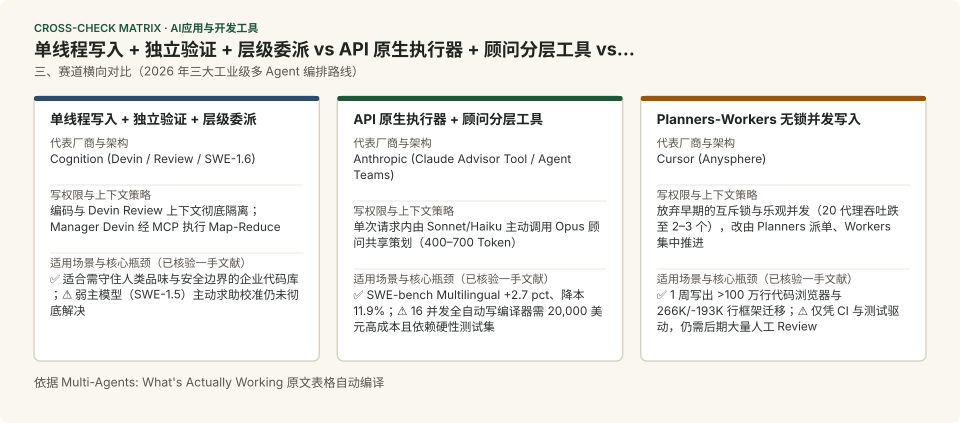

# Multi-Agents: What's Actually Working

2026-04-22 · Cognition · Anthropic · Cursor (Anysphere) · Chroma · 有来源缺口

[本地原件归档](../../../raw/bde0c64655f5407495829fc48be764e3ada630afce7124b54c1000a7cad10088) · 固定材料版本 `digest-material-bde0c64655f5407495829fc48be764e3ada630afce7124b54c1000a7cad10088@1` · [一手原站](https://cognition.com/blog/multi-agents-working)

## 深度拆解与复核

- 口径与利益：本文为 Cognition 联合创始人 Walden Yan 于 2026-04-22 在 [Cognition 官方博客](https://cognition.com/blog/multi-agents-working) 发表的阶段复盘（距前作 [《Don’t Build Multi-Agents》](Don%E2%80%99t%20Build%20Multi-Agents.md) 约 10 个月），旨在为 Devin、Devin Review、Windsurf 与自研 SWE 模型家族建立多代理工程架构信誉。本工作台穿透核验了文中 14 条关键外链中的 8 篇（8/14）一手原文，包括 Cognition [SWE-1.5](https://cognition.com/blog/swe-1-5) 与 [SWE-1.6](https://cognition.com/blog/swe-1-6) 发布稿、[Anthropic《The advisor strategy》（2026-04-09）](https://claude.com/resources/articles/the-advisor-strategy)、[Anthropic《Building a C compiler》（2026-02-05）](https://www.anthropic.com/research/building-c-compiler)、[Cursor《Scaling long-running autonomous coding》（2026-01-14）](https://cursor.com/blog/scaling-agents) 及 [Chroma《Context Rot》（2025-07-14）](https://www.trychroma.com/research/context-rot)，另有 [Cognition 企业档案](../entities/companies/Cognition.md) 与 [Conductor 导读](Meta收购Conductor：AI编程的下一场竞争，是让多个Agent一起干活.md) 提供商业化上下文。
- 核心判断：==2026 年生产级多 Agent 在工业界收敛为「单线程写入 + 多模型外挂智囊」结构（区别于无中心并发写代码的自由群落 unstructured swarms）：用干净短上下文的 Devin Review 对抗长程 Context Rot，用异构前沿模型（Claude + GPT）或逐步补齐自训练的 SWE-1.6 承担 Smart Friend 路由，并通过内部 MCP 让 Manager Devin 执行严格自上而下的 Map-Reduce 委派==。

### 一、业务切口与核心机制（从单代理到单线程写入多智囊）

1. 过去 10 个月（2025-06 至 2026-04）的供需转折：随着模型原生工具调用与自我上下文提炼能力成熟，大型保守企业客户在 Devin 上的使用量于过去 6 个月增长约 8x。这同时制造了「推力」（海量并发代理令管理、规划与 PR 审查成为人工瓶颈，催生 Devin 管理 Devin 与编码-审查自动循环）与「拉力」（随 Opus-class 与 Mythos 级更大模型推高单任务成本，团队迫切需要高低搭配降本）。文中同时点明：构建 Web 浏览器（200k LOC）、C 编译器（100k LOC）或 LLM 训练脚本优化（10k+ 次迭代）之所以适合大量并发，是因为它们具备单一可自动验证的成功标准，而真实商业软件必须规模化人类品味与一致性决策。
2. 模式一 · 隔离上下文的代码审查循环（The Code-Review-Loop）：
   - 实证结果：即使 PR 完全由 Devin 生成，Devin Review 平均仍能捕获每 PR 约 2 个缺陷，其中约 58% 属于逻辑错误、边界遗漏或安全漏洞等严重问题，并会在人类打开 PR 前自动与 Devin 往复修复多轮。
   - 关键工程反直觉：Devin 与 Devin Review 绝不能事先共享上下文。因为 Agent 没有自我保护偏见，相同基座模型在不同上下文下不会自证盲从；更重要的是依据 Chroma 的 Context Rot 机制，工作数小时后的编码代理已积累庞大且含噪的指令、试错命令与历史轨迹，有限的注意力头会丢失局部细节；而 Devin Review 仅从纯净的 Diff 倒推实现，甚至能反手质询用户原始指令中的不安全模式，同时由拥有全量用户意图的 Devin 充当「通信桥梁」过滤掉超范围或循环误报的建议。
3. 模式二 · 大小/异构模型协作「Smart Friend」：
   - 痛点背景：随着市场需求从 Sonnet-class 转向高成本的 Opus-class 乃至 Mythos 级模型，Windsurf 在 2025 年 10 月推出 950 tok/sec 的快速模型 SWE-1.5 并尝试配对 Sonnet 4.5 做规划；架构上由小/主模型自主决定何时向大模型工具「Smart Friend」求助。
   - 双向通信难点：弱主模型往往不知道自己已触及能力上限（解法包括强制首问评估、对合并冲突等高危场景设定硬性触发规则、直接 Fork 全部主上下文以 80/20 法则避免摘录失真，以及鼓励发问「我该怎么办」而非狭窄提问）；而 Smart Friend 回话必须拒绝凭空猜测缺失文件（如 `important_file.py`），改为明确指示主模型先读取该文件再复询，并允许「越界（over-scoped）」主动指出主模型未察觉的轨迹隐患。
   - 实测分化：SWE-1.5 与 Sonnet 4.5 能力差距过大导致质量天花板被弱主模型锁死；后继达到 SWE-bench 上 Opus-4.5 水平的 SWE-1.6（2026-04-07 发布）配合长度惩罚训练显著缩窄了该差距，但真正成熟落地的仍是「强强互补路由」——即生产环境中把 Claude 与 GPT 作为双前沿节点按调试、视觉推理、写测试等子任务专长互调。
4. 模式三 · 多 Devin 树状委派（Map-Reduce-and-Manage）：线上 Devin 已支持 Manager Devin 通过内部 MCP 拆分大任务（如跨 10 个 PR 的新功能、跨越十余服务的迁移）并派生 Child Devins 执行后汇总。工程难点在于受小范围委派训练的 Manager 默认倾向过度微观指挥（在缺少深层代码库上下文时反而失效），且模型默认误以为与子代理共享状态或自发上报发现，仍需针对性环境训练。

### 二、核心数据核查、口径纠偏与工程边界

- ✅ 外部定量印证（Anthropic Advisor Strategy 与 Chroma Context Rot）：本工作台核查 [Anthropic 2026-04-09 发布的 Advisor Tool 公告](https://claude.com/resources/articles/the-advisor-strategy)（对应原文脚注 [2]），其机制与 Cognition Smart Friend 高度同构（但 Anthropic 将其封装为单次 `/v1/messages` 请求内的服务端工具 `advisor_20260301`，Opus 仅返回 400–700 Token 建议且受 `max_uses` 限制）：实测 Sonnet + Opus 顾问在 SWE-bench Multilingual 上提升 2.7 个百分点且单任务成本降 11.9%，Haiku + Opus 顾问在 BrowseComp 上得分从 19.7% 翻倍至 41.2%、比单跑 Sonnet 成本低 85%（得分低 29%）。这侧面证实了 Cognition 关于「主模型够强时协作立刻兑现正收益，过弱主模型则受限于天花板」的判断。Chroma [Context Rot 报告（2025-07-14）](https://www.trychroma.com/research/context-rot) 评测 18 个主流模型（GPT-4.1、Claude 4、Gemini 2.5、Qwen3）亦证实非均匀长程退化存在。
- ✅ 大规模并发演示的数字口径核实：对照 [Cursor《Scaling agents》（2026-01-14）](https://cursor.com/blog/scaling-agents) 与 [Anthropic《Building a C compiler》（2026-02-05）](https://www.anthropic.com/research/building-c-compiler)，Cursor 从零构建 Web 浏览器在近 1 周内写入超 100 万行代码（1,000+ 文件，而 Cognition 文中简记为 200k LOC；Cursor 另提及同期 Windows 7 模拟器 1.2M LOC 与 Excel 1.6M LOC），Anthropic 16 个 Claude 实例在近 2,000 次会话、消耗 20,000 美元 API 费用下产出 100,000 行 Rust 版 C 编译器。Anthropic [2025-06-13 多代理研究报告](https://www.anthropic.com/research/multi-agent-research-system) 则披露 Opus 4 + Sonnet 4 只读研究组合较单代理性能高 90.2%，但 Token 消耗达普通对话的 15x。
- ⚠️ 量纲与样本口径缺口（58% 严重缺陷率无分母）：原文披露 Devin Review 平均每 PR 发现 2 个缺陷且约 58% 为严重问题，但未披露测试 PR 总量、代码仓库分布、多轮复查导致 PR 合并延迟上升幅度，也未给出 SWE-1.5 / SWE-1.6 与 Sonnet 4.5 / Opus-4.5 组队后的对比基准分数。
- 本工作台推断：Cognition 在 2026 年 4 月把「独立 Devins 嵌套委派 + 强强模型互调」跑通后，才得以在 2026 年 9–11 月进一步升级为 [Devin Fusion（任务成本 1.35 美元较高配模型降约 60%）与常驻式 Devin Bots](快速冲击%20750%20亿美元估值，Cognition凭什么？.md)；但原厂 Anthropic 已将 Smart Friend 直接产品化为 API 内置原语 `advisor_20260301`，纯应用层多模型路由若缺少企业代码库上下文与审阅门禁，长期议价空间将被基座模型商压缩。

### 三、赛道横向对比（2026 年三大工业级多 Agent 编排路线）

| 编排路线 | 代表厂商与架构 | 写权限与上下文策略 | 适用场景与核心瓶颈（已核验一手文献） |
| :--- | :--- | :--- | :--- |
| 单线程写入 + 独立验证 + 层级委派 | Cognition (Devin / Review / SWE-1.6) | 编码与 Devin Review 上下文彻底隔离；Manager Devin 经 MCP 执行 Map-Reduce | ✅ 适合需守住人类品味与安全边界的企业代码库；⚠️ 弱主模型（SWE-1.5）主动求助校准仍未彻底解决 |
| API 原生执行器 + 顾问分层工具 | Anthropic (Claude Advisor Tool / Agent Teams) | 单次请求内由 Sonnet/Haiku 主动调用 Opus 顾问共享策划（400–700 Token） | ✅ SWE-bench Multilingual +2.7 pct、降本 11.9%；⚠️ 16 并发全自动写编译器需 20,000 美元高成本且依赖硬性测试集 |
| Planners-Workers 无锁并发写入 | Cursor (Anysphere) | 放弃早期的互斥锁与乐观并发（20 代理吞吐跌至 2–3 个），改由 Planners 派单、Workers 集中推进 | ✅ 1 周写出 >100 万行代码浏览器与 266K/-193K 行框架迁移；⚠️ 仅凭 CI 与测试驱动，仍需后期大量人工 Review |

### 观点与可反驳条件

- ==观点==：多 Agent 工程在 2026 年的真实收敛点在于把「隔离上下文的验证循环（Devin Review）」与「单请求/MCP 内部的跨智囊升级（Smart Friend / Advisor）」做成低耦合协作层，同时将代码写入主干锁在单线程路径上；决定 Cognition 能否守住技术护城河的关键，在于其专有 SWE 模型能否通过强化学习学会精确校准求助时机并维持低延迟高并发。
- ==推翻条件==：
  1. 截至 2027-06-30，若独立评测显示 Anthropic 原生 `advisor` 工具或 OpenAI 同类内置分级路由在 Windsurf / 企业真实仓库上的任务通过率与成本效率持平或反超 Cognition Devin Fusion（当前基准成本每任务 1.35 美元），且 SWE-1.x 系列在 SWE-Bench Pro 上未拉开代差，则 Cognition 自建多模型路由层的护城河将被证伪。
  2. 截至 2027-06-30，若 Cursor Planners-Workers 或无中心代理群落在真实生产企业多 PR 交付中的人工返工率降到与单线程 Manager-Devin 持平（返工/回滚率差异 < 5 个百分点）且平均交付周期缩短 >= 40%，则「必须维持单线程写入主干」的架构约束将被推翻。

---

## 原文摘录与一手信源存证

> Even when we look at Devin usage in our largest enterprises segment, the segment that has traditionally been cautious toward adopting new technologies, we see an explosion over the last 6 months (~8x).
> — 原文摘录，文字段落 1；证据 `digest-material-bde0c64655f5407495829fc48be764e3ada630afce7124b54c1000a7cad10088-excerpt-1@4`

> The practical shape is map-reduce-and-manage: a manager splits work, children execute, the manager synthesizes and reports back.
> — 原文摘录，文字段落 2；证据 `digest-material-bde0c64655f5407495829fc48be764e3ada630afce7124b54c1000a7cad10088-excerpt-2@4`

一手材料：

- Multi-Agents: What's Actually Working · Cognition · [原站](https://cognition.com/blog/multi-agents-working) · [主体档案：Cognition](../entities/companies/Cognition.md) · [本地原件](../../../raw/bde0c64655f5407495829fc48be764e3ada630afce7124b54c1000a7cad10088)
  材料版本 `digest-material-bde0c64655f5407495829fc48be764e3ada630afce7124b54c1000a7cad10088@2`；获取方式 `http_full_text`。
  > Even when we look at Devin usage in our largest enterprises segment, the segment that has traditionally been cautious toward adopting new technologies, we see an explosion over the last 6 months (~8x). — 原文提取
  > The practical shape is map-reduce-and-manage: a manager splits work, children execute, the manager synthesizes and reports back. — 原文提取
- Introducing SWE-1.5: Our Fast Agent Model · Cognition · [原站](https://cognition.com/blog/swe-1-5) · [主体档案：Cognition](../entities/companies/Cognition.md) · [本地原件](../../../raw/21ee82e005297a5a97fa3d541c7eb598e94f5619e28d8b57ebff415093205d66)
  材料版本 `digest-material-21ee82e005297a5a97fa3d541c7eb598e94f5619e28d8b57ebff415093205d66@1`；获取方式 `http_full_text`。
  > Today we’re releasing SWE-1.5, the latest in our family of models optimized for software engineering. It is a frontier-size model with hundreds of billions of parameters that achieves near-SOTA coding performance. — 原文提取
  > Developers shouldn’t have to choose between an AI that thinks fast and one that thinks well. Yet, this has been a seemingly inescapable tradeoff in AI coding so far. — 原文提取
- Introducing SWE 1.6: Improving Model UX · Cognition · [原站](https://cognition.com/blog/swe-1-6) · [主体档案：Cognition](../entities/companies/Cognition.md) · [本地原件](../../../raw/d0e6181e634566dd006890f40c42d05b2f421af3b8a2b463a34b1ec321249241)
  材料版本 `digest-material-d0e6181e634566dd006890f40c42d05b2f421af3b8a2b463a34b1ec321249241@1`；获取方式 `http_full_text`。
  > We’re releasing SWE-1.6, our latest model built for software engineering agents, and we’re making it generally available in Windsurf. SWE-1.6 is optimized for both intelligence and model UX. — 原文提取
  > Last month, we released SWE-1.6 Preview, which improved on SWE-Bench Pro by more than 10% compared to our previous model SWE-1.5 while being post-trained on the same pre-trained model. — 原文提取
- The advisor strategy: Give Sonnet an intelligence boost with Opus · Anthropic · [原站](https://claude.com/resources/articles/the-advisor-strategy) · [主体档案：Anthropic](../entities/companies/Anthropic.md) · [本地原件](../../../raw/7e87583aebf7714fc66d9c78bfaa9558a4f702db4ffbd3b6a738a7259ee7a33c)
  材料版本 `digest-material-7e87583aebf7714fc66d9c78bfaa9558a4f702db4ffbd3b6a738a7259ee7a33c@1`；获取方式 `http_full_text`。
  > Developers who want to better balance intelligence and cost have converged on what we call the advisor strategy: pair Opus as an advisor with Sonnet or Haiku as an executor. — 原文提取
  > Today we're introducing the advisor tool on the Claude Platform to make the advisor strategy a one-line change in your API call. — 原文提取
- How we built our multi-agent research system · Anthropic · [原站](https://www.anthropic.com/research/multi-agent-research-system) · [主体档案：Anthropic](../entities/companies/Anthropic.md) · [本地原件](../../../raw/be756d9654beaabb97b69c15843554b98f8027fd30463966a045bcc4bddbf8c6)
  材料版本 `digest-material-be756d9654beaabb97b69c15843554b98f8027fd30463966a045bcc4bddbf8c6@1`；获取方式 `http_full_text`。
  > Claude now has Research capabilities that allow it to search across the web, Google Workspace, and any integrations to accomplish complex tasks. — 原文提取
  > The journey of this multi-agent system from prototype to production taught us critical lessons about system architecture, tool design, and prompt engineering. — 原文提取
- Building a C compiler with parallel Claudes · Anthropic · [原站](https://www.anthropic.com/research/building-c-compiler) · [主体档案：Anthropic](../entities/companies/Anthropic.md) · [本地原件](../../../raw/59af8159bdadc015258d09707aada20926198bb94bc3bd1d2102b780232ee1d0)
  材料版本 `digest-material-59af8159bdadc015258d09707aada20926198bb94bc3bd1d2102b780232ee1d0@1`；获取方式 `http_full_text`。
  > Written by Nicholas Carlini, a researcher on our Safeguards team. — 原文提取
  > I've been experimenting with a new approach to supervising language models that we’re calling "agent teams." — 原文提取
- Scaling long-running autonomous coding · Cursor (Anysphere) · [原站](https://cursor.com/blog/scaling-agents) · [主体档案：Cursor (Anysphere)](../entities/companies/Cursor%20%28Anysphere%29.md) · [本地原件](../../../raw/f55e28edf5d1a58707afe88260357d6066c6faae6b6a80e540e5c1f1987621b3)
  材料版本 `digest-material-f55e28edf5d1a58707afe88260357d6066c6faae6b6a80e540e5c1f1987621b3@1`；获取方式 `http_full_text`。
  > We've been experimenting with running coding agents autonomously for weeks. — 原文提取
  > Our goal is to understand how far we can push the frontier of agentic coding for projects that typically take human teams months to complete. — 原文提取
- Context Rot: How Increasing Input Tokens Impacts LLM Performance · Chroma · [原站](https://www.trychroma.com/research/context-rot) · [主体档案：Chroma](../entities/companies/Chroma.md) · [本地原件](../../../raw/3850154fc226d9a7aa0067b842af75776d72e2652f0f041850ab14b327072d7a)
  材料版本 `digest-material-3850154fc226d9a7aa0067b842af75776d72e2652f0f041850ab14b327072d7a@1`；获取方式 `http_full_text`。
  > Recent developments in LLMs show a trend toward longer context windows, with the input token count of the latest models reaching the millions. — 原文提取
  > However, NIAH is fundamentally a simple retrieval task, in which a known sentence (the “needle”) is placed in a long document of unrelated text (the “haystack”), and the model is prompted to retrieve it. — 原文提取

归属与范围：已采集 Cognition 官方工程博客原件（2026-04-22，Walden Yan），并穿透核验文中引用的 7 篇关键一级技术文献（Cognition SWE-1.5 / SWE-1.6、Anthropic The Advisor Strategy / Multi-Agent Research System / Building a C Compiler、Cursor Scaling Agents、Chroma Context Rot，连同原文共 8/14 条技术引用完成正文取证）；Devin Review 抽样 PR 分母与 Smart Friend 内部对照得分未公开，已登记 not\_disclosed 缺口。

来源缺口：

- `not_disclosed`：Cognition 未披露 Devin Review「平均每个 PR 检出 2 个缺陷且约 58% 为严重缺陷」背后的 PR 抽样总量（分母）、仓库覆盖分布及多轮生成器-验证器对抗循环增加的单任务耗时与推理成本；亦未披露 SWE-1.5 / SWE-1.6 与 Sonnet 4.5 / Opus-4.5 搭配 Smart Friend 时的具体基准得分差值。 [线索](https://cognition.com/blog/multi-agents-working)
- `unavailable`：文中引用的 Anthropic 245 页《Claude Mythos Preview System Card》（2026-04-07）因 PDF 体积较大未做全篇逐页解析，文中涉及 Mythos 级模型成本上升趋势的论述按两家公司官方公告摘要核对。 [线索](https://www-cdn.anthropic.com/08ab9158070959f88f296514c21b7facce6f52bc.pdf)

[返回赛道总览](../赛道总览.md#digest-bde0c64655f54074) · [返回导读索引](README.md) · [主体档案库](../entities/README.md)
