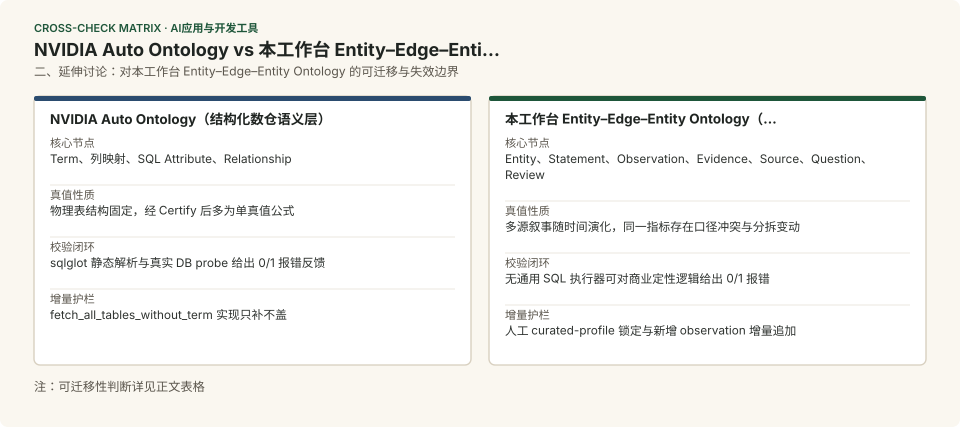

# NVIDIA Auto Ontology 是什麼？拆解 Text-to-SQL Agent 的程式與 LLM 邊界

2026-11-13 · NVIDIA (auto-ontology & auto-ontology-eval) · 有来源缺口

[本地原件归档](../../../raw/d57023a0925229bc822eb457ffb5a57eb21cc4549877118e7127ea7b5c5d31f4) · 固定材料版本 `digest-material-d57023a0925229bc822eb457ffb5a57eb21cc4549877118e7127ea7b5c5d31f4@1` · [一手原站](https://github.com/NVIDIA/auto-ontology) · [触发线索（微信公众号）](https://warmwater.dev/blog/nvidia-auto-ontology-system-design)

> [!IMPORTANT]
> 用户关注点（TG）：先收录，再用收录的内容延伸entity ontology讨论

## 针对性追查与回应

- 口径与利益：本拆解经一手穿透核查上游开源仓库 [NVIDIA/auto-ontology（v1.3.0）](https://github.com/NVIDIA/auto-ontology) 与评测配套库 [NVIDIA/auto-ontology-eval](https://github.com/NVIDIA/auto-ontology-eval)，将第三方博客 [warmwater.dev 架构拆解（2026-11-13）](https://warmwater.dev/blog/nvidia-auto-ontology-system-design) 降级为触发线索，并关联 [NVIDIA 档案](../entities/companies/NVIDIA.md)；核心结论在于将语义归纳、图路径计算、目录校验与有限重试拆分进确定性 Harness 骨架，把 LLM 压缩为受 Pydantic 结构化输出约束的提案器与修正器。NVIDIA 以 Apache-2.0 开源该语义层并将默认模型端点指向 [NVIDIA NIM](https://integrate.api.nvidia.com/v1)（build.nvidia.com 与 nvapi- 密钥体系），商业激励在于用企业级语义层标准锚定 Text-to-SQL Agent 工作流以拉动推理算力与软件栈消费。

### 一、技术架构拆解与程序/LLM 边界（含一手仓库对照核查）

`NVIDIA Auto Ontology` 面向企业关系型数据库交付可信的 Text-to-SQL 能力，内部围绕 `Generate`、`Certify`、`Answer` 三段生命周期展开，核心元件全部落于 `Prompt`、`Context` 与 `Harness` 三层而无任何微调或训练代码：

1. Semantic Compiler 与「只补不盖」编译律：`Catalog Ingest` 抽取表结构、抽样字段值并解析查询历史，`Semantic Compiler` 分四阶段在 `Postgres` 与 `pgvector` 唯一存储中构建三类本体定义——`Term`（业务概念如 `Customer`、`Invoice Line` 及其同义词与字段映射）、`SQL Attribute`（挂载在 `Term` 下且经人工审核的一致性指标表达式如 `margin`、`rolling total`）、`Relationship`（表间显式外键、隐式 FK 候选与 `bridge table` 路径）。
   - ✅ 本工作台核查（核心机制与增量口径确认）：拉取上游 [NVIDIA/auto-ontology](https://github.com/NVIDIA/auto-ontology) 源码确认，`semantic_scheduler.py` 在服务启动后每 24 小时从上一轮结束起重新调度编译；`semantic/pipeline.py` 确凿调用 `fetch_all_tables_without_term`，仅对尚无 `Term` 的表执行生成，确保专家 `Certify` 修正后的定义不被周期编译覆盖；`README` 演示的 Wide World Importers 示例对「2015 年 6 月 Pennsylvania 州 USB 寿司卷闪存盘收入」返回 $588.80（来自 3 条发票明细），且可通过 `Apache Ossie` YAML 导入导出跨系统迁移；对外通过 `MCP` 暴露 `check_answerable`（例如检测到无 `ad spend` 词条时返回 `coverage = 1/2` 并拒答）与 `ask_question`，并支持 `REST` API 与 Web UI。
2. 三层工程化约束（Prompt / Context / Harness）：
   - `Prompt Engineering`：全链路使用 `Pydantic` structured output，撰写 `SQL` 强制遵循 `thought -> sql_code -> response` 顺序先暴露 `NULL`、除以零与同分排序假设；程式确认的 join 路径直接切换精简 prompt 不让模型重判；真实库查得的拼写值（如 `Pennsylvania` vs `PA`）以 `value anchors` 观察事实写入而非建议。
   - `Context Engineering`：离线将 `Term`、`SQL Attribute` 与 `Relationship` 编入 `pgvector`，在线按单题意图检索并拼接最短 join 路径与范例；修正阶段将过往所有错误 `SQL` 压缩为单条失败清单，避免重复膨胀 schema 上下文。
   - `Harness Engineering`：`SQL Guardrails` 将确定性验证排在模型判断前，且在 `DB probe` 验证字面值、join 路径与 `JSONB` key 成立后再执行最终查询。
   - ⚠️ 本工作台核查（口径与版本演进差异）：`warmwater.dev` 详述的早期架构采用 `Text-to-SQL Graph`（`LangGraph` 状态机）与禁用原生 tool calling 的受控循环——由程式按 `find_join_path` 算最短路径、非声明 FK 由 LLM 从前 5 个候选中择一或弃权，验证分硬检查（`sqlglot` 静态解析与 `SELECT NULL`、`WHERE 1=0` 等退化检测、意图验证、执行）与软检查（`DB probe` 与空结果或整栏 `NULL` 排查，涉及移除多余 `LIKE` 条件），设定 `MAX_RECONSTRUCTION_ATTEMPTS` 上限 7 次、软检查超过 5 次后放行、首轮失败清空状态重跑 1 次，并记录编译期因「表数 × 扇出」触发模型网关 HTTP 503 错误以及注释「Measured against the live endpoint」。但本工作台核对上游最新 `main` 分支（v1.3.0）发现，README 与 `react/agent.py` 已演进为单推理模型驱动的受控 ReAct 循环（工具集为 `retrieve`、`run_sql`、`submit` 及可选的 Kumo RFM `predict`，除 `predict` 外其余工具均不调用语言模型）；`db_probe/config.py` 明确限制单次执行 `DB_PROBE_MAX_CALLS` 为 40 次、`DB_PROBE_MAX_ROWS` 为 50 行；`connectors/` 目录当前包含 9 个独立引擎模块（`Postgres`、`Snowflake`、`Databricks`、`DuckDB`、`ClickHouse`、`MySQL`、`SQLite`、`HeavyDB`、`Kyuubi`），与原文所称 10 种 engine 存在 1 个口径差异；此外 `NVIDIA/auto-ontology-eval`（基于 `NeMo Gym` 对照 `schema_only_sql` 与 `auto_ontology_sql` 执行准确率，覆盖 BIRD 1,534 Dev / 500 Mini-Dev、BEAVER 100 题样本、FDABench-Lite 169 题、Wide World Importers 41 题与 BIRD-Interact 300 Lite / 600 Full）虽在 README 展示 BEAVER 第 1、BIRD-Interact 第 2 徽章，但未公布对照组与实验组的具体绝对得分差值。

### 二、延伸讨论：对本工作台 Entity–Edge–Entity Ontology 的可迁移与失效边界

本工作台推断，若将 `NVIDIA Auto Ontology` 的经验直接照搬进投研 `Entity–Edge–Entity` 知识图谱，一半会立竿见影降噪，另一半则会因对象物理属性不同而彻底失效。两者结构对照如下：

| 维度 | NVIDIA Auto Ontology（结构化数仓语义层） | 本工作台 Entity–Edge–Entity Ontology（投研知识图谱） | 可迁移性判断 |
| --- | --- | --- | --- |
| 核心节点 | Term、列映射、SQL Attribute、Relationship | Entity、Statement、Observation、Evidence、Source、Question、Review | 概念层可对齐，但投研需保留证据与观点节点 |
| 真值性质 | 物理表结构固定，经 Certify 后多为单真值公式 | 多源叙事随时间演化，同一指标存在口径冲突与分拆变动 | 单真值 Certify 不可直接照搬至投研判断 |
| 校验闭环 | sqlglot 静态解析与真实 DB probe 给出 0/1 报错反馈 | 无通用 SQL 执行器可对商业定性逻辑给出 0/1 报错 | 7 次重试闭环失效，必须严把信源准入与门控 |
| 增量护栏 | fetch_all_tables_without_term 实现只补不盖 | 人工 curated-profile 锁定与新增 observation 增量追加 | 高度可迁移，保护人类认知锚点不被自动任务冲刷 |

具体而言，三条工程边界值得立即沿用，两条前提则绝不能误用：

1. 可迁移一（只补不盖的分层认证律）：本工作台已有 `entity` 主体归并准则（母体统一聚合并禁止按子站拆壳）与 `curated-profile` 人工核心结论，应严格对齐 `fetch_all_tables_without_term` 机制——自动化巡检只能向主体追加新的 `observation`、`statement` 与未建档候选关系，绝不可覆盖人工 `Certify` 锁定的实体边界、组织架构或核心推论。
2. 可迁移二（确定性图路径优先与 Value Anchor 锚定）：凡能从图谱既定边（如 `entity -> affiliation -> lab -> official_account -> material -> evidence`）算出的实体归属与时间线，应先由确定性 SQL/图检索锁定，再以不可改写的 `Value Anchor`（原文核查数值、日期、主链接）形式喂给 LLM，只把「跨实体隐含因果与口径冲突辨析」留给模型判断。
3. 可迁移三（前置拒答门控与对照组评测）：借鉴 `check_answerable` 概念覆盖度门槛与 `auto-ontology-eval` 对照实验（`schema_only_sql` vs `auto_ontology_sql`），当投研图谱缺少一手 `evidence` 或存在未闭合 `gaps` 时应直接阻断强行合成结论，并用同一批历史研究问题对比「纯原文检索」与「挂载 Entity Ontology」的事实准确率及幻觉率。
4. 不可迁移（单真值假设与执行器自愈环）：✅ 本工作台核查，关系型数据库的外键与列名可在真实库中被 `run_sql` 与 `DB probe` 低成本试错，即使错 5 次也能靠空结果或语法报错拉回；但投研文本推论没有客观数据库执行器返回错误码，若在无确定性验算的语料图谱中套用多轮重试修正，只会把大模型幻觉包装得更自洽。投研图谱必须坚持「数据层（客观实体/财报/论文）确定性 Certify + 视角层（`lens`/争议）保留 `question` 与 `supersedes` 时间边」的双层隔离设计，而不是强求全图统一口径。

### 观点与可反驳条件

- 观点：企业级 Agent 语义层的核心壁垒不在于「自动提取有多炫」，而在于「只补不盖的人机边界、前置确定性校验与明确拒答出口」；面向投研场景设计 Entity–Edge–Entity Ontology 时，应全面吸收其确定性路径收束与增量认证保护，同时拒绝把非结构化投研多口径争议压缩进单真值 SQL Attribute 范式或依赖多次生成-报错重试闭环。
- 推翻条件：
  1. 若未来 12 个月内基础模型在 BIRD-Interact 或 BEAVER 全集上仅凭无外置语义层的 `schema_only_sql` 即可稳定追平 `auto_ontology_sql`，且多表口径误判率降至 2% 以下，则独立 Ontology 编译层的工程价值将被大幅削弱。
  2. 若 `NVIDIA/auto-ontology` 后续版本取消人工 `Certify` 的只补不盖约束、全面转向周期性全自动覆写 `Term` 与指标定义，且线上企业客户未出现明显口径回归事故，则「人类认证边界不可或缺」的判断可被证伪。
  3. 若投研领域出现可对财务勾稽、供应链实物守恒与多文档时间线进行统一确定性符号验算的执行器，使定性投研推论也能获得类似 `sqlglot` 与 `DB probe` 的即时 0/1 报错反馈，则「投研本体不能依赖生成-报错-重试闭环」的边界论断需修正。

---

## 原文摘录与一手信源存证

> 本文目錄這個系列如何閱讀？Auto Ontology 解決什麼問題？Auto Ontology 的架構由哪些部分組成？哪些決策交給程式，哪些交給 LLM？這條邊界為什麼需要 domain knowledge？Prompt、Context、Harness 各自如何實作？Prompt Engineering Context Engineering Harness Engineering哪些做法可以沿用到其他領域？
> — 原文摘录，文字段落 1；证据 `digest-material-d57023a0925229bc822eb457ffb5a57eb21cc4549877118e7127ea7b5c5d31f4-excerpt-1@1`

> 假設題目是這樣：設計一個系統，讓 agent 回答企業資料庫的問題。資料散在幾十張命名混亂的表裡，答案必須可信，無法回答時必須明確說明。
> — 原文摘录，文字段落 2；证据 `digest-material-d57023a0925229bc822eb457ffb5a57eb21cc4549877118e7127ea7b5c5d31f4-excerpt-2@1`

一手材料：

- NVIDIA/auto-ontology: Open-Source Enterprise Semantic Layer & Ontology-Grounded Text-to-SQL Framework · NVIDIA · [原站](https://github.com/NVIDIA/auto-ontology) · [主体档案：NVIDIA](../entities/companies/NVIDIA.md) · [本地原件](../../../raw/321fc0eb09d343a1319d67e96f8da96938279de32b1de7e4b4f50eaf1339142e)
  材料版本 `digest-material-321fc0eb09d343a1319d67e96f8da96938279de32b1de7e4b4f50eaf1339142e@1`；获取方式 `http_full_text`。
  > Agents can retrieve documents and query databases, but reliability gates agentic analytics: a revenue metric answered faster is worth nothing if the number is wrong. — 原文提取
  > generate enterprise ontologies from metadata; connect existing ontologies and semantic models; build AI-ready knowledge graphs. — 原文提取
- NVIDIA/auto-ontology-eval: Deterministic Text-to-SQL Ontology Evaluation Harness · NVIDIA · [原站](https://github.com/NVIDIA/auto-ontology-eval) · [主体档案：NVIDIA](../entities/companies/NVIDIA.md) · [本地原件](../../../raw/3cc59e2a68cd484573a410060a17b9364997859e3e6aab3069528c6e1f853d9d)
  材料版本 `digest-material-3cc59e2a68cd484573a410060a17b9364997859e3e6aab3069528c6e1f853d9d@1`；获取方式 `http_full_text`。
  > the ones it broke, so you can see where the difference comes from. — 原文提取
  > a difference measured with them covers those inputs as well as the ontology. — 原文提取

归属与范围：已完成一手信源穿透：将触发线索 warmwater.dev（2026-11-13 技术博客拆解）降级为 trigger\_source，穿透定位至上游官方仓库 NVIDIA/auto-ontology（Apache-2.0，v1.3.0）及配套评测库 NVIDIA/auto-ontology-eval（NeMo Gym 对照基准）。实体统一归口至母体 NVIDIA（GitHub 与官网入口），不拆分子项目壳。核查发现上游主干已由早期 LangGraph 状态机演进为 ReAct 工具循环（retrieve / run\_sql / submit / predict），并与本工作台 Entity–Edge–Entity 本体设计完成可迁移边界对照；BEAVER/BIRD-Interact 具体得分差值及历史分支常量保留来源缺口。

来源缺口：

- `not_disclosed`：NVIDIA/auto-ontology 官方 README 展示 BEAVER #1 与 BIRD-Interact #2 榜单徽章，但 README 与 auto-ontology-eval 说明均未直接披露对照 schema\_only\_sql 与 auto\_ontology\_sql 的具体绝对得分差值。 [线索](https://github.com/NVIDIA/auto-ontology-eval)
- `unavailable`：触发文章拆解的 LangGraph 常量（MAX\_RECONSTRUCTION\_ATTEMPTS = 7、软检查 5 次放行）未在本次拉取的 v1.3.0 主 README 与 react/agent.py 首屏复现，且外部榜单实时页与 docs/architecture.md 完整图谱细节未完整抓回，保留演进版本对照缺口。 [线索](https://github.com/NVIDIA/auto-ontology/blob/main/docs/architecture.md)
- `unverified_claim`：实体关系入库跳过 (Auto Ontology --uses\_artifact--\> BEAVER)：谓词 'uses\_artifact' 不允许 to 实体类型 'concept'（仅允许 \['product'\]）
- `unverified_claim`：实体关系入库跳过 (Auto Ontology --uses\_artifact--\> BIRD-Interact)：谓词 'uses\_artifact' 不允许 to 实体类型 'concept'（仅允许 \['product'\]）
- `unverified_claim`：实体关系入库跳过 (Auto Ontology --partners\_with--\> Snowflake)：谓词 'partners\_with' 不允许 from 实体类型 'product'（仅允许 \['company', 'organization', 'business', 'person'\]）
- `unverified_claim`：实体关系入库跳过 (Auto Ontology --partners\_with--\> Databricks)：谓词 'partners\_with' 不允许 from 实体类型 'product'（仅允许 \['company', 'organization', 'business', 'person'\]）

[返回赛道总览](../赛道总览.md#digest-d57023a0925229bc) · [返回导读索引](README.md) · [主体档案库](../entities/README.md)
