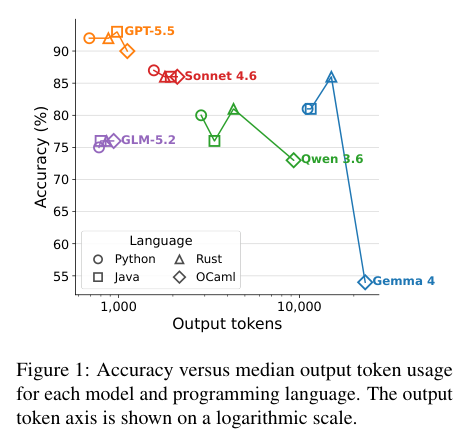
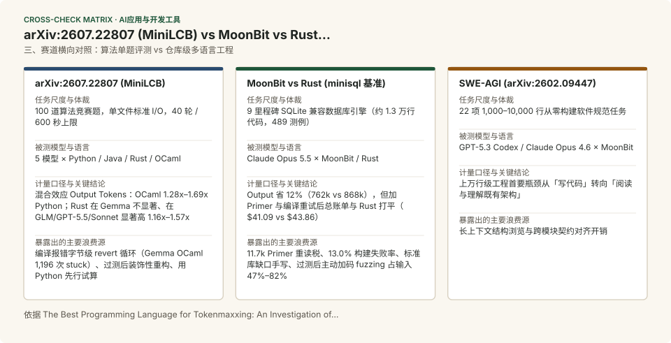

# The Best Programming Language for Tokenmaxxing: An Investigation of Coding Agent Behavior Across Programming Languages (arXiv:2607.22807)

2026-11-27 · arXiv:2607.22807 · Northeastern University & Wellesley College (Wu, Anderson, Guha) · 有来源缺口

[本地原件归档](../../../raw/c0731531fed378322a6a2aed89b0594ec29d6cbf834bb0468b3904ca2e37bd65) · 固定材料版本 `digest-material-c0731531fed378322a6a2aed89b0594ec29d6cbf834bb0468b3904ca2e37bd65@1` · [一手原站](https://arxiv.org/abs/2607.22807)

## 深度拆解与复核

- 口径与利益：本文为东北大学（Northeastern University：Zixuan Wu、Arjun Guha）与韦尔斯利学院（Wellesley College：Carolyn Jane Anderson）联合发表的实证研究论文《The Best Programming Language for Tokenmaxxing: An Investigation of Coding Agent Behavior Across Programming Languages》（arXiv:2607.22807，v1 提交于 2026-07-24、v2 修订于 2026-10-21）。作者无特定语言商业推广利益，但需锁定两项实验边界：第一，采用单一轻量脚手架 `mini-swe-agent` 与 100 道竞赛算法题（MiniLCB，单文件或小目录、可见全量单测），不等同于十万行级多文件工程仓库；第二，成本口径仅计量 Output Tokens（含闭源模型的隐藏推理 Token，不统计启用 Prefix Caching 后的 Input Tokens 账单）。

### 一、实验设计与跨语言 Output Token 惩罚全表

论文从 LiveCodeBench v6 共 880 题中筛出 499 道语言无关（标准 I/O 评测）题目并随机抽样 100 题构成 MiniLCB（每题 2–45 个测试用例，中位数 22 个，单用例超时 10 秒），在 Ubuntu 24.04（256MB 内存上限、最多 40 轮与 600 秒）容器内测试 5 个开启推理的模型 × 4 种编程语言，共收集 2,000 条 Agent 轨迹；按 2026 年 7 月 API 标准费率，400 题/模型复现开销约为 GPT-5.5 \$100、Sonnet \$150、GLM \$25，本地 H100 运行 Gemma 约 28 GPU 小时、Qwen 约 19 GPU 小时。

| 语言 | 版本 | 预装扩展包 | 编译命令 | 运行命令 | The Stack v2 去重语料参考 |
| :--- | :--- | :--- | :--- | :--- | :--- |
| Python | 3.12.3 | numpy, pandas, scipy, sympy | — | `python3 solution.py` | 约 200 GB |
| Java (OpenJDK) | 21.0.11 | — | `javac Solution.java` | `java Solution` | 约 200 GB |
| Rust | 1.96 | — | `cargo build --release` | `./target/release/solution` | 约 12 GB |
| OCaml | 5.4.1 | core, base, zarith | `dune build ./solution.exe` | `dune exec ./solution.exe` | 远低于 12 GB |

为剥离题目本身难度带来的方差（混合效应模型组内相关系数 ICC 高达 0.73–0.97，证明题目难度解释了绝大多数绝对 Token 波动），作者以 Python 为基准（1.00x）拟合混合效应模型（Table 2 & Table 7），并拆解首次通过全部测试前后的中位输出消耗（Table 3 & Table 8）：

| 模型（推理配置与来源） | Java vs Python (95% CI / p) | Rust vs Python (95% CI / p) | OCaml vs Python (95% CI / p) | ICC | Python 过测前/后 Tokens (Turns) | OCaml 过测前/后 Tokens (Turns) |
| :--- | :--- | :--- | :--- | :--- | :--- | :--- |
| Gemma-4-26B-A4B（本地 vLLM / 6K 推理预算） | 0.85x [0.70, 1.04], p=0.114 | 1.07x [0.88, 1.31], p=0.480 | 1.44x [1.18, 1.75], p<0.001 | 0.80 | 1,820 (1) / 3,628 (3) | 2,495 (2) / 3,356 (3) |
| Qwen3.6-35B-A3B（本地 vLLM FP8 / 6K 预算） | 1.21x [1.03, 1.42], p<0.05 | 1.20x [1.02, 1.41], p<0.05 | 1.69x [1.44, 1.98], p<0.001 | 0.89 | 1,756 (1) / 294 (3) | 3,330 (6) / 405 (5) |
| GLM-5.2（HF API / high-effort, 11K 上限） | 1.34x [1.09, 1.65], p<0.01 | 1.57x [1.28, 1.93], p<0.001 | 1.54x [1.25, 1.88], p<0.001 | 0.73 | 758 (1) / 117 (2) | 1,374 (3) / 109 (2) |
| GPT-5.5（medium reasoning） | 1.30x, p<0.001 | 1.36x, p<0.001 | 1.30x, p<0.001 | 0.94 | 601 (2) / 42 (1) | 910 (2) / 44 (1) |
| Claude-Sonnet-4.6（10K 推理预算） | 1.18x, p<0.001 | 1.16x, p<0.001 | 1.28x, p<0.001 | 0.97 | 878 (2) / 103 (1) | 1,484 (2) / 136 (1) |

### 二、Token 耗散去向与工程边界核查

论文通过离线重跑每一个中间代码快照得到测试演化状态机（`breakthrough` / `stay` / `improved` / `regressed` / `churn` / `broke` / `stuck`），并用 GPT-5-Mini 按 12 类语义动作标注快照间增量，揭示了五项高频损耗机制：

1. 编译语法拉锯而非算法卡壳（Table 4/5）：Gemma 在 OCaml 上出现 1,196 次 `stuck` 自循环，其中 92% 的失败快照源于编译报错、仅 8% 源于逻辑错误答案；`stuck` 循环中 31% 为 `revert`（在 2–3 个报错版本间字节级来回重写），而从 `stuck` 跳出至 `breakthrough` 的动作 60% 为 `fix bug`（一旦模型准确说出 OCaml 具体类型报错，原封不动的算法即刻全部通过）。在开源模型里，OCaml 上错误恢复动作合计占主导——Qwen 在 OCaml 中 `fix bug` 占 37%、`debug failure` 占 8%、`infra confusion` 占 12%（Python 分别为 14%、4%、0%）；Gemma 在 OCaml 中 `fix bug` 16%、`debug failure` 15%、`infra confusion` 5%、`revert` 23%；甚至 GPT-5.5 在 OCaml 亦有 11% `infra confusion` 与 7% `fix bug`（Python 仅 1% 与 2%）。
2. 过测后过度打磨与「性能焦虑」（Table 3/6/8）：Gemma 在 Python 通过首个全过解（1,820 tokens / 1 轮）后，又额外消耗 3,628 tokens（3 轮）做无效修饰，在 Rust 上更是在 2,026 tokens 过测后额外消耗 7,312 tokens（3 轮）；Gemma Python 进入 `stay`（205 次自循环）的动作中，56% 为 `cosmetic refactor`（34%）与 `optimize perf`（22%）。相对地，GPT-5.5 与 Sonnet 在通过测试后仅消耗 42–44 及 95–136 tokens 提交，未出现大规模过测后空转。
3. 用 Python 当作外部演算草稿纸（Appendix D）：面对不熟悉的静态类型语言，前沿模型主动绕过目标语言先行验证不变量——GPT-5.5 在 OCaml 27%、Rust 19%、Java 18% 的题目中通过 `python3 -c` 或 heredoc 跑暴力脚本验证；Sonnet 在 `arc194_e` 上先用 Python 花 23 轮探索不变量，再一次性写出通过全部 32 个测试的 OCaml 代码；GLM 在 `arc194_e` 的 Rust 任务中也先用 Python 花 11 轮校验数学不变量。
4. 注释内规划与不信任可见测试：Qwen 在 `arc194_a` 中写出 35 行 Java 代码却附带 3,439 行注释推演；Gemma 与 Qwen 超过 70% 进入 `stay` 的改写未运行 `./test.sh`，而是自行构造样例反复复核。此外，Gemma 与 Qwen 每轮平均出现 7.70 与 7.72 次 `wait`/`actually` 等自我质疑词（GLM 为 4.27 次）。

- ✅ 本工作台核查（时间线与核心数据复核）：论文引言引用英伟达 CEO 黄仁勋（Jensen Huang）2026 年在 All-In Podcast 的言论（若年薪 \$500,000 工程师一年未消耗至少 \$250,000 Token 将令人警觉，仅消耗 \$5,000 将暴怒）作为「tokenmaxxing」反讽背景；本文真实最早挂网为 2026-07-24（v1），并非 2026-11-27。Table 2/3 与 Table 7/8 完整覆盖 5 个模型、ICC 0.73–0.97 与全部 95% 置信区间。
- ⚠️ 本工作台核查（对「只计 Output Tokens」与库内 MoonBit 基准的口径纠偏）：对比本工作台已入库的 [沈向洋第六届 IDEA 大会与 MoonBit vs Rust minisql 基准导读](%E6%B2%88%E5%90%91%E6%B4%8B%E5%88%9A%E8%AE%B2%E4%BA%86%E5%A5%BD%E5%A4%9AAI%E9%9D%9E%E5%85%B1%E8%AF%86%E5%95%8A.md) 可见一处关键方法论差异。arXiv:2607.22807 在 Appendix E 明确只计量 Output Tokens，理由是存在 Prefix Caching 时 Input Tokens 更便宜；但 `minisql` 在多轮长程工程（9 里程碑、489 测例）中实证显示，低资源语言不仅增加 13.0% 编译失败重试，还需外挂 11.7k Token Primer（Rust 仅 2.9k），使单轮重读的 Cached Input Tokens 高出 9%（2,359 万 vs 2,172 万），直接抹平语法简短省下的 12% Output 优势（总 API 成本 MoonBit/Rust 均值 0.94x、中位数 1.12x）。==在长上下文多文件工程下，只看 Output Tokens 倍率会系统性低估低资源语言的真实缓存重读税与构建脚手架摩擦==。

### 三、赛道横向对照：算法单题评测 vs 仓库级多语言工程

| 对比维度 | arXiv:2607.22807 (MiniLCB) | MoonBit vs Rust (`minisql` 基准) | SWE-AGI (arXiv:2602.09447) |
| :--- | :--- | :--- | :--- |
| 任务尺度与体裁 | 100 道算法竞赛题，单文件标准 I/O，40 轮 / 600 秒上限 | 9 里程碑 SQLite 兼容数据库引擎（约 1.3 万行代码，489 测例） | 22 项 1,000–10,000 行从零构建软件规范任务 |
| 被测模型与语言 | 5 模型 × Python / Java / Rust / OCaml | Claude Opus 5.5 × MoonBit / Rust | GPT-5.3 Codex / Claude Opus 4.6 × MoonBit |
| 计量口径与关键结论 | 混合效应 Output Tokens：OCaml 1.28x–1.69x Python；Rust 在 Gemma 不显著、在 GLM/GPT-5.5/Sonnet 显著高 1.16x–1.57x | Output 省 12%（762k vs 868k），但加 Primer 与编译重试后总账单与 Rust 打平（\$41.09 vs \$43.86） | 上万行级工程首要瓶颈从「写代码」转向「阅读与理解既有架构」 |
| 暴露出的主要浪费源 | 编译报错字节级 `revert` 循环（Gemma OCaml 1,196 次 `stuck`）、过测后装饰性重构、用 Python 先行试算 | 11.7k Primer 重读税、13.0% 构建失败率、标准库缺口手写、过测后主动加码 fuzzing 占输入 47%–82% | 长上下文结构浏览与跨模块契约对齐开销 |

- 本工作台推断：决定生产级 Coding Agent 跨语言成本的核心变量是「预训练语料密度 × 工具链校验确定性 × 止停机制（Early-stop）」，语法表面字节数仅占次要权重。对工业界而言，Rust/OCaml 类强静态类型语言在 Agent 流程中应当采用「Python 先行验证不变量 + 编译器结构化报错引导 + 通过全量单测后强制阻断 `cosmetic refactor` 轮次」的三段式编排，减少目标语言内的盲目试错与冗余抛光。

### 观点与可反驳条件

- ==观点==：Coding Agent 在不同编程语言间的 Token 成本差异主要由「非熟悉语言的编译报错拉锯、工具链脚手架困惑（`infra confusion`）与过测后冗余重构」等过程轨迹摩擦驱动（最终代码长度影响有限）；同时评估低资源语言真实工程账单时，必须计入长上下文 Primer 重读与多轮构建导致的 Cache Input 膨胀，否则会低估低资源语言的隐性税负。
- ==推翻条件==：
  1. 若后续针对仓库级真实多文件基准（如 SWE-bench Multilingual 或 Multi-SWE-bench）的随机对照实验证明，主流前沿推理模型在控制任务复杂度后，OCaml 或 Rust 的全口径总 API 账单（Output + Cached Input）与 Python 之比收敛至 1.05x 以内（p > 0.05），且过程编译失败重试率低于 5%，则「低资源静态语言普遍存在显著过程轨迹损耗」的判断将被推翻。
  2. 若主流模型提供商或 IDE/Agent 脚手架（如 Codex、Claude Code）通过默认集成过测硬阻断（Pass-and-Submit）与原生编译器 LSP 反馈，使各模型在所有语言上的 Tokens after Solution 统一降至与 GPT-5.5（42–44 tokens）同一水平，且预训练语料补齐消除了 `python3 -c` 转译绕行，则语言维度的过程耗散差距将不再构成 Agent 选型约束。

---

## 原文摘录与一手信源存证

> 【信源巡检核心摘要】 2026 年 7 月发表的一手实证论文（arXiv:2607.22807）系统拆解不同编程语言导致 Coding Agent Token 消耗差异的原因：控制题目难度后，OCaml 比 Python 多消耗 1.28x–1.69x Token，Rust 与 Java 亦因模型不同产生额外开销；关键发现是高耗原因并非最终代码长度（OCaml 中位解长度排第二短），而是过程轨迹损耗——模型在不熟悉或强约束静态类型语言中更易陷入编译失败重试循环、先用 Python 原型再转译、在注释中反复规划及在通过单测后继续自我修改。
> — 原文摘录，文字段落 1；证据 `digest-material-c0731531fed378322a6a2aed89b0594ec29d6cbf834bb0468b3904ca2e37bd65-excerpt-1@1`

一手材料：

- The Best Programming Language for Tokenmaxxing: An Investigation of Coding Agent Behavior Across Programming Languages (arXiv:2607.22807) · Northeastern University & Wellesley College (Zixuan Wu, Carolyn Jane Anderson, Arjun Guha) · [原站](https://arxiv.org/abs/2607.22807) · [主体档案：Northeastern University Khoury College](../entities/labs/Northeastern%20University%20Khoury%20College.md) / [主体档案：Arjun Guha](../entities/people/Arjun%20Guha.md) / [主体档案：Carolyn Jane Anderson](../entities/people/Carolyn%20Jane%20Anderson.md) · [本地原件](../../../raw/189bb11841893deb9cdd30fc1e19870d8cdc5c9424bd2310c5c986212fb39f34)
  材料版本 `digest-material-189bb11841893deb9cdd30fc1e19870d8cdc5c9424bd2310c5c986212fb39f34@1`；获取方式 `http_pdf`。
  > Let’s say you have a software engineer or AI researcher and you pay them \$500,000 a year. We do that all the time. That \$500,000 engineer, at the end of the year, I’m going to ask them, how much did you spend in tokens? — PDF p.1
  > for AI adoption. There are even reports of orga- nizations running internal leaderboards for token consumption. — PDF p.1

归属与范围：已抓取 arXiv:2607.22807 完整 PDF 全文（18 页，2026-07-24 v1 提交，2026-10-21 v2 修订）及全部 9 张实验表，替换原 670 字符 RSS 摘要。论文在 MiniLCB（LiveCodeBench v6 中 499 道语言无关题随机抽样 100 题，单题 2–45 个可见单测、中位数 22 个）上用 mini-swe-agent 评估 5 个推理模型（Gemma-4-26B-A4B、Qwen3.6-35B-A3B、GLM-5.2、GPT-5.5、Claude-Sonnet-4.6）与 4 种语言（Python/Java/Rust/OCaml），共 2,000 条轨迹。混合效应模型（ICC 0.73–0.97）显示控制题难度后 OCaml 输出 Token 较 Python 多 1.28x–1.69x（p\<0.001），Rust 与 Java 的额外成本呈模型依赖性（Gemma 不显著，Qwen/GLM/GPT-5.5/Sonnet 显著高于 Python 1.16x–1.57x）；高耗主因在过程轨迹损耗（编译失败重试循环、通过单测后继续自我修改、注释内规划以及先用 Python 原型再转译），与最终代码长度无关（OCaml 中位解长度排第二短）。

来源缺口：

- `not_disclosed`：论文正文 Figure 1（五模型四语言中位 Output Tokens 与成功率散点对数图）及 Figure 3 仅以矢量图呈现，未在正文或附录列出逐语言 Accuracy 精确百分数对照表；全部代码与 2,000 条轨迹数据集声明将于正式发表时公开，当前尚未释放仓库链接。 [线索](https://arxiv.org/abs/2607.22807)

[返回赛道总览](../赛道总览.md#digest-c0731531fed37832) · [返回导读索引](README.md) · [主体档案库](../entities/README.md)
