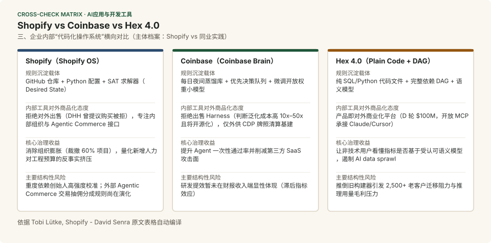

# Tobi Lütke, Shopify - David Senra

2026-11-22 · David Senra · Tobi Lütke (Shopify) 双期访谈 & Business Insider · 有来源缺口

[本地原件归档](../../../raw/95ecf52ea44232bc9f42ee873e3540efddce9db0c55c776aaf55426d66854c45) · 固定材料版本 `digest-material-95ecf52ea44232bc9f42ee873e3540efddce9db0c55c776aaf55426d66854c45@1` · [一手原站](https://www.davidsenra.com/episode/tobi-lutke)

## 深度拆解与复核

- 口径与利益：本拆解以 [David Senra 第一期完整文字实录（2026-01-18，159,258 字符）](https://www.davidsenra.com/episode/tobi-lutke)、[Episode 57 官方摘要（2026-11-22）](https://www.davidsenra.com/episode/tobi-lutke-2) 与 [Business Insider 原话报道（2026-11-23）](https://www.businessinsider.com/shopify-ceo-says-jensen-huangs-ouster-looked-choreographed-2026-11) 为一手依据，关联 [主体档案：Shopify](../entities/companies/Shopify.md) 与 [主体档案：David Senra](../entities/people/David%20Senra.md)。Tobi Lütke 为 Shopify 联合创始人兼 CEO（2008 年接任 CEO，此前兼任 CTO；10 年级辍学于德国 Koblenzer Carl-Benz-School 完成编程学徒，2004 年与 Scott Lake、Daniel Weinand 在加拿大 Ottawa 创办 Snowdevil 并用 Ruby on Rails 打造 Shopify，现服务逾 175 国超 400 万商户；2015 年 IPO 估值 \$1.27B 后市值突破 \$200B，个人持股约 5%–6%，2022 年起兼任 Coinbase 董事，并与妻子 Fiona McKean 创立 Thistledown Foundation、获 Canadian Meritorious Service Cross），其高举“Founder Mode 不可继任”与“AI 超级工具强化一线造物者”既反映工程信仰，也服务 Shopify 在 Agentic Commerce 时代作为独立商户底座的叙事；播客第一期实录标注赞助含 Ramp、AppLovin、OpenAI ChatGPT、Deel 与 Eight Sleep；由于 Episode 57 官网当前仅公开 2,290 字符 Summary，下文严格区分第一期完整逐字稿、Ep.57 官方摘要与 Business Insider 逐字引述边界。
- ==核心结论==：Tobi Lütke 在 2026-11-22 [Episode 57](https://www.davidsenra.com/episode/tobi-lutke-2) 抛出的“传统 Web 2.0 程序员岗位终结、AI 是乐器而非自动驾驶仪、软件正趋近零缺陷（nearly bug-free）”三大命题，延续了其 2026-01-18 [第一期访谈](https://www.davidsenra.com/episode/tobi-lutke) 展示的组织工程化底层机制（Shopify OS 用 Python 与 SAT 求解器配置代码化管理组织、COVID 期亲审砍掉 60% 冗余项目）；对照本赛道 GDPx 12.0% 与 APEX-Agents 压测基线，本工作台判断“软件近零缺陷”只在测试反馈回路确定性高的工程子域（如内部代码库周末重构、接口标准化）成立，跨入多系统长程状态或企业治理域后，校验门禁与创始人第一性原理判断仍是稀缺约束。

### 一、AI 优先软件工程、Shopify OS 代码化治理与校验边界（T1/T3 交叉验证）

| 演进节点 | 访谈实证细节（Episode 1 与 Episode 57 对照） | 与赛道核心锚点（T1/T3）的收敛与张力（本工作台核查） |
| :--- | :--- | :--- |
| 传统编码岗位重组 | [Ep.57 官方摘要](https://www.davidsenra.com/episode/tobi-lutke-2) 明确指出传统 Web 2.0 computer programmer 岗位终结，瓶颈转变为“提示词野心不足（insufficiently ambitious prompting）”与计算机不该让人产生挫败感 | 与 T1 一致：代码生成边际成本归零，工程师职能上移至定义架构约束、验收标准与高杠杆提示词设计 |
| 周末级代码重构 | [Ep.57 官方摘要](https://www.davidsenra.com/episode/tobi-lutke-2) 披露原本需数年完成的代码重写在一个周末内完成；[Ep.1 完整实录](https://www.davidsenra.com/episode/tobi-lutke) 亦反对笨重低效的客户端 JavaScript 堆栈，重视 Ruby/Rails/React 及 MacBook / Android / Slack / Wikipedia 等通用研发流转速度 | 印证确定性工程域中“强类型/自动化测试 + AI 工具链”对重构周期的量级压缩，但未公开具体代码库体积与线上回滚率 |
| 软件近零缺陷假说 | [Ep.57 官方摘要](https://www.davidsenra.com/episode/tobi-lutke-2) 提及 DHH RailsWorld 演讲、形式化验证（formal verification）、AI“工厂”与将 AI 定义为“乐器（instrument）”，预期软件正迈向“nearly bug-free” | ⚠️ 需限定边界：本库 GDPx（12.0% pass@1）与 Mercor APEX-Agents（pass^8 <=13.4%）显示长程跨应用缺陷仍高；近零缺陷仅在测试完备的局部模块成立 |
| Shopify OS 与 0% 利率对比 | [Ep.1 完整实录](https://www.davidsenra.com/episode/tobi-lutke) 披露 COVID 后员工膨胀至 8,000 人却衍生 5,500 个职级，Lütke 亲审所有项目砍掉 60% 并更替全部高管；以 Shopify OS 结合 Python 与 SAT 求解器构建“期望状态系统（desired state systems）”管理汇报跨度、推行个体贡献者 Mastery 序列及可每季调配 RSU/现金的薪酬滑块，指出 0% 利率结束逼迫团队剔除堆栈浪费 | ✅ 强印证 T3：通过 Shopify OS 将组织规则与管理参数代码化、配置文件化（与 Harvey 规则库及 Hex 4.0 同源），用工程收敛对抗组织熵增 |
| 多模块微操与商业底座 | [Ep.1 完整实录](https://www.davidsenra.com/episode/tobi-lutke) 将 AI-led 智能体节点重整与并行模块比作 StarCraft 极高注意力博弈（及 Elo 竞技排序思维），并披露 Shopify 正与各研究实验室协作构建 Agentic Commerce 标准以向个人购物助手暴露商户目录与交易接口 | 物理/商业接口层与 T4 共振：谁把数百万商户的非标商品目录结构化暴露给 LLM，谁就掌握智能体电商的源头路由与抽佣控制权 |

- ✅ 本工作台核查（“AI 作为乐器”与 StarCraft 微操的工程一致性）：不同于把 Agent 当作脱离人类监管的黑盒自动驾驶，Lütke 在 [2026-01 第一期](https://www.davidsenra.com/episode/tobi-lutke)（StarCraft 类比：在多线并行模块中按需放大微操注意力并亲自做 Double Check）与 [2026-11 Episode 57](https://www.davidsenra.com/episode/tobi-lutke-2)（AI 是需要演奏者注入高维品味与严苛约束的“乐器”）两期访谈保持 2/2 逻辑连贯；他在 Ep.1 中亦强调拒绝僵化 OKRs 与“80% 高管靠经验惯性复用旧打法”，反对以 HR 学历、PhD 或 SAT 分数作为单维过滤（推崇真实工程手感与 Affirmations 式自驱信念），追求像 SpaceX Raptor 火箭迭代图谱与 Formula One 般持续剪枝、识别 Norman 门（Norman doors）并避免像 Apple / Google / Microsoft / Oracle / Xbox / Xerox 陷入大公司惯性。
- ⚠️ 本工作台推断（“软件趋近零缺陷”为何不能直接外推至企业全流程）：虽然 Lütke 预期借助形式化验证与 AI 工具链，软件本身将趋近 0% 缺陷率（对应其在 Ep.1 观察到 70%–80% 早年商户调研背后实为“身边有创业导师在 24 小时内回信”的因果倒置与幸存者偏差洞察），但工程软件逼近“零缺陷”的前提是编译器、类型系统与单元测试能提供 100% 确定性反馈。一旦迁移到金融合规、多系统跨应用协同或商业决策（如 OpenAI、Stripe、Coinbase、Ramp 等复杂真实环境，且涉及大量 PDF / PDFs 非结构化单据），缺乏低成本确定性校验器才是 T1 揭示的真正瓶颈——因此软件局部“近零缺陷”不会消灭工程壁垒，反而把竞争推向“谁能先写出可验证的测试门禁与环境沙盒（T2）”。

### 二、Founder Mode 不可替代性、Nvidia 董事会治理批评与生态外溢

- 创始人不可替代论与 Jeff Bezos 财富衡量口径：[Episode 57 官方摘要](https://www.davidsenra.com/episode/tobi-lutke-2) 记录 Lütke 以少年时期在德国 Koblenz 三家医院献血攒钱买 NVIDIA Riva TNT 显卡切入，强调“不存在真正意义上的创始人接班（there is no such thing as a succession for a founder）”，认为即便是 Tim Cook 在 Apple 也只是延续 Steve Jobs 铺好的跑道，唯有创始人能在危机时刻彻底重构公司（如 Meta AI 实验室转向与 Shopify 2022 年股价下跌 80% 时他反而因剔除 50x 营收估值泡沫而如释重负；类似 Atari 的 Nolan Bushnell、Polaroid 的 Edwin Land、James Dyson《Against the Odds》及 Brad Jacobs、Buffett、David Ogilvy、John Mackey/Whole Foods、Daniel Ek/Spotify、Elon Musk、Mark Zuckerberg、Brian Armstrong、Michael Dell、Michael Rubin、Vlad Tenev 等样本；Ep.1 亦参照 Picasso、Van Gogh、Da Vinci、Michael Jordan《Last Dance》及 Jimmy Iovine/Rick Rubin《Defiant Ones》、Andre Agassi/Pete Sampras、Napoleon 等案例）。他还转述与 Jeff Bezos 的对话：相比 Forbes 400 个人财富榜，更应衡量创业者为外部股东创造的财富（例如 Lütke 个人并不持有的约 94%–95% Shopify 股权，以及投资生态对仅 1% 顶尖异常值的错误排斥）。
- 锐评 Nvidia 董事会处理黄仁勋（Jensen Huang）离任：据 [Business Insider（2026-11-23）逐字报道](https://www.businessinsider.com/shopify-ceo-says-jensen-huangs-ouster-looked-choreographed-2026-11)，针对 2026 年 11 月 NVIDIA 创始人黄仁勋在婚外情及外国情报审查风波后辞职且董事会拒绝复职一事，Lütke 在 Episode 57 公开质疑指控序列过于整齐、“如同按剧本编排的定点清除（surgical... choreographed）”，直指 Nvidia 董事会成员为“knuckleheads”（糊涂虫），认为其本应先采取行政休假（administrative leave）审慎查证而非仓促接受辞职、冒着把高速创新龙头变成“遗产公司（legacy company）”的风险；同时也承认自己判断可能出错，但指出“原本有许多既得利益者希望黄仁勋离位”；在 [Episode 57 官网](https://www.davidsenra.com/episode/tobi-lutke-2) 摘要中他亦强调“创始人不可替代”并感叹市场本身才是“最初的超级智能（Markets are the original superintelligence）”。
- ⚠️ 本工作台复核（信源完整度边界与算力生态二阶含意）：上述 Nvidia 董事会具体英文原话引自 [Business Insider 报道](https://www.businessinsider.com/shopify-ceo-says-jensen-huangs-ouster-looked-choreographed-2026-11) 并结合 Ep.57 官网摘要交叉确认；因播客官方尚未公布 Ep.57 完整音频文字稿（已记入缺口），细节覆盖度逊于 Ep.1（159,258 字符全文）。在产业层面，Lütke 身处 Canada、与硅谷（Silicon Valley / California / Seattle / Montreal / Toronto / Ottawa / Albuquerque / New Mexico / Memphis）深度耦合且兼任 Coinbase 董事，其对 Nvidia 董事会的公开批评折射出头部应用层/平台型创始人对“底层算力主宰失去创始人舵手”的焦虑——若 NVIDIA 从创始人主导的高速工程迭代步入职业经理人委员会防御期，GPU 路线图节奏与面向中小研发团队（及 OpenAI 生态外创业者）的算力分配优先级存在边际走弱风险。

### 三、企业内部“代码化操作系统”横向对比（[主体档案：Shopify](../entities/companies/Shopify.md) vs 同业实践）

| 组织与系统 | 规则沉淀载体 | 内部工具对外商品化态度 | 核心治理收益 | 主要结构性风险 |
| :--- | :--- | :--- | :--- | :--- |
| Shopify（Shopify OS） | GitHub 仓库 + Python 配置 + SAT 求解器（Desired State） | 拒绝对外出售（DHH 曾提议购买被拒），专注内部组织与 Agentic Commerce 接口 | 消除组织膨胀（裁撤 60% 项目），量化新增人力对工程预算的反事实挤压 | 重度依赖创始人高强度校准；外部 Agentic Commerce 交易抽佣分成规则尚在演化 |
| Coinbase（Coinbase Brain） | 每日夜间蒸馏库 + 优先决策队列 + 微调开放权重小模型 | 拒绝出售 Harness（判断泛化成本高 10x–50x 且将开源化），仅外供 CDP 牌照清算基建 | 提升 Agent 一次性通过率并削减第三方 SaaS 攻击面 | 研发提效暂未在财报收入端显性体现（滞后指标效应） |
| Hex 4.0（Plain Code + DAG） | 纯 SQL/Python 代码文件 + 完整依赖 DAG + 语义模型 | 产品即对外商业化平台（D 轮 \$100M，开放 MCP 承接 Claude/Cursor） | 让非技术用户看懂指标是否基于受认可语义模型，遏制 AI data sprawl | 推倒旧构建器引发 2,500+ 老客户迁移阻力与推理用量毛利压力 |

### 观点与可反驳条件

- ==观点==：Tobi Lütke 双期访谈最核心的产业信号在于“代码生产力爆炸（周末级重构）与组织规则代码化（Shopify OS）并进，但软件趋近零缺陷只会在强校验回路内兑现”——未来 12–24 个月，AI 应用与开发工具的价值将从“多写代码”加速向“Agentic Commerce 接口标准化（商户目录/事务暴露）与自动化校验沙盒”集中，而失去创始人第一性原理校准的科技巨头（如后黄仁勋时代的治理摩擦）则面临更高的创新折旧风险。
- ==推翻条件==：
  1. ① 若 2027 年 H1 前公开主流大模型与商用 Agentic Coding 平台在跨仓库、长程多应用生产基准（如 GDPx / SWE-bench 生产级衍生集）中的缺陷逃逸率或一次通过率仍未跨过 35%，且 Shopify 等头部工程团队公开复盘中“AI 周末重写”引发的线上故障率显著高于人工重构（如 P0/P1 事故同比上升 >25%），则“软件即将迈向近零缺陷”的判断将被证伪。
  2. ② 若在后 Jensen Huang 治理周期内，NVIDIA 下一代架构交付节奏（如 2027 年产品路标如期量产）与开发者生态净留存未出现任何延期或客户向 AMD/自研 ASIC 加速分流的迹象（数据中心 GPU 毛利率与营收增速连续 4 个季度维持稳态扩张），则 Lütke 关于“创始人缺失必然导致创新型巨头滑向 legacy company”的悲观外推将被证伪。
  3. ③ 若截至 2027 年 Q4，通过 LLM 对话窗口直接完成的 Agentic Commerce 交易额仍占 Shopify 总 GMV 不足 2%，且商户主要流量仍依赖传统搜索与社交广告投放而非模型原生商品目录接口，则“个人购物智能体重构电商分发底座”的节奏预期需大幅下调。

---

## 原文摘录与一手信源存证

> Tobi Lütke is the co-founder and CEO of Shopify.
> — 原文摘录，文字段落 1；证据 `digest-material-95ecf52ea44232bc9f42ee873e3540efddce9db0c55c776aaf55426d66854c45-excerpt-1@1`

> Tobi Lütke is the co-founder of Shopify, where he has served as the company's CEO since 2008.
> — 原文摘录，文字段落 2；证据 `digest-material-95ecf52ea44232bc9f42ee873e3540efddce9db0c55c776aaf55426d66854c45-excerpt-2@1`

> Under his leadership, Shopify grew from an online snowboard shop in Ottawa, Canada in 2004 to the world's leading e-commerce platform, powering over 4 million merchants in more than 175 countries.
> — 原文摘录，文字段落 3；证据 `digest-material-95ecf52ea44232bc9f42ee873e3540efddce9db0c55c776aaf55426d66854c45-excerpt-3@1`

一手材料：

- Tobi Lütke, Shopify - David Senra · David Senra · [原站](https://www.davidsenra.com/episode/tobi-lutke) · [主体档案：David Senra](../entities/people/David%20Senra.md) · [本地原件](../../../raw/95ecf52ea44232bc9f42ee873e3540efddce9db0c55c776aaf55426d66854c45)
  材料版本 `digest-material-95ecf52ea44232bc9f42ee873e3540efddce9db0c55c776aaf55426d66854c45@1`；获取方式 `tg_approved_full_text`。
  > Tobi Lütke is the co-founder and CEO of Shopify. — 原文提取
  > Tobi Lütke is the co-founder of Shopify, where he has served as the company's CEO since 2008. — 原文提取
- Jensen Huang, AI & Why Founders Are Irreplaceable | Tobi Lütke, Shopify (Ep. 57, Nov 22, 2026) - David Senra · David Senra · [原站](https://www.davidsenra.com/episode/tobi-lutke-2) · [主体档案：David Senra](../entities/people/David%20Senra.md) · [本地原件](../../../raw/b448319ab30a396133e739d3332025798cdc1c3d382529ace5d8c83666833746)
  材料版本 `digest-material-b448319ab30a396133e739d3332025798cdc1c3d382529ace5d8c83666833746@1`；获取方式 `http_full_text`。
  > Tobi Lütke is the co-founder and CEO of Shopify. — 原文提取
  > Get key takeaways from each episode delivered to your inbox. — 原文提取
- Shopify CEO Says Jensen Huang's Ouster Looked 'Choreographed' - Business Insider · Business Insider · [原站](https://www.businessinsider.com/shopify-ceo-says-jensen-huangs-ouster-looked-choreographed-2026-11) · [主体档案：Business Insider](../entities/labs/Business%20Insider.md) · [本地原件](../../../raw/c616eefb1b300d886cf4d318a2743f92b2935832a28ab9d1a97bf2a8e1be3835)
  材料版本 `digest-material-c616eefb1b300d886cf4d318a2743f92b2935832a28ab9d1a97bf2a8e1be3835@1`；获取方式 `http_full_text`。
  > Shopify CEO Tobi Lütke had some strong words about Nvidia's board over its handling of Jensen Huang's resignation. — 原文提取
  > In an episode of David Senra's podcast released Sunday, Lütke questioned the sequence of allegations that preceded Huang's departure, saying it appeared too neatly arranged to be incidental. — 原文提取

归属与范围：Shopify 联合创始人兼 CEO Tobi Lütke 做客 David Senra 播客两期深度对谈（2026-01-18 第一期 159,258 字符完整文字实录与 2026-11-22 Episode 57 官方页面 Summary，辅以 Business Insider 对 Episode 57 关于 Nvidia 董事会发言的一手媒体引述），聚焦 AI 时代软件工程向校验/乐器式驾驭转型、Shopify OS 代码化治理与创始人不可替代性。

来源缺口：

- `unavailable`：2026-11-22 发布的 Episode 57（episode/tobi-lutke-2）官网单集页当前仅发布 2,290 字符 Summary 尚未挂出音频逐字稿全本，本次以 2026-01-18 第一期 159,258 字符完整实录、Episode 57 官网 Summary 与 Business Insider 原话报道交叉互证，未获取 Episode 57 完整逐字稿。 [线索](https://www.davidsenra.com/episode/tobi-lutke-2)
- `not_disclosed`：Tobi Lütke 在 Episode 57 提及的“周末完成过去需数年的代码库重写（weekend rewrite）”及“软件趋近零缺陷”未在公开 Summary 中披露具体仓库规模、编程语言占比、自动化测试门禁覆盖率与 Shopify OS 内部 AI 算力账单明细。 [线索](https://www.davidsenra.com/episode/tobi-lutke-2)

[返回赛道总览](../赛道总览.md#digest-95ecf52ea44232bc) · [返回导读索引](README.md) · [主体档案库](../entities/README.md)
