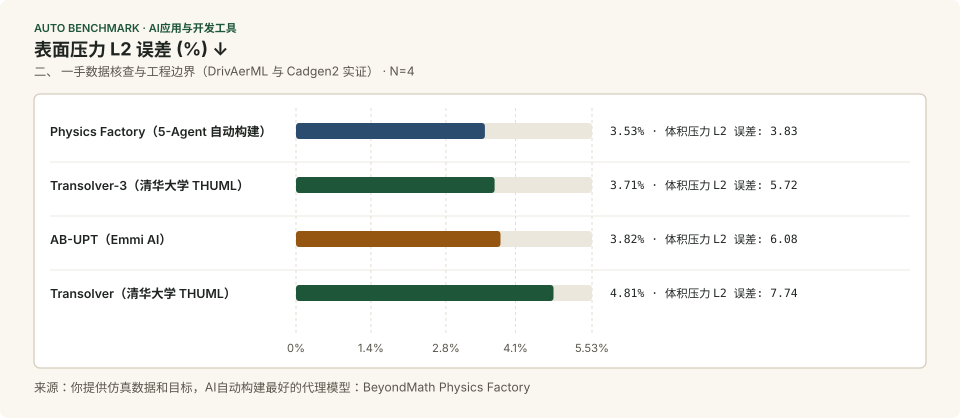

# 你提供仿真数据和目标，AI自动构建最好的代理模型：BeyondMath Physics Factory

2026-11-27 · BeyondMath (Physics Factory / Developer Blog) · 有来源缺口

[本地原件归档](../../../raw/acdbc955250c4bddcc2c088c19b0d93f7c857966191908ccb2728086bd2d6a4c) · 固定材料版本 `digest-material-acdbc955250c4bddcc2c088c19b0d93f7c857966191908ccb2728086bd2d6a4c@1` · [一手原站](https://blog.beyondmath.com/posts/20260803-built-autonomously-1st-drivaerml/) · [触发线索（AIE 加速工业进化）](https://mp.weixin.qq.com/s/ERlooNORkNTtXoDkFr-_4g)

## 深度拆解与复核

- 来源：[BeyondMath 开发者博客 DrivAerML 基准实证 (2026-08-03)](https://blog.beyondmath.com/posts/20260803-built-autonomously-1st-drivaerml/) · [Cadgen2 平板电脑 50 变体结构研究 (2026-09-19)](https://blog.beyondmath.com/posts/20260919-cadgen2-tablet-variant-study/) · [Cadgen2 F1 气动实时形变研究 (2026-09-19)](https://blog.beyondmath.com/posts/20260919-cadgen2-f1-aero-doe/) · [BeyondMath \$18.5M 种子轮公告 (2026-02-25)](https://beyondmath.com/news/seed-round-announcement) · [Physics Factory 全面开放编目 (2026-10-21)](https://surrogatemodels.com/news/beyondmath-physics-factory) · [DrivAerML 数据集原始论文 (arXiv:2408.11969)](https://arxiv.org/abs/2408.11969)
- 口径与利益披露：BeyondMath 作为售卖 AI CAE 平台与 Credits 算力消耗的商业初创公司，其开发者博客将 Physics Factory 定位为替代「百万美元级招聘 AI 博士」与「高价外部咨询」的工业标品，存在显著的基准测试叙事与获客导向；第三方索引站 Surrogate Models 属非商业学术/行业信息聚合站点；微信公众号《AIE风向标》系基于 BeyondMath 官网技术文章整理的中文二手编译线索，存在参数缩水与产品机理简化。
- ==核心结论==：Physics Factory 的实质定位是==面向垂直工业工程团队的「多 Agent 物理代理模型自动化工厂（Forge）+ 仿真就绪生成式 CAD 前处理器（Cadgen2）+ 在线推理端（Studio）」一体化软件栈==。在一手 DrivAerML 基准上，其 5 组 Agent 以不足 30 分钟人工介入自动拼装出点运算网格无关模型，确实在表面压力（3.53%）、体积压力（3.83%）与阻力系数 Cd（R²=0.985）刷新公开榜单；但同表显示它在体积速度场（4.98% vs 4.14%）和升力系数 Cl（0.975 vs 0.985）仍落后于清华大学人工设计的 Transolver-3，且 Cadgen2 目前仍依赖 OpenRadioss 等传统显式求解器输出结构应力数据而非免求解器世界模型。商业成败取决于能否把「30 分钟跑出高分模型」转化为高安全门槛制造业的复购 Credits，而这正撞上工业界与通用 AI 阵营争夺私有仿真数据与 CAD 入口的正面竞争。

---

### 一、 业务切口、公司底座与核心机制

#### 1. 公司主体穿透：4 年技术积累切入「算力与算法人才双缺」的中腰部工程团队
- 创始团队与资本底座：BeyondMath 于 2022 年在英国伦敦与剑桥创立，创始人 Alan Patterson（CEO，30 年 ML 与软件工程履历，曾参与被 Amazon 收购的 Evi Technologies 与被 Google 收购的 Spider.io）与 Darren Garvey（CTO，前 Evi Technologies、HomeX、eBay 工程高管），商业化团队吸收了 Palantir 前商业拓展负责人 Wasil Rezk（CCO）及 Google Ads SRE 负责人 David Sharp。截至 2026-02-25，公司累计完成 \$18.5M 种子轮融资（\$10M 追加轮由 Cambridge Innovation Capital 领投，UP.Partners、Insight Partners 与车企 JLR 旗下 InMotion Ventures 跟投）。
- 商业定位切换：传统车企与航空巨头拥有自研或高价咨询定制代理模型的预算，而中腰部制造业工程团队缺乏能调参的物理 AI 博士，又难以承受外部咨询按项目计费的长期驻场服务。BeyondMath 在 2026-10-21 将 Physics Factory 全面开放，采用「注册购买 Credits + 企业私有云/本地隔离部署」双轨制，试图用标准化 Agent 工程平台下沉承接这批算力与算法人才双缺的客户。

#### 2. Physics Factory 三段式产品结构与 5 个 Agent 协作链
- Forge（多 Agent 代理模型工厂）：用户输入原始仿真数据集、自然语言目标与预算上限，平台内 5 组自主 Agent 团队按流水线接力——Organise（数据盘点与版本化）→ Analyse（尺度诊断，例如自动识别压力场与速度场量级差异并配置分场归一化）→ Train（从基础物理 AI 组件库抽取专用编码器、注意力机制、解码器及空气动力学/热力学/结构/电磁学物理约束条件组装网络）→ Optimise（执行可控对照实验，如自动尝试 lower-lr-nodropout-deeper-decoder 等变体，在验证集平台期追加解码块，基于测试损失下降约三分之二的实证证据保留胜出分支并舍弃红叉失败分支，全程以平实英文记录决策日志）→ Predict（封装模型并交付推理）。
- Cadgen2（2026-09 推出的生成式 CAD 与 DOE 前处理模块）：解决工程仿真耗时的几何清理与参数化瓶颈，分两条路径打通仿真输入——其一从文本规格或草图直接生成带物料清单 BOM、几何公差 GD&T 与 STEP/BREP 文件的装配体，并在生成瞬间完成「仿真消特征（defeaturing）」（保留承力筋板、凸台与密封边，剔除增加单元数却不影响结构响应的螺纹、Logo、焊脚与 BGA 焊球）；其二针对无特征树的外部导入几何（如 F1 气动曲面），自动逆向提取 DOE 参数手柄与空间位移场，让无历史树模型也能直接批量扫描变形。
- Studio（Generative Physics Studio 推理终端）：承载已发布的定制代理模型或 BeyondMath 预置基础物理模型（如 2026-10-21 披露的发动机进气道内流模型，免网格在笔记本 CPU 上约 15 秒完成单工况速度场预测），供工程师在数秒内对照基线检索新变体的阻力变化与尾流结构。

---

### 二、 一手数据核查与工程边界（DrivAerML 与 Cadgen2 实证）

对照 BeyondMath 官方技术博客、Surrogate Models 编目与 DrivAerML 原始论文（arXiv:2408.11969），触发线索《AIE风向标》在基本框架之外存在 4 处关键工程口径遗漏与误读：

| 核查维度 | 触发线索（AIE风向标）表述 | 一手信源核验实情 | 核查结论与工程边界 |
| :--- | :--- | :--- | :--- |
| DrivAerML 榜单排名与精度表现 | 仅笼统称表面压力、体积压力与阻力显著提升，力系数优于现有其他模型，推理超 1 亿点 | 一手博文公开全指标表：DrivAerML（500 车型 / 16 个形状参数 / OpenFOAM v2212 混合 RANS-LES ~1.6 亿单元 / 400 训练 50 测试 5 折中位数）上，Physics Factory 在表面压力 L2 误差 3.53%、体积压力 3.83%、阻力 Cd R² 0.985（MAE 0.0032 约 3 drag counts）排第一，支持 1.5 亿+ 点（150M+）流式推理；但体积速度场 L2 误差 4.98% 劣于清华 Transolver-3 的 4.14%，升力 Cl R² 0.975 亦劣于 Transolver-3 的 0.985 | ⚠️ 胜负分项披露与口径校准（本工作台核查）：公号遗漏 1.5 亿+ 点推理量级且隐去了速度场与升力落后项；此外 BeyondMath 承认基线分数直接引自各论文自身数据划分，尚未在统一测试划分下同台重跑 |
| Cadgen2 仿真机制与「世界模型」作用 | 称对 Cadgen2 生成变体快速仿真似乎无需自建代理模型，靠预置世界物理模型即可快速出结果 | 2026-09-19 平板 50 变体研究原文披露：基线 124.6×174.2×8.10 mm（257.0 g、20 实体）扩展为 50 装配体（1,000 实体、1,050 份 STEP、950 处 0.050 mm 绑定间隙），全部使用四面体网格（参考模型 136,905 节点 / 407,692 单元，筛选网格约 49,000 节点）送入开源显式求解器 OpenRadioss 执行 1.0 m 跌落仿真，单工作站 3 并发共耗时 11 h 07 min 才跑完 50 组；峰值得出显示模组应力 130–1,781 MPa，且作者明示采用线性弹性材料假设、不可作绝对破坏预测 | ❌ 机制误读纠正（本工作台核查）：Cadgen2 在结构强度寻优中依赖 OpenRadioss 显式数值求解出数，充当「合规 CAD 生成 + 网格消特征 + 导出求解器卡片」的数据生成管道；其生成的高成本仿真张量（单次 1.5 ms 碰撞达 3.8 GB）反过来才是喂给 Physics Factory 训练代理模型的燃料 |
| F1 气动变形能力与几何拓扑边界 | 称 Cadgen2 可从导入 CAD 提取参数化数据并生成特定几何 | 2026-09-19 F1 案例实测：无特征树 46 零件模型自动提取 28 个 DOE 手柄（前翼 8、轮拱 8、后扩散器 7、导流片 5），90,497 三角面片单手柄形变耗时 465–547 ms，零自交折叠且翻转面积 <=0.0009%、顶点序保真 <=0.009 mm；但局限性章明确写明「位移场不能增减拓扑，B-rep 需拟合 NURBS 控制点，超容差则拒收」 | ✅ 量纲实证与 ⚠️ 拓扑边界（本工作台核查）：F1 实时变形速度已进入交互级（<1 秒），但无法在既有装配体上凭空增加新翼片或开孔，仍受拓扑冻结约束 |
| 商业化进度与客户验证状态 | 称公司成立不久、工具刚推出，尚未看到公开客户侧实际验证 | BeyondMath 创立于 2022 年（已运行 4 年），2026-08-03 发 DrivAerML、2026-09-19 发 Cadgen2、2026-10-21 全面开放注册买 Credits；且 2026 年初已公布 Honeywell 主导的三年期 STRATA 航空增材制造项目（英国 ATI 联合项目 £14.1M / 官方稿称 \$19M）及 F1 车队使用记录 | ⚠️ 时间线校准（本工作台核查）：企业级物理模型早期商业验证已存在，但 2026-10-21 开放的 Physics Factory 自助多 Agent 平台本身确仍缺乏公开第三方客户量化验收案例 |

- 原位架构核查（误差积累拆分发现的真实工程意义）：在 DrivAerML 实验中，Agent 发现直接对预测压力/速度场做面积分求取整车阻力系数（Cd）与升力系数（Cl）会放大局部离散误差，因此自主拆分出「点运算编码器-解码器预测场量 + 轻量专用标量网络直接预测力系数」双头架构。✅ 这一工程拆解（本工作台核查）与工业 CFD 代理模型实践中「场重建误差不等于积分气动力保真」的核心痛点一致：针对整车 50 个未见测试几何，Physics Factory 将阻力 MAE 压至 0.0032（约 3 个阻力计数），使设计变更排序方向保持可用。

#### DrivAerML 同台精度明细（2026-08-03 官方披露，5 次随机 400/50 划分中位数）

| 模型 / 团队 | 表面压力 L2 误差 (%) ↓ | 体积压力 L2 误差 (%) ↓ | 体积速度 L2 误差 (%) ↓ | 阻力系数 Cd R² ↑ | 升力系数 Cl R² ↑ |
| :--- | :--- | :--- | :--- | :--- | :--- |
| Physics Factory（5-Agent 自动构建） | 3.53 | 3.83 | 4.98 | 0.985 | 0.975 |
| Transolver-3（清华大学 THUML） | 3.71 | 5.72 | 4.14 | 0.972 | 0.985 |
| AB-UPT（Emmi AI） | 3.82 | 6.08 | 5.93 | 0.963 | 0.975 |
| Transolver（清华大学 THUML） | 4.81 | 7.74 | 6.78 | 未在同表列示 | 未在同表列示 |

---

### 三、 赛道横向对比：Agent 代理建模工厂 vs 神经物理基模 vs 传统 CAD/CAE 巨头

- ==本工作台推断==：当前 AI 工业仿真与设计赛道正分化为三条路线——「通用物理基础模型（如 NVIDIA PhysicsNeMo、物原科技 TensorWorld/Transolver）」、「传统 CAD/CAE 巨头平台内生智能体（如达索 SOLIDWORKS Blue Tokens、西门子 Simcenter/Designcenter）」以及 BeyondMath/Luminary Cloud 代表的「云原生多 Agent 自助建模工厂」。BeyondMath 的差异化在于用多 Agent 工程流水线把过去需要高校顶会团队手工调优数月的模型选型压进 30 分钟人工设定，再借 Cadgen2 从几何生成端解决高保真训练样本稀缺问题。然而这一模式面临双面夹击：向上，传统汽车主机厂与航空巨头手握几十年私有仿真库与 Parasolid/CATIA 原生特征树，极难把核心 STEP/B-rep 资产迁出至第三方平台；向下，NVIDIA PhysicsNeMo 2.3 已在 2026-11 免费开源打包 AB-UPT、DoMINO 与 SMART 等汽车气动配方，持续压低开源自建基线门槛。

| 对标阵营与代表厂商 | 核心交付物与技术路径 | 商业变现与部署形态 | 面对 BeyondMath 的核心竞争优势与短板 |
| :--- | :--- | :--- | :--- |
| BeyondMath (Physics Factory) | 5-Agent 自动编排 Forge + 生成式 CAD 前处理 Cadgen2 + Studio 推理终端，直接摄取原始 STL | 注册买 Credits 按量计费 + 企业私有云/本地部署 | 优势在降低 AI 算法人才门槛与打通无特征树 DOE 前处理；短板在无自有原生主 CAD 席位生态，需说服企业外迁敏感仿真资产 |
| 达索系统 / 西门子 (SOLIDWORKS LEO / Simcenter) | 基于 Parasolid/CATIA 存量设计底座内嵌设计智能体，西门子同步 \$50M 战略绑定 Xometry 打通制造报价 | 高粘性软件订阅席位（\$2,820–\$4,716/年）+ 3DEXPERIENCE 迁云 + Blue Tokens（\$1,250/25,000 枚/年） | 优势在控制 800 万+ 机械工程师桌面入口与完整特征树工作流；短板在传统求解器算力昂贵且旧架构迁移缓慢 |
| 神经物理基模与开源底座 (NVIDIA PhysicsNeMo / 清华 THUML / TensorWorld) | 开源或底层预训练神经 PDE 求解器（AB-UPT、Transolver-3、GeoPT 1M+ 样本动力学抬升） | NVIDIA 靠 GPU 算力与工具链免费开源生态锁定；初创团队依赖工业定制/基模授权 | 优势在速度场（4.14%）与升力精度（0.985）及开源生态免费复制能力，直接压缩 BeyondMath 在标准 PDE 配方上的壁垒 |
| 同级工业 AI 物理平台 (Luminary Cloud / PhysicsX) | Luminary 2026-11 新增 Agent-led engineering 与持续物理大模型；PhysicsX 依托 3.32 万次 RANS 预训练汽车气动模型 | 云端 GPU 托管仿真 + 垂直行业定制项目交付（PhysicsX 深度切入欧洲防务与 F1/汽车） | 同处无网格/代理模型赛道正面竞争，Luminary 与 PhysicsX 均在补齐 Agent 自动化能力与行业预训练权重壁垒 |

---

### 观点与可反驳条件

- ==观点==：BeyondMath Physics Factory 的核心价值在于用多 Agent 自动化选型加 Cadgen2 自动消特征数据工厂，把 AI 代理建模从高薪 AI 博士手工定制转化为领域工程师 30 分钟发起、按 Credits 结算的可复制软件流，其意义主要体现于降低建模门槛而非单靠某一项公开榜单宣称第一；但在汽车与航空高安全制造现场，主机厂严守三维几何与风洞实验产权、且开源配方（NVIDIA PhysicsNeMo 2.3 与 Transolver-3）已能逼近或局部反超其公开精度，Physics Factory 短期内很难靠公有云自助 Credits 撬动大型 OEM 替换 Ansys/Star-CCM+/CATIA 核心工作流，更现实的增量来自联合体工程交付（如 Honeywell STRATA 式共研）与中小非标研发团队的私有云加速套件。
- ==推翻条件==：
  1. ① 公有云自助 Credits 商业放量证伪条件：若截至 2027-Q4，BeyondMath 公开披露或被权威行业统计证实其 Physics Factory 开放平台实现 >=50 家制造业企业付费复购（非一次性科研试点），或年度经常性收入 ARR 突破 \$15M 且主要源自自助 Credits 与企业私有云标准订阅（非单一政府/大厂共研项目拨款），则「无主 CAD 席位底座制约标准化变现」的判断将被修正。
  2. ② 全流程端到端替代显式求解器证伪条件：若 BeyondMath 在 2027 年底前发布同行评审技术报告或第三方权威工程验收案例，证明 Cadgen2 配合其预置世界物理模型无需调用 OpenRadioss/OpenFOAM 等传统数值求解器，即可在非线弹塑性碰撞或全尺寸航空热流耦合任务上达到工程签收公差（相对误差 <=2% 且拓扑变化自由增减），则「Cadgen2 仍受制于传统求解器与拓扑冻结边界」的判断将被推翻。
  3. ③ 开源与巨头生态防线击穿条件：若截至 2027 年中，达索/西门子或开源 PhysicsNeMo 社区推出同等「自然语言目标驱动、自动搜索网格式无关代理架构 + 自动消特征 STEP 管道」的零溢价工具链，且 Honeywell STRATA 或其 F1 车队合作未见续签/扩约，则 BeyondMath 五组 Agent 编排壁垒将被证明仅具半年级窗口期。

---

## 原文摘录与一手信源存证

> 在仿真领域，使用AI代理模型提升求解速度，从而在早期探索更多的方案，已经是很重要的一个发展方向。但是对大多数企业来说，构建AI代理模型这事技术门槛还是有点高（养不起AI算法专家），一些通用构建工具效果又可能不稳定。
> — 原文摘录，文字段落 1；证据 `digest-material-acdbc955250c4bddcc2c088c19b0d93f7c857966191908ccb2728086bd2d6a4c-excerpt-1@1`

> 为此，AI CAE创企BeyondMath给出了一个方案：你只要把数据和目标扔给Physics Factory平台，多Agent系统自己帮你找出最好的AI代理模型。
> — 原文摘录，文字段落 2；证据 `digest-material-acdbc955250c4bddcc2c088c19b0d93f7c857966191908ccb2728086bd2d6a4c-excerpt-2@1`

一手材料：

- Built Autonomously, Achieves 1st Place on DrivAerML · BeyondMath · [原站](https://blog.beyondmath.com/posts/20260803-built-autonomously-1st-drivaerml/) · [主体档案：BeyondMath](../entities/companies/BeyondMath.md) · [本地原件](../../../raw/a370327f58a050e6f945bb98b19a9fde281183e225b4515eef98f6e0742a6b5c)
  材料版本 `digest-material-a370327f58a050e6f945bb98b19a9fde281183e225b4515eef98f6e0742a6b5c@1`；获取方式 `http_full_text`。
  > The Physics AI model built autonomously in Physics Factory takes 1st place on the DrivAerML benchmark, ahead of models hand-built by world-class AI research teams. — 原文提取
  > Physics Factory took the DrivAerML benchmark from raw dataset to a deployed model with a single plain English goal and under 30 minutes of our hands-on time. — 原文提取
- Cadgen2: Generating and Solving a 50-Variant Tablet Study · BeyondMath · [原站](https://blog.beyondmath.com/posts/20260919-cadgen2-tablet-variant-study/) · [主体档案：BeyondMath](../entities/companies/BeyondMath.md) · [本地原件](../../../raw/3784f38970431723a0b20b86bd4d61cb8813062b6781b6ad87f6a40820e80324)
  材料版本 `digest-material-3784f38970431723a0b20b86bd4d61cb8813062b6781b6ad87f6a40820e80324@1`；获取方式 `http_full_text`。
  > Cadgen2 is the AI-based CAD generation module within BeyondMath’s Physics Factory. — 原文提取
  > A dimensional change must propagate to mating parts, clearances, fastener positions and specification documents. Each propagation path is a potential source of divergence between model and drawing. — 原文提取
- Cadgen2: Real-Time Modification of F1 Aerodynamic Surfaces · BeyondMath · [原站](https://blog.beyondmath.com/posts/20260919-cadgen2-f1-aero-doe/) · [主体档案：BeyondMath](../entities/companies/BeyondMath.md) · [本地原件](../../../raw/150c15c9ab2ff5479b599c66f892595a8affcc043990636d9be3c599406e98e0)
  材料版本 `digest-material-150c15c9ab2ff5479b599c66f892595a8affcc043990636d9be3c599406e98e0@1`；获取方式 `http_full_text`。
  > Cadgen2 generates engineering-grade CAD assemblies from specifications, produces controlled design variants with defeatured geometry and extracts DOE parameterisations from imported CAD models. — 原文提取
  > Flap angle on elements 3 and 4, swept within its −4 … 4° DOE range. Colour indicates displacement as a fraction of that part's maximum displacement; the rest of the car is ghosted. — 原文提取
- BeyondMath completes \$18.5 million Seed Round to scale world's largest foundational physics AI model · BeyondMath · [原站](https://beyondmath.com/news/seed-round-announcement) · [主体档案：BeyondMath](../entities/companies/BeyondMath.md) · [本地原件](../../../raw/e8de109ba2158c4dda622473bc00049a08c3c526236448ebe54f69af82457b59)
  材料版本 `digest-material-e8de109ba2158c4dda622473bc00049a08c3c526236448ebe54f69af82457b59@1`；获取方式 `http_full_text`。
  > Oops! Something went wrong while submitting the form. — 原文提取
  > BeyondMath, a deeptech company that has developed a first-of-its-kind generative physics model, has closed a \$10 million Seed extension led by Cambridge Innovation Capital, alongside existing investors including UP.Partners, Insight Partners, and InMotion Ventures. — 原文提取
- BeyondMath opens Physics Factory to everyone · Surrogate Models · [原站](https://surrogatemodels.com/news/beyondmath-physics-factory) · [主体档案：Surrogate Models](../entities/companies/Surrogate%20Models.md) · [本地原件](../../../raw/0739251a2670d55cdc6bc40caae858f10d3dd07343cdda9871779e6f72941efe)
  材料版本 `digest-material-0739251a2670d55cdc6bc40caae858f10d3dd07343cdda9871779e6f72941efe@1`；获取方式 `http_full_text`。
  > BeyondMath says its Physics Factory platform is now open to everyone. — 原文提取
  > Physics Factory is open to everyone. Three tools in one platform: Cadgen2 … Forge … Studio. — 原文提取
- DrivAerML: High-Fidelity Computational Fluid Dynamics Dataset for Road-Car External Aerodynamics · Neil Ashton et al. (arXiv:2408.11969) · [原站](https://arxiv.org/abs/2408.11969) · [主体档案：Neil Ashton](../entities/people/Neil%20Ashton.md) · [本地原件](../../../raw/d3b8703fd7d025b23b5836159aeddb51c9be2f4d9de22dfdb8ba170b65debe20)
  材料版本 `digest-material-d3b8703fd7d025b23b5836159aeddb51c9be2f4d9de22dfdb8ba170b65debe20@1`；获取方式 `http_full_text`。
  > Machine Learning (ML) has the potential to revolutionise the field of automotive aerodynamics, enabling split-second flow predictions early in the design process. — 原文提取
  > arXivLabs is a framework that allows collaborators to develop and share new arXiv features directly on our website. — 原文提取

归属与范围：已穿透上游一手信源并核查主体背景：(1) BeyondMath 官方开发者博客 2026-08-03《Built Autonomously, Achieves 1st Place on DrivAerML》（确认 5 个 Agent 团队架构、500 车型 / ~1.6 亿单元混合 RANS-LES、1.5 亿+ 点推理、以及被触发稿忽略的指标拆分：Physics Factory 在表面压力 3.53%、体积压力 3.83% 与阻力 Cd R2 0.985 领先，但在体积速度场 4.98% vs 4.14% 与升力 Cl R2 0.975 vs 0.985 两项仍落后于清华 Transolver-3）；(2) BeyondMath 官方技术博客 2026-09-19 两篇 Cadgen2 案例研究（平板 20 实体 / 50 变体 / 1,050 STEP 实测依赖 OpenRadioss 耗时 11h07m 求解，F1 几何 28 个 DOE 手柄 465-547 ms 实时形变）；(3) BeyondMath 2026-02-25 种子轮公告（\$18.5M 融资、CIC 领投及 Honeywell £14.1M / \$19M STRATA 项目）；(4) Surrogate Models 2026-10-21 编目确认开放注册与 Credits 收费；(5) DrivAerML 原始论文 arXiv:2408.11969。微信公众号《AIE风向标》退居触发线索，并纠正其『超过 1 亿点』缩水、『Cadgen2 无需代理模型靠世界模型直接高速出真值』误读及『尚无客户侧验证』的时间线偏差。

来源缺口：

- `not_disclosed`：BeyondMath 未公开 Physics Factory（Forge 模块）基础物理 AI 组件库的具体网络结构、预训练权重规模、5 个 Agent 间的协同编排实现细节，亦未公开 DrivAerML 5 次随机划分标准差、训练 GPU 耗时与平台 Credits 收费单价表。 [线索](https://blog.beyondmath.com/posts/20260803-built-autonomously-1st-drivaerml/)
- `not_disclosed`：虽已披露 \$18.5M 种子轮融资及 Honeywell 主导的三年期 STRATA 项目（英国 ATI 联合项目 £14.1M / BeyondMath 稿称 \$19M）与未具名 F1 车队合作，但公司未披露商业付费客户数、ARR 收入以及 Physics Factory 自助平台或 Cadgen2 的独立第三方工程验收 ROI 数据。 [线索](https://beyondmath.com/news/seed-round-announcement)
- `unavailable`：CEO Alan Patterson 个人 Substack 长文（alpatters.substack.com/p/building-a-foundational-ai-model）与 2026-10-21 LinkedIn 全面开放公告原贴在直连 HTTP 请求下遭遇 Cloudflare 403 或登录墙拦截未取回全文；开放机制已通过 surrogatemodels.com 编目交叉核实。 [线索](https://surrogatemodels.com/news/beyondmath-physics-factory)

[返回赛道总览](../赛道总览.md#digest-acdbc955250c4bdd) · [返回导读索引](README.md) · [主体档案库](../entities/README.md)
