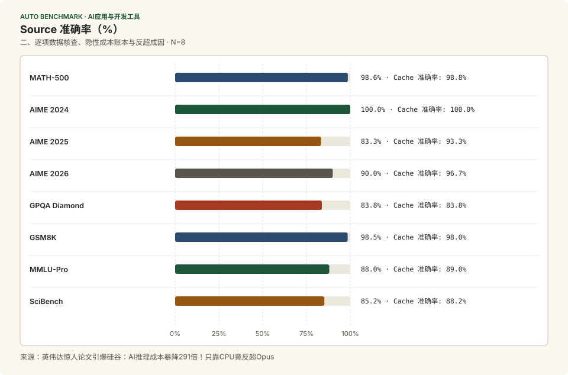

# 英伟达惊人论文引爆硅谷：AI推理成本暴降291倍！只靠CPU竟反超Opus

2026-11-28 · NVIDIA LPR Lab (arXiv:2611.09891) · 有来源缺口

[本地原件归档](../../../raw/be551686598537bf1885c624420a7061b189a5187e6b78e6cb516574f111ebeb) · 固定材料版本 `digest-material-be551686598537bf1885c624420a7061b189a5187e6b78e6cb516574f111ebeb@1` · [一手原站](https://arxiv.org/abs/2611.09891) · [触发线索（图灵边界）](https://mp.weixin.qq.com/s/35CCRGyPzRTrTbSxwcTtRA)

> [!IMPORTANT]
> 用户关注点（TG）：真？有什么前提限制呢

## 针对性追查与回应

## 针对性追查与回应：是否属实与五项前提限制

- 口径与利益：本核查穿透至上游一手论文 [arXiv:2611.09891v1](https://arxiv.org/html/2611.09891v1)（作者 Peter Belcak、Pavlo Molchanov 等 5 人均隶属 [NVIDIA](../entities/companies/NVIDIA.md) 旗下 [NVIDIA LPR Lab](../../具身智能/entities/labs/NVIDIA%20LPR%20Lab.md)）与 [Project Moonshot: LFI](https://research.nvidia.com/labs/lpr/lfi/) 主页，将微信公号报道降格为触发线索。作者所属机构的商业利益与研究动机在于探索「云端大模型做离线编译工厂 + 端侧低功耗 CPU 与 1B 小模型做高频执行」的混合分工，借此缓解高频 Agent 推理的边际成本瓶颈并提前卡位 1,000 美元 / 40 瓦本地前沿智能生态；同时全篇实验仅以单一源模型（Claude Opus 4.5）自建自测且未开源代码与权重，需防指标向有利口径倾斜。
- 核查总结论（数据出处属实，「只靠 CPU」属标题简化）：==arXiv:2611.09891 论文中的 291.1 倍降本与 7/8 基准追平或反超 Claude Opus 4.5 均有原始 Table 2 支撑，但两个数字均附带严格的口径边界，并非通用推理无条件替代方案。==
  - ✅ 本工作台核查（[arXiv:2611.09891v1 Table 2](https://arxiv.org/html/2611.09891v1)）：在 2026-11-06 提交的论文中，AIME 2025 的缓存准确率（CAcc）为 93.3%，对比源模型 Claude Opus 4.5（4,096 token 延伸思考）的 83.3% 高出 10.0 个百分点；运行期单次调用成本从 \$0.1203 降至 \$0.0004，降幅达 291.1 倍；8 项基准整体运行期成本降幅为 16.3 倍（GSM8K）至 291.1 倍（AIME 2025），绝对单次费用为 \$0.0004 至 \$0.0019。
  - ⚠️ 本工作台核查（标题口径纠偏）：所谓「只靠 CPU 反超 Opus」并不等于零神经网络推理。运行期仍须调用微调后的 Llama 3.2 1B（执行参数抽取、类型转换与轻量语义判断）及约 300M 参数的 EmbeddingGemma（在 CPU 上经 FAISS 做 768 维语义检索），且 1B 模型微调是在单张 GPU 上用合成数据完成；同时 Table 2 的成本核算采用 2026 年 3 月 API 零售价（Llama 3.2 1B 按输入 \$0.023/百万 Token、输出 \$0.194/百万 Token 计价），论文并未在本地纯 CPU 上实测延迟与功耗。

五项必须满足的前提限制如下：

1. 构建期存在 12.1–83.7 倍沉没成本，低于回本线严格亏损：由 [Appendix C](https://arxiv.org/html/2611.09891v1) 可见，Builder（Claude Opus 4.5）需经历多轮「写代码—单测—裁判—改错」闭环，单条缓存构建平均吞掉 16.5 万至 59.8 万输入 Token 与 2.1 万至 4.1 万输出 Token（如 GPQA Diamond 构建成本 \$1.7781，对比直接求解 \$0.0708 高出 25.1 倍）。按回本公式计算，AIME 类高难度题目需同类变体重复命中约 13 次才能打平构建费，GSM8K 类低单价题目则需重复命中约 90 次；一次性或低频问题接入必然亏损。
2. 构建成本高度依赖 Anthropic Prompt Cache 9 折读缓存折扣：Builder 多轮循环中 85% 至 93% 的输入 Token 命中了 Anthropic 提示缓存读取（\$0.50/百万 Token，对比基础输入价 \$5.00/百万 Token）。若无该底层缓存计费折扣，仅 GPQA Diamond 单题的输入端构建成本就会从约 \$0.28 跃升至 \$2.77 以上，总构建开销翻倍。
3. 仅覆盖等理同构（Equirational）非创意任务，跨结构合并尚未解决：论文第 2 节假设 A1/A2 要求问题族共享相同推理骨架，仅在措辞（phrasal）或数值参数（parametric）上变动；第 4 节明确指出该架构适用于重复执行固定指令的非创造性场景，且尚不具备将多条相近但结构不同的语义函数自动泛化为单一通用函数的能力。
4. 仍有 3.6%–9.2% 组合扰动失误率，且评测存在「教师自举」边界：在同时改写措辞与替换参数的 Combined 扰动测试下，8 项基准通过率为 90.8%（AIME 2026）至 96.4%（SciBench）。更关键的是，论文第 3.2 节与 3.4 节限定扰动测试只在「原始题已被缓存答对」的子集上开展，且扰动样本生成器与两级裁判委员会全部采用 Claude Opus 4.5，未在真实企业多轮 Agent 工具调用中做人工盲测。
5. 误命中静默漂移与开源/延迟空白：入口向量余弦相似度一旦对「表面相似但逻辑条件改变」的输入误命中，不会主动触发 fallback 回退；此外论文仅提出 [Project Moonshot: Local Frontier Intelligence](https://research.nvidia.com/labs/lpr/lfi/) 的 1,000 美元 / 40 瓦端侧愿景，未开源代码与 1B 权重，亦未披露复杂科学题运行期消耗 2.47 万输入与 6,648 输出 Token 时的端到端延迟。

### 一、核心架构与机制拆解：把思考编译为语义函数

[CPU-ARC（Agentic Reasoning Caching）](https://arxiv.org/abs/2611.09891) 由 [NVIDIA LPR Lab](../../具身智能/entities/labs/NVIDIA%20LPR%20Lab.md) 研究员 Peter Belcak、Pavlo Molchanov 等 5 人提出，核心设计是把「寻找解法（Reasoning Search）」与「执行解法（Execution）」拆开：

1. 构建期（离线/异步重资产编译）：面对一条首次查询与开启 4,096 token 延伸思考的源模型 Claude Opus 4.5（Source）思维链，同样由 Claude Opus 4.5 担任 Builder，依次完成输入输出隔离、逻辑步骤分解、参数与合法值域识别、自底向上依赖规划，最终在带有单步验证与抽取往返测试的循环中生成一组 Python 可调用对象，论文称为语义函数（Semantic Functions）。
2. 语义函数运行时原语与静态编译选项：语义函数不按固定变量名硬编码，而是以自然语言意图描述键名，通过 7 个原语交互——`load()`（从 CPU 栈式向量内存按语义检索参数并做类型强转）、`do()`（按自然语言描述动态派发子语义函数）、`narrate()`（写入可审计推理日志）、`lm()` / `extract()` / `smart_convert()`（仅在需要基础语义分类、原文抽值或 `ast.literal_eval()` 纠偏时调用 1B 小模型 Target）以及 `invoke_tool()`（调用外部工具）。当函数网络稳定后，还可进一步静态编译为直连 Python 字典查表与直接函数调用的独立模块，消除运行期内部 `do()`/`load()` 向量检索。
3. 运行期（低成本拦截与回退）：新请求进入后先经 300M 参数的 EmbeddingGemma 在 CPU 上做余弦相似度匹配（阈值未命中或抛出 `CacheInvocationError` 时回退源模型）；命中后由微调 Llama 3.2 1B（Extractor / Target / Converter）从自然语言题面提取参数，交由确定性 Python 代码在 CPU 上完成数值与逻辑运算。团队抽取 20% 运行日志作为种子，用 Opus 4.5 扩增约 10 倍同构合成变体并剔除泄露思维链样本，在单张 GPU 上以 BFloat16 精度、4,096 上下文长度微调 Llama 3.2 1B。

### 二、逐项数据核查、隐性成本账本与反超成因

对照 [arXiv:2611.09891v1 Table 2 与 Appendix C](https://arxiv.org/html/2611.09891v1)，8 项基准完整核查如下：

| 基准测试 | Source 准确率 | Cache 准确率 | 组合扰动通过率 | Source 单题成本 | Builder 构建成本 | Cache 调用成本 | 构建倍数 | 单次降本倍数 |
| --- | --- | --- | --- | --- | --- | --- | --- | --- | --- |
| MATH-500 | 98.6% | 98.8% | 91.6% | \$0.0388 | \$1.1818 | \$0.0004 | 30.5× | 88.7× |
| AIME 2024 | 100.0% | 100.0% | 95.1% | \$0.1101 | \$1.4198 | \$0.0004 | 12.9× | 262.4× |
| AIME 2025 | 83.3% | 93.3% | 93.4% | \$0.1203 | \$1.4517 | \$0.0004 | 12.1× | 291.1× |
| AIME 2026 | 90.0% | 96.7% | 90.8% | \$0.1197 | \$1.5477 | \$0.0004 | 12.9× | 281.4× |
| GPQA Diamond | 83.8% | 83.8% | 94.0% | \$0.0708 | \$1.7781 | \$0.0019 | 25.1× | 38.1× |
| GSM8K | 98.5% | 98.0% | 92.5% | \$0.0101 | \$0.8481 | \$0.0006 | 83.7× | 16.3× |
| MMLU-Pro | 88.0% | 89.0% | 91.9% | \$0.0345 | \$1.4084 | \$0.0015 | 40.8× | 22.9× |
| SciBench | 85.2% | 88.2% | 96.4% | \$0.0434 | \$1.2572 | \$0.0005 | 29.0× | 83.0× |

1. 为什么 CPU 缓存能在 AIME 2025 反超 Opus 4.5 10 个百分点：论文 3.6 节解释，Opus 4.5 在长思维链末端常出现算术心算滑点导致答案偏差，而缓存将正确的数学推导逻辑固化为确定性 Python 执行，消除了末端计算错误；同时 Phase 5 根函数验收环节明确将缓存输出同时对照 transcript 与 golden label，相当于在构建阶段剔除或修正了源模型末端算错的分支。
2. 运行期真正的 Token 消耗分布（Appendix C）：在纯数学竞赛题 AIME 2025 上，Target/Extractor/Converter 合计仅消耗约 1 万输入 Token 与 934 输出 Token；但在长题干的科学基准 GPQA Diamond 上，运行期抽取参数（Extractor 18,175 输入 / 1,400 输出）与目标调用（Target 4,796 输入 / 4,519 输出）仍要吃掉近 3.14 万 Token，只是因为由 \$0.023/\$0.194 每百万 Token 的 1B 模型承担，账单才压到 \$0.0019。

### 三、对 Agent 运行时架构与硬件商业的结构意义

本工作台推断，CPU-ARC 并非要求开发者抛弃云端大模型，而是揭示了企业高频 Agent 工作流的新分工形态，与 [NVIDIA Auto Ontology](NVIDIA%20Auto%20Ontology%20是什麼？拆解%20Text-to-SQL%20Agent%20的程式與%20LLM%20邊界.md) 将检索与校验下沉到确定性 Harness 一脉相承：

1. 商业可行区间明确偏向「高频、高源模型单价、强结构重复」端点：如固定模板报销审核、结构化金融/保险核保规则提取、标准化科学/工程参数计算。只要同一请求家族日均调用跨过 13–90 次门槛，云端 GPU 推理即可转化为一次性离线编译开销。
2. 对 [NVIDIA](../entities/companies/NVIDIA.md) 的战略逻辑：表面看似「用 CPU 替代 GPU」，实则符合 [Project Moonshot: Local Frontier Intelligence](https://research.nvidia.com/labs/lpr/lfi/) 蓝图——把云端高算力集群定位为持续生产与迭代语义程序缓存的「编译工厂」，把成熟高频工作流下沉至本地低功耗 CPU 与 1B 小模型端侧设备（目标低于 1,000 美元、40 瓦功耗），既缓解云端推理利润率压力，又把端侧/边缘智能生态纳入 NVIDIA 软件工具链。

### 观点与可反驳条件

- ==观点==：CPU-ARC 证伪了「所有高频 Agent 推理都必须每次从零运行大模型思维链」的粗放算力假设，但其 291 倍降本严格限定于「构建已摊销、问题等理同构、高频重复且容忍约 4%–9% 组合扰动失误率」的运行期边际成本，现阶段尚不能替代开放式、低频或高风险零容错推理。
- ==推翻条件==：
  1. 若未来 12 个月内有独立团队复现或开源 CPU-ARC 后，在真实多工具生产级企业 Agent 工作流（而非静态单轮数学/科学题）上测得跨结构语义函数复用率低于 20%，且入口向量误命中导致的静默错误率超过 10%，则该架构的通用工程迁移价值将被证伪。
  2. 若前沿闭源或开源推理模型（如新一代轻量推理模型）的基础单次推理价格继续下降 10 倍以上，而多轮 Builder 代码编译的 Token 消耗无法同步压缩 5 倍以上，导致常规企业任务的回本阈值长期停留在 100 次以上，则离线代码缓存相对于直接模型蒸馏或 Prompt Caching 的经济优势将被抹平。

---

## 原文摘录与一手信源存证

> 在这篇编号为 arXiv:2611.09891 的论文里，Pavlo Molchanov 与 Peter Belcak 等五位研究员抛出了一套名为 CPU-ARC（智能体推理缓存） 的新架构。 结论极其反直觉：把顶级大模型昂贵的“思考过程”直接编译成普通 CPU 代码； 之后遇到同类问题，哪怕题面改了措辞、换了数字，也不再呼叫大模型，直接在 CPU 上跑代码求解。
> — 原文摘录，文字段落 1；证据 `digest-material-be551686598537bf1885c624420a7061b189a5187e6b78e6cb516574f111ebeb-excerpt-1@2`

> 但在本来就很便宜的 GSM8K 小学数学题上，单次解题才 1 美分，构建却要花掉 0.85 美元（贵了 83.7 倍），你必须把同一类题重复跑够 90 次以上才能回本！ 如果是只问一次的开放式问题，用这套方案纯粹是赔本赚吆喝。
> — 原文摘录，文字段落 2；证据 `digest-material-be551686598537bf1885c624420a7061b189a5187e6b78e6cb516574f111ebeb-excerpt-2@2`

一手材料：

- CPU-ARC: Agentic Reasoning Caching for on-CPU Reasoning Reuse (arXiv:2611.09891v1) · NVIDIA LPR Lab · [原站](https://arxiv.org/abs/2611.09891) · [主体档案：NVIDIA](../entities/companies/NVIDIA.md) / [主体档案：NVIDIA LPR Lab](../entities/labs/NVIDIA%20LPR%20Lab.md) · [本地原件](../../../raw/48a053f55cfad8f77c1dd67c130342e93d07018b69fa1c9671e2e9719ff907b7)
  材料版本 `digest-material-48a053f55cfad8f77c1dd67c130342e93d07018b69fa1c9671e2e9719ff907b7@1`；获取方式 `http_full_text`。
  > Large language models re-invent the wheel all the time. They conflate task-solving with the execution of the solutions, which forces them to solve every problem from scratch. — 原文提取
  > Language models solve every problem from scratch, no matter how common. — 原文提取
- Project Moonshot: Local Frontier Intelligence (LFI) · NVIDIA LPR Lab · [原站](https://research.nvidia.com/labs/lpr/lfi/) · [主体档案：NVIDIA LPR Lab](../entities/labs/NVIDIA%20LPR%20Lab.md) · [本地原件](../../../raw/ec9eeb1b580da5eede2054a9816dafe1c47253d7065f7fab1a6f4aee67ccee18)
  材料版本 `digest-material-ec9eeb1b580da5eede2054a9816dafe1c47253d7065f7fab1a6f4aee67ccee18@1`；获取方式 `http_full_text`。
  > locally, privately, and efficiently under the user's full control. — 原文提取
  > The content of this website is entirely human-written out of respect for the human reader. — 原文提取

归属与范围：已穿透核查上游一手论文 arXiv:2611.09891v1（HTML 全文）及 NVIDIA LPR Lab Project Moonshot: Local Frontier Intelligence 官方项目页，逐表对照 Table 2、Appendix C 逐角色 Token 账单与 Appendix D 1B 模型微调配方，微信公号稿降格为 trigger\_source；未开源代码、未披露端到端延迟与端侧功耗实测登记为规范缺口。

来源缺口：

- `not_disclosed`：arXiv:2611.09891v1 与 Project Moonshot: LFI 主页均未开源 CPU-ARC 运行时框架、Builder 提示词模板、微调后的 Llama 3.2 1B 权重或合成微调数据集，外部暂无法一键复现 Table 2 指标。 [线索](https://arxiv.org/abs/2611.09891)
- `not_disclosed`：论文全文未披露实际端到端推理延迟（如复杂科学题在本地 CPU 运行 EmbeddingGemma 300M 与 Llama 3.2 1B 消耗 1.8 万输入 Token 的实测耗时），亦未在低于 1,000 美元、40 瓦端侧硬件上实测能耗与吞吐，Table 2 成本按 2026 年 3 月云端 API 零售价估算。 [线索](https://arxiv.org/html/2611.09891v1)
- `pending_verification`：论文鲁棒性测试仅覆盖 8 项数学与科学问答基准中缓存已答对的样本子集，且扰动生成与结果裁判全部由 Claude Opus 4.5 担任，尚未在真实多轮企业 Agent 工具调用生产负载上做跨模型或人工盲测验证。 [线索](https://arxiv.org/html/2611.09891v1)

[返回赛道总览](../赛道总览.md#digest-be551686598537bf) · [返回导读索引](README.md) · [主体档案库](../entities/README.md)
