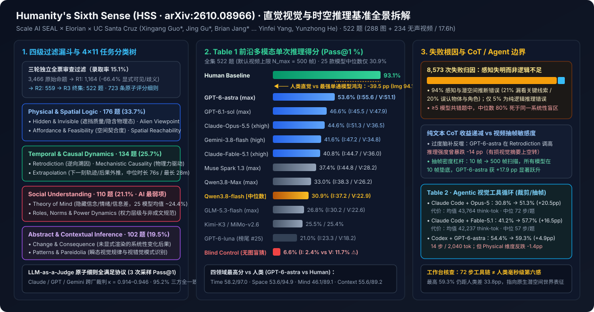

# Humanity's Sixth Sense (HSS): Benchmarking Intuitive Visual and Temporal Scene Reasoning in Multimodal Models (arXiv:2610.08966)

2026-10-14 · Scale AI SEAL × Elorian × UCSC (Guo et al.) · arXiv:2610.08966 · 待云端同步

[本地原件归档](../../../raw/570606646688fb30e274946f14a66defe942430b647f37b8190e77ce69bf21f9) · 固定材料版本 `digest-material-570606646688fb30e274946f14a66defe942430b647f37b8190e77ce69bf21f9@1` · [一手原站](https://arxiv.org/abs/2610.08966)

## 深度拆解与复核

- ==核心结论/观点==：Scale AI（SEAL 评测实验室）联合硅谷原生视觉推理初创实验室 Elorian 与 UC Santa Cruz 发布直觉视觉与时空推理基准 Humanity's Sixth Sense（HSS，[arXiv:2610.08966](https://arxiv.org/abs/2610.08966)，评测框架 [xingang2/HSS-Eval](https://github.com/xingang2/HSS-Eval)，数据集 [ScaleAI/HSS](https://huggingface.co/datasets/ScaleAI/HSS)）。HSS 从 3,466 道人工原创命题中经三轮独立全票审查筛出 522 道开放式任务（录取率 15.1%，含 288 张静态图像与 234 段累计 17.6 小时的无声视频，配 723 条原子评分细则）。对 25 款前沿多模态大模型的系统实测揭示了巨大的「人类第六感鸿沟」：人类受试者平均准确率（Pass@1）达 93.1%，而最强商业模型 GPT-6-astra（最大推理强度）单通得分仅 53.6%，25 款模型中位数低至 30.9%；对 8,573 次失败样本的归因证明 94% 源于视觉感知与潜空间隐式推断失明（仅 5% 为逻辑推理错误），单纯拉长纯文本思维链（Test-Time Compute）在逆向溯因等任务上甚至因「有损视觉摘要上的过度脑补」引发 -14 个百分点的准确率倒退。
- 场景与利益相关标注：本文由两大直接商业利益相关方联合主导——① Scale AI（SEAL 实验室）：曾与 CAIS 联合打造博士级学科基准 Humanity's Last Exam (HLE)，主营业务为向头部基模厂商出售高毛利专家评测集与多模态后训练 RL 环境（文中 15.1% 严苛人工漏斗正是其高端数据产线的能力展示）；② Elorian（[elorian.ai](https://elorian.ai/)）：2026 年 4 月刚以 3 亿美元投后估值完成 5,500 万美元种子轮融资（Striker Venture Partners、Menlo Ventures、Altimeter 领投，NVIDIA 与 Jeff Dean 参投），由前 Apple 多模态负责人 Yinfei Yang、前 xAI 后训练负责人兼 Google Gemini 核心主创 Dustin Tran 与前 Google Gemini 数据负责人 Andrew Dai 创立，其核心商业叙事正是「传统 VLM 将视觉转文本推理存在结构性天花板，必须构建支持动态裁剪、抽帧与代码交互的原生视觉推理（Native Visual Reasoning）模型」。因此，对文中 Agentic 视觉工具循环（Table 2）的收益解读需剥离其产品路线背书效应，独立审视延迟代价与基准半衰期。

---

### 一、 作者团队血缘与研究定位：从 Humanity's Last Exam（慢思考学科极限）走向 Humanity's Sixth Sense（快思考直觉基座）

1. 核心作者与三方机构分工：
   - 共同第一作者（Equal Contribution）：Xingang Guo*（Scale AI 研究员，开源评测代码库 [xingang2/HSS-Eval](https://github.com/xingang2/HSS-Eval) 主维护者）、Jing Gu*（Elorian 研究员，UC Santa Cruz 多模态方向博士背景）、Brian Jang*（Scale AI 研究员）。
   - 资深与通讯作者群：Scale AI 侧由 Yunzhong He（Scale AI 研究负责人，前 Meta FAIR / UCLA 视觉学者）与 Chenguang Wang（Scale AI & UC Santa Cruz 计算机系助理教授）领衔；Elorian 侧集结了联合创始人兼首席多模态架构师 Yinfei Yang（前 Apple Foundation Model MM1 / MM1.5 负责人、Google ALIGN 共同作者）、首席推理架构师 Dustin Tran（前 xAI 后训练负责人、Google DeepMind Gemini 1–2.5 核心贡献者）以及哈佛大学助理教授 Seth Neel。
2. 与 HLE 的正交互补定位：
   - 过去两年，以 Scale SEAL × CAIS 发布的 Humanity's Last Exam (HLE) 为代表的旗舰基准聚焦于金字塔尖的博士级跨学科难题（数学证明、量子化学、前沿文献推理），前沿模型通过强化学习可验证奖励（RLVR）与长思维链（System-2）已在该类考题上逼近甚至超越人类专家。
   - HSS 则切向人类智能光谱的另一端——莫拉维克悖论（Moravec's Paradox）在多模态时代的集中体现：普通成年人无需专业知识、仅凭一眼扫视（at a glance）或几秒无声画面即可瞬间完成的「前语言场景直觉」（如判断沙发能否塞进狭小楼梯转角、从洒落地面的水渍形态反推刚发生的碰撞方向、从会议室座位与视线微表情识别谁拥有真正话语权）。

---

### 二、 数据集构造、4×11 认知分类学与原子评分协议（全量工程量纲拆解）

1. 四级过滤漏斗（3,466 → 522 题，端到端通过率 15.1%）：
   - 标注团队最初专门针对隐式视觉推理编写了 3,466 道候选任务，随后执行三轮独立盲审且要求三轮全票通过（Unanimous Approval）：
     - Stage 1（初筛剔除 66.4%，剩 1,164 题）：淘汰答案可直接从画面字面像素读出（纯 OCR / 显式目标检测）、依赖外部百科知识或评审员之间答案不一致的题目；
     - Stage 2（复核评分细则，剩 559 题）：检验问题是否存在多解歧义，打磨原子级评分标准；
     - Stage 3（终审定稿，剩 522 题）：最终冻结发布集包含 288 道静态图像任务（占 55.2%）与 234 道无声视频任务（占 44.8%）。
   - 无声视频时序特征与防污染设计：全部 234 段视频均剥离音轨（Silent Video），强制模型只能从像素运动而非语音台词或环境音效中提取因果信号；视频总累计时长达 17.6 小时，单段时长呈明显右偏长尾分布——中位数 76 秒，四分位距（IQR）20–307 秒，最长单段达 28 分钟（1,680 秒）。虽然底层图像与公开网络视频可能曾出现在预训练语料中，但全部 522 道提问与 723 条评分细则均为全新人工原创，测试实时零样本跨帧关系推断而非静态百科记忆。
2. 四大核心领域 × 11 个子任务分布：

| 一级认知领域（题数 / 占比） | 涵盖的 11 个二级子领域（Subdomains） | 测量的隐式物理 / 时空 / 心智机制 | 人类基线 | GPT-6-astra | 25 模型特征表现 |
| :--- | :--- | :--- | :---: | :---: | :--- |
| 1. 物理与空间逻辑 *Physical & Spatial Logic* （176 题 / 33.7%） | ① *Hidden & Invisible*（遮挡质量/温度/隐含刚度） ② *Spatial "Alien Viewpoint"*（异位视角空间投影） ③ *Affordance & Feasibility*（空间契合度与动作可行性） ④ *Spatial Reachability*（物理约束下的可达边界） | 不依赖显式三维重建网格，凭单目透视、接触形变与重力常识预判物体能否穿过孔洞、异侧观察者能看到什么 | 94.9% | 53.6% | 几何透视转换与紧凑空间契合度判断频繁出错 |
| 2. 时序与因果动力学 *Temporal & Causal Dynamics* （134 题 / 25.7%） | ⑤ *Retrodiction*（逆向溯因：从当前残局反推前一刻事件） ⑥ *Mechanistic Causality*（驱动当前运动的底层物理力传递） ⑦ *Extrapolation*（轨迹外推：预判下一秒即将发生的后果） | 跨帧动量守恒、接触力链条传递、危险态势超前预判与遮挡后轨迹延续 | 97.0% | 58.2% | 人类最高分领域（97.0%），模型对瞬态因果链断裂严重 |
| 3. 社会理解与心智理论 *Social Understanding* （110 题 / 21.1%） | ⑧ *Social Roles, Norms & Power Dynamics*（权力层级与潜规则） ⑨ *Theory of Mind*（隐藏信念、意图、情绪与信息不对称） | 从无声肢体朝向、微表情、社交距离与视线回避推断「谁知情、谁被蒙在鼓里、谁主导局面」 | 89.1% | 46.1% | 全场重灾区：25 款模型平均得分仅约 24.4%（Qwen3.8-flash 仅 18.6%） |
| 4. 抽象与语境推断 *Abstract & Contextual* （102 题 / 19.5%） | ⑩ *Change & Consequence*（未直接渲染的结构变化系统后果） ⑪ *Patterns & Pareidolia*（瞬态构图规律与视错觉模式识别） | 跨局部线索拼合全局语境异常、反事实状态推演与抽象视觉类比 | 89.2% | 55.6% | Claude-Opus-5.5 并列达 55.6%，依赖高层语义归纳能力 |

3. 开放式作答与原子级全满足评分协议（All-or-Nothing Atomic Rubric）：
   - 彻底摒弃多选题（MCQ），要求被测模型输出自由文本解释；每道题绑定人工编写的参考答案与 723 条必选原子标准（平均每题 1.39 条，每条标准均经原作者之外至少 3 名独立审核员背靠背核准）。
   - 全满足门控：单次作答必须同时满足该题名下每一条原子标准才记为 1 分，漏掉任一关键因果环节即记 0 分；每个模型在每道题上独立运行 3 次采样取均值作为最终 Pass@1。
   - 跨厂商裁判一致性校验：使用 Claude（Claude-Opus-5）、GPT（GPT-5.6-terra） 与 Gemini 三套异构大模型交叉担任评分裁判，评估单元间的机会校正一致性系数 Cohen's $\kappa$ 介于 0.914 至 0.946（超过 95% 的题目与细则满足 $\kappa \ge 0.92$，三家裁判在 95.2% 的样本上给出完全一致的二元判罚）。

---

### 三、 25 款前沿多模态模型全量跑分拆解与「纯文本 CoT 失效」机制

#### 1. Table 1 单通推理（Single-Pass Inference）核心分层榜单

在统一默认抽帧上限（对不支持原生视频流或需帧管理的接口采用均匀采样，全局上限 $N_{\max} = 500$ 帧或取模型自身最大帧配额）下，25 款模型完整得分梯队如下：

| 排名 / 梯队 | 模型名称（推理强度配置） | Overall Pass@1 (%) | Image (288 题) | Video (234 题) | Time 时序因果 | Space 空间物理 | Mind 社会心智 | Context 抽象语境 |
| :--- | :--- | :---: | :---: | :---: | :---: | :---: | :---: | :---: |
| *参考基准* | Human Baseline（人类受试者） | 93.1 | 94.1 | 91.9 | 97.0 | 94.9 | 89.1 | 89.2 |
| #1 榜首 | GPT-6-astra *(max)* | 53.6 ± 4.1 | 55.6 | 51.1 | 58.2 | 53.6 | 46.1 | 55.6 |
| #2 | GPT-6.1-sol *(max)* | 46.6 ± 3.8 | 45.5 | 47.9 | — | — | — | — |
| #3 | Claude-Opus-5.5 *(xhigh)* | 44.6 ± 3.8 | 51.3 | 36.5 | 44.0 | 44.9 | 34.8 | 55.6 |
| #4 | Gemini-3.8-flash *(high)* | 41.6 ± 3.7 | 47.2 | 34.8 | 43.3 | 37.5 | 40.0 | 48.4 |
| #5 | Claude-Fable-5.1 *(xhigh)* | 40.8 ± 3.6 | 44.7 | 36.0 | 43.3 | 41.1 | 34.2 | 44.1 |
| #6 | Gemini-3.7-flash *(high)* | 39.8 ± 3.7 | 45.4 | 33.0 | 40.5 | 40.9 | 35.8 | 41.5 |
| #7 | Muse Spark 1.3 *(max)* | 37.4 ± 3.5 | 44.8 | 28.2 | 39.6 | 38.1 | 25.8 | 45.8 |
| #8–#12 | Claude-Fable-5 (34.5) / Qwen3.8-Max (33.0) / Gemini-3.5-flash (32.6) / Gemini-3.6-flash (31.9) / GPT-6-sol (31.2) | 31.2 – 34.5 | 31.8 – 38.3 | 26.2 – 31.3 | 35.6 – 38.1 | 29.7 – 35.2 | 21.0 – 32.4 | 28.4 – 34.7 |
| #13 中位数 | Qwen3.8-flash *(max)* | 30.9 ± 3.3 | 37.2 | 22.9 | 37.9 | 29.2 | 18.6 | 37.1 |
| #14–#19 | Claude-Opus-5 (30.5) / GPT-5.6-sol (30.0) / GLM-5.3-flash (26.8) / Kimi-K3 (25.5) / MiMo-v2.6-flash (25.4) / MiMo-v2.6-pro (25.2) | 25.2 – 30.5 | 28.5 – 32.5 | 18.6 – 31.9 | — | — | — | — |
| #20–#25 | Claude-Sonnet-5 (24.8) / Muse Spark 1.2 (24.5) / Claude-Opus-4.8 (23.5) / GPT-5.6-terra (22.7) / GPT-5.6-luna (21.6) / GPT-6-luna (21.0) | 21.0 – 24.8 | 23.3 – 29.5 | 18.2 – 20.9 | — | — | — | — |
| *盲测对照* | Blind Control（GPT-6-astra 剥离图像/视频） | 6.6 ± 1.5 | 2.4 | 11.7 | — | — | — | — |

#### 2. 为什么扩展纯文本 CoT（Test-Time Compute）救不了直觉视觉，而动态视觉工具链代价高昂？

1. 8,573 次错误归因：瓶颈在「视觉表征失真」而非「符号逻辑推理」：
   - 论文对全部评测模型产生的 8,573 条失败记录做细粒度归因，发现高达 94% 的失败属于视觉感知或潜空间隐式推断错误（其中 21% 完全漏看了画面中的决定性视觉线索，20% 误认了关键物体、人物身份或角色关系），而真正死于形式逻辑链条推导错误的仅占 5%。
   - 更关键的是，在至少被 5 款模型同时答错的题目上，中位数高达 80% 的模型栽在完全相同的底层视觉盲区上——证明当前主流「冻结 ViT 离散 Patch 编码 + 线性投影至自回归语言空间」架构存在跨厂商共性的结构性失明。
2. Test-Time Compute（Reasoning Effort）的非单调退化与语言化瓶颈（Verbalization Bottleneck）：
   - 实验对比 low / medium / high / xhigh / max 推理预算发现，单纯增加纯文本思考 Token 不仅边际收益迅速衰减，甚至在部分子域诱发显著负优化——典型如 GPT-6-astra 在逆向溯因（Retrodiction）子任务上提高推理强度时曾出现 -14 个百分点的准确率暴跌。
   - 底层机制：当模型在首轮视觉编码阶段漏掉了关键的亚像素几何接触或人物微表情时，后续生成的数万个文本 CoT Token 只能在「错误或不完整的初始文字描述」上反复空转，把原本直觉能看出的简单物理事实脑补成复杂的错误阴谋论（Overthinking on Lossy Visual Summaries）。相比之下，直接增加原始像素时间分辨率效果立竿见影：在 234 道视频题上将帧预算从 10 帧 扫描至 500 帧，所有参评模型均在 10 帧 处垫底，而 GPT-6-astra 从 10 帧 增至 500 帧 直接斩获 +17.9 个百分点的净提升。
3. Table 2：Agentic 视觉操作循环（裁剪 / 缩放 / 逐帧提取）的收益与算力账本：

| Agentic 框架 | 基座模型 | 单通基线 (Raw) | Agent 模式得分 | 总体净增 ($\Delta$) | Image $\Delta$ | Video $\Delta$ | Temporal $\Delta$ | Physical $\Delta$ | Social $\Delta$ | Abstract $\Delta$ | 平均思考 Token (think-tok) | 中位执行步数 (steps) |
| :--- | :--- | :---: | :---: | :---: | :---: | :---: | :---: | :---: | :---: | :---: | :---: | :---: |
| Claude Code | Claude-Opus-5 | 30.8% | 51.3% | +20.5 | +24.3 | +15.8 | +26.3 | +15.1 | +18.2 | +25.6 | 43,764 | 72 步 |
| Claude Code | Claude-Fable-5.1 | 41.2% | 57.7% | +16.5 | +15.4 | +17.9 | +16.8 | +14.9 | +22.1 | +13.2 | 42,237 | 57 步 |
| Codex | GPT-6-astra | 54.4% | 59.3% | +4.9 | +4.5 | +5.5 | +6.7 | -1.4 | +9.5 | +9.6 | 2,040 | 14 步 |
| Codex | GPT-5.6-sol | 28.4% | 35.8% | +7.5 | +8.0 | +6.8 | +3.4 | +6.5 | +6.9 | +15.5 | 6,541 | 18 步 |

---

### 四、 方法论与实验统计原位核查（`/r` 独立复核）

1. ✅ 核查 1：开放式全满足原子细则有效压平了传统多模态基准的「猜题泡沫」（本工作台核查）
   - 本工作台核查：过往主流视觉基准（如 MMMU、MMStar、Video-MME）普遍采用四选一多选题（随机猜题下限 25%），模型极易利用选项长度、排他性措辞先验刷出虚高分数。HSS 强制自由文本作答且要求全部原子细则同时命中，使 GPT-6-astra (max) 在剥离媒体后的总体盲猜得分降至 6.6%，522 道题中三次盲测全过的仅有 4 题（0.77%）；配合三家异构裁判 0.914–0.946 的 $\kappa$ 一致性，确认 93.1% vs 53.6% 的能力断层具备扎实的测量效度。
2. ⚠️ 核查 2：盲测对照暴露视频题干存在 4.88 倍 于静态图的语言先验泄露（本工作台核查与推断）
   - 本工作台核查：拆解 Table 1 最末行 Blind Control 子项可见，无图盲猜在静态图像集上仅 2.4%，但在无声视频集上却跳升至 11.7%（相差 4.88 倍）。
   - 本工作台推断：视频题干为了在长时序片段（中位数 76 秒，最长 28 分钟）中锚定提问瞬间，往往在问题文本里写明了动作主语与前后物理态势（例如「当叉车升起托盘经过货架拐角时……」），使强语言模型在完全不看视频像素的情况下仍能凭物理动词先验猜对近九分之一的题目。若扣除该 11.7% 语言先验底座，多数中腰部模型（Video 得分 18%–26%）在纯视频像素上的真实增量理解能力实际上仅在 7%–15% 区间。
3. ⚠️ 核查 3：全局上限 $N_{\max}=500$ 帧与各厂商 API 帧配额差异构成单通榜单的混杂变量（本工作台核查）
   - 本工作台核查：234 段视频最长 28 分钟（1,680 秒），即便吃满 500 帧上限，最差采样密度也低至 0.30 FPS（每 3.36 秒 1 帧）；更重要的是，不同模型原生 API 允许输入的最大帧数与视觉 Token 压缩比并不统一。数据直接印证了这一混杂效应：全场 25 款模型中，唯有 OpenAI 的 GPT-6.1-sol（Video 47.9% > Image 45.5%）与 GPT-5.6-sol（Video 31.9% > Image 28.5%）实现了视频反超图像，而图像端紧咬榜首的 Claude-Opus-5.5（Image 51.3%）到视频端暴跌 -14.8pp 至 36.5%，Muse Spark 1.3 更是暴跌 -16.6pp（44.8% → 28.2%）。因此 Table 1 视频分差距部分反映的是厂商 API 视频上下文窗口工程配额，而非纯粹的底层架构优劣。
4. ❌ 核查 4：72 步 Agentic 循环违背「毫秒级直觉」的物理时间约束，且全量公开集缺乏私有留存保护（本工作台核查与推断）
   - 本工作台核查：① Claude Code 虽为 Claude 系列带来 +16.5 ~ +20.5pp 跃升，但代价是单题平均消耗 42,237–43,764 个思考 Token、中位数串行调用 57–72 步编写 Python 脚本裁剪局部像素与抽帧；反观 Codex + GPT-6-astra 在 Physical & Spatial Logic 维度甚至出现 -1.4pp 的倒退（局部裁剪破坏了全局三维透视参照系），且全场最高 Agent 得分（59.3%）距人类单眼直觉（93.1%）仍有 33.8pp 缺口。② 核查 [ScaleAI/HSS](https://huggingface.co/datasets/ScaleAI/HSS) 仓库结构确认，全部 522 道题的媒体、提问、参考答案与 723 条原子评分细则已 100% 公开且未设置独立私有留存集（No Private Held-Out Split）。
   - 本工作台推断：用耗时数十秒、72 步工具循环的「System-2 离线显微镜」去修补感知盲区，无法迁移至自动驾驶或人形机器人毫秒级避障与交互场景；同时缺乏私有测试集意味着未来 6–9 个月内，针对这 11 类子任务的合成视觉工具轨迹（Visual Tool-Use RLVR）将快速推高公开榜分数，存在显著的「刷榜饱和但真实物理直觉未解」风险。

---

### 五、 与本库世界模型、具身 System-1 解码及后训练数据主线的交叉互证

HSS 的实验证据将本库在 AI训练与数据 及 具身智能 赛道追踪的三条独立技术脉络严密咬合在同一个第一性原理框架下：

1. 印证 Yann LeCun「柏拉图表征定理」对自回归语言主干的容量损耗诊断：
   - 在本库已收录的 [LeCun & Balestriero 论文导读](Yann%20LeCun%E6%96%B0%E8%AE%BA%E6%96%87%EF%BC%8C1.09%E4%BA%BFJEPA%E5%9C%A8%E5%9B%BE%E6%96%87%E5%AF%B9%E9%BD%90%E4%B8%8A%E8%B5%A2%E4%BA%86720%E4%BA%BFQwen%EF%BC%81.md)（arXiv:2610.39302）中，谱理论严格证明标准 LLM 的 Next-Token Prediction 等价于在同一文档切片上做「坏视角（Bad Views）」配对，迫使模型将大量表征维度浪费在记忆句法与措辞干扰项上，而未能收敛出跨视角等距同构的物理世界状态空间。HSS 中 94% 失败源于感知/潜空间推断、拉长文本 CoT 反而倒退 -14pp，正是「坏视角语言主干无法靠事后多说废话重建丢失物理态」的大规模实证。
2. 呼应具身智能 VFlash 的 System-1 原生空间并行解码方向：
   - 在本库具身赛道收录的 [NVIDIA LPR Lab VFlash 导读](../../%E5%85%B7%E8%BA%AB%E6%99%BA%E8%83%BD/blogs/%E8%8B%B1%E4%BC%9F%E8%BE%BE%20VFlash%EF%BC%9AJim%20Fan%E5%AE%A3%E5%91%8A%E2%80%9CSystem-1%E8%A7%86%E8%A7%89%E6%96%B0%E6%97%B6%E4%BB%A3%E2%80%9D%EF%BD%9C%E6%A8%A1%E5%9E%8B%E6%8F%90%E9%80%9F12%E5%80%8D.md) 中，传统自回归 VLM 逐 Token 串行吐出三维轨迹不仅在 Jetson Thor 上耗时 3,107.6 ms，还因首点量化偏差毒化下游世界动作模型（成功率从 62.6% 倒退至 61.0%）；改用跳过逐 Token 文本校验的非因果双向并行图元解码后，延迟骤降至 258.2 ms（提速 12×）且成功率反升至 70.2%。这与 HSS 揭示的「把连续物理空间强行压扁为离散语言 Token 思维链会导致空间物理维度负优化（如 Codex + GPT-6-astra 在 Physical 域 -1.4pp）」指向同一结论：物理与空间直觉必须在潜空间或原生几何空间并行完成，而不能绕道串行自然语言中介。
3. 重塑 AI训练与数据 赛道的商业价值锚点：
   - 结合本赛道 [Mercor 职业基准映射](90%25%E7%9A%84%E7%BE%8E%E5%9B%BD%E5%B7%A5%E4%BD%9C%EF%BC%8C%E6%B2%A1%E6%9C%89%E4%BB%BB%E4%BD%95AI%E5%9F%BA%E5%87%86%E8%A6%86%E7%9B%96.md)、[Handshake 可交互模拟世界主张](%E3%80%8CHandshake%E5%A4%8D%E7%9B%98%E6%95%B0%E6%8D%AE%E8%A1%8C%E4%B8%9A%E3%80%8D%E6%95%B0%E6%8D%AE%E8%A1%8C%E4%B8%9A%E5%9C%A8%E5%8D%96%E4%BB%BB%E5%8A%A1%EF%BC%8C%E6%B2%A1%E4%BA%BA%E5%9C%A8%E5%BB%BA%E4%B8%96%E7%95%8C.md)与 [Trajectory 持续后训练融资披露](Trajectory%20%E8%8E%B7%20Sequoia%20Capital%20%E9%A2%86%E6%8A%95%E3%80%81NVIDIA%20%E4%B8%8E%20Bessemer%20%E5%8F%82%E6%8A%95%20%244%2C500%20%E4%B8%87%20Series%20A%EF%BC%88%E6%8A%95%E5%90%8E%E4%BC%B0%E5%80%BC%20%243%20%E4%BA%BF%EF%BC%89%EF%BC%9A%E5%88%87%E5%85%A5%E9%A2%86%E5%9F%9F%E4%B8%93%E5%AE%B6%E5%8F%8D%E9%A6%88%E9%A9%B1%E5%8A%A8%E7%9A%84%E6%8C%81%E7%BB%AD%E5%90%8E%E8%AE%AD%E7%BB%83%E9%97%AD%E7%8E%AF.md)可见：静态文本问答与学科刷题数据红利已彻底见顶；下一阶段高溢价数据基础设施正沿两条主线分化——面向企业软件工作流的生产现场专家纠偏闭环（Trajectory），以及面向多模态与物理 AGI 的高密度反事实物理/社交状态推断环境与原生视觉操作轨迹（Scale SEAL / Elorian）。

### 观点与可反驳条件

- ==观点==：HSS 以 93.1%（人类）对 53.6%（最强单通模型）及 94% 感知失明归因，证实以「冻结 ViT 离散分块 + 纯文本 CoT 扩展」为核心的现行多模态范式在日常物理、时序因果与无声社会心智直觉上已撞上结构性天花板；依靠 50–70 步 Python 裁剪抽帧的 Agentic 视觉套壳只是高延迟的离线权宜之计，真正的代际突破将取决于引入跨帧连续潜空间预测（如视频 JEPA / 原生三维时空世界模型）作为多模态基座的原生 System-1 感知主干。
- ==推翻条件==：
  1. 若未来 12 个月内，仅靠纯自回归离散视觉-语言 Token 架构（不挂载外部裁剪/抽帧代码循环、单题端到端延迟 <1 秒）的模型在新建未公开的同分布私有直觉视觉测试集上将 Pass@1 推升至 85% 以上，则「离散语言中介无法承载人类级视觉直觉」的架构瓶颈判断将被推翻；
  2. 若主流模型在公开的 ScaleAI/HSS（522 题）上通过合成视觉工具 RLVR 训练在 6 个月内刷过 80%，但在独立采集的零样本长尾无声视频/真机物理可行性测试集上得分仍停留在 <55%，则将反向证实本工作台关于「HSS 缺失私有留存集导致快速基准过拟合」的预警；
  3. 若在统一强制锁死相同物理抽帧率（如全量视频统一输入 2 FPS 原生帧流）后，Claude-Opus-5.5 与 Gemini-3.8-flash 等模型的 Video Pass@1 自动追平甚至反超 Image Pass@1（达到 >50%），则说明当前视频子集的部分掉点主要源于 API 帧配额截断而非时序因果推理缺陷。

---

## 原文摘录与一手信源存证

> 【信源巡检核心摘要】 Scale AI Labs 联合 Elorian 与 UC Santa Cruz 发布直觉视觉与时空推理基准 Humanity's Sixth Sense (HSS, https://arxiv.org/abs/2610.08966 ，开源评测集托管于 https://huggingface.co/ScaleAI )。
> — 原文摘录，文字段落 1；证据 `digest-material-570606646688fb30e274946f14a66defe942430b647f37b8190e77ce69bf21f9-excerpt-1@1`

一手材料：

- Humanity's Sixth Sense (HSS): Benchmarking Intuitive Visual and Temporal Scene Reasoning in Multimodal Models (arXiv:2610.08966) · Scale AI SEAL × Elorian × UC Santa Cruz · [原站](https://arxiv.org/abs/2610.08966) · [主体档案：Scale AI Labs](../entities/companies/Scale%20AI%20Labs.md) / [主体档案：Elorian](../entities/companies/Elorian.md) / [主体档案：UC Santa Cruz](../entities/labs/UC%20Santa%20Cruz.md) · [待上传原件](../../../raw/570606646688fb30e274946f14a66defe942430b647f37b8190e77ce69bf21f9)
  材料版本 `digest-material-570606646688fb30e274946f14a66defe942430b647f37b8190e77ce69bf21f9@1`；获取方式 `tg_approved_source_update`。
  > 【信源巡检核心摘要】 Scale AI Labs 联合 Elorian 与 UC Santa Cruz 发布直觉视觉与时空推理基准 Humanity's Sixth Sense (HSS, https://arxiv.org/abs/2610.08966 ，开源评测集托管于 https://huggingface.co/ScaleAI )。 — 原文提取

归属与范围：核心结论：Scale AI（SEAL 实验室）联合原生视觉推理实验室 Elorian 与 UC Santa Cruz 发布 Humanity's Sixth Sense (HSS, arXiv:2610.08966)，从 3,466 道原始命题中以 15.1% 录取率严筛出 522 道开放式任务（288 图 + 234 段共 17.6 小时无声视频）及 723 条原子评分细则；实测 25 款前沿多模态模型中位数仅 30.9%、榜首 GPT-6-astra 单通仅 53.6%（远低于人类 93.1%），8,573 次失败中 94% 源于感知与潜空间推断失明而非逻辑不足，证明纯文本 CoT 扩展无法代偿底层视觉世界表征缺失。

来源缺口：

- `not_disclosed`：ScaleAI/HSS 已将全部 522 道公开题目与 723 条原子评分细则全量开源于 Hugging Face，论文未披露单独隔离的私有留存测试集（private held-out split），无法直接观测各厂商后续合成数据微调是否存在题型过拟合。 [线索](https://huggingface.co/datasets/ScaleAI/HSS)
- `not_disclosed`：Table 1 中各闭源商业 API 在 234 段长尾视频（中位 76 秒、最长 28 分钟）上实际生效的内部帧采样数与视觉 Token 压缩率未逐模型完全对齐披露，部分模型视频分大幅低于图像分混杂了 API 帧窗口配额限制。 [线索](https://arxiv.org/abs/2610.08966)

[返回赛道总览](../赛道总览.md#digest-570606646688fb30) · [返回导读索引](README.md) · [主体档案库](../entities/README.md)
