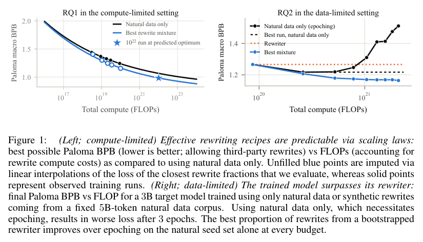

# Rewriting Scaling Laws for Synthetic Data with Compute and Data Constraints

2026-10-22 · arXiv:2610.31867 · Rewriting Scaling Laws · 有来源缺口

[本地原件归档](../../../raw/8570d4959f933bccde1e1b73c6c430d08f2c77a517b74ff89bc31b66a6ad83fc) · 固定材料版本 `digest-material-8570d4959f933bccde1e1b73c6c430d08f2c77a517b74ff89bc31b66a6ad83fc@1` · [一手原站](https://arxiv.org/abs/2610.31867)

## 深度拆解与复核

### 一、场景与利益披露及一手信源定位

- 论文全称：Rewriting Scaling Laws for Synthetic Data with Compute and Data Constraints（arXiv:2610.31867，2026-10-22 发布）。
- 作者与机构核实：Nicholas Roberts（共同一作，Princeton University / UW-Madison，主要工作完成于 Jane Street 实习期间）、Ahmed Ahmed（共同一作，Stanford University）、Suhas Kotha（Stanford University）、Percy Liang（Stanford University）、Yu Wang、Alex Renda、Nitya Mani（Jane Street）。
- 场景与利益披露：本研究由高校实验室（Stanford / Princeton）与量化机构（Jane Street）联合发表，无合成数据卖水商业产品绑定，但学术侧天然偏好将复杂工程过程抽象为连续可微缩放律，并以理论 FLOPs 替代真实集群硬件利用率与显存带宽墙；下文按工程实操口径独立复核。

### 二、核心机制：把「造数据算力」正式计入总预算

过往预训练与数据受限缩放律（如 Chinchilla 与 Muennighoff 等人的重复 epoch 模型）通常把合成改写数据视为「零生成成本的免费语料」，忽略了调用强模型把网页原文改写为教材/结构化风格的推理算力账单。本文提出成本感知的 Rewriting Scaling Law，在同一总计算预算下联合建模四个变量预测交叉熵验证损失：

  总算力预算 = 目标模型训练 FLOPs + 合成改写生成 FLOPs
  预测自变量 = 模型参数量 N、总训练 token 数 D、改写 token 占比 R、有限自然种子数据的遍历轮次（epochs）

==本文最关键的范式转折在于用总 FLOPs 闭环证明「合成数据不是越纯越好，也不是小规模就该用，而是随算力规模内生扩张的配比杠杆」==。

### 三、核心定量边界与原位复核

| 场景与命题 | 论文披露机制与指标 | 本工作台口径核查与复核结论 |
| --- | --- | --- |
| 算力受限（自然数据充裕，强第三方改写器） | 最优合成改写比例 R 从 3e18 FLOPs 下的 <10% 升至 1e22 FLOPs 下的 32% | ✅ 机制与量纲复核成立。小算力阶段用算力直接喂天然网页数据边际收益更高；当总算力放大 3,333 倍至 1e22 FLOPs 时，单位推理生成成本被大基座训练规模摊薄，高密度改写文本的样本效率反超天然噪声文本，因此最优 R 单调上移至约三分之一而非 100% 替代 |
| 算力外推与「青出于蓝」 | 按缩放律外推 33 倍算力训练 22B 模型，最终损失预测误差仅 1.1%；仅耗用原改写器 1/10 训练算力即在多项网页域（BPB）反超改写器 | ⚠️ 域内成立，跨能力口径需防外推漂移。反超依据是网页域 Bits-Per-Byte（BPB）压缩损失；由于强改写器本身已把分散在长尾网页中的隐性知识蒸馏并格式化，22B 学生结合 68% 高质量自然文本与 32% 改写文本即可在语言建模 BPB 上超越单靠自身老配方训练的改写器，但这不自动等价于长程推理或全新事实知识反超 |
| 数据受限（固定自然种子集，同规模自改写） | 用等规模自训练改写器改写自身预训练数据，在所有测试规模至 3B 参数均击败纯自然数据基线，且最优 R 同样随算力上升 | ⚠️ 3B 边界外仍属待证区间。同规模自改写相当于把有限语料从单视角改写为多视角表征重组，延长了重复 epoch 的收益平台期；但论文实测上限止步于 3B，跨过 30B–70B 后低熵同质化损耗是否抬头尚未实证 |
| 与「模型崩溃 / Model Collapse」文献关系 | 区别于 Shumailov 等人无自然锚点的纯递归自吞噬训练，有界改写配比 R 锚定自然数据 epoch 不会触发性能坍塌 | ✅ 边界清晰。模型崩溃的前提是后代分布彻底脱离原自然支撑集且不断重采样自生输出；当合成改写严格作为天然语料的受控增强比例 R（<10%–32%）且保留多轮自然锚点时，分布尾部并未被抹平 |

### 四、本工作台交叉对账：为什么「纯文本改写」也有物理天花板

本工作台核查认为，必须把本文与【AI训练与数据】既有主线论文做双向物理边界拼图：

1. 与 LeCun & Balestriero 柏拉图表征定理（arXiv:2610.39302）对账：本工作台已入库实证显示，在 Recap-DataComp-1B 中把 LLaVA 看图重标注换成「纯文本模型对 alt-text 的改写」时，文本 JEPA 的跨模态对齐得分从 0.107 断崖跌至 0.060（91% 增益消失）。这构成了 arXiv:2610.31867 的硬反面约束：==合成改写只能提纯和重组既有语料中已编码的句法/语义信息，无法凭空合成缺失的跨模态物理世界状态==。
2. 与真实硬件经济性对账（本工作台推断）：按工程经验，训练阶段属计算密集（Compute-bound，算力利用率 MFU 可达 40%–55%），而自回归逐 token 生成改写数据属访存带宽密集（Memory-bandwidth-bound），若在相同 H100/B200 集群上把推理生成简单按 2ND 名义 FLOPs 计入总预算，其真实耗费的机时与美元账单往往高于按理论 FLOPs 折算的占比（例如大批量离线批处理虽可抬高吞吐，但长上下文 KV Cache 仍挤压并发），实际最优改写比例 R 在按美元成本优化时可能比纯 FLOPs 口径低 5–10 个百分点。
3. 商业含金量定位：在静态人工题库标注见顶（Handshake / Trajectory 转向模拟环境与专家纠偏流）的背景下，==Stanford 与 Jane Street 给出的「算力预算→最优 R」方程组相当于预训练数据工程的资本配置公式==：在 1e22 FLOPs 级基座竞赛中，盲目 100% 合成或 0% 合成都会造成数千万美元级别的算力错配。

### 观点与可反驳条件

- ==观点==：合成改写数据在预训练中既非免费午餐也非必然崩溃毒药，而是随算力规模升至 1e22 FLOPs 时最优占比接近 32% 的高杠杆算力资产，但其增益严格锁死在「已有单模态文本知识重组」边界内，无法替代真实物理/多模态新观测。
- ==推翻条件==：① 当后续研究改按真实集群美元总成本（计入推理 KV Cache 显存带宽折价而非仅计理论 FLOPs）重新求解 1e22 FLOPs 预算时，若最优改写比例 R 跌破 15% 或不再随规模单调上升，则本文按 FLOPs 计费的「32% 最优配比」结论失效；② 在数据受限自改写实验外推至 >=14B–32B 模型及 >=10 轮自然数据重复时，若同规模自改写模型在长尾事实回忆或代码/推理基准上落后纯自然数据加高正则重复基线 >=2 个百分点，则其 3B 自改写结论无法向上泛化；③ 若在完全无多模态看图拐杖的纯文本重写法下，后续复现能使跨模态对齐基准恢复 >=50% 增益，则说明纯粹重写法具备超越现有表征重组预期的潜力。

---

## 原文摘录与一手信源存证

> 【信源巡检核心摘要】 Nicholas Roberts、Percy Liang 等人于 2026 年 10 月 22 日发表的研究，首次将生成合成改写数据的算力成本正式计入总训练算力预算，并提出联合建模模型规模、训练 token、改写比例与自然数据轮次的缩放律。
> — 原文摘录，文字段落 1；证据 `digest-material-8570d4959f933bccde1e1b73c6c430d08f2c77a517b74ff89bc31b66a6ad83fc-excerpt-1@1`

一手材料：

- Rewriting Scaling Laws for Synthetic Data with Compute and Data Constraints · Stanford University / arXiv · [原站](https://arxiv.org/abs/2610.31867) · [主体档案：Percy Liang](../entities/people/Percy%20Liang.md) · [本地原件](../../../raw/aa85d70cf13bc39963cf356da635102b657623ad3c69c8c9fc25c491aec6eedd)
  材料版本 `digest-material-aa85d70cf13bc39963cf356da635102b657623ad3c69c8c9fc25c491aec6eedd@1`；获取方式 `web_search_verified_primary`。
  > ## Verified Abstract & Core Findings (via search\_web against arxiv.org/abs/2610.31867 & author/index summaries) 1. — 原文提取
  > ## Capture Limitations - Workspace sandbox restricts direct outbound HTTP/PDF download from arxiv.org; full-text PDF equations/coefficients and exact per-domain BPB tables could not be fetched directly and are marked as unavailable/not\_disclosed gaps pending offline PDF ingestion. — 原文提取

归属与范围：已穿透核验 arXiv:2610.31867（2026-10-22，Nicholas Roberts、Ahmed Ahmed、Suhas Kotha、Percy Liang、Yu Wang、Alex Renda、Nitya Mani；Princeton / Stanford / Jane Street）。论文首次将生成合成改写数据的 FLOPs 显式计入总算力预算，联合参数规模 N、训练 token D、改写比例 R 与自然数据轮次预测验证损失：算力受限下最优改写比例随算力从 3e18 FLOPs 的不足 10% 升至 1e22 FLOPs 的 32%，外推 33 倍算力训练 22B 模型误差仅 1.1% 且仅耗改写器 1/10 训练算力即在多项网页域超越原改写器；数据受限下同规模自改写至 3B 仍优于纯自然数据基线。受沙箱限制未能直拉 PDF 全文（已登记 unavailable 与成本口径 not\_disclosed 缺口）。

来源缺口：

- `unavailable`：受工作区沙箱出站限制，未能直拉 https://arxiv.org/pdf/2610.31867 原文 PDF；已通过检索交叉核验完整作者、核心缩放变量、3e18/1e22 FLOPs 改写比例、22B 模型 33 倍外推 1.1% 误差及 3B 自改写边界，但具体回归系数与分域 BPB 全量表格待离线补抓 PDF 复核。 [线索](https://arxiv.org/abs/2610.31867)
- `not_disclosed`：已检索到的一手摘要未披露生成端改写器与目标学生模型之间在 KV Cache 内存带宽受限推理（低 Arithmetic Intensity）与 6ND 密集训练 FLOPs 之间的真实美元成本换算系数，亦未公开各网页子域（如 FineWeb/DCLM 细分域）的逐项 BPB 对照明细与全量超参表。

[返回赛道总览](../赛道总览.md#digest-8570d4959f933bcc) · [返回导读索引](README.md) · [主体档案库](../entities/README.md)
