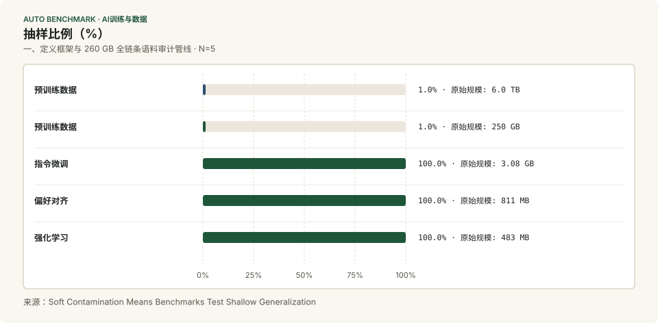

# Soft Contamination Means Benchmarks Test Shallow Generalization

2026-02-12 · Arb Research (Spiesberger et al.) · arXiv:2602.12413 · 有来源缺口

[本地原件归档](../../../raw/e3358442675af2da4244bccc079df8b73f210be1114ef661b2268ad5b34d6311) · 固定材料版本 `digest-material-e3358442675af2da4244bccc079df8b73f210be1114ef661b2268ad5b34d6311@1` · [一手原站](https://arxiv.org/abs/2602.12413)

## 深度拆解与复核

- 口径与利益披露：本篇研究《Soft Contamination Means Benchmarks Test Shallow Generalization》（arXiv:2602.12413，v1 于 2026-02-12 提交，v2 于 2026-11-07 修订，录用于 40th Conference on Neural Information Processing Systems / NeurIPS 2026）由独立研究与咨询机构 Arb Research（并列一作 Ari Spiesberger、Juan J. Vazquez；合作者 Nicky Pochinkov、Peli Grietzer；联合导师 Gavin Leech）联合 Charles University（Tomáš Gavenčiak）与 University of Oxford（Nandi Schoots）完成。利益与激励边界上，Arb Research 主营 AI 泛化机制、评估方法与大数据管线研究（客户包含 Stripe、SCSP、LawZero、European Commission、Coefficient Giving、Schmidt Futures 等），并不出售预训练语料或托管大模型，其动机聚焦于揭示既有推理基准被「语义重复（Semantic Duplicates / SemDs）」混淆的方法论局限；论文依托 OLMo 3（Allen Institute for AI）开放权重与全量开放语料开展审计，致谢明确肯定 OLMo 团队对批评的开放回应并披露其已修复 ZebraLogic 精确漏题。全部实验代码以 MIT 协议开源于 GitHub（AriSpiesberger/Soft-Contamination-Prevelance），但不随库附带 260 GB 语料嵌入向量或模型权重。

### 一、定义框架与 260 GB 全链条语料审计管线

1. 核心概念区分：论文将与测试集在词句空间（string space）相距甚远、但包含相同核心算法或逻辑结构、学会其解法即可解出测试题的训练样本定义为 Semantic Duplicates（SemDs，含同题复述 equivalent、精确改写 exact、测试集为训练集特例 subset 等功能性重复）；将此类暴露称为 Soft Contamination（软污染），而把微调后在同基准未见保留集（unseen split）得分上升、却未能迁移至同域对照基准（control benchmarks）的现象界定为 Shallow Generalization（浅层泛化）。作者在脚注 1 引述 Kambhampati（2023/2024）与 Meursault（2025）的「近似检索器（approximate retrievers）」假说，将模型输出视为邻近训练文档的相似度加权组合。
2. 审计语料与算力尺度（Table 5）：受算力预算约束，团队未嵌入全部预训练数据，而是采用分层水库抽样（Stratified Reservoir Sampling）取 1% 预训练语料加 100% 后训练微调语料，将文本切分为 50–2,048 tokens，使用当时在 Massive Text Embedding Benchmark（MTEB）排名第二的 llama-embed-nemotron-8B 在 8 张 H100 GPUs 上以 FP16 精度耗时约 2 天完成约 260 GB（文中亦约计 250 GB 实扫量）嵌入计算（对比前人文献 Table 2：Magar and Schwartz 2022 为 2.5 GB / 0.3B，Yang et al. 2023 为 23 GB / 13B，Riddell et al. 2024 为 155 GB / 16B，Shilov et al. 2025 为 45 GB / 2.7B，Xu et al. 2025 为 1 GB / 72B，且对比 The Pile 800 GB、StarCoderData、RedPajama 等开放语料）：

| 阶段 | 数据集 | 原始规模 | 抽样比例 | 抽样方式与说明 |
| --- | --- | --- | --- | --- |
| 预训练数据 | Dolma3_6T-mix（Dolma） | 6.0 TB | 1.0% | 分层水库抽样（排除长上下文数据） |
| 预训练数据 | Dolmino-mix（Dolmino） | 250 GB | 1.0% | 分层水库抽样（100B tokens 约 2.7 GB 样本） |
| 指令微调 | Dolci3 SFT（Dolci SFT） | 3.08 GB | 100.0% | 全量摄入（2M 条指令问答） |
| 偏好对齐 | Dolci3 Instruct DPO（Dolci DPO） | 811 MB | 100.0% | 全量摄入（260k 偏好对） |
| 强化学习 | Dolci3 Instruct RL（Olmo Instruct RL） | 483 MB | 100.0% | 全量摄入（169k 条提示） |

3. 两阶段筛查、人工一致性与轻量化分类器蒸馏（Appendix A.7–A.8）：高余弦相似度并不等价于语义重复，团队对 MBPP（n=427，sanitized 测试集 257 题）和 CodeForces（468 题）在每个数据集取 Top 0.1% 余弦相似度候选中的前 100 或随机 100 条，先以 gemini-3-flash-preview（temperature 1.0，max_output_tokens 8,192）输出结构化 JSON 判断，再用 gemini-3-pro 二次复核。余弦相似度低于 0.35 时重复率接近 0%（小于 1%），在 0.4–0.7 呈 S 型陡升，大于 0.8 时高达 60%–85%。在 190 题人工分层抽样校验中，CodeForces（每类 23 题 × 10 次）Fleiss κ = 0.78，MBPP（每类 20 题 × 10 次）Fleiss κ = 0.904；裁判模型对 Equivalent 与 Exact 的合计检出率达 96% 以上，对非重复样本误判率最高仅 5.5%，但会漏掉 30.4% 的 CodeForces subset 与 16.5% 的 MBPP subset（或 23.5% superset 漏至 unrelated），故全文污染率均属保守下界。进一步地，团队将标注蒸馏至 LoRA Rank 32 分类器（Batch Size 128，Max Seq Length 4096）：

| 指标 / 配置 | CodeForces（gpt-oss-20b） | MBPP（Qwen3-30B-A3B-Instruct） |
| --- | --- | --- |
| Epochs / LR | 10 / 0.0001 | 5 / 0.0005 |
| 训练集 / 重复数 | 13,398 / 1,218（9%） | 13,266 / 1,206（9%） |
| 验证集 / 重复数 | 512 / 128（25%） | 560 / 140（25%） |
| Accuracy / Balanced Acc | 95.31% / 91.41% | 96.79% / 94.29% |
| Macro F1 / Dup F1 | 0.9343 / 0.8992 | 0.9559 / 0.9328 |
| Dup Precision / Recall | 97.27% / 83.59% | 97.66% / 89.29% |
| Non-Dup Prec / Recall | 94.78% / 99.22% | 96.53% / 99.29% |
| TP / FN / FP / TN | 107 / 21 / 3 / 381 | 125 / 15 / 3 / 417 |

### 二、野外污染实况与常规去重失灵拆解（Table 3 / 15 / 16）

1. 四大基准污染分布差异：在 OLMo 3 语料审计中，MBPP 100% 题目在各训练阶段 Top-100 相似样本中均含至少 1 条 SemD（Top 0.1% 随机抽 100 覆盖 99.6%，Top-1 即达 90% 饱和）；CodeForces 75.9%（摘要取整 76%，Appendix A.3 组合 Top-100 达 77.5%，Top-1 为 28.4%，难度越低即 Elo 越低越易命中）存在至少 1 条 SemD，且集中出现于 Dolma、Dolci SFT 与 Dolci DPO；ZebraLogic（n=1,000）在 Dolci-Instruct-RL 中发现至少 49.5% 任务的精确原题重复（4×4 及以上网格谜题高达 70%+，直接解释 OLMo 3 模型卡从 SFT 18% -> DPO 28.4% -> RL 32.9% 的后段跃迁）；唯独 MuSR（Murder Mysteries，n=250）最高余弦相似度仅约 0.4，经核实无自然重复，适合作为后续受控剂量实验的干净基座。
2. 传统去重管线对软污染几乎全军覆没（Table 3 & Table 15）：论文盘点 OpenAI（GPT-4、GPT-3）、Anthropic（Claude Opus 4.5）、Meta（Llama 3）、AllenAI（OLMo 3）、Google DeepMind（Gemini 2.5）、DeepSeek-R1 与 Qwen（Qwen 2.5-Math 等）的公开去重规范，发现除 Gemini 2.5 曾笼统提及 semantic（未公开细节）外，全行业均依赖精确匹配、子串或 10–20-gram（13-gram 居多）。将这些流程复现于已确认的野生 SemDs 样本上，单片最强方法仅能拦截 6.52%，全部方法串联亦仅捕获 CodeForces 的 10.87% 与 MBPP 的 0.57%：

| 去重方法 | CodeForces 拦截率 | MBPP 拦截率 |
| --- | --- | --- |
| Claude Opus 4.5 全管线（Anthropic 2025b §2.2，20-gram） | 0.78% | 0.04% |
| GPT-4 50 字符子串匹配（OpenAI 2024 App. C） | 6.52% | 0.27% |
| GPT-3 13-gram 重叠（Brown et al. 2020 App. C） | 6.09% | 0.10% |
| OLMo 3 全管线（Olmo et al. 2025 §3.5.3，13-gram 门控） | 5.83% | 0.10% |
| MinHash（Jaccard >= 0.8）+ 13-gram 包含 | 0.09% | 0.00% |
| Code-clone（MinHash + Type-2 + CodeBLEU） | n/a | 0.21% |
| Code embedding（UniXcoder >= 0.8） | n/a | 0.20% |
| 全部方法联合（All combined） | 10.87% | 0.57% |

3. 野生软污染的七类形态分布（Table 16）：对 1,150 对 CodeForces 与 1,200 对 MBPP 野生 SemDs 的强制单选归类揭示，仅少数属于字面微调或跨语种翻译，最大比重来自「相同算法但完全不同的题面叙事」（CodeForces 占 63.2%、MBPP 占 42.9%）以及「语料题目严格泛化测试题」（CodeForces 8.0%、MBPP 22.6%），另有同语言改写（9.9% / 19.3%）、逐字近复述（15.3% / 2.2%）、跨编程语言（0.3% / 7.9%）、跨自然语言（1.6% / 1.0%）与逻辑补集（1.6% / 4.1%）。

### 三、受控 LoRA 消融与万分之四自然剂量微调（Table 4 / 12 / 13 / 14）

1. 受控半切消融实验（Section 4.4，Table 4）：对 MuSR（n=125 seen / 125 unseen）、ZebraLogic（n=500 / 500）与 MBPP（n=210 / 210）按一半 Seen 生成精确重复或合成 SemDs（CoT 推理链由 Claude Opus 4.5 生成，另对比 gpt-4.1-mini 教师模型，在 MuSR 上分别为 85.8%–87.1% vs 81.3%–82.5%），以 LoRA（Rank 16、Alpha 32、Dropout 0.05，8×A100 GPU 每轮约 2–3 小时）微调 Olmo-3-7B（Olmo 3 Instruct），并在每道题温度 0.7 下采样 8 次测算准确率（同时对照最高余弦相似度非重复样本 `cos` 及同域/非目标控制基准）：

| 基准与实验条件 | Seen 准确率 | Unseen 准确率 | 对照基准准确率（Control） |
| --- | --- | --- | --- |
| MuSR · 未微调基线 | – | 66.0 ± 3.0% | TrueDetective: 28.3 ± 3.3% |
| MuSR · Exact dupes（精确重复） | 87.9 ± 2.1% | 87.3 ± 2.1% | TrueDetective: 27.7 ± 3.2% |
| MuSR · Sem. dupes（regen） | 85.8 ± 2.2% | 86.2 ± 2.2% | TrueDetective: 29.3 ± 3.3% |
| MuSR · Sem. dupes（1-branch） | 85.7 ± 2.2% | 86.0 ± 2.2% | TrueDetective: 28.3 ± 3.3% |
| MuSR · Sem. dupes（n-branches） | 87.5 ± 2.1% | 87.9 ± 2.1% | TrueDetective: 29.8 ± 3.3% |
| MuSR · cos similarity（SFT / RL） | – | 68.6 ± 2.1% / 65.3 ± 2.1% | TrueDetective: 25.1% / 26.7% |
| ZebraLogic · 未微调基线 | – | 36.9 ± 1.5% | ARC-Challenge: 50.1 ± 1.5% |
| ZebraLogic · Exact dupes | 48.4 ± 1.6% | 43.4 ± 1.6% | ARC-Challenge: 49.5 ± 1.5% |
| ZebraLogic · Sem. dupes（P 改写） | 39.2 ± 1.5% | 36.2 ± 1.5% | ARC-Challenge: 49.3 ± 1.5% |
| ZebraLogic · Sem. dupes（SH,SU / SH,P） | 36.0% / 38.0% | 36.8% / 36.0% | ARC-Challenge: 50.7% / 49.4% |
| ZebraLogic · Sem. dupes（SH,SU,P 组合） | 28.0 ± 1.4% | 28.4 ± 1.4% | ARC-Challenge: 50.4 ± 1.5% |
| ZebraLogic · cos similarity（SFT） | – | 22.9 ± 1.3% | – |
| MBPP · 未微调基线 | – | 46.4 ± 3.4% | HumanEval: 55.3 ± 3.9% |
| MBPP · Exact dupes | 63.0 ± 3.3% | 48.8 ± 3.5% | HumanEval: 49.2 ± 3.9% |
| MBPP · Sem. dupes（Python） | 55.1 ± 3.4% | 53.6 ± 3.4% | HumanEval: 67.0 ± 3.7% |
| MBPP · cos similarity（SFT） | – | 48.8 ± 3.5% | HumanEval: 53.1 ± 3.9% |

- 关键对照结论：在 MuSR 上，无论精确重复或三档 SemDs 均把 Seen 与 Unseen 同步拉高约 +20 至 +22 pp（且主题相近但非重复的 `cos` 组几乎无效），而控制基准 TrueDetective 停滞于 ~28%；在 ZebraLogic 上，叠加打乱（SH）、类别替换（SU）与改写（P）导致推理链分布漂移反而掉分 8.5–8.9 pp；在 MBPP 上，SemDs 令 Unseen 提升 +7.2 pp 的同时意外将 HumanEval 控制组拉升至 67.0%（+11.7 pp）。此外 Table 12–13 证实微调后在 ARC-Easy（78.2%->77.4–78.9%）、BoolQ（75.7%->75.3–78.4%）、HellaSwag（57.5%->56.4–56.8%）、PIQA（75.0%->74.5–75.8%）与 WinoGrande（65.3%->63.5–65.1%）等通用能力上均未退化。
2. 生态真实污染率（4 / 10,000）微调复现（Section 4.5，Table 14）：按 MBPP 实测 Top 0.1% 中 40% 为真 SemD 反推，单题自然重复率保守为万分之四（4 in 10,000）。团队在 10,000 条去重 OLMo 3 SFT 语料中为 125 道 MuSR Seen 题各混入 4 条 SemD（合计 500 条、占 5%；对照 Clean 净数据集与 Exact 4 份精确复制组），用单张 GH200（约 5–8 小时/次，每题采样 20 次并做配对 Wilcoxon 符号秩检验）微调 Olmo-3-7B-base、Qwen3-8B-base 与 Qwen3.5-9B-base：

| 模型 | Epoch | Split | Clean (%) | Contam. (%) | Exact (%) | p (Contam vs Clean) | p (Contam vs Exact) |
| --- | --- | --- | --- | --- | --- | --- | --- |
| Olmo-3-7B | Baseline | Seen / Unseen | 49.9 / 49.8 | – | – | – | – |
| Olmo-3-7B | 5 | Seen / Unseen | 56.3 / 57.4 | 58.1 / 56.5 | 71.1 / 55.5 | 0.689 / 0.852 | <0.001 / 0.652 |
| Olmo-3-7B | 10 | Seen / Unseen | 52.5 / 51.0 | 69.4 / 62.4 | 75.5 / 51.2 | 0.001 / 0.037 | 0.256 / 0.084 |
| Qwen3-8B | Baseline | Seen / Unseen | 55.4 / 51.2 | – | – | – | – |
| Qwen3-8B | 5 | Seen / Unseen | 59.5 / 53.8 | 59.4 / 59.0 | 71.9 / 58.5 | 0.951 / 0.017 | <0.001 / 0.803 |
| Qwen3-8B | 10 | Seen / Unseen | 60.4 / 59.0 | 73.6 / 68.9 | 99.2 / 65.6 | <0.001 / <0.001 | <0.001 / 0.334 |
| Qwen3.5-9B | Baseline | Seen / Unseen | 55.5 / 55.1 | – | – | – | – |
| Qwen3.5-9B | 5 | Seen / Unseen | 55.4 / 56.4 | 70.4 / 69.0 | 99.5 / 73.6 | <0.001 / <0.001 | <0.001 / 0.007 |
| Qwen3.5-9B | 10 | Seen / Unseen | 62.3 / 63.3 | 77.6 / 74.7 | 100.0 / 75.0 | <0.001 / 0.009 | <0.001 / 0.754 |

### 四、本工作台核查与赛道映射

- 本工作台核查：
  1. ✅ 第一作者、机构与代码开源实况核查：实查 arXiv:2602.12413v2 论文首页与元信息，第一作者为 Ari Spiesberger 与 Juan J. Vazquez（Equal contribution，均隶属 Arb Research，并非“Ellis Spiesberger”），联合导师为 Gavin Leech（Arb Research）与 Nandi Schoots（University of Oxford）。随文代码仓库 https://github.com/AriSpiesberger/Soft-Contamination-Prevelance 真实存在且采用 MIT 开源协议，包含 sdtd-llm-generation、pipeline、comparison_analysis、model_diffusion、finetuning、ecology 等全部实验脚本，但仓库 README 明确声明不含任何语料数据、嵌入向量与权重文件。
  2. ⚠️ 版本口径差异（v1 vs v2）与「不迁移至同类测试集」边界复核：对比 arXiv v1（2026-02-12）与 GitHub README 仍残留的早期数字（CodeForces 78%、ZebraLogic 50%、生态混入提升约 5%），v2（2026-11-07）实测口径已更新为 CodeForces 75.9%（Top-100 综合 77.5%）、ZebraLogic 至少 49.5%（4×4 及以上网格 70%+，且注明 OLMo 团队已修复该错误），并在三款基座上将生态虚增校准为 Epoch 10 的 Unseen +9.9 至 +11.4 pp。更重要的是，巡检摘要称增益「无法迁移至同类概念测试集」在原文存在两处关键边界例外：① MuSR 的对照 TrueDetective 上 Olmo 3 基线仅 28.3%（接近 24% 随机猜率，且 Qwen3-8B 污染组在 TrueDetective 上也录得温和上升），ZebraLogic 的对照 ARC-Challenge 属科学选择题而非逻辑网格推理，因而无提升仅算弱证据；② MBPP 组的语义重复微调使同类代码基准 HumanEval 从 55.3% 跃升至 67.0%（+11.7 pp），而精确重复反而使 HumanEval 跌至 49.2%（-6.1 pp），表明算法级语义改写对跨基准代码能力存在一定正迁移，不能一概否定。
  3. ⚠️ 生态实验的 Epoch 动力学与 LoRA 采样边界核查：Table 14 显示 Olmo-3-7B 在 Epoch 5 时 Unseen 污染组与干净组完全无差异（56.5% vs 57.4%，p=0.852），Epoch 10 拉开的 +11.4 pp 差值（62.4% vs 51.0%）有一部分源于干净组在 10 个 Epoch 过拟合后自身下跌 6.4 pp；而在 Qwen3-8B 与 Qwen3.5-9B 上，即使干净组持续涨分，污染组仍在 Unseen 上稳定高出 9.9–11.4 pp。此外预训练语料仅抽样 1%（且未涵盖当前大模型普遍使用的合成重述语料与 RL 环境轨迹），受控组采用 LoRA Rank 16（Biderman et al. 2024 提示 LoRA 学习与遗忘均弱于全量微调），故绝对虚增幅度在不同训练配方下仍有浮动空间。
- 本工作台推断：将本文置入「AI训练与数据」既有研究图谱（ScaleAI/HSS、Mercor OWE-Bench、Handshake/Trajectory），它刚好解释了我们在两项既定研究线索上关注的核心张力。第一，对照未决问题 q-thesis-hss-open-rubric-overfitting（ScaleAI/HSS 将 522 题与 723 条原子细则全量公开且无私有留存集），本文用万分之四的极低混入率证明，只要与测试题共享底层结构（同算法不同题干的 42.9%–63.2% 软污染，即可绕过 99.4% 的传统代码去重和 89% 的文本去重）且同分布题目暴露在后训练流中，模型就能在不破坏一般常识基准的前提下把同基准保留集推高 10–22 个百分点，导致开源公开榜分数出现系统性虚高。第二，这也印证了 Mercor OWE-Bench（arXiv:2611.30017v1，通过隔离无网隐藏验证器揭露开发分比隐藏分虚高 17.6 分）与 Handshake / Trajectory 商业路径转型的必然性——买方实验室为评测真实泛化（而非浅层基准内插值）付费的锚点，必须从公开静态问答集迁移到「动态抽样池 + 语义级分类器过滤 + 不可见隐藏验证环境 + 跨测试集对照归因」。

### 观点与可反驳条件

- ==观点==：arXiv:2602.12413v2 证实当前大模型主流 n-gram（10–20-gram）、MinHash 与代码查重管线对语义级软污染的拦截率不足 11%（MBPP 仅 0.57%），在万分之四自然污染密度下即可将保留测试集得分虚增 9.9–11.4 pp；因此任何仅凭公开静态基准与常规字符串去重报告的「推理能力跃升」，在缺乏语义过滤审计与同域高基线对照基准之前均不构成真实 OOD 泛化证据。
- ==推翻条件==：
  1. 截至 2027 年 6 月，针对全量开源后训练基座（可公开审计全部预训练与 SFT/DPO/RL 语料）的第三方独立复现证明：在用本文蒸馏的语义重复分类器（或同类 >90% F1 语义过滤器）彻底剔除余弦相似度 >0.4 且算法等价的 SemDs 后，万分之四自然速率下的软污染对 MuSR 等多步推理基准未见集（Unseen split）增益收敛至 <= 2 个百分点（p > 0.05）。
  2. 2027 年内出现大样本全参数微调（Full Finetuning）对照实验证实：在遵循标准早期停训（Early Stopping，避免 Clean 基线在后期掉分）与同等有效算力预算下，公开无私有留存集的基准（如 ScaleAI/HSS 或未加密题库）上的合成 RLVR/SFT 刷榜分数增益，可按 >= 70% 的斜率同步迁移至完全隔离采集的新领域/新机制零样本测试集（如真实分布外长尾任务）。
  3. 行业主流前沿模型发布卡片（OpenAI、Anthropic、Google DeepMind、Ai2、Qwen）在 2027 Q3 前普遍落地「语义级去重拦截率披露 + 强制同域非退化对照基准（非近随机猜率对照）」，且审计显示封闭实验室合成重述语料中测试题 SemDs 占比低于 0.005%（较本文 OLMo 3 测得底线低一个数量级以上）。

---

## 原文摘录与一手信源存证

> 【信源巡检核心摘要】 研究系统揭示传统 n-gram 去重无法拦截语义等价但字面改写的“软污染”（Soft Contamination）：对 OLMo 3 语料审计发现 CodeForces 存在 76%–78%、MBPP 存在 100% 语义重复，ZebraLogic 存在 50% 精确重复。
> — 原文摘录，文字段落 1；证据 `digest-material-e3358442675af2da4244bccc079df8b73f210be1114ef661b2268ad5b34d6311-excerpt-1@1`

一手材料：

- Soft Contamination Means Benchmarks Test Shallow Generalization · Arb Research (Spiesberger et al.) · [原站](https://arxiv.org/abs/2602.12413) · [主体档案：Arb Research](../entities/labs/Arb%20Research.md) / [主体档案：Ari Spiesberger](../entities/companies/Ari%20Spiesberger.md) / [主体档案：Ari Spiesberger](../entities/people/Ari%20Spiesberger.md) · [本地原件](../../../raw/e8a802ec719c8afc6ad5c4136796898d9be541a6a4a53d2803e54d2d2c72da54)
  材料版本 `digest-material-e8a802ec719c8afc6ad5c4136796898d9be541a6a4a53d2803e54d2d2c72da54@1`；获取方式 `tg_approved_full_text`。
  > Authors: Ari Spiesberger\* (Arb Research), Juan J. — 原文提取
  > Training on benchmark test items is a classic way to overestimate generalization to unseen problems. — 原文提取

归属与范围：Arb Research（并列一作 Ari Spiesberger、Juan J. Vazquez；联合导师 Gavin Leech、Nandi Schoots \[University of Oxford\]，合作者 Nicky Pochinkov、Peli Grietzer、Tomáš Gavenčiak \[Charles University\]）发表 NeurIPS 2026 论文（arXiv:2602.12413，v1 2026-02-12，v2 2026-11-07；代码 MIT 开源于 AriSpiesberger/Soft-Contamination-Prevelance）。研究嵌入审计 OLMo 3 约 260 GB 语料（1% Dolma3/Dolmino + 100% Dolci3 SFT/DPO/RL），发现 CodeForces 75.9% 与 MBPP 100% 题目存在语义重复、ZebraLogic 存在 \>=49.5% 精确重复（OLMo 团队后续已修复）；常见 10–20-gram、MinHash 与 CodeBLEU 仅滤除 0.57%–10.87%。在 OLMo-3-7B、Qwen3-8B 与 Qwen3.5-9B 按万分之四自然密度混入语义重复可令 MuSR 保留分虚增 9.9–11.4 pp（受控组最高 +22 pp）且不迁移至弱对照基准（MBPP 向 HumanEval 除外，+11.7 pp）。

来源缺口：

- `not_disclosed`：闭源基准对比模型 Qwen3-8B-base 与 Qwen3.5-9B-base 的预训练与后训练语料未公开，无法直接审计其既有软污染基线；对 OLMo 3 预训练库（Dolma3\_6T-mix 6.0 TB 与 Dolmino-mix 250 GB）仅按 1% 分层采样嵌入且未覆盖 RL 环境生成的合成轨迹数据，所测 75.9%–100% 重复率为下界估计。 [线索](https://arxiv.org/abs/2602.12413)
- `pending_verification`：受控微调实验仅使用 LoRA（Rank 16）且控制基准存在量程与域偏差（TrueDetective 基准仅 28.3% 接近 24% 随机猜率；ARC-Challenge 属科学问答而非逻辑谜题），GitHub 仓库公开全套脚本但未附带 260 GB 语料向量与微调权重。 [线索](https://github.com/AriSpiesberger/Soft-Contamination-Prevelance)

[返回赛道总览](../赛道总览.md#digest-e3358442675af2da) · [返回导读索引](README.md) · [主体档案库](../entities/README.md)
