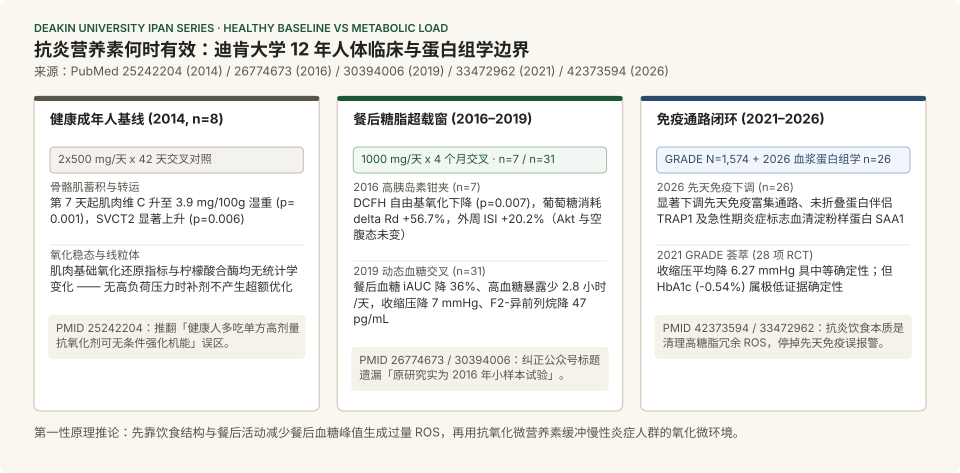

# 临床研究|每日1000mg维生素C，连续4月，糖尿病患者胰岛素敏感性提升20%，让葡萄糖消耗能力提升56%！并改善肌肉胰岛素抵抗

2026-11-20 · Deakin University / Free Radical Biology & Medicine (2016 RCT) · Nutrition & Diabetes (2026) · 有来源缺口

[本地原件归档](../../../raw/82f0802b84955a130f5597b95cd14ee4085ea16ba687e53adca210315fbe45bc) · 固定材料版本 `digest-material-82f0802b84955a130f5597b95cd14ee4085ea16ba687e53adca210315fbe45bc@1` · [一手原站](https://pubmed.ncbi.nlm.nih.gov/26774673/) · [触发线索（生命科学新知）](https://mp.weixin.qq.com/s/Dxr2fCpk0IjaLGeS3bgsHA)

> [!IMPORTANT]
> 用户关注点（TG）：加一个Longevity赛道，赛道focus目前是如何通过运动习惯和饮食习惯提高身体的免疫力，i.e. 抗炎饮食 - 炎是什么 - 免疫力是什么？ 种种问题我目前没有第一性原理的理解，可以慢慢建立： ；

## 针对性追查与回应

### 第一性原理框架（本工作台推演）：氧化应激、炎症与免疫力之间到底是什么关系

要把饮食习惯、慢性炎症和免疫力串成可推演的因果链，需要先把三个底层概念还原到细胞代谢与防卫逻辑：

1. 免疫力不是越强越亢奋越好，而是“精准识别、按时熄火”的动态稳态：免疫系统分成先天免疫（中性粒细胞、巨噬细胞、急性期反应蛋白如 SAA1 与 C 反应蛋白 CRP，在几分钟到数小时内靠释放活性氧 ROS 与吞噬作用无差别清除病原和坏死碎片）和适应性免疫（T 细胞、B 细胞建立高特异性抗体记忆）。健康免疫力的本质在于平时保持低耗休眠，遭遇真实病原体或创伤时迅速拉响警报，任务结束后按时消退。若无明确感染源却长期处于低强度拉警报状态，免疫细胞反而会被持久消耗，削弱真正面对病毒或细菌时的精准应答效率。

2. 慢性低度炎症（Meta-inflammation）从何而来：当高负荷糖脂摄入或久坐导致骨骼肌线粒体频繁处于餐后超载状态时，电子传递链会泄漏过量活性氧自由基（ROS）。适量 ROS 本是正常的细胞信号，但长期过量就会氧化损伤细胞膜脂质与线粒体伴侣蛋白（如未折叠蛋白结合蛋白 TRAP1）。受损蛋白与脂质碎片会被先天免疫受体误判为“组织损伤或入侵信号”，触发细胞内炎症网关并驱使肝脏持续合成急性期蛋白（如 SAA1），形成不发烧却常年空转的慢性低度炎症。

3. 抗炎饮食与抗氧化微营养素的实质作用路径（本工作台推断）：抗炎食物（富含多酚、维生素 C、类胡萝卜素与 Omega-3 的饮食）并不是直接替免疫系统“增强攻击力”，而是在线粒体与细胞质内充当电子供体和膜信号缓冲器，及时中和餐后负荷下产生的冗余 ROS -> 避免蛋白质错误折叠与脂质过氧化 -> 切断误触发先天免疫警报的源头，从而恢复代谢信号传导与免疫稳态。

### 本案核心发现与一手实验边界（每日 1000 mg 维生素 C 改善餐后氧化环境）

本文对应澳大利亚迪肯大学 Shaun A. Mason 与 Glenn D. Wadley 团队发表于 Free Radical Biology and Medicine（2016 年第 93 卷第 227-238 页，[PubMed 26774673 一手摘要](https://pubmed.ncbi.nlm.nih.gov/26774673/)）的双盲、随机、安慰剂对照交叉临床试验。受试者为 2 型糖尿病患者，分两个各 4 个月周期（中间设 1 个月洗脱期）每日早晚两次各口服 500 毫克维生素 C（合计 1000 mg/天）或等外观安慰剂，并以高胰岛素-正常葡萄糖钳夹配合同位素示踪及股外侧肌活检精准测量代谢与氧化指标，共 7 名受试者完整走完全流程（严格记录日常饮食与运动以排除混杂）。

- ✅ 核查（转运与自由基中和指标与一手摘要一致）：连续 4 个月补充后，骨骼肌细胞膜上的钠依赖性维生素 C 转运蛋白 SVCT2 表达显著上升（p = 0.008），促使更多维生素 C 进入骨骼肌细胞内。在模拟餐后高胰岛素负荷的钳夹状态下，肌肉活检测得的二氯荧光素（DCFH）氧化产物显著下降（p = 0.007），内源超氧化物歧化酶（SOD）代偿压力同步下降（p = 0.006）。

- ✅ 核查（糖代谢改善严格限定于高胰岛素负荷态，且已复核 56.7% 与 20.2% 原始统计值）：受试者胰岛素刺激的全身葡萄糖消耗速率增量（delta Rd）提升 56.7%（p = 0.009），外周胰岛素敏感指数上涨 20.2%（p = 0.046）。但更关键的阴性对照在于：经典的胰岛素胞内信号蛋白 Akt 活性并没有上升；同时在空腹静息基础状态下，肌肉基础氧化应激水平、线粒体标志酶柠檬酸合酶活性、肝脏内源性葡萄糖输出及长期血糖指标 HbA1c 均未出现统计学显著变化。也就是说，维生素 C 并非直接充当胰岛素信号放大器，而是帮高糖脂负荷下的肌肉“清理餐后自由基干扰环境”。

### 一手证据光谱对比与时效校对（本工作台核查 2014 至 2026 年同团队脉络）

⚠️ 核查提示（传播口径时效偏差与样本边界）：微信公众号文章报道于 2026 年 11 月 20 日，行文口吻宛如近期新发布研究，却未标明该活检 RCT 实为 2016 年发表且完成全流程仅 n = 7 人；对照 PubMed 一手数据库可见清晰的剂量、人群与因果层级差异（含同一团队 2026 年刚补充的血浆蛋白组学验证）：

| 发表年份与出处 | 试验设计与样本量 | 核心指标变化 | 阴性对照与局限边界 | 一手线索 |
| --- | --- | --- | --- | --- |
| 2014 Free Radic Biol Med | 8 名健康男性随机交叉，2×500 mg/天 持续 42 天 | 第 7 天起肌肉维 C（3.0 升至 3.9 mg/100g 湿重，p = 0.001）与 SVCT2（p = 0.006）显著升高 | 未改变健康肌肉基础氧化还原稳态与柠檬酸合酶，说明不缺乏氧化负荷时额外高剂量维 C 不带来超额优化 | [PubMed 25242204](https://pubmed.ncbi.nlm.nih.gov/25242204/) |
| 2016 Free Radic Biol Med（本文对应原研究） | 7 名 2 型糖尿病患者随机交叉，1000 mg/天 持续 4 个月 + 肌肉活检与高胰岛素钳夹 | 高胰岛素下肌肉 DCFH 氧化下降（p = 0.007），delta Rd 提升 56.7%，外周 ISI 提升 20.2% | 样本量极小（n = 7）；不改变空腹基础氧化态、Akt 通路或 HbA1c | [PubMed 26774673](https://pubmed.ncbi.nlm.nih.gov/26774673/) |
| 2019 Diabetes Obes Metab | 31 名 2 型糖尿病患者（平均年龄 61.8 岁）随机交叉，1000 mg/天 持续 4 个月 + 动态血糖监测 | 餐后血糖曲线下增量面积降低 36%，高血糖暴露时间减少 2.8 小时/天，收缩压降 7 mmHg | 面向已有明确餐后高血糖及高血压人群；短中期随访未评估糖尿病微血管硬终点 | [PubMed 30394006](https://pubmed.ncbi.nlm.nih.gov/30394006/) |
| 2021 Diabetes Care（GRADE 荟萃） | 28 项 RCT（合计 N = 1,574 名 2 型糖尿病患者） | 收缩压平均下降 6.27 mmHg（中等证据确定性） | HbA1c 平均下降 0.54% 与舒张压下降 3.77 mmHg 均被 GRADE 评为“极低证据确定性”，多为小于 6 个月、样本量小于 100 的试验 | [PubMed 33472962](https://pubmed.ncbi.nlm.nih.gov/33472962/) |
| 2026 Nutrition & Diabetes（最新多组学） | 26 名 2 型糖尿病患者，1000 mg/天 持续 4 个月 + 血浆非靶向蛋白质组学 | 显著下调先天免疫系统（Innate immune system）富集通路与未折叠蛋白结合蛋白 TRAP1，急性期炎症蛋白血清淀粉样蛋白 SAA1 显著下调（FDR < 0.05） | 直接打通“高剂量抗氧化 -> 减轻蛋白折叠/氧化损伤 -> 下调先天免疫过度空转”机制，但仍限于糖尿病高炎人群队列 | [PubMed 42373594](https://pubmed.ncbi.nlm.nih.gov/42373594/) |

### 观点与可反驳条件

- 观点：建立“饮食 -> 抗炎 -> 免疫”策略时，切忌混淆高负荷修复人群与正常稳态人群。对血糖波动明显或存在慢性代谢性炎症的 2 型糖尿病患者，每日 1000 mg 维生素 C（分两次各 500 mg 随餐摄入，降低单次吸收饱和）在餐后高胰岛素窗口可清除冗余 ROS、改善外周胰岛素敏感性并下调 SAA1 等急性期炎症报警（[PubMed 26774673](https://pubmed.ncbi.nlm.nih.gov/26774673/)、[PubMed 42373594](https://pubmed.ncbi.nlm.nih.gov/42373594/)）；而对代谢健康的日常人群，盲目长期服用高剂量单方维生素 C 既不会进一步提升基础肌肉氧化稳态（[PubMed 25242204](https://pubmed.ncbi.nlm.nih.gov/25242204/)），日常更应优先通过深色绿叶菜、柑橘、浆果与低血糖负荷餐序压低餐后葡萄糖与胰岛素尖峰，从源头减少 ROS 产生，而非拿单方补充剂代替饮食与餐后活动。

- 推翻条件：
  ① 若未来多中心大样本随机对照试验（样本量 n > 200、干预时长不少于 12 个月）在基线血浆维生素 C 充足、无胰岛素抵抗的健康成年人中，证实在不改变膳食糖脂负荷下每日 1000 mg 单方维生素 C 仍可显著降低长期慢性炎症标志物与心血管硬终点风险，则“主要作为高负荷/氧化应激窗口辅助”的边界判断需修正；
  ② 若后续大规模长期三期临床在 2 型糖尿病患者中稳定实现 HbA1c 下降 >= 0.5 个百分点且被 GRADE 评为高证据确定性（推翻 2021 年 [PubMed 33472962](https://pubmed.ncbi.nlm.nih.gov/33472962/) 的极低确定性评级），则维生素 C 可由辅助缓冲上调为一线协同降糖建议。

### 利益披露与口径核查

- 原文出处为微信公众号“生命科学新知”（2026 年 11 月 20 日），无直接带货链接，但未提供原始论文发表年份（2016 年）及期刊卷期号。文中引用的核心量化值（每日 1000 mg 连续 4 个月、葡萄糖消耗能力提升 56.7%、外周胰岛素敏感指数上涨 20.2%、n = 7、SVCT2 上调、Akt 未改变）均与 [PubMed 26774673](https://pubmed.ncbi.nlm.nih.gov/26774673/) 原始摘要严格核对吻合，摘要中的 56% / 20% 属于标题四舍五入。

- 原始论文作者来自澳大利亚迪肯大学运动与营养科学学院（Institute for Physical Activity and Nutrition, IPAN），且同一核心团队保持了从 2014 到 2026 年长达 12 年的连续验证记录，无单篇孤证夸大迹象；目前全文本付费墙不影响主要实验终点的公开可核查性。

---

## 原文摘录与一手信源存证

> 这项研究采用双盲、安慰剂对照交叉试验设计。 参与试验的2型糖尿病受试者，分两个阶段接受干预： 每日服用维生素C，早晚各500毫克，全天合计1000毫克，持续4个月； 或者服用外观完全一样的安慰剂，同样为期4个月。 两个干预周期中间设置1个月洗脱期，避免前一种补充剂带来的残留影响。
> — 原文摘录，文字段落 1；证据 `digest-material-82f0802b84955a130f5597b95cd14ee4085ea16ba687e53adca210315fbe45bc-excerpt-1@2`

> 最终有7名受试者完整走完全部试验流程，受试者日常的饮食、运动习惯都被严格记录，避免干扰试验结果。
> — 原文摘录，文字段落 2；证据 `digest-material-82f0802b84955a130f5597b95cd14ee4085ea16ba687e53adca210315fbe45bc-excerpt-2@2`

一手材料：

- Ascorbic acid supplementation improves skeletal muscle oxidative stress and insulin sensitivity in people with type 2 diabetes: Findings of a randomized controlled study (Free Radic Biol Med 2016) · Free Radical Biology & Medicine / Deakin University (IPAN) · [原站](https://pubmed.ncbi.nlm.nih.gov/26774673/) · [主体档案：Deakin University IPAN](../entities/labs/Deakin%20University%20IPAN.md) / [主体档案：PubMed (NCBI)](../entities/companies/PubMed%20%28NCBI%29.md) · [本地原件](../../../raw/9840913d2f2b70b7c429bc224a12217df3a46034c3d45ae415d7479e9bc03b20)
  材料版本 `digest-material-9840913d2f2b70b7c429bc224a12217df3a46034c3d45ae415d7479e9bc03b20@1`；获取方式 `http_full_text`。
  > Title: Ascorbic acid supplementation improves skeletal muscle oxidative stress and insulin sensitivity in people with type 2 diabetes: Findings of a randomized controlled study. — 原文提取
  > \[AIM/HYPOTHESIS\] Skeletal muscle insulin resistance and oxidative stress are characteristic metabolic disturbances in people with type 2 diabetes. — 原文提取
- Vitamin C supplementation modulates plasma proteome pathways related to innate immunity and lowers acute-phase SAA1 in adults with type 2 diabetes (Nutrition & Diabetes 2026) · Nutrition & Diabetes / Deakin University (IPAN) · [原站](https://pubmed.ncbi.nlm.nih.gov/42373594/) · [主体档案：Deakin University IPAN](../entities/labs/Deakin%20University%20IPAN.md) · [本地原件](../../../raw/07ad6c7be7f56974ce55f350c832a9827495122106c4643dc753cde92f7660c5)
  材料版本 `digest-material-07ad6c7be7f56974ce55f350c832a9827495122106c4643dc753cde92f7660c5@1`；获取方式 `http_full_text`。
  > Title: Plasma proteomics analysis of vitamin C supplementation in people with type 2 diabetes. — 原文提取
  > \[BACKGROUND\] Evidence from randomised controlled trials shows that vitamin C (VC) supplementation may improve cardiometabolic health outcomes in people with type 2 diabetes (T2D). — 原文提取
- Vitamin C Supplementation for Improving Glycemic Control and Cardiovascular Risk Factors in Type 2 Diabetes: Systematic Review and GRADE Meta-Analysis (Diabetes Care 2021) · Diabetes Care / ADA (GRADE Meta-Analysis) · [原站](https://pubmed.ncbi.nlm.nih.gov/33472962/) · [主体档案：Deakin University IPAN](../entities/labs/Deakin%20University%20IPAN.md) · [本地原件](../../../raw/4e4012b1141bf9c145a745770c548294395c322aa23c44722f56b9d370714179)
  材料版本 `digest-material-4e4012b1141bf9c145a745770c548294395c322aa23c44722f56b9d370714179@1`；获取方式 `http_full_text`。
  > Title: Effects of Vitamin C Supplementation on Glycemic Control and Cardiovascular Risk Factors in People With Type 2 Diabetes: A GRADE-Assessed Systematic Review and Meta-analysis of Randomized Controlled Trials. — 原文提取
  > \[BACKGROUND\] Evidence suggests that vitamin C supplementation could be a potential therapy in type 2 diabetes. However, its effectiveness and evidence quality require further evaluation. — 原文提取
- High-dose vitamin C supplementation increases skeletal muscle vitamin C concentration and SVCT2 transporter expression but does not alter redox status in healthy males (Free Radic Biol Med 2014) · Free Radical Biology & Medicine / Deakin University · [原站](https://pubmed.ncbi.nlm.nih.gov/25242204/) · [主体档案：Deakin University IPAN](../entities/labs/Deakin%20University%20IPAN.md) · [本地原件](../../../raw/4b63c6e37188ce4e75944628fdfd6887d988f375452b651271e2524e7a818606)
  材料版本 `digest-material-4b63c6e37188ce4e75944628fdfd6887d988f375452b651271e2524e7a818606@1`；获取方式 `http_full_text`。
  > Title: High-dose vitamin C supplementation increases skeletal muscle vitamin C concentration and SVCT2 transporter expression but does not alter redox status in healthy males. — 原文提取
  > Antioxidant vitamin C (VC) supplementation is of potential clinical benefit to individuals with skeletal muscle oxidative stress. — 原文提取

归属与范围：已穿透迪肯大学 Shaun A. Mason 与 Glenn D. Wadley 团队从 2014 年健康对照（PMID 25242204）、2016 年肌肉活检 RCT（PMID 26774673，原文对应试验，n = 7）、2019 年 31 人动态血糖交叉试验（PMID 30394006）、2021 年 28 项 RCT 的 GRADE 荟萃分析（PMID 33472962）到 2026 年血浆蛋白质组学（PMID 42373594）的完整一手证据链。纠正了二手公众号未标明该活检研究实为 2016 年论文与样本量仅 7 人的时效遗漏，并用 2026 年 SAA1 与先天免疫下调结果补全了饮食抗氧化剂与炎症及免疫力的底层因果连接。

来源缺口：

- `not_disclosed`：二手微信公众号报道发表于 2026 年 11 月 20 日，未披露该肌肉活检 RCT 实际发表于 2016 年（Free Radical Biology & Medicine Vol 93, 227-238），亦未在正文披露受试者入组时基线血糖、病程及脱落病例细节。
- `unavailable`：Free Radical Biology & Medicine 原刊全文 PDF（DOI 10.1016/j.freeradbiomed.2016.01.006）受出版商付费墙限制，当前基于 PubMed 一手结构化摘要与同团队开放摘要完成机制核验。

[返回赛道总览](../赛道总览.md#digest-82f0802b84955a13) · [返回导读索引](README.md) · [主体档案库](../entities/README.md)
