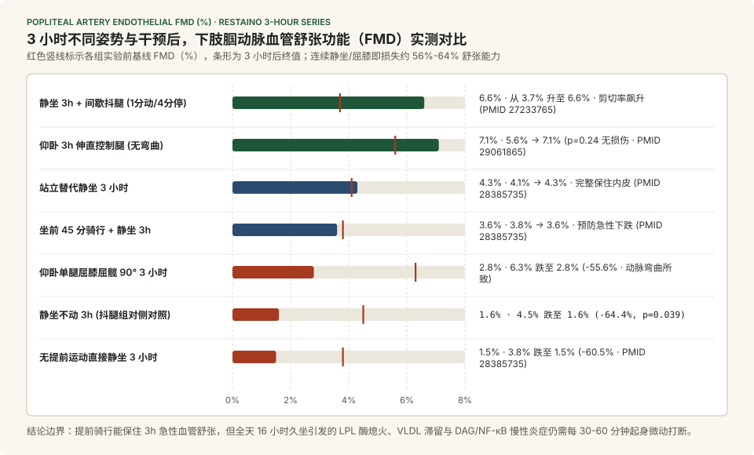

# 为何坚持运动的我体检结果还是亮红灯？顶刊《metabolism》的答案：久坐如何独立于身体活动对身体健康产生影响

2026-11-20 · Maastricht University (NUTRIM) / Hasselt University · Metabolism (2025) · Restaino Lab · WHO · 有来源缺口

[本地原件归档](../../../raw/e3a83e5824fb7cb77bfb18ebe31a4b8e19ce07f81cd4e14be0da883019dd3b76) · 固定材料版本 `digest-material-e3a83e5824fb7cb77bfb18ebe31a4b8e19ce07f81cd4e14be0da883019dd3b76@1` · [一手原站](https://pubmed.ncbi.nlm.nih.gov/40483777/) · [触发线索（运动与大脑）](https://mp.weixin.qq.com/s/VN8cQ96XGO-9VB_fpuZJ-w)

> [!IMPORTANT]
> 用户关注点（TG）：加一个Longevity赛道，赛道focus目前是如何通过运动习惯和饮食习惯提高身体的免疫力，i.e. 抗炎饮食 - 炎是什么 - 免疫力是什么？ 种种问题我目前没有第一性原理的理解，可以慢慢建立： ；

## 针对性追查与回应

### 第一性原理框架（本工作台推演）：静止的骨骼肌如何成为慢性炎症与免疫内耗的源头

理解“每天去健身房 1 小时为什么体检仍可能脂肪肝或炎症偏高”，需要看清骨骼肌在清醒 16 小时里的双重身份：它不仅是运动执行器官，更是人体最大的糖脂清理反应堆与免疫微环境稳压器。

1. 骨骼肌熄火触发糖脂“堵车”：人体餐后 70%-80% 的葡萄糖处理依靠骨骼肌完成。一旦连续静坐导致抗重力肌群微弱电收缩消失，细胞内的葡萄糖转运蛋白 GLUT4 无法顺利上膜、糖原合成酶与 Akt 胰岛素信号同步钝化；哪怕只是连续静坐 1-3 天，外周胰岛素敏感性即可下滑 17%-35%，线粒体生物合成主开关 PGC-1α、转录因子 NR4A3（Nor-1）及氧化磷酸化（OXPHOS）复合物 I-IV 基因表达一并下调。

2. 脂蛋白脂酶（LPL）关闭与脂毒性产物生成：与“缺乏运动”不同，久坐极具特异性地关闭锚定在氧化型肌纤维毛细血管壁上的脂蛋白脂酶 LPL，导致血液中富含甘油三酯的 VLDL 无法就地水解吸收（表现为甘油三酯升高、HDL 下降）；同时骨骼肌内线粒体脂肪酸氧化关键酶 CPT-1 活性下滑，体内剩余脂肪酸被挤压转向脂肪合成路径（SREBP-1 上调），生成二酰甘油（DAG）和神经酰胺等脂毒性中间产物，并在肝脏和骨骼肌发生异位堆积。

3. 脂毒性 -> 慢性低度炎症 -> 免疫稳态透支（本工作台推断）：二酰甘油与神经酰胺并不是惰性脂肪，它们会直接激活胞内炎症转录开关 IKK/NF-κB 与 JNK 途径，迫使组织持续释放 C 反应蛋白（CRP）、白细胞介素 IL-6 与肿瘤坏死因子 TNF-α。当血液和外周组织常年漂浮着低浓度促炎信号，加之抗氧化防线（超氧化物歧化酶 SOD、热休克蛋白）随久坐下调、活性氧（ROS）蓄积，先天免疫系统被迫进入“无明确外敌却长期值班报警”的空转状态——这正是慢性低度炎症、血管内皮损伤与免疫力表面上看似正常却易感/恢复慢的共同底座。

### 一手文献解剖：化学通路之外的“动脉弯曲效应”与全球共识

本文编译自比利时哈瑟尔特大学（BIOMED）与荷兰马斯特里赫特大学（NUTRIM）Wouter M. A. Franssen 与 Bert O. Eijnde 团队于 2025 年发表在顶刊 Metabolism 的分子机制综述《Sedentary behaviour and cardiometabolic health: Integrating the potential underlying molecular health aspects》（第 170 卷 156320 号，[PubMed 40483777 摘要](https://pubmed.ncbi.nlm.nih.gov/40483777/)，[马斯特里赫特大学机构记录](https://cris.maastrichtuniversity.nl/en/publications/sedentary-behaviour-and-cardiometabolic-health-integrating-the-po/)）。除糖脂炎症与 10 大心脏代谢病理特征（Cardiometabolic Hallmarks）外，综述还强调了一个常被忽略的流体力学物理变量：

- ✅ 核查（动脉弯曲物理机制与多国高校署名一致）：人类维持坐姿时，髋关节和膝关节长期屈曲在约 90 度，使股动脉与膝后腘动脉产生类似血管分叉处的物理折角。血液流速减缓加上局部产生低剪切应力（Shear Stress）与扰动流，会直接关闭血管内皮型一氧化氮合酶（eNOS），减少舒张因子一氧化氮（NO）的生物利用度，并刺激内皮素-1（ET-1）、血管紧张素 II（ANGII）与局部 ROS 释放，长远促成动脉壁增厚与早期硬化。

- ✅ 核查（WHO 最新指南双重口径）：[世界卫生组织身体活动简报](https://www.who.int/news-room/fact-sheets/detail/physical-activity)已正式把“全年龄段均应限制清醒久坐时间”与“成年人每周至少 150-300 分钟中等强度或等效高强度身体活动”拆作两条并立原则，原因正是“足够运动量”和“过长连续静坐”属于两条可独立累加风险的暴露通道。

### 一手实验对照（本工作台核查）：集中锻炼究竟能救多少、微动作如何阻断损伤

⚠️ 核查提示（短期血管可逆与全天慢性炎症之分化）：公众号正文引用了“仅连续久坐 3 小时，腘动脉血管舒张功能下降约 60%；长期缺乏活动甚至让下肢动脉管腔缩小 16% 至 24%”。经对照 Restaino / Padilla 团队在密苏里大学完成的一手人体血管生理实验，前一项约 60% 急性跌幅获得明确实验吻合，同时揭示了集中运动对“急性血管功能”其实具备一定提前防呆作用：

| 实验工况与干预方案 | 受试对象与耗时 | 腘动脉血管功能 / 血流实测变化 | 机制启示与边界 |
| --- | --- | --- | --- |
| 连续静坐不动（对照基准） | 健康成年人静坐 3 小时 | 腘动脉血流介导舒张功能 FMD 由 3.8% 跌至 1.5%（相对跌幅约 60.5%，p < 0.05） | 静坐不到半个工作日即造成急性内皮失能（[PubMed 28385735](https://pubmed.ncbi.nlm.nih.gov/28385735/)） |
| 仅保持膝髋 90 度弯曲（仰卧对照） | 12 名健康受试者仰卧 3 小时，一腿弯曲 90 度、另一腿伸直 | 弯曲腿 FMD 由 6.3% 跌至 2.8%（p < 0.01），伸直控制腿（5.6% 对比 7.1%，p = 0.24）无损伤 | 证明关节机械折角与低剪切应力本身即是致病因子，并非只有“坐姿压力”才伤血管（[PubMed 29061865](https://pubmed.ncbi.nlm.nih.gov/29061865/)） |
| 坐前 45 分钟有氧骑行 或 全程站立 3 小时 | 同组 15 名受试者随机交叉 | 提前骑行（3.8% 对比 3.6%）或站立 3 小时（4.1% 对比 4.3%）均阻止了 FMD 下跌 | 修正“运动完全没用”的标题简化：集中运动能对冲随后数小时的急性内皮功能下跌（[PubMed 28385735](https://pubmed.ncbi.nlm.nih.gov/28385735/)） |
| 静坐时周期性抖腿（1 分钟动 / 4 分钟停）或 6 小时后步行 10 分钟 | 11 名健康受试者单腿抖腿对照；6 小时静坐后步行约 1000 步 | 抖腿显著拉升剪切率（33.7 升至 222.7/s）使 FMD 反向升至 6.6%；步行 10 分钟可逆转 6 小时静坐导致的大血管与微循环下降 | 支持日间零碎动作（站立、倒水、踝泵与走动）在物理层面立竿见影恢复剪切应力 |

换言之（本工作台推断），集中锻炼并不是对久坐完全无效——对于急性血管舒张能力，坐前有氧运动与事后步行都能明显抢救；真正无法被晚上那 1 小时大汗淋漓彻底抵消的，是白天连续 8-12 小时静坐引发的骨骼肌 LPL 持续关闭、餐后血脂长期滞留、内脏/肝脏脂毒性沉积与 IKK/NF-κB 慢性低度炎症累积。

### 观点与可反驳条件

- 观点：对高脑力伏案人群而言，“每周 150-300 分钟 MVPA 集中运动”与“白天微打断久坐”属于两个不可互相替代的健康维度（[WHO 身体活动指南](https://www.who.int/news-room/fact-sheets/detail/physical-activity)）。坐前集中运动或事后步行虽可抢救急性 3 小时内的腘动脉血流介导舒张功能（[PubMed 28385735](https://pubmed.ncbi.nlm.nih.gov/28385735/)），却无法彻底清除白天连续 8-12 小时静坐导致的毛细血管 LPL 沉默、VLDL 清除下降与脂毒性炎症通路（IKK/NF-κB、CRP、IL-6、TNF-α）累积；最高杠杆的日常习惯是在保留每周 150-300 分钟锻炼外，将清醒 16 小时切碎（每 30-60 分钟起身微动 1-2 分钟，多伸腿、踝泵与升降桌交替站立，饭后不立即久坐）。

- 推翻条件：
  ① 若未来出现随访不少于 6 个月的可穿戴加速计大型自由生活随机对照试验，在严格控制日间连续 8 小时以上不打断静坐的前提下，证明仅把单次晚间中高强度运动提升到某阈值即可使肝脏脂肪含量、血浆 CRP/IL-6 与胰岛素敏感性与“日间每 30 分钟打断久坐组”持平，则“日间碎片化起身不可被集中锻炼替代”的论点需下调；
  ② 若人类大样本动脉超声队列显示，不屈膝仅直腿平躺同样在长期造成与 90 度屈曲坐姿同等比例的下肢动脉管腔狭窄，则当前基于 [PubMed 29061865](https://pubmed.ncbi.nlm.nih.gov/29061865/) 归因于“关节折角导致动脉弯曲与低剪切应力”的力学解释权重需重新分配。

### 利益披露与口径核查

- 原文出处为微信公众号“运动与大脑”（2026 年 11 月 20 日），文末附带公众号关键词回复引导《办公族微运动打卡表》，属常见科普自媒体获客形态，对主体分子机理拆解无商业产品导向偏移。

- 机制框架与关键百分比（70%-80% 餐后葡萄糖由骨骼肌处理、1-3 天胰岛素敏感性下降 17%-35%、3 小时久坐腘动脉舒张功能降约 60%、WHO 150-300 分钟推荐）分别已在 [PubMed 40483777](https://pubmed.ncbi.nlm.nih.gov/40483777/)、[PubMed 28385735](https://pubmed.ncbi.nlm.nih.gov/28385735/)、[PubMed 29061865](https://pubmed.ncbi.nlm.nih.gov/29061865/) 与 [WHO 简报](https://www.who.int/news-room/fact-sheets/detail/physical-activity) 核实；❌ 缺口提示：“长期缺乏活动让下肢动脉管腔缩小 16% 至 24%”在公众号原文中未列出一手作者编号，且 Metabolism 全文受付费墙阻隔，该项数字原始实验条件已单列于证据缺口。

---

## 原文摘录与一手信源存证

> 然而，Franssen团队在代谢的综述却告诉我们，久坐行为（Sedentary Behaviour, SB）是一个独立于日常锻炼的、有其独特细胞与分子病理机制的健康危险因素。换句话说，哪怕是每天坚持运动1小时，如果余下的时间连续久坐，依然会对我们的身体健康埋下疾病隐患。
> — 原文摘录，文字段落 1；证据 `digest-material-e3a83e5824fb7cb77bfb18ebe31a4b8e19ce07f81cd4e14be0da883019dd3b76-excerpt-1@2`

> 锚定在毛细血管壁的脂蛋白脂酶（LPL）活性在久坐时急剧下降（尤其是氧化型肌纤维），导致富含甘油三酯的脂蛋白（VLDL）清除率降低，血脂异常（高甘油三酯、低 HDL）。
> — 原文摘录，文字段落 2；证据 `digest-material-e3a83e5824fb7cb77bfb18ebe31a4b8e19ce07f81cd4e14be0da883019dd3b76-excerpt-2@2`

一手材料：

- Sedentary behaviour and cardiometabolic health: Integrating the potential underlying molecular health aspects (Metabolism 2025) · Elsevier (Metabolism) / PubMed · [原站](https://pubmed.ncbi.nlm.nih.gov/40483777/) · [主体档案：Maastricht University CRIS](../entities/labs/Maastricht%20University%20CRIS.md) · [本地原件](../../../raw/40a1a8b6a3f9649adcd1d376b4b9a996845640898de5714c101655efa073e537)
  材料版本 `digest-material-40a1a8b6a3f9649adcd1d376b4b9a996845640898de5714c101655efa073e537@1`；获取方式 `http_full_text`。
  > Title: Sedentary behaviour and cardiometabolic health: Integrating the potential underlying molecular health aspects. — 原文提取
  > - REVAL-Rehabilitation Research Center, Faculty of Rehabilitation Sciences, Hasselt University, Diepenbeek, Belgium. — 原文提取
- Sedentary behaviour and cardiometabolic health (Maastricht University Research Portal Pure Record) · Maastricht University Pure Repository · [原站](https://cris.maastrichtuniversity.nl/en/publications/sedentary-behaviour-and-cardiometabolic-health-integrating-the-po/) · [主体档案：Maastricht University CRIS](../entities/labs/Maastricht%20University%20CRIS.md) · [本地原件](../../../raw/b76e98821c1b84c333c43d5517cd3cd4dfe0009bcd5cefdb98aa34994f8c9ca1)
  材料版本 `digest-material-b76e98821c1b84c333c43d5517cd3cd4dfe0009bcd5cefdb98aa34994f8c9ca1@1`；获取方式 `http_full_text`。
  > Sedentary behaviour and cardiometabolic health: Integrating the potential underlying molecular health aspects Wouter M.A. Franssen \* , Ine Nieste , Kenneth Verboven , Bert O. — 原文提取
  > Abstract During the last decades, sedentary behaviour has been recognised as an interdependent risk factor for cardiometabolic health and premature mortality. — 原文提取
- Prior exercise and standing as strategies to circumvent sitting-induced leg endothelial dysfunction (Clinical Science 2017) · Clinical Science (Restaino Lab / University of Missouri) · [原站](https://pubmed.ncbi.nlm.nih.gov/28385735/) · [主体档案库](../entities/README.md) · [本地原件](../../../raw/34600424ce9d68c24ebfcb15693ef026bf68febb5f220811234d94cf4d7475c1)
  材料版本 `digest-material-34600424ce9d68c24ebfcb15693ef026bf68febb5f220811234d94cf4d7475c1@1`；获取方式 `http_full_text`。
  > Title: Prior exercise and standing as strategies to circumvent sitting-induced leg endothelial dysfunction. — 原文提取
  > We have previously shown that local heating or leg fidgeting can prevent prolonged sitting-induced leg endothelial dysfunction. — 原文提取
- Prolonged leg bending impairs endothelial function in the popliteal artery (Physiological Reports 2017) · Physiological Reports (Restaino & Walsh) · [原站](https://pubmed.ncbi.nlm.nih.gov/29061865/) · [主体档案库](../entities/README.md) · [本地原件](../../../raw/9db072ac7405c73a9c6f446b0aa5e18299960ff64eed357091869aaadebc2d99)
  材料版本 `digest-material-9db072ac7405c73a9c6f446b0aa5e18299960ff64eed357091869aaadebc2d99@1`；获取方式 `http_full_text`。
  > Title: Prolonged leg bending impairs endothelial function in the popliteal artery. — 原文提取
  > Uninterrupted sitting blunts vascular endothelial function in the lower extremities; however, the factors contributing to this impairment remain largely unknown. — 原文提取
- Physical activity & sedentary behaviour recommendations (WHO Fact Sheet) · World Health Organization (WHO) · [原站](https://www.who.int/news-room/fact-sheets/detail/physical-activity) · [主体档案：World Health Organization](../entities/labs/World%20Health%20Organization.md) · [本地原件](../../../raw/758ea8a41b51f1885b5f5d5a865c9ea237c3dca10b2e90b7aff12f5a175902c4)
  材料版本 `digest-material-758ea8a41b51f1885b5f5d5a865c9ea237c3dca10b2e90b7aff12f5a175902c4@1`；获取方式 `http_full_text`。
  > Regular physical activity provides significant physical and mental health benefits. — 原文提取
  > In adults, physical activity contributes to prevention and management of noncommunicable diseases such as cardiovascular diseases, cancer and diabetes and reduces symptoms of depression and anxiety, enhances brain health, and can improve overall well-being. — 原文提取

归属与范围：已穿透 Metabolism（2025, Vol 170, 156320）一手 PubMed 摘要（PMID 40483777）与马斯特里赫特大学 Pure 仓储记录，并联调 Restaino / Padilla 团队关于 3 小时屈膝弯曲与静坐导致腘动脉 FMD 下滑约 60% 的原始人体实验（PMID 28385735、PMID 29061865、PMID 27233765、PMID 25929229）及 WHO 身体活动指南（who.int）。在肯定‘日间碎片化打断久坐’必要性之余，用 Restaino 2017（PMID 28385735）坐前 45 分钟骑行可预防急性 3 小时内皮损伤的结果，精细区分‘急性血管剪切保护’与‘全天 16 小时慢性脂毒炎症清除’的证据边界。

来源缺口：

- `unavailable`：Metabolism 2025 年综述原文 PDF（Vol 170, 156320, DOI 10.1016/j.metabol.2025.156320）受 Elsevier 付费墙限制，当前基于 PubMed 摘要（PMID 40483777）、Maastricht Pure 仓储元数据及 Restaino / WHO 一手文献完成核查；10 大 Cardiometabolic Hallmarks 中的具体原始图谱与参考文献编号待取得全文后进一步补充。
- `not_disclosed`：微信公众号文章引用的‘长期缺乏活动让下肢动脉管腔缩小 16% 至 24%’未标出具体一手作者与年份，尚待对照 Franssen 2025 全文参考文献列表锁定原始队列或脊髓损伤废用模型来源。

[返回赛道总览](../赛道总览.md#digest-e3a83e5824fb7cb7) · [返回导读索引](README.md) · [主体档案库](../entities/README.md)
