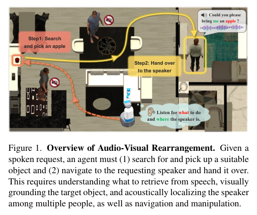
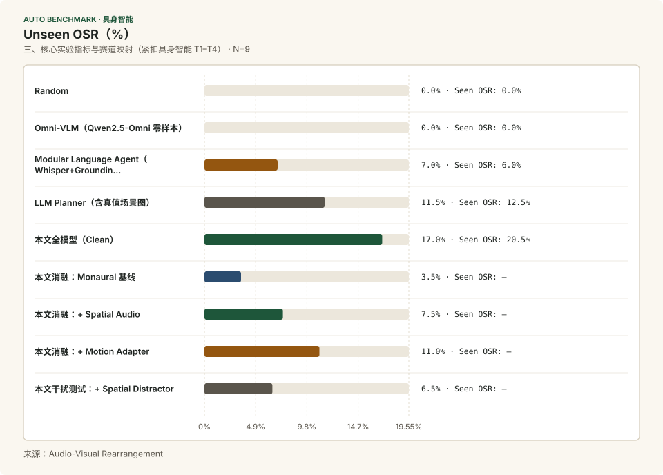

# Audio-Visual Rearrangement

2026-11-23 · 中国农业大学 / MBZUAI / UC Berkeley · arXiv:2611.30171v1 (Ruohao Guo, Dantong Niu 等) · 已整理

[本地原件归档](../../../raw/c8e48e375759284e4c8e4af372f9c2a00dd7445a1501c8a030f9b87f3e16a72a) · 固定材料版本 `digest-material-c8e48e375759284e4c8e4af372f9c2a00dd7445a1501c8a030f9b87f3e16a72a@1` · [一手原站](https://arxiv.org/abs/2611.30171v1)

## 深度拆解与复核

- 口径与利益披露：本篇为高校联合学术预印本（arXiv:2611.30171v1），7 位作者分别来自中国农业大学（Ruohao Guo、Jiatong Ye、Chenwei Dong、Guangyao Li、Zhenbo Li，占 5/7）、MBZUAI（Jinxing Zhou）与 UC Berkeley（Dantong Niu）。Triage 自动线索曾标出 Intel，系关键词子串误匹配，正文单位不含 Intel；代码与模型权重声明即将开源但截至 2026-11-25 尚未释放，论文在受控仿真基准中突出自提空间音频模块相对优势。

### 一、任务边界与基准拆解（AVR Benchmark）

Audio-Visual Rearrangement (AVR) 将音频导航与家庭物体重排合并为单轮语音驱动任务：多人物室内环境中，唯一发起请求的说话人仅在回合起点发声 1 次，Fetch 移动机械臂需在最深 5,000 步预算内同时解出“要什么”与“谁在哪”，抓取目标并交付至说话人或指定支撑面。

- 仿真底座与声学耦合：基于 Habitat 3.0 与 HSSD 室内场景，用 Qwen3-TTS 合成语音并挂载于发声人头部，经 SoundSpaces 2.0 计算双耳房间冲激响应生成空间语音；说话人与智能体初始 Geodesic 距离跨度 2–25 m（Euclidean 距离集中于 5–9 m，峰值 6–8 m）。
- 数据集切分与任务税率：2,000 条基础轨迹分布在 38 个开发场景（34 场景 1,790 条训练 / 4 场景 210 条验证），规则专家生成 10 项指令微调混合数据共计 150k 训练样本与 13k 验证样本；评测集 400 条（200 seen / 200 unseen，unseen 含 11 个未见场景），按 Explicit Target（Category / Instance）、Spatial Reference（Object / Destination）与 Implicit Intent（Food & Drink / Home / Work / Leisure）八子类 4:3:3 比例采样。

### 二、架构机制：MAS Audio Encoder 与三阶段训练

模型以 Qwen2.5-Omni-7B 为底座，保留视觉编码器、单声道语音分支与 Thinker 语言模型，旁路新增 Motion-Aware Spatial (MAS) Audio Encoder：

- 双耳特征编码：对 16 kHz 双耳音频提取左右耳对数梅尔谱与幅值加权耳间相位差余弦/正弦特征，经时间卷积与 32 层 Transformer（hidden size 1280、输出 2048 维）自适应池化为 16 个初始空间特征向量 H0。
- 位姿自适应残差更新：假设说话人全程静止，Motion Adapter（bottleneck 128）将当前位姿 Tt 与初始收听位姿 T0 的相对旋转平移编码为 motion embedding m，经 GELU(c+m)-GELU(c) 残差直接从 H0 计算 Ht，再经 MLP spatial projector 映射为 16 个 3584 维空间 token。
- 三阶段课程与微调代价：Stage 1 在 33/2 场景分割上训练 10 epochs 学习方位/距离预测（Stage 2 验证集折叠方位角 MAE 为 19.41°、水平距离 MAE 为 1.058 m）；Stage 2 在 34/4 场景分割上冻结声学编码器训练 Motion Adapter 40 epochs；Stage 3 在 6 张 A100 GPU 上以 BF16 联合微调 projector 与 LoRA（rank=16、alpha=32、dropout=0.05、lr=1e-5、warmup 3%，有效 batch size 48），对动作名/坐标参数加权 2.0 交叉熵损失，输出 Explore/Navigate/Turn/Pick/Place/Done 六类技能。

### 三、核心实验指标与赛道映射（紧扣具身智能 T1–T4）

| 模型 / 条件 | Seen OSR | Unseen OSR | Unseen TSA | Unseen CDSR | 平均步数 (Unseen) |
| --- | --- | --- | --- | --- | --- |
| Random | 0.0% | 0.0% | — | — | 5000.0 |
| Omni-VLM（Qwen2.5-Omni 零样本） | 0.0% | 0.0% | — | — | 4921.3 |
| Modular Language Agent（Whisper+GroundingDINO+SAM） | 6.0% | 7.0% | — | — | 3851.2 |
| LLM Planner（含真值场景图） | 12.5% | 11.5% | — | — | 2867.8 |
| 本文全模型（Clean） | 20.5% | 17.0% | 47.6% | 49.3% | 2685.5 |
| 本文消融：Monaural 基线 | — | 3.5% | 34.4% | 15.9% | 2621.9 |
| 本文消融：+ Spatial Audio | — | 7.5% | 46.5% | 25.0% | 2926.4 |
| 本文消融：+ Motion Adapter | — | 11.0% | 43.5% | 34.4% | 2752.4 |
| 本文干扰测试：+ Spatial Distractor | — | 6.5% | 37.2% | 27.1% | 2738.1 |

- 本工作台核查：
  1. ✅ 单次语音的位姿重参数化在 S2 规划层具备真实增益：Unseen OSR 从单声道 3.5% 依次升至 7.5%（+Spatial Audio）、11.0%（+Motion Adapter）与 17.0%（10 任务联合微调），尤其拿到正确物体后的条件交付率 CDSR 从 15.9% 跃升至 49.3%，高于注入真值场景图的 LLM Planner（OSR 11.5%，RSR 仅 1.7% vs 本文 15.0%），说明相对说话人坐标的连续跟踪比静态房间拓扑更能解开“找对物却送错人”的交付断链。
  2. ⚠️ S0/S1 底层物理约束被仿真特权接口完全绕过（对应 T1/T3 物理墙）：模型输出的是归一化像素坐标 [0,100] 的高级技能，低层执行直接消费仿真器深度图、精确位姿与 navmesh，彻底跳过 T1 的 1,000 Hz 运控频率墙、轮式里程计累积漂移与 1 ms 视触力接触反馈；UC Berkeley BAIR 体系（如 Trevor Darrell / Sergey Levine 团队的 ARM4R 与 Physical Intelligence 路线）在 T2 已证明真机操控难以脱离高频触觉与实测交互，因此 17.0% unseen OSR 仅代表 S2 语音空间路由上限，不可直接外推至真机交付率。
  3. ❌ 抗噪与说话人相对放置是当前架构硬断裂：Table 4 在距说话人至少 2 m、距智能体至少 1 m 处加入单个等功率环境干扰声后，unseen OSR 从 17.0% 跌至 6.5%（跌幅 61.8%），CDSR 从 49.3% 跌至 27.1%；Table 2 中 Spatial Reference Destination（将物体放到离说话人最近支撑面）在 seen/unseen 均仅为 3.3%，且 Geodesic 初始距离超过 10–12 m 后成功率趋近停滞。
- 本工作台推断：ASR/多模态大模型介入“声学空间感知”的价值在 S2 意图与人机协同定位层（补充 T3 Code-as-Policy 流程编排的被动触发输入），前提是前端麦克风阵列与声源分离独立于主干 VLM，而非由单次双耳录音硬编码静态几何假设；若不引入多轮声学重锚定与 T1/T3 独立视觉-力觉 Verifier，AVR 类端到端技能输出在真实噪杂家庭/厂房场景难以跨过 10% 可用门槛。

### 观点与可反驳条件

- ==观点==：arXiv:2611.30171v1 的核心增量在于把“单次口令空间记忆”通过低维相对位姿适配器嵌入 Qwen2.5-Omni，在 S2 高层技能规划上优于盲目的纯文本场景图规划；但因底层依赖理想仿真位姿且单干扰声即致 OSR 腰斩（17.0%→6.5%），现阶段仅属 S2 多模态感知扩展研究，尚不构成 T1/T2 端到端实机操作路径突破。
- ==推翻条件==：
  1. 作者或后续复现团队开源代码并在真实 Fetch/移动双臂机器人上取消仿真 navmesh 与真值里程计特权，仅靠机载 IMU/轮速计与四麦以上阵列在 60 dB 多人交谈背景噪下，于 unseen 物理房间内复测 AVR OSR 达到 25% 以上且 Destination 子任务突破 15%；
  2. 当说话人在 5–12 m 区间内发生走动（非静止假设）时，连续增量声学定位模块在无重复语音条件下仍能将 CDSR 维持在 40% 以上而不发生明显退化。

---

## 原文摘录与一手信源存证

> We introduce Audio-Visual Rearrangement (AVR), a novel task in which an agent hears a spoken request, retrieves a suitable object, and delivers it to the requesting user or an instruction-specified destination.
> — 原文摘录，文字段落 1；证据 `digest-material-c8e48e375759284e4c8e4af372f9c2a00dd7445a1501c8a030f9b87f3e16a72a-excerpt-1@1`

一手材料：

- Audio-Visual Rearrangement · Dantong Niu · [原站](https://arxiv.org/abs/2611.30171v1) · [主体档案：Dantong Niu](../entities/people/Dantong%20Niu.md) / [主体档案：Ruohao Guo](../entities/people/Ruohao%20Guo.md) / [主体档案：Jiatong Ye](../entities/people/Jiatong%20Ye.md) · [本地原件](../../../raw/c8e48e375759284e4c8e4af372f9c2a00dd7445a1501c8a030f9b87f3e16a72a)
  材料版本 `digest-material-c8e48e375759284e4c8e4af372f9c2a00dd7445a1501c8a030f9b87f3e16a72a@1`；获取方式 `tg_approved_rss_full_text`。
  > We introduce Audio-Visual Rearrangement (AVR), a novel task in which an agent hears a spoken request, retrieves a suitable object, and delivers it to the requesting user or an instruction-specified destination. — 原文提取
- Audio-Visual Rearrangement (Full HTML Paper) · 中国农业大学 / MBZUAI / UC Berkeley · arXiv:2611.30171v1 (Ruohao Guo, Dantong Niu 等) · [原站](https://arxiv.org/html/2611.30171v1) · [主体档案库](../entities/README.md) · [本地原件](../../../raw/45366b7171d8f81519ffd6f143803701fa5a2dc529a9a42ed2fd7d2266df1a43)
  材料版本 `digest-material-45366b7171d8f81519ffd6f143803701fa5a2dc529a9a42ed2fd7d2266df1a43@1`；获取方式 `http_full_text`。
  > We introduce Audio-Visual Rearrangement (AVR), a novel task in which an agent hears a spoken request, retrieves a suitable object, and delivers it to the requesting user or an instruction-specified destination. — 原文提取
  > Figure 1 :  Overview of Audio-Visual Rearrangement. Given a spoken request, an agent must (1) search for and pick up a suitable object and (2) navigate to the requesting speaker and hand it over. — 原文提取

归属与范围：基于 arXiv:2611.30171v1 HTML 全文核验 Audio-Visual Rearrangement (AVR)：在 Habitat 3.0 + HSSD + SoundSpaces 2.0 仿真环境中结合 Qwen3-TTS 生成 2,000 条训练验证轨迹与 400 条评测轨迹（200 seen / 200 unseen，三类八子类 4:3:3 分布）。框架基于 Qwen2.5-Omni-7B 接入 32 层 MAS Audio Encoder 与 bottleneck=128 的 Motion Adapter，经三阶段课程训练与 6 张 A100 LoRA 微调后，seen OSR 达 20.5%、unseen OSR 达 17.0%（较带真值场景图的 LLM Planner 高 8.0 / 5.5 个百分点）；但并发干扰声源下 unseen OSR 降至 6.5%，说话人相对放置子类仅 3.3%，且底层仍依赖仿真器深度图、精确位姿与 navmesh，代码尚未开源。

[返回赛道总览](../赛道总览.md#digest-c8e48e375759284e) · [返回导读索引](README.md) · [主体档案库](../entities/README.md)
