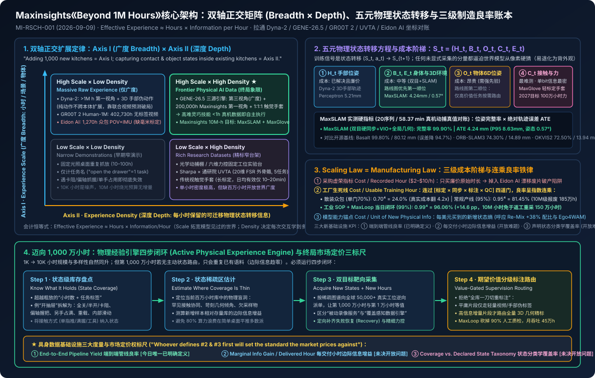
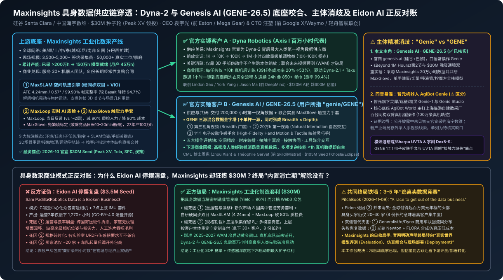

# Beyond 1M Hours: The Data Scaling Laws of Physical AI

2026-09-09 · Maxinsights · Official Engineering Blog · 有来源缺口

[本地原件归档](../../../raw/7cd8c0adb7118dba4b0d396babe2d976c18bcccde2eea617d5da32bb6529592a) · 固定材料版本 `digest-material-7cd8c0adb7118dba4b0d396babe2d976c18bcccde2eea617d5da32bb6529592a@2` · [一手原站](https://www.maxinsights.ai/beyond-1m-hours.html)

> [!IMPORTANT]
> 用户关注点（TG）：\[TG#245\] dyna和genie的数据都是用max insight的，这篇博客很有参考价值 | \[TG#246\] "GENE's data engine combines these sources rather than choosing one: third-person video for breadth, egocentric video for natural interaction, and instrumented gloves for high-fidelity hand motion and tactile signals." | \[TG#247\] "So the scaling law is also a manufacturing law, and that changes which metric the business runs on. Cost per recorded hour is easy to measure and is what procurement asks for. What governs the business is cost per usable training hour — one that cleared calibration, sync, annotation, and QC for the supervision actually being bought. What governs the model is one step further out: cost per unit of new physical information — the measure that tells you whether each additional decade of hours is still buying capability." - 这段真是太好了 | \[TG#248\] "One clarification, since this is where the framework is easiest to attack: Axis I coverage is breadth — more environments, people, and objects across the same kind of recording. Axis II is depth — how much of each interaction the recording preserves. Adding a thousand new kitchens is Axis I; capturing contact and object states inside the kitchens you already have is Axis II." - tech details with clear definition，这篇文章竟然是免费的。 | \[TG#249\] "It should know what it already holds, at the level of state coverage rather than hours and task labels. It should estimate where that coverage is thin. It should acquire against that estimate alongside its volume targets, seeking new states as well as new hours — rare interactions, difficult geometries, underrepresented object classes. And it should route each hour to the level of supervision its expected value justifies, since full geometric annotation is worth paying for on some recordings and wasted on others." 我太同意了 | \[TG#250\] "Three numbers make that measurable: end-to-end pipeline yield, marginal information gain per delivered hour, and coverage against a declared state taxonomy. Only the first is well-defined today. The second and third are open problems, and whoever defines them first will set the standard the market prices against."

## 针对性追查与回应

- ==核心结论与六脉络总纲==：硅谷/中国具身数据基础设施商 Maxinsights（海宇数维）发布的官方工程研究《Beyond 1M Hours: The Data Scaling Laws of Physical AI》（文档编号 MI-RSCH-001，2026-09-09），不仅从官方一手披露层面实锤了用户给出的一线供应链情报——Maxinsights 同时充当 Dyna Robotics 百万小时世界—动作模型 Dyna-2 的最大第一视角人类数据供应商，以及 Genesis AI 旗舰灵巧操作基模 GENE-26.5（口语常读作 Genie）200,000 小时第一视角数据供应商与 MaxGlove 触觉手套共研伙伴——更给出了跨越首个 100 万小时门槛后物理 AI 最清晰的数据架构与单位经济学总纲：物理智能沿 Axis I：Experience Scale（经验规模 = 广度 Breadth） 与 Axis II：Experience Density（经验密度 = 深度 Depth） 正交耦合扩展（$\text{Effective experience} \approx \text{hours} \times \text{information per hour}$）；具身缩放定律本质是受多道质检门连乘良率支配的制造定律（Manufacturing Law），沿着「采购虚荣指标 Cost per Recorded Hour $\to$ 工厂生死线 Cost per Usable Training Hour $\to$ 模型能力锚点 Cost per Unit of New Physical Information」三级递进；迈向 1,000 万小时的前沿语料库必须脱离静态视频仓库，构建状态覆盖盘点 $\to$ 稀疏盲区估计 $\to$ 新状态与新时长双目标靶向采集 $\to$ 按期望价值分级路由几何标注的主动数据引擎，并围绕「端到端管线良率、每交付小时边际信息增益、声明状态分类学覆盖率」三大标尺争夺行业定价权。将该文与昨日入库的 Eidon AI 停摆复盘《Robotics Data is a Broken Business》正反对账可见：工业级硬件同步标定（MaxSLAM 4.24 mm）与自动化质检闭环（MaxLoop 降本 80%）帮 Maxinsights 赢下了 2025–2027 基模冷启动上半场，但下游仅 20–30 家前沿买家与真机车队回流替代的终局倒计时并未消失，迫使其向模型评测与现场部署加速纵深跃迁。
- 场景与利益披露（商业激励标注）：本文发布于 Maxinsights 官宣由 Peak XV Partners 领投 3,000 万美元（$30M）种子轮**前夕，定位为公司首席技术宣言。阅读时需穿透其精巧的议程设置：文中界定的每一道“下一代科学难题”，在工程落地上均精准映射至 Maxinsights 正在售卖的三款核心商业产品——五元物理状态 $S_t$ 中优先求解身体与环境三维几何（$B_t, E_t$）对应其双目硬同步 MaxSLAM，将四道质检门良率从 95% 推向 99%（总良率 81% → 96%）及按价值路由标注对应其实时质检引擎 MaxLoop，而攻克单比特信息密度最高但最难测量的接触态（$C_t$）则直接为其 2027 年剑指 100 万小时力数据的轻标定触觉手套 MaxGlove 铺路。尽管带有明确的供应商路线图导向，本文对正交坐标、连乘良率与状态空间覆盖的形式化定义干净克制，是当前具身数据基础设施领域罕见的高信噪比一手文献。

---

### 一、 具身数据供应链穿透与主体消歧：起底 Maxinsights，核验 Dyna 与 GENE (Genie) 底座

#### 1. Maxinsights（海宇数维）创始班底、全球产能账本与三件套自研壁垒
- 公司主体与资本拼图：Maxinsights 总部位于加州硅谷 Santa Clara，中国研发与运营实体为海宇数维，在中、美、印尼设有直属办公室。2026 年 10 月完成 \$30M（3,000 万美元）种子轮融资（参见本库前序归档《[华人物理AI公司完成3000万美元种子轮](%E5%8D%8E%E4%BA%BA%E7%89%A9%E7%90%86AI%E5%85%AC%E5%8F%B8%E5%AE%8C%E6%88%903000%E4%B8%87%E7%BE%8E%E5%85%83%E7%A7%8D%E5%AD%90%E8%BD%AE.md)》，Business Wire 更正版一手通稿 `digest-material-205fe390…`），由原红杉印度/东南亚 Peak XV Partners（董事总经理 Rohit Agarwal）领投，Tola Capital、South Park Commons、渶策资本（INCE Capital）、Alumni Ventures 参投。
- 双华人联创基因（工业供应链规模管理 × Waymo/轻舟智航自动驾驶数据闭环）：
  1. CEO 袁宇光（Yuguang "YG" Yuan）：上海交通大学本科、UC Berkeley Haas MBA；早年联合创立工业机器人公司 Mega Gear Robotics 并实现并购退出，后在动力管理跨国巨头 Eaton（伊顿） 成为最年轻高管团队负责人，直管 \$150M 年营收业务线与 1,500+ 人跨国生产服务团队——这正是文中把具身数采直接定义为“制造业良率工程”的操盘手底色。
  2. CTO 汪堃（Kun Wang）：北京大学毕业，早期任职于 Google X 自动驾驶团队（Waymo 前身），后回国作为联合创始人创办自动驾驶独角兽 轻舟智航（QCraft）（团队超 1,000 人，辅助驾驶与自动驾驶方案量产装车超 100 万辆），深谙多传感器硬件时间同步、SLAM 几何重建与海量影子模式数据清洗管线。
- 全球分布式采集产线与三层自研软硬件底座：
  - 现场规模：业务横跨 美国、墨西哥、土耳其、中国、泰国、越南、印尼、南非 8 国（巴西扩建中），签约管理 3,500–5,000+ 名现场采集员，深入 50,000+ 个真实工厂车间、商超后厨、洗衣房与家庭场景；截至 2026 年秋累计采集超 2,000,000 小时（200 万小时） 多模态物理交互数据，清洗交付 1,500,000 小时（150 万小时）模型就绪语料，峰值月处理吞吐达 450,000 小时/月，服务全球 30+ 家前沿具身团队（含 8 份长期经常性复购年框）。
  - 硬件与几何底座 MaxSLAM（`maxinsights.ai/maxslam.html` 一手评测复核）：自研头戴式双目立体相机 + IMU 穿戴终端，在硬件端锁死双目与惯导曝光同步及相机—IMU 联合内外参标定，软件端融合跨视角学习特征、双目视觉惯性里程计（Stereo VIO）与全局几何束平差（Bundle Optimization）。在覆盖遮挡、弯腰转身与精细桌面装配的 20 段真实操作序列（有效时长 58.37 分钟，以光学动捕系统为参考真值） 内部评测中，四大场景（杂物装箱 3.49 mm / 0.52°、纸箱整理打包 5.60 mm / 0.85°、家庭衣物折叠整理 5.43 mm / 0.53°、工具维修装配 2.84 mm / 0.57°）汇总达到 位置绝对轨迹误差 ATE RMSE = 4.24 mm（95 分位误差 P95 = 8.63 mm）、姿态误差 0.57°、位姿输出帧完整率 99.90%；同数据集横评开源方案时，全面压制 ORB-SLAM3（完整率仅 74.30%、丢帧逾四分之一，ATE 14.89 mm）、OKVIS2（完整率 72.50%，ATE 13.94 mm）与 Basalt（虽达 99.80% 完整率，但位置误差暴涨至 80.12 mm，MaxSLAM 将轨迹误差削减 94.7%）。
  - 自动化质检与四层标注管线 MaxLoop：流式多模态 Agent 在数据上传瞬间完成标定漂移、帧同步、手部出画与遮挡打分，将采集员纠偏反馈周期从行业普遍的 1–2 周压缩至当日（Same-Day Feedback），直接砍掉 90% 人工审核团队规模、降低 ~80% 人工质检成本，支持输出环境/任务/子任务/自然语言指令四级语义及 SLAM 位姿、3D 手部关键点、三维场景网格、接触事件等 9 类物理模态。
  - 轻标定触觉力控手套 MaxGlove：针对市面上动捕/触觉手套标定繁琐、单套设备日均有效采集仅 10–20 分钟 的工程痛点，研发免冗长标定的轻量化触觉与指尖力传感手套，计划 2027 年内规模化交付 1,000,000 小时（100 万小时）接触力数据。

#### 2. ✅ 一线情报核查与同名消歧（本工作台核查）：Dyna 与 GENE (Genie) 双双坐实，严格区分 Genesis AI 与 智元 AgiBot
用户批注（TG#245 & TG#246）指出“*dyna和genie的数据都是用max insight的*”，并精准定位到文中 GENE's data engine 原句。经本工作台交叉比对《Beyond 1M Hours》正文、Maxinsights \$30M 官方更正版融资通稿及下游模型原始技术报告，核查结论如下：

| 核查对象 | 真实法人与核心团队 | 与 Maxinsights 的公开实锤供应链关系 | 模型架构与真机商业兑现指标 | 核验状态与消歧边界 |
| :--- | :--- | :--- | :--- | :--- |
| 1. Dyna Robotics （dyna.co） | 联创 Lindon Gao、York Yang + 前 DeepMind 研究科学家 Jason Ma；获 \$120M A 轮（估值 \$600M） | ✅ 官方实锤：Maxinsights 融资通稿明确披露其为 Dyna-2 背后最大人类第一视角数据供应商，《Beyond 1M Hours》第 1 节将其列为 Axis I 百万小时扩展标杆 | Dyna-2 在 1K → 10K → 100K → 1M 小时 嵌套人手视频上预训练 WAM，每任务仅需 ≤10h 真机后训练（39 任务得分 ~20% → 53%），支撑 [Dyna-2.1 + Taku](%E5%AF%B9%E8%B0%88%EF%BD%9CDyna%20%E8%81%94%E5%90%88%E5%88%9B%E5%A7%8B%E4%BA%BA%20York%EF%BC%9A%E4%B8%BA%E4%BB%80%E4%B9%88%E4%B8%80%E5%AE%9A%E8%A6%81%E9%9D%A2%E5%90%91%E9%83%A8%E7%BD%B2%E5%81%9A%E9%A2%84%E8%AE%AD%E7%BB%83.md) 跑通 1 小时一镜到底商用洗衣房与 24h 叠 850+ 餐巾（良率 99.4%） | ✅ 一手双边咬合：外包百万小时人类广度先验 + 自采高价值真机错误恢复闭环 |
| 2. Genesis AI · GENE-26.5 （genesis.ai，口语读作 Genie） | CMU 机器人博士 周宪（Zhou Xian，CEO） 与前 Skild AI / Mistral 研究员 Théophile Gervet（CMU 博士，President） 2024 年底创立（硅谷+巴黎）；获 Khosla & Eclipse 领投 \$105M 种子轮 | ✅ 官方实锤（即用户所指 genie / GENE）：Maxinsights 通稿明确披露向 Genesis AI 交付 200,000 小时第一视角数据，并联合测试 MaxGlove 触觉力手套；本文第 2 节专门拆解 GENE-26.5 | 三源混合数据引擎（第三视角视频 + 20万h 第一视角 + 1:1:1 电子皮肤触觉手套映射全尺寸灵巧手），统一权重跑通单手磕鸡蛋、移液管精准分液、双臂切菜、拧魔方与线束插拔，多项高难技能 <1 小时真机数据即达自主执行 | ✅ 一手双边咬合：精准命中 TG#246 摘录原句，代表 Axis II 高密度交互路线 |
| 3. 智元机器人 AgiBot Genie （zhiyuan-robot.com，同音易混） | 彭志辉（稚晖君）等创立；旗下具身产品线含精灵 Genie-1、Genie Studio、Genie Envisioner 与 AgiBot World | ⚠️ 需严格区分：智元官方公开的百万真机数据集 AgiBot World 系上海临港自建数采厂百台同构双臂机器人真机遥操作产出（100 万条真机轨迹），公开披露中未见官宣采购 Maxinsights | 主打自建重资产真机遥操作工厂 + 世界模型 Genie Envisioner | ⚠️ 主体消歧：本文 GENE 100% 指向美国/法国 Genesis AI (GENE-26.5)；国内具身圈若另有外采海宇数维人手视频的非公开交叉线索，单独留作 `pending_verification` |

---

### 二、 《Beyond 1M Hours》全篇七节技术框架与量纲 100% 还原（含用户 5 段精选原句逐层深剖）

为完整保留原文干货定义与推导脉络（TG#248: “tech details with clear definition”），以下按原文七个章节逐节还原全部概念、公式、实验消融与本工作台原位物理核查：

#### 第 0–1 节：跨越百万小时后的新问题与 Dyna-2 的缩放启示（Why Action Labels Alone Fail）
- 底层瓶颈重构：LLM 继承了互联网现成文本，视觉模型继承了数十亿网页图片，唯独机器人缺乏天然现成基质——真机演示昂贵、死绑特定本体构型且受物理实时运行速率限制。当 Dyna-2 在超 1,000,000 小时（100 万小时）人类第一视角视频上完成预训练并在 1K, 10K, 100K, 1M hours 四个数量级嵌套子集上展现单调性能增益后，“人类经验能否扩展物理智能”已尘埃落定，真问题切换为首个百万小时之后该扩展什么。作者提出两条正交且耦合的扩展轴：Experience Scale（经验规模：拥有多少小时物理经验） 与 Experience Density（经验密度：每小时经验包含多少可学习的物理信息）。
- Dyna-2 消融实验的关键机制洞察：Dyna-2 仅从第一视角视频中提取三维手部轨迹（3D hand tracks）作为最小伪动作，在完全没有显式人机形态对齐（no human-robot alignment）的前提下实现了零样本跨本体迁移；但其内部消融揭示了一个极易被忽视的硬规律——单纯堆叠动作标签（action-only training）并不能产生跨本体缩放效应，真正让跨本体泛化随规模单调起飞的，是引入未来视频预测（adding video prediction）并与额外人类视频联合协同训练（co-training）。
  - ✅ 跨模型第一性原理印证（本工作台核查）：这一结论与本工作台已归档的 [NVIDIA GR00T 2 官方技术白皮书](GR00T%202%20Official%20Technical%20Release_%20Scaling%20World-Action%20Models%20on%20402%2C000%20Hours%20of%20Human%20Video%20with%20X-Adapt%20%26.md)（抛弃 GR00T N1 噪声巨大的离线 VQ-VAE IDM 伪动作，直接在 402,730 小时 Human-1M 视频上屏蔽动作损失、直训 Cosmos-Predict2.5-2B 未来帧流匹配）及 [复旦/地平线 Ego4WAM](Ego4WAM%EF%BC%9A%E5%BD%93%E4%BA%BA%E7%B1%BB%E6%95%B0%E6%8D%AE%E8%BF%88%E5%90%91%E7%99%BE%E4%B8%87%E5%B0%8F%E6%97%B6%EF%BC%8C%E6%8E%A2%E7%B4%A2%E6%95%B0%E6%8D%AE%E6%97%B6%E9%95%BF%E4%B9%8B%E5%A4%96%E7%9C%9F%E6%AD%A3%E5%80%BC%E5%BE%97%20scaling%20%E7%9A%84%E5%85%B3%E9%94%AE%E7%BB%B4%E5%BA%A6.md)（15,000h 无标签视频预训练视频分支 + Shared-Attention 让真机成功率翻 4.55 倍）完全闭环——人类视频真正的价值在于教会世界—动作模型“物理世界在交互作用下如何随时间演化”，而非生搬硬套人手关节角。

#### 第 2 节：GENE-26.5 的互补启示 —— 三源混合数据引擎与五大操控维度（回应 TG#246）
> 原文核心原句（TG#246）：“GENE's data engine combines these sources rather than choosing one: third-person video for breadth, egocentric video for natural interaction, and instrumented gloves for high-fidelity hand motion and tactile signals.”

- 打破“规模 vs 保真度”二选一悖论：第三视角与第一视角纯视频易于扩规模，但把接触力与手部精细状态留作隐式未知量；全传感仪器化采集能显式暴露手部状态、接触点与触觉分布，但历史采集成本高昂。Genesis AI 的 GENE-26.5 放弃单押一端，搭建三层融合金字塔：
  1. 第三视角视频（Third-person video for breadth）：低成本获取海量场景与任务语义广度；
  2. 第一视角视频（Egocentric video for natural interaction）：由 Maxinsights 供应 200,000 小时 无干扰自然手物交互序列；
  3. 电子皮肤传感手套（Instrumented gloves for high-fidelity hand motion and tactile signals）：通过“人手—触觉手套—全尺寸灵巧手” 1:1:1 拓扑映射（并联合测试 MaxGlove），直接捕获指尖接触力与高自由度运动学真值。
- 五大物理操控评估轴与商业回报：GENE-26.5 不再粗放统计“完成了什么任务名”，而是沿五个物理维度拆解操控过程：① 空间精度（spatial precision）、② 时序编排与时机（temporal composition / timing）、③ 接触丰富度（contact richness）、④ 多指/双手接触协同（contact coordination）、⑤ 工具媒介交互（tool-mediated interaction）。其商业账本回报极其直接：更高密度的前端人类交互数据直接抵消（buy down）了昂贵的后端真机遥操作需求，使多项复杂灵巧技能仅用 < 1 小时（under an hour）特定任务真机数据即实现自主执行。
- ✅ 横向拉通本库四大具身数据范式（本工作台核查）：
  - 对比 [NVIDIA GR00T 2 Human-1M](GR00T%202%20Official%20Technical%20Release_%20Scaling%20World-Action%20Models%20on%20402%2C000%20Hours%20of%20Human%20Video%20with%20X-Adapt%20%26.md)（402,730h 纯人手视频 + 10,184h 手持 UMI + 23,500h 真机）：英伟达靠 UMI 刚体夹爪与真机遥操补齐动作锚点，但在百万小时人手视频层缺失直接触觉模态；
  - 对比 [Generalist AI GEN-1.5](Generalist%EF%BC%9A%E7%99%BE%E4%B8%87%E5%B0%8F%E6%97%B6%E6%95%B0%E6%8D%AE%E7%9A%84infra.md)（100 万小时注塑单自由度无源 UMI 夹爪）：用机械末端同构彻底消灭了人手重定向误差，同样把下游微调压至 <1h，但牺牲了五指多点协同操作空间；
  - 对比 [通研院 × Sharpa UVTA (arXiv:2609.34182)](%E8%A7%A6%E8%A7%89%E7%81%B5%E5%B7%A7%E6%93%8D%E4%BD%9C%E6%9D%80%E5%87%BA%E4%B8%80%E5%8C%B9%E9%BB%91%E9%A9%AC%EF%BC%9A%E4%BA%BA%E7%B1%BB%E8%A7%A6%E8%A7%89%E6%95%B0%E6%8D%AE%E7%BB%88%E4%BA%8E%E8%A2%AB%E8%A7%84%E6%A8%A1%E5%8C%96%E5%9C%B0%E7%94%A8%E8%B5%B7%E6%9D%A5%E4%BA%86%EF%BC%9F.md)（20 维 FSR 触觉外骨骼 + 联合视觉触觉世界模型，84% 真机成功率）：UVTA 在学术侧率先实证“剔除触觉仅用纯人手视觉数据在精细接触任务上成功率为 0%”，而 GENE-26.5 × Maxinsights 正是将 UVTA 验证的视触觉路线推向 20 万–100 万小时工业级混合规模化的商业落地体。

#### 第 3 节：Axis I（经验规模 1M → 10M+）—— 缩放定律本质是制造定律（回应 TG#247）
> 原文灵魂原段（TG#247）：“So the scaling law is also a manufacturing law, and that changes which metric the business runs on. Cost per recorded hour is easy to measure and is what procurement asks for. What governs the business is cost per usable training hour — one that cleared calibration, sync, annotation, and QC for the supervision actually being bought. What governs the model is one step further out: cost per unit of new physical information — the measure that tells you whether each additional decade of hours is still buying capability.”

- ✅ 三级单位经济学阶梯与连乘良率工程推算（本工作台测算）：
  1. 第一层 · 采购虚荣指标 Cost per Recorded Hour（每录制小时成本）：行业常见原始采集报价约 \$2–\$10/h，极易度量，也是缺乏经验的采购方最常询价的数字。但若缺失硬件同步与标定管控，买回来的只是充斥镜头畸变、果冻效应、运动模糊、时间轴错位与手部出画的电子垃圾——这正是 [Eidon AI](Robotics%20Data%20is%20a%20Broken%20Business%20%26%20Robot%20Training%20Data%20Guide_%20Eidon%20AI%20Post-Mortem%20and%201%2C270%2B%20Hours%20Open%20Ego.md) 散户家庭众包模式折戟的第一重陷阱。
  2. 第二层 · 数采工厂生死线 Cost per Usable Training Hour（每可用训练小时成本）：一条原始录像必须依次闯过 ① 传感器内外参标定（calibration）$	imes$ ② 多模态亚毫秒帧同步（sync）$	imes$ ③ 空间/语义动作标注（annotation）$	imes$ ④ 质量检验（QC） 四道串联关卡，总良率严格服从指数连乘 $Y_{\text{e2e}} = \prod_{i=1}^{4} y_i$：
     - 原文基准测算：四道门各 95% 合格率时，端到端良率跌至 $0.95^4 = \mathbf{81.45\%}$（原文记 81%）；将每道门推高至 99% 时，端到端良率跃升至 $0.99^4 = \mathbf{96.06\%}$（原文记 96%）。在 1,000 万小时（10M hours） 量级下，这 15 个百分点 的差距意味着 150 万小时语料免于返工重采与算力空转。
     - 本工作台扩展算账（非标众包 vs 工业 SOP 产线）：若散装穿戴众包在标定漂移、时间戳抖动、遮挡丢帧与标签对齐四关的单关合格率仅为 70%，总良率将崩塌至 $0.70^4 = \mathbf{24.01\%}$——表面 \$8/h 的原始录制单价折算为真实可用工时瞬间翻 4.16 倍至 \$33.3/h（尚未计入人工逐条筛废成本）；反之，Maxinsights 借硬件同步 MaxSLAM（99.90% 帧位姿完整率）与采集端当日反馈 MaxLoop 将单门良率锁在 96%–99%，把 200 万小时实采转化为 150 万小时可用交付（实证综合交付率 75%+）。
  3. 第三层 · 模型能力天花板 Cost per Unit of New Physical Information（每单位新增物理信息成本）：在小规模阶段（1,000 → 10,000 hours），时长与多样性自然同步增长；但越过临界点迈向 1,000 万小时后，被动录制的“第 1,000 万个小时”只会高度重复存量库里的常规桌面抓放。只有实施覆盖感知采集（Coverage-Aware Acquisition），主动追踪薄弱环境、稀缺物体与困难构型，才能守住“每新增十倍时长（decade of hours）继续买到模型能力跃升”的缩放斜率。这一点与本工作台在 [狮子山 Lion-ER / Stanford Re-Mix](%E4%B8%8D%E9%9D%A0%E5%A0%86%E7%A0%8C%E6%95%B0%E6%8D%AE%EF%BC%8C%E8%AE%A9%E6%9C%BA%E5%99%A8%E4%BA%BA%E7%9C%8B%E6%87%82%E7%9C%9F%E5%AE%9E%E7%89%A9%E7%90%86%E4%B8%96%E7%95%8C%20_%20%E6%8B%9B%E5%95%86%E5%B1%80%E7%8B%AE%E5%AD%90%E5%B1%B1%E4%BA%BA%E5%B7%A5%E6%99%BA%E8%83%BD%E5%AE%9E%E9%AA%8C%E5%AE%A4%E5%8F%91%E5%B8%83%E3%80%8C%E9%A9%AD%E7%89%A9%E2%84%A2%20Lion-ER-35B-A3B%E3%80%8D%E5%85%B7%E8%BA%AB%E6%8E%A8%E7%90%86%E6%A8%A1%E5%9E%8B.md) 拆解中验证的 梯度霸权（Gradient Dominance）与 Group DRO 重加权（裁剪至 25% 高信息子集保住 97.5% 性能，比均匀采样高 +38%–40%） 在数学本质上完全同源。

#### 第 4 节：Axis II（经验密度）—— 正交广度/深度定义与五元物理状态转移 $S_t$（回应 TG#248）
> 原文正交界定原段（TG#248）：“One clarification, since this is where the framework is easiest to attack: Axis I coverage is breadth — more environments, people, and objects across the same kind of recording. Axis II is depth — how much of each interaction the recording preserves. Adding a thousand new kitchens is Axis I; capturing contact and object states inside the kitchens you already have is Axis II.”

- 为什么“1,000 间新厨房 vs 既有厨房内的接触与物体状态”一针见血刺穿行业概念混战：
  - 同为 1 小时录像，一段是固定条件下重复桌面抓放，另一段是伴随状态连续演变、精密几何配合、多变接触、多指协调与工具使用的双臂操作——时长相等，信息量天差地别（在 10,000 小时规模下只是噪声，在 1,000 万小时规模下直接决定全部预算生死）。
  - 从任务覆盖（Task Coverage）升级为状态覆盖（State Coverage）+ 接触即状态（Contact is Part of the State）：传统数据集把 "open the drawer"（拉开抽屉）计为 1 个任务；但物理状态空间视角下至少包含 6 类截然不同的动力学子区域——抽屉全关、半开、滑轨卡阻、偏轴斜握把手、另一只手被占满、抽屉异常沉重、内部杂物随拉动移位反冲；进一步地，即便起止物体位姿完全一致，“单指轻推 vs 五指满握”、“单点稳定接触 vs 多点协同接触”、“徒手直操 vs 借力工具”、“慢速准静态运动 vs 严苛卡点动态交互”对应完全不同的控制律，只见过第一种状态的策略在真实家庭与工厂中必然失效。
- 五元物理状态转移方程与传感器定价路线图：
  $$S_t = (H_t,\; B_t,\; O_t,\; C_t,\; E_t), \qquad (S_t,\; a_t) \to S_{t+1}$$
  其中 $H_t$ 为手部位姿（hand pose），$B_t$ 为身体构型（body configuration），$O_t$ 为物体六维位姿与几何（object pose and geometry），$C_t$ 为接触力与接触面状态（contact），$E_t$ 为周围三维环境几何（surrounding 3D environment）。Physical AI 数据的最小基本单元不是单帧图像或视频切片，而是物理交互及其引发的状态转移 $(S_t, a_t) \to S_{t+1}$。任何未被显式记录的 $S_t$ 分量，世界模型都必须从二维像素中强行脑补——有时可行，有时则直接导致模型退化为“死记硬背纹理外观（memorizing appearance）”而非习得接触物理。
  - 诚实的成本排序（Pricing the Elements of $S_t$）：① $H_t$ 手部位姿已解决且极廉价（如 Dyna-2 3D 手部追踪、[Perceptron \$29/h API 5.21 mm](%E6%AF%8F%E5%B0%8F%E6%97%B629%E7%BE%8E%E5%85%83%EF%BC%8Cegocentric%20video%E8%BD%AC%E4%B8%BA%E6%9C%BA%E5%99%A8%E4%BA%BA%E8%AE%AD%E7%BB%83%E6%95%B0%E6%8D%AE.md)）；② $B_t, E_t$ 身体与环境三维几何成本适中，靠双目视觉与 SLAM 即可规模化获取（排在工程路线图第一顺位）；③ $O_t$ 物体精确位姿成本高昂，需仪器化场地或强几何先验（排在第二顺位，仅在特定任务族值得时投入）；④ $C_t$ 接触与力最难测量但每比特信息价值最高（排在压轴顺位，先跑通简版再上全量）。
- 跨本体可迁移性（Embodiment Transferability）：人类腕部轨迹不是机械臂关节角，五指抓握也不是平行二指夹爪指令；但接触发生的位置、物体受触后的运动响应、哪种抓握构型能稳定物体、铰链如何约束运动轨迹均属于独立于执行者形态的底层物理不变量（actor-invariant interaction physics）。提升 Axis II 密度的终极目标不是为了多打标签而打标签，而是保留跨越本体切换依然存活的物理不变量，提高规模扩展的资金转化效率。

#### 第 5–7 节：Scale × Density 乘积矩阵、1,000 万小时四步主动引擎与三大市场定价标尺（回应 TG#249 & TG#250）
- Scale × Density 会计恒等式与四象限对账：
  $$\text{Effective experience} \approx \text{hours} \times \text{information per hour}$$

| 规模 \ 密度 | Low Experience Density（低经验密度） | High Experience Density（高经验密度） |
| :--- | :--- | :--- |
| Low Experience Scale（低经验规模） | Narrow demonstrations（早期固定工位窄演示） | Rich but limited research datasets（实验室多传感精标窄数据集，如 5 任务 UVTA） |
| High Experience Scale（高经验规模） | Massive raw experience（纯广度海量原始视频，如 Human-1M 无标签子集） | Frontier Physical AI Data（广度×深度乘积终局：GENE-26.5 三源引擎 / 10M-h 目标库） |

- 1,000 万小时物理经验引擎的四步主动闭环（回应 TG#249）：
  > 原文原段（TG#249）：“It should know what it already holds, at the level of state coverage rather than hours and task labels. It should estimate where that coverage is thin. It should acquire against that estimate alongside its volume targets, seeking new states as well as new hours — rare interactions, difficult geometries, underrepresented object classes. And it should route each hour to the level of supervision its expected value justifies, since full geometric annotation is worth paying for on some recordings and wasted on others.”
  1. 状态级库存盘点（State-Level Inventory）：账本颗粒度从“多少小时、多少任务名”下沉至 $(H_t, B_t, O_t, C_t, E_t)$ 状态空间覆盖图谱；
  2. 稀疏空洞估计（Thin-Coverage Estimation）：自动诊断当前语料库在哪些接触模式、几何倾角与长尾物体类别上存在覆盖盲洞（精准克服 [狮子山 Lion-ER](%E4%B8%8D%E9%9D%A0%E5%A0%86%E7%A0%8C%E6%95%B0%E6%8D%AE%EF%BC%8C%E8%AE%A9%E6%9C%BA%E5%99%A8%E4%BA%BA%E7%9C%8B%E6%87%82%E7%9C%9F%E5%AE%9E%E7%89%A9%E7%90%86%E4%B8%96%E7%95%8C%20_%20%E6%8B%9B%E5%95%86%E5%B1%80%E7%8B%AE%E5%AD%90%E5%B1%B1%E4%BA%BA%E5%B7%A5%E6%99%BA%E8%83%BD%E5%AE%9E%E9%AA%8C%E5%AE%A4%E5%8F%91%E5%B8%83%E3%80%8C%E9%A9%AD%E7%89%A9%E2%84%A2%20Lion-ER-35B-A3B%E3%80%8D%E5%85%B7%E8%BA%AB%E6%8E%A8%E7%90%86%E6%A8%A1%E5%9E%8B.md) 所受困的“存量开源池零支撑集 $0 \times w = 0$”死穴）；
  3. 新状态与新时长双目标靶向采集（Gap-Targeted Acquisition）：按状态缺口向现场采集网逆向派单，定向猎取罕见接触交互、苛刻几何构型、欠采样物体类别与失败恢复轨迹（Failure & Recovery Rollouts）；
  4. 按期望信息价值分级路由监督预算（Value-Gated Supervision Routing）：拒绝把昂贵的全量三维几何与接触精标平均撒向平庸重复片段——高信息增量片段路由全量几何精标，常规片段仅走轻量视频/伪动作弱监督，将单美元有效物理经验产出最大化。
- 具身数据基础设施三大度量与市场定价锚（回应 TG#250）：
  > 原文压轴原段（TG#250）：“Three numbers make that measurable: end-to-end pipeline yield, marginal information gain per delivered hour, and coverage against a declared state taxonomy. Only the first is well-defined today. The second and third are open problems, and whoever defines them first will set the standard the market prices against.”
  - 第 7 节同时援引佐治亚理工 Danfei Xu 等人的 [EgoScale（约 20,000 小时第一视角缩放律，arXiv:2602.16710）](%E4%B8%93%E8%AE%BFDanfei%20Xu%EF%BC%9A%E4%BA%BA%E7%B1%BB%E6%95%B0%E6%8D%AE%E6%98%AF%E4%BC%AA%E8%A3%85%E6%88%90%E5%8F%A6%E4%B8%80%E7%A7%8D%E5%BD%A2%E5%BC%8F%E7%9A%84%E6%9C%BA%E5%99%A8%E4%BA%BA%E6%95%B0%E6%8D%AE.md) 交叉佐证多团队向人类第一视角视频收敛，并点明终局分水岭：前 100 万小时回答了“规模是否有用”，接下来的 1,000 万小时将决定*“一小时究竟值多少钱”*——而谁率先给出 ② 每交付小时边际信息增益（marginal information gain per delivered hour） 与 ③ 相对显式物理状态分类学的覆盖率（coverage against a declared state taxonomy） 的工业标准定义，谁就将掌握整个具身数据交易市场的定价锚（pricing standard）。

---

### 三、 商业模式正反对账与物理边界复核：Maxinsights vs Eidon AI 停摆复盘

将今日《Beyond 1M Hours》与昨日入库的 Sam Padilla（[Eidon AI 联创](../entities/people/Sam%20Padilla%20%28%40theSamPadilla%29.md)）清盘复盘《[Robotics Data is a Broken Business](Robotics%20Data%20is%20a%20Broken%20Business%20%26%20Robot%20Training%20Data%20Guide_%20Eidon%20AI%20Post-Mortem%20and%201%2C270%2B%20Hours%20Open%20Ego.md)》放在同一张资产负债表上审视，可以清晰拆解出已被工业工程攻克的上半场痛点与尚未解除的下半场终局风险：

1. ✅ 已攻克的上半场死穴（为什么 Eidon AI 两年仅采 1,270 小时停摆，而 Maxinsights 采超 200 万小时拿 \$30M？本工作台核查）：
   - Eidon AI 试图用 Web3 去中心化激励向欧美散户寄送相机 + 7 点上肢 IMU 套件，死于跨国单件寄送物流折损、家庭白墙缺乏视觉特征导致 SLAM/IMU 积分漂移（无毫米级相机绝对位姿）、以及全人工洗片吞噬毛利。
   - Maxinsights 彻底抛弃散户众包，改用新兴市场 8 国集中招募培训 SOP 劳务网络 + 自研硬件同步双目 MaxSLAM（4.24 mm 精度 + 99.90% 帧完整率）+ MaxLoop 当日 AI 质检（砍掉 80% 审核成本）+ 上层按客户指定本体 URDF 定制重定向交付，精准吃下了 2025–2027 年全球头部 WAM/VLA 实验室（Dyna Robotics、Genesis AI 等 30+ 家）尚未铺开商用车队前的冷启动黄金窗口。
2. ⚠️ 未解除的下半场铁墙（“逃离卖数据业务”的 3–5 年倒计时与触觉物理边界，本工作台推断）：
   - 客户集中度与车队飞轮替代（Built-in Expiration Date 依然有效）：Maxinsights 披露服务 30+ 家客户、签下 8 份长期复购合同，侧面印证了 Sam Padilla 指出的*“全球付得起百万美元级数据年框的前沿具身买家仅 20–30 家”*完全属实。更具警示意义的是，就在三天前（2026-11-09），PitchBook 发表深度报道《*Physical AI's data boom is a race to get out of the data business*》（已被 Maxinsights 官网 Newsroom 主动收录），直指第三方数采商正面临一场“赶在真机车队回流与物理仿真成熟前逃离纯卖数据业务的赛跑”——一旦 Dyna（商用洗衣房车队）、Generalist AI 或 Physical Intelligence 跨过万台商业工位部署拐点，现场真机自动回流的同分布失败恢复轨迹（On-Policy Failure & Recovery Rollouts）在末端控制精度上天然优于跨形态人手数据。这也是为何 Maxinsights 在官网明确写下战略转向：“Our direction is real-world evaluation and deployment”（向真实世界模型评测、仿真闭环与现场部署延伸）。
   - ⚠️ MaxGlove 穿戴触觉与刚体微米装配的物理鸿沟（本工作台推断）：轻量化穿戴传感手套（如 MaxGlove 与 GENE 电子皮肤手套）可高效捕获人手抓取柔性/日常物体时的法向接触压力分布（$F_n$）与接触时序，大幅加速灵巧手日常操作冷启动；但在过盈配合插拔、精密拧紧等工业刚性装配场景中，人手皮肤软组织形变阻尼与刚性金属/工程塑料指尖的接触刚度矩阵存在本质差异，穿戴手套难以替代机载六维力/力矩传感器与微米级视触觉闭环（如本库收录的 [ForceVLA2](https://arxiv.org/abs/2603.15169) 与 [瞬恒智能 SynDexy C1 1 ms 力控闭环](%E6%8A%8A%E5%B7%A5%E4%B8%9A%E7%B2%BE%E5%AF%86%E5%B7%A5%E5%BA%8F%E4%BA%A4%E7%BB%99%E6%9C%BA%E5%99%A8%E4%BA%BA%EF%BC%9A%E7%9E%AC%E6%81%92%E6%99%BA%E8%83%BDSynDexy%20C1%20%E5%AE%8C%E6%88%90%E9%A6%96%E6%AC%A1%E5%B0%8F%E6%89%B9%E9%87%8F%E4%BA%A4%E4%BB%98.md)）。

### 观点与可反驳条件

- ==观点==：具身智能数据赛道已正式告别“盲目比拼原始录制小时数（Recorded Hours）”的草莽阶段，进入以 Scale (Breadth) × Density (Depth) 乘积与 Cost per Unit of New Physical Information（单位新增物理状态转移信息成本） 定价的工业化精炼时代。在 2025–2027 年基模冷启动窗口期内，以 Maxinsights 为代表、握有硬件级双目同步标定（MaxSLAM 4.24 mm）、自动化质检闭环（MaxLoop 96% 端到端良率）与轻标定触觉采集（MaxGlove）的工业化供应商，确实击败了散户众包模式（Eidon AI）并成为 Dyna-2 与 Genesis AI GENE-26.5 不可或缺的外部燃料库；但从 3–5 年终局看，纯卖离线人类采集小时数仍受制于 20–30 家窄买家池与下游真机车队回流替代，第三方数据商唯有率先定义“边际信息增益”与“物理状态分类学覆盖率”两大行业评测标准并切入真机评测（Eval）与部署运维工具链，才能跨越周期留存软件级估值溢价。
- ==推翻条件==：
  1. 纯像素无标定缩放推翻密度壁垒：若 2027 年底前开源世界—动作模型仅凭无硬件同步、无深度/触觉传感器的互联网或众包原始视频（如纯 Human-1M 无标签视频，零 MaxSLAM 级相机位姿与零 MaxGlove 触觉手套输入），在包含抽屉卡阻、双臂工具协同与单手磕蛋等接触密集型基准上仅靠 <1 小时真机微调即达到与 GENE-26.5 持平（差距 <3%）的自主成功率，则 Axis II 高成本仪器化密度采集的商业溢价将被证伪；
  2. 合成仿真全面替代真人数采：若以 [光轮智能 Newton](../entities/companies/%E5%85%89%E8%BD%AE%E6%99%BA%E8%83%BD%EF%BC%88Lightwheel%EF%BC%89.md) 校准级刚柔耦合仿真 + FLORA 自动奖励生成为代表的纯合成管线，在 2027–2028 年将新物理状态（含织物缠绕、流体与多指接触）的边际生成成本压降至真人穿戴采集（\$5–\$20/可用小时）的 1/10 以下且零 Sim-to-Real 性能折损，则 Maxinsights 的万人跨国人工采集网络将提前遭遇产能过剩；
  3. 独立评测与经常性合同锁死终局护城河：反之，若 Maxinsights 在 2028 年前成功发布行业公认的“物理状态分类学覆盖度与边际信息增益”自动化评测基准，将其经常性年框客户从当前的 8 家扩展至 >40 家（切入传统工业自动化、车企与消费硬件巨头），且评测/软件工具链经常性收入占比突破 50%，则将推翻“第三方具身数据商具备内置消亡倒计时”的审慎折价判断。

---

## 原文摘录与一手信源存证

> The first million hours showed that human experience can scale physical intelligence. The next frontier is to scale not only how many hours we collect, but how much learnable physical information each hour contains.
> — 原文摘录，文字段落 1；证据 `digest-material-7cd8c0adb7118dba4b0d396babe2d976c18bcccde2eea617d5da32bb6529592a-excerpt-1@2`

> For years, one of the central questions in robotics has been whether Physical AI can follow a scaling path similar to language and vision.
> — 原文摘录，文字段落 2；证据 `digest-material-7cd8c0adb7118dba4b0d396babe2d976c18bcccde2eea617d5da32bb6529592a-excerpt-2@2`

> Dyna Robotics' Dyna-2 is an important data point for how that bottleneck breaks.
> — 原文摘录，文字段落 3；证据 `digest-material-7cd8c0adb7118dba4b0d396babe2d976c18bcccde2eea617d5da32bb6529592a-excerpt-3@2`

一手材料：

- Beyond 1M Hours: The Data Scaling Laws of Physical AI (MI-RSCH-001) · Maxinsights · Official Engineering Blog · [原站](https://www.maxinsights.ai/beyond-1m-hours.html) · [主体档案：Maxinsights](../entities/companies/Maxinsights.md) / [主体档案：Genesis AI](../entities/companies/Genesis%20AI.md) / [主体档案：Dyna Robotics](../entities/companies/Dyna%20Robotics.md) · [本地原件](../../../raw/7cd8c0adb7118dba4b0d396babe2d976c18bcccde2eea617d5da32bb6529592a)
  材料版本 `digest-material-7cd8c0adb7118dba4b0d396babe2d976c18bcccde2eea617d5da32bb6529592a@2`；获取方式 `official_spa_bundle_verbatim_extract`。
  > The first million hours showed that human experience can scale physical intelligence. The next frontier is to scale not only how many hours we collect, but how much learnable physical information each hour contains. — 原文提取
  > For years, one of the central questions in robotics has been whether Physical AI can follow a scaling path similar to language and vision. — 原文提取
- MaxSLAM: Millimeter-Level Spatial Trajectories for Egocentric Embodied AI Data · Maxinsights · Official Engineering Blog · [原站](https://www.maxinsights.ai/maxslam.html) · [主体档案：Maxinsights](../entities/companies/Maxinsights.md) · [本地原件](../../../raw/fd804bdd429c3add170c3cce93a167e2525a3cb9e44d5d9361e4888e620030dd)
  材料版本 `digest-material-fd804bdd429c3add170c3cce93a167e2525a3cb9e44d5d9361e4888e620030dd@1`；获取方式 `official_spa_bundle_verbatim_extract`。
  > Enabling robots to learn from human actions requires accurately capturing spatial changes throughout task execution. MaxSLAM is our spatial trajectory engine built for egocentric manipulation scenarios. — 原文提取
  > The camera trajectories recovered by MaxSLAM achieved millimeter-level positional agreement with motion-capture reference trajectories, with sub-degree orientation error. — 原文提取
- CORRECTING and REPLACING Waymo, Google and Microsoft Alums Raise \$30M to Build the Data Layer for Physical AI · Maxinsights（公司更正新闻稿，Business Wire分发） · [原站](https://www.businesswire.com/news/home/20261022672609/en/) · [主体档案：Maxinsights](../entities/companies/Maxinsights.md) / [主体档案：Peak XV Partners](../entities/funds/Peak%20XV%20Partners.md) / [主体档案：Tola Capital](../entities/funds/Tola%20Capital.md) · [NotebookLM](https://notebook.google.com/notebook/cac99041-d3b9-449e-a192-12bb4b1ad391) · [Drive](https://drive.google.com/file/d/1Xonxn_FFjceKhKst7wQ9j_XCtTCsQMOX/view?usp=drivesdk)
  材料版本 `digest-material-205fe390ebab7205efa6a019de548b78d5f1ce3b5a6f423c2a349f1083c19f8c@1`；获取方式 `notebooklm_indexed_text`。
  > Maxinsights, the company building the data layer for physical AI, today announced \$30 million in seed funding led by PeakXV, with participation from Tola Capital, South Park Commons, INCE Capital, and Alumni Ventures. — 原文提取
  > , a sensor glove for capturing tactile touch and force for a new era of data collection. — 原文提取
- Dyna-2.1: A Physical Agent for End-to-End Workflows · Dyna Robotics · [原站](https://www.dyna.co/dyna-2.1) · [主体档案：Dyna Robotics](../entities/companies/Dyna%20Robotics.md) · [NotebookLM](https://notebook.google.com/notebook/33f0076b-fc09-42cc-9cd9-fecfb847ce1c) · [Drive](https://drive.google.com/file/d/1yrr4uJbzQbGajwvrLqGgXBpTeQKkHG2-/view?usp=drivesdk)
  材料版本 `digest-material-8402d993a095afe73cc79f2fd0bf2a3938dc04b4f8ae8adac7e8129b36bbebf5@3`；获取方式 `http_full_text_snapshot`。
  > To be useful, a general-purpose robot needs to take over entire workflows without frequent human intervention. — 原文提取
  > Dyna-2.1: The first physical agent to automate an end-to-end workflow—one hour, uncut. — 原文提取

归属与范围：完整归档 Maxinsights《Beyond 1M Hours》（MI-RSCH-001）与《MaxSLAM》两篇官方工程原文，关联其 \$30M 种子轮更正版官方通稿与 Dyna-2.1 官方技术页；实锤核验 Dyna Robotics（Dyna-2 最大第一视角数据供应商）与 Genesis AI（GENE-26.5 20万小时第一视角数据供应 + MaxGlove 触觉手套联合测试），严格消歧同音主体智元机器人 AgiBot Genie，并与本库 Eidon AI 停摆复盘、NVIDIA GR00T 2 Human-1M、通研院/Sharpa UVTA 及狮子山 Lion-ER / Re-Mix 完成全维度对账。

来源缺口：

- `not_disclosed`：虽已结合 2026-11-09 PitchBook 专访补齐 2026 预计年化运行率（\$250M ARR）与前三大客户收入占比（30%），但 Maxinsights 向 Dyna Robotics 与 Genesis AI 交付可用训练工时的具体阶梯单价（\$/hour）与经审计毛利率明细仍未公开。
- `pending_verification`：主体消歧与一线交叉线索边界：公开一手材料已 100% 证实美国/法国 Genesis AI（GENE-26.5）采购 Maxinsights 20 万小时数据并共测 MaxGlove；而同名谐音的国内智元机器人 AgiBot（Genie-1 / AgiBot World）公开主打上海自建百台真机遥操作数采厂，其是否另行外采第三方第一视角人手视频仍属待独立核实的行业非公开线索。

[返回赛道总览](../赛道总览.md#digest-7cd8c0adb7118dba) · [返回导读索引](README.md) · [主体档案库](../entities/README.md)
