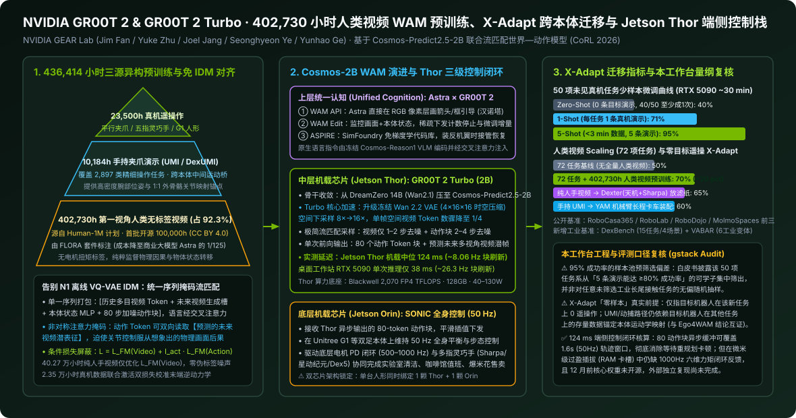

# GR00T 2 Official Technical Release: Scaling World-Action Models on 402,000 Hours of Human Video with X-Adapt & Jetson Thor 2B Turbo

2026-11-04 · NVIDIA GEAR Lab · GR00T 2 Technical Release · 待云端同步

[本地原件归档](../../../raw/c6f1bcb6d99d80a10ee03de0b047c533b6a55b761aecc635d5dd8bdad433f654) · 固定材料版本 `digest-material-c6f1bcb6d99d80a10ee03de0b047c533b6a55b761aecc635d5dd8bdad433f654@1` · [一手原站](https://research.nvidia.com/labs/gear/gr00t-2/)

## 深度拆解与复核

- ==核心结论==：GR00T 2 将英伟达具身基础模型从前代 N1/N1.5 的“静态 VLM 特征拼接动作头”推进至基于 Cosmos-Predict2.5-2B 的统一序列世界—动作模型（WAM），在 402,730 小时第一视角无标签人类视频（占总时长 92.3%）、23,500 小时真机遥操作与 10,184 小时手持 UMI 数据上通过「动作 Token 定向读取预测未来视频帧 + 纯视频样本条件屏蔽动作流匹配损失」绕开离线逆动力学伪标签误差；端侧变体 GR00T 2 Turbo 借冻结 Wan 2.2 VAE（4×16×16 压缩）将空间视频 Token 砍至 1/4，在机载 Jetson Thor 上以 124 ms 中位延迟输出 80 步动作块驱动 Jetson Orin 上的 SONIC（50 Hz）全身控制，但其宣称的 50 项任务 5-Shot 95% 成功率建立在「预筛选 ≥80% 可学任务子集」之上，且像素空间做梦仍未解决接触后微米级六维力控盲区。
- 关联主体档案：[NVIDIA GEAR Lab](../entities/labs/NVIDIA%20GEAR%20Lab.md) · [NVIDIA](../entities/companies/NVIDIA.md) · [Jim Fan](../entities/people/Jim%20Fan.md) · [Yuke Zhu](../entities/people/Yuke%20Zhu.md) · [Joel Jang](../entities/people/Joel%20Jang.md) · [Seonghyeon Ye](../entities/people/Seonghyeon%20Ye.md) · [Yunhao Ge](../entities/people/Yunhao%20Ge.md) · [宇树科技 (Unitree Robotics)](../entities/companies/%E5%AE%87%E6%A0%91%E7%A7%91%E6%8A%80%20%28Unitree%20Robotics%29.md) · [Sharpa](../entities/companies/Sharpa.md) · [Physical Intelligence](../entities/companies/Physical%20Intelligence.md)

### 一、 场景与利益标注及一手技术白皮书穿透

- 场景与利益标注：本文穿透核查 NVIDIA GEAR Lab（General Embodied Agent Research，由 Jim Fan（范麟熙） 与 Yuke Zhu（朱玉可） 共同领导，核心研究骨干涵盖 DreamZero 与 GR00T N1 主创 Seonghyeon Ye, Joel Jang, Yunhao Ge 等）在 CoRL 2026 正式发布的官方项目页与技术白皮书《GR00T 2: Scaling Robot Foundation Models for Generalization, Dexterity, and Adaptation》（`https://research.nvidia.com/labs/gear/gr00t-2/`，开源代码主仓关联 `https://github.com/NVIDIA/Isaac-GR00T`，首批 100,000 小时人类视频子集托管于 Hugging Face nvidia/human-1m-100k-oss，奖励与数据标注模型托管于 Flora-Rewarder-27B）。商业利益相关前置声明：英伟达并不直接售卖通用人形整机，其开放模型权重（计划 2026 年 12 月放出）、Human-1M 数据集、FLORA 本地标注套件与 SimFoundry / Isaac Lab 3.0 仿真的核心商业闭环，是在云端锁死大规模视频世界模型预训练与合成 RL 的 H100 / B200 集群消耗，并在端侧将人形机器人客户绑定至「Jetson Thor（跑 GR00T 2 Turbo）+ Jetson Orin（跑 SONIC 50Hz 全身控制）」的双芯片机载参考架构。阅读官方披露的少样本 95% 成功率与零样本跨本体迁移指标时，必须拆清任务预筛选口径与硬件算力开销。

---

### 二、 核心工程机制与量纲全量拆解（40.27 万小时视频管线 × WAM 演进 × X-Adapt × Thor 闭环）

#### 1. 402,730 小时人类视频预训练管线：如何绕开无动作标签视频的逆动力学瓶颈？
- 三源异构预训练配方（合计 436,414 小时）：
  1. 第一视角人类无标签操作视频（402,730 小时，占总时长 92.28%）：源自英伟达内部百万小时级人类数据工程 Human-1M（同步在 Hugging Face 以 CC BY 4.0 协议开源首批 100,000 小时 子集 Human-1M-100K-OSS），聚焦真实体力劳动与双手精细操作，包含头部与手部运动视觉轨迹，但不含任何机器人关节角或电机扭矩标签。
  2. 跨本体真机遥操作数据（23,500 小时，占 5.38%）：覆盖平行二指夹爪、多自由度五指灵巧手（如 Sharpa、星动纪元灵巧手）及双足人形本体（如 Unitree G1），负责将模型潜空间锚定至真实物理执行器动作空间。
  3. 手持无源夹爪演示数据（10,184 小时，覆盖 2,897 项任务，占 2.33%）：采用 UMI（Universal Manipulation Interface）与 1:1 机械外骨骼 DexUMI 采集，充当连接裸手运动与刚体机械手运动学的中间桥梁。
  4. 低成本本地化清洗与奖励标注引擎（FLORA）：面对超 40 万小时原始视频，调用前沿商业多模态推理模型（如 Astra）做时序切分与过程打标的 API 成本过高；GEAR Lab 训练并开源了专用数据模型套件 FLORA（含时序分割 Flora-TempSeg、细粒度动作描述 Flora-Captioner 及输出稠密过程奖励与结果判定的 Flora-Rewarder-27B），在同等标注精度下将本地部署算力成本压降至调用 Astra 的约 1/125（0.8%）。
- 核心算法突破：从 GR00T N1 的离线 VQ-VAE IDM 升级为「统一序列打包 + 条件掩码联合流匹配」：
  - 在前代 [GR00T N1](GR00T%20N1%20%26%20N1.5_%20An%20Open%20Foundation%20Model%20for%20Generalist%20Humanoid%20Robots%20%28arXiv_2503.14734%29.md) 中，团队训练离线 VQ-VAE 逆动力学模型（IDM）为人类视频强行打离散“潜动作伪标签”；但当人手（27 自由度软体）与机械夹爪拓扑差异巨大或存在相机晃动时，离线伪标签会引入严重量化噪声。
  - GR00T 2 彻底抛弃离线伪动作提取，直接在 Cosmos-Predict2.5-2B 视频扩散 Transformer 内部将多视角历史视频 Token、未来待生成视频潜帧槽位、经轻量级 MLP 投影的机器人本体状态 $q_t$ 以及加噪动作块 $A_t^\tau$ 打包进同一条统一序列，自然语言指令则由冻结的 Cosmos-Reason1 视觉语言模型编码后通过交叉注意力（Cross-Attention）注入。
  - 非对称方向注意力与条件损失掩码：在自注意力掩码设计上，视频 Token 跨越时间与多相机视角互相关注，而动作 Token 被允许直接关注序列中正在同步生成的「未来视频 Token」，迫使预测出的电机指令显式服从模型在像素潜空间“做梦”预演出的未来物理场景变化。训练总目标由未来视频潜变量流匹配损失 $\mathcal{L}_{\text{FM}}^{\text{video}}$ 与连续动作流匹配损失 $\mathcal{L}_{\text{FM}}^{\text{action}}$ 叠加构成：当输入为 23,500h 真机或 10,184h UMI 数据时双损失同时回传；当输入为 402,730h 无动作标签人类视频时，直接将动作流匹配损失项条件掩码归零（Masked Out），仅用纯视频流匹配梯度锤炼骨干网络的接触因果与物体动力学表征。

#### 2. 世界—动作模型（WAM）与主流具身基础架构横向对账
结合本工作台已入库的五套代表性具身模型，将 GR00T 2 / Turbo 放入统一技术坐标系拉通对比：

| 架构维度 | [GR00T N1 / N1.5](GR00T%20N1%20%26%20N1.5_%20An%20Open%20Foundation%20Model%20for%20Generalist%20Humanoid%20Robots%20%28arXiv_2503.14734%29.md) | [NVIDIA DreamZero](https://arxiv.org/abs/2602.15922) | [NVIDIA VFlash](%E8%8B%B1%E4%BC%9F%E8%BE%BE%20VFlash%EF%BC%9AJim%20Fan%E5%AE%A3%E5%91%8A%E2%80%9CSystem-1%E8%A7%86%E8%A7%89%E6%96%B0%E6%97%B6%E4%BB%A3%E2%80%9D%EF%BD%9C%E6%A8%A1%E5%9E%8B%E6%8F%90%E9%80%9F12%E5%80%8D.md) | [复旦/地平线 Ego4WAM](Ego4WAM%EF%BC%9A%E5%BD%93%E4%BA%BA%E7%B1%BB%E6%95%B0%E6%8D%AE%E8%BF%88%E5%90%91%E7%99%BE%E4%B8%87%E5%B0%8F%E6%97%B6%EF%BC%8C%E6%8E%A2%E7%B4%A2%E6%95%B0%E6%8D%AE%E6%97%B6%E9%95%BF%E4%B9%8B%E5%A4%96%E7%9C%9F%E6%AD%A3%E5%80%BC%E5%BE%97%20scaling%20%E7%9A%84%E5%85%B3%E9%94%AE%E7%BB%B4%E5%BA%A6.md) | [Physical Intelligence π0.5](%CF%800.5%20%28pi0.5%29_%20A%20Vision-Language-Action%20Model%20with%20Open-World%20Generalization%20%28arXiv_2504.16054%29.md) | NVIDIA GR00T 2 / Turbo (本文) |
| :--- | :--- | :--- | :--- | :--- | :--- | :--- |
| 核心范式定位 | 双系统 VLA (Eagle VLM + DiT) | 重型自回归扩散 WAM (Wan2.1-I2V) | 高层 VLM 并行几何规划草稿器 (FPD) | 双分支共享注意力 WAM (OpenWAM) | 分层子任务自回归 + 知识绝缘 VLA | 轻量化端侧统一序列 WAM + Astra 视觉接口 |
| 参数规模 | 2.2B (1.34B + 0.86B) | 14B (140 亿参数) | 4B 目标 VLM + 537M 双向草稿器 | 基于 Wan-DiT 双分支 | ~2.3B (2B VLM + 300M Expert) | 2B (Cosmos-Predict2.5-2B) + 冻结 Reason1 |
| 人类视频利用方式 | 离线 VQ-VAE IDM 提离散潜动作，N1.5 加 FLARE | 联合预测密集视频帧与动作，10–20 min 跨本体视频迁移 | 不直接训人类视频，加速高层 2D/3D 轨迹图元生成 | 15,000h 纯视频训视频分支 + 12,000h 3D 手部轨迹中训 | 几乎不靠无标签人手视频，靠 10,000h+ 跨本体真机 + Web VQA | 402,730h 无标签视频直训未来帧流匹配（屏蔽动作损失） |
| 解决的核心痛点 | 截取 VLM 第 12 层降时延，少样本提升 4.2x | 证明 14B 视频生成骨干具备 >2× 零样本物理泛化 | 消除 AR 逐坐标验证坍塌，规划解码提速 12–42× | 实证对齐度 > 盲堆时长，6,000 类长尾引发精细度负迁移 | Stop-Gradient 阻断动作噪声污染 VLM，百户家庭 82% 泛化 | 将 DreamZero 的 WAM 能力压缩 7 倍 塞进单颗机载 Jetson Thor |
| 端侧推理延迟与频率 | 单卡 L40 63.9 ms (16 步块) | 多卡服务器优化后闭环仅 7 Hz (~143 ms，难上机载端侧) | Thor 规划解码 258.2 ms，接 WAM 总链路 703.3 ms (1.42 Hz) | 侧重离线数据配比消融，未主打机载极限低时延 | 300M 动作专家 10 步去噪支撑 50 Hz (1.0s 块) | Turbo 在机载 Jetson Thor 达 124 ms (RTX 5090 38 ms)，输出 80 动作块 |

- ✅ 架构演进闭环核查（本工作台核查）：将上表串联即可看清英伟达 2026 年在具身大脑上的三次迭代跳跃——2 月的 DreamZero (arXiv:2602.15922) 验证了“联合预测未来视频与动作”能让跨本体泛化翻倍，但 14B 参数过于笨重，即便加上 DiT 缓存也只能在地面工作站跑 7 Hz；随后 [Goodfire AI 神经几何解剖 (arXiv:2610.20840)](%E3%80%90%E6%85%A2%E7%A7%91%E7%A0%94%E3%80%91VLA%E5%A6%82%E4%BD%95%E5%9C%A8%E5%86%85%E9%83%A8%E8%A1%A8%E7%A4%BA%E7%89%A9%E7%90%86%E4%B8%96%E7%95%8C%EF%BC%9F.md) 揭示纯 VLA（如 $\pi_{0.5}$）因缺乏时序世界状态预测而把“机械臂停顿”误判为抓取/松手阶段切换；11 月发布的 GR00T 2 Turbo 完成了工程收敛：把 DreamZero 的 WAM 架构从 14B 砍到 2B 并换装高压缩比 Wan 2.2 VAE 塞进单颗 Jetson Thor（124 ms），同时把复杂逻辑推理剥离给上层多模态模型 Astra 通过像素涂鸦（WAM API）稀疏下发（若上层搭配同周发布的 VFlash 并行草稿器，还可进一步压缩高层轨迹绘制延迟）。

#### 3. X-Adapt 跨本体零样本/少样本迁移机制与基准实测
- 四条跨域数据迁移管线：
  1. 手持夹爪迁移（UMI → YAM 机械臂）：操作员手持低成本无源 UMI 夹爪采集长时程玩具自卸卡车装配演示，仅用该人类手持数据微调 GR00T 2 检查点后零样本部署至外观与运动学迥异的 YAM 机械臂夹爪，取得 60% 端到端装配成功率。
  2. 人类视频/动捕手套迁移（Human Video / Mocap → Dexter 双臂灵巧手）：在配备天机双臂与 [Sharpa](../entities/companies/Sharpa.md) 五指灵巧手的 Dexter 平台上，仅凭人类演示视频/动捕数据（目标机器人针对该任务 0 条遥操作演示），完成高中化学实验“将滤纸折好放入漏斗并润湿倾倒盐水”，取得 65% 成功率，并支持遥操作难以采集的仓库动态抛掷（Throwing）动作。
  3. 1:1 机械外骨骼迁移（DexUMI → 多指灵巧手）：针对多指灵巧手设计具备 1:1 关节机械映射的可穿戴外骨骼 DexUMI（计划开源全部 CAD 图纸与 BOM），利用 GR00T 2 的未来视频联合生成跨越外骨骼与真机灵巧手之间的显著视觉外观鸿沟，自主完成持刀切香蕉与精细手腕扭转。
  4. 物理仿真强化学习迁移（SimFoundry 1.0/2.0 + Isaac Lab 3.0 + Newton → Unitree G1）：沿「人类视频 → 场景与运动 3D 重建 → 集成 Newton 物理引擎的 Isaac Lab 3.0 强化学习训练 → 域随机化合成轨迹 → 微调 GR00T 2 → 真机零样本部署」六步管线，驱动人形机器人完成全身移动清洁与售卖作业。
- 官方核心评测数据汇总：
  - 72 项真机任务人类视频 Scaling 验证：在 72 项真机评估任务上，引入全量 402,730 小时人类第一视角视频预训练后，真机平均任务完成进度/成功率从基线的 50% 提升至 70%（+20 pct）。
  - 50 项未见任务少样本适配曲线：在无该任务特定演示（Zero-Shot）条件下，模型在 50 项任务中的 40 项至少成功完成一次，平均零样本成功率为 40%（40%–41%）；提供 1 条演示（1-Shot） 后平均成功率跃升至 71%；提供 5 条演示（5-Shot，总时长 < 3 分钟 真机数据，在单张桌面级 NVIDIA GeForce RTX 5090 上微调约 30 分钟） 后，平均成功率达到 95%。
  - 横向公开与工业基准：官方披露 GR00T 2 在 RoboCasa365、RoboLab、RoboDojo 与 MolmoSpaces 四大基准上均位列 VLA 与 WAM 模型总榜前三；同时联合 RLWRLD 发布含 4 类工业场景 15 项任务的灵巧基准 DexBench，联合 UC Berkeley 发布含 6 类工业标准化变体任务的 VABAR，并在富士康（Foxconn）、西门子（Siemens）产线场景开展早期验证。

#### 4. Jetson Thor 2B Turbo 端侧实时闭环控制栈与上层「统一认知」接口
- GR00T 2 Turbo 的四倍视觉 Token 压缩机制：标准视频扩散模型的计算瓶颈在于多相机视角展开后的海量视觉 Token 自注意力开销。GR00T 2 Turbo 保持 2B（20 亿） 参数规模不变，但将底层冻结视频自编码器切换为高压缩比的 Wan 2.2 VAE（时空压缩率达 4 × 16 × 16，权重体积约 1.34 GB），使单帧每维空间下采样率从传统的 8× 翻倍至 16×，空间视频潜变量网格缩小至原来的 1/4（4× Token 削减）；配合流匹配直线路径优化，推理部署时未来视频仅需 1–2 步去噪、动作序列仅需 2–4 步去噪。
- 双芯片三级机载控制闭环量纲（以 [Unitree G1](../entities/companies/%E5%AE%87%E6%A0%91%E7%A7%91%E6%8A%80%20%28Unitree%20Robotics%29.md) 全身操作实机为例）：
  1. 中层世界—动作模型芯片（机载 NVIDIA Jetson Thor）：搭载 Blackwell 架构 GPU（最高 2,070 FP4 TFLOPS 稀疏算力、128 GB LPDDR5X 显存带宽 273 GB/s、可配置功耗包络 40 W – 130 W），本地运行 GR00T 2 Turbo，单次推理中位延迟为 124 ms（对应动作块重规划上限频率约 8.06 Hz；若在桌面 RTX 5090 工作站推理，单次延迟降至 38 ms，约 26.3 Hz），每次前向输出 80 个动作 Token 组成的动作块。
  2. 底层全身平衡小脑芯片（机载 NVIDIA Jetson Orin）：独立运行全身运动控制器 [SONIC](%E4%B8%93%E8%AE%BF%E7%BD%97%E6%AD%A3%E5%AE%9C%EF%BC%9A%E5%85%B3%E4%BA%8ESONIC%E5%85%A8%E8%BA%AB%E6%8E%A7%E5%88%B6%E6%A1%86%E6%9E%B6%E7%9A%84%E8%AE%BF%E8%B0%88.md)，接收 Thor 异步生成的动作块后以 50 Hz（每 20 ms 一拍）维持双足动态平衡与上下肢协调，再交由关节电机驱动器执行 500–1000 Hz 底层力矩 PD 闭环。
  3. 上层「统一认知（Unified Cognition）」慢思考协同（前沿模型 Astra）：通过三类接口与本地 GR00T 2 耦合（详见本库关联导读[《现场｜Jim Fan CoRL演讲全文》](%E7%8E%B0%E5%9C%BA%EF%BD%9CJim%20Fan%20CoRL%E6%BC%94%E8%AE%B2%E5%85%A8%E6%96%87%EF%BC%9A%E8%BF%99%E4%B8%8D%E6%98%AF%E5%AF%92%E5%86%AC%EF%BC%8C%E8%BF%99%E6%98%AF%E6%9C%BA%E5%99%A8%E4%BA%BA%E7%9A%84%E5%A4%8F%E5%A4%A9.md)）——① WAM API（Astra 直接在相机 RGB 画面绘制箭头/目标框，引导 GR00T 2 零样本求解物理汉诺塔与复杂垃圾分类）；② WAM Edit（监控视频与本体状态，在两次化学蘸取计数达标或显微镜旋钮清晰对焦瞬间下发增量停止/微调指令）；③ ASPIRE（在仿真器中免梯度下降探索积累代码技能库，当真机整夜拼装飞机把上机翼装反时无缝切入恢复例程纠错复位）。

---

### 三、 原位物理与工程量纲复核（本工作台核查与推断）

1. ⚠️ 核查一：5-Shot 95% 成功率背后的「任务池预筛选生存偏差」与评测基准成色（本工作台核查）
   - 媒体传播普遍将“5 条演示、3 分钟数据、RTX 5090 微调 30 分钟即达 95% 成功率”解读为通用产线问题已攻克。但核查白皮书实验方法论脚注可见：这 50 项评测任务是从更大候选池中按「模型在 5 条演示微调后至少能达到 80% 成功率」的标准预先筛选出来的可学任务子集。换言之，凡是在 5 条演示下学不会的高精度卡阻、软体复杂缠绕或强反光透明件任务已被前置剔除出分母，95% 度量的是“可适配象限内的样本收敛效率”，而非未筛选真实工业工序的无偏成功率。同时，RoboCasa365、MolmoSpaces 与 RoboDojo 仍以仿真与标准化桌面短时程回合为主；演讲展示的服务器内存条（RAM）插拔、UPS 1 小时数据训剪刀裁贴快递单、粗盐过滤与整夜拼飞机，尚未披露无剪辑连续运行 >8 小时 的平均故障间隔时间（MTBF）与人工干预接管率。
2. ⚠️ 核查二：X-Adapt“零样本”并非零本体先验，与 Ego4WAM 边界严格互证（本工作台核查）
   - 白皮书明确限定：X-Adapt 的“零样本”仅指目标机器人在该项待测新任务上没有采集过遥操作轨迹；但在 UMI → YAM 与人体动捕迁移路径中，训练集中必须混入该目标机器人在其他历史任务上的存量真机数据（即 23,500 小时遥操作池中的同构样本），才能锚定 Embodiment-Specific MLP 与像素空间的运动学映射。这与本库 [Ego4WAM (arXiv:2609.40341)](Ego4WAM%EF%BC%9A%E5%BD%93%E4%BA%BA%E7%B1%BB%E6%95%B0%E6%8D%AE%E8%BF%88%E5%90%91%E7%99%BE%E4%B8%87%E5%B0%8F%E6%97%B6%EF%BC%8C%E6%8E%A2%E7%B4%A2%E6%95%B0%E6%8D%AE%E6%97%B6%E9%95%BF%E4%B9%8B%E5%A4%96%E7%9C%9F%E6%AD%A3%E5%80%BC%E5%BE%97%20scaling%20%E7%9A%84%E5%85%B3%E9%94%AE%E7%BB%B4%E5%BA%A6.md) 实证的“真机数据从 20 条进一步砍到绝对 0 条时动作头立即崩溃”完全一致——当第三方开发者拿到一台从未进入 23,500h 预训练库的全新自研机械臂时，仍需先采集数十小时基础任务真机数据做本体对齐。
3. ✅ 核查三：Jetson Thor 124 ms 端侧推理与 80 动作块闭环时间预算复核（本工作台核查）
   - 按底层控制频率 50 Hz（每步 20 ms）核算，单次前向输出的 80 个动作 Token 覆盖未来 1.6 秒 的连续运动窗口（若按灵巧手+双臂多维展平编码，即便折算为 16–32 个时间步也覆盖 320–640 ms）。由于 Jetson Thor 本地单次推理中位耗时仅 124 ms，小于动作块执行周期的 1/3 至 1/12，系统完全支持异步流水线滚动重规划（Receding-Horizon Execution）——即底层 Orin (SONIC) 正在执行当前动作块前 6–7 步时，下一轮基于最新相机画面的运动块已在 Thor 上解码完毕并平滑融合，消除了传统自回归 VLA“动一下、停顿等推理半秒”的机械卡顿。但需注意单台 Unitree G1 同时背负 Jetson Thor（峰值 130W）与 Jetson Orin（15W–60W），仅机载计算单元满载功耗即达 100W–180W，对人形机器人自带电池续航（通常 800–1,000 Wh）构成约 15%–20% 的额外功率分流。
4. ❌ 核查四：像素潜空间做梦无法替代接触后 1,000 Hz 六维力触闭环（本工作台推断）
   - GR00T 2 的输入模态仅限「语言 + 多视角 RGB 图像 + 关节本体状态 $q_t$」，未原生接入指尖高密度视触觉阵列或腕部六维力/力矩传感器（6-Axis F/T）。在服务器内存条（DDR5 DIMM）插槽按压等紧配合任务中，一旦手指与散热马甲遮挡住金手指卡口，Wan 2.2 VAE 压缩 16 倍后的低分辨率视频潜变量根本无法分辨 0.1 mm 级的插偏卡阻；若缺乏底层柔顺阻抗控制或 [瞬恒 SynDexy C1](%E6%8A%8A%E5%B7%A5%E4%B8%9A%E7%B2%BE%E5%AF%86%E5%B7%A5%E5%BA%8F%E4%BA%A4%E7%BB%99%E6%9C%BA%E5%99%A8%E4%BA%BA%EF%BC%9A%E7%9E%AC%E6%81%92%E6%99%BA%E8%83%BDSynDexy%20C1%20%E5%AE%8C%E6%88%90%E9%A6%96%E6%AC%A1%E5%B0%8F%E6%89%B9%E9%87%8F%E4%BA%A4%E4%BB%98.md) / ForceVLA2 式的毫秒级力矩熔断，纯靠 8 Hz 视觉重规划在工装公差波动时极易压弯主板插槽引脚。

---

### 观点与可反驳条件

- ==观点==：GR00T 2 与 GR00T 2 Turbo 的核心产业意义，在于证明了世界—动作模型（WAM）不必停留在 14B 服务器级玩具（DreamZero），通过 2B 骨干 + Wan 2.2 VAE 四倍视觉压缩 + 条件掩码流匹配，既能吃下 40.27 万小时无动作标签人类视频的物理因果红利，又能压进 124 ms 单颗机载 Jetson Thor 跑通端侧闭环。但英伟达真正的护城河并非这颗 2B 模型检查点本身，而是以 Human-1M + FLORA (1/125 标注成本) + SimFoundry/Newton + WAM API + Thor/Orin 双芯 构建的具身全栈标准，迫使下游本体厂在算力选型上深度锁定英伟达生态。
- ==推翻条件==：
  1. ① 无预筛选真实工业任务复现反驳：2026 年 12 月 GR00T 2 与 Turbo 权重正式开源后，若独立第三方在不经过 ≥80% 可学性预筛选的完整 DexBench（15 项工业任务）或线束插接、柔性袋装等未见工位上执行同等「5 条演示 + RTX 5090 微调 30 分钟」测试，端到端平均成功率跌破 55%，则证明白皮书 95% 少样本上限主要由任务筛选贡献；
  2. ② 像素级视频生成必要性反驳：若同参数量级（2B）的对照模型在同等 40.27 万小时视频数据上改用非像素重建的纯隐空间世界预测（如 V-JEPA 潜状态回归或 N1.5 FLARE 轻量对齐），在 X-Adapt 人手视频转机械手基准上取得不低于 GR00T 2（如滤纸任务 ≥65%）的迁移成功率，同时将 Jetson Thor 端侧延迟进一步压低至 <60 ms，则证明在扩散过程中显式解码未来视频潜帧存在算力冗余；
  3. ③ 端侧异构算力替代反驳：若头部人形本体厂基于开源 VLA/WAM 权重配合单颗国产高算力车规级 SoC（如双地平线 J6P 或黑芝麻 Thor 同级方案，BOM 成本低于 Jetson Thor + Orin 组合的 40%）跑通同等 120 ms 内 80-token 动作块闭环，则英伟达借 GR00T 2 Turbo 绑定高端机载双芯片的硬件溢价逻辑将被削弱。

---

## 原文摘录与一手信源存证

> 【信源巡检核心摘要】 NVIDIA GEAR Lab 在 CoRL 2026 正式上线下一代机器人基础模型 GR00T 2 官方技术页与白皮书（https://research.nvidia.com/labs/gear/gr00t-2/ ，代码栈关联 https://github.com/NVIDIA/Isaac-GR00T ）。
> — 原文摘录，文字段落 1；证据 `digest-material-c6f1bcb6d99d80a10ee03de0b047c533b6a55b761aecc635d5dd8bdad433f654-excerpt-1@1`

一手材料：

- GR00T 2 Official Technical Release: Scaling World-Action Models on 402,000 Hours of Human Video with X-Adapt & Jetson Thor 2B Turbo · NVIDIA GEAR Lab · [原站](https://research.nvidia.com/labs/gear/gr00t-2/) · [主体档案：NVIDIA GEAR Lab](../entities/labs/NVIDIA%20GEAR%20Lab.md) / [主体档案：Jim Fan](../entities/people/Jim%20Fan.md) / [主体档案：Yuke Zhu](../entities/people/Yuke%20Zhu.md) · [待上传原件](../../../raw/c6f1bcb6d99d80a10ee03de0b047c533b6a55b761aecc635d5dd8bdad433f654)
  材料版本 `digest-material-c6f1bcb6d99d80a10ee03de0b047c533b6a55b761aecc635d5dd8bdad433f654@1`；获取方式 `tg_approved_source_update`。
  > 【信源巡检核心摘要】 NVIDIA GEAR Lab 在 CoRL 2026 正式上线下一代机器人基础模型 GR00T 2 官方技术页与白皮书（https://research.nvidia.com/labs/gear/gr00t-2/ ，代码栈关联 https://github.com/NVIDIA/Isaac-GR00T ）。 — 原文提取

归属与范围：完成 NVIDIA GEAR Lab（Jim Fan / Yuke Zhu 团队）GR00T 2 与 GR00T 2 Turbo 官方项目页及技术白皮书穿透核查：拆解 436,414 小时三源异构数据（402,730h 第一视角人类无标签视频 + 23,500h 真机遥操作 + 10,184h/2,897 任务手持 UMI，含 Hugging Face 开源 100,000h Human-1M 子集与 1/125 标注成本 FLORA 套件）、Cosmos-Predict2.5-2B 统一序列掩码流匹配机制（与 GR00T N1/N1.5、DreamZero 14B、VFlash、Ego4WAM、π0.5 横向对账）、Wan 2.2 VAE 1/4 视觉压缩在机载 Jetson Thor 上的 124 ms 实时闭环（驱动 Jetson Orin 50Hz SONIC 全身控制及 Astra WAM API/Edit/ASPIRE 协同），并复核 5-Shot 95% 成功率背后的 ≥80% 可学任务预筛选口径偏差与接触力控盲区。

来源缺口：

- `not_disclosed`：GR00T 2 白皮书披露 50 项评测任务系从「5 条演示微调可达 ≥80% 成功率」的可学池中预筛选得出，未披露未筛选全量工业长尾任务分母得分、DexBench/VABAR 分项绝对分值及连续 8 小时无剪辑运行 MTBF；核心模型权重与 X-Adapt 代码需待 2026 年 12 月正式开源后独立复现。 [线索](https://research.nvidia.com/labs/gear/gr00t-2/)

[返回赛道总览](../赛道总览.md#digest-c6f1bcb6d99d80a1) · [返回导读索引](README.md) · [主体档案库](../entities/README.md)
