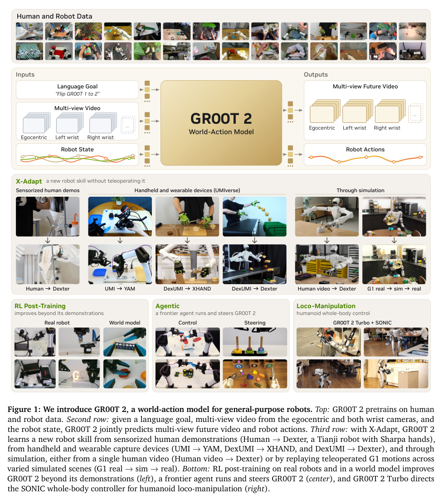
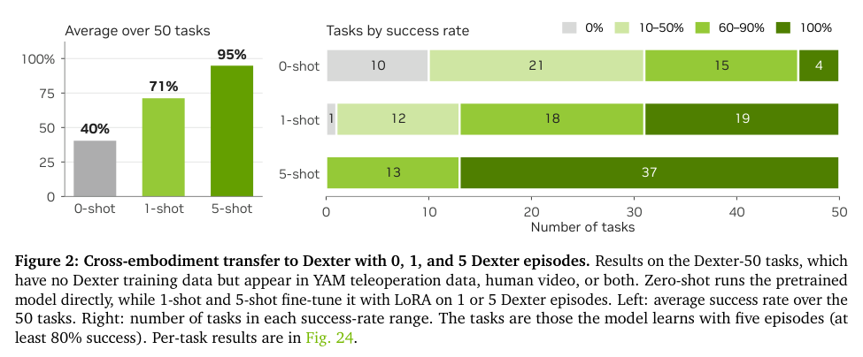

# GR00T 2: World-Action Model for Physical AI and Agentic Robotics

2026-11-09 · NVIDIA GEAR Lab · 有来源缺口

[本地原件归档](../../../raw/e8b71a3de7c7aa50d6c424f4d6c54b0560e7f6855fd52d651c51aab56435f417) · 固定材料版本 `digest-material-e8b71a3de7c7aa50d6c424f4d6c54b0560e7f6855fd52d651c51aab56435f417@1` · [一手原站](https://research.nvidia.com/labs/gear/gr00t-2/assets/gr00t2_whitepaper.pdf) · [触发线索（NVIDIA GEAR Lab / Jim Fan）](https://research.nvidia.com/labs/gear/gr00t-2)

## 深度拆解与复核

### 一、 口径与利益披露及与既有 GR00T 2 导读的增量分工

- **口径与利益披露**：本文底稿为 [具身纪元](https://mp.weixin.qq.com/s/vFEQRvXIvkXicYfOvDuEOQ) Marilyn Liu 于 2026-11-10 编译整理的 CoRL 2026（Austin）主题演讲《From Dreaming to Doing: World Action Models and Agentic Robotics》全文实录（主讲人 Jim Fan，NVIDIA GEAR Lab 联合负责人），本工作台已完成对上游一手站点 [NVIDIA GEAR GR00T 2 项目页](https://research.nvidia.com/labs/gear/gr00t-2/)、135 页白皮书 [gr00t2_whitepaper.pdf](https://research.nvidia.com/labs/gear/gr00t-2/assets/gr00t2_whitepaper.pdf)、[SimFoundry 项目页](https://research.nvidia.com/labs/gear/simfoundry/)、[GEAR DexUMI 文档](https://research.nvidia.com/labs/gear/hardware-prototypes/GEAR_DexUMI/index.html) 及 Hugging Face 数据集 [PhysicalAI-Human-1M-100K](https://huggingface.co/datasets/nvidia/PhysicalAI-Human-1M-100K) 的逐项交叉核查。NVIDIA 自身处于计算平台与具身全栈生态的卖方位置：现场“物理世界 RSI（服务器内存条更换）”、“Team Green”情怀叙事与派对卖爆米花 ARR 每晚 \$20 美元的舞台修辞，核心商业目标是将模型训练锁定在云端 GPU，并将机载控制栈绑定在 Jetson Thor 与 Jetson Orin 双芯片之上。
- **增量定位与库内分工**：库内已入库技术页拆解 [GR00T 2 Official Technical Release](GR00T%202%20Official%20Technical%20Release_%20Scaling%20World-Action%20Models%20on%20402,000%20Hours%20of%20Human%20Video%20with%20X-Adapt%20%26.md)（覆盖 Cosmos-Predict2.5-2B 联合流匹配、436,414 小时三源配比、5-Shot 95% 预筛选偏差与 124 ms 时序预算）以及新闻摘要 [Jim Fan 与 NVIDIA 在 CoRL 2026 发布 GR00T 2](Jim%20Fan%20%E4%B8%8E%20NVIDIA%20%E5%9C%A8%20CoRL%202026%20%E5%8F%91%E5%B8%83%20GR00T%202%20%E4%B8%96%E7%95%8C%E5%8A%A8%E4%BD%9C%E6%A8%A1%E5%9E%8B%EF%BC%88WAM%EF%BC%89%E5%8F%8A%2010%20%E4%B8%87%E5%B0%8F%E6%97%B6%E5%BC%80%E6%BA%90%E7%A4%BA%E8%8C%83%E6%95%B0%E6%8D%AE%E9%9B%86.md)（当前仅为一手摘要存证）。本篇不重复 N1/DreamZero 架构对照，聚焦 Keynote 现场实机口径、上游白皮书增量实证、数据/硬件文档纠偏与全栈开源兑现清单。

---

### 二、 CoRL 2026 Keynote 现场叙事与「1x 原速无剪辑」实机细节核查

1. Astra 冲击下的 System 1 / System 2 重新分工：Jim Fan 在 Keynote 中以 2026-09-03 Astra 发布引发的“悲伤 5 个阶段”开场，指出前沿推理模型（System 2）虽能理解长程语义、编写控制代码并做视觉监工，但无法替代高频本地执行的物理技能层（System 1）。GR00T 2（20 亿参数 / 2B World-Action Model）接收语言指令、多视角相机画面与机器人状态，在同一个扩散 Transformer 内联合去噪未来视频帧（320x224 分辨率、0.8 s 历史窗口）与连续动作块；演讲特别说明现场不受会议 Wi-Fi 约束的本地化 System 1 才是可用工程边界。
2. @DrJimFan 与 Keynote 长程灵巧 1x 实时无剪辑验证：
   - 服务器内存条更换（RAM Swap）：全自主、1 倍速（1x）、无剪辑完成数据中心内存条拔插与卡槽按压；白皮书与官方项目页给出该双臂 Dexter（天机机械臂 + 双 22-DoF Sharpa 灵巧手 + 3-DoF GEAR Neck，立体头部相机 2560x1984）在 GB300 内存条安装任务上取得 85% 成功率，玩具卡车装配取得 65% 成功率。
   - UPS 门店贴标与化学粗盐过滤：UPS 场景仅用 1 小时（1 hour）示范数据微调，完成剪刀裁切标签、1x 实时双指剥离背纸、贴包裹与扫码；粗盐过滤任务（舀盐、溶解、放置滤纸、润湿倾倒与实验后自主清理）横跨 3 至 5 分钟、20 多个步骤，展示长程误差累积控制；结尾通过高亮动态划火柴点亮酒精灯并熄灭火柴演示高频实时控制。
   - ✅ 开源数据集路径与规模口径核查（本工作台核查）：既有导读曾写为 nvidia/human-1m-100k-oss，经核对官方项目页与 Hugging Face 实仓，==正式公开数据集标识为 nvidia/PhysicalAI-Human-1M-100K==（CC BY 4.0 协议，2026-11-07 更新，已累计 21,855 次下载；human-1m-100k-oss 为其发布暂存桶名称），配套提供 PhysicalAI-Human-1M-Explorer 浏览器。==100,000 小时（10 万小时）是 Human-1M 内部人类第一视角数据池中已开源的首批子集，402,000 小时（白皮书精确值 402,730 小时）才是用于预训练 GR00T 2 的全量人类视频体量==，二者并非矛盾而是“已开放子集 vs 内部预训练全集”的层级关系。

---

### 三、 上游白皮书增量实证：X-Adapt、DexUMI 硬件参数与 Turbo/Agentic 实测边界

1. Cross-Adapt（X-Adapt）四条 Pipeline 与 GEAR DexUMI 实测硬件核验：
   - 人体视频/动捕 -> Dexter（0 条目标任务遥操作）：化学滤纸铺设与润湿 20 次试验成功率达 65%，并支持仓库动态抛掷（Throwing）；但训练池仍依赖目标机器人其他任务的本体对齐数据。
   - 手持 UMI 夹爪 -> YAM 机械臂：在无 YAM 该任务遥操作数据下，仅凭 UMI 数据微调完成最长达 4 分钟的玩具自卸卡车装配，端到端成功率 60%（同步测试传送带分拣抛掷与 NIST 板拆解）。
   - ⚠️ GEAR DexUMI 外骨骼自由度与传感口径核查（本工作台核查）：演讲与中文报道泛称 DexUMI 与机器人手具备 1:1 机械映射；核查上游 [GEAR DexUMI 官方硬件文档](https://research.nvidia.com/labs/gear/hardware-prototypes/GEAR_DexUMI/index.html) 可见，==该穿戴外骨骼基于 Xu et al. (2025) 改进，单手实配 15 个磁编码器（含四指掌指外展），五指指尖均配备法向力与切向剪切力传感器并搭载 OAK 腕部相机==（软件 Apache-2.0、Record3D iPhone 适配器 LGPL-2.1-only、X Hand URDF 为 MIT、硬件图纸 CC BY 4.0），并非未加区分的笼统“16-DoF”固定规格。实测跨视觉外观差异完成 Tianji + ROBOTERA 灵巧手的切香蕉、酸奶舀麦片与划火柴点灯。
   - 仿真强化学习 -> 真机零样本：从单段人类用锤视频重建场景并做 RL，迁移至 Sharpa 真机；在 Unitree G1 分布外（OOD）测试中，加入仿真片段使 GR00T 2 Turbo 成功率从 6.7% 跃升至 63.3%（对比 GR00T 1.7 的 40.0%）。

| 模块/机制 | 演讲与导读摘要口径 | 上游白皮书与文档核查增量实测 | 关键限制与未决边界 |
| :--- | :--- | :--- | :--- |
| GR00T 2 Turbo 端侧推理 | 空间视频 token 砍至 1/4，Jetson Thor 输出 80 个动作 token，Orin 跑 50 Hz SONIC | 推理优化较 eager BF16 降延迟 66%–86%（提速 2.9x–7.2x）；RTX 5090 达 38 ms，Jetson AGX Thor 达 124 ms 规划 1.6 s 动作块；G1 爆米花 48/48（100%）、桌面清理 93%（30 次） | 在 YAM 上仅固定管件（90%）与断路器插线（100%）胜过基座 GR00T 2，其余 4 项 YAM 任务及 6 项 Dexter 任务中的 5 项均略逊于完整版 |
| WAM API 视觉目标引导 | Astra 在相机画面直接画框/箭头，零样本求解汉诺塔与垃圾分类 | 短程 what-and-where 指令在 YAM（90 次）从 40% 提至 92%（纯步骤文本 66%），Dexter（64 次）从 30% 提至 70%；长程垃圾分类 YAM 完成 17/20、NIST 拆解 3/10 | how 类动作方式指令在 YAM 仅从 44% 提至 59%；Dexter 在长程垃圾分类中极少全程收官；2D 涂鸦不传递目标朝向与倾倒/擦拭轨迹 |
| WAM Edit 与 ASPIRE 守护 | Astra 监工 2 次蘸取计数与显微镜对焦；ASPIRE 纠正装反机翼实现整夜 Minecraft 式装配 | YAM 杂乱倒料连续 100 次试验：飞机 98/100、拖拉机 97/100、Hot Wheels 97/100（无智能体 71–84，纯 SFT 23–69）；加 RL 与 ASPIRE CaP 后，5 根网线插接从 12/20 升至 19/20，5 个充电器插接从 2/20 升至 20/20 | ASPIRE 代码恢复例程依赖仿真先验环境搭建，且当前未公布多机连续 8 小时以上的 MTBF 与人工介入接管率 |
| 真实世界强化学习与基准 | 较基线取得两位数提升 | 3 项富接触插接任务经真实世界 GRPO 自模仿 RL 后，成功率从监督微调的 40%–76% 跃升至 88%–96%；50 项 Dexter 未见任务 Zero-Shot 40%、1-Shot 71%、5-Shot 95% | 50 项评测集经过 >=80% 可学性预筛选；白皮书 Sec. 5 明确承认未接入指尖触觉/腕部力矩，SONIC 潜变量仅表征关节位置而非显式接触力 |

2. 全栈开源与仿真评测底座核验：
   - **SimFoundry 1.0 / 2.0**：现场演示的 SimFoundry 1.0（[项目页](https://research.nvidia.com/labs/gear/simfoundry/) / arXiv:2606.28276 / github.com/NVlabs/SimFoundry）以单视频重建 3D Gaussian Splatting 背景与带纹理网格，并生成物体/场景/任务数字表亲（在零样本真机迁移中分别带来 17%、21%、50% 平均提升）；在 GR00T 2 的 25 项 YAM 基准与 14 个策略对比中，SimFoundry 仿真与真机成功率相关性达 Pearson 0.92、Spearman 0.89（MMRV 0.055），支持颗粒物与关节物体，2.0 预计 2027 年初推出。
   - **Isaac Lab 3.0 与 Newton**：NVIDIA 在 2026-11-09 发布的 CoRL 官方生态博客（blogs.nvidia.com/blog/2026/11/09/practice-makes-precise-corl/，直接抓取返回 HTTP 403，经检索与库内摘要复核）同期推出深度集成开源物理引擎 Newton 的 Isaac Lab 3.0 以及面向物流/零售/制造灵巧操作的 **DexBench 与 VABAR** 公开基准，构成底层的 GPU 物理仿真与评测底座。
   - **Flora 数据整理引擎**：白皮书 Sec. C.4 披露其包含时序切分 Flora-TempSeg（重叠滑窗预测起止时间与跨窗标记，支持双手并行动作独立分段）与上下文描述 Flora-Captioner（结合前后邻近动作帧消歧物体身份，输出含双臂分工的祈使句，失败尝试按预期目标标注但不伪标成功），二者均用 GRPO 基于时序 F1 与边界可验证奖励训练，配合 Flora-Rewarder 使本地标注算力成本压降至调用 Astra 的约 1/125。
   - 开源权重兑现状态与白皮书开放难题（本工作台推断）：截至 2026-11-23 核查，Hugging Face 上的 Human-1M 首批 100,000 小时数据集（PhysicalAI-Human-1M-100K）、SimFoundry 1.0 与 UMI/DexUMI 硬件文档已上线，但 ==GR00T 2 与 GR00T 2 Turbo 模型权重及 Cross-Adapt 方法在官网仍标示为“Available in December”（预计 2026 年 12 月开源）==。白皮书第 5 章（p. 27）进一步坦承三大未解问题：接触力/触觉缺失、层级接口无法传达力控与动态风格，以及人类视频/UMI/真机遥操作三者之间尚未建立定量的“数据小时汇率（exchange rate）”。

---

### 观点与可反驳条件

- ==观点==：CoRL 2026 Keynote 的核心战略价值，是用 2B 端侧 WAM（GR00T 2 Turbo）+ 像素级高层接口（WAM API / WAM Edit / ASPIRE）+ 廉价数据闭环（1/125 成本 Flora + DexUMI + SimFoundry）打通了“推理大模型给指令、本地小模型扛高频、仿真和人类视频补规模”的工程范式，但其护城河在于数据与仿真标准，而非未经触觉闭环的 2B 视觉模型本身。
- ==推翻条件==：
  1. ① 开源权重复现期性能回撤：若 2026 年 12 月 GR00T 2 与 Turbo 权重正式放出后，外部团队在未做可学性预筛选的 DexBench 与 VABAR 完整工业子集上，仅凭 5-Shot 与单卡 RTX 5090 微调无法复现 70% 以上真机成功率，且在无 ASPIRE 人工搭建仿真恢复例程时连续作业掉队，则说明当前 97/100 级演示高度依赖任务筛选与特定脚手架；
  2. ② 人类视频与 UMI 数据汇率失效：若后续消融证明 100,000 小时 PhysicalAI-Human-1M-100K 在异构机械手（非预训练库内本体）微调中带来的效率增益显著低于直接采集 10–20 小时 DexUMI 或真机遥操作数据（即人类视频边际汇率在跨全新本体时趋近于零），则 Human-1M 作为通用预训练底座的生态绑定力将被大幅削弱；
  3. ③ 力触觉闭环强制替代像素预测：若同期接入指尖视触觉或腕部六维力传感器、在隐空间做世界状态预测的端侧策略，在内存条插拔、线束盲插等遮挡型富接触任务中以更低计算延迟稳定超越 GR00T 2 的 88%–96% RL 表现，则纯 RGB 像素做梦路线将面临架构级重构。

---

## 原文摘录与一手信源存证

> Jim Fan宣布新模型发布，GR00T 2 是面向通用机器人的世界—动作模型（World-Action Model，WAM）。 它接收语言指令、多视角相机画面和机器人状态，通过同一个扩散 Transformer 联合预测未来画面与动作序列，把“世界将如何变化”和“机器人应如何行动”一起学习。
> — 原文摘录，文字段落 1；证据 `digest-material-e8b71a3de7c7aa50d6c424f4d6c54b0560e7f6855fd52d651c51aab56435f417-excerpt-1@2`

> Cross-Adapt 的重点，是让机器人执行它自己没有示范过的任务。 演讲展示了人体动捕、UMI 夹爪、DexUMI 外骨骼及仿真经验向机器人的迁移。论文将其称为 X-Adapt：联合预测未来视频与动作，为不同身体的经验建立联系。这里的“零样本”针对目标机器人上的新任务；人体动捕和 UMI 路径仍使用目标机器人的其他任务数据来建立身体对应。
> — 原文摘录，文字段落 2；证据 `digest-material-e8b71a3de7c7aa50d6c424f4d6c54b0560e7f6855fd52d651c51aab56435f417-excerpt-2@2`

> 这个机器人身上带着两块芯片。GR00T 2 Turbo 运行在 Jetson Thor 上，每次处理 80 个动作 token；SONIC 运行在 Jetson Orin 上，以 50 赫兹的频率进行全身控制。
> — 原文摘录，文字段落 3；证据 `digest-material-e8b71a3de7c7aa50d6c424f4d6c54b0560e7f6855fd52d651c51aab56435f417-excerpt-3@2`

> 我很高兴地宣布：GR00T 2 和 Turbo 的权重，以及 Cross-Adapt 的方法，将在 12 月开源。
> — 原文摘录，文字段落 4；证据 `digest-material-e8b71a3de7c7aa50d6c424f4d6c54b0560e7f6855fd52d651c51aab56435f417-excerpt-4@1`

> 如果你在本地部署 Flora，在同等性能下，成本可以降到 Astra 的约一百二十五分之一。
> — 原文摘录，文字段落 5；证据 `digest-material-e8b71a3de7c7aa50d6c424f4d6c54b0560e7f6855fd52d651c51aab56435f417-excerpt-5@1`

一手材料：

- GR00T 2: Scaling Robot Foundation Models for Generalization, Dexterity, and Adaptation (Technical Whitepaper, 135 pages) · NVIDIA GEAR Lab · [原站](https://research.nvidia.com/labs/gear/gr00t-2/assets/gr00t2_whitepaper.pdf) · [主体档案库](../entities/README.md) · [本地原件](../../../raw/a7316845d53aa61db023de15ca4f4fad422ed071f256d9fa7e8801aa7376dd50)
  材料版本 `digest-material-a7316845d53aa61db023de15ca4f4fad422ed071f256d9fa7e8801aa7376dd50@1`；获取方式 `http_pdf`。
  > 3 GR00T 2 Capabilities 6 3.1 Fast Adaptation: Zero-Shot Generalization and Few-Shot Mastery . . . . . . . . . . . . . . . . 6 3.2 X-Adaptability: Cross-Embodiment Skill Transfer . — PDF p.1
  > D.1 Why Aggregate Real-Robot Evaluations, and Why A/B . . . . . . . . . . . . . . . . . . . . . . . 65 D.2 Designing Evaluation Tasks from First Principles . . . . . . . . . . . — PDF p.2
- nvidia/PhysicalAI-Human-1M-100K (Open 100K Hours Egocentric Human Video Dataset) · NVIDIA · [原站](https://huggingface.co/datasets/nvidia/PhysicalAI-Human-1M-100K) · [主体档案库](../entities/README.md) · [本地原件](../../../raw/bd1a468524e7ffe1837c78a141b0b23b55c0b4d3d92938fa5584fcd5f5db05b2)
  材料版本 `digest-material-bd1a468524e7ffe1837c78a141b0b23b55c0b4d3d92938fa5584fcd5f5db05b2@1`；获取方式 `http_full_text`。
  > The worker repeatedly sews white lace fabric with a sewing machine after trimming loose threads. — 原文提取
  > The person removes the brake caliper from a motorcycle using a T-handle wrench and pliers, then uses a screwdriver to adjust the caliper. After moving the motorcycle, they return to work on the caliper with a wrench. — 原文提取
- GEAR DexUMI Open-Source Hardware & Software Documentation · NVIDIA GEAR Lab · [原站](https://research.nvidia.com/labs/gear/hardware-prototypes/GEAR_DexUMI/index.html) · [主体档案库](../entities/README.md) · [本地原件](../../../raw/90cf3ab0097553eb573050d2ab7fa036815e31a0428a7da3db17cdf506b5adda)
  材料版本 `digest-material-90cf3ab0097553eb573050d2ab7fa036815e31a0428a7da3db17cdf506b5adda@1`；获取方式 `http_full_text`。
  > GEAR DexUMI is based on DexUMI (Xu et al., 2025): a wearable hand exoskeleton for recording dexterous human demonstrations, with no robot needed. — 原文提取
  > The DexUMI data-collection software and the hand monitor use Apache-2.0 by default. The complete Record3D-derived iPhone adapter, including NVIDIA adaptations, is LGPL-2.1-only. — 原文提取
- SimFoundry: Modular and Automated Scene Generation for Policy Learning and Evaluation · NVIDIA GEAR Lab · [原站](https://research.nvidia.com/labs/gear/simfoundry/) · [主体档案库](../entities/README.md) · [本地原件](../../../raw/65ac55c7939e8f4319dcc9a3fbd60b94f2a27c8c0f1c43df66291832739d04e2)
  材料版本 `digest-material-65ac55c7939e8f4319dcc9a3fbd60b94f2a27c8c0f1c43df66291832739d04e2@1`；获取方式 `http_full_text`。
  > SimFoundry takes a single video of a real world scene and automatically turns it into an interactive simulation environment for scalable policy training and evaluation. — 原文提取
  > Explore the reconstructed 3D scenes interactively. — 原文提取

归属与范围：本次核查穿透 CoRL 2026 演讲全文（6,903 字）、NVIDIA GEAR GR00T 2 官方项目页、135 页白皮书 gr00t2\_whitepaper.pdf、SimFoundry（arXiv:2606.28276）、GEAR DexUMI 硬件文档及 Hugging Face 数据集 PhysicalAI-Human-1M-100K：纠偏开源数据集正式仓名为 nvidia/PhysicalAI-Human-1M-100K（区分于 402,730 小时内部全集），核实 DexUMI 为单手 15 磁编码器+五指法向/剪切力传感+OAK 相机多协议开源，补齐 GR00T 2 Turbo 跨任务胜负分化、WAM API/ASPIRE 连续百次实测及白皮书触觉/汇率局限；blogs.nvidia.com CoRL 博客（Isaac Lab 3.0 / Newton / DexBench / VABAR）直抓遇 403，GR00T 2 权重标示 2026 年 12 月开源。

来源缺口：

- `unavailable`：NVIDIA 官方 CoRL 2026 博客文章（https://blogs.nvidia.com/blog/2026/11/09/practice-makes-precise-corl/，涵盖 Isaac Lab 3.0 + Newton 物理引擎及 DexBench / VABAR 工业基准）在直接抓取时返回 HTTP 403 Forbidden，本工作台仅通过联网检索与库内既有登记摘要核对核心事实，未获取该博文完整正文。 [线索](https://blogs.nvidia.com/blog/2026/11/09/practice-makes-precise-corl/)
- `not_disclosed`：GR00T 2 与 GR00T 2 Turbo 模型权重以及 Cross-Adapt（X-Adapt）完整代码在官方项目页仍标示为 Available in December（预计 2026 年 12 月开源）；同时白皮书未披露长时程连续运行（如整夜装配演示）超过 8 小时的平均故障间隔时间（MTBF）及人工接管率。 [线索](https://research.nvidia.com/labs/gear/gr00t-2/)

[返回赛道总览](../赛道总览.md#digest-e8b71a3de7c7aa50) · [返回导读索引](README.md) · [主体档案库](../entities/README.md)
