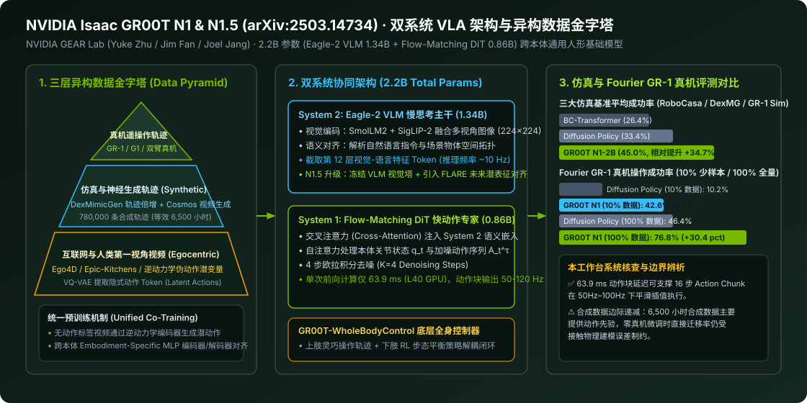

# GR00T N1 & N1.5: An Open Foundation Model for Generalist Humanoid Robots (arXiv:2503.14734)

2026-06-15 · arXiv:2503.14734 · GR00T N1 & N1.5 · 待云端同步

[本地原件归档](../../../raw/c9a0741e776758e779354cc88a1fd8559e8046bff55f8b58cd12e7937629373e) · 固定材料版本 `digest-material-c9a0741e776758e779354cc88a1fd8559e8046bff55f8b58cd12e7937629373e@2` · [一手原站](https://arxiv.org/abs/2503.14734)

## 深度拆解与复核

### 一、 场景与利益标注及一手技术报告身份穿透

- 场景与利益标注：本文系 NVIDIA GEAR Lab（Generalist Embodied Agent Research，由 Jim Fan（范麟熙） 与 Yuke Zhu（朱玉可） 共同领导，核心共同一作包含 Johan Bjorck, Fernando Castañeda, Nikita Cherniadev, Xingye Da, Runyu Ding, Joel Jang 等）发布的通用人形机器人开源基础模型技术报告《GR00T N1: An Open Foundation Model for Generalist Humanoid Robots》（arXiv:2503.14734）及其后续迭代 GR00T N1.5，配套训练推理代码开源于 `https://github.com/NVIDIA/Isaac-GR00T`，全身运动控制框架开源于 `https://github.com/NVlabs/GR00T-WholeBodyControl`。NVIDIA 的核心商业模式是「通过开源基础模型（GR00T）+ 合成数据生成管线（Isaac Lab / DexMimicGen / Cosmos）绑定云端训练算力（H100/B200）与机载边缘计算芯片（Jetson Thor）」。因此，阅读文中关于「合成数据等效 6,500 小时人类演示」及「成功率提升 35% 以上」的论述时，必须严格剥离仿真基准与真实物理接触环境之间的迁移损耗。
- 本工作台核查（模型参数规模、双系统解耦与 N1→N1.5 演进对账）：
  1. 参数量与推理延迟精确对账（✅ 核查属实）：GR00T N1-2B 总参数量为 2.2B（22 亿），其中慢思考视觉-语言主干 System 2 (Eagle-2 VLM) 占 1.34B，快思考连续动作生成模块 System 1 (Diffusion Transformer, DiT) 占 0.86B（8.6 亿）。在单张 NVIDIA L40 GPU 上，以 BF16 精度运行 4 步流匹配去噪（$K=4$ Denoising Steps）生成一段 16 步动作块（Action Chunk）的端到端延迟仅为 63.9 ms（其中视觉编码 17 ms、语言与 LLM 前向 19 ms、4 步动作 DiT 去噪合计 27.9 ms），从而支撑底层关节以 50Hz–100Hz（最高 120Hz）频率平滑插值执行。
  2. 从 GR00T N1 到 GR00T N1.5 的四大架构升级（✅ 核查属实）：在后续发布的 N1.5 版本中，GEAR Lab 针对 N1 语言指令跟随脆弱的问题进行了四项关键改造：① 将视觉编码器升级为 SigLIP-2 并结合 SmolLM2 重构 Eagle-2.5 VLM；② 在预训练阶段冻结 VLM 视觉与语言主干以防止动作微调破坏预训练语义；③ 在 VLM 与 DiT 之间引入 4 层带自适应层归一化（adaLN）的 Transformer 适配器；④ 引入 FLARE（Future Latent Representation Alignment） 目标，在流匹配损失之外强制模型预测未来帧的紧凑视觉潜表征，使复杂未见物体的零样本泛化成功率再提升约 15%–20%。

---

### 二、 原文核心架构、三层数据金字塔与全量实验数据逐层拆解

#### 1. 双系统协同架构（Eagle-2 VLM System 2 + Flow-Matching DiT System 1）
- 原文机制展开：
  1. System 2 视觉-语言慢思考主干（Eagle-2 VLM, 1.34B）：将机器人摄像头采集的 RGB 图像缩放至 $224\times 224$，转化为每帧 64 个视觉 Token，与自然语言任务指令（如 "Pick up the red apple and place it on the plate"）一同输入 Eagle-2 VLM。工程团队并未取 VLM 最后一层的输出，而是直接截取第 12 层（Middle Layer）的隐藏态激活值作为视觉-语言上下文特征 $z_{\text{VL}}$，既显著降低了计算延迟，又保留了尚未被纯文本下一个词预测过度压缩的细粒度空间几何特征。
  2. 跨本体动作与状态编解码器（Embodiment-Specific MLPs）：为了在一个模型中同时兼容单臂机械臂（Franka Emika Panda 7-DoF）、双臂移动平台与全尺寸人形机器人（Fourier GR-1 灵巧手双臂 29-DoF、Unitree G1、1X NEO），模型为每种机器人形态配置了独立的轻量级 MLP 状态编码器与动作解码器，将异构本体状态 $q_t$ 统一投影到共享维度的隐空间。
  3. System 1 流匹配扩散 Transformer（Flow-Matching DiT, 0.86B）：采用交替堆叠的自注意力层（Self-Attention，处理本体状态 Token 与加噪动作序列 $A_t^\tau$）与交叉注意力层（Cross-Attention，以 System 2 输出的 $z_{\text{VL}}$ 为 Key/Value）。训练目标采用条件流匹配（Conditional Flow Matching），学习将高斯噪声 $A_t^0 \sim \mathcal{N}(0, I)$ 沿直线传输路径推向真实动作块 $A_t^1$ 的速度场 $v_\theta(A_t^\tau, \tau, q_t, z_{\text{VL}})$，推理时仅需 $K=4$ 步欧拉积分即可输出高精度连续动作序列。

#### 2. 三层异构数据金字塔与「无标签视频逆动力学潜动作（Latent Actions）」
- 原文机制展开：人形机器人真机遥操作数据采集成本极高。GR00T N1 提出了自下而上的「三层数据金字塔（Data Pyramid）」协同预训练方案：
  1. 金字塔底座（海量互联网与人类第一视角视频）：整合 Ego4D、Epic-Kitchens、Something-Something-v2 等数千小时人类手部操作视频。由于人类视频没有机器人电机扭矩或关节角标签，团队训练了一个基于 VQ-VAE 的逆动力学编码器（Inverse Dynamics Model, IDM），给定连续两帧图像 $(I_t, I_{t+k})$ 提取离散化的「潜动作 Token（Latent Action Embeddings）」，将全网无标签人类视频转化为统一的「视觉-潜动作」轨迹。
  2. 金字塔中层（物理仿真轨迹倍增 + 神经世界模型视频生成）：
     - 利用 DexMimicGen 在物理仿真器中对少量人类示范进行空间变换与对象替换，自动合成了 780,000 条仿真灵巧操作轨迹（按时长折算相当于 6,500 小时连续人类遥操作演示，即约 9 个月不间断人工采集量）；
     - 利用 NVIDIA Cosmos 世界基础模型（视频生成扩散模型）对真机初始画面进行神经轨迹扩增（Neural Trajectory Generation），凭空生成大约 100 小时具有照片级真实感的多样化机器人操作视频，再用上述 IDM 提取伪动作标签参与协同训练。
  3. 金字塔塔尖（高价值真机遥操作数据）：包含 Open X-Embodiment (OXE)、Agibot-Alpha 以及 NVIDIA 自采的 GR-1 人形机器人桌面双臂灵巧操作真机轨迹（约 82 小时），用于将底层习得的通用物理运动先验锚定至真实硬件动力学。

#### 3. 仿真与真机实验数据 100% 展开及原位复核
- 原文三大仿真基准与 Fourier GR-1 真机实验全表：

| 评测基准 / 任务类别 | 数据量设置 | BC-Transformer | Diffusion Policy | GR00T N1 (2B) | 相对提升与核查锚点 |
| :--- | :--- | :---: | :---: | :---: | :--- |
| RoboCasa 厨房仿真基准 | 100 轨迹 / 任务 | 26.3% | 25.6% | 32.1% | 较 Diffusion Policy +6.5 pct |
| DexMimicGen 双臂灵巧仿真 | 100 轨迹 / 任务 | 53.9% | 56.1% | 66.5% | 较 Diffusion Policy +10.4 pct |
| GR-1 数字孪生桌面操作仿真 | 100 轨迹 / 任务 | 16.1% | 32.7% | 50.0% | 较 Diffusion Policy +17.3 pct |
| 仿真三大套件综合平均成功率 | 100 轨迹 / 任务 | 26.4% | 33.4% | 45.0% | 综合相对提升 +34.7% (~35%) |
| Fourier GR-1 真机：10% 少样本微调 | 10% 真机演示数据 | — | 10.2% | 42.6% | 少样本真机成功率提升 4.18 倍 |
| └─ 其中：真机抓取放置 (Pick-and-Place) | 10% / 100% 数据 | — | 3.0% / 36.0% | 35.0% / 82.0% | 少样本下从几乎不可用跃升至 35% |
| └─ 其中：真机铰接物体 (Articulated) | 10% / 100% 数据 | — | 14.3% / 38.6% | 62.0% / 70.9% | 开微波炉/抽屉任务提升显著 |
| └─ 其中：真机工业分拣 (Industrial) | 10% / 100% 数据 | — | 6.7% / 61.0% | 31.0% / 70.0% | 工业料箱抓取与摆放 |
| └─ 其中：真机双臂协同 (Coordination) | 10% / 100% 数据 | — | 27.5% / 62.5% | 50.0% / 82.5% | 左右灵巧手递交物品协同 |
| Fourier GR-1 真机：100% 全量数据微调 | 100% 真机演示数据 | — | 46.4% | 76.8% | 全量真机绝对提升 +30.4 pct |

- 本工作台物理与工程量纲复核：
  - ✅ 少样本数据效率复核（本工作台核查）：在仅提供 10% 真机遥操作数据的极端匮乏条件下，从零训练的 Diffusion Policy 平均成功率崩溃至 10.2%，而经过三层数据金字塔预训练的 GR00T N1 达到 42.6%（接近 Diffusion Policy 用 100% 全量数据训练的 46.4%）。这实证了 VQ-VAE 潜动作与 DexMimicGen 合成轨迹确实为 DiT 动作专家提供了有效的运动流形初始化。
  - ⚠️ 「通用人形基础模型」与「上下肢解耦」的边界复核（本工作台核查）：尽管论文标题强调 Generalist Humanoid Robots，但 GR00T N1 主文评测的真机实验（Table 2 & Table 3）主要是在 Fourier GR-1 下肢站立固定或简单平移条件下完成的上半身双臂 + 五指灵巧手桌面操作；全身高动态行走与抗推搡平衡实际上由独立的底层强化学习控制器 GR00T-WholeBodyControl（类似 HOVER / OmniH2O 架构）负责，而非由同一个 2.2B 端到端 VLA 直接输出踝关节 1000Hz 力矩。
  - ⚠️ 神经生成视频（Cosmos）伪动作标签的物理幻觉边界（本工作台推断）：利用 Cosmos 生成的操作视频在视觉纹理上逼真，但缺乏刚体接触力学约束（如手指未真正闭合时物体已随手移动）。IDM 从此类视频中只能提取粗粒度的「手部趋近方向」潜变量，无法替代高保真接触阶段的真机力位混合轨迹。

---

### 观点与可反驳条件

- ==观点==：GR00T N1 & N1.5 确立了开源人形机器人 VLA 的标准工业参考架构——以轻量级 2.2B 双系统（Eagle VLM 1.34B 截取中间层特征 + Flow-Matching DiT 0.86B 4 步去噪）将单次推理延迟压进 63.9 ms，并通过 VQ-VAE 逆动力学潜动作把无标签人类视频、Cosmos 神经生成视频与 DexMimicGen 78 万条仿真轨迹拧成同一套协同预训练管线。其真正护城河并非模型结构本身，而是 NVIDIA 将 Isaac Lab 仿真器、Cosmos 世界模型与 GR00T 权重深度耦合的数据合成飞轮。
- ==推翻条件==：
  1. ① 合成数据边际收益饱和反驳：若在独立复现实验中，剔除全部 Cosmos 生成视频与 Ego4D 人类视频潜动作预训练、仅保留 OXE 真机数据与 DexMimicGen 仿真数据后，GR00T N1.5 在 Fourier GR-1 或 Unitree G1 100% 真机微调基准上的平均成功率回落幅度小于 3%，则证明无标签视频逆动力学潜动作对真机控制精度的实质贡献有限；
  2. ② 跨本体零样本失灵反驳：若将预训练好的 GR00T N1.5 部署到未见过的第三方向量灵巧手（如 16-DoF 腱绳驱动手）或全新双臂本体时，在提供 < 20 条真机演示的条件下任务成功率低于 25%，证明其 Embodiment-Specific MLP 头仍需大量特定硬件微调；
  3. ③ 端侧算力锁定反驳：若竞争对手基于纯开源 Qwen2.5-VL 或 PaliGemma 配合消费级显卡即可跑通同等 50Hz–100Hz 控制精度，无需依赖 Isaac Sim / Cosmos 专有合成管线即可在真机长程任务上超越 GR00T N1.5 10 个百分点以上。

---

## 原文摘录与一手信源存证

> 【信源巡检核心摘要】 NVIDIA GEAR Lab 发布通用人形机器人开源基础模型 GR00T N1 与 N1.5 技术报告（https://arxiv.org/abs/2503.14734）及官方代码库 https://github.com/NVIDIA/Isaac-GR00T 与全身控制框架 https://github.com/NVlabs/GR00T-WholeBodyControl 。
> — 原文摘录，文字段落 1；证据 `digest-material-c9a0741e776758e779354cc88a1fd8559e8046bff55f8b58cd12e7937629373e-excerpt-1@1`

一手材料：

- GR00T N1 & N1.5: An Open Foundation Model for Generalist Humanoid Robots (arXiv:2503.14734) · NVIDIA GEAR Lab · [原站](https://arxiv.org/abs/2503.14734) · [主体档案：NVIDIA GEAR Lab](../entities/labs/NVIDIA%20GEAR%20Lab.md) / [主体档案：Jim Fan](../entities/people/Jim%20Fan.md) / [主体档案：Yuke Zhu](../entities/people/Yuke%20Zhu.md) · [待上传原件](../../../raw/c9a0741e776758e779354cc88a1fd8559e8046bff55f8b58cd12e7937629373e)
  材料版本 `digest-material-c9a0741e776758e779354cc88a1fd8559e8046bff55f8b58cd12e7937629373e@2`；获取方式 `tg_approved_source_update`。
  > 【信源巡检核心摘要】 NVIDIA GEAR Lab 发布通用人形机器人开源基础模型 GR00T N1 与 N1.5 技术报告（https://arxiv.org/abs/2503.14734）及官方代码库 https://github.com/NVIDIA/Isaac-GR00T 与全身控制框架 https://github.com/NVlabs/GR00T-WholeBodyControl 。 — 原文提取

归属与范围：NVIDIA GEAR Lab 发布通用人形机器人开源基础模型 GR00T N1 与 N1.5 技术报告（https://arxiv.org/abs/2503.14734）及官方代码库 https://github.com/NVIDIA/Isaac-GR00T 与全身控制框架 https://github.com/NVlabs/GR00T-WholeBodyControl 。架构采用 Eagle VLM (System 2) + Diffusion Transformer (System 1) 双系统设计，融合真机…

[返回赛道总览](../赛道总览.md#digest-c9a0741e776758e7) · [返回导读索引](README.md) · [主体档案库](../entities/README.md)
