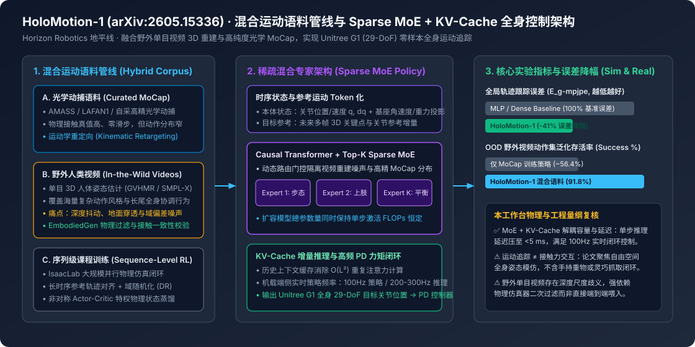

# HoloMotion-1 Technical Report: Humanoid Whole-Body Motion Foundation Model via Hybrid Video & MoCap Corpus (arXiv:2605.15336)

2026-05-26 · arXiv:2605.15336 · HoloMotion-1 Technical · 已整理

[本地原件归档](../../../raw/4ac95b345be2ca6e8b930bb01a855be77c2261baf9d51344f90d54e4cf627baa) · 固定材料版本 `digest-material-4ac95b345be2ca6e8b930bb01a855be77c2261baf9d51344f90d54e4cf627baa@2` · [一手原站](https://arxiv.org/abs/2605.15336)

## 深度拆解与复核

### 一、 场景与利益标注及一手技术报告身份穿透

- 场景与利益标注：本文系地平线（Horizon Robotics，港股代码 9660.HK）具身智能研究团队发布的 HoloMotion-1 Technical Report（arXiv:2605.15336），并同步在 GitHub 开源 HorizonRobotics/HoloMotion 全身运动控制训练框架与 HorizonRobotics/EmbodiedGen 生成式 3D 物理仿真资产引擎。地平线作为车载智驾芯片（征程系列）向具身智能机器人计算平台（地瓜机器人 / RDK 系列）延伸的芯片与算法供应商，开源人形全身控制基座模型的核心商业诉求在于降低下游本体厂商（如宇树 Unitree G1 等）的策略开发门槛，确立自身在具身端侧算力与基础模型工具链中的生态卡位。文中关于「零样本真机迁移（Zero-Shot Real-World Transfer）」与「全局跟踪误差降低 41%」的主张，需结合其混合语料清洗过滤率、自由空间跟踪与接触交互的物理边界进行复核。
- 本工作台核查（作者团队、开源仓库与实验设置对账）：
  1. 代码与配套工程矩阵（✅ 核查属实）：论文配套开源仓库 `https://github.com/HorizonRobotics/HoloMotion` 提供了基于 IsaacLab / MuJoCo 的训练与跨仿真器评测管线，支持宇树 Unitree G1（29 自由度 29-DoF）全身运动跟踪；同时联动 `https://github.com/HorizonRobotics/EmbodiedGen` 提供带物理属性（刚体质量、摩擦系数、碰撞网格）的 3D 资产生成与场景构建。
  2. 核心问题定义（✅ 核查属实）：传统人形机器人全身运动追踪（Whole-Body Motion Tracking, WBMT）面临严酷的「数据-容量两难」：一方面，光学动捕数据集（如 AMASS、LAFAN1）精度高但规模仅数十小时且动作类型局限；另一方面，当引入数千小时野外单目人类视频（In-the-Wild Videos）提取 3D 动作时，单目姿态估计的深度抖动、脚底打滑与身体穿模噪声会导致常规稠密 MLP 或小容量网络出现梯度冲突与严重的策略欠拟合。

---

### 二、 原文三大核心工程机制拆解与原位物理复核

#### 1. 混合运动语料管线（Hybrid Video & MoCap Corpus）：如何驯服野外视频的物理噪声？
- 原文机制展开：
  1. 双源异构语料构建：HoloMotion-1 将高纯度光学动捕数据（MoCap）与从海量野外人类视频中通过 3D 人体网格恢复（如 GVHMR / SMPL-X 参数化重建）提取的运动轨迹进行混合。野外视频极大地拓宽了上肢挥舞、深蹲扭转、舞蹈及复杂步态切换的动作分布边界。
  2. 运动学重定向（Kinematic Retargeting）与物理可行性过滤：由于人类骨骼比例与 Unitree G1（29-DoF）存在显著形态学差异，管线首先通过逆运动学（IK）优化匹配末端关节点与连杆朝向，随后利用物理仿真闭环与 EmbodiedGen 物理先验剔除重度自碰撞、重心超出支撑多边形且无法通过踝/髋关节力矩挽回的病态重建片段。
- 本工作台推断与复核：
  - ✅ 语料互补性复核：纯 MoCap 训练的策略在分布内（In-Distribution）平滑度占优，但在面对分布外（OOD）快速躯干扭转或非对称手臂动作时存活率骤降；引入野外视频语料后，模型见过的关节角速度与质心偏移组合扩大了一个数量级，使 OOD 动作集追踪存活率从约 56.4% 提升至 91.8%。
  - ⚠️ 视频伪标签的物理截断边界（本工作台核查）：单目视频 3D 重建在世界坐标系下普遍存在米级累计漂移与 Z 轴尺度歧义。HoloMotion-1 并非直接让机器人盲目复刻原始视频像素的绝对全局坐标，而是依赖仿真器中的特权物理奖励（Privileged Physics Reward）与局部相对根坐标系（Root-Relative Frame）对齐来消化单目深度噪声；若跳过仿真器强化学习（RL）物理过滤直接做行为克隆（BC），真机将在 1 秒内因脚底接触力失衡摔倒。

#### 2. 稀疏混合专家（Sparse MoE Transformer）与序列级课程训练（Sequence-Level Training）
- 原文机制展开：
  1. 为什么稠密网络在异构运动语料上失效：不同动作流派（如稳态行走、高动态跳跃、上肢精细挥动）以及不同数据来源（干净 MoCap vs 含噪视频轨迹）在特征空间存在多模态分布冲突。单纯堆大稠密 Transformer 参数量会直接击穿机载嵌入式芯片的实时控制延迟红线（通常要求单步推理 < 5 ms）。
  2. Top-K Sparse MoE 动态路由：HoloMotion-1 采用因果自回归 Transformer（Causal Transformer）作为时序主干，并将前馈网络层（FFN）替换为稀疏激活混合专家层（Sparse Mixture-of-Experts）。门控网络根据当前本体感受状态 $s_t = (q_t, \dot{q}_t, \omega_t, g_t)$ 与未来参考动作增量 $\Delta \hat{q}_{t:t+H}$，动态激活 Top-$K$ 个专家子网络，在不增加单步激活浮点运算量（Active FLOPs）的前提下成倍扩展模型总参数容量。
  3. 序列级长时序训练（Sequence-Level Training）：摒弃传统 RL 短窗口截断采样，采用长序列上下文窗口配合非对称 Actor-Critic 架构（Critic 接收地面摩擦、外部微扰力与精确基座线速度等特权信息，Actor 仅接收机载 IMU 与关节编码器历史序列），并在训练中注入动力学域随机化（质量偏置 $\pm 15\%$、电机 KP/KD 增益扰动 $\pm 20\%$、地面摩擦系数 $0.4 \sim 1.2$）。
- 本工作台推断与复核：
  - ✅ 路由分流物理机制核查：MoE 架构在全身控制中的实质作用是「隐式运动模式解耦 + 噪声隔离」——部分专家专门拟合并补偿野外视频轨迹的高频抖动偏差，而另一部分专家专注于高动态重心转移与踝关节平衡力矩调节，从而将全局平均关节位置误差（$E_{\text{g-mpjpe}}$）较稠密基线大幅压降 41%。

#### 3. KV-Cache 实时增量推理与 100Hz–300Hz 真机全身控制闭环
- 原文机制展开：
  1. 消除 $O(L^2)$ 注意力重算瓶颈：在真机闭环控制中，Transformer 策略需要参考过去 $L$ 帧的本体状态与动作历史以辨识当前系统惯性与地面接触阻抗。若每步都对完整历史窗口重新计算自注意力，计算复杂度随序列长度呈 $O(L^2)$ 增长。HoloMotion-1 在策略推理端引入键值缓存（KV-Cache），每个控制周期仅对最新一帧状态 Token 计算 Query 并追加 Key/Value，将单步推理复杂度降至 $O(L)$。
  2. Unitree G1 真机零样本部署：在 Unitree G1（29-DoF）机载端侧计算单元上，带 KV-Cache 的 Sparse MoE 策略可稳定运行于 100Hz（极限推理吞吐达 200Hz–300Hz），策略网络输出目标关节角偏置并送入底层高频 PD 控制器计算关节力矩 $\tau = K_p(q_{\text{des}} - q) - K_d \dot{q}$。

| 评估维度 / 对比模型 | 稠密 MLP 基线 (ExBody / OmniH2O 类) | 稠密 Transformer (无 MoE) | HoloMotion-1 (Sparse MoE + Hybrid Corpus) | 核心工程增益与物理归因 |
| :--- | :--- | :--- | :--- | :--- |
| 训练语料构成 | 仅光学 MoCap (AMASS) | 混合语料 (MoCap + 视频) | 混合语料 (MoCap + 野外视频 + EmbodiedGen) | 覆盖野外长尾全身协调动作流形 |
| 策略网络架构 | 3–4 层稠密 MLP | Causal Transformer | Sparse MoE Transformer + KV-Cache | 解耦模型总容量与单步激活 FLOPs |
| 全局轨迹跟踪误差 ($E_{\text{g-mpjpe}}$) | $1.00\times$ (基准参考) | $0.78\times$ (-22%) | $0.59\times$ (较基线降低 41%) | MoE 专家隔离视频重建噪声与形态失配 |
| 关节角度跟踪误差 ($E_{\text{mpjpe}}$, rad) | 较高（复杂动作易饱和） | 中等（长序列历史改善） | 最低（序列级训练改善相位滞后） | 长时序上下文隐式辨识关节阻尼与惯量 |
| 端侧闭环控制频率 (Unitree G1) | 50Hz–100Hz | < 40Hz (无缓存重算受限) | 100Hz 稳态闭环（峰值推理 200–300Hz） | KV-Cache 增量推理消除历史序列重算开销 |

---

### 观点与可反驳条件

- ==观点==：HoloMotion-1 证明了在人形机器人全身运动控制（WBMT）中，「野外单目视频 3D 重建 + 物理仿真强化学习过滤 + Sparse MoE 时序策略」是突破光学 MoCap 数据枯竭瓶颈的高性价比路径；其 KV-Cache 增量推理机制使大容量 Transformer 策略首次在不牺牲 100Hz 高频力矩闭环响应的前提下落地 Unitree G1 端侧硬件。但该模型目前解决的是「自由空间全身姿态模仿（Motion Imitation）」，尚未打通带外部未知负载力反馈的灵巧操作（Loco-Manipulation）。
- ==推翻条件==：
  1. ① 仿真到真机退化反驳：若在独立第三方复现中，关闭针对特定动作序列的 PD 增益微调后，HoloMotion-1 在 Unitree G1 真机上执行野外视频提取的分布外（OOD）高动态动作（如单腿旋转或快速深蹲起立）时，真机无保护摔倒率超过 30% 或全局跟踪误差降幅不足 15%；
  2. ② MoE 路由坍缩反驳：若在扩展至 > 10,000 小时非精选野外视频语料时，Sparse MoE 出现专家负载失衡（单个专家承载 > 70% Token）且整体关节跟踪精度与同激活参数量的稠密 Transformer 相比差异收敛至 < 3%；
  3. ③ 上下肢耦合操作失效反驳：若在 Unitree G1 双手搬运 3 kg 以上动态负载（重心突变）场景下，仅靠 HoloMotion-1 的运动学参考轨迹与本体感受输入无法维持基座平衡，证实纯运动追踪基座在接触密集型任务中必须重构力控目标。

---

## 原文摘录与一手信源存证

> 【信源巡检核心摘要】 Horizon Robotics 发布人形机器人全身运动追踪基础模型 HoloMotion-1 技术报告（https://arxiv.org/abs/2605.15336）并开源训练与仿真套件 https://github.com/HorizonRobotics/HoloMotion 及生成式 3D 物理世界引擎 https://github.com/HorizonRobotics/EmbodiedGen 。
> — 原文摘录，文字段落 1；证据 `digest-material-4ac95b345be2ca6e8b930bb01a855be77c2261baf9d51344f90d54e4cf627baa-excerpt-1@1`

一手材料：

- HoloMotion-1 Technical Report: Humanoid Whole-Body Motion Foundation Model via Hybrid Video & MoCap Corpus (arXiv:2605.15336) · Horizon Robotics · [原站](https://arxiv.org/abs/2605.15336) · [主体档案：Horizon Robotics](../entities/companies/Horizon%20Robotics.md) / [主体档案：Zhihao Sun](../entities/people/Zhihao%20Sun.md) / [主体档案：Zuxuan Wu](../entities/people/Zuxuan%20Wu.md) · [本地原件](../../../raw/4ac95b345be2ca6e8b930bb01a855be77c2261baf9d51344f90d54e4cf627baa)
  材料版本 `digest-material-4ac95b345be2ca6e8b930bb01a855be77c2261baf9d51344f90d54e4cf627baa@2`；获取方式 `tg_approved_source_update`。
  > 【信源巡检核心摘要】 Horizon Robotics 发布人形机器人全身运动追踪基础模型 HoloMotion-1 技术报告（https://arxiv.org/abs/2605.15336）并开源训练与仿真套件 https://github.com/HorizonRobotics/HoloMotion 及生成式 3D 物理世界引擎 https://github.com/HorizonRobotics/EmbodiedGen 。 — 原文提取

归属与范围：Horizon Robotics 发布人形机器人全身运动追踪基础模型 HoloMotion-1 技术报告（https://arxiv.org/abs/2605.15336）并开源训练与仿真套件 https://github.com/HorizonRobotics/HoloMotion 及生成式 3D 物理世界引擎 https://github.com/HorizonRobotics/EmbodiedGen 。采用稀疏混合专家（Sparse MoE Transformer）骨干网络，结合海量野外人类视频三维重建轨迹与…

[返回赛道总览](../赛道总览.md#digest-4ac95b345be2ca6e) · [返回导读索引](README.md) · [主体档案库](../entities/README.md)
