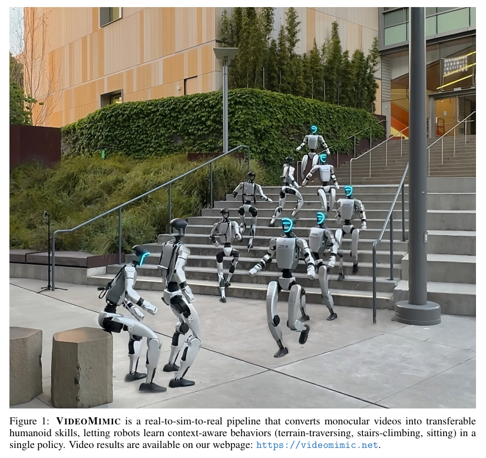
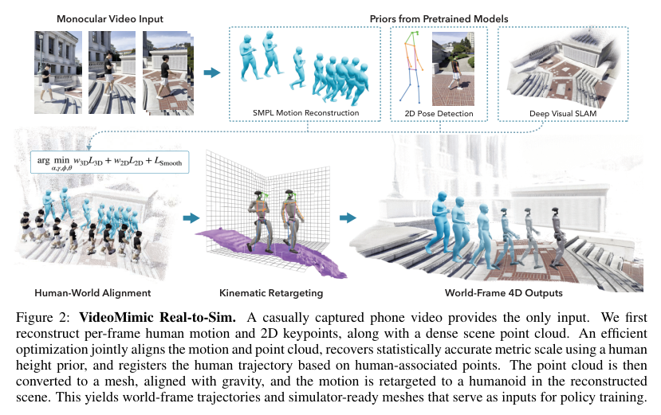

# Human Data EP04—Video：VideoMimic

2025-11-04 · UC Berkeley BAIR · VideoMimic (arXiv:2505.03729) · 有来源缺口

[本地原件归档](../../../raw/d79294879f3062ac0397fb10c26a1be860663775947b03995411b5dce85aa472) · 固定材料版本 `digest-material-d79294879f3062ac0397fb10c26a1be860663775947b03995411b5dce85aa472@1` · [一手原站](https://arxiv.org/abs/2505.03729)

## 深度拆解与复核

- ==核心结论==：UC Berkeley [BAIR](../entities/labs/BAIR%20%28Berkeley%20AI%20Research%29.md) 提出的 VideoMimic 证明了日常 2D 单目 RGB 视频可以通过几何联合重建驱动人形机器人的环境感知全身运控（Visual Imitation / Contextual Humanoid Control），但它并未绕开动作捕捉数据——消融实验显示去掉阶段一基于少量 LaFAN MoCap 的预训练（MPT）后，策略成功率会从约 0.7–0.8 跌向约 0.1。制约该路线商业落地的核心在于多视角一致性几何重建的算力成本与真机泛化精度（当前仅依靠 123 段手机自拍与 10 段 LaFAN 平衡采样训练，尚未公布真机百次级跨地形成功率的统计审计）。

#### 一、业务切口与核心机制

这篇访谈围绕石麻笔记 Human Data EP04—Video 展开，受访核心贡献者 [Junyi Zhang](../entities/people/Junyi%20Zhang.md)（章俊一，导师 [Trevor Darrell](../entities/people/Trevor%20Darrell.md)，联合 [Pieter Abbeel](../entities/people/Pieter%20Abbeel.md)、Angjoo Kanazawa 与 Jitendra Malik 等 [BAIR](../entities/labs/BAIR%20%28Berkeley%20AI%20Research%29.md) 团队）重点拆解了从纯视频驱动走向真实地形全身控制的系统链路：

1. Real-to-Sim 联合几何与人体 4D 重建：传统视频 HMR（Human Mesh Recovery，如 Kanazawa CVPR 2018、HMR2）只恢复相机系下的孤立 SMPL 人体网格，缺乏世界坐标系深度和地形接触，因此只能支持如 Exbody2、TWIST 等平地或盲目运控，以及 PHC、MaskedMimic 等早期仿真动作追踪。VideoMimic 的前处理融合 Grounded SAM2 人体分割、VIMO 人体姿态估计、ViTPose 2D 关键点、BSTRO 足部接触估计以及 MegaSaM / MonST3R 单目动态 4D 点云重建（对比更早的 COLMAP / SfM、Bundle Adjustment 与静态 DUSt3R / VGGT；受访者同时提及在 SLAM 与前馈几何两条路线间的工程权衡）。随后管线在 JAX 框架下运行 Levenberg-Marquardt 联合优化（基于 SLAHMR 式初始化与 GeoCalib 重力对齐），在 NVIDIA A100 上编译后约 20 ms 即可求解 300 帧序列，再用 NKSR（Neural Kernel Surface Reconstruction）将稀疏场景点云重建为可物理碰撞的网格模型。

2. 四阶段渐进式强化学习与稀疏条件蒸馏：整套控制架构沿袭 DeepMimic 到 Isaac Gym（200 Hz 物理仿真，decimation=4 输出 50 Hz 策略）的运控范式，拆为四阶段推进：阶段一 MoCap Pre-Training（MPT）仅用约 10 段 LaFAN 平地行走动作做 23 自由度 [宇树科技 (Unitree Robotics)](../entities/companies/%E5%AE%87%E6%A0%91%E7%A7%91%E6%8A%80%20%28Unitree%20Robotics%29.md) Unitree G1 预训练（终止阈值 0.3）；阶段二 Scene-Conditioned Tracking 引入残差 11×11 高度图（0.1 m 网格、初始权重归零）联合追踪真实视频重建的人体—场景序列（90% 自建视频与 10% LaFAN 平衡采样）；阶段三通过 DAgger 蒸馏剥离对未来 SMPL 目标关节角与姿态角的特权依赖，改为仅接收 5 帧历史本体感知（proprioception）、11×11 高度图与根部方向指令（root xy offset + yaw）；阶段四放宽终止阈值至 1.2 并施加超越关节极限 98% 范围的惩罚微调。真机部署时在 Unitree G1 机载 Jetson Orin NX 上以 50 Hz 运行（低增益 Kp=75, Kd=2，踝关节 Kp=20），外加 Fast-lio2 激光雷达里程计构建在线局部高程地图。

3. 数据金字塔与 RL / IL 方法边界：受访者针对视频路线给出清晰的方法论分层——底层仍需要动捕级高质量运动数据构建物理基底，上层才用互联网量级的 YouTube / Instagram 泛化场景视频（以及 RGB-D 传感器）做跨环境扩展。而在学习范式上，受访者参照 ARM4R（RSS 工作，类似 SFT + RLHF 的二阶段逻辑）指出：灵巧操作场景遥操作数据充足，多采用视频预训练 + 模仿学习（IL）微调（如 ATM、Dual-Stream 3D）；人形全身运控极度缺乏交互轨迹，强依赖仿真器内的强化学习（RL）物理试错与 Autoencoder / MAE 式低维状态压缩，同时明确不盲从将所有能力硬塞进单一 Transformer 端到端直出关节力矩的路线。

#### 二、核心数据核查、口径纠偏与工程边界

场景与利益披露：本条材料由作者团队成员接受自媒体专栏访谈形成（归于 Human Data 系列 EP01-MoCap 至 EP05 谱系），研究动机聚焦学术验证与开源发布（CoRL 2025 最佳学生论文奖），不涉及商业数据外包报价，但存在学术 Demo 仅展示最优切片与核心工程难点依赖非公开发布细节的样本偏向。

| 核查维度 | 访谈或标题表述 | 一手论文实证（arXiv:2505.03729v5） | 本工作台核查判定 |
| --- | --- | --- | --- |
| 4D 场景人体联合重建精度 | 用 MonST3R / MegaSaM 从日常单目视频高精度恢复人体与地形 | SLOPER4D 数据集 Table 2：WA-MPJPE 112.13（vs TRAM 149.48、WHAM 189.29），W-MPJPE 696.62（vs TRAM 954.90），场景 Chamfer 距离 0.75（vs TRAM 10.66） | ✅ 已验证（学术基准优势显著，JAX 300 帧优化耗时 20 ms） |
| 真实视频数据规模与构成 | 依托视频实现跨地形全身运控 | Table 6 显示全库仅 123 段手机自拍视频（上楼 39、下楼 36、上下混合 13、站立 7、坐 12、坐站切换 5、跨地形 11）外加 10 段 LaFAN | ⚠️ 口径偏窄（属于高度精选的小规模手持实拍，并非互联网千万级开放爬虫） |
| 预训练与纯视频替代关系 | 纯视频即可支撑机器人上下文全身模仿 | Fig 6 仿真消融：剔除阶段一 LaFAN MoCap Pre-Training 后，楼梯/障碍任务成功率从约 0.7–0.8 塌缩至约 0.1 | ❌ 无法脱离 MoCap 基底（90% 视频仍需 10% LaFAN 混合护航） |
| 真机泛化与步态表现 | 实现上下楼、跨地形与坐立等连续全身动作 | 论文 Sec 7 与访谈均承认真机存在“醉醺醺”高频碎步与恢复跳动；MegaSaM 低纹理环境有重影、NKSR 过度平滑窄台阶 | ❌ 缺失真机定量统计（论文未报告 Unitree G1 真机百次实验成功率表） |

本工作台核查认为，VideoMimic 最核心的未解瓶颈在于三维重建误差向右半部分物理控制链条的不可逆传递：

1. ⚠️ 单目尺度歧义与高度图盲区：11×11 局部高度图（0.1 m 分辨率）仅表达单层顶面高度，既无法识别门框、桌面底沿等悬空（overhanging）障碍，也无法应对桌椅滑动、软垫形变等动态/铰接场景；真机端改用 Fast-lio2 建图后，又引入了激光雷达近距盲区和动态障碍延迟。
2. ⚠️ 纯视频与真实物理交互的鸿沟（IFT 缺失）：人类在视频中借力支撑、推拉墙壁或椅背的隐式交互力无法通过单纯点云和 SMPL 关节角还原，导致策略在真机接触边界易出现非预期打滑或保护性抖动。

#### 三、赛道横向对比与定位

在工作台已归档的具身运控与视频重构体系中，VideoMimic 是连接单目人类视频与环境感知全身控制的关键桥接节点，但在效率与泛化尺度上面临后来者（如 [SuperMimic](SuperMimic%EF%BC%88BAIR%20_%20CoRL%202026%20%E6%9C%80%E4%BD%B3%E8%AE%BA%E6%96%87%EF%BC%89%EF%BC%9A%E5%8D%95%E4%B8%AA%E5%8F%AF%E5%BE%AE%E4%B8%96%E7%95%8C%E6%A8%A1%E5%9E%8B%E5%B0%86%E4%BA%BA%E5%BD%A2%E5%85%A8%E8%BA%AB%E6%8E%A7%E5%88%B6%E7%AE%97%E5%8A%9B%E9%99%8D%E4%BD%8E%E8%B6%85%201%2C000%20%E5%80%8D.md)、[HoloMotion-1 Technical Report](HoloMotion-1%20Technical%20Report_%20Humanoid%20Whole-Body%20Motion%20Foundation%20Model%20via%20Hybrid%20Video%20%26%20MoCap%20Corpus%20%28ar.md)）的结构性迭代：

| 代表工作 | 数据输入与传感器基底 | 学习与优化架构 | 场景感知能力 | 核心瓶颈与演进位置 |
| --- | --- | --- | --- | --- |
| [Human Data EP04—Video：VideoMimic](Human%20Data%20EP04%E2%80%94Video%EF%BC%9AVideoMimic.md) | 123 段自拍 RGB 视频 + 10 段 LaFAN MoCap | MegaSaM/MonST3R + 4 阶段 PPO + DAgger 蒸馏 | 支持（11×11 高度图 + Fast-lio2） | 开创视频-场景-运控链路，受限于 123 段小规模与“醉步”噪声 |
| [Human Data EP05—Video：HUB](Human%20Data%20EP05%E2%80%94Video%EF%BC%9AHUB.md) | 固定机位互联网视频（WHAM 提取） | 参考轨迹细化 + Balance-Aware RL（无里程计） | 无（纯本体盲控） | 单策略限高难静态平衡，缺乏泛化与多任务统一框架 |
| [SuperMimic](SuperMimic%EF%BC%88BAIR%20_%20CoRL%202026%20%E6%9C%80%E4%BD%B3%E8%AE%BA%E6%96%87%EF%BC%89%EF%BC%9A%E5%8D%95%E4%B8%AA%E5%8F%AF%E5%BE%AE%E4%B8%96%E7%95%8C%E6%A8%A1%E5%9E%8B%E5%B0%86%E4%BA%BA%E5%BD%A2%E5%85%A8%E8%BA%AB%E6%8E%A7%E5%88%B6%E7%AE%97%E5%8A%9B%E9%99%8D%E4%BD%8E%E8%B6%85%201%2C000%20%E5%80%8D.md) | 跨本体仿真状态与运动库 | 单个可微物理世界模型梯度回传 | 视任务接入物理边界 | CoRL 2026 同源演进路线，将 RL 采样算力压低千倍以上 |
| [HoloMotion-1 Technical Report](HoloMotion-1%20Technical%20Report_%20Humanoid%20Whole-Body%20Motion%20Foundation%20Model%20via%20Hybrid%20Video%20%26%20MoCap%20Corpus%20%28ar.md) | 大规模 Hybrid Video + MoCap | 通用运动基础模型（MoE/多阶段追踪） | 可扩展多地形接口 | 用大规模混合动捕解决纯视频的运动学噪声与泛化失真 |

### 观点与可反驳条件

- ==观点==：单目消费级视频在人形机器人全身运控中的真实角色，是“环境语义与拓扑接触关系的低成本索引器”，而不能直接替代动捕成为高精度关节动力学真源；短期内工业界仍会沿“少量高质量 MoCap 建立本体动力学下限 + 局部深度/视频重建提供场景约束”的混合结构推进。
- ==推翻条件==：
  1. ① 若未来 18 个月内出现不依赖任何 MoCap 预训练阶段（去掉 MPT 后），仅凭开放互联网 RGB 视频（>10,000 段零筛选实拍）端到端训练的人形上下楼梯与坐立策略，且真机跨 5 类非结构化室内外地形零样本连续成功 50 次以上（成功率 >= 90%、无碎步保护跳），则“视频无法脱离 MoCap 底层基底”的判断被推翻。
  2. ② 若在纯端到端视觉（无 Fast-lio2 建图与外置激光雷达）条件下，单目帧率级 4D 前馈几何模型的单步时延降至 10 ms 以下且真机台阶边缘误差稳定小于 1 cm，则基于高度图中继与显式点云网格重建的两阶段管线将被证实为过渡方案。

---

## 原文摘录与一手信源存证

> Human Data系列前三期我们都聚焦于利用人体动捕数据做人形机器人控制数据源的工作，分别是Human Data EP01-MoCap：TWIST，Human Data EP02—MoCap：GMT和Human Data EP03—MoCap：Exbody2。
> — 原文摘录，PDF p.1；证据 `digest-material-d79294879f3062ac0397fb10c26a1be860663775947b03995411b5dce85aa472-excerpt-1@1`

> VideoMimic是一个可以让人形机器人通过用手机随手拍摄的人体视频学习动作的方法。这篇工作的一作之一是章俊一，他目前是UC Berkeley在读博士，导师是 Trevor Darrell教授，本科毕业于上海交通大学。这篇访谈有关于基于2D视频重建三维人体动态点云方法的介绍，有关于人体视频数据和高精度动捕数据金字塔的思考，也有关于人形机器人全身运动控制在RL还是IL方法选择上的探讨，非常有启发，推荐阅读。
> — 原文摘录，PDF p.1；证据 `digest-material-d79294879f3062ac0397fb10c26a1be860663775947b03995411b5dce85aa472-excerpt-2@1`

> 我们想要解决的核心问题，其实就是实现一个具有泛化能力的全身运动控制系统。所谓泛化，一方面是方法上的泛化，也就是在网络设计、训练方式、奖励设计上都能够具备通用性；另一方面是任务上的泛化，也就是机器人能够在不同的地形和环境下实现稳定的运动，而不需要针对每一个任务单独设计。
> — 原文摘录，PDF p.1；证据 `digest-material-d79294879f3062ac0397fb10c26a1be860663775947b03995411b5dce85aa472-excerpt-3@1`

一手材料：

- Visual Imitation Enables Contextual Humanoid Control · Arthur Allshire, Hongsuk Choi, Junyi Zhang et al. / arXiv · [原站](https://arxiv.org/abs/2505.03729) · [主体档案：Junyi Zhang](../entities/people/Junyi%20Zhang.md) / [主体档案：Trevor Darrell](../entities/people/Trevor%20Darrell.md) / [主体档案：BAIR (Berkeley AI Research)](../entities/labs/BAIR%20%28Berkeley%20AI%20Research%29.md) · [NotebookLM](https://notebook.google.com/notebook/33f0076b-fc09-42cc-9cd9-fecfb847ce1c) · [Drive](https://drive.google.com/file/d/1ojQZE3P4uXIb-JsyuSyz_zqB1oLtJCdW/view?usp=drivesdk)
  材料版本 `digest-material-58d5d1eee387976024b9dcf19ee455ad1ba7150e47ed3284067df00ff4181230@1`；获取方式 `http_pdf`。
  > Figure 1: VIDEOMIMIC is a real-to-sim-to-real pipeline that converts monocular videos into transferable humanoid skills, letting robots learn context-aware behaviors (terrain-traversing, stairs-climbing, sitting) in a single policy. — PDF p.1
  > Abstract: How can we teach humanoids to climb staircases and sit on chairs using the surrounding environment context? Arguably, the simplest way is to just show them—casually capture a human motion video and feed it to humanoids. — PDF p.1

归属与范围：完成来源核查与一手PDF精读核对：VideoMimic（arXiv:2505.03729v5，CoRL 2025 Best Student Paper，项目页 videomimic.net 验证）证实了基于MonST3R/MegaSaM+NKSR的real-to-sim-to-real框架可行性（SLOPER4D WA-MPJPE 112.13），但论文Table 6与Fig 6实证揭示其全集仅123段自拍+10段LaFAN（90%/10%配比），且剥离Stage 1 MoCap预训练后成功率剧降至约0.1，访谈所述视频替代动捕存在明确工程前提；缺口留存真机量化统计与第三方复现。

来源缺口：

- `unavailable`：VideoMimic项目主页（videomimic.net）展示的多地形高分辨率真机测试原片及分场景完整试错日志未作结构化开放归档，保留原始视频素材缺口。
- `pending_verification`：论文（arXiv:2505.03729v5）未报告Unitree G1真机在非结构化楼梯、座椅与障碍物上的百次级量化成功率统计，且步态存在高频微幅碎步，真机长期零样本迁移稳定性尚未获第三方实验室独立复测。

[返回赛道总览](../赛道总览.md#digest-d79294879f3062ac) · [返回导读索引](README.md) · [主体档案库](../entities/README.md)
