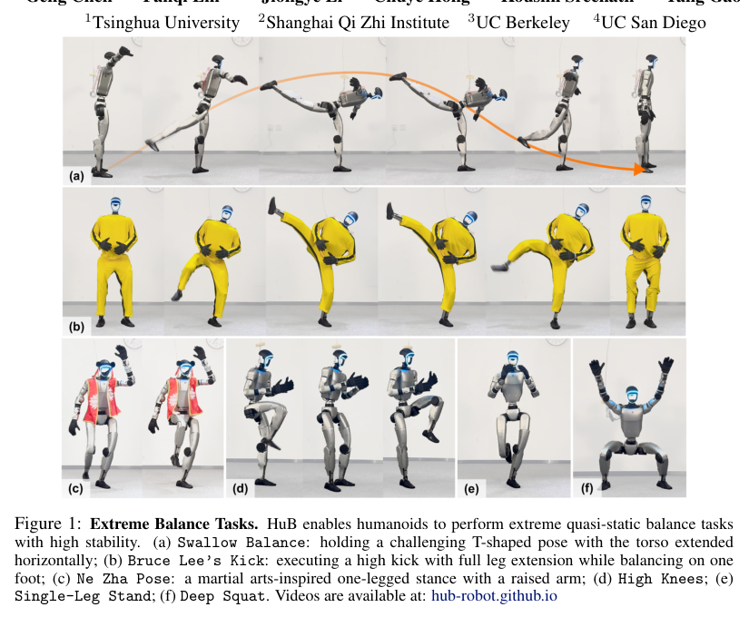
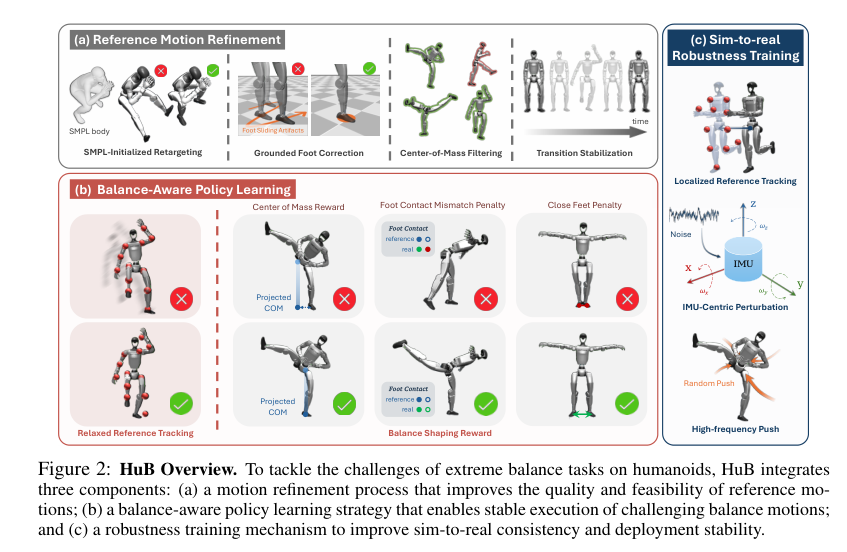

# Human Data EP05—Video：HUB

2025-11-06 · 清华大学 IIIS · HuB (arXiv:2505.07294) · 有来源缺口

[本地原件归档](../../../raw/91c9fed04a1c282cd0c8c7d536c109d5bac40519ef36678008dec7b98fdb5109) · 固定材料版本 `digest-material-91c9fed04a1c282cd0c8c7d536c109d5bac40519ef36678008dec7b98fdb5109@1` · [一手原站](https://arxiv.org/abs/2505.07294)

## 深度拆解与复核

- ==核心结论==：清华叉院（IIIS）高阳团队提出的 HuB（Humanoid Balance，CoRL 2025 Oral）在传统全身动作追踪几乎全部归零的极难静态平衡动作上把 Unitree G1 真机成功率拉到了 80%–100%，但它的本质是针对单一动作重度特化的静态平衡稳控器，而非通用多技能框架。该工作既证明了互联网视频提取的 SMPL 数据经过运动学重整后可用于极端力学极限测试，也暴露出纯单目视频提纯的硬边界——大位移与严重自遮挡动作（如“叶问蹲”）在源头即提取失真，无法进入策略训练阶段。

#### 一、业务切口与核心机制

这篇访谈录对应 Human Data EP05—Video（串联 EP01-MoCap 至 EP06 系列），围绕第一作者 [Tong Zhang](../entities/people/Tong%20Zhang.md)（张彤）、郑博远、导师高阳与 UC Berkeley Koushil Sreenath 等合作者打造的 HuB 框架展开，重点拆解如何在没有高精度地面真值动捕的条件下让 23 自由度人形机器人完成“燕式平衡（Swallow Balance）”“李小龙侧踢（Bruce Lee's Kick）”“哪吒造型（Ne Zha Pose）”等极端高质心单腿平衡任务：

1. Reference Motion Refinement（参考动作物理纠偏管线）：作者没有停留在从 Max Planck Institute 提出的 SMPL 人体线性参数模型直接插值追踪，而是从无视角移动的互联网健身/武术/体操视频用 WHAM 提取原始 SMPL，随后串联四道修正规则：(1) SMPL-Initialized Retargeting（以 SMPL 欧拉角初始化梯度优化，避开零初始位姿在 Deep Squat 深蹲等大屈曲动作中卡死）；(2) Grounded Foot Correction（平移根部高度与平面偏移以锚定支撑脚不漂移）；(3) COM Filtering（利用机器人 URDF 刚体参数计算质心水平投影，剔除质心偏离支撑脚中心超过 0.2 m 的非物理帧）；(4) Transition Stabilization（拉长双足/单足首尾稳态过渡时长以匹配真实平衡保持期）。

2. Balance-Aware Policy Learning（弱化全局追踪、聚焦动态平衡）：对比 H2O、OmniH2O、ExBody2、HumanPlus、PHC、TWIST 等传统全身追踪器对全球轨迹坐标的强锁死惩罚，HuB 将追踪平滑高斯半径放宽至 sigma = 0.6 m（消融涵盖 0.15 m、0.3 m 与 1.2 m），同时叠加热带三项 Balance Shaping Rewards——质心投影与支撑多边形距离奖励（COM-reward）、足地接触不一致惩罚（Contact Mismatch Penalty）与双脚间距过近自碰撞惩罚（Close Feet Penalty）。这一机制允许机器人在脚底接触摩擦受限与电机响应滞后时主动通过微调关节角度救回平衡，而不被参考轨迹锁死摔倒。

3. 无里程计架构与耦合 IMU-OU 噪声（Sim2Real）：不同于依赖外部 VIO 或视觉里程计（如部分竞品与带地形高度图的 VideoMimic 路线）容易产生累计漂移，HuB 在教师策略与学生策略两端全部移除全局位置观测，全部改用局部坐标系目标与纯本体感知。仿真中以每 1 s 高频推搡（最高 0.5 m/s）代替传统低频（5 s）大冲击训练抗扰，并引入以 IMU 为核心的耦合 Ornstein-Uhlenbeck（OU）欧拉角姿态噪声注入重力投影、角速度与局部目标观测，使真机部署仅靠 50 Hz 机载传感器即可完成 10 连踢与足球撞击自恢复。

#### 二、核心数据核查、口径纠偏与工程边界

场景与利益披露：本访谈属于科研成果科普访谈，受访团队侧重呈现算法思路和极端平衡视频亮点；其中“100 个里面 99% 人类做不到”等主播/作者口述属经验修辞比喻，未附带人类受试者生理统计对照实验。

| 核查项目 | 访谈核心说法 | 论文与仿真/真机实证（arXiv:2505.07294v2） | 本工作台核查判定 |
| --- | --- | --- | --- |
| 极端单腿平衡超越现有追踪器 | H2O/OmniH2O 直接倒地，HuB 极其稳定 | 仿真 Table 1/8（100 eps 带推扰+OU 噪声）：燕式平衡 HuB 100% vs H2O 0%/OmniH2O 0%（Epos 83.15 mm）；李小龙踢 100% vs 4%/3%；哪吒与单腿站立均为 97% vs 0% | ✅ 基准复现成立（消融显示删接触惩罚后燕式跌至 74%、侧踢跌至 62%） |
| 真实 Unitree G1 部署表现 | 真机鲁棒性极强，可抗踢踹与连续踢腿 | Table 2 真机每项 5 次试验：燕式平衡 4/5（80%，Epos-l 38.31 mm），侧踢/哪吒/单腿站立/深蹲均 5/5（100%，Epos-l 27.87–30.91 mm）；OmniH2O 前 4 项均 0/5 | ✅ 实测数值过关，⚠️ 但每项任务仅测 5 次、样本量小且“每个动作独立训单策略” |
| 耦合 OU 噪声与高频推扰增益 | 无里程计部署依赖噪声建模对齐 | 仿真 Table 9/1(c)：耦合 OU 噪声燕式成功率 100%、脚底打滑降至 76.44 mm/s（独立均匀噪声 98%、打滑 162.63 mm/s）；高频推扰训练 100% vs 5 s 低频 97% / 无推扰 90% | ✅ 消融证据充分（sigma=1.2 m 太松会跌回 73%） |
| 单目视频 SMPL 提取覆盖范围 | 直接拿互联网日常人类视频提 SMPL 训练 | 论文 Sec 6 与访谈共同承认：WHAM 仅适用固定机位小位移视频；“叶问蹲”等大幅度遮挡动态动作 SMPL 提取失败，无法直接入训 | ❌ 源数据提取天花板明显，不支持高动态翻滚、跨障或大位移跑酷 |

本工作台推断，HuB 在工程演进上有两点未公开说明但决定产品落地节奏的约束：

1. ⚠️ 单动作单策略（Single-Motion Policy）无法承担泛化底座：论文中展示的所有 5 个招牌动作各自独立训练了一个学生策略并切换执行，并非单一通用控制器；将其推广到通用生活场景时，如何在百千个动作间无感切换且不触发接触惩罚冲突仍未证明。
2. ⚠️ “单腿站立超过 99% 人类”属口语夸张口径：该任务实际受限于当前双足机器人点接触/平底刚性脚掌缺少人类脚趾主动抓地与足底力觉反馈，而非普通人类肌肉极限；HuB 实际上是在有限执行器与无足底传感器的前提下，把准静态平衡边界榨取到接近理论物理上限。

#### 三、赛道横向对比与定位

在单目视频提取与人形全身运控的技术象限中（对比工作台收录的同系列 VideoMimic、GAE 及最新 [HoloMotion-1 Technical Report](HoloMotion-1%20Technical%20Report_%20Humanoid%20Whole-Body%20Motion%20Foundation%20Model%20via%20Hybrid%20Video%20%26%20MoCap%20Corpus%20%28ar.md)），HuB 选择用最重的参考数据清洗与平衡奖励塑形换取极端单动作真机稳态：

| 方案 | 视频源数据特征 | 传感器与里程计假设 | 单/多任务形态 | 核心擅长区间与边界 |
| --- | --- | --- | --- | --- |
| [Human Data EP05—Video：HUB](Human%20Data%20EP05%E2%80%94Video%EF%BC%9AHUB.md) | 固定机位互联网视频（WHAM 提取 SMPL） | 纯本体 IMU（完全放弃里程计） | 单动作特化策略 | 准静态高质心极限平衡（5/5 真机成功率），不能连续奔跑或翻越障碍 |
| [Human Data EP04—Video：VideoMimic](Human%20Data%20EP04%E2%80%94Video%EF%BC%9AVideoMimic.md) | 手持自拍移动视频（MonST3R + 10% LaFAN） | 本体 + LiDAR Fast-lio2 高度图 | 多地形条件控制 | 上下楼/坐椅等环境交互，但动态接触与步态干净度逊于动捕底座 |
| [Human Data EP06—Mocap+Video：GAE](Human%20Data%20EP06%E2%80%94Mocap%2BVideo%EF%BC%9AGAE.md) | 万小时级动捕 + 视频多模态融合 | 实时人体遥操作延迟预测接口 | 通用单一大模型（MoE） | 852M 参数面向实时通用追踪，牺牲机载轻量性与极简 IMU 部署假设 |
| [专访罗正宜：关于SONIC全身控制框架的访谈](%E4%B8%93%E8%AE%BF%E7%BD%97%E6%AD%A3%E5%AE%9C%EF%BC%9A%E5%85%B3%E4%BA%8ESONIC%E5%85%A8%E8%BA%AB%E6%8E%A7%E5%88%B6%E6%A1%86%E6%9E%B6%E7%9A%84%E8%AE%BF%E8%B0%88.md) | 611–700 小时高精光学动捕 | 本体 + VR/VLA 多接口统一空间 | 42M 参数单一基础模型 | 兼顾通用自然追踪与 99.2% 真机完成率，但未如 HuB 主攻静态极限平衡保持 |

### 观点与可反驳条件

- ==观点==：HuB 验证了“在没有高精度动捕设备条件下，通过质心投影约束、地面锚定清洗和耦合 OU-IMU 噪声塑形，依然可以把单目固定机位视频转译为超越传统追踪器的高稳态真机平衡策略”；但这类物理重整链路属于面向单一准静态技能的数据精炼插件，无法替代大规模动捕库充当通用运动基础模型的底座。
- ==推翻条件==：
  1. ① 若后续单模型版本能在无任何外部动作捕捉数据补充的前提下，仅依靠互联网单目视频库同时掌握 >= 50 种含高动态跳跃、滚翻与连续单腿平衡转换的技能并由同一套策略参数在 Unitree G1 上实现 90%+ 真机零复位切换，则“单动作特化天花板”判断被推翻。
  2. ② 若在工业实测中去掉独立外部 VIO 后，无里程计局部追踪策略在连续 10 分钟以上随机动态行走—单腿静态切换任务中仍出现高于 20% 的累积旋转倾覆，则 HuB 在长时间域上必须重新接回前向位置估计模块。

---

## 原文摘录与一手信源存证

> Human Data系列围绕人体数据展开，我们前四期分别采访了基于人体动捕和人体视频数据做人形机器人全身运控相关的四篇论文，人体动捕遥操Human Data EP01-MoCap：TWIST，全身运控系统Human Data EP02— MoCap：GMT和Human Data EP03—MoCap：Exbody2，基于视频的全身运控系统Human Data EP04— Video：VideoMimic。
> — 原文摘录，PDF p.1；证据 `digest-material-91c9fed04a1c282cd0c8c7d536c109d5bac40519ef36678008dec7b98fdb5109-excerpt-1@1`

> Human Data第五期，我们采访了一篇非常有意思的工作——HuB: Learning Extreme Humanoid Balance，这篇工作探索了现有的人形机器人可以展示什么程度的极致平衡能力。与前面四期工作不同，HUB完全依托互联网人类视频数据来获取人体SMPL数据，以此来作为人形机器人运动控制训练的起点。
> — 原文摘录，PDF p.1；证据 `digest-material-91c9fed04a1c282cd0c8c7d536c109d5bac40519ef36678008dec7b98fdb5109-excerpt-2@1`

> HUB的两位一作分别是张彤和郑博远。张彤目前在清华叉院读博，导师是高阳，本科毕业于清华大学电子系。
> — 原文摘录，PDF p.1；证据 `digest-material-91c9fed04a1c282cd0c8c7d536c109d5bac40519ef36678008dec7b98fdb5109-excerpt-3@1`

一手材料：

- HuB: Learning Extreme Humanoid Balance · Tong Zhang et al. / arXiv · [原站](https://arxiv.org/abs/2505.07294) · [主体档案：Tong Zhang](../entities/people/Tong%20Zhang.md) · [NotebookLM](https://notebook.google.com/notebook/33f0076b-fc09-42cc-9cd9-fecfb847ce1c) · [Drive](https://drive.google.com/file/d/1lQ1T3fZEhukU-5ePWuaaVLsKZB96hkw0/view?usp=drivesdk)
  材料版本 `digest-material-1215f3047c36c850c33d8e4da1bf28225a0799a1a494cfa0237f9f2285611486@1`；获取方式 `http_pdf`。
  > Figure 1: Extreme Balance Tasks. HuB enables humanoids to perform extreme quasi-static balance tasks with high stability. — PDF p.1
  > Abstract: The human body demonstrates exceptional motor capabilities—such as standing steadily on one foot or performing a high kick with the leg raised over 1.5 meters—both requiring precise balance control. — PDF p.1

归属与范围：完成论文一手核对（arXiv:2505.07294v2，项目页 hub-robot.github.io 确认CoRL 2025 Oral）：仿真与Unitree G1真机Table 1/2实证支持HuB在燕式平衡（80%，4/5）、李小龙侧踢（100%，5/5）等准静态高质心任务上对H2O/OmniH2O的显著突破，耦合OU噪声与高频推扰消融扎实；同时核出单动作单策略分化、固定机位偏置及高遮挡动作WHAM提取失败等硬限制，“超越99%人类”按未验证修辞处理。

来源缺口：

- `pending_verification`：访谈中“单腿平衡能力超过99%人类”的口头表述属于研究者主观类比修辞，论文未设置人类受试者生理对比基准。
- `pending_verification`：HuB真机评估每项动作仅汇报5次实验（Table 2）且5个展示技能分别对应独立训练的单任务策略，同一套权重统合几十种日常移动平衡动作以及高动态遮挡动作（如叶问蹲）的能力尚未得到验证。

[返回赛道总览](../赛道总览.md#digest-91c9fed04a1c282c) · [返回导读索引](README.md) · [主体档案库](../entities/README.md)
