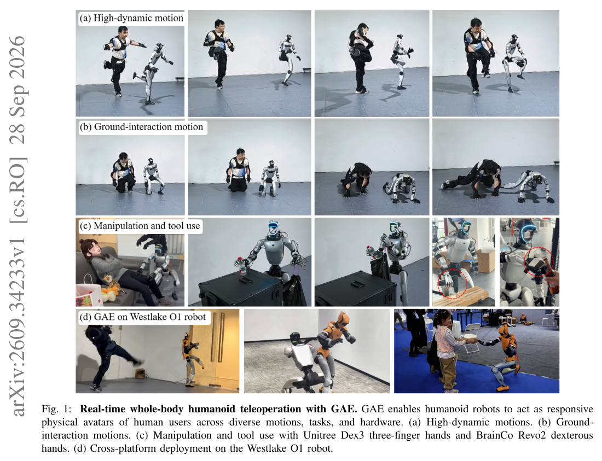
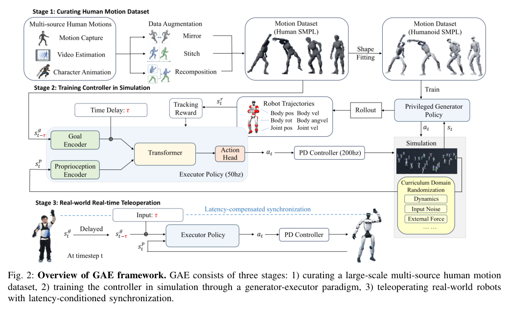

# Human Data EP06—Mocap+Video：GAE

2025-11-07 · 西湖大学 MiLAB & 西湖机器人 · GAE (arXiv:2609.34233) · 有来源缺口

[本地原件归档](../../../raw/dbf0c7438df818560638b6daabc82ecce09d4f5ad21649f8f28a70df74da92b6) · 固定材料版本 `digest-material-dbf0c7438df818560638b6daabc82ecce09d4f5ad21649f8f28a70df74da92b6@1` · [一手原站](https://arxiv.org/abs/2609.34233)

## 深度拆解与复核

- ==核心结论==：西湖大学 MiLAB 王东林与一作 [Yuefan Wang](../entities/people/Yuefan%20Wang.md)（王悦凡）团队提出的 GAE（General Action Expert，arXiv:2609.34233）揭示了一个正在收紧的工程分化：在超 10,000 小时混杂 MoCap 与视频的百万级轨迹规模上，模型架构（是否引入 MOE）只贡献约 1%–2% 的性能差异，真正带来 10%–20% 跃升的是数据多样性配比、几何对齐重定向与延迟自适应（Anticipation）训练。然而，论文刻意回避了一个直接制约端侧部署的核心代价——852M 参数的 MoE Transformer 相比同级 [NVIDIA GEAR Lab](../entities/labs/NVIDIA%20GEAR%20Lab.md) SONIC（42M MLP）膨胀了约 20 倍，且论文在“外置感知缺失”的同时未披露机载 Jetson 端到端推理耗时与真实百次掉线摔机率。

#### 一、业务切口与核心机制

这篇发表于 2025-11-07 的 Human Data EP06—Mocap+Video 专访（紧随西湖机器人在 2025 年 9 月底放出的实景搏击/端水一镜到底全身遥操作展示，其正式技术论文于 2026-09-28 发布为 arXiv:2609.34233）正面回答了从 EP01 到 EP05（含 VideoMimic、HUB、TWIST、Hover、GMT 等系列）累积的核心疑问：当人体动作数据源不再局限于单一动捕或单目 RGB 视频，规模放大后该如何消除重定向畸变与遥操作物理延时？

1. 异构数据源几何统一（Humanoid-Proportioned SMPL）与数据增强：团队构建了超过 10,000 小时的多源人类动作库（整合光学/惯性 MoCap、视频估算与角色动画数据；访谈口径称为百万级轨迹与上万小时级数据量）。针对人机体型比例差异导致直接追踪触发“原地僵化或滑步”的痛点，GAE 先按目标人形机器人的连杆长度定制几何代理模型（Humanoid-Proportioned SMPL），再进行镜像翻转（mirroring）、时序拼接（temporal stitching）与上下半身重组（upper-lower recomposition）三类增强，在不增加真实采集人天的前提下填补组合长尾。

2. 两阶段 Generator–Executor 解耦框架与 852M MoE 主干：整个策略摒弃了常见的纯单阶段端到端模仿学习，第一阶段特权级 Generator 在无干扰仿真环境下追踪几何适配参考动作并产出严格物理可行的机器人状态 rollout；第二阶段可部署 Executor（100 帧历史、5 头 Multi-Critic 与未来目标/状态辅助监督，backbone 为 852M 参数 MoE Transformer）在全套领域随机化下学习追踪 Generator 状态奖励，但其输入直接对接未经过重度在线 IK 优化的延迟原始人类运动信号，从而把在线 Retargeting 误差直接由强化学习网络消化吸收。

3. RoPE 时延前瞻机制（Latency-Conditioned Anticipation）与跨本体迁移：针对遥操作中常见的通信与人体感知链路延时，GAE 在 RoPE 位置编码上随机采样时间偏置参数 tau（取值 0–5，50 Hz 控制频率下每帧对应 20 ms，最高覆盖 100 ms 前瞻，其中真机格斗与遥操对照展示 tau = 4 即 80 ms 提前预测对出拳与落步同步性的明显改善）。跨本体验证涵盖 Unitree G1、Westlake O1 及 ENGINEAI PM01，并通过 BrainCo Revo2 与 Unitree Dex3 灵巧手演示高动态手眼协同及 5 kg 负载受扰抗摔，同时完成北京至杭州约 1,300 km 跨城远程遥操作演练。

#### 二、核心数据核查、口径纠偏与工程边界

场景与利益披露：本条对话发生于西湖机器人商业化与融资曝光密集期（2025 年国庆前公开真机视频引发关注后 1 个月，同期涉及商业原型展示）；文中“上机调试几乎从来没摔过”“上万小时 / 百万轨迹带来显著涌现”均为团队口述，独立外部测试与完整算力/能耗账本未对外审计。

| 核查维度 | 访谈核心说法 | 论文实证与外部可检边界（arXiv:2609.34233v1） | 本工作台核查判定 |
| --- | --- | --- | --- |
| MOE 结构收益 vs 数据清洗重采样 | 改 MOE 这类结构调整仅差 1%–2%，数据配比与重定向差 10%–20% | Fig 3 消融（Hard 难集 SR）：Full+Aug 93.9% vs 剔除增强 91.6% vs 50% 数据不增强 85.3%（仅靠数据量与增强即拉开 8.6 个百分点）；两阶段 G-E（93.9%）对比直接端到端（90.6%）高出 3.3 个百分点 | ✅ 量级趋势一致（数据规模/增强收益远大于单点结构微调，⚠️ 但论文未单独披露关闭 MoE 路由的具体百分点消融表） |
| 通用动捕追踪性能 vs SONIC | 可实现零调参高动态格斗、跳跃与爬行追踪 | Table I 仿真测试（每组 50 条轨迹）：Easy 集 GAE 97.3% vs SONIC 95.4%；Medium 集 96.9% vs 85.2%；Hard 集 93.9% vs 77.7%（tau=5 即 100 ms 延迟下仍保持 92.1%） | ⚠️ 成功率口径偏宽（GAE 采用关键点误差 < 50 cm 作为成功判据，比 SONIC 原论文的 0.25 m 高度阈值更宽，且使用自建 10,000h 库对比 SONIC 开源权重，未控制训练数据对齐） |
| 参数膨胀与端侧实时性代价 | 实机全链路非常流畅，50 Hz 控制极稳 | 骨干参数量达 852M，且需维持 100 帧历史窗，但论文全文与附录未汇报 Jetson 机载推理耗时（ms）、内存占用及总 GPU 训练千卡时成本 | ⚠️ 重大工程信息缺口（参数是 SONIC 42M 的 20.3 倍，端侧高负载实时性难以仅凭展示视频背书） |
| 地形/视觉感知与摔倒频率 | 调试阶段从头到尾很少摔机 | 论文 Sec V.A 明确承认模型完全无外置视觉/LiDAR 感知输入，无法爬楼梯或主动避障；且 2025 年 3 月早期版本仍需要大量真实轨迹微调才可跳舞 | ❌ 口径存在筛选效应（2025-11 访谈“未摔”口径仅指 9 月底已成熟版本在平地受控遥操下的体验，非无约束开放环境） |

本工作台核查还注意到，GAE 在商业数据生态上有两个直接的供应链依赖：

1. ⚠️ 重型动作先验仍锚定专业 MoCap 硬件：尽管主张混合视频增强，团队展示的高动态一镜到底全身格斗、精细上肢挥击依然重度依托诺亦腾惯性动捕衣提供实时低延迟输入，纯 VR 稀疏追踪（头+手 3 点）在遮挡或下肢大步幅转换时的真机降级幅度论文未给出独立定量表格。
2. ⚠️ “百万级轨迹”缺少按模态比例与来源许可的明细拆账：论文明确给出 >10,000 小时总量与 50% 消融实验，但未公布其中商业动捕、开源数据集（AMASS/Twist2）与单目 RGB 估算视频各自占比及去重比例，这使得外界难以直接复现或评估其边际采集单价。

#### 三、赛道横向对比与定位

围绕“大流量异构动作库 + 通用全身追踪 + 遥操作落地”三条轴线，GAE 在当前具身运控工作台谱系中与 [NVIDIA GEAR Lab](../entities/labs/NVIDIA%20GEAR%20Lab.md) SONIC 及 Noitom HiPHI 体系形成了高度对称的工程对照组：

| 模型 / 体系 | 训练数据量级与来源 | 骨干规模与机制 | 遥操接口与延时对策 | 最明显局限与工程代价 |
| --- | --- | --- | --- | --- |
| [Human Data EP06—Mocap+Video：GAE](Human%20Data%20EP06%E2%80%94Mocap%2BVideo%EF%BC%9AGAE.md) | 宣称 >10,000 小时混合数据（MoCap+视频+动画增强） | 852M MoE Transformer + 两阶段 Generator–Executor | RoPE 随机 tau 偏置前瞻最高 100 ms | 模型过大、未公开 Jetson 实测 ms 与外置地形感知能力 |
| [专访罗正宜：关于SONIC全身控制框架的访谈](%E4%B8%93%E8%AE%BF%E7%BD%97%E6%AD%A3%E5%AE%9C%EF%BC%9A%E5%85%B3%E4%BA%8ESONIC%E5%85%A8%E8%BA%AB%E6%8E%A7%E5%88%B6%E6%A1%86%E6%9E%B6%E7%9A%84%E8%AE%BF%E8%B0%88.md) | 700 小时高精光学动捕（清洗留存 611 小时） | 42M MLP + FSQ 通用潜空间离散编码器 | 4 线程异步执行 + 160 ms 混合过渡（Jetson 实测 1–2 ms） | 同样缺少视觉避障/上下楼梯能力，700 小时纯数字人底座缺居家操作细粒度动作 |
| [Weave](Weave_%20Learning%20Whole-Body%20Dexterous%20Loco-Manipulation%20from%20Human-Object%20Interactions%20%28arXiv_2609.16683%29.md) | 人机物体交互（HOI）专项动捕片段 | 全身移动抓取 + 灵巧操作一体追踪 | 聚焦高接触物体操作与协同稳定性 | 覆盖极长尾动态跑跳动作的密度不如 GAE / SONIC 通用库 |
| [HoloMotion-1 Technical Report](HoloMotion-1%20Technical%20Report_%20Humanoid%20Whole-Body%20Motion%20Foundation%20Model%20via%20Hybrid%20Video%20%26%20MoCap%20Corpus%20%28ar.md) | 大规模混合 Video + MoCap 基础语料 | 统一运动基础模型架构 | 多接口全身策略兼容遥操与上层规划 | 开源全链路实机基准与延迟压力测试仍有待独立复测 |

### 观点与可反驳条件

- ==观点==：GAE 把通用全身遥操的瓶颈重心从“单点网络架构（MoE）”成功转移到“千万级多样动作重采样 + 人机几何重配（Humanoid-Proportioned SMPL）+ RoPE 物理前瞻补偿”，证明了无显式在线 IK 求解器的端到端延迟吞吐可支撑 1,300 km 级远程敏捷控制；但 852M 参数的 MoE 代价如果没有配套的蒸馏压缩、机载推理延时白皮书和外置视觉/深度传感器接入，就还只能停留在高配平地演示与数据采集底层工具，无法直接充当家庭/工业移动作业产品的全天候控制器。
- ==推翻条件==：
  1. ① 若团队公开 852M GAE 在 Unitree G1 机载 Jetson Orin NX（不依赖台式机无线回传计算）下的独立延迟基准测试，能以 >= 50 Hz 帧率（单步推理 <= 5 ms）稳定跑完含强外部冲击的 100 次高动态格斗—深蹲—单腿连续测试且成功率 >= 95%，则本工作台对其端侧推理算力过载的质疑被推翻。
  2. ② 若在纯无 MOE（等参数量稠密网络 vs MoE）与同等 10,000 小时对齐训练条件下，学术界或工业界证实 MoE 架构本身在跨技能容量上仍能稳定拉开 >= 10% 绝对成功率差，则“MOE 仅贡献 1%–2% 边际微调”的经验判断失效。

---

## 原文摘录与一手信源存证

> 国庆前，具身社区都被一段真人穿戴诺亦腾惯性动捕设备来遥操人形机器人的视频惊艳到，遥操延迟很低，动作多样性丰富，完成度很高。
> — 原文摘录，PDF p.1；证据 `digest-material-dbf0c7438df818560638b6daabc82ecce09d4f5ad21649f8f28a70df74da92b6-excerpt-1@1`

> GAE这篇工作的主要参与者是西湖大学博士生王悦凡博士，他目前在西湖大学王东林老师组里读博，本科毕业于哈工大。一起来来了解下他在做GAE这个工作过程中的一些心得。
> — 原文摘录，PDF p.1；证据 `digest-material-dbf0c7438df818560638b6daabc82ecce09d4f5ad21649f8f28a70df74da92b6-excerpt-2@1`

> 我们一开始的目标，就是希望在人形机器人的运动控制上实现通用化。这个项目从去年启动时，就希望构建一个类似于“机器人的小脑”的系统——用单一模型去控制机器人，实现对多样化运动的统一学习与生成。
> — 原文摘录，PDF p.2；证据 `digest-material-dbf0c7438df818560638b6daabc82ecce09d4f5ad21649f8f28a70df74da92b6-excerpt-3@1`

一手材料：

- GAE: General Action Expert for Real-Time Humanoid Teleoperation · Yuefan Wang et al. / arXiv · [原站](https://arxiv.org/abs/2609.34233) · [主体档案：Yuefan Wang](../entities/people/Yuefan%20Wang.md) · [NotebookLM](https://notebook.google.com/notebook/33f0076b-fc09-42cc-9cd9-fecfb847ce1c) · [Drive](https://drive.google.com/file/d/1QExSXvrnpQ0BcXJO5FSGMXHGM4Hpzcyb/view?usp=drivesdk)
  材料版本 `digest-material-d6a0b0605bb196aab7ec539afa9f83e1d49f5494027903fd0c96df1079431064@1`；获取方式 `http_pdf`。
  > Fig. 1: Real-time whole-body humanoid teleoperation with GAE. GAE enables humanoid robots to act as responsive physical avatars of human users across diverse motions, tasks, and hardware. — PDF p.1
  > Abstract— Humanoid avatars extend human physical pres- ence beyond the body, enabling people to participate in so- cial, service, and labor activities through remotely operated robots. — PDF p.1

归属与范围：完成EP06访谈（2025-11-07）与后续正式技术论文（arXiv:2609.34233v1，2026-09-28公开，项目页确认时间跨度）的跨期对齐核对：确认GAE在超万小时异构重配（Humanoid-Proportioned SMPL）与RoPE 0–100 ms延迟预测上具备工程新意，Fig 3数据扩增与G-E两阶段消融扎实（93.9% vs 85.3%）；但同时核出852M参数比SONIC大20倍却隐去机载推理耗时、测试成功率采用50 cm较宽判据以及完全缺失外置地形视觉（Sec V.A）等关键约束；口述不摔口径按受控演示边界处理。

来源缺口：

- `not_disclosed`：GAE虽在论文公开852M MoE参数体量与100帧历史窗，但全文未披露机载Jetson端到端推理延迟（ms）、总GPU训练消耗及10,000+小时混合库中商业动捕与视频估算的具体比例拆账。
- `pending_verification`：访谈中“上机调试从头到尾没摔过”“百万级轨迹绝对规模”及MoE对比稠密模型仅差1%–2%的说法属于团队工程口述，论文未附无MoE对照组表格及独立外部百次故障统计。
- `pending_verification`：GAE在Hard集（93.9% vs SONIC 77.7%）对比采用了50 cm宽松关键点判据且未在对齐数据下重训基线，在真机无外置视觉（Sec V.A）下的开放环境长期抗摔率待第三方实测。

[返回赛道总览](../赛道总览.md#digest-dbf0c7438df81856) · [返回导读索引](README.md) · [主体档案库](../entities/README.md)
