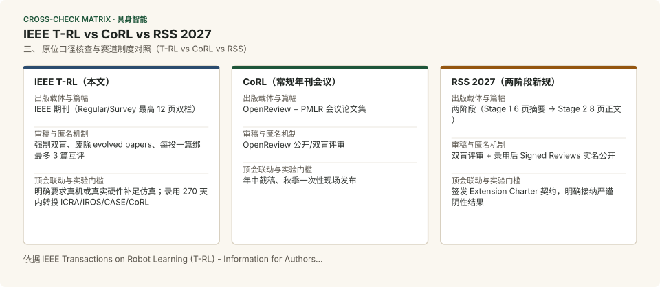

# IEEE Transactions on Robot Learning (T-RL) - Information for Authors

2026-03-05 · IEEE-RAS · 已整理

[本地原件归档](../../../raw/824719dbb828d47bd58eef90d4ef2395931b92656671e29b28238b1d985086dd) · 固定材料版本 `digest-material-824719dbb828d47bd58eef90d4ef2395931b92656671e29b28238b1d985086dd@1` · [一手原站](https://www.ieee-ras.org/publications/t-rl/information-for-authors/)

## 深度拆解与复核

## 深度拆解与复核

==场景与利益披露==：本文件为 IEEE Robotics and Automation Society（IEEE RAS / IEEE-RAS）官方发布的《IEEE Transactions on Robot Learning (T-RL) - Information for Authors》（2026-03-05 收录版），属于学会出版管理委员会（Publication Activities Board）的一手制度规则（Role=Data），非商业公司路演。作为 IEEE 旗下专门承接「机器人学习」交叉方向的旗舰期刊（Transactions），T-RL 的规则设计直接反映学术共同体如何在 AI 论文量产背景下守住物理真实性、期刊独立性与顶会联动秩序。

### 一、 期刊定位、真机门槛与「期刊→四大顶会」转投机制

1. 收录范围与物理硬件导向（本工作台梳理）：T-RL（IEEE TRANSACTIONS ON ROBOT LEARNING）聚焦针对机器人与自动化系统物理约束的 Artificial Intelligence（AI-based / AI-driven）基础方法突破，重点解决已有数据稀缺（limited pre-existing data）、跨平台泛化差、学习时间尺度慢及物理部署鲁棒性低等瓶颈，并明确要求涵盖安全与可靠性保证、人机协作及可解释控制。==制度文本明确写入「除仿真评测外，预期提交真实硬件实验验证（Applications in real hardware in addition or to complement evaluation in simulation are expected）」==，将真机基准与可复现对比置为常态硬门槛。
2. 四大会议宣讲通道与严格时间窗（本工作台核查）：T-RL Regular Papers 录用后可在 PaperCept 工作区收到邀请，于 IEEE RAS 主办或协办的 ICRA、IROS、CASE 及 CoRL（Conference on Robot Learning）专属环节（special session）宣讲，但每篇仅限择一会议且须在录用后 270 天内申请转投（不可因窗口期要求加速或延迟审稿）。官方窗口设定如下（均须早于对应 Steering Committee 会议前至少一个月关闭）：
   - ICRA 2026：2025-04-01 至 2025-12-31
   - IROS 2026：2025-08-01 至 2026-04-30
   - CASE 2026：2025-08-01 至 2026-04-30
   - CoRL2026：2026-04-16 至 2026-09-01
3. 废除「演化论文」与双盲匿名铁律（本工作台核查）：自 2025 年 1 月起，因全面推行 Double-Anonymous Review Process，T-RL 正式取消 evolved papers 类别。论文不得处于其他会议或期刊同步在审状态（违规即退稿），且严禁出现「in our previous work」等暴露身份的引述，须改写为第三人称客观引用。同时启用审稿互惠绑定：每篇送审稿件目标配齐 3 份评审（至少 2 名独立审稿人），所有作者及共同作者投稿即默认承诺为 T-RL 承担最多 3 篇其他稿件的评审任务，且须将 PaperCept PINs 绑定至 ORCID（Contributor ID）。

### 二、 裁决机制、版式工程约束与合规边界

1. 四级审稿裁决与三编辑会签制（依据 IEEE Publication Services and Products Board Operations Manual）：
   - Editorial (Summary) Rejections：针对不完整或明显不合刊范围的初筛退稿（prescreening），若涉及「技术贡献不足（criterion 3.e）」，必须由 Editor-in-Chief（EiC）、Senior Editor（SE）与 Associate Editor（AE）三方一致同意方可在投稿后三周内签发；只要三方存在分歧即必须送外审。
   - Revise and Resubmit（RR）与 Conditionally Accepted（CR/CC）：RR 须附带高亮修改版与不超过 10 页的逐条回复，并应避免连续两次 RR 或两次 CR/CC；CC 常规稿件修改期 60 天（Special Issue 特刊 30 天），终稿（Accepted Manuscripts）须在通知后 30 天内提交且超 180 天未达标将视同撤稿。Survey Papers 投稿前须先向 EiC 提交含作者资质与文献评述框架的独立 PDF 提案。
2. 出版格式、CJK 字体与多媒体封装规范：
   - 篇幅与模板：Regular 与 Survey 均限 12 页双栏 `\documentclass[journal]{IEEEtran}`（10 pt 字体，含图表、参考文献及每名作者不超过 100 词的简介；图形摘要 graphical abstract 视为正式技术内容参与评审）。支持在英文作者名旁加注 Chinese、Japanese、Korean（CJK）母语姓名，并强制提醒远东（Far East）作者在 `ras.papercept.net/journals/trl` 测试 PDF 字体嵌入（最低 PDF 1.4），防 Western 审稿端乱码。
   - 补充材料与多媒体：上限 60 MB 压缩包，须与正文严格解耦（论文须独立可读），每份上传文件（`UploadedFile.xyz`）须配同名 `.txt` 说明，视频/数据集压缩包内必须附 ASCII 格式 `ReadMe.txt` 与不超过 5 句的 `Summary.txt`。
   - 预印本、OA 费率与 Generative AI 披露：允许在 ArXiv 或 TechRxiv 发布 Preprints，录用后须替换为已接收版本（非 IEEE 排版终版）并加注 IEEE Xplore 与 DOI 链接；2026-01-01 起 Open Access（OA）APC 调至 USD \$2,800（IEEE Members 享 5% 折扣、IEEE Society Members 享 20% 折扣，不可叠加且不适用学生会员，另有 Lower-middle Income Country Program 减免）。AI-generated 内容必须在致谢中明确标出所用系统与对应章节（语法润色除外），并遵守 RAS Generative AI Guidelines。

### 三、 原位口径核查与赛道制度对照（T-RL vs CoRL vs RSS）

- ✅ 期刊—顶会联合宣讲机制的真实权重（本工作台核查）：不同于传统期刊「发完就沉底」或会议「一锤子买卖」，T-RL 把 12 页深度的期刊审稿与 CoRL2026 / ICRA / IROS / CASE 现场曝光打通（270 天窗口 + CoRL 专属席位），在 `Beyond 1M Hours` 等真机基准与长程系统论文需要详尽消融实验时，提供比 8 页顶会更充裕的论证篇幅。
- ⚠️ 双盲与预印本扩散的实际脆弱点（本工作台推断）：尽管 T-RL 废除 evolved papers 并强制双盲，但指南同时允许 ArXiv / TechRxiv 预印本提前占位；在具身智能大模型高频刷榜周期下，顶会/头部实验室往往在投稿同期于 X 与 GitHub 公开项目主页与视频，审稿人极易通过开源视频风格或基准名称反推作者身份，「形式双盲 + 事实明牌」的张力短期难以根除。
- ✅ 对比 CoRL 与 RSS 2027（本工作台核查）：对照本库 [BAIR at CoRL 2026 拆解](BAIR%20at%20CoRL%202026%EF%BC%9A33%20%E7%AF%87%E4%B8%BB%E4%BC%9A%E8%AE%BA%E6%96%87%E3%80%8110%20%E9%A1%B9%20Oral_Spotlight%20%E4%B8%8E%E6%9C%80%E4%BD%B3%E8%AE%BA%E6%96%87%E5%A5%96%E5%85%A8%E8%A7%88.md) 与同期收录的 RSS 2027 Call for Papers，T-RL 走的是「12 页期刊深审 + 270 天顶会转投宣讲」的慢变量稳态通路，而 RSS 2027 则激进转向「6 页扩展摘要 + Extension Charter 两阶段孵化」；两者共同指向同一痛点——传统单一截稿死线已难以承受 LLM 时代的投稿洪峰与真机实验验证周期。

| 对比维度 | IEEE T-RL（本文） | CoRL（常规年刊会议） | RSS 2027（两阶段新规） |
| :--- | :--- | :--- | :--- |
| 出版载体与篇幅 | IEEE 期刊（Regular/Survey 最高 12 页双栏） | OpenReview + PMLR 会议论文集 | 两阶段（Stage 1 6 页摘要 → Stage 2 8 页正文） |
| 审稿与匿名机制 | 强制双盲、废除 evolved papers、每投一篇绑最多 3 篇互评 | OpenReview 公开/双盲评审 | 双盲评审 + 录用后 Signed Reviews 实名公开 |
| 顶会联动与实验门槛 | 明确要求真机或真实硬件补足仿真；录用 270 天内转投 ICRA/IROS/CASE/CoRL | 年中截稿、秋季一次性现场发布 | 签发 Extension Charter 契约，明确接纳严谨阴性结果 |

### 观点与可反驳条件

- ==观点==：IEEE T-RL 通过「取消 evolved papers + 强制真机硬件预期 + 打通 ICRA/IROS/CASE/CoRL 270 天宣讲窗口」，正在成为机器人学习领域对抗短平快灌水的核心制度压舱石；对涉及真实物理系统标定、数据基建与长周期基准的研究，T-RL 提供的 12 页篇幅与多轮审稿修复机制优于传统 8 页会议一轮博弈。
- ==推翻条件==：
  1. 顶会分流与审稿周期失血：若 2027 年底前 T-RL 平均一审至终审（RR/CR 全周期）耗时超过 9 个月、且通过 CoRL 专属通道转投宣讲的论文占比低于总录用数的 15%，导致头部 VLA/WAM 团队继续将核心真机成果锁定在 RSS/CoRL 首发，则「期刊—顶会双向桥接」的生态吸引力将被证伪。
  2. 双盲与 AI 披露形同虚设：若在 2027 年已发表的 T-RL 论文中，同步挂出 ArXiv/项目主页导致可识别率居高不下，且致谢中按规定披露 AI-generated 内容的比例长期低于 10%，说明制度约束在实操层已被高速预印本竞赛架空。

---

## 原文摘录与一手信源存证

> 【信源巡检核心摘要】 Author guidelines for the IEEE Transactions on Robot Learning (T-RL), enabling paper presentation pathways to flagship conferences including ICRA, IROS, CASE, and CoRL.
> — 原文摘录，文字段落 1；证据 `digest-material-824719dbb828d47bd58eef90d4ef2395931b92656671e29b28238b1d985086dd-excerpt-1@1`

一手材料：

- IEEE Transactions on Robot Learning (T-RL) - Information for Authors · IEEE-RAS · [原站](https://www.ieee-ras.org/publications/t-rl/information-for-authors/) · [主体档案：IEEE ICRA (International Conference on Robotics and Automation)](../entities/labs/IEEE%20ICRA%20%28International%20Conference%20on%20Robotics%20and%20Automation%29.md) · [本地原件](../../../raw/f49bd365b32263463c738cfd66e4d4a12f62c377bffa14bb4e50e026e7f4188c)
  材料版本 `digest-material-f49bd365b32263463c738cfd66e4d4a12f62c377bffa14bb4e50e026e7f4188c@1`；获取方式 `http_full_text`。
  > The paper must be transferred within 270 days of acceptance. Authors may not request any acceleration or delay of the review process based on these time windows. — 原文提取
  > The invitation to present at a conference is in the author’s workspace in PaperCept after acceptance of the paper. Eligible papers may only be presented at one conference. — 原文提取

归属与范围：已抓取 ieee-ras.org 上《IEEE Transactions on Robot Learning (T-RL) - Information for Authors》完整官方正文（31,442 字符），系统拆解期刊至 ICRA/IROS/CASE/CoRL2026 会议宣讲窗口、2025 年 1 月起废除 evolved papers 与强制双盲规则、12 页版式与 60 MB 补充材料约束、USD 2,800 OA 费率及生成式 AI 披露条款，并对照 CoRL/RSS 评估其在具身智能数据与真机评测规范中的制度定位。

[返回赛道总览](../赛道总览.md#digest-824719dbb828d47b) · [返回导读索引](README.md) · [主体档案库](../entities/README.md)
