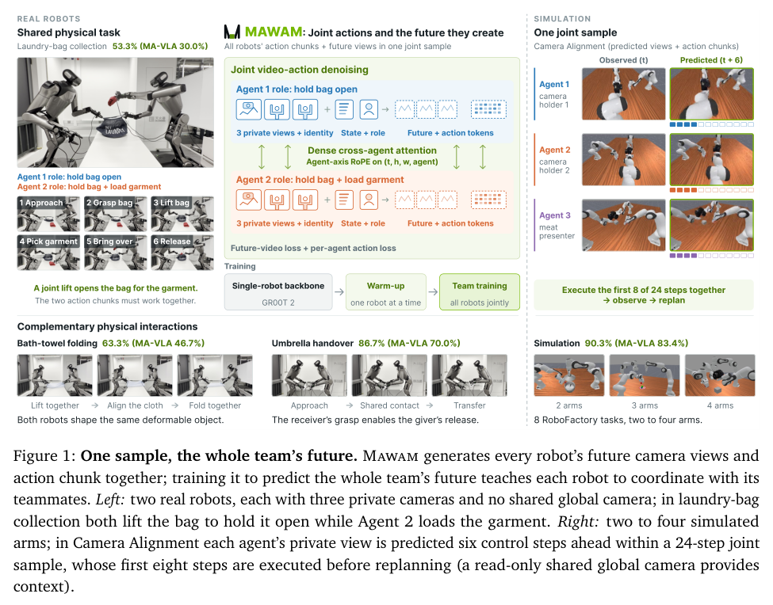
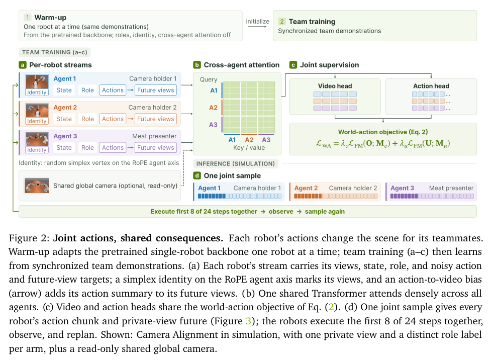

# MAWAM: A Multi-Agent World-Action Model for Coordinated Manipulation

2026-11-18 · NVIDIA LPR Lab · NVIDIA GEAR Lab · HKU · MIT (arXiv:2611.25105v2) · 有来源缺口

[本地原件归档](../../../raw/8f1cb39900b03eb9c40d6b280d45b04215ada8fa19eb4759d907fc176ee5b4af) · 固定材料版本 `digest-material-8f1cb39900b03eb9c40d6b280d45b04215ada8fa19eb4759d907fc176ee5b4af@1` · [一手原站](https://arxiv.org/abs/2611.25105v2)

## 深度拆解与复核

- 来源：[arXiv:2611.25105v2 (HTML 全文)](https://arxiv.org/html/2611.25105v2) · [arXiv 摘要页](https://arxiv.org/abs/2611.25105v2) · [NVIDIA LPR Lab 项目主页](https://research.nvidia.com/labs/lpr/mawam/)
- 口径与利益披露（归属核实）：尽管该条目由订阅人物 Linxi "Jim" Fan 线触发且包含高校合著者，本工作台核查论文首页与项目主页确认，MAWAM 并非纯高校学术研究，而是 NVIDIA 主导的工业实验室联合成果——13 位作者（Xianzhe Fan、Chi-Pin Huang、Fu-En Yang、Jing Wang、Yecheng Wu、Yu-Cheng Chou、Johan Bjorck、Linxi "Jim" Fan、Jan Kautz、Yu-Chiang Frank Wang、Zhiding Yu、Hengshuang Zhao、Zhiqi Li）中 11 位署名 NVIDIA（横跨 Jan Kautz / Zhiding Yu 领衔的 NVIDIA LPR Lab 与 Jim Fan / Johan Bjorck 所在的 NVIDIA GEAR Lab），仅第一作者 Xianzhe Fan 兼署 The University of Hong Kong（与 Hengshuang Zhao 同校）、Yecheng Wu 兼署 MIT；项目页托管于 research.nvidia.com/labs/lpr/mawam/ 并直接基于 NVIDIA 自研单机世界—动作模型 GR00T 2（2026 年 11 月发布）与 Cosmos-Reason1 构建。文章处于企业科研公关与技术壁垒展示场景，基准测试（尤其对 MA-VLA 的 π0.5 复现）及「世界模型协同优势」具有天然卖方技术叙事激励。元数据核对：论文提交于 2026-11-18 UTC（Nov 2026，v2 修订 2026-11-20 UTC），DOI 10.48550/arXiv.2611.25105（DataCite），学科归类 cs.RO / Robotics、cs.AI（Artificial Intelligence）与 cs.CV（Computer Vision and Pattern Recognition）；页面 PDF、HTML、TeX 源码与 BibTeX 均已上线，但 Code / Hugging Face Spaces / Replicate / DagsHub / CatalyzeX / ScienceCast 等外部仓库入口目前无公开代码或权重链接（Litmaps、Connected Papers、Google Scholar、Semantic Scholar、CORE、SciX、Smart Citations Explorer 等检索工具尚未披露后续复现）。
- ==核心结论==：MAWAM（Multi-Agent World-Action Model for Coordinated Manipulation）证明了把多个独立机械臂各自的私有相机观测、本体状态与动作块（Action Chunk）放进同一个冻结视觉—推理骨干（GR00T 2 / Cosmos-Reason1 + Wan 2.1 视频 VAE）联合去噪，能在无共享全局相机、纯依赖机载私有视角下将双机真实协同操作平均成功率推高至 67.8%（比同数据同相机复现的 MA-VLA 高 18.9 个百分点），并在 RoboFactory 2–4 臂仿真中取得 90.3% 平均成功率；但真正的物理机理洞察藏在消融表 Table 8 中——推理期把未来帧 token 冻结在初始噪声（Frozen future）并不显著拉低成功率，而一旦把未来帧 token 从注意力序列中彻底删去（No future tokens），四臂接力立即从 95.0% 归零至 0.0%。这说明 ==多智能体世界—动作模型的核心价值并非在部署时生成高保真未来像素视频，而是利用「队级未来视频监督」在训练期把跨机因果碰撞与节奏耦合写入同一组共享中间计算槽位（Future-view tokens）==。

---

### 一、 架构机理拆解：如何在不合并控制接口的前提下完成跨机协同？

多机协同操作的经典困局在于「非对称视角耦合」：在双台 Galaxea R1 Pro 协同撑开洗衣袋装衣或折叠浴巾时，1 号机的每一次抬升都会即时改变 2 号机所看到的织物形变，但两台机器人的私有相机（1 个头部左目 + 2 个腕部 RealSense D405）与底层控制器相互独立。MAWAM 没有采用「拼成单机大向量（Centralized team）」的做法（因为单机预训练底座 GR00T 2 无法直接消化突然翻倍的拼接动作维数，在四臂接力上直接跌至 0.0%），而是设计了四项结构保留组件：

1. 分机数据流与路由守卫（Per-Robot Streams & View–Agent Map）：
   - 通过显式视角—智能体映射 q(v) = i 与相机类型标签 c(v)，将每个机器人的私有视频编码流 V_{i,v}、本体状态 S_i 与动作 token U_i 编组为独立流 X_i；解码阶段用互不重叠的选择矩阵 A_i 将各机器人预测出的动作块准确回写至各自控制器（真实双机 Galaxea R1 Pro 物理接口为每机 44D 状态 / 37D 指令，合包 88D 状态 / 74D 指令，模型激活学习每机 16D 逻辑控制空间：双臂各 7D 相对末端位姿含四元数 + 双 1D 夹爪开合）。
2. 正单形智能体旋转身份编码（Regular-Simplex RoPE Agent Axis）：
   - 在 GR00T 2 的 128D 注意力头中，MAWAM 将原本分配给时间维（t）的 11 个最低频旋转对（10^-2 至 1.5×10^-4 rad/帧，在 4 个潜帧跨度上累计旋转 <= 0.03 rad、几乎不携带时序信息）重新划拨给 agent 轴，形成 (d_t, d_a, d_h, d_w) = (22, 22, 42, 42) 的 4D RoPE 分配（占 11–21 与 75–85 维）。
   - 用 P=4 中心化正则单形顶点 c_j ∈ R^4 对不同机器人赋相位：同一机器人名下全部 3 个私有视角共享完全相同的旋转相位，不同机器人之间恒定保持 ±2/√3 ≈ 1.15 rad 夹角（任意两机距离完全对称、消除槽位顺序偏置），可选的共享全局只读相机则置零相位。训练期每步随机重抽顶点映射并整组打乱智能体序列顺序，迫使 Transformer 学习近似置换等变（Approximate permutation equivariance）。
3. 动作到视频偏置（Action-to-Video Bias）与任务角色解耦（Task-Role Embeddings）：
   - 将第 i 台机器人的噪声动作 token 编码均值直接加到其名下所有私有视角未来帧 token 上，把控制意图绑定至自身视角的未来物理演化；同时为每台机器人叠加可学习的任务角色嵌入 ρ(r_i)。两者分工明确：Identity 回答「这路相机和动作属于哪台机器」，Role 回答「它在本任务中承担什么职能」——在三臂 Camera Alignment 任务中，把两个机位支架赋予同一角色标签 [0,0,1]，模型依然凭借各自私有状态与流区分控制输出，取得 100.0% 成功率。
4. 两阶段世界—动作联合流匹配训练（Warm-up → Team Training）：
   - 全部训练共用同一联合流匹配损失 L_WA = λ_v L_FM(O; M_v) + λ_u L_FM(U; M_u)。第 1 阶段 Warm-up 先关闭跨机注意力、身份码与角色嵌入，单机逐台适应相机布局与控制器（仿真默认 6,000 次更新）；第 2 阶段 Team training 载入 Warm-up 权重，开启全双向稠密 Cross-Agent Attention，在同步团队示范下联合去噪过去 5 帧观测（真机 15 Hz 下 0.8 s；仿真 20 Hz 下 0.6 s）对应的未来 8 帧私有视角（步距 3 步，覆盖 24 步 = 真机 1.6 s / 仿真 1.2 s）与 24 步连续动作块（每次锁步执行前 8 步，即真机 0.53 s / 仿真 0.4 s 后重规划）。

---

### 二、 量化基准、消融机制与反常发现复核

#### 1. 真机（2× Galaxea R1 Pro，6 路私有相机、0 全局相机，每任务 30 次试验）与仿真（RoboFactory 8 任务，每任务 100 局）

| 实验场景与对比方法 | 核心定量指标与成功率表现 | 本工作台口径与工程核查 |
| :--- | :--- | :--- |
| 真机 3 任务均分（Laundry / Towel / Umbrella） | MAWAM 达 67.8% ± 4.7%（53.3% / 63.3% / 86.7%）；MA-VLA (π0.5) 48.9% ± 5.0%（30.0% / 46.7% / 70.0%）；CLS-DP 37.8%；GauDP 28.9% | ✅ 对比公平性核查：四组方法均在相同示范集、相同 2× Galaxea R1 Pro 硬件与 6 路私有视角（无全局相机）下评测，MAWAM 相对 MA-VLA 领先 +18.9 个百分点且在最依赖双机同步张紧的洗衣袋收集领先 +23.3 pp |
| 仿真 RoboFactory 8 任务（2–4 臂，150 条/任务） | MAWAM 均分 90.3% ± 0.9%，超过 MA-VLA 83.4%（+6.9 pp）与 LTLDiff 35.8%；四臂 Take Photo 97.0%、Long Pipeline Delivery 95.0%、Place Food 78.0% | ⚠️ 难度分化核查：Three Robots Stack Cube 仅 59.0%（MA-VLA 为 58.0%），Long Pipeline Delivery 亦略低于 MA-VLA 的 97.0%；且仿真端默认带入只读共享全局视角，去掉全局相机后 Place Food 从 78.0% 跌至 62.0% |
| 队友延迟响应压力测试（Long Pipeline 持停 16 步） | 强制第 2 交接点释放后静止 16 步，MAWAM 接收臂中位启动延迟 +12 步（抓取 +9 步），保持 99% 成功率；无跨机注意力基线仅延迟 +6 步（抓取 +1.5 步），成功率跌至 44%（p = 3.2×10^-16） | ✅ 因果协同复核（本工作台核查）：证明 Cross-Agent Attention 确实让接收方根据队友动作与未来视觉状态动态退让节奏，而非盲目按固定节拍开环前冲 |

#### 2. 消融实验拆解：到底是什么让多机 WAM 有效？（Table 3 & Table 8）

| 消融变体 | 受损最重任务与幅度 | 揭示的底层工程因果 |
| :--- | :--- | :--- |
| 关闭跨机注意力（Independent agents） | 四臂 Long Pipeline Delivery 95.0% → 39.0%；Place Food 78.0% → 54.0%；真机均值 67.8% → 52.2% | 仅靠共用权重和各自局部观察无法协调多机交接时序与遮挡态，跨机 token 互注意是协同刚需 |
| 移除团队阶段未来视频监督（保留 token 与计算） | Place Food 78.0% → 47.0%（-31.0 pp）；Camera Alignment 100.0% → 94.0% | 即使测试时架构与 FLOPs 完全不变，缺少队级联合视觉未来监督会导致「掀盖臂与放肉臂」之间失去空间几何约束 |
| 跳过单机 Warm-up 直接团队训练 | Long Pipeline Delivery 95.0% → 34.0%；Place Food 78.0% → 45.0% | 单机预训练骨干（GR00T 2）必须先完成相机视角几何与控制器维度的单机对齐，再学多机耦合 |
| 移除任务角色（No roles）或固定身份（Absolute slots） | No roles 使 Camera Alignment 100.0% → 8.0%、Place Food 78.0% → 0.0%；Absolute slots 使 Place Food 78.0% → 22.0%（Fixed simplex 43.0%） | 没有 Role 嵌入会导致所有机械臂行为塌缩为同一高概率动作（74 局同时抬相机、仅 8 局举靶物）；固定槽位 ID 则摧毁随机化对称泛化 |
| 测试期冻结未来帧 vs 删除未来 token（Table 8） | Frozen future：Place Food 78.0% → 70.0%（p=0.17 不显著）、四臂接力反升至 98.0%；No future tokens：Long Pipeline 95.0% → 0.0%、Pass Shoe 100.0% → 1.0% | ⚠️ 核心机理复核（本工作台推断）：与单机 Fast-WAM/SelfWAM 结论高度一致，生成式未来图像本身不是部署控制所需的视觉输入（真机删除未来 token 耗时从 0.320 s 降至 0.215 s 但策略完全崩溃），未来帧 token 实质上是 Transformer 跨机推理的隐式物理工作区 |

---

### 三、 物理与系统落地边界核查（对标本工作台「S0/S1 端侧与算力墙」锚点）

- ⚠️ 集中式 H100 推理延迟与通讯耦合边界（本工作台核查）：依据 Appendix Table 9 与 E.1，MAWAM 真实参数量为 2.76B 可训练参数（2.06B DiT + 0.70B 状态/动作编解码器，冻结 Cosmos-Reason1 与 Wan 2.1 VAE），在单卡 NVIDIA H100（fp32、2 步流匹配、编译后）上执行 1 次联合采样需 0.32 s（输出 24 步、锁步执行 8 步 = 0.53 s 控制周期）；对比 MA-VLA（π0.5，3.35B 参数、10 步流匹配）的 0.065 s 慢约 4.9 倍，且未计入双机图像采集汇总至集中协调器与回传控制器间的网络往返延迟。当仿真场景从 2 臂扩展至 4 臂时，单卡 L40（bf16、4 步未编译）耗时从 0.76 s / 1.40 s 上升至 1.85 s。
- ⚠️ 硬件自由度阉割与触力觉缺位（本工作台推断）：真实实验将两台 Galaxea R1 Pro 的轮式底盘与 4-DoF 躯干完全锁死（固定俯倾 [25.8°, -43.0°, -48.7°, 0°] 与固定初始臂形），全过程无指尖触觉或腕部六维力矩反馈（延续了 GR00T 2 白皮书第 5 章承认的接触力感知缺口），对洗衣袋拉扯张力与毛巾褶皱摩擦只能靠 224×320 RGB 视觉被动估计——这直接解释了为何真机三项柔性/交接任务最高平均仅 67.8%（最难的洗衣袋装衣仅 53.3%），尚未达到工业产线 99%+ 无人值守门槛。
- ❌ 代码与异构多机扩展未闭环：论文截至 2026-11-20 v2 版本未释放 GitHub 训练/部署代码与团队权重，且正则单形（4 顶点）与锁步重规划假设团队成员数固定（<= 4 台）、控制频率同构同步；在动态增减机器人、人机混编或异构轮臂+人形协同场景下，当前架构仍未验证。

### 观点与可反驳条件

- ==观点==：MAWAM 把单机世界—动作模型（GR00T 2）以极低侵入代价（11 对低频 RoPE 改配 + Action-to-Video 偏置 + 角色嵌入）成功升维为多智能体协同策略，并给出强有力的消融铁证——多机 WAM 真正起作用的不是测试期去噪出来的像素画面，而是训练期「团队联合未来视频预测」逼出的跨机因果注意力隐空间；但在工程部署上，0.32 s 的 H100 集中式推理与锁步通信约束决定了它目前仍是实验室高延迟原型，距离上车端侧芯片（如 Jetson Thor）实现多机去中心化高频力控协作还差「Future-token 蒸馏减半计算 + 触力觉残差补盲」两步跃迁。
- ==推翻条件==：
  1. ① 端侧蒸馏与多机去中心化可迁移性证伪：若截至 2027 年 Q2，NVIDIA LPR/GEAR Lab 开源 MAWAM 与 GR00T 2 权重后，外部团队将其空间 token 压缩至 1/4（类似 GR00T 2 Turbo 路径）或蒸馏至端侧边缘卡时，4 臂协同任务（Long Pipeline Delivery / Take Photo）与双机洗衣袋收集成功率下滑超过 15 个百分点（跌破 80% / 38%），则说明其多机跨视角注意力高度依赖高算力稠密全局 token，难以低成本下沉至机载端侧。
  2. ② 纯视觉协同对比触力觉闭环的物理上限证伪：若第三方在同等双臂 Galaxea R1 Pro 平台上，仅使用局部腕部力矩/视触觉反馈 + 轻量级去中心化扩散策略（无需 2.06B 视频 DiT 联合去噪）在洗衣袋收集与浴巾折叠两项柔性负载任务上突破 85% 成功率（显著超越 MAWAM 的 53.3% 与 63.3%），则说明柔性物体多机协同的主要瓶颈是接触力状态观测缺失，而非缺少跨机像素级未来生成。

---

## 原文摘录与一手信源存证

> Every move in a robot team changes the world in which its teammates must act. Coordinated manipulation therefore calls for predicting the team's actions together with the physical future they jointly create.
> — 原文摘录，文字段落 1；证据 `digest-material-8f1cb39900b03eb9c40d6b280d45b04215ada8fa19eb4759d907fc176ee5b4af-excerpt-1@2`

> We introduce MAWAM, a multi-agent world-action model that jointly generates each robot's future views and executable action chunks in a single sample. Built from a pretrained single-robot world-action backbone, MAWAM jointly denoises all robots' action and future-view tokens through cross-agent attention, while preserving a separate control interface for each robot.
> — 原文摘录，文字段落 2；证据 `digest-material-8f1cb39900b03eb9c40d6b280d45b04215ada8fa19eb4759d907fc176ee5b4af-excerpt-2@2`

> MAWAM achieves the highest success on all three real-robot tasks (laundry-bag collection, bath-towel folding, and umbrella handover), with 67.8% mean success, 18.9 percentage points above MA-VLA trained on the same demonstrations and cameras. In simulation, MAWAM reaches 90.3% mean success on eight tasks with teams of up to four arms. Ablations show that cross-agent attention and team-stage future-video supervision both improve coordinated control: without attention, a four-arm relay falls from 95.0% to 39.0%, and without this supervision, Place Food falls from 78.0% to 47.0%.
> — 原文摘录，文字段落 3；证据 `digest-material-8f1cb39900b03eb9c40d6b280d45b04215ada8fa19eb4759d907fc176ee5b4af-excerpt-3@2`

一手材料：

- MAWAM: A Multi-Agent World-Action Model for Coordinated Manipulation (arXiv:2611.25105v2 Full Paper) · NVIDIA LPR Lab · NVIDIA GEAR Lab · HKU · MIT · [原站](https://arxiv.org/abs/2611.25105v2) · [主体档案：NVIDIA GEAR Lab](../entities/labs/NVIDIA%20GEAR%20Lab.md) / [主体档案：MIT](../entities/labs/MIT.md) / [主体档案：NVIDIA LPR Lab](../entities/labs/NVIDIA%20LPR%20Lab.md) · [本地原件](../../../raw/385309e9c3c241bde580b041e37a9e84963f13a5ada1b77ea36563a156151813)
  材料版本 `digest-material-385309e9c3c241bde580b041e37a9e84963f13a5ada1b77ea36563a156151813@1`；获取方式 `http_full_text`。
  > Every move in a robot team changes the world in which its teammates must act. Coordinated manipulation therefore calls for predicting the team’s actions together with the physical future they jointly create. — 原文提取
  > generates every robot’s future camera views and action chunk together; training it to predict the whole team’s future teaches each robot to coordinate with its teammates. — 原文提取
- MAWAM Project Page — NVIDIA Learning and Perception Research · NVIDIA LPR Lab · [原站](https://research.nvidia.com/labs/lpr/mawam/) · [主体档案：NVIDIA LPR Lab](../entities/labs/NVIDIA%20LPR%20Lab.md) · [本地原件](../../../raw/7cffee416e66b435eb2aa788483d9b423cdfd05c0e4c37c9fac5d751b9e7bbd5)
  材料版本 `digest-material-7cffee416e66b435eb2aa788483d9b423cdfd05c0e4c37c9fac5d751b9e7bbd5@1`；获取方式 `http_full_text`。
  > From a pair of robots in the lab to teams in factories and homes. — 原文提取
  > Every move in a robot team changes the world in which its teammates must act. Coordinated manipulation therefore calls for predicting the team's actions together with the physical future they jointly create. — 原文提取

归属与范围：已通过 ingest.fetch 抓回 arXiv:2611.25105v2 HTML 全文（83,418 字符）及 PDF 首页（23 页）、NVIDIA LPR Lab 官方项目页（research.nvidia.com/labs/lpr/mawam/，10,340 字符）完成全量穿透核查：13 位作者中 11 位署名 NVIDIA（横跨 Jan Kautz / Zhiding Yu 的 LPR Lab 与 Jim Fan / Johan Bjorck 的 GEAR Lab），仅 Xianzhe Fan / Hengshuang Zhao 兼署或署名香港大学（HKU）、Yecheng Wu 兼署 MIT，确认为 NVIDIA 主导的工业实验室联合成果而非纯高校学术论文；拆解了 4D RoPE 正单形身份编码、Action-to-Video Bias、两阶段训练、Table 1/2/3/7/8/9/11 全量定量消融，并定位出「推理期冻结未来帧几乎不损性能但删去未来 token 即归零」的共享工作区机理与 0.32 s H100 集中式推理边界；训练/部署代码与团队权重尚未开源及异构/触觉局限保留规范缺口。

来源缺口：

- `not_disclosed`：NVIDIA LPR Lab 项目页与 arXiv:2611.25105v2 均未开放 MAWAM 的训练/推理代码仓、2.76B 团队微调权重及 Galaxea R1 Pro 双机同步遥操作数据集，且其底座 GR00T 2 权重在官方页亦标示预计 2026 年 12 月开源，外部团队暂无法独立复现真机 67.8% 与仿真 90.3% 指标。 [线索](https://research.nvidia.com/labs/lpr/mawam/)
- `pending_verification`：MAWAM 真机实验仅在两台锁死底盘与躯干的同构 Galaxea R1 Pro 上各测 30 次、无指尖触觉或腕部力矩传感，且依赖单卡 H100 集中式推理（0.32 s 模型耗时未含网络往返）与固定 \<= 4 台智能体的正则单形池；端侧 Jetson Thor 部署、异构多机及动态编队尚未经真机验证。 [线索](https://arxiv.org/html/2611.25105v2)

[返回赛道总览](../赛道总览.md#digest-8f1cb39900b03eb9) · [返回导读索引](README.md) · [主体档案库](../entities/README.md)
