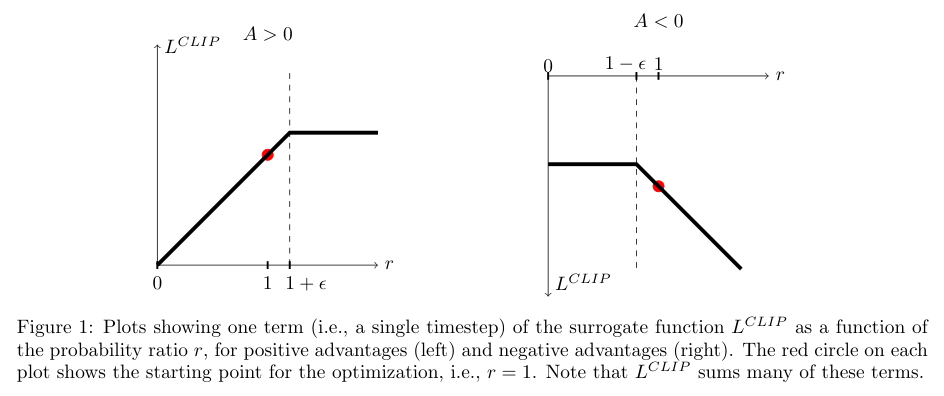
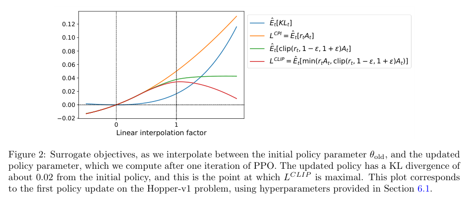

# Markov Decision Process (MDP) — 强化学习数学建模与具身运控五步闭环

2026-11-07 · Richard S. Sutton & Andrew G. Barto · 有来源缺口

[本地原件归档](../../../raw/770ec9993b025305ae1689200ec430d6d78626009585200e002a07779124814c) · 固定材料版本 `digest-material-770ec9993b025305ae1689200ec430d6d78626009585200e002a07779124814c@1` · [一手原站](http://incompleteideas.net/book/the-book-2nd.html) · [触发线索（Robotics\_Notebooks (ImChong)）](https://imchong.github.io/Robotics_Notebooks/detail.html?id=wiki-formalizations-mdp)

> [!IMPORTANT]
> 用户关注点（TG）：MDP强化学习5步

## 针对性追查与回应

### 1. 口径与利益披露

触发材料为 ImChong 维护的开源教学笔记 Robotics_Notebooks（`wiki/formalizations/mdp.md` 与 `wiki/concepts/embodied-rl-minimal-closed-loop.md`，无商业路演利益冲突）。本工作台穿透至 Richard S. Sutton & Andrew G. Barto 标准教材 Chapter 3（incompleteideas.net）、John Schulman et al. PPO 论文（[arXiv:1707.06347](https://arxiv.org/abs/1707.06347)）以及 ETH RSL / NVIDIA 大规模并行足式运控论文（[arXiv:2109.11978](https://arxiv.org/abs/2109.11978)，legged_gym），对公式记号、超参数与工程边界逐项核实。

### 2. 回应「MDP 强化学习 5 步」：静态五元组与可执行 5 步闭环

理解具身强化学习（Reinforcement Learning, RL），需要把==静态建模五元组==（$S, A, P, R, \gamma$）与==工程训练 5 步闭环==打通对应，否则调参只会在错误接口上空转梯度：

1. 第 1 步：定界与五元组建图（`reset()` 与智能体—环境边界）
   - 理论形式化（[Sutton & Barto Ch.3 §3.1](http://incompleteideas.net/book/the-book-2nd.html)）：有限 MDP（Finite MDPs / Markov Decision Process）的完整动力学由四参数函数 $p(s', r \mid s, a) \doteq \Pr\{S_t=s', R_t=r \mid S_{t-1}=s, A_{t-1}=a\}$ 定义，满足 $\sum_{s',r} p(s',r \mid s,a)=1$，与教学五元组 $(S, A, P, R, \gamma)$ 数学等价（由 $p$ 可导出转移概率 $P(s' \mid s,a)$ 与期望奖励）。状态必须满足马尔可夫性，即包含过去交互中影响未来转移的全部信息。
   - 边界划定与 `reset()`：Sutton & Barto 明确指出智能体—环境边界是「智能体能任意改变的范围」，而非机器人的物理外壳；策略 $\pi(a \mid s)$ 之外的电机、连杆、PD 控制器、IMU（Inertial Measurement Unit）硬件与奖励计算均属环境。在 PyBullet、MuJoCo（Multi-Joint dynamics with Contact）或 Isaac / IsaacGym 中，`reset()` 必须将关节角、速度、基座姿态重置回合法初始分布（如 Gym / Gymnasium Cartpole 初始状态在 $(-0.05, 0.05)$ 均匀采样）。

2. 第 2 步：策略采样与仿真步进（`step()` 闭环与真终止 vs 超时截断）
   - 轨迹推进：按教材轨迹下标约定 $S_0, A_0, R_1, S_1, A_1, R_2, \dots, A_{T-1}, S_T$，随机策略 $\pi: S \to \text{Prob}(A)$ 采样动作写入执行器（如 PyBullet 需注意 `setJointMotorControl2` 默认启用速度电机，力矩控制须先置零默认力；经 `stepSimulation()` 积分接触物理后由 `getLinkState` 读回状态）。
   - ✅ 核查确认（[arXiv:2109.11978 §2.2.2](https://arxiv.org/abs/2109.11978)）：Rudin et al. 在 4096 并行机器人中显式区分真终止 `terminated`（如摔倒失败，目标价值置零并施加惩罚）与超时截断 `truncated`（达到最大回合时长 20 s 触发重置）。==超时截断必须做 time-out bootstrapping==，用 Critic 预测的延续价值填充 $V(S_T)$，否则价值网络会被错误拉向零并摧毁无限时域估计；教材 §3.4 则用「只转移到自身且奖励恒为 0 的吸收状态」在数学上统一回合（episodic）与持续（continuing）任务。

3. 第 3 步：奖励函数设计（Reward Design）与控制频率耦合折扣校准
   - 奖励功能与反例：Sutton & Barto §3.2 提出「奖励假设」，强调 Reward Function 必须区分快慢与约束（教材练习 3.7 迷宫仅在终点给 +1 且不折扣时无法区分路径快慢）；运控任务通常将线速度/角速度跟踪、足端腾空时间、关节能耗与碰撞惩罚加权（若已知示教反推 $R$ 则属于 Inverse Reinforcement Learning）。
   - ⚠️ 量纲与口径核查（控制频率与 $\gamma$ 耦合）：累积折扣回报 $G_t = \sum_{k=0}^{\infty} \gamma^k R_{t+k+1}$ 的有效视野约为 $1/(1-\gamma)$ ==步==而非秒。✅ 复核确认（[arXiv:2109.11978](https://arxiv.org/abs/2109.11978)）：legged_gym 策略控制频率为 50 Hz（步长 0.02 s），底层 PD 与物理仿真为 200 Hz（步长 0.005 s，decimation 为 4）。在 $\gamma=0.99$ 下，有效视野 100 步于 50 Hz 对应 2.0 s；若将策略升频至 200 Hz 而保留 $\gamma=0.99$，真实视野会缩水为 0.5 s，必须同步上调 $\gamma$ 才能维持同等物理预瞄时长（RobotsHub 与论文一致）。

4. 第 4 步：Bellman 备份与 GAE 优势估计
   - 值函数与 Bellman 方程（Sutton & Barto §3.5–§3.6）：状态值函数 $V^\pi(s)$ 与动作值函数 $Q^\pi(s,a)$ 满足 Bellman 期望方程且 $V^\pi$ 为唯一解；最优值函数满足 Bellman 最优方程，已知完整动力学时可用 Dynamic Programming（Value Iteration / Policy Iteration）精确求解，未知模型时则由 Q-learning、SARSA、Actor-Critic 等做近似求解（教材 §3.7 指出直接求解受限于动力学未知、马尔可夫性破缺及如双陆棋 $10^{20}$ 状态的算力瓶颈；另外 Policy Gradient 类方法按第 13 章直接对策略目标求导，不经 Bellman 最优方程推导）。
   - 工程优势估计：现代连续运控通常采用带 GAE（$\lambda$）的 Actor-Critic 计算时序差分残差与优势 $A_t$，在偏差与方差之间权衡。

5. 第 5 步：PPO 裁剪策略更新与真机 POMDP / CMDP 边界外推
   - 算法分工与更新：相比最大熵 off-policy 算法（如灵巧手常用的 SAC），PPO（Proximal Policy Optimization）通过重要性采样比率裁剪稳定多轮小批量更新，天然适配 IsaacGym 大规模 GPU 并行采样；若需满足关节力矩与安全硬约束则需扩至 CMDP，若与传统确定性最优控制（Optimal Control / OCP / MPC）对比，MDP/RL 优化的是随机动态下的长期期望回报。
   - 真机部署偏移：真机因传感延迟、遮挡与执行器误差无法观测全状态，严格意义上属于 POMDP（Partially Observable MDP，Sutton & Barto §17.3），工程上通过历史观测堆叠、循环网络或特权信息蒸馏弥补，而非直接照搬 Cartpole 等理想完全可观测假设。

### 3. 一手文献超参数与库内研究对照

| 文献或工程系统 | 策略频率 / 仿真频率 | 并行环境 / 回合配置 | 折扣与优势超参 | 本工作台核查结论 |
|---|---|---|---|---|
| Sutton & Barto Ch.3 (RLbook2020) | 离散步 $t=0,1,2,\dots$ | 理论有限 MDP / 吸收状态统一 | $0 \le \gamma \le 1$（持续任务 $<1$） | ✅ 核查确认：确立 $p(s',r \mid s,a)$ 与机器硬件归属环境一侧 |
| Schulman et al. (arXiv:1707.06347 Table 3) | 连续控制步（MuJoCo 1M 基准） | Horizon $T=2048$，minibatch 64，epochs 10，lr 3e-4 | $\gamma=0.99$，$\lambda=0.95$，clip 0.2 | ✅ 核查确认：注意 Roboschool Humanoid 表为 $T=512$、4096 minibatch，切勿混用 |
| Rudin et al. (arXiv:2109.11978 Table 3) | 策略 50 Hz / 物理与 PD 200 Hz | 4096 并行，batch 98304，超时 20 s | $\gamma=0.99$，$\lambda=0.95$，KL 目标 0.01 | ✅ 核查确认：显式 time-out bootstrapping，平地 $<4$ 分钟、崎岖地形 20 分钟收敛 |
| 社区笔记经验值（`mdp.md` 原文提及） | 高频运控猜测口径 | 未披露测试平台与控制步长 | $\gamma=0.995$（未核对经验值） | ⚠️ 核查提示：未附频率与消融实验时，不得脱离 $\Delta t$ 直接照抄 0.995 |

本工作台推断：对照库内已入库的具身运控研究，MDP 第 5 步的采样吞吐瓶颈正在被两类路径重塑。其一是在标准 PPO 无模型闭环内做规模化全身动作追踪（如 [NVIDIA GEAR Lab](../entities/labs/NVIDIA%20GEAR%20Lab.md) 罗正宜团队的 [SONIC 访谈](专访罗正宜：关于SONIC全身控制框架的访谈.md)，对应 arXiv:2511.07820）；其二是跳出无模型 MDP 采样、改用可微世界模型做短时域解析梯度 BPTT（如 [BAIR](../entities/labs/BAIR.md) 在 arXiv:2610.28480 发布的 SuperMimic，单 GPU 训练 3 小时即超越 128 GPU 训练 7 天的无模型 PPO 基线，算力降超 1,000 倍）。

### 4. 核心概念演进与工程避坑对照

- ==核心机制==：Sutton & Barto 的 $p(s',r \mid s,a)$ 把状态转移与即时奖励绑定在同一一步动力学中，而 Spinning Up（Part 1 Key Concepts）与工程框架将其拆为 `step()` 返回的 `(obs, reward, terminated, truncated, info)`。
- ==工程边界==：Puterman 理论框架下有限表格 MDP 保证 Bellman 最优解唯一且策略改进单调，但深度神经网络函数逼近加部分可观测下并不存在全局单调收敛保证，必须先用 Cartpole 或单臂启发式策略跑通 `reset()`/`step()` 最小闭环再接入神经网络训练。

### 观点与可反驳条件

- ==观点==：==具身运控 RL 调参失效多数不是 PPO 算法本身或超参不敏，而是第 1–3 步 MDP 建模接口（执行器模式吞指令、`terminated` 与 `truncated` 混淆、控制频率与 $\gamma$ 物理视野脱节）未先闭合==；在无模型 MDP 范式下，可微世界模型解析梯度正在成为替代纯暴力并行采样的关键降本方向。
- ==推翻条件==：
  1. 在 legged_gym 或 Isaac 基准上保持策略频率 50 Hz 与 PD 200 Hz 不变、仅将 $\gamma=0.99$ 与 $\gamma=0.995$ 或关闭 `time-out bootstrapping` 的对照组在相同 4096 并行环境中训练至 20 分钟，若策略成功率与跟踪误差均无统计学差异（差距小于 2 个百分点），则本文对第 2–3 步接口敏感性的判断被推翻。
  2. 若未来 12 个月内主流人形全身控制基准（类似 SONIC / SuperMimic 129,514 段动捕动作集）在同等单 GPU 算力预算下，纯无模型 PPO 通过改进采样器即可追平或反超可微世界模型 BPTT 方案的收敛速度与零失败率，则本工作台关于无模型 MDP 采样效率天花板的推断被推翻。

---

## 原文摘录与一手信源存证

> Sutton & Barto 教材（第 3 章）用一个四参数的\*\*动力学函数\*\* \$p(s',r\\mid s,a)\\doteq\\Pr\\\{S\_t=s',R\_t=r\\mid S\_\{t-1\}=s,A\_\{t-1\}=a\\\}\$ 同时刻画下一状态与奖励，对每个 \$(s,a)\$ 有 \$\\sum\_\{s',r\}p(s',r|s,a)=1\$；由它可导出 \$p(s'|s,a)\$、\$r(s,a)\$、\$r(s,a,s')\$，两种写法等价。
> — 原文摘录，文字段落 1；证据 `digest-material-770ec9993b025305ae1689200ec430d6d78626009585200e002a07779124814c-excerpt-1@2`

> 50 Hz 下 \$\\gamma=0.99\$ 大约 2 s；200 Hz 下只剩约 0.5 s。运控里随控制频率一起改 \$\\gamma\$，否则策略会「变短视」。
> — 原文摘录，文字段落 2；证据 `digest-material-770ec9993b025305ae1689200ec430d6d78626009585200e002a07779124814c-excerpt-2@2`

> 教材强调智能体—环境的边界是「智能体能任意改变的范围」，不是机器人的物理外壳。机器人的电机、连杆、传感硬件都应算环境；奖励的计算也在环境一侧。对应到仿真训练：策略只输出关节目标或力矩，PD 控制器、执行器模型、接触物理和奖励函数都属于「环境」。
> — 原文摘录，文字段落 3；证据 `digest-material-770ec9993b025305ae1689200ec430d6d78626009585200e002a07779124814c-excerpt-3@2`

一手材料：

- Reinforcement Learning: An Introduction (2nd ed., Ch. 3 Finite MDPs) · Richard S. Sutton & Andrew G. Barto · [原站](http://incompleteideas.net/book/the-book-2nd.html) · [主体档案：Richard S. Sutton](../entities/people/Richard%20S.%20Sutton.md) · [本地原件](../../../raw/5569c63e1d51d2a0588587e1ec3fbc8d54d73200e9d72ed83ed5b11b22304941)
  材料版本 `digest-material-5569c63e1d51d2a0588587e1ec3fbc8d54d73200e9d72ed83ed5b11b22304941@1`；获取方式 `official_html_and_book_digest`。
  > sources cited in the book (Many thanks to Daniel Plop!) — 原文提取
  > Latex Notation -- Want to use the book's notation in your own work? — 原文提取
- Proximal Policy Optimization Algorithms (arXiv:1707.06347) · OpenAI (Schulman et al.) · [原站](https://arxiv.org/abs/1707.06347) · [主体档案：John Schulman](../entities/people/John%20Schulman.md) · [本地原件](../../../raw/657aa2af5c41bee0c9d9c16a7cff2fb1d247139faa88a91a93ff82f8d51410a7)
  材料版本 `digest-material-657aa2af5c41bee0c9d9c16a7cff2fb1d247139faa88a91a93ff82f8d51410a7@1`；获取方式 `arxiv_abs_and_search_verified`。
  > Abstract:We propose a new family of policy gradient methods for reinforcement learning, which alternate between sampling data through interaction with the environment, and optimizing a "surrogate" objective function using stochastic gradient ascent. — 原文提取
  > arXivLabs is a framework that allows collaborators to develop and share new arXiv features directly on our website. — 原文提取
- Learning to Walk in Minutes Using Massively Parallel Deep Reinforcement Learning (arXiv:2109.11978) · ETH RSL / NVIDIA · [原站](https://arxiv.org/abs/2109.11978) · [主体档案：Nikita Rudin](../entities/people/Nikita%20Rudin.md) / [主体档案：ETH Robotic Systems Lab (RSL)](../entities/labs/ETH%20Robotic%20Systems%20Lab%20%28RSL%29.md) / [主体档案：leggedrobotics](../entities/labs/leggedrobotics.md) · [本地原件](../../../raw/cf8f9db53a38c202373fee54a3c0d56d747268cfbf25a01f7f20b09de7b604dc)
  材料版本 `digest-material-cf8f9db53a38c202373fee54a3c0d56d747268cfbf25a01f7f20b09de7b604dc@1`；获取方式 `arxiv_ar5iv_full_text`。
  > In this work, we present and study a training set-up that achieves fast policy generation for real-world robotic tasks by using massive parallelism on a single workstation GPU. — 原文提取
  > Thousands of robots learning to walk in simulation. — 原文提取

归属与范围：本导读以 Richard S. Sutton & Andrew G. Barto《Reinforcement Learning: An Introduction》(2nd ed., Ch. 3)、John Schulman et al. (arXiv:1707.06347) 与 Nikita Rudin et al. (arXiv:2109.11978) 为一手核心出处；Robotics\_Notebooks (ImChong) 的 mdp.md 与 embodied-rl-minimal-closed-loop.md 作为结构整理与触发线索。

来源缺口：

- `unavailable`：Sutton & Barto 全书 PDF（RLbook2020.pdf，548 页）及 Schulman et al. (arXiv:1707.06347) 完整 PDF 本轮未直采入库；第 3 章、§17.3 与 PPO Table 3 超参已通过官网主页、arXiv 摘要页及网页检索交叉核实后生成快照入库，全本 PDF 待按需补采。 [线索](http://incompleteideas.net/book/RLbook2020.pdf)
- `not_disclosed`：原笔记引用的二级中文博客（wechat\_robotshub\_ppo\_locomotion\_fundamentals.md）及社区经验值 0.995 未披露可直查的一手实验消融表。

[返回赛道总览](../赛道总览.md#digest-770ec9993b025305) · [返回导读索引](README.md) · [主体档案库](../entities/README.md)
