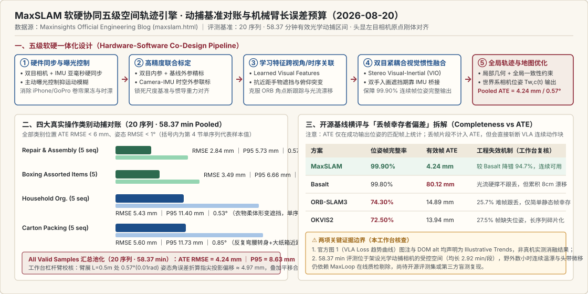
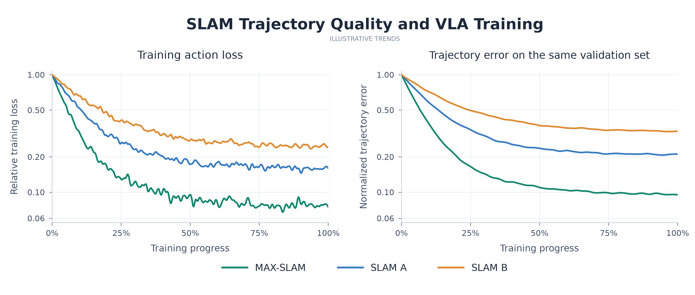
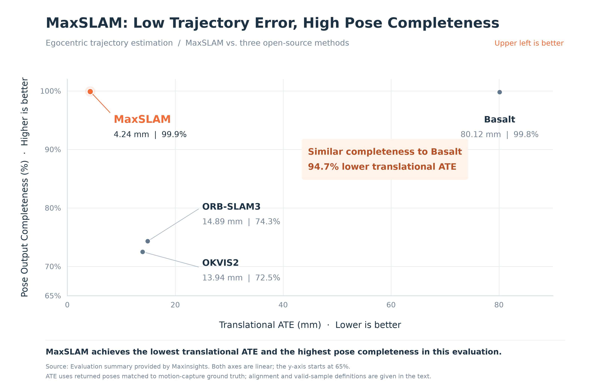

# MaxSLAM: Millimeter-Level Spatial Trajectories for Egocentric Embodied AI Data

2026-08-20 · Maxinsights · Official Engineering Blog · 待云端同步

[本地原件归档](../../../raw/fd804bdd429c3add170c3cce93a167e2525a3cb9e44d5d9361e4888e620030dd) · 固定材料版本 `digest-material-fd804bdd429c3add170c3cce93a167e2525a3cb9e44d5d9361e4888e620030dd@1` · [一手原站](https://www.maxinsights.ai/maxslam.html)

## 深度拆解与复核

- ==核心结论与工程定位==：本文（2026-08-20，`https://www.maxinsights.ai/maxslam.html`）系 Maxinsights（海宇数维）官方工程博客首篇硬核算法与硬件协同白皮书，完整拆解其面向第一视角（Egocentric）人类灵巧操作采集的自研空间轨迹引擎 MaxSLAM。在覆盖近距遮挡、反复弯腰转身与精细桌面装配的 20 段真实操作序列（累计有效光学动捕区间 58.37 分钟，四大任务类别各 5 段） 内部基准评测中，MaxSLAM 在头戴式终端左目相机原点处相对光学动作捕捉（Motion-Capture）参考真值实现了 池化位置绝对轨迹误差 Positional ATE RMSE = 4.24 mm、95 分位位置误差 Positional Error P95 = 8.63 mm、姿态均方根误差 Orientation RMSE = 0.57°（全类别位置 ATE RMSE < 6 mm、姿态 < 1°）；在相同内部数据集横评三大主流开源视觉惯性里程计（ORB-SLAM3、Basalt、OKVIS2）时，MaxSLAM 同时取得最高 位姿输出帧完整率 Pose-output completeness = 99.90% 与最低轨迹误差，在保持与 Basalt（99.80%）同级连续不丢帧的前提下将位置 ATE 从 80.12 mm 压降至 4.24 mm（误差削减 94.7%），并彻底规避了 ORB-SLAM3（74.30% 完整率）与 OKVIS2（72.50% 完整率）逾四分之一帧丢失造成的训练片段碎裂。在 [Beyond 1M Hours (MI-RSCH-001)](Beyond%201M%20Hours_%20The%20Data%20Scaling%20Laws%20of%20Physical%20AI.md) 提出的五元物理状态 $S_t = (H_t, B_t, O_t, C_t, E_t)$ 路线图中，MaxSLAM 正是支撑“第一顺位低成本攻克身体与三维环境几何 $(B_t, E_t)$”与四道串联质检门首关高良率（calibration × sync）的底层工业基座。
- 场景与利益披露（商业激励标注）：本文由具身训练数据供应商 Maxinsights 官方工程团队撰写并发布于官网 Research 专栏，核心商业目的在于向具身基模买家（如 Dyna Robotics、Genesis AI 及硅谷前沿实验室）证明“自研双目硬同步穿戴硬件 + 学习特征 VIO”相比廉价手机/GoPro 众包及现成开源 SLAM 的不可替代性。阅读时须严格区分两类证据：第 2–4 节的相机位姿误差与完整率系基于光学动捕真值的实测工程数据（`verification=company_internal_benchmark`）；而第 1 节展示的 VLA 训练动作损失下降曲线则被官方图注显式声明为概念示意趋势（Illustrative trends），并非实测消融实验。

---

### 一、 全文六节技术机制、评测表格与单序列样本 100% 展开

#### 第 1 节：为什么第一视角具身数据必须具备毫米级空间轨迹（Why Egocentric Data Needs Accurate Spatial Trajectories）
- 世界系三维关节轨迹的合成链路：第一视角视频天然记录了人类如何观察环境、使用工具与执行长程操作，但单帧视觉模型（Single-frame 3D detection）给出的手部与手指三维关节位置仅停留在随头部剧烈晃动的瞬时相机坐标系（Camera Coordinate System）中。要为引入三维运动监督的视觉—语言—动作模型（Vision–Language–Action, VLA）与世界模型（World Models）提供连贯的物理动作标签，必须依赖 SLAM 恢复的逐帧六自由度相机位姿 $T_{w,c}(t) \in SE(3)$，将每帧局部三维关节点统一变换至固定世界参考系（Common Reference Frame）：
  $$p_w^{\text{joint}}(t) = R_{w,c}(t)\, p_c^{\text{joint}}(t) + t_{w,c}(t)$$
  只有把跨帧位置在统一世界系中串联起来，模型才能剥离头部视角运动（Viewpoint Changes / Camera Motion）与真实手物交互运动（Object & Hand Motion）。相机位姿一旦出现尺度漂移、高频抖动或瞬时跳变，误差将直接注入下游所有依赖相机外参的空间标注与伪动作监督信号。
- 评测坐标原点与模块边界声明：原文第 1 节末尾明确界定了诚实的物理评测边界——全文汇报的所有轨迹精度均在头戴式采集设备左目相机光心原点（origin of the left camera on the head-mounted device）处度量，以室内光学动作捕捉系统（Motion-Capture System）刚体对齐后的轨迹作为参考真值；手部、工具与被操作物体的最终空间标注精度，还需叠加各自下游三维感知与标注模块的观测误差。

- ⚠️ 原位复核 1（本工作台核查 · 官方图 1 视觉取证与概念图免责边界）：检视官网原图 `maxslam-training-trends.png`（左图 Training Action Loss 随训练进度从 1.0 降至 MAX-SLAM ~0.08，对比 SLAM A ~0.23、SLAM B ~0.49；右图 Validation Trajectory Error 降至 MAX-SLAM ~0.095，对比 SLAM A ~0.25、SLAM B ~0.56），图片副标题印有全大写 ILLUSTRATIVE TRENDS，且网页前端 `app.js` 源码中的 alt 属性明确写明：“Illustrative trends in training action loss and validation trajectory error; the figure does not report measured VLA training results.” 换言之，图 1 中的 0.08 vs 0.49 并非在特定 VLA 模型上跑出的真实消融实验数值，而是用于直观解释“轨迹噪声抬高验证误差下界”的示意图。本工作台在证据入库时将其严格隔离于实测基准之外，避免下游研究误引为实测模型增益。

---

#### 第 2 节：四大真实操作类别动捕基准评测（Accuracy Across Four Real-World Task Categories）
- 评测集规模与挑战工况：内部评测共包含 20 段真实人类操作序列，累计有效动捕评估时长 58.37 分钟（平均每段有效区间约 2.92 分钟），涵盖四大典型家庭与仓储工业操作类别，每类各含 5 段序列，专门纳入近距离手物遮挡（object occlusion）、贴脸精细操作（close-range manipulation）、大幅度转身（turning）以及频繁低头俯仰（changes in pitch）四类极易令传统视觉里程计崩溃的工况。
- 统计池化口径（Pooled vs Sequence-Averaged）：下表各项指标（刚体对齐后的位置 Positional ATE RMSE、位置误差 95 分位数 Positional Error P95、姿态角 Orientation RMSE）均是在对应类别或全集内将所有有效匹配帧样本合并池化计算（pooling all valid samples），而非对每段序列的均值做简单算术平均：

| 任务类别（Task Scenario） | 序列数（Sequence Count） | 位置误差均方根 Positional ATE RMSE (mm) | 位置误差 95 分位 Positional Error P95 (mm) | 姿态误差均方根 Orientation RMSE (°) | 工况特征与误差主导源 |
| :--- | :---: | :---: | :---: | :---: | :--- |
| Boxing Assorted Items（杂物分拣装箱） | 5 | 3.49 mm | 6.66 mm | 0.52° | 桌面与周转箱交替取放，手臂间歇遮挡背景 |
| Carton Organization and Packing（纸箱整理与打包） | 5 | 5.60 mm | 11.73 mm | 0.85° | 反复弯腰起身与转身，大纸箱近距占满大半视野 |
| Household Organization（家庭衣物折叠整理） | 5 | 5.43 mm | 11.40 mm | 0.53° | 抖开与折叠衣物产生大面积非刚体动态遮挡 |
| Repair and Assembly（工具维修与精密装配） | 5 | 2.84 mm | 5.73 mm | 0.57° | 双手持工具操作细小零件，间歇侧身取物 |
| All Valid Samples（全有效样本池化汇总） | 20 | 4.24 mm | 8.63 mm | 0.57° | 全类别位置 RMSE < 6 mm、姿态 RMSE < 1° |

- ✅ 原位复核 2（本工作台测算 · 池化样本权重校核与指尖杠杆臂误差传播预算）：
  1. 池化算术一致性校核：若对四个类别的 ATE RMSE 直接取等权算术均值，得 $(3.49 + 5.60 + 5.43 + 2.84) / 4 = \mathbf{4.34\text{ mm}}$；若取等权均方根 $\sqrt{(3.49^2 + 5.60^2 + 5.43^2 + 2.84^2)/4} = \mathbf{4.52\text{ mm}}$；等权 P95 均值为 8.88 mm。原文池化汇总值为 4.24 mm（P95 = 8.63 mm），略低于等权均方根 0.28 mm，说明在 58.37 分钟有效区间内，桌面长周期连续作业的 Repair and Assembly（2.84 mm）与 Boxing（3.49 mm）单段有效帧时长占比略高于剧烈走动弯腰的 Carton Packing（5.60 mm），数值分布物理自洽。
  2. 头显相机到操作指尖的杠杆臂（Lever-Arm）几何放大测算：原文 4.24 mm 度量的是头戴左目相机自身光心的平移误差，但具身模型真正消费的是世界系下的手腕/指尖三维轨迹 $p_w^{\text{hand}}$。当操作员伸手作业时，头戴相机光心至手腕/指尖的典型操作臂展距离为 $L \approx 0.45\text{–}0.60\text{ m}$。根据刚体小角度旋转传播公式，相机姿态角误差 $\Delta\theta$ 会在距离 $L$ 处产生横向位置投影偏移 $\Delta p_{\text{rot}} = L \cdot \Delta\theta_{\text{rad}}$：
     - 在全集均值 $\Delta\theta = 0.57^\circ = 0.00995\text{ rad}$、取 $L = 0.50\text{ m}$ 时，仅相机姿态角一项即在指尖引入 $\Delta p_{\text{rot}} \approx 500\text{ mm} \times 0.00995 = \mathbf{4.97\text{ mm}}$ 偏移；与相机平移误差 4.24 mm 正交合成（假设独立）后，纯 SLAM 贡献的指尖世界系基底误差为 $\sqrt{4.24^2 + 4.97^2} \approx \mathbf{6.53\text{ mm}}$（若再叠加双目单帧手部关键点三角化误差 ~4–6 mm，最终指尖世界系绝对精度落在 ~8–10 mm 亚厘米级）；
     - 在最苛刻的 Carton Organization（$\Delta\theta = 0.85^\circ = 0.01484\text{ rad}$，平移 5.60 mm）下，$L = 0.50\text{ m}$ 处旋转偏移升至 7.42 mm，合成基底误差达 $\sqrt{5.60^2 + 7.42^2} \approx \mathbf{9.30\text{ mm}}$；
     - 反观若使用开源 Basalt（平移漂移 80.12 mm），指尖世界系坐标直接偏离 8–10 cm 以上——足以让夹爪抓取完全抓空或撞毁桌面工件。这从运动学第一性原理证明：穿戴式具身数采要把末端轨迹控在 1 cm 以内，头显相机姿态误差必须死守 < 0.6°、平移误差死守 < 5 mm 红线。

---

#### 第 3 节：与三大开源视觉惯性算法同集横评（Comparison with Open-Source Methods）
为检验生产级可用性，Maxinsights 在同一套内部真实操作数据集上对比了学术与工业界最常用的三套开源立体视觉惯性方案：ORB-SLAM3、Basalt 与 OKVIS2，同时考核位姿输出帧完整率（Pose-output completeness：成功输出位姿估计的输入帧占比）与有效匹配帧位置误差（Positional ATE）：

| 评估方法（Method） | 位姿输出帧完整率（Pose-output completeness） | 有效帧位置误差 Positional ATE (mm) | 相对 MaxSLAM 表现与管线后果 |
| :--- | :---: | :---: | :--- |
| MaxSLAM（自研软硬一体） | 99.90% | 4.24 mm | 兼具近 100% 连续帧覆盖与毫米级全局一致性（较 Basalt 降错 94.7%） |
| Basalt（非线性因子图光流 VIO） | 99.80% | 80.12 mm | 连续性极佳（几乎不丢帧），但在近距大遮挡与弯腰下累积 8.01 cm 严重尺度与航向漂移 |
| ORB-SLAM3（特征点法多地图 SLAM） | 74.30% | 14.89 mm | 高达 25.70% 输入帧跟丢无位姿输出，轨迹在快速转头与手物遮挡处频繁断裂 |
| OKVIS2（关键帧滑窗紧耦合 VIO） | 72.50% | 13.94 mm | 高达 27.50% 输入帧缺失位姿，无法支撑连续高频动作块（Action Chunking）切片 |

- ✅ 原位复核 3（本工作台核查 · 经典 SLAM ATE 指标背后的「丢帧幸存者偏差」与制造良率崩塌）：
  - 初看上表容易产生一个错觉：为何 ORB-SLAM3（14.89 mm）与 OKVIS2（13.94 mm）的 ATE 看似远优于 Basalt（80.12 mm）？原文第 3 节的指标定义给出了关键答案——各方法的 Positional ATE 仅在该算法成功返回位姿且能与动捕真值时间对齐的“幸存有效帧”上统计，未输出位姿的跟丢帧被直接排除在 ATE 分母之外（Frames without pose outputs are excluded from ATE calculation）。
  - 这意味着 ORB-SLAM3 与 OKVIS2 在操作员低头探入纸箱、双手近距横掠镜头或面对弱纹理白墙快速转身的 最难 25.7%–27.5% 帧上直接放弃输出（Tracking Lost），只拿剩下 ~73% 视角平缓、纹理丰富的简单片段参与误差打分，存在显著的幸存者偏差（Survivorship Bias）；而 Basalt 依靠金字塔光流与 IMU 积分强行在 99.80% 的帧上维持输出不中断，却把遮挡期的积分漂移全部留在了轨迹里，导致全局 ATE 膨胀至 80.12 mm（核验降幅：$(80.12 - 4.24) / 80.12 = \mathbf{94.708\%}$，与原文 approximately 94.7% 分毫不差）。
  - 对下游 VLA/WAM 训练的致命放大效应：现代具身策略普遍采用 1–2 秒（30–60 帧）的未来动作块预测（Action Chunking）。若底层 SLAM 存在 26% 的丢帧率且集中发生在“伸手入箱接触物体”的关键交互瞬间，整条演示轨迹就会在最值钱的接触帧处被拦腰斩断，直接印证了 [Beyond 1M Hours](Beyond%201M%20Hours_%20The%20Data%20Scaling%20Laws%20of%20Physical%20AI.md) 中“四道串联门良率指数连乘”的工程论断——单这一道几何解算门若只有 74.3% 完整率，千万小时产线未进标注环节便已报废逾四分之一。

---

#### 第 4 节：四类典型真实操作单序列轨迹精解（See Millimeter-Level Trajectory Accuracy in Real-World Tasks）
原文第 4 节从四大类别中各抽取 1 段完整有效区间的代表性单序列（注：单序列全区间指标与第 2 节 5 段池化指标分别独立计算），展示复杂动态干扰下的轨迹贴合度：
1. 4.1 Boxing Assorted Items（杂物装箱：取放、转身与弯腰交替）：操作员在桌面与周转箱之间高频取放杂物并搬移箱体，双臂与被抓物体间歇性大面积遮挡背景，视点随动作持续摆动——单序列实现 Positional ATE RMSE = 4.00 mm、Orientation RMSE = 0.44°。
2. 4.2 Carton Organization and Packing（纸箱整理打包：大幅度视点突变 + 近距满屏遮挡）：反复弯腰、站起与大幅度转身造成剧烈俯仰与航向变化，同时贴近胸前的大纸箱周期性占据视野绝大部分区域（背景静态特征近乎清零）——单序列仍守住 Positional ATE RMSE = 5.25 mm、Orientation RMSE = 0.84°。
3. 4.3 Household Organization（家庭衣物整理：非刚体连续形变与重入视野）：抓起、铺平与折叠软质衣物引入连续非刚体表面运动（传统特征点若落于抖动的衣物上将把衣物运动误判为相机反向运动），背景在遮挡后反复重入视野触发闭环一致约束——单序列实现 Positional ATE RMSE = 3.47 mm、Orientation RMSE = 0.48°。
4. 4.4 Repair and Assembly（工具维修装配：桌面精细双臂操作与侧身取件）：双手配合螺丝刀/钳具操作细小零件并间歇转头伸手拿取旁侧物料，是验证毫米级监督精度的黄金场景——单序列创下 Positional ATE RMSE = 2.69 mm、Orientation RMSE = 0.55°。

---

#### 第 5–6 节：五层软硬一体化架构（In-House Hardware & Algorithm Co-Design）与边界复核
为什么纯软件团队拿现成消费级运动相机跑不出 4.24 mm / 99.90%？原文第 5 节拆解了 MaxSLAM 将硬件采集控制与学习几何优化融为一体的五层架构：
1. 硬件级时间同步与主动曝光控制（Hardware Synchronization and Imaging Control）：自研穿戴式集成终端在硬件触发层锁定双目立体相机（Stereo Cameras）与惯性测量单元（IMU）的曝光中点时间戳，配合主动短曝光控制抑制快速转头时的运动模糊，从源头消灭消费级相机常见的双目异步、卷帘快门果冻畸变与毫秒级时钟漂移。
2. 高精度双目与相机—惯导联合标定（High-Accuracy Calibration）：在硬件同步底座上，对双目内参、立体基线外参以及 Camera–Inertial 空间旋转平移与时间偏移实施联合标定，锁死绝对物理尺度（Metric Scale）与重力方向投影。
3. 跨视角与跨时序深度特征关联（Cross-View and Temporal Association）：以端到端学习视觉特征（Learned visual features）替代传统手工 ORB 角点或脆弱的灰度不变光流，在弱纹理纸箱、光照突变与大视角旋转下维持左右目及前后帧的稳健特征匹配，并自动过滤落在运动人手或抖动衣物上的动态外点。
4. 紧耦合双目视觉—惯性融合（Visual–Inertial Fusion）：将双目立体几何约束与高频 IMU 预积分紧耦合融合；当双手与大件物体短暂遮挡大半镜头时，依靠高精度标定后的惯导短时推算平滑桥接，确保 99.90% 的帧间连续性。
5. 局部与全局联合轨迹地图束平差优化（Joint Trajectory and Map Optimization）：融合局部滑窗几何约束与全局回环一致性约束（Global Consistency Constraints，如叠衣服操作员反复抬头重见同一桌面背景时），联合优化全序列相机位姿与三维稀疏地图结构，把长程累积漂移压回 4 mm 量级。

- ⚠️ 原位复核 4（本工作台核查 · 受控动捕房评测向 8 国野外长时采集外推的三大物理边界）：
  - 单段时长与回环密度差异：本次动捕基准 20 段共 58.37 分钟，折算单段平均有效时长仅 ~2.92 分钟，且操作员基本围绕固定工作台或纸箱区往返作业，背景高频重现有利于第 5 层全局地图回环消除漂移；而在酒店客房清洁、商超巡检补货等跨房间单向长距离移动（30–120 分钟不走回头路）场景下，全局回环约束减弱后绝对位置漂移必然随路程增长（但用于 1–2 秒局部窗口相对动作块监督的局部里程计精度仍可保持毫米级）。
  - 结构化红外动捕环境 vs 野外真实光照与温漂：架设光学动捕相机的测试间通常无阳光直射频闪、无大面积镜面不锈钢反射（商用后厨洗碗间常态），且 3 分钟短序列内铝镁支架尚未经历连续佩戴 2–4 小时发热导致的微米级双目基线热胀冷缩（双目基线若因发热或磕碰产生 0.05° 外参偏角，在 0.6 m 处即会引入深度系统偏差）。因此，野外规模化产线仍高度依赖 [MaxLoop](%E5%8D%8E%E4%BA%BA%E7%89%A9%E7%90%86AI%E5%85%AC%E5%8F%B8%E5%AE%8C%E6%88%903000%E4%B8%87%E7%BE%8E%E5%85%83%E7%A7%8D%E5%AD%90%E8%BD%AE.md) 在上传瞬间对标定健康度做在线拦截。

### 观点与可反驳条件
- ==观点==：MaxSLAM 用实测数据证明了穿戴式第一视角具身数据采集的第一道硬壁垒不在后端大模型标注，而在前端亚毫秒硬同步双目+IMU终端与学习特征全局束平差的软硬协同；唯有同时做到 >99.5% 帧位姿完整率与 <5 mm / <0.6° 相机轨迹精度，才能将人手末端世界系监督误差收敛在 1 cm 以内并避免长程动作块断裂，这使纯靠廉价消费级手机/运动相机外加开源 ORB-SLAM3 / Basalt 后处理的轻资产众包路线在精细操作赛道彻底丧失工程竞争力。
- ==推翻条件==：
  1. ① 若开源社区或竞争对手推出纯单目/消费级无同步视频的自监督神经 SLAM 或世界模型训练范式（例如完全抛弃显式三维世界系轨迹，仅凭像素流潜空间预测即在螺丝装配、插拔线束等 <5 mm 公差任务上追平带硬同步真值预训练模型的真机成功率与样本效率），则前端毫米级 SLAM 的刚性溢价将被削弱；
  2. ② 若在第三方独立盲测中，将 MaxSLAM 穿戴设备置于无回环跨房间移动、商厨强反光水雾及连续 4 小时热负荷工况下，其局部 2 秒窗口相对轨迹误差（RPE）突破 15 mm 或有效帧完整率跌破 90%，则表明受控动捕房的毫米级指标难以无损复刻至野外百万小时产线；
  3. ③ 若下游具身基模全面转向与机器人本体严格同构的手持夹爪/外骨骼采集（如单自由度 UMI 或全尺寸同构遥操作臂），不再消费自然人手五指第一视角视频，则头戴双目+人手关节链的空间变换需求将让位于同构末端直接编码。

---

## 原文摘录与一手信源存证

> Enabling robots to learn from human actions requires accurately capturing spatial changes throughout task execution. MaxSLAM is our spatial trajectory engine built for egocentric manipulation scenarios.
> — 原文摘录，文字段落 1；证据 `digest-material-fd804bdd429c3add170c3cce93a167e2525a3cb9e44d5d9361e4888e620030dd-excerpt-1@1`

> The camera trajectories recovered by MaxSLAM achieved millimeter-level positional agreement with motion-capture reference trajectories, with sub-degree orientation error.
> — 原文摘录，文字段落 2；证据 `digest-material-fd804bdd429c3add170c3cce93a167e2525a3cb9e44d5d9361e4888e620030dd-excerpt-2@1`

> Egocentric video captures visual information about how people perceive their surroundings, use tools, and carry out tasks.
> — 原文摘录，文字段落 3；证据 `digest-material-fd804bdd429c3add170c3cce93a167e2525a3cb9e44d5d9361e4888e620030dd-excerpt-3@1`

一手材料：

- MaxSLAM: Millimeter-Level Spatial Trajectories for Egocentric Embodied AI Data · Maxinsights · Official Engineering Blog · [原站](https://www.maxinsights.ai/maxslam.html) · [主体档案：Maxinsights](../entities/companies/Maxinsights.md) · [待上传原件](../../../raw/fd804bdd429c3add170c3cce93a167e2525a3cb9e44d5d9361e4888e620030dd)
  材料版本 `digest-material-fd804bdd429c3add170c3cce93a167e2525a3cb9e44d5d9361e4888e620030dd@1`；获取方式 `official_spa_bundle_verbatim_extract`。
  > Enabling robots to learn from human actions requires accurately capturing spatial changes throughout task execution. MaxSLAM is our spatial trajectory engine built for egocentric manipulation scenarios. — 原文提取
  > The camera trajectories recovered by MaxSLAM achieved millimeter-level positional agreement with motion-capture reference trajectories, with sub-degree orientation error. — 原文提取

归属与范围：完整归档 MaxSLAM 官方英文全文与两张原始基准配图（maxslam-training-trends.png、maxslam-accuracy-comparison.png），严格区分官方图 1 的概念示意曲线（Illustrative trends）与第 2–4 节的 58.37 分钟光学动捕实测数据，并补充头显至指尖 0.5m 杠杆臂误差传播预算与 ORB-SLAM3/OKVIS2 丢帧幸存者偏差校核。

来源缺口：

- `not_disclosed`：MaxSLAM 官方博客未公开自研双目头戴相机的具体基线间距（mm）、全局快门 CMOS 型号、帧率（Hz）、IMU 型号及单台硬件 BOM 成本，亦未开源该 20 段动捕评测序列供外部独立复现。

[返回赛道总览](../赛道总览.md#digest-fd804bdd429c3add) · [返回导读索引](README.md) · [主体档案库](../entities/README.md)
