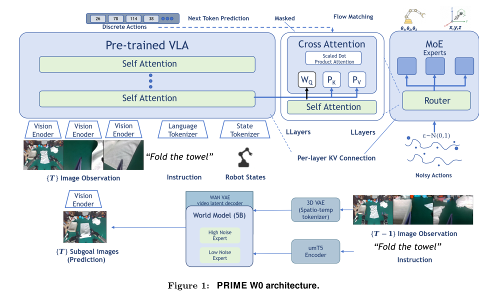
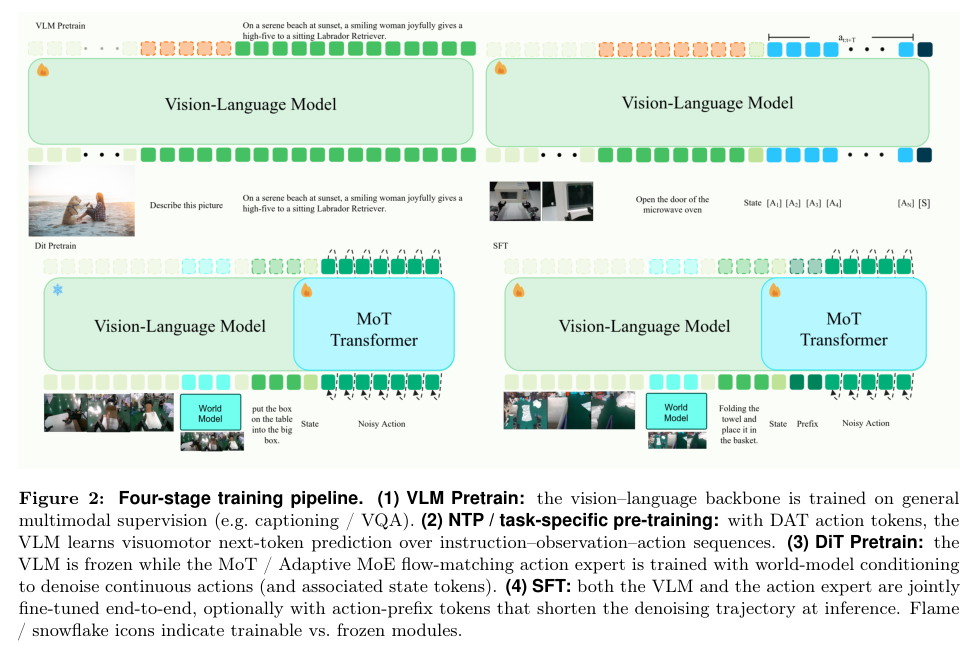

# OpenAI计划用机器人建设数据中心 / 破壳机器人开放RoboAPI / Scale AI发布53万条子任务标注数据集

2026-10-30 · Scale AI & Hugging Face / PRIME W0 / AcrossDEX / 破壳机器人 / Nua / EU-Startups (Bleu Robotics) · 有来源缺口

[本地原件归档](../../../raw/2b182ce9bb5eb0289be141cbe3074accd41fe74fafe682ebafb99178930d632d) · 固定材料版本 `digest-material-2b182ce9bb5eb0289be141cbe3074accd41fe74fafe682ebafb99178930d632d@1` · [一手原站](https://arxiv.org/html/2609.36416v1)

## 深度拆解与复核

- ==核心结论==：该期 8 条行业日报（2026-10-30，来源汇编号 SourceMind）经上游论文与官方产品页逐条穿透，产业主线体现为三股架构分化同步推进：数据标注细粒度化（Scale AI FineART 53.4 万条子任务、1,718 小时）、轻量评估器替代高价前沿模型（Nua Artificer 4B）与异构世界模型结合（PRIME W0 真机 78.1% vs 69.1%）；与此同时，AcrossDEX 1.0 仅停留在 Genesis 物理仿真（未做真机实测）、Bleu Robotics 缺乏第三方测试验证、OpenAI（Sam Altman / John Collison Cheeky Pint 访谈）与 Logan Olson 的原帖均未能穿透获取完整原件，八条资讯必须按证据分层对待。

#### 一、业务切口与核心机制

本条动态横跨具身智能产业链上中下游五个环节，可提炼出 4 组关键机制对照：
1. 密集子任务标注与跨本体规划迁移（Scale AI & Hugging Face：FineART / FineART-VLA）：联合团队针对开源操作数据集大多只有单条全局指令的痛点，在 ALOHA 平台采集 40,543 段双臂示范、累计 1,718 小时、覆盖 151 项任务，并对每条轨迹全程标定共 533,913 条子任务（平均每段约 13 条，152.5 秒/段）。模型 FineART-VLA 基于 π0.5 扩展出“先预测语言子任务（System-2，2B Gemma + SigLIP）再由动作专家（System-1，300M）通过 Knowledge Insulation 隔断反向梯度”的层次结构，并将数据按 CC BY 4.0、权重（FineART-VLA-subtask-midtrained）沿用 Gemma 许可开源于 LeRobot。
2. 世界模型异步前瞻与阶段自适应（PRIME W0，Huabin Peng 等）：由 Lumos SZ Lab、Lumos Robotics 与清华大学、港中文、NTU 团队提出，针对 VLA 的“时间近视与动力学脱节”构建四阶段训练框架：在约 10,000 小时混合数据（Teleop 60% / UMI 30% / Simulation 10%）上依次训练几何感知离散动作编解码器 DAT+NTP（1–2 阶段）与流形约束协方差相关动作扩散模块 ADM（3 阶段），并在第 4 阶段以异步世界模型生成的未来子目标图像叠加 DINOv2 历史帧特征 Whist 与 Adaptive MoE（Phase-aware）驱动控制。推理时子目标生成与当前帧并行，保障实时性。
3. 从单视角人手运动跨向多构型灵巧手（AcrossDEX 1.0，Xiaoyu Yang & Nan Wu）：使用 99 条 HOT3D 人类手眼轨迹（195,300 帧，约 108.5 分钟 @ 30 Hz）预训练共享视觉/时序/腕部编码器，再引入手型专属手指控制头及有效性掩码，在 Genesis 仿真中依托 DexMachina 训练 PPO 专家策略并采回样本以 4:1 回放比混合后训练，实现 30 步人手预测映射到 60 步 Inspire（6 通道）与 Allegro（16 关节）机器手控制，配合 RTC 异步块衔接。
4. 轻量奖励评估器与开放云端动作接口（Nua Artificer、破壳机器人 RoboAPI、Bleu Robotics、OpenAI、Logan Olson）：
   - Nua 以 4B 参数模型 Artificer 对机器人视频做进度与成败判定，意图替代昂贵闭源前沿模型（如 Opus 5.5、GPT-6 Astra）；
   - 破壳机器人（PokeBot）免费向非商业用户开放 RoboAPI 技术预览，接收腕部鱼眼/状态/语言调用 Poke-Aurora（Aurora）模型，支持 UR7e、Franka 与 YAM 等末端位姿控制；
   - 法国 Inria 孵化企业 Bleu Robotics（联合创始人包括 Jean-Baptiste Mouret、Serena Ivaldi 与前 Renault 制造经理 Benoît Berkoukchi）获 Contrarian Ventures 与 OVNI Capital 领投的 500 万欧元种子前融资，主打基于溯因学习的少样本工业部署（声称少至 10 次示范、1 小时内完成部署）；
   - OpenAI CEO Sam Altman 在 John Collison 主持的 Cheeky Pint 播客中提及用机器人参与晶圆厂与数据中心建设的远期设想；开发者 Logan Olson 放出第 5 版自主抓糖果机械臂演示视频。

#### 二、核心数据核查、口径纠偏与工程边界

场景与利益披露：Scale AI 为商业数据标注与合成平台厂商，发布 FineART 同时兼具确立子任务标注标准与吸引 LeRobot 生态合作的目的；破壳机器人 RoboAPI 与 Nua 均处于开发者推广期；Bleu Robotics 融资稿为创业公司公关叙事；PRIME W0 与 AcrossDEX 1.0 属科研预印本论文，各自围绕自有评估集报告最优结果。

本工作台核查原始论文、产品文档与榜单原文，发现多处容易被二手摘要掩盖的口径细节：

| 项目/论文 | 一手核查与基准数值 | 潜在口径陷阱、遗漏约束与边界条件 | 核查状态 |
| --- | --- | --- | --- |
| Scale AI FineART (arXiv:2609.36416v1) | 40,543 段、1,718 小时、533,913 子任务、151 任务；共计 3,400 次真机测试；空间消歧任务（put donut into left/right/middle bin）由 32.0% 升至 100 %；未见长程任务（prepare breakfast）人工子任务引导下由 16.0% 升至 76.0%；跨本体（YAM 5 任务）仅 25 eps/任务达到 26.4%，优于无中期训练基线 250 eps/任务的 18.4% | [⚠️] 跨本体实验揭示显著冷启动代价：YAM 仅 10 eps/任务时 FineART-VLA 只有 14.4%，低于已有 YAM 数据的 ABC（24.8%）和 MolmoAct2（20.8%）；且 prepare breakfast 自主预测子任务（无人工口令提示）下 Run 1.3 与 1.4 均只录得 0.0% 完整成功率；论文坦承仅单本体采集且中期训练仅跑了约 10% 个 epoch | [✅] 全文+Tables 1-4 已复核 |
| PRIME W0 (arXiv:2610.39528v1) | LIBERO 四套件均值 99.1%（Spatial 98.8% / Object 100 % / Goal 99.0% / Long 98.6%，EO-1 为 98.4%）；自建五类真机任务均值 78.1%，同台测试 π0.5 仅 69.1%，GR00T-N1.6 为 41.4%，OpenVLA 为 15.7%；长流程组装 Assembly 较 π0.5 提升 +24.1% | [⚠️] 78.1% vs 69.1% 来自分母尚未完全开源的自建五类真机评估套件（LIBERO 99.1% 与 π0.5 96.9% 已接近饱和区分度下降）；论文第 4 节自承尚无触觉/力反馈输入，历史帧窗口固定且 MoE 在极不均衡分布下仍有路由偏移风险 | [✅] arXiv 论文+Table 2 已复核 |
| AcrossDEX 1.0 (arXiv:2610.40210v1) | HOT3D 人手预训练 108.5 分钟（195,300 帧）；Genesis 仿真中“开盖并复位” BC 仅 40.6%，Flow 为 18.8%，Diffusion 为 9.4%；“闭盖重定位”中 Inspire 达 100 %（Flow 79.3% / Diff 70.0%）、Allegro 达 93.3%（Flow 90.0% / Diff 80.0%） | [⚠️] 全部为纯仿真评价（Genesis + DexMachina PPO 专家），尚无真机部署验证；而且作者实验意外暴露出直接回归 BC 在复杂开盖接触场景反超 Flow 与 Diffusion 超过一倍，说明多峰生成头在百分钟级有限数据体量下收益不稳定 | [✅] arXiv 论文全数已复核 |
| Nua Artificer 4B (usenua.com) | 自测 ArmNet268 平衡准确率 92.84%（并列第二，仅落后 GPT-6 Astra 的 93.29%，平 GPT-6.1 Sol 92.84%，高出 Opus 5.5 91.86% 与 Gemini Robotics ER 2 91.81%）；RoboReward 源等权 MAE 为 0.4308（12 模型最低，优于 Opus 5.5 的 0.4400 与 GPT-6 Astra 的 0.4620） | [⚠️] Nua 将连续奖励评估适配至二分类阈值框架上做团队自测，且尚未公布独立消融代码与训练数据规模构成，4B 小模型在 OOD 长尾失败场景中的假阳性风险仍需外部核验 | [✅] 官网实测图谱与数值全数补抓 |
| 破壳机器人 RoboAPI (pokebot.com/ai) | 支持 UR7e / Franka / YAM 等本体通过 REST/SDK 接入 Poke-Aurora；支持腕部鱼眼观测与语言指令输出动作块 | [⚠️] 技术预览明确只允许非商业使用并自行列举“严重遮挡、超长任务与提示词措辞敏感”三大失效区；目前缺乏独立第三方在统一真机套件上的实地实测分数 | [✅] 官网与前序档案互证 |
| Bleu Robotics (EU-Startups) | 500 万欧元种子前融资（Contrarian Ventures + OVNI Capital）；号称少至 10 次示范、部署时间压至 <= 1 小时、产线要求 99%+ 准确率 | [⚠️] EU-Startups 原文实证了融资金额、投资方与团队构成（Inria + Renault 背景）；“10 次示范 / 1 小时 / 99%+ 准确率”完全属于创始人采访口径，无白皮书或客户产线对比实验 | [⚠️] 媒体采访已取，产品无外部评测 |
| OpenAI Cheeky Pint & Logan Olson | Altman 谈论以机器人协助晶圆厂与数据中心建设；Logan Olson v5 展示抓糖果 | [❌] cheekypint.substack.com 返回 Cloudflare 403，Logan Olson X 原帖亦未抓到原始全文与视频流，仅通过外部公开新闻摘要印证大意，不能作为精确技术承诺引用 | [❌] 一手原文受限/未归档 |

本工作台推断，从工程落地与资产筛选视角看，该期 8 条动态折射出行业向“细粒度子任务分割 + 世界模型异步前瞻 + 4B 轻量判别器”拆解演进：FineART 通过 53.4 万条子任务把空间与长程语义显式化，PRIME W0 借助异步前瞻补足长程装配精度（+24.1%），Artificer 4B 验证了特定评估维度小模型追平前沿闭源模型的可行性；与之相对，AcrossDEX 1.0 仍局限于 Genesis 物理仿真且生成式控制策略表现低于基础 BC，而 Bleu Robotics 的 99%+ 产线目标与 破壳机器人 RoboAPI 尚缺独立第三方真机验证。

#### 三、赛道横向对比与定位

| 方向层级 | 代表实体/工作 | 核心壁垒与技术特征 | 当前主要短板 |
| --- | --- | --- | --- |
| 数据与子任务中期训练 | Scale AI FineART / UMI-Live | 53.4 万细粒度子任务标签 + KI 隔离防止底层视觉语言遗忘 | 单本体采集限制跨构型零样本直接迁移（首 10 条微调仅 14.4%） |
| 前瞻世界模型 VLA | PRIME W0 | 异步世界模型子目标图像 + DAT + 协方差 ADM，Assembly +24.1% | 纯视本体输入缺触觉力觉，自建真机集缺乏全网公开对照 |
| 灵巧手人机迁移 | AcrossDEX 1.0 | 共享腕部+手型掩码跨 Inspire 6 通道与 Allegro 16 自由度 | 未出物理仿真箱，生成式控制策略未跑赢基础 BC 回归 |
| 任务判别器 / 云端API | Nua Artificer / 破壳 RoboAPI | 4B 模型做到 MAE 0.4308 逼近前沿大模型，RoboAPI 封装多机械臂 | 判别器外推鲁棒性与云端动作API的稳定性待独立审计 |
| 工业少样本软件 | Bleu Robotics | 溯因学习回避端到端黑盒与海量遥操数据 | 99%+ 与 1 小时落地指标仅停留在融资宣讲阶段 |

### 观点与可反驳条件

- ==观点==：本轮集中发布的成果清晰勾勒出 2026 年底具身软件栈的“分工加速”——动作策略训练正在向“密集子任务切分 + 异步视觉世界模型预测 + 4B 级轻量进度评估器”三层拆解演进，取代单一端到端 VLA 硬抗长程误差的旧思路；同时，诸如 Bleu Robotics 和 破壳机器人 试图通过工程封装绕开海量数据墙，但其真实分水岭仍取决于未经筛选的工厂真机 OOD 验证，不能用仿真（AcrossDEX）或自测套件（PRIME W0 / Artificer）直接外推商用成熟度。
- ==推翻条件==：
  1. ① 若 Scale AI FineART 或同类扁平 vs 子任务消融在大于 1 个完整 epoch 的全量训练中，证明普通多语言提示与纯动作模型在不借助子任务标签条件下亦能在空间消歧与跨本体少样本上达到同等效果（差值缩小至 < 3 个百分点），则“密集子任务标注必然带来核心增益”的判断失效。
  2. ② AcrossDEX 1.0 在后续真机实验（非 Genesis 仿真）中被独立团队证实仅凭 100–200 分钟人手视频预训练即可在物理机械手开盖与复杂接触任务实现 >= 80% 真机成功率且 Flow/Diffusion 反超直接 BC。
  3. ③ Bleu Robotics 在 2027 年 Q3 前公开合作工厂连续工位实测数据，证明非端到端溯因学习架构在无额外手工状态机编写下确能以 <= 10 次示范实现 <= 1 小时部署与 >= 99% 产线成功率。

---

## 原文摘录与一手信源存证

> Altman 透露 OpenAI 机器人计划：参与数据中心建设，扩大算力供给10 月 29 日发布的 Cheeky Pint 访谈中，OpenAI 首席执行官 Sam Altman 表示，将把公司的机器人项目用于建设数据中心\[1\]。他设想让 AI 控制机器人参与晶圆厂运作、涡轮机或太阳能板制造，再扩大数据中心供给。面对零部件供应瓶颈，他提出用机器人制造更多组件，并将这条降低算力成本的路径定位为长期计划。
> — 原文摘录，PDF p.1；证据 `digest-material-2b182ce9bb5eb0289be141cbe3074accd41fe74fafe682ebafb99178930d632d-excerpt-1@1`

> 破壳机器人开放 RoboAPI 技术预览，用语言指令调用 Poke-Aurora 控制机械臂10 月 30 日，破壳机器人（PokeBot）开放 RoboAPI 技术预览\[2\]，让开发者调用 Poke- Aurora 控制机械臂。接口根据相机观测、机器人状态和语言指令预测动作块；配套腕部鱼眼相机与末端位姿控制，官方展示了 UR、Franka 等配置。
> — 原文摘录，PDF p.2；证据 `digest-material-2b182ce9bb5eb0289be141cbe3074accd41fe74fafe682ebafb99178930d632d-excerpt-2@1`

> 10 月 29 日，Scale AI 与开源机器人项目 LeRobot 发布 FineART 数据与模型\[3\]。数据含 40,543 段双臂示范，共 1,718 小时、151 项任务，附有 533,913 条子任务标注。
> — 原文摘录，PDF p.3；证据 `digest-material-2b182ce9bb5eb0289be141cbe3074accd41fe74fafe682ebafb99178930d632d-excerpt-3@1`

一手材料：

- FineART: Scale AI’s First Open-Source Robotics Dataset and Model | Scale Labs · Scale AI / Hugging Face · [原站](https://labs.scale.com/blog/fineart) · [主体档案：Scale AI Labs](../entities/companies/Scale%20AI%20Labs.md) · [NotebookLM](https://notebook.google.com/notebook/cac99041-d3b9-449e-a192-12bb4b1ad391) · [Drive](https://drive.google.com/file/d/1OX3Wqa7OsP0tTAdK07ksGxRjuCINuoY6/view?usp=drivesdk)
  材料版本 `digest-material-c9e95a68803418d8d32183d48b236ff21ba81f4e3cb22435dd8867eb7d42c3e2@1`；获取方式 `http_full_text`。
  > In multi-step tasks, each action depends on the last. Missing one step can cause failure in the task. — 原文提取
  > open the box with a box cutter, unfold the flaps, remove the items. — 原文提取
- FineART: Fine-grained Annotated Robotic Trajectory Dataset and Vision-Language-Action Model for Bimanual Manipulation · Jade Choghari et al. (Scale AI & Hugging Face) · [原站](https://arxiv.org/html/2609.36416v1) · [主体档案：Scale AI Labs](../entities/companies/Scale%20AI%20Labs.md) / [主体档案：Jade Choghari](../entities/people/Jade%20Choghari.md) · [本地原件](../../../raw/e3cbd248d636cc9867a1d8190fc91eabb65494a69b6ffd02b03971340fdda9fa)
  材料版本 `digest-material-e3cbd248d636cc9867a1d8190fc91eabb65494a69b6ffd02b03971340fdda9fa@1`；获取方式 `http_full_text`。
  > Robots operating in real-world environments must execute complex, multi-step bimanual tasks over long horizons rather than single, isolated actions. — 原文提取
  > tasks. We also introduce FineART-VLA, a vision-language-action policy that predicts its own next subtask, and show that mid-training it this way yields substantial gains. — 原文提取
- pokebot | 破壳机器人 · 破壳机器人 · [原站](https://pokebot.com/ai) · [主体档案：破壳机器人（pokebot）](../entities/companies/%E7%A0%B4%E5%A3%B3%E6%9C%BA%E5%99%A8%E4%BA%BA%EF%BC%88pokebot%EF%BC%89.md) · [NotebookLM](https://notebook.google.com/notebook/cac99041-d3b9-449e-a192-12bb4b1ad391) · [Drive](https://drive.google.com/file/d/1IPLKJV4XpsyDiYoR7HXwDVBUVywQeiMb/view?usp=drivesdk)
  材料版本 `digest-material-0a4a01d2dc53175d9ec23c9e535f2fe18fdb26a886daaba57c4b8487b40d866d@1`；获取方式 `http_full_text`。
  > Physical AI has advanced at an unprecedented pace over the past few years. As embodied models become more capable and robots learn increasingly complex tasks, generalization has become one of the most important challenges. — 原文提取
  > The development of language models offers a useful parallel. GPT-3 first demonstrated that language models could evolve from task-specific NLP tools into general-purpose foundation models capable of handling a wide range of tasks. — 原文提取
- Artificer by Nua: Frontier robotics task evaluation in 4B parameters · Nua · [原站](https://usenua.com/blog/artificer) · [主体档案：Nua AI, Inc.](../entities/companies/Nua%20AI%2C%20Inc..md) · [NotebookLM](https://notebook.google.com/notebook/cac99041-d3b9-449e-a192-12bb4b1ad391) · [Drive](https://drive.google.com/file/d/1mtpPE_-FnzMTJDzP_bjir2NC2UGh8-ip/view?usp=drivesdk)
  材料版本 `digest-material-3083ebf8a07ed04b44bc799bc2fb652f32bc8f0d6821fe5db27bdb52d2d80239@2`；获取方式 `http_full_text`。
  > Robot systems need feedback during training, evaluation, and deployment. An arm might grasp the right object, but place it in the wrong bin. A robot might have only completed part of its task before it stopped. — 原文提取
  > frontier level, beating out Opus 5.5 and GPT-6.1 Sol and GPT-6 Astra. — 原文提取
- PRIME W0: Physical Priors from World Models for Embodied Manipulation · PRIME W0论文作者 · [原站](https://arxiv.org/abs/2610.39528) · [主体档案：Huabin Peng](../entities/people/Huabin%20Peng.md) · [NotebookLM](https://notebook.google.com/notebook/cac99041-d3b9-449e-a192-12bb4b1ad391) · [Drive](https://drive.google.com/file/d/1FxMJARiX00RzA6KhyhcZseDFlaGGl_Qx/view?usp=drivesdk)
  材料版本 `digest-material-0b0a472aa1b06d3ffe14a6c280b2022fd5b058b55937f62812f37944a40f51c0@1`；获取方式 `http_pdf`。
  > Vision-Language-Action (VLA) models \[6, 15, 5\] have emerged as a dominant paradigm for generalist robot policies, casting manipulation as conditional generation over visual and language tokens. — PDF p.1
  > Flow-matching action decoders exacerbate both issues. During denoising, early steps benefit from high-level task semantics while late steps require precise perceptual grounding and kinematically consistent trajectories. — PDF p.1
- AcrossDEX 1.0: From Human Motion Pretraining to Bimanual Dexterous Manipulation across Hand Embodiments · AcrossDEX论文作者 · [原站](https://arxiv.org/abs/2610.40210) · [主体档案：Xiaoyu Yang](../entities/people/Xiaoyu%20Yang.md) · [NotebookLM](https://notebook.google.com/notebook/cac99041-d3b9-449e-a192-12bb4b1ad391) · [Drive](https://drive.google.com/file/d/1u5KBRJvz0Yt74FcvvdES3FKO9LdF0wOU/view?usp=drivesdk)
  材料版本 `digest-material-0461d6972d69b28ce383033adf529cfc374eb66a1db203b3dfd113c71d133942@1`；获取方式 `http_pdf`。
  > Abstract—Bimanual dexterous manipulation requires contin- uous coordination of wrist motion, finger contact, and object motion. Human videos provide rich manipulation experience. — PDF p.1
  > Index Terms—Bimanual dexterous manipulation, human mo- tion pretraining, cross-embodiment adaptation, imitation learn- ing, action chunking, reinforcement learning. — PDF p.1
- French startup Bleu Robotics secures €5 million to teach humanoid robots new tasks with fewer demonstrations · EU-Startups (引述 Benoît Berkoukchi 及 Contrarian Ventures) · [原站](https://www.eu-startups.com/2026/10/french-startup-bleu-robotics-secures-e5-million-to-teach-humanoid-robots-new-tasks-with-fewer-demonstrations/) · [主体档案：EU-Startups](../entities/labs/EU-Startups.md) · [本地原件](../../../raw/f9af44a1370cda067def75514671124c81e493518a53a8d99dc8dc2a8132035d)
  材料版本 `digest-material-f9af44a1370cda067def75514671124c81e493518a53a8d99dc8dc2a8132035d@1`；获取方式 `http_full_text`。
  > French startup Bleu Robotics secures €5 million to teach humanoid robots new... — 原文提取
  > , a Paris-based startup building AI models for industrial humanoid robots, has raised a €5 million pre-Seed round, to reach its goal of reducing the full humanoid robot deployment process to one hour or shorter. — 原文提取

归属与范围：SourceMind八条行业动态全面穿透：除保留Scale AI FineART博客、破壳机器人RoboAPI、Nua博客、PRIME W0与AcrossDEX 1.0论文外，新抓取并快照arXiv:2609.36416v1论文正文（含Tables 1-4与局限声明）、EU-Startups关于Bleu Robotics 500万欧元融资全文以及Nua官网完整SVG实测榜单(ArmNet268 92.84%、RoboReward 0.4308)；Cheeky Pint Altman播客页面返回403且Logan Olson X原帖无法直采，相关未得原件与缺少第三方基准的宣称保留在gaps中。

来源缺口：

- `unavailable`：Cheeky Pint访谈页面(cheekypint.substack.com/p/why-sam-altman-is-against-a-single)触发Cloudflare 403阻断，未取得Altman原话全文记录，仅能依据外部公开新闻转述确认大意。
- `unavailable`：开发者Logan Olson第5版抓糖果演示(x.com/jloganolson/status/2115920901791449142)因X页面抓取受限，未取得一手原帖正文与演示视频。
- `pending_verification`：Bleu Robotics声称的10次示范少样本、\<=1小时部署与99%+准确率仅源自创始人在EU-Startups采访口述；破壳机器人RoboAPI与Nua Artificer亦缺乏独立第三方的跨场景复现评测报告。

[返回赛道总览](../赛道总览.md#digest-2b182ce9bb5eb028) · [返回导读索引](README.md) · [主体档案库](../entities/README.md)
