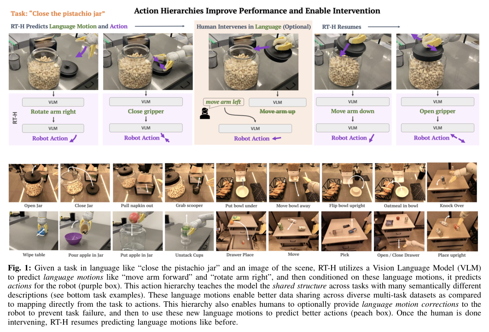
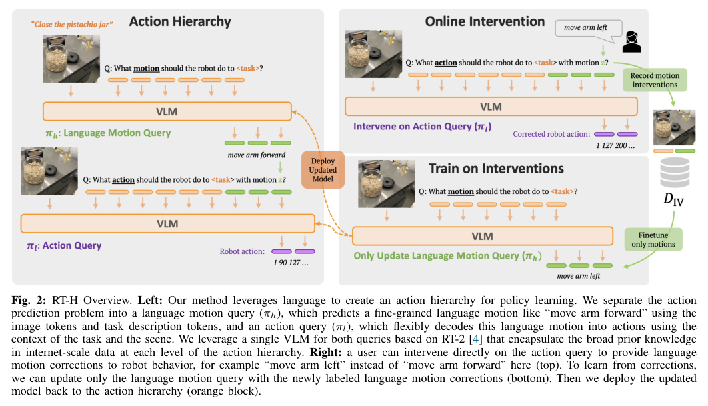

# RT-H: Action Hierarchies Using Language

2024-03-04 · Google DeepMind · Stanford University (arXiv:2403.01823v2) · 有来源缺口

[本地原件归档](../../../raw/84a5425857072cb7c09545b1a2716d8e3bb67d092b715e8c0132d1e0af551fcc) · 固定材料版本 `digest-material-84a5425857072cb7c09545b1a2716d8e3bb67d092b715e8c0132d1e0af551fcc@1` · [一手原站](https://arxiv.org/abs/2403.01823v2)

## 深度拆解与复核

- 来源：[arXiv:2403.01823v2 (HTML 全文)](https://arxiv.org/html/2403.01823v2) · [arXiv 摘要页](https://arxiv.org/abs/2403.01823v2) · [RT-H 官方项目主页](https://rt-hierarchy.github.io/)
- 口径与利益披露：本文由 Google DeepMind Robotics 与 Stanford University 联合团队（Suneel Belkhale、Tianli Ding、Ted Xiao、Pierre Sermanet、Quan Vuong、Jonathan Tompson、Yevgen Chebotar、Debidatta Dwibedi、Dorsa Sadigh）于 2024-03-04 UTC 提交 v1、2024-06-01 UTC 修订 v2（Mar / Jun 2024；DOI 10.48550/arXiv.2403.01823，DataCite），学科归类 cs.RO / Robotics 与 cs.AI（Artificial Intelligence）；页面提供 PDF、HTML、TeX 源码与 BibTeX，但 Google DeepMind 未在 Code / Hugging Face Spaces / Replicate / DagsHub / CatalyzeX / ScienceCast 等区域开放模型权重或数据集（可通过 Litmaps、Connected Papers、Google Scholar、Semantic Scholar、CORE、SciX、Smart Citations Explorer 检索引用演化）。作为 Google DeepMind Robotics 在 RT-2（55B PaLI-X）之后的承前启后代表作，实验均在内部专用移动操作器与自有 100K Kitchen+Diverse 数据集上完成，部分图注与定量对比天然服务于「语言动作中间层优于扁平 VLA 与遥操作纠偏」的路线论证。
- ==核心结论==：放在 2024→2026 具身智能 S2→S1 演化谱系中，RT-H（Action Hierarchies Using Language）的历史坐标是 ==在扁平自回归 VLA（RT-2）撞上跨任务泛化与遥操作纠偏瓶颈后，首次验证「中间动作抽象层 + 廉价本体自动标注 + 在线语言纠偏」能够把不同高层语义任务（如“抓可乐罐”与“倒杯子”）压进共享低层运动空间==——它在 8 项高难度真机操作上相对 RT-2 提升 15 个百分点（40% vs 25%），且仅用每任务 30 条键盘/语音纠偏示范就把成功率拉升至 63%（反超暴跌至 13% 的遥操作 RT-2-IWR 整整 50 个百分点）。但从 2026 年 WAM / GR00T 2 / π0.7 + MEM 的当代视角回看，RT-H 的「9 维离散规则动词 + 55B 自回归词表双查询」路线已被彻底迭代：语言短语无法传达力矩/速度与多分钟状态记忆，异步单步缓存也扛不住 50–1,000 Hz 接触密集闭环。

---

### 一、 演化谱系定位：为什么 2024 年的 RT-H 是 VLA 分层化的关键转折点？

在 RT-1（2022）到 RT-2（2023）的早期 VLA 范式中，模型直接把「高层任务指令 + 当前图像」映射为 256 桶离散化的末端 6-DoF 增量与夹爪动作（即扁平映射 π(a | o, g)）。当训练池从语义相近的 Kitchen 70K 示范（6 类任务、542 条指令）扩展到包含开闭开心果罐、抽纸巾、燕麦倒碗等 24+ 类异构任务的 Diverse 30K 示范（合计 Diverse+Kitchen 100K）时，高层任务描述彼此毫无语义重叠，扁平 RT-2 出现严重数据共享失效（8 项核心测试任务仅 4 项非零成功率，均值 25%）。RT-H 提出的三项设计直接塑造了后续两代分层具身模型（π0.5 语义子任务、GR00T 2 WAM API、π0.7 MEM 长期语言日志）：

1. 显式双层查询分解（Language Motion Query π_h → Action Query π_l）：
   - 先由 π_h(z | o, g)（Prompt：What skill should the robot do to [task]?）预测细粒度语言动作 z（如 move arm forward、rotate arm right、close gripper），再将 z 塞入 55B PaLI-X Encoder（冻结 22B ViT）作为条件输入给 π_l(a | o, g, z)（Prompt：What action should the robot do to [task], with current skill: [motion]?）解码 256 桶动作 token。
   - ⚠️ 为何拆成两次查询而非单次自回归 RT-H-Joint？（本工作台核查）：Table I 离线验证集 MSE 显示，RT-H 在 Kitchen 上为 24.9（RT-H-Joint 28.22、RT-2 30.2），在 D+K 上为 23.6（RT-H-Joint 25.44、RT-2 27.7）；把语言动作 z 送入 Encoder 双向交互比放在 Decoder 单向自回归能降低约 20% 动作 MSE（而若使用真值标注 RT-H (GT)，MSE 可再降约 40% 至 17.8–17.9，暴露出 π_h 自身预测误差仍是主要瓶颈）。
2. 零人工标注的本体感知自动词表（Automated Proprioception Labeling）：
   - 团队发现人工离线标注细粒度动作极易因相机视角错觉和切分边界不一致引入噪声，转而直接读取 9 维动作增量（3D 末端位置 + 3D 旋转角 + 2D 底盘移动 + 1D 夹爪），过滤低于阈值的微动作并按幅值排序组合，零人工成本自动生成超过 2,500 种组合语言动作（实际高频活跃约 256 种）。
3. 纠偏从「遥操作动作空间」升维至「语言动作空间」：
   - 人类操作员无需戴 VR 手柄抢夺底层 6-DoF 控制权，只需键盘热键或语音把预测错误改写为 move arm up 等短语直接喂给 π_l；随后仅更新 π_h（将纠正样本上采样 50:1，以 50% 预训练 + 23% 示范动作 + 23% 示范语言 + 4% 纠偏语言混合微调），即可避免污染底层动作解码器。

---

### 二、 真机定量实证与消融拆解（D+K 100K 数据集，PaLI-X 55B 底座）

| 评测维度与对比基线 | 论文实测定量结果 | 本工作台口径与局限核查 |
| :--- | :--- | :--- |
| D+K 8 项高难任务真机基准（每任务 10 局 = 80 局/方法） | RT-H 平均成功率 40%，超过扁平 RT-2（25%）+15 个百分点；RT-H 在 6/8 任务取得非零成功率（RT-2 仅 4/8，RT-H-Joint 为 8/8），且在 7/8 任务阶段推进更深 | ⚠️ 绝对成功率偏低（本工作台核查）：即便作为最强基础模型，RT-H 在开/关开心果罐等精密任务上原始成功率仍低，需靠人类在线纠偏或阶段后训补足，且每任务仅测 10 局，95% Wilson 置信区间较宽 |
| 语言空间 vs 离散簇 / 独热编码消融（RT-H-Cluster / RT-H-OneHot） | 把语言短语替换为 256 类 K-Means 动作聚类（RT-H-Cluster）整体略逊于 RT-H，但在极精密的开闭罐子任务上略胜；替换为无结构整数 ID（RT-H-OneHot）成功率大幅滑坡 | ✅ 语言拓扑结构价值核查：OneHot 抹掉了 move arm forward 与 move arm forward and left 的语义邻近性导致数据无法跨任务迁移；而 Cluster 在特定精细轨迹上更锐利，反向预告了后来「连续隐空间原语」对粗糙文本动词的替代 |
| 在线纠偏微调样本效率（每任务仅 30 条成功纠偏轨迹） | RT-H-Intervene 将 8 任务均分从 40% 拉升至 63%（+23 pp），在开/关开心果罐上提升 60%–70%；同步微调动作头 RT-H-InterveneAction 仅升至约 49%（+9 pp）；遥操作基线 RT-2-IWR 反从 25% 跌至 13%（差 50 pp） | ✅ 策略退化机理核查（本工作台核查）：少量 VR 遥操作会剧烈偏移原策略动作分布导致崩溃，而 RT-H-InterveneAction 把模型自产的次优纠偏动作喂回 π_l 也会诱发零动作退化；锁住 π_l 只修 π_h 是 RT-H 最干净的工程贡献 |
| 分布外泛化（纯 Kitchen 训练，新场景 & Table II 新物体 50 局） | 新场景（新建筑/光照/地板/背景）平均高出 RT-2 8–12 个百分点；未见新物体（梨、椰子水、奥利奥）均值 65% vs RT-2 55%（pick 70% vs 60%，move 60% vs 50%） | ✅ 泛化机制核查：底层运动描述词跨背景与跨物体外观保持不变，相当于为大模型提供了一层抗视觉干扰的几何正则瓶颈 |

---

### 三、 时代对比局限：RT-H 放在当代 WAM / GR00T 2 / π0.7 谱系中缺了什么？

1. 55B 双查询自回归算力墙与异步预测错位：
   - 为避免在 PaLI-X 55B 上串行跑两次前向导致控制频率腰斩，RT-H 采用「异步查询（Asynchronous Querying）」——用上一帧预测的 z_t 解码 a_t，同时批量预判 z_{t+1}。这一妥协在速度剧变或突发碰撞边界极易产生 1 步语义滞后；当代端侧 System-1 模型（如 GR00T 2 Turbo 2B 在 Jetson Thor 达 124 ms 规划 1.6 s 动作块、VFlash 537M 扩散草稿器并行解码）已将底层控制彻底脱离自回归文本词表。
2. 纯运动学直角坐标动词的表达天花板（无力控、无物体坐标系、无视觉未来）：
   - Table III 统计显示同一条 move arm forward 在不同任务中伴随显著非主轴方差（如绕 x 轴旋转标准差 10.9），说明 RT-H 高度依赖 π_l 看图「脑补」精确位姿与抓握时机；在缺乏触力觉闭环的富接触装配或非刚体操作中，纯靠离散 256 桶空间语言指令无法传达阻抗、夹持力与接触刚度——对比 GR00T 2 的 WAM API 直接在图像像素上画 2D 空间框/箭头（what-and-where 在 YAM 上把成功率从 40% 提至 92%），以及 MAWAM 通过未来帧视频 token 对齐物理演化，文字运动指令在空间精度上明显粗糙。
3. 无状态单步窗口 vs 多尺度长程记忆（π0.7 MEM）：
   - RT-H 每步只看当前图像观测并输出当前瞬间运动短语，论文 Section VI 虽设想增加「长程任务规划层」，但本身既无短期时序抗遮挡编码、也无分钟级事件日志；这一缺口直到 Physical Intelligence 在 π0.7（MEM，arXiv:2603.03596）中才用「短期高频视频编码 + 长期百 Token 级文本操作日志」补齐 15 分钟连续作业记忆。
4. 失败模式暴露的底层依赖悖论：
   - 论文 Section V-C 坦承当 π_l 本身在分布外场景过度冲出碗沿或夹爪闭合后状态变化微弱时，会出现 close gripper 死循环或「语言纠偏比遥操作更慢」的退化——换言之，语言层纠偏上限被底层连续动作策略的物理精度硬锁死。

### 观点与可反驳条件

- ==观点==：RT-H 的持久历史贡献不在其 55B PaLI-X 模型架构或 256 桶离散动作，而在于它确立了「高层语义—中层可执行原子语言—底层高频连续动作」的分层接口思想，并首次实证在低维可解释接口上做人类纠偏的样本效率碾压底层 VR 遥操作（63% vs 13%）；但在 2026 年的 S2→S1 分工下，S2 与 S1 之间的沟通媒介已经从 RT-H 的以本体为中心的直角坐标文本动词（move arm forward），演进为像素空间提示（WAM API / 轨迹关键点）、潜空间世界模型预测（WAM / MAWAM）与长程文本状态日志（MEM），纯文本运动词汇表本身已成为历史过渡态。
- ==推翻条件==：
  1. ① 本体运动动词在跨本体通用性上的复活证伪：若 2027 年内有主流开源跨本体基础模型（涵盖双臂人形、轮臂与夹爪）证明将 RT-H 式标准化运动文本词表（而非 2D/3D 空间关键点或潜空间连续 token）作为 S2→S1 统一中间接口，在未见过的新本体零样本迁移基准（如 DexBench / VABAR）上优于视觉像素引导接口（WAM API / 3D 轨迹提示）超过 10 个百分点，则「纯文本本体运动词表已过时」的判断将被推翻。
  2. ② 自回归文本链在高频接触任务中的延迟证伪：若基于新一代轻量化 VLM 的「语言动作 + 动作」单模型双查询方案在无需独立流匹配/扩散动作头的前提下，能在工业级插接/柔性操作真机上稳定实现 >= 20 Hz 端侧闭环控制且成功率不低于扩散/WAM 架构（如 85%+），则「自回归语言中间层必然受限于异步滞后与频率墙」的结论将被修正。

---

## 原文摘录与一手信源存证

> To bridge tasks and actions, our insight is to teach the robot the language of actions, describing low-level motions with more fine-grained phrases like "move arm forward". Predicting these language motions as an intermediate step between tasks and actions forces the policy to learn the shared structure of low-level motions across seemingly disparate tasks.
> — 原文摘录，文字段落 1；证据 `digest-material-84a5425857072cb7c09545b1a2716d8e3bb67d092b715e8c0132d1e0af551fcc-excerpt-1@2`

> Our method RT-H builds an action hierarchy using language motions: it first learns to predict language motions, and conditioned on this and the high-level task, it predicts actions, using visual context at all stages. We show that RT-H leverages this language-action hierarchy to learn policies that are more robust and flexible by effectively tapping into multi-task datasets.
> — 原文摘录，文字段落 2；证据 `digest-material-84a5425857072cb7c09545b1a2716d8e3bb67d092b715e8c0132d1e0af551fcc-excerpt-2@2`

> We show that these policies not only allow for responding to language interventions, but can also learn from such interventions and outperform methods that learn from teleoperated interventions.
> — 原文摘录，文字段落 3；证据 `digest-material-84a5425857072cb7c09545b1a2716d8e3bb67d092b715e8c0132d1e0af551fcc-excerpt-3@2`

一手材料：

- RT-H: Action Hierarchies Using Language (arXiv:2403.01823v2 Full Paper) · Google DeepMind · Stanford University · [原站](https://arxiv.org/abs/2403.01823v2) · [主体档案：Google DeepMind](../entities/labs/Google%20DeepMind.md) / [主体档案：Stanford University](../entities/labs/Stanford%20University.md) / [主体档案：Google Research](../entities/labs/Google%20Research.md) · [本地原件](../../../raw/9036d9d1ef8a1e9c9ccc692e65da0fec5818c832400e5081b4f61f3ae9da1e5a)
  材料版本 `digest-material-9036d9d1ef8a1e9c9ccc692e65da0fec5818c832400e5081b4f61f3ae9da1e5a@1`；获取方式 `http_full_text`。
  > Language provides a way to break down complex concepts into digestible pieces. — 原文提取
  > our insight is to teach the robot the language of actions, describing low-level motions with more fine-grained phrases like “move arm forward” or “close gripper”. — 原文提取
- RT-H: Action Hierarchies Using Language Official Project Page · Google DeepMind Robotics · Stanford University · [原站](https://rt-hierarchy.github.io/) · [主体档案：Google DeepMind](../entities/labs/Google%20DeepMind.md) · [本地原件](../../../raw/d0a7e00ba9f24e71ac588397a89b7bf4156b5a11f40317de20cf8242a2ea38b1)
  材料版本 `digest-material-d0a7e00ba9f24e71ac588397a89b7bf4156b5a11f40317de20cf8242a2ea38b1@1`；获取方式 `http_full_text`。
  > Language provides a way to break down complex concepts into digestible pieces. — 原文提取
  > Recent works in robot imitation learning have proposed learning language-conditioned policies that predict actions given visual observations and the high-level task specified in language. — 原文提取

归属与范围：已通过 ingest.fetch 抓回 arXiv:2403.01823v2 HTML 全文（100,244 字符）及 PDF 首页（23 页）、官方项目主页 rt-hierarchy.github.io（10,616 字符）完成全量穿透核查：确认作者为 Google DeepMind Robotics（Tianli Ding, Ted Xiao, Pierre Sermanet, Quan Vuong, Jonathan Tompson, Yevgen Chebotar, Debidatta Dwibedi）与 Stanford University（Suneel Belkhale, Dorsa Sadigh）；拆解了双查询语言动作层 π\_h/π\_l、9 维本体自动标注（2,500+ 词表）、异步推理缓存、Diverse+Kitchen 100K 真机量化提升（40% vs RT-2 25%）、30 条语言纠偏跃升至 63%（vs RT-2-IWR 13%）及对比 GR00T 2 / π0.7 MEM / MAWAM 的四大当代局限；未开源 55B 权重与 D+K 数据集保留规范缺口。

来源缺口：

- `not_disclosed`：Google DeepMind 与 Stanford University 未在 arXiv:2403.01823v2 或项目主页 rt-hierarchy.github.io 开源 RT-H（PaLI-X 55B）模型权重、30K Diverse 扩充示范数据集及 9 维本体动作自动标签脚本。 [线索](https://rt-hierarchy.github.io/)
- `pending_verification`：RT-H 的 Diverse+Kitchen 真机评测仅在单一移动机械臂本体上对 8 项任务各测 10 局（每方法共 80 局），且动作仍为 256 桶离散末端增量、无触力觉闭环或长程记忆状态；其在高频接触装配与跨本体迁移上的上限相比当代 2026 WAM（GR00T 2）与 MEM（π0.7）已显落伍。 [线索](https://arxiv.org/html/2403.01823v2)

[返回赛道总览](../赛道总览.md#digest-84a5425857072cb7) · [返回导读索引](README.md) · [主体档案库](../entities/README.md)
