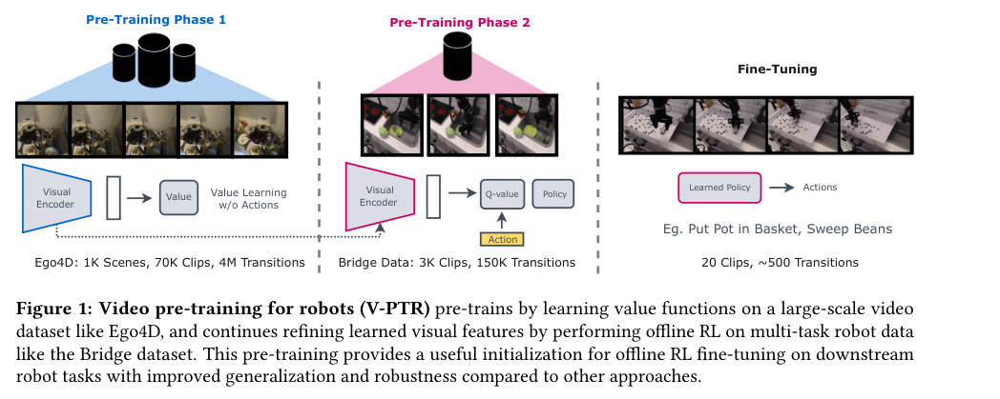
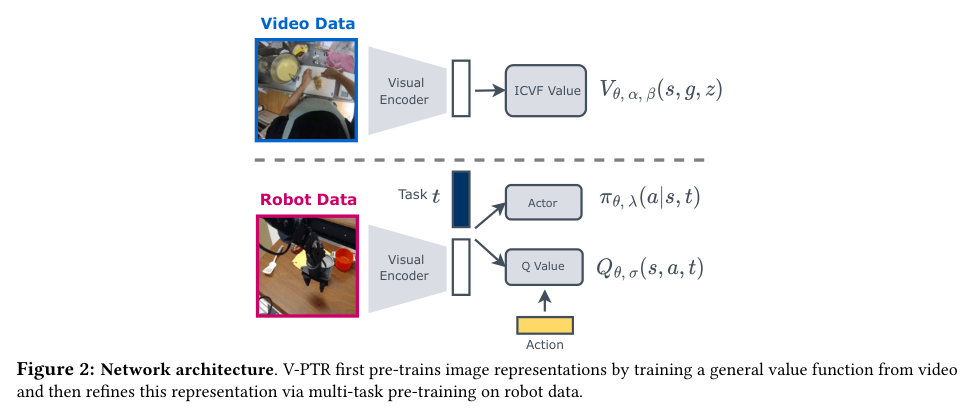

# Robotic Offline RL from Internet Videos via Value-Function Pre-Training

2023-09-22 · arXiv:2309.13041 · Robotic Offline RL from Internet · 有来源缺口

[本地原件归档](../../../raw/c3edece6e7eb7d2c3dd3ea915c11aa500ac7f0a9105ac1ef5cb33563f569c837) · 固定材料版本 `digest-material-c3edece6e7eb7d2c3dd3ea915c11aa500ac7f0a9105ac1ef5cb33563f569c837@1` · [一手原站](https://arxiv.org/abs/2309.13041v1)

## 深度拆解与复核

- ==核心结论==：由 UC Berkeley（BAIR）与 Google DeepMind 联合发表的《Robotic Offline RL from Internet Videos via Value-Function Pre-Training》（arXiv:2309.13041v1，作者 Chethan Bhateja、Derek Guo、Dibya Ghosh、Anikait Singh、Manan Tomar、Quan Vuong、Yevgen Chebotar、Sergey Levine、Aviral Kumar）提出 V-PTR 系统，直击具身智能与机器学习（ML）领域的底层数据断层——互联网大规模第一人称人类视频（如 Ego4D）缺乏动作与奖励标注，与机器人离线强化学习（Offline RL）所需的动作轨迹存在类型不匹配（Type Mismatch）；该研究首次在大规模实验上证明，纯靠时序差分学习（TD-Learning）在无动作视频上预训练意图条件价值函数（ICVF），再经跨任务机器人数据集（Bridge）做多任务 CQL 桥接，即可在真实 WidowX 机械臂上显著超越 R3M、MVP、VIP 等视觉自监督或对比学习基线。
- 本工作台交叉档案：[主体档案：Sergey Levine](../entities/people/Sergey%20Levine.md) · [主体档案：Yevgen Chebotar](../entities/people/Yevgen%20Chebotar.md) · [主体档案：BAIR](../entities/labs/BAIR.md) · [主体档案：Google Research](../entities/labs/Google%20Research.md)

#### 1. 口径与利益披露（学术预印本实验边界与数据规模标注）

- 论文属性与资助背景：本件为 2023-09-22 发布的 arXiv 学术研究论文（UC Berkeley RAIL/BAIR 与 Google DeepMind 合作完成，获 NSF 研究生奖学金、美国海军研究办公室 ONR N00014-21-1-2838 及 Google Cloud TRC TPU 算力支持），属离线强化学习与跨视角表征预训练的早期奠基性方法论工作，不存在商业产品售卖动机。
- 基准与外推边界（本工作台核查）：✅ 全部真机实验均在 6-DoF WidowX 250 机械臂与玩具厨房桌面（Toy Kitchen）场景下执行，每个条件测试 12 次试验（新物体泛化为 9 次试验），输入为 128×128 侧视固定相机图像与本体位置；⚠️ 这意味着实验样本量较小且高度结构化，其“领先基线”的结论主要成立在低自由度桌面抓取与少数样本（10–44 条遥操作轨迹）微调区段，不可直接等同于工业产线级 >99% 可靠性或双臂全身灵巧操作能力。

#### 2. V-PTR 三阶段架构与机制拆解（为什么 TD 价值预训练优于自监督对比学习）

1. 第一阶段：无动作 Internet Videos 上的 TD 价值预训练（ICVF）
   - ✅ 本工作台核查：V-PTR 摒弃了 R3M/MVP 的图像重构或对比表征目标，转而在 400 万条 Ego4D 人类第一人称视频转移（裁剪为 10–150 帧片段、224×224 分辨率）上训练意图条件价值函数 V(s, g, z) = phi(f(s))^T T(f(z)) psi(f(g))，利用状态转移的时序优势 A = I(s = g) + gamma * V_bar(s', z, z) - V(s, z, z) 直接建模“采取动作后能抵达哪些长期功能结果”。为防止价值网络在 TD 更新中发散，团队将 ResNetv2-50 骨干中的 BatchNorm 全部替换为 GroupNorm，并配合随机裁剪与色彩抖动运行 200 万梯度步（batch size 64，lr 1e-4 余弦退火）。
2. 第二阶段：多任务机器人离线 RL 桥接（Bridge 数据集 + CQL）
   - ✅ 本工作台核查：Ego4D 为第一人称佩戴视角，而 Bridge 数据集（15 万条 WidowX 机械臂玩具厨房多任务轨迹）为固定肩部第三人称视角，两者存在显著构型与视角鸿沟。V-PTR 用阶段一学到的特征骨干初始化 CQL（Conservative Q-Learning）的策略与双 Q 网络，在不包含下游评估场景的多任务数据上训练 20 万步，将人类视频的功能语义对齐至机器人动作空间。
3. 第三阶段：目标任务分层采样微调与语言条件扩展
   - ✅ 本工作台核查：针对新任务仅采集 10–44 条 Oculus Quest 遥操作演示，采用分层混合采样（target 数据占比 tau = 0.1，多任务机器人数据占比 0.9；仿真实验 tau = 0.7）继续运行 CQL 联合微调，避免小样本过拟合；若结合 GRIF 预训练语言编码器替换 one-hot 任务编号，模型可直接响应自然语言指令。

#### 3. 真实 WidowX 机械臂与诊断实验定量战绩复核

| 评估基准与场景 | V-PTR (Ours) | 最强对照基线表现 | 其他基线与核心机理差距（本工作台核查） |
| --- | --- | --- | --- |
| 表 1 场景一：初始位姿与物体位置变化（4 项任务共 48 次试验） | 24 / 48 (50.0%) | V-PTR w/o phase 2 为 7 / 48；MVP+BC 为 6 / 48；PTR 为 5 / 48；VIP+CQL 为 2 / 48 | ✅ 本工作台核查：R3M+BC 与冻结表征的 VIP_frozen+CQL 均录得 0 / 48；在将刀放入锅中任务上仅 V-PTR 成功（6 / 12），其余 6 种基线全为 0 / 12，显示预抓取前重新调整夹爪朝向的能力。 |
| 表 1 场景二：未见干扰物测试（4 项任务共 48 次试验） | 20 / 48 (41.7%) | V-PTR w/o phase 2 为 6 / 48；MVP+BC 为 5 / 48；VIP+CQL 为 4 / 48；PTR 为 1 / 48 | ✅ 本工作台核查：加入未见干扰物后各方法均掉点，但 V-PTR 绝对成功率仍是无视频基线 PTR 的 20 倍；Grad-CAM 热力图证实 V-PTR 聚焦于夹爪与目标物体，而 PTR 与 VIP 将大量注意力分散到背景桌面。 |
| 表 1 场景三：未见新物体泛化（胡萝卜/黄瓜/冰淇淋共 9 次） | 3 / 9 (33.3%) | V-PTR w/o phase 2 为 3 / 9；VIP+CQL 为 3 / 9；PTR 为 1 / 9；R3M/MVP 均为 0 / 9 | ⚠️ 本工作台核查：在陌生几何物体上整体成功率仍偏低（Ice-cream 为 0 / 3），但封闭形式 SARSA 价值拟合误差测试证明 V-PTR 的特征基在扰动下保持最平滑单调的价值曲线。 |
| 表 2 复杂技能与表 3 语言指令（6 项任务共 72 次试验） | 语言版 44 / 72 (61.1%)；One-hot 35 / 72 | PTR（语言版）21 / 72 (29.2%)；BC（语言版）8 / 72 (11.1%) | ✅ 本工作台核查：在开微波炉（5 / 12 vs PTR 0 / 12）与扫豆子（6 / 12 vs PTR 2 / 12）上显著胜出；仅每任务 10 条演示极低样本下（表 5），V-PTR 合计 25 / 72 仍明显高于 PTR（9 / 72）与 VIP+CQL（3 / 72）。 |

#### 4. 历史定位与实操局限（从 2023 Value Pre-Training 到 2026 工业 VLA/ICL 的演进）

- ❌ 视角与高度敏感性缺陷（作者自承）：论文第 6 节明确承认，包括 V-PTR 在内的所有当前方法对工作台高度、相机安装角度与机器人构型偏移仍高度敏感——一旦真实部署相机偏离 Bridge 肩部视角，阶段二桥接收益将快速衰减。
- ⚠️ 算法路线演进定位（本工作台推断）：V-PTR 代表了 2023 年在“缺乏大规模真机跨本体数据时，用纯视觉 ResNet-50 + TD Value Function 榨干 Ego4D 人类视频”的离线 RL 路线顶点，也直接孕育了 Sergey Levine 与 Aviral Kumar 等团队后续向更大规模 VLA 与物理上下文学习（如 Physical Intelligence、GEN-1.5、Skild S1）演进；但其依赖固定二阶段 15 万条同构型机器人数据桥接、且绝对成功率徘徊在 41%–61% 之间的结构性瓶颈，决定了它只能作为表征与价值初始化底座，无法单靠 CQL 直接满足工厂级零样本泛化需求。

### 观点与可反驳条件

- ==观点==：V-PTR 的核心贡献在于用可复现的实证打破了“自监督重建/对比特征足以支撑机器人控制”的 CV 惯性——当下游控制器采用价值驱动的 Offline RL 时，上游视频预训练必须使用同构的时序差分价值目标（ICVF）并剔除 BatchNorm，才能学出对干扰物免疫、对齐操作意图的状态表征；但受限于 ResNetv2-50 容量与仍需同构型 Bridge 机器人数据做阶段二桥接，单靠价值函数预训练无法跨过“视角/高度偏移即大幅掉点”的工业实用门槛。
- ==推翻条件==：
  1. ① 方法论路线证伪条件：若在严格同等的 Ego4D 400 万帧 + Bridge 15 万条数据预算下，使用更大容量的 ViT/VLM 掩码自编码器或下一帧世界模型（World Model）预训练配合与 V-PTR 相同的 CQL 阶段二/三微调，在 WidowX 干扰物测试（Scenario 2）中同样达到 ≥42% 成功率且 SARSA 价值拟合误差低于 V-PTR，则“TD 价值预训练在视频到 RL 迁移中具有不可替代结构优势”的核心主张将被推翻。
  2. ② 跨视角扩展正向突破条件：若后续将 V-PTR 的 ResNetv2-50 替换为多视角 3D/4D 几何编码器并在多样化跨本体数据集（而非单一视角 Bridge）上联合执行阶段二预训练，在相机高度/角度人为偏移 ±20% 的未见真机桌面下仍能维持 ≥50% 零样本成功率，则本文第 6 节指出的视角敏感性上限将被打破。
  3. ③ 极低样本工业门槛检验条件：在仅提供 ≤10 条演示且存在多干扰物的复杂长程任务（如连续两步以上工具使用或铰链门操作）中，若 V-PTR 无需阶段二 15 万条同构型机器人数据即可稳定达到 ≥60% 成功率，则“阶段二同构型机器人数据桥接不可或缺”的推断将被修正。

---

## 原文摘录与一手信源存证

> 【信源巡检核心摘要】 Pre-training on Internet data has proven to be a key ingredient for broad generalization in many modern ML systems. What would it take to enable such capabilities in robotic reinforcement learning (RL)?
> — 原文摘录，文字段落 1；证据 `digest-material-c3edece6e7eb7d2c3dd3ea915c11aa500ac7f0a9105ac1ef5cb33563f569c837-excerpt-1@1`

一手材料：

- Robotic Offline RL from Internet Videos via Value-Function Pre-Training · UC Berkeley BAIR & Google DeepMind · [原站](https://arxiv.org/abs/2309.13041v1) · [主体档案库](../entities/README.md) · [本地原件](../../../raw/d19340d17e8bc18d49956e8df8b449a6b8aabb3be106ec9a8a01947295d5f027)
  材料版本 `digest-material-d19340d17e8bc18d49956e8df8b449a6b8aabb3be106ec9a8a01947295d5f027@1`；获取方式 `arxiv_html_full_text`。
  > \[div\] Abstract Pre-training on Internet data has proven to be a key ingredient for broad generalization in many modern ML systems. What would it take to enable such capabilities in robotic reinforcement learning (RL)? — 原文提取
  > \[p\] Pre-training on Internet data has proven to be a key ingredient for broad generalization in many modern ML systems. What would it take to enable such capabilities in robotic reinforcement learning (RL)? — 原文提取

归属与范围：V-PTR（arXiv:2309.13041v1）先在 Ego4D 400 万条人类第一人称视频上通过 TD-Learning 训练意图条件价值函数（ICVF），再于 Bridge 15 万条多任务机器人数据上以 CQL 桥接并微调 WidowX 250 真机任务，在含干扰物场景取得 20/48 成功率及语言条件 44/72 成功率，显著优于 R3M、MVP、VIP 与无视频 PTR。

来源缺口：

- `not_disclosed`：论文第 6 节明确提示当前架构对工作台高度、相机视角与机器人构型变化仍高度敏感；原文评估集中在 WidowX 250 单臂玩具厨房桌面，未提供跨更高自由度双臂平台或工业柔性操作场景的实测基准。 [线索](https://arxiv.org/abs/2309.13041v1)

[返回赛道总览](../赛道总览.md#digest-c3edece6e7eb7d2c) · [返回导读索引](README.md) · [主体档案库](../entities/README.md)
