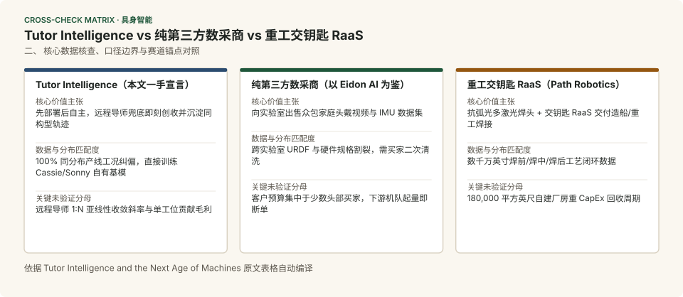

# Tutor Intelligence and the Next Age of Machines

2026-11-01 · Tutor Intelligence · 有来源缺口

[本地原件归档](../../../raw/6688bc2a78bb0a47120172451c7c84184427778a502160eb18f52bc223ee0fe9) · 固定材料版本 `digest-material-6688bc2a78bb0a47120172451c7c84184427778a502160eb18f52bc223ee0fe9@1` · [一手原站](https://tutorintelligence.com/blog/tutor-intelligence-and-the-next-age-of-machines)

## 深度拆解与复核

## 深度拆解与复核

==场景与利益披露==：本文《Tutor Intelligence and the Next Age of Machines》（2026-11-01）由 Tutor Intelligence Co-Founder & CEO Josh Gruenstein 署名发布于公司官方博客，写于 a16z 领投 7,500 万美元（\$75M）B 轮融资节点（与 2026-11-02 库内已拆解的 [Investing in Tutor Intelligence](Investing%20in%20Tutor%20Intelligence.md) 互为创始人宣言与领投方叙事对照）。作为自研硬件与模型的一体化创业公司，作者天然有动机突出全栈平台复利（full-stack compounding）与「先部署后自主」的必然性，评估时须把物理商业闭环与远期宏观愿景拆开校验。

### 一、 起源逻辑与「部署前置」技术经济机制

1. 物理自动化瓶颈与「人力智能联网」起源（本工作台梳理）：Josh Gruenstein 以 1800 年代初人类生活基线（全球逾四分之三人口处于极端贫困、5 岁以下儿童死亡率达 43%、成人识字率仅 12%）引出物理劳动降本的杠杆效应，指出即便截至 2025 年美国（United States / US）在 3.4 亿人口体量下仅部署 38,000 台商用机器人，约十分之九的美国工厂与仓库仍处于零机器人状态（Intelligence 仍是核心瓶颈）。2019 年 3 月在 MIT 就读期间，委内瑞拉（Venezuela）Guri Dam 输电线火灾导致供应该国超 80% 电力的 Simón Bolívar Hydroelectric Plant 瘫痪，约 10,000 名 Venezuelans 在 RuneScape 中全职打金换取 USD（规避 Bol 贬值、占 Venezuelan GDP 约 1 bp）的产业链随之断线——这让 Gruenstein 与 CTO Alon Kosowsky-Sachs 意识到通用人类智能早已完成联网与市场化定价，遂于 2021 年 2 月正式注册成立 Tutor Intelligence（Tutor）。
2. 远程导师（Tutors）的三重飞轮（本工作台拆解）：不同于在实验室等待互联网级机器人智能成熟再出货，Tutor 选择把未完全自主的机器人直接部署进产线、实时接入远程人类导师。其设计目标对应三条结构性属性：第一，依靠人工兜底让机器人在首日即产生正净经济价值，绕开传统定制集成高企的 ROI 门槛；第二，大规模付费机队自然置身于真实演示数据流中心，市场激励自发生成机器人训练数据互联网，训练遵循 Scaling Laws 的基础模型，使导师数量随部署规模呈亚线性（sub-linearly）增长；第三，通过不断填补目标概率分布的重叠切片，把硬件、智能与客户需求视为联合设计问题（co-design），用已盈利工位的现金流反哺模型与制造产能。
3. Cassie 与 Sonny 双代本体分工（本工作台核查）：首款平台 Cassie 瞄准纸箱与托盘等「物理世界协议缓冲区（protocol buffers）」的码垛与拆垛（该工种全美年均流动率周期仅 3 个月、存在约 500K 岗位缺口），公司宣称未来一年将制造美国全部工业机器人中的多数（plurality），其中主力为 Cassies；第二款平台 Sonny 为面向高灵巧度手工作业（handwork）的半人形机器人（semi-humanoid），兼顾可规模制造性与前沿基础模型的速率与可靠性边界。双方已在北美（North America）Fortune 50 巨头至中小家族企业规模化运行，累计参与生产与发运数亿件 Americans 日常消费品。

### 二、 核心数据核查、口径边界与赛道锚点对照

- ✅ 融资、商业计费与《Investing in Tutor》互证（本工作台核查）：对照本库 [Investing in Tutor Intelligence](Investing%20in%20Tutor%20Intelligence.md) 与 [Scale VP 部署层拆解](具身基模之上，还有应用层｜Scale%20VP合伙人：部署公司将分走模型公司的蛋糕.md)，Tutor 累计融资 \$117M（\$75M B 轮 + \$34M A 轮等），以 \$14–\$18/小时或按件收费交付 Cassie 与 Sonny（上线耗时低至 8 小时），将「远程人工纠偏成本」转化为付费工位现金流。==对照赛道锚点 T2 与 T4（Beyond 1M Hours 与 Eidon AI 复盘），Tutor 避开了第三方数采商「客户池仅约 20 家 + 下游自采即遭抛弃」的消亡陷阱，因为其 Data Factory 与客户机队采自同构型、直接服务同一 SLA==。
- ⚠️ 「美国工业机器人产量多数（plurality）」与「0.02 bps 劳动占比」口径审视（本工作台推断）：原文称未来一年 Tutor 将制造美国工业机器人产量中的多数（主要为 Cassies），并估算当前 Tutor 已完成美国经济有效劳动的 0.02 bps（并设定终极 KPI 为超越当今全球经济价值的 100%）。需注意美国本土工业机器人制造业本就高度日欧化（FANUC、KUKA、ABB、Yaskawa 主导整机进口与组装），若仅以「美国本土注册制造单臂物流整机口径」统计，少数千台产能即可形成所谓 plurality，并不等同于在北美全行业装机份额中占主导；同时 0.02 bps 劳动占比缺乏可核验机队台数与稼动工时披露。
- ❌ 未披露人机比与 BOM 护城河断点（本工作台核查）：与 a16z 领投稿一致，这篇创始人长文同样未披露远程导师与机队的实时 1:N 托管比例、异常接管率（intervention rate）及 Cassie/Sonny 单机 BOM 折旧。在蒸汽机类比（价值最终流向连接矿山、工厂与铁路的网络而非引擎制造厂）下，Tutor 宣称世代级企业必须横跨全栈，但若其 1:N 人机比停滞，全栈模式反而会同时承担重资产制造折旧与高人工运维的双重挤压。

| 对比维度 | Tutor Intelligence（本文一手宣言） | 纯第三方数采商（以 Eidon AI 为鉴） | 重工交钥匙 RaaS（Path Robotics） |
| :--- | :--- | :--- | :--- |
| 核心价值主张 | 先部署后自主，远程导师兜底即刻创收并沉淀同构型轨迹 | 向实验室出售众包家庭头戴视频与 IMU 数据集 | 抗弧光多激光焊头 + 交钥匙 RaaS 交付造船/重工焊接 |
| 数据与分布匹配度 | 100% 同分布产线工况纠偏，直接训练 Cassie/Sonny 自有基模 | 跨实验室 URDF 与硬件规格割裂，需买家二次清洗 | 数千万英寸焊前/焊中/焊后工艺闭环数据 |
| 关键未验证分母 | 远程导师 1:N 亚线性收敛斜率与单工位贡献毛利 | 客户预算集中于少数头部买家，下游机队起量即断单 | 180,000 平方英尺自建厂房重 CapEx 回收周期 |

### 观点与可反驳条件

- ==观点==：Tutor Intelligence 用远程人类导师先打通 CPG 仓储搬运现金流、再以同构型在岗纠偏数据喂养 Cassie/Sonny 基础模型的路线，在商业闭环上显著优于脱离付费场景的纯数据工厂；但「全栈平台能否真正形成亚线性导师缩放复利」，决定其终局是高毛利物理网络还是披着 AI 外衣的远程外包劳务公司。
- ==推翻条件==：
  1. 导师人机比未能亚线性收敛：若至 2027 年底在网运行机队达到约 1,000 台规模时，远程人类导师与机器人的平均托管比仍卡在 1:5 以下（或高频 SKU 切换导致接管时长占比高于 25%），使单工位毛利无法覆盖硬件折旧，则「数据飞轮自动压低导师边际成本」的核心机制将被证伪。
  2. 产能与商业交付口径大幅落空：若未来 12 个月（至 2027 年 Q4）Tutor 实际交付通电的 Cassie 与 Sonny 合计低于 500 台、或客户复购扩张停滞并出现批量退租，则「靠规模化标准部署自然形成机器人数据互联网」的飞轮前提将不成立。

---

## 原文摘录与一手信源存证

> Tutor Intelligence and the Next Age of Machines  一手发布主体：Tutor Intelligence 原始链接：https://tutorintelligence.com/blog/tutor-intelligence-and-the-next-age-of-machines 发布日期：2026-11-01 归属赛道：具身智能  【信源巡检核心摘要】 Official Tutor Intelligence
> — 原文摘录，文字段落 1；证据 `digest-material-6688bc2a78bb0a47120172451c7c84184427778a502160eb18f52bc223ee0fe9-excerpt-1@1`

> Tutor Intelligence announcement post detailing its robot-by-the-hour warehouse model (starting around \$14/hour with Sonny and Cassie robots), Data Factory training, and frontier robot foundation model scaling around its \$75M
> — 原文摘录，文字段落 2；证据 `digest-material-6688bc2a78bb0a47120172451c7c84184427778a502160eb18f52bc223ee0fe9-excerpt-2@1`

> robot foundation model scaling around its \$75M Series B led by Andreessen…  【分诊与中枢定位】 【具身智能】Tutor Intelligence：涉及 Tutor Intelligence, Intel；含指标 \$14, \$75M；关联未决问题「Beyond 1M Hours: The
> — 原文摘录，文字段落 3；证据 `digest-material-6688bc2a78bb0a47120172451c7c84184427778a502160eb18f52bc223ee0fe9-excerpt-3@1`

一手材料：

- Tutor Intelligence and the Next Age of Machines · Tutor Intelligence · [原站](https://tutorintelligence.com/blog/tutor-intelligence-and-the-next-age-of-machines) · [主体档案：Tutor Intelligence](../entities/companies/Tutor%20Intelligence.md) · [本地原件](../../../raw/617262c443c256815dc7ca5202259447fcb331bc518965d3a5fbb3857f1be26a)
  材料版本 `digest-material-617262c443c256815dc7ca5202259447fcb331bc518965d3a5fbb3857f1be26a@1`；获取方式 `http_full_text`。
  > Co-Founder and CEO Josh Gruenstein on the origin of Tutor, breaking the robot intelligence bottleneck, and building a more abundant future in the next age of machines. — 原文提取
  > At the start of the 1800s, more than three quarters of the world’s population lived in extreme poverty. — 原文提取

归属与范围：已从 tutorintelligence.com 拉取《Tutor Intelligence and the Next Age of Machines》完整一手正文（9,536 字符），并与库内 a16z 投资专文（Investing in Tutor Intelligence）、Path Robotics 与 Eidon AI 复盘完成交叉核对。拆解澄清了创始人 Josh Gruenstein 与 Alon Kosowsky-Sachs 将「远程人类导师先于完全自主上线」设计为数据飞轮起点的方法论，并标明算量分母与人机比未披露边界。

来源缺口：

- `not_disclosed`：创始人长文未披露 Cassie 与 Sonny 的单台硬件 BOM 成本、远程人工导师（tutors）与机器人的平均托管比例（1:N）与人工接管时长占比，亦未给出 0.02 bps 美国经济劳动占比推算分母与 2026 年在网通电收费台数。 [线索](https://tutorintelligence.com/blog/tutor-intelligence-and-the-next-age-of-machines)

[返回赛道总览](../赛道总览.md#digest-6688bc2a78bb0a47) · [返回导读索引](README.md) · [主体档案库](../entities/README.md)
