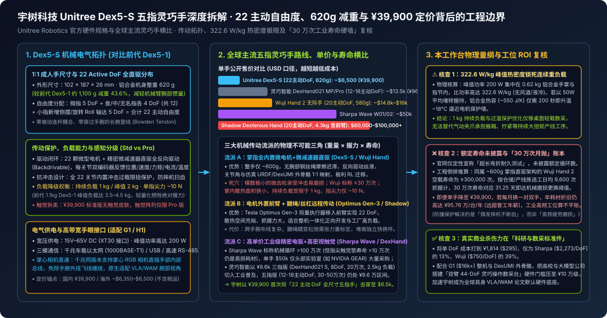

# Unitree Dex5-S 1:1 Human-Scale Five-Finger Dexterous Hand Release: 22 Active DoF, 620g Weight & RMB 39,900 (\$6,500) Pricing for G1/H1

2026-09-21 · 宇树科技 (Unitree Robotics) · Dex5-S 官方规格 · 有来源缺口

[本地原件归档](../../../raw/4ac349de2158600222d0aa31727cd8746443d1b9128859ad25e6bc9e7bf10183) · 固定材料版本 `digest-material-4ac349de2158600222d0aa31727cd8746443d1b9128859ad25e6bc9e7bf10183@1` · [一手原站](https://www.unitree.com/dex5-s)

## 深度拆解与复核

- ==核心结论==：宇树科技 Dex5-S 以 ¥39,900（海外约 \$6,500，单主动自由度成本仅 ¥1,814）首次将「1:1 成人手尺寸、620 g 自重、22 Active DoF 全直驱反向驱动五指灵巧手」拉入万美元以内，其工程减法是将前代 1.1 kg 的 Dex5-1P 大幅瘦身并剥离 94 点触觉阵列归入高配 Pro 版、同时将峰值握持负载从 3.5–4.5 kg 下调至持续 1 kg / 峰值 2 kg（指尖力 ~10 N）；受限于 322.6 W/kg 掌内热功率密度与未披露额定循环寿命的微减速器磨损硬墙（对标同构直驱 Wuji Hand 30 万次 在工业拣选下约 1 个月 损耗），Dex5-S 的真实产业杀伤力并非替代产线气动夹爪，而是成为全球高校与大模型公司采集灵巧操作真机数据的低门槛标准耗材。
- 关联主体档案：[宇树科技 (Unitree Robotics)](../entities/companies/%E5%AE%87%E6%A0%91%E7%A7%91%E6%8A%80%20%28Unitree%20Robotics%29.md) · [Sharpa](../entities/companies/Sharpa.md) · [NVIDIA GEAR Lab](../entities/labs/NVIDIA%20GEAR%20Lab.md) · [Physical Intelligence](../entities/companies/Physical%20Intelligence.md)

### 一、 场景与利益标注及官方硬件规格核验

- 场景与利益标注：本文穿透核查宇树科技（Unitree Robotics）官方产品页发布的 1:1 人类尺寸五指灵巧手 Unitree Dex5-S / Dex5-S Pro 一手硬件规格书（`https://www.unitree.com/dex5-s`，原生适配宇树 G1 与 H1 人形机器人腕部机械电气接口）及前代 Dex5-1 / Dex5-1P 招股与产品参数对比。商业利益相关前置声明：作为全球出货量居前的双足人形与四足本体硬件商，宇树在官方规格页突出展示「22 主动自由度、620 g 超轻自重、全关节防撞过载保护与 ¥39,900 颠覆级起售价」，核心商业诉求是用极致的关节单价将科研机构与具身算法团队锁定在 G1 + Dex5-S 硬件生态内；但官方规格表对工业落地最敏感的两项指标采取了选择性披露与分级拆卖——① ¥39,900 标准版不含任何表皮触觉传感器阵列（触觉感知被单独拆分至未公开低价的 Dex5-S Pro 版本）；② 未披露任何量化的额定抓握循环寿命次数（仅定性表述为“通过超长弯折耐久测试”）。

---

### 二、 核心机械电气架构拆解与全球主流五指灵巧手大横比

#### 1. Dex5-S 机械传动、驱动闭环与电气通信全参数还原
1. 构型尺寸与 22 Active DoF 空间拓扑（对比前代 Dex5-1 的激进重构）：
   - 外形与减重：整手长宽高为 102 × 187 × 26 mm（严格对齐成年男性手掌 1:1 包络），采用铝合金精密加工壳体，单手整备质量压降至 620 g——较宇树前代体积偏大、重达 ~1,100 g 的 Dex5-1 直接减重 43.6%（削减 480 g），显著降低了 Unitree G1 细长小臂末端的高速摆动惯量。
   - 22 个独立主动自由度（零被动耦合连杆）：在上一代 20 DoF 基础上，为小指新增 1 个独立的侧摆/翻滚轴（Roll Axis），形成 拇指 5 DoF + 食指 4 DoF + 中指 4 DoF + 无名指 4 DoF + 小指 5 DoF = 22 Active DoF 的全驱动配置。新增的小指第 5 轴专门服务于类人手掌内拱曲（Palm Arching）与球体/细柄工具（如剪刀、螺丝刀、试管）的包络对握。
2. 掌指内置微减速器直驱 vs 欠驱动连杆/跨腕腱绳方案：
   - Dex5-S 摒弃了低端灵巧手常用的四连杆欠驱动耦合（无法独立控制指尖姿态）与跨手腕长距离鲍登钢丝绳（Bowden Cable，存在非线性摩擦迟滞与钢丝蠕变松弛），在掌心与指节内部直接集成了 22 组微型空心杯/无刷电机 + 精密微型减速器复合传动关节。
   - 全关节丝滑反向驱动（Backdrivability）与双编码器闭环：全部 22 个关节均支持低阻抗反向驱动，每个关节内置电机端 + 输出端双编码器，实时回传位置、角速度、估算力矩、相电流与绕组温度五维状态；同时在全部 22 个关节内部设计了极限冲击过载保护结构（Ultimate Impact Protection），在机器人意外摔倒撑地或高速碰撞桌面时通过机械滑移/限扭卸力保护内部微模数齿轮不断齿。
3. 负载力矩、200W 峰值供电与千兆网掌心相机直通：
   - 负载与指尖力：单手持续工作额定负载为 1 kg，理想姿态（掌心向下或侧向抓握 5 cm 硬质圆柱）峰值最大负载为 2 kg，单指尖额定输出力约为 10 N（对比前代 1.1 kg 的 Dex5-1 峰值负载 3.5–4.5 kg，轻量化与微型化带来了约一半的绝对抓握力折让）。
   - 供电与总线接口：支持 15V – 65V 宽电压输入（XT30 航模级电源接口，可直接挂载人形机器人高压母线），整手峰值功率达 200 W；通信提供 千兆车载以太网（1000BASE-T1）、USB 与高速 RS-485 三种配置——其中千兆以太网版本允许将掌心 RGB 微型相机直接插入手部内部接口并共用同一根腕部线缆回传视频流，彻底消除了传统外挂腕部相机的飞线缠绕，原生契合 [GR00T 2](GR00T%202%20Official%20Technical%20Release_%20Scaling%20World-Action%20Models%20on%20402%2C000%20Hours%20of%20Human%20Video%20with%20X-Adapt%20%26.md) 与 [π0.5](%CF%800.5%20%28pi0.5%29_%20A%20Vision-Language-Action%20Model%20with%20Open-World%20Generalization%20%28arXiv_2504.16054%29.md) 对多视角手眼协同图像的需求。

#### 2. 全球六大代表性灵巧手技术流派与核心量纲横比
将 Unitree Dex5-S 与本库追踪的国内外主流高自由度灵巧手拉通对账：

| 型号与厂商 | 自由度配置 | 传动与驱动拓扑 | 整重 (含驱动) | 负载 / 指尖力 | 触觉传感配置 | 标称循环寿命 | 单手公开售价 (单 DoF 均价) |
| :--- | :--- | :--- | :---: | :---: | :--- | :--- | :--- |
| 宇树 Dex5-S / S Pro *(本文)* | 22 主动 DoF (拇5+三指×4+小5) | 掌指内置微电机+微减速器全直驱 (全反向驱动+防撞保护) | 620 g | 持续 1 kg / 峰值 2 kg · 指尖 ~10 N | 标准版无触觉；触觉阵列仅限 Pro 版 | 未量化披露 (`not_disclosed`) | ¥39,900 / ~\$6,500 (¥1,814 / DoF) |
| 宇树前代 Dex5-1 / 1P | 20 主动 DoF | 微力控复合齿轮传动 | ~1,100 g | 峰值 3.5–4.5 kg | 1P 版配 94 点阵列触觉 | 未量化披露 | 高于 Dex5-S (随整机选配) |
| 无际科技 Wuji Hand 2 | 20 主动 DoF (每指 4 独立全驱动) | 掌指内置微型电驱直驱 (无耦合连杆) | 580–600 g | 轻载科研灵巧操作 | 可选指尖触觉扩展 | 空载抓握 ≥300,000 次 | \$14,600–\$16,000 (~¥10.8万, ¥5,400/DoF) |
| [Sharpa](../entities/companies/Sharpa.md) Wave W01 / W02 | 22 DoF (W01) / 21 DoF (W02) | 工业级精密机电一体化直驱/复合驱动 | ~1.3 kg (W01) / <750 g (W02) | 高刚度精细工具操作 (NVIDIA GEAR 御用) | 高分辨率多维视触觉指尖 (灵敏度极高) | 整手 >1,000,000 次；指尖触觉垫 >100,000 次 | ~\$50,000 (~¥36万, ¥16,360/DoF) |
| 灵巧智能 DexHand021 系列 | S: 8 DoF (三指) MP: 12主动+7被动 Pro: 18主动/22总DoF | 仿生双腱绳全向驱动 (腕手一体化 + 内置 5MP 变焦掌心相机) | S 版 ~600 g | S 版额定 2.5 kg / 最大 5 kg | 多维法向+切向力触觉 (0.1 N 灵敏度) + 接近觉 | S 版 200,000 次；Pro 版 300,000–500,000 次 | S 三指 ~¥9,600；五指 MP/Pro ¥96,000–98,000 |
| 英国 Shadow Hand | 20 主动 DoF (共 24 关节运动) | 20 电机外置粗壮前臂 + 跨腕腱绳驱动 | ~4.3 kg (含完整前臂驱动箱) | 经典科研高灵巧度标杆 | 可选 BioTac / 高密触觉指尖 | 重载 RL 实验验证 (腱绳需定期维护张紧) | \$60,000–\$100,000+ (¥43万–72万+) |
| Tesla Optimus Gen-3 Hand | 22 主动 DoF | 50 执行器外置前臂 + 精密丝杠/金属腱绳跨腕远程传动 | 不单独剥离 (整机 ~57 kg) | 面向工厂搬运与装配连续高负载 | 指尖多维力/触觉闭环 | 面向工厂连续多班次设计 (内部闭源未公售) | 不单独外售 (整机远期目标 BOM \$20k–\$30k) |

---

### 三、 原位物理、热力学与工位 ROI 复核（穿透 ¥39,900 定价真相）

1. ✅ 核查一：¥39,900（¥1,814 / DoF）极致降本的三大工程来源（本工作台核查）
   - 相比海外科研标准件 Shadow Hand（\$60k–\$100k+）、Sharpa Wave（~\$50k）乃至国产同类全直驱 Wuji Hand 2（~\$15k），宇树将 22 主动自由度五指手直接砍到 ¥39,900（相当于 Sharpa 的 11%、Wuji 的 37%），并非靠单一材料奇迹，而是三项明确的工程取舍：① 裸手与触觉拆卖：将良率最低、标定最繁琐、极易磨损的表皮阵列触觉传感器从标准版中彻底剥离，仅靠双编码器电流环估算粗略接触力，把真触觉成本转嫁给高配 Dex5-S Pro；② 掌内紧凑直驱省去跨腕腱绳装配人工：Shadow 与 DexHand021 Pro 的双腱绳穿线、预紧与蠕变标定高度依赖熟练技工工时，而 22 个独立模块化微电机减速器模组可走宇树成熟的自动化电驱产线；③ 四足/人形海量出货摊薄双编码器与微驱控板 BOM。
2. ⚠️ 核查二：322.6 W/kg 峰值热功率密度与 1 kg 持续负载的热力学硬墙（本工作台测算）
   - 物理量纲核算：Dex5-S 将 22 颗电机与驱动电路全部塞进 102 × 187 × 26 mm、总重仅 0.62 kg 的手掌与细指节内，峰值输入功率高达 200 W，折算比功率密度达 322.6 W/kg，且手部无任何主动风扇或液冷管路，仅靠铝合金外壳自然对流与向机械臂腕部热传导散热。按铝合金比热容 $c \approx 890\text{ J/(kg}\cdot\text{K)}$ 工程倒排推算，即便只有 400 g 结构铝件参与吸热（热容约 356 J/K），若在抓持重物堵转工况下维持 40 W 平均铜损发热，在空气自然对流极弱条件下每分钟温升可达 6°C–7°C，连续满负荷握持 5–8 分钟 即可触发绕组过温降额保护。这直接从热力学第一性原理解释了：为什么宇树虽然官方宣称“优化了散热以减少强化学习训练过温报警”，但仍诚实地将持续工作负载限制在 1 kg、单指尖力限制在 ~10 N——它本质上是为间歇性灵巧操作设计，而非像 Tesla Optimus Gen-3 那样把发热大户（50 个执行器）全部挪进体积宽裕的前臂金属筒内以支撑工厂连续重载。
3. ❌ 核查三：正面撞击本库核心约束「灵巧手 30 万次寿命硬墙」——防撞保护 ≠ 抗疲劳磨损（本工作台推断）
   - 在本库收录的[《Where Physical AI Is Heading（旧金山一线报告）》](Where%20Physical%20AI%20Is%20Heading.md)中已确立一条关键产业基准：与 Dex5-S 同样采用“约 600 g 掌指内置 20 路全直驱微型电驱”架构的 Wuji Hand（无际手），其出厂标称空载抓握寿命为 300,000 次；而真实工厂或电商仓储拣选工位每天抓握约 9,600 次，意味着 30 万次寿命在连续生产工况下仅能支撑 31.25 天（约 1 个月）即因微型齿轮磨损背隙放大或减速器失效而报废。
   - 宇树在 Dex5-S 上主打的“全 22 关节极限冲击过载保护”，解决的是偶发瞬态大冲击下的断齿风险（Impact Survival，常见于实验室 RL 探索摔机或碰撞桌面），但并不能改变指节内直径仅数毫米的超小模数齿轮在高频往复啮合下的赫兹接触疲劳磨损（Fatigue Wear）；即便高价如 \$50,000 的 Sharpa Wave 将机械本体寿命推至 >100 万次，其指尖触觉传感器寿命依然只有 >10 万次（重度工况约 10 天 需更换指套耗材）。
   - 工位耗材 ROI 倒排账本：即便 Dex5-S 将单手价格打到 ¥39,900（双手一对 ¥79,800），若直接投入日均 9,600 次 的工业高频分拣产线且实际带载寿命处于 30 万–50 万次（1–1.7 个月）区间，则单台人形机器人每年仅更换双手硬件的耗材折旧就高达 ¥56 万 – ¥95.76 万/年，是国内制造业普工综合年薪（¥8 万–12 万）的 5–10 倍，彻底击穿[「机器人综合失败与损耗成本 < 节省人工薪资」](Where%20Physical%20AI%20Is%20Heading.md)的商业化红线。
4. ✅ 核查四：真正的战略生态位——把全球 VLA/WAM 灵巧操作数采台门槛砍进 ¥20 万 区间（本工作台推断）
   - 既然算不平 24/7 重载产线的耗材账，为何 Dex5-S 依然是具身行业的重要拐点？因为在科研开发与真机遥操作数采场景中，单台机器人每天有效采集通常仅数百至一千余次抓握，30 万次寿命足以稳定服役 1–2 年。此前高校或初创团队若想复现 [NVIDIA GR00T 2](GR00T%202%20Official%20Technical%20Release_%20Scaling%20World-Action%20Models%20on%20402%2C000%20Hours%20of%20Human%20Video%20with%20X-Adapt%20%26.md) 中的双臂五指灵巧操作（如 Dexter 搭载一对 \$50,000 的 Sharpa 手），仅一对灵巧手采购成本就超过 ¥70 万元；如今采用 Unitree G1 整机 + 一对 Dex5-S（合计 ¥79,800）+ 开源 DexUMI 1:1 机械外骨骼，整套双臂 44-DoF 全直驱灵巧操作实验台的硬件总 BOM 被压缩至 ¥20 万–25 万元 级别，且全反向驱动与千兆网掌心相机直通极大降低了 RL / WAM 部署工程债，这将直接推动 G1 + Dex5-S 成为学术界灵巧操作论文的事实标准底座。

---

### 观点与可反驳条件

- ==观点==：宇树 Dex5-S 用「剥离标配触觉阵列 + 掌指模块化微减速器全直驱 + 负载折让至持续 1 kg」的精准刀法，将 22 主动自由度 1:1 五指灵巧手单价首次击穿至 ¥39,900（¥1,814/DoF）。但它本质上是一款面向 VLA/WAM 算法研发、遥操作数采与轻载服务演示的“高性价比科研标准件”，而非能够直接进厂替代气动夹爪或前臂肌腱外置工业手（如 Optimus Gen-3）的 24/7 产线工装——横亘在类人掌内直驱灵巧手与大规模工厂商业化之间的头号物理死穴，依然是 322.6 W/kg 散热瓶颈与 30 万次量级的微齿轮疲劳寿命。
- ==推翻条件==：
  1. ① 百万次带载寿命实测反驳：若宇树后续公开或第三方独立老化实验室在 0.5–1.0 kg 额定带载、每分钟 15 次 抓握频率 下完成连续耐久测试，证实 Dex5-S 的微减速器在不返厂更换齿轮条件下无故障循环寿命突破 1,500,000 次（即工业单班次连续寿命 >6 个月，双班年折旧压降至 <¥8 万/年）且指尖定位重复精度衰减 <1.5 mm；
  2. ② Pro 版高性价比耐用触觉反驳：若 Dex5-S Pro 集成多维阵列触觉后的单手含税售价仍控制在 ¥55,000（~\$8,000）以内，且其指尖触觉表皮在切向摩擦工况下的无衰减按压寿命突破 500,000 次（超越当前 Sharpa 触觉垫 10 万次 量级 5 倍），彻底打通低成本接触力控闭环；
  3. ③ 前臂外置肌腱方案成本反杀反驳：若竞争对手推出可标准化快换、内置自动张力补偿的前臂/腕部外置丝杠腱绳五指手，在同等 ¥40,000 价位下同时实现 >3 kg 持续抓握负载 与 >200 万次 产线寿命，导致掌内微型齿轮直驱路线在科研端以外全面收缩。

---

## 原文摘录与一手信源存证

> 【信源巡检核心摘要】 宇树科技（Unitree Robotics）正式发布 1:1 人类尺寸五指灵巧手 Dex5-S（适配 G1 与 H1 人形机器人平台）：整手重量约 620g，具备 22 个主动自由度（22 Active DoF），全关节集成双编码器闭环控制、丝滑反向驱动（Backdrivability）与冲击力矩过载保护，官方首发单手定价降至 39,900 元人民币（约 \$6,500），将高自由度科研与遥操作灵巧手硬件 BOM 门槛压降至万美元以内。
> — 原文摘录，文字段落 1；证据 `digest-material-4ac349de2158600222d0aa31727cd8746443d1b9128859ad25e6bc9e7bf10183-excerpt-1@1`

一手材料：

- Unitree Dex5-S 1:1 Human-Scale Five-Finger Dexterous Hand Release: 22 Active DoF, 620g Weight & RMB 39,900 (\$6,500) Pricing for G1/H1 · 宇树科技 (Unitree Robotics) · [原站](https://www.unitree.com/dex5-s) · [主体档案：宇树科技 (Unitree Robotics)](../entities/companies/%E5%AE%87%E6%A0%91%E7%A7%91%E6%8A%80%20%28Unitree%20Robotics%29.md) · [本地原件](../../../raw/4ac349de2158600222d0aa31727cd8746443d1b9128859ad25e6bc9e7bf10183)
  材料版本 `digest-material-4ac349de2158600222d0aa31727cd8746443d1b9128859ad25e6bc9e7bf10183@1`；获取方式 `tg_approved_source_update`。
  > 【信源巡检核心摘要】 宇树科技（Unitree Robotics）正式发布 1:1 人类尺寸五指灵巧手 Dex5-S（适配 G1 与 H1 人形机器人平台）：整手重量约 620g，具备 22 个主动自由度（22 Active DoF），全关节集成双编码器闭环控制、丝滑反向驱动（Backdrivability）与冲击力矩过载保护，官方首发单手定价降至 39,900 元人民币（约 \$6,500），将高自由度科研与遥操作灵巧手硬件 BOM 门槛压降至万美元以内。 — 原文提取

归属与范围：完成宇树科技 Unitree Dex5-S / Dex5-S Pro 五指灵巧手官方规格穿透复核并与前代 Dex5-1P、无际手 Wuji Hand 2、Sharpa Wave、灵巧智能 DexHand021、Shadow Hand 及 Tesla Optimus Gen-3 横向拉通对账：还原 102×187×26 mm 1:1 尺寸、620g 铝合金机身（较前代减重 43.6%）、小指新增 Roll 轴共 22 主动自由度微减速器全直驱反向驱动与全关节防撞保护、1000BASE-T1 千兆网掌心相机直通设计，穿透复核 ¥39,900（¥1,814/DoF）标准版剥离触觉阵列的定价结构、322.6 W/kg 掌内热功率密度上限及未披露循环寿命下的工业高频拣选耗材折旧账本。

来源缺口：

- `not_disclosed`：宇树科技 Dex5-S 官方规格页仅定性描述「超长弯折耐久测试」，未披露空载或 1 kg 额定带载下的量化抓握循环寿命次数，亦未公开搭载表皮触觉传感阵列的 Dex5-S Pro 版本具体售价、触觉点阵密度及单点按压疲劳寿命。 [线索](https://www.unitree.com/dex5-s)

[返回赛道总览](../赛道总览.md#digest-4ac349de21586002) · [返回导读索引](README.md) · [主体档案库](../entities/README.md)
