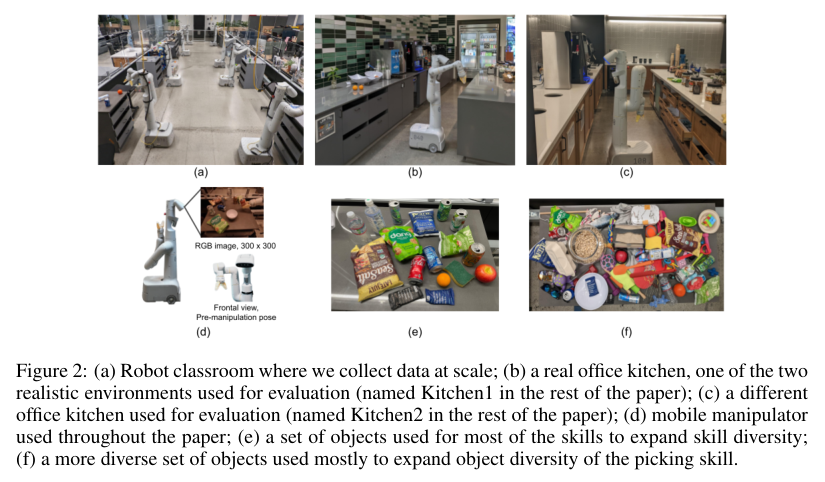

# VLA简史：从RT1到MolMoAct2

2026-11-02 · human five（穿透 RT-1 / RT-2 / RT-X / Octo / OpenVLA / π0 / SmolVLA / MolmoAct2 八篇 arXiv 论文） · 有来源缺口

[本地原件归档](../../../raw/337c8061044197579ff7f572a9c11aa6d2ca7b2e8d2cd1fb0e3e80ee95ddc2cc) · 固定材料版本 `digest-material-337c8061044197579ff7f572a9c11aa6d2ca7b2e8d2cd1fb0e3e80ee95ddc2cc@1` · [一手原站](https://arxiv.org/abs/2212.06817)

## 深度拆解与复核

- ==核心结论==：穿透核查 `human five` 梳理的从 SayCan、RT-1 到 MolmoAct2 八篇核心论文（arXiv:2212.06817 至 2605.02881）及作者自测的 843 步 LIBERO 动作离散化消融实验可见，VLA 三年演进的主轴是从「256-Bin 离散词表逐帧自回归（RT-1 / RT-2 / OpenVLA）」转向「连续 Action Chunk 流匹配专家 + 显式空间推理表征（π0 / SmolVLA / MolmoAct2）」；但一手论文也揭示了常被综述忽略的工程真相——MolmoAct2 宣称的 55.79 Hz 实为单步均摊的 Action Chunk 开环吞吐而非块内实时纠偏频率，且其零样本泛化仍严格受限于 3 类已采集本体。

#### 一、业务切口与核心机制

本条目对应微信公众号 `human five`（2026-11-02）发布的《VLA简史：从RT1到MolMoAct2》，与站内已收录的同号后续课程实录 [《Robot Policies：从 Imitation Learning 到 Token VLA》](Robot%20Policies%EF%BC%9A%E4%BB%8E%20Imitation%20Learning%20%E5%88%B0%20Token%20VLA.md) 形成「编年史+动手量化实验 vs 课程数学框架」的清晰互补。传统工业 Pick-and-Place 系统依赖固定坐标，目标收纳箱移动几厘米即告失败；而 GPT-4V、Gemini、LLaVA 等 VLM 虽看懂场景却无法输出电机指令。VLA 通过 Input Encoding（视觉 Patch + 文本 Embedding + 本体状态）→ Multimodal Processing（Transformer 联合注意力）→ Action Prediction（离散 Bin / Diffusion / Flow Matching Action Chunk）→ Execution and Feedback 回路，把互联网语义知识引入物理控制，并经历了四次核心范式转折：

1. 统一策略与多任务 Scaling（SayCan → RT-1）：SayCan（2022）用 LLM 拆解步骤再由独立 Affordance Model 挑选预定义技能库，无法端到端学习操作；Google Robotics 推出 RT-1（[arXiv:2212.06817](https://arxiv.org/abs/2212.06817)），以 Universal Sentence Encoder（USE）编码指令，通过 FiLM Conditioning 调制 ImageNet 预训练的 EfficientNet-B3（6 帧历史图像），再用 TokenLearner 将 486 个空间 token 压缩至 48 个输入 8 层 Decoder-only Transformer（仅 35M 参数、3 Hz 运行），预测 11 维离散化为 256 个 Bin 的机械臂与底盘动作。13 台机器人 17 个月采集 130,000 条示范、覆盖 700+ 任务，在已见任务达 97%、未见指令 76%、视觉干扰 83%、背景变化 59%——消融实验证明保留 97% 样本删去 25% 任务对泛化的损伤等价于砍半数据量。
2. 互联网语义迁移与跨本体正迁移（RT-2 → Open X-Embodiment / RT-X）：Google DeepMind 的 RT-2（[arXiv:2307.15818](https://arxiv.org/abs/2307.15818)）基于 PaLI-X（5B/55B）与 PaLM-E（12B），把 8 维动作映射进词表 256 个离散 token 做 Next-Token Prediction 与 Autoregressive Action Generation，并与互联网图文数据做 Co-fine-tuning，在未见场景成功率从 RT-1 的 32% 升至 62%，涌现出「把 Coke Can 放到 Taylor Swift 照片上」（旁置 Tom Cruise、Snoop Dogg）等语义泛化。随后 21 家机构联合发布 Open X-Embodiment（[arXiv:2310.08864](https://arxiv.org/abs/2310.08864)），汇总超 100 万条轨迹、22 种 Embodiment、527 项技能（160,266 任务），统一为 7 维动作空间；跨本体训练使 RT-2-X 在他机技能上成功率由 RT-2 的 27.3% 跃升至 75.8%，而小容量 RT-1-X 却出现欠拟合退化。
3. 开源模块化 vs VLM 底座路线分岔（Octo vs OpenVLA）：Octo Model Team 的 Octo（[arXiv:2405.12213](https://arxiv.org/abs/2405.12213)）基于 25 个 OXE 子集的 80 万条轨迹从头训练模块化策略（Octo-Small 27M / Octo-Base 93M，T5-base 111M 文本编码 + CNN 视觉分块 + Readout Tokens + Diffusion Action Head），以迭代去噪破解 Mean Squared Error（MSE）在绕障左右路径上的均值塌缩，微调约 100 条示范即达 72% 平均成功率（从头训练仅 20%）。同期 [openvla](../entities/companies/openvla.md)（[arXiv:2406.09246](https://arxiv.org/abs/2406.09246)）用 97 万条 OXE 轨迹微调 Prismatic-7B VLM（SigLIP + DINOv2 + MLP Projector + Llama 2 7B），采用第 1–99 百分位 Clipped Range 256 Bins，在 29 项 WidowX 与 Google 机器人任务上反超 55B RT-2-X 达 16.5 个百分点，但因放弃互联网 Co-fine-tuning，在 Taylor Swift 类概念迁移上反而弱于 RT-2-X。
4. 连续 Flow Matching、轻量化异步与空间推理融合（π0 → SmolVLA → MolmoAct / MolMoAct2）：Google 出身团队创立的 Physical Intelligence 推出 π0（[arXiv:2410.24164](https://arxiv.org/abs/2410.24164)），在 3B PaliGemma 底座旁外挂 300M Flow Matching Action Expert（共 3.3B），在 >10,000 小时、7 类本体、68 项任务上预训练并一次输出 H=50 步连续 Action Chunk（支持最高 50 Hz 叠衣/收桌）；Hugging Face 团队的 SmolVLA（[arXiv:2506.01844](https://arxiv.org/abs/2506.01844)）缩减至 450M 参数（~100M 动作专家），用 SmolVLM2（SigLIP + SmolLM2 前半 16 层、每图压至 64 个视觉 token）在 481 个社区数据集（22.9K episodes、10.6M 帧）训练并引入 Asynchronous Inference，实现消费级部署与约 2 倍吞吐。Ai2 的 MolmoAct（[arXiv:2508.07917](https://arxiv.org/abs/2508.07917)）引入 Depth Anything V2 + VQ-VAE 深度 token 与至多 5 点末端视觉轨迹再输出 8 步动作；最新 MolmoAct2（[arXiv:2605.02881](https://arxiv.org/abs/2605.02881)）升级 Molmo2-ER 4B 底座（3.3M 具身推理语料）与 720 小时 MolmoAct2-BimanualYAM 双臂数据集，以逐层 KV 条件连接 Flow Matching 连续动作专家及自适应变化区域深度重预测（MolmoAct2-Think），将推理速度推至工程可用线。

#### 二、核心数据核查、口径纠偏与工程边界

场景与利益披露：本条目原稿由独立技术作者 `human five` 撰写并发表于个人公众号（2026-11-02，阅读量 290），属于无商业卖货绑定的个人学习复盘与小规模自测笔记。文中对八篇论文架构的定性梳理基本准确，但部分关键参数量、延迟瓶颈与离散化实验解读需经一手原论文校正。

| 核查项目 | 原稿（human five）描述 | 本工作台穿透八篇 arXiv 原文核查结论 | 证据来源 |
| :--- | :--- | :--- | :--- |
| 843 条 LIBERO 离散化消融实验 | 对比 16–256 Bins 下 Full Range 与 Clipped Range（1%–99%），256 Bins 时 Full Range RMSE 低约 5.5 倍 | ✅ 机理核查合理：LIBERO 轨迹含少数极端复位/跃变动作，1–99% 截断虽加密中间精度却带来巨大尾部截断误差；但作者亦承认离线单步 RMSE 更小不等于长程偏差更小 | [human five 原稿] · [OpenVLA arXiv:2406.09246](https://arxiv.org/abs/2406.09246) |
| TokenLearner 与开源 VLA 算力权衡 | RT-1 将 486 个空间 token 压至 48 个；SmolVLA 约 450M 仅 OpenVLA 1/16，少于 30,000 Episode 社区数据训练 | ✅ 数字核查修正：SmolVLA 精确为 450M 参数（~100M 动作专家）、481 个社区子集共 22.9K episodes / 10.6M 帧（确实 <30k episodes）；在 LIBERO 平均达 87.3%，SO100 多任务实机 78.3% 超越 π0（61.7%）且训练快 40%、显存省 6 倍 | [SmolVLA arXiv:2506.01844](https://arxiv.org/abs/2506.01844) |
| π0 与 MolmoAct2 真实控制频率陷阱 | 指出 π0 预测 50 步未全用最新观测；MolmoAct2 引入自适应深度与 Flow Matching 更快更实用 | ⚠️ 频率口径纠偏（关键）：MolmoAct2 在 LIBERO 取得 97.2%（Think 版 98.1%，超越 π0.5 的 96.9% 与 OpenVLA 的 76.5%），单 H100 经 CUDA Graph 优化后 Flow Matching 达 55.79 Hz（离散路径仅 14.17 Hz），但原论文第 7 节坦承 55.79 Hz 是「Action Chunk 开环均摊吞吐率」而非块内实时反馈纠偏（YAM/SO-100 每次开环执行 30 步、DROID 执行 15 步、LIBERO 10 步） | [MolmoAct2 arXiv:2605.02881](https://arxiv.org/abs/2605.02881) |
| SmolVLA 异步推理与数据尺度矛盾 | 异步推理提吞吐约 1 倍，但排队动作仍基于旧观测；SmolVLA 数据 <30K episodes | ⚠️ 口径对齐提示：SmolVLA 约 22.9K episodes 共 10.6M 帧；AsyncInfer 在感知与动作生成间解耦的同时引入 Action Chunk 边界观察滞后，与作者质疑 π0 50 步块长滞后属同一结构性代价 | [SmolVLA arXiv:2506.01844](https://arxiv.org/abs/2506.01844) · [π0 arXiv:2410.24164](https://arxiv.org/abs/2410.24164) |

- ✅ 「VLA + RL + World Model」收尾判断核查：human five 在第 6 节提出纯靠 Behavioral Cloning 模仿学习不够，未来应融合 RL 真实交互纠偏与 World Model 前瞻推演，同时警惕世界模型不准与计算延迟代价。这与本工作台核查 MolmoAct2 第 6.8 节（MolmoAct2-Think 自适应推理率仅 12.71 Hz，仍为 Flow Matching 55.79 Hz 的四分之一）及 π0.7（14B 世界模型生成子目标图耗时瓶颈）的实测结论高度一致。
- ⚠️ MolmoAct2 零样本边界提示（本工作台核查）：尽管 MolmoAct2 公开了 MolmoAct2-BimanualYAM（720 小时双臂）、过滤版 DROID 与 SO-100/101 三大数据集，但作者在第 7 节明确限定「MolmoAct2 不是可免微调直接迁移任意新本体的通用控制器」，一旦超出上述 3 类训练本体（如进入灵巧手或异构移动操作平台），仍必须用目标本体示范重新微调。

#### 三、赛道横向对比与定位（八代际 VLA 工程参数与实测总账）

| 模型 / 数据集 | 发布机构与时间 | 参数规模与视觉-语言底座 | 动作生成机制与 Chunk | 核心数据集与代表量化表现（作者论文口径） |
| :--- | :--- | :--- | :--- | :--- |
| RT-1 | Google Robotics (2022-12) | 35M（USE + FiLM EfficientNet-B3 + TokenLearner + 8 层 Decoder） | 256-Bin 离散分类，单步 11 维，3 Hz | 130k 轨迹 / 700+ 任务：已见 97%、未见指令 76%、干扰 83%、新背景 59% |
| RT-2 | Google DeepMind (2023-07) | PaLI-X (5B/55B) / PaLM-E (12B) | 256-Bin 自回归文本 token，8 维动作 | 机器人数据 + 互联网 Co-fine-tuning：未见场景 62%（vs RT-1 32%） |
| RT-X / OXE | Open X-Embodiment (2023-10) | 复用 RT-1 / RT-2 架构 | 统一 7 维相对/增量动作，离散 token | >1M 轨迹 / 22 本体 / 527 技能：RT-2-X 他机技能 75.8%（vs RT-2 27.3%） |
| Octo | Octo Model Team (2024-05) | Octo-Small 27M / Octo-Base 93M（T5-base 111M + CNN） | Readout Tokens + Diffusion 连续 Action Chunk | 800k 轨迹（25 个 OXE 集）：6 台真机 ~100 条微调均胜率 72%（从头训练 20%） |
| OpenVLA | Stanford / Berkeley 等 (2024-06) | 7B（SigLIP + DINOv2 + MLP Projector + Llama 2 7B） | 1–99% Clipped Range 256-Bin 自回归，7 维，~6 Hz | 97 万（970k）OXE 轨迹：29 项任务超 55B RT-2-X +16.5%；LIBERO 均分 76.5% |
| π0 | Physical Intelligence (2024-10) | 3.3B（3B PaliGemma VLM + 300M Flow Matching 专家） | Flow Matching 连续 Action Chunk（H=50），最高 50 Hz | >10,000 小时 / 7 本体 / 68 任务：LIBERO 均分 94.2%，支持叠衣等灵巧任务 |
| SmolVLA | Hugging Face 等 (2025-06) | 450M（SmolVLM2 前 16 层 + ~100M 动作专家，64 视觉 token） | Flow Matching 连续 Action Chunk + Asynchronous Inference | 22.9K episodes / 481 社区集：LIBERO 87.3%，SO100 78.3%（超 π0 61.7%） |
| MolmoAct2 | Allen Institute for AI (Ai2, 2026-05) | Molmo2-ER 4B + Flow Matching 专家（逐层 KV 条件） | 连续流匹配（CUDA Graph 均摊 55.79 Hz）+ 自适应深度 Think（12.71 Hz） | 3.3M ER 语料 + 720h BimanualYAM：LIBERO 97.2% / Think 98.1%（vs π0.5 96.9%） |

### 观点与可反驳条件

- ==观点==：从 RT-1 到 MolmoAct2 的三年演化已清晰证伪「把大型 VLM 直接当高频伺服控制器」的早期路径——离散 256-Bin 自回归因精度截断与解码延迟全面让位于「中低频空间/语义 VLM 底座 + 逐层 KV 注入的 Flow Matching 连续 Action Chunk 专家」双系统架构；但行业仍未跨越「块内开环盲区」与「跨未知本体零样本泛化」两道关卡，LIBERO 刷榜逼近 98%（MolmoAct2-Think 98.1%、π0.5 96.9%）掩盖了真实开放世界接触扰动下的脆弱性（对比 Penn PAL Lab 实测 π0 仅 42.3%）。
- ==推翻条件==：
  1. ① 高频离散自回归逆袭证伪：若至 2027-Q4 出现不依赖 Flow Matching / Diffusion 连续动作专家、仅靠离散动作词表（含 FAST 类压缩）自回归解码即在真机 50 Hz 高频力接触装配与柔体操作中实现端到端推理延迟 <=20ms（>=50 Hz 真正实时反馈重规划，而非 Action Chunk 均摊）且多任务成功率超越 MolmoAct2（97.2%）与 π0.7，则本文对离散自回归受限频率墙的判断将被推翻。
  2. ② 跨未知本体零样本突破证伪：若后续全开源 VLA（如 MolmoAct 系列下一代）在未纳入预训练集的全新异构机器人本体（如未见 5 指灵巧手或四轮足双臂平台）上，无需目标本体遥操作微调即取得 >=85% 真实开放环境任务成功率，则本文关于「当前开源 VLA 仍绑定已知本体分布」的边界判断将被推翻。

---

## 原文摘录与一手信源存证

> 刚开始在 Twitter 上关注机器人学习社区时，Vision-Language-Action Model （VLA ）是我经常看到的一个词。到了 2026 年，随着每一次所谓的「机器人领域 GPT 时刻」到来，我逐渐发现一件有意思的事情：机器人领域至今仍未就最值得 Scaling 的方向形成共识，不同研究者对不同技术路线有着各自坚定的判断，其中一条路线就是 VLA。
> — 原文摘录，PDF p.1；证据 `digest-material-337c8061044197579ff7f572a9c11aa6d2ca7b2e8d2cd1fb0e3e80ee95ddc2cc-excerpt-1@1`

> 我想弄清楚我们是如何走到今天这一步的，从 RT-1 到 MolmoAct 2 这样的新模型，究竟发生了哪些变化？又是哪些架构设计让这些系统真正发挥作用？这篇 Blog 是我追溯这一演进过程、理解其中技术权衡，并尝试开展一些小型实验的记录。说到底，这也是我更新自己对机器人学习领域认知的一种方式。
> — 原文摘录，PDF p.1；证据 `digest-material-337c8061044197579ff7f572a9c11aa6d2ca7b2e8d2cd1fb0e3e80ee95ddc2cc-excerpt-2@1`

> 设想这样一个场景：机器人手臂正在执行抓取并放置（Pick-and-Place ）任务，此时有人将目标收纳箱向左移动了几厘米。一个围绕固定位置设计的系统可能会抓空，甚至直接执行失败。
> — 原文摘录，PDF p.1；证据 `digest-material-337c8061044197579ff7f572a9c11aa6d2ca7b2e8d2cd1fb0e3e80ee95ddc2cc-excerpt-3@1`

一手材料：

- RT-1: Robotics Transformer for Real-World Control at Scale · Anthony Brohan et al. · [原站](https://arxiv.org/abs/2212.06817) · [主体档案：Google DeepMind](../entities/labs/Google%20DeepMind.md) · [NotebookLM](https://notebook.google.com/notebook/cac99041-d3b9-449e-a192-12bb4b1ad391) · [Drive](https://drive.google.com/file/d/1Qj4ls1vFvCxpbzxQZCXf3UCNc6X8xFHf/view?usp=drivesdk)
  材料版本 `digest-material-81efe669c8fa50ffc7097886dc78a442fa7a8f7f2451684b93069cb9fbeda767@1`；获取方式 `http_pdf`。
  > By transferring knowledge from large, diverse, task-agnostic datasets, modern ma- chine learning models can solve specific downstream tasks either zero-shot or with small task-specific datasets to a high level of performance. — PDF p.1
  > End-to-end robotic learning, with either imitation or reinforcement, typically involves collecting task-specific data in either single-task (Kalashnikov et al., 2018; Zhang et al., 2018) or multi- task (Kalashnikov et al., 2021b; Jang et al., 2021) settings that are narrowly tailored to the tasks that the robot should perform. — PDF p.1
- RT-2: Vision-Language-Action Models Transfer Web Knowledge to Robotic Control · Anthony Brohan et al. · [原站](https://arxiv.org/abs/2307.15818) · [主体档案：Google DeepMind](../entities/labs/Google%20DeepMind.md) · [NotebookLM](https://notebook.google.com/notebook/cac99041-d3b9-449e-a192-12bb4b1ad391) · [Drive](https://drive.google.com/file/d/1ENu2dfhC8NR5zA8TDpCzQrplRQIcCZco/view?usp=drivesdk)
  材料版本 `digest-material-0a62dc36bbbfdea232ad45a0ab75c82e9cf535b55333ff22c02d5da1897ccac3@1`；获取方式 `http_pdf`。
  > We study how vision-language models trained on Internet-scale data can be incorporated directly into end-to-end robotic control to boost generalization and enable emergent semantic reasoning. — PDF p.1
  > Figure 1 | RT-2 overview: we represent robot actions as another language, which can be cast into text tokens and trained together with Internet-scale vision-language datasets. — PDF p.2
- Open X-Embodiment: Robotic Learning Datasets and RT-X Models · Open X-Embodiment Collaboration · [原站](https://arxiv.org/abs/2310.08864) · [主体档案：Open X-Embodiment Collaboration (arXiv)](../entities/people/Open%20X-Embodiment%20Collaboration%20%28arXiv%29.md) · [NotebookLM](https://notebook.google.com/notebook/cac99041-d3b9-449e-a192-12bb4b1ad391) · [Drive](https://drive.google.com/file/d/19M5icHRCE3T5KASJXMwT2m0b2eK48yp7/view?usp=drivesdk)
  材料版本 `digest-material-13f16aff5afdee583dc25b3c570e9bb0cf6baefb59b539928d919588cd8d9246@1`；获取方式 `http_pdf`。
  > Fig. 1: We propose an open, large-scale dataset for robot learning curated from 21 institutions across the globe. — PDF p.1
  > Abstract— Large, high-capacity models trained on diverse datasets have shown remarkable successes on efficiently tackling downstream applications. — PDF p.1
- Octo: An Open-Source Generalist Robot Policy · Octo Model Team · [原站](https://arxiv.org/abs/2405.12213) · [主体档案：octo-models](../entities/companies/octo-models.md) · [NotebookLM](https://notebook.google.com/notebook/cac99041-d3b9-449e-a192-12bb4b1ad391) · [Drive](https://drive.google.com/file/d/1IoTQKTKKSxa59p9X0XpwL5GTHjk3uIeo/view?usp=drivesdk)
  材料版本 `digest-material-73bff297cfafe523319162124e6b7f96919c0930e0a380f307255c4c7464ac93@1`；获取方式 `http_pdf`。
  > Fig. 1: We introduce Octo, an open-source, generalist policy for robotic manipulation. Octo is a transformer-based policy pretrained on 800k diverse robot episodes from the Open X-Embodiment dataset \[67\]. — PDF p.1
  > experiments across 9 robotic platforms, we demonstrate that Octo serves as a versatile policy initialization that can be effectively finetuned to new observation and action spaces. — PDF p.1
- OpenVLA: An Open-Source Vision-Language-Action Model · Moo Jin Kim et al. · [原站](https://arxiv.org/abs/2406.09246) · [主体档案：openvla](../entities/companies/openvla.md) · [NotebookLM](https://notebook.google.com/notebook/cac99041-d3b9-449e-a192-12bb4b1ad391) · [Drive](https://drive.google.com/file/d/1pi9i_PbPfiEjgzaKLitqQ5Vn-pCqqDz6/view?usp=drivesdk)
  材料版本 `digest-material-353c37df34458f12f969b14dfd8b77175b727b9cddea7bb891759beddeefe1be@1`；获取方式 `http_pdf`。
  > Figure 1: We present OpenVLA, a 7B-parameter open-source vision-language-action model (VLA), trained on 970k robot episodes from the Open X-Embodiment dataset \[1\]. — PDF p.1
  > Towards this goal, existing work has explored integrating pretrained language and vision-language models for robotic representation learning \[12–14\] and as a component in modular systems for task planning and execution \[15, 16\]. — PDF p.2
- π0: A Vision-Language-Action Flow Model for General Robot Control · Kevin Black et al. · [原站](https://arxiv.org/abs/2410.24164) · [主体档案：Physical Intelligence](../entities/companies/Physical%20Intelligence.md) · [NotebookLM](https://notebook.google.com/notebook/cac99041-d3b9-449e-a192-12bb4b1ad391) · [Drive](https://drive.google.com/file/d/1az7mwbOijLIvbLN0L8DCNxkA5rz3AYWE/view?usp=drivesdk)
  材料版本 `digest-material-fbdfba56258bdbd220207ba63410c6c943e43a73e97a7a5a47ca0bc74204f821@1`；获取方式 `http_pdf`。
  > Fig. 1: Our generalist robot policy uses a pre-trained vision-language model (VLM) backbone, as well as a diverse cross- embodiment dataset with a variety of dexterous manipulation tasks. — PDF p.1
  > Abstract—Robot learning holds tremendous promise to unlock the full potential of flexible, general, and dexterous robot systems, as well as to address some of the deepest questions in artificial intelligence. — PDF p.1
- SmolVLA: A vision-language-action model for affordable and efficient robotics · Mustafa Shukor et al. · [原站](https://arxiv.org/abs/2506.01844) · [主体档案：huggingface](../entities/companies/huggingface.md) · [NotebookLM](https://notebook.google.com/notebook/cac99041-d3b9-449e-a192-12bb4b1ad391) · [Drive](https://drive.google.com/file/d/1db5cj0-W33lJbSc05_TdUmdy_rpjliLi/view?usp=drivesdk)
  材料版本 `digest-material-cb1bb9a8f824187fcdc32af8c290214487c524f139a3c2def1c6d97adb1fa40c@1`；获取方式 `http_pdf`。
  > Vision-language models (VLMs) pretrained on large-scale multimodal datasets encode rich visual and linguistic knowledge, making them a strong foundation for robotics. — PDF p.1
  > Figure 1 ∣SmolVLA. SmolVLA consists of a compact pretrained vision-language model, discarding the last L −N layers (scissors icon). — PDF p.1
- MolmoAct2 · Haoquan Fang et al. · [原站](https://arxiv.org/abs/2605.02881) · [主体档案：allenai](../entities/labs/allenai.md) · [NotebookLM](https://notebook.google.com/notebook/cac99041-d3b9-449e-a192-12bb4b1ad391) · [Drive](https://drive.google.com/file/d/10mVTKcU5KYnggYKjEElYH4F8mT5Q0iBt/view?usp=drivesdk)
  材料版本 `digest-material-3029bc601e4d71ebc2e45ce996cbe35649b24eeb26b5925a73c83cb83e7fadad@1`；获取方式 `http_pdf`。
  > Vision-Language-Action (VLA) models aim to provide a single generalist controller for robots, but today’s systems fall short for real-world deployment. — PDF p.1
  > Figure 1 Overview of MolmoAct2. MolmoAct2 is a fully open action reasoning model for real-world deployment. — PDF p.2

归属与范围：逐项核验 RT-1 至 MolmoAct2 八篇 arXiv 原始论文 PDF（64K–178K 字符），精准校准参数规模、LIBERO / SO100 / 跨本体指标及 MolmoAct2 55.79 Hz 开环均摊吞吐限制；保留博主 843 条 LIBERO 离散化实验（5.5 倍 RMSE 差异）并补足离线/真机边界。

来源缺口：

- `not_disclosed`：human five 个人博文提及的自测 843 条 LIBERO 轨迹离散化脚本、各 Bin 下多步漂移定量曲线及 SmolVLA Checkpoint 语言扰动测试细节尚未随本文公开，留待作者后续博文释放。

[返回赛道总览](../赛道总览.md#digest-337c806104419757) · [返回导读索引](README.md) · [主体档案库](../entities/README.md)
