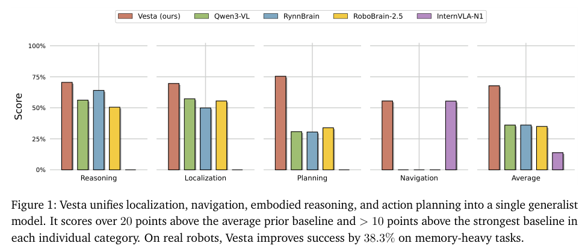
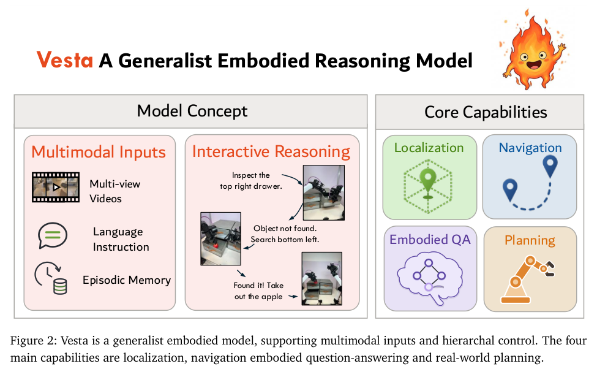

# Vesta: A Generalist Embodied Reasoning Model

2026-06-18 · arXiv:2606.20905 · Vesta · 有来源缺口

[本地原件归档](../../../raw/bb7038e00733b981038ae50c95334e20ee92f6d4db235c85baa4c84aae9b45cc) · 固定材料版本 `digest-material-bb7038e00733b981038ae50c95334e20ee92f6d4db235c85baa4c84aae9b45cc@1` · [一手原站](https://arxiv.org/abs/2606.20905v1)

## 深度拆解与复核

- 口径与利益披露：本论文为一手科研预印本 `arXiv:2606.20905v1`（2026-06-18 提交，版权归 NVIDIA 所有），核心团队由 NVIDIA（Johan Bjorck、Zhiqi Li、Jing Wang、Sifei Liu、Zhiding Yu 及共同导师 Yuke Zhu、Linxi "Jim" Fan、Jan Kautz）联合 UIUC、UCSD、香港理工、JHU（Yu-Cheng Chou）、密歇根大学、NTU 与图宾根大学组成。真机分层架构中底层执行器直接搭配 NVIDIA 自家的 `GR00T-N1.6`，与同系 [GR00T 2](GR00T%202_%20World-Action%20Model%20for%20Physical%20AI%20and%20Agentic%20Robotics.md) 构成清晰的技术协同线；本文表 1 对部分未发布评测脚本的竞品（marked †）为作者按统一评估代码复测口径。

### 一、技术路线：单一通用规划器（Embodied Reasoning Model）如何吃掉多专精模型拼装

针对具身系统长期依赖“导航专精模型 + 定位模型 + 推理模型”串联带来的高延迟、显存膨胀与误差级联，`Vesta`（Embodied Reasoning Model）选择以 `Qwen3-VL-8B` 为基座，在 128 张 H100 上完成 1 epoch 全混合 SFT（`lr = 1e-5`，`batch_size = 256`，`weight_decay = 0.01`），依靠两项设计完成能力收敛：

1. 空间感知强偏置的六元 SFT 配方（图 4）：将超过 69% 的配比倾注于物理空间底座——Spatial Intelligence 占 27.1%、Navigation 占 21.8%、Grounding（指代与接触点预测）占 20.8%，再以 16.2% General VLM 数据保底通用语义能力防止过拟合，最后用 9.8% Embodied Reasoning 与 4.3% Real Robots 真机轨迹完成动作对齐。
2. 极简多模态记忆框架（Memory Harness）：推理前对每一步生成四段结构化思维链（Observation / Progress / Reasoning / Action），但仅将历史子任务文本 `a_t` 写入文字缓存、并强制保留初始首帧 `o_1` + 按均匀或近因指数权重采样最多 `K` 张历史关键帧。该设计规避了长视频历史爆上下文显存的问题。

### 二、核心基准与真机实验核查

- 本工作台核查：直接核对论文正文字段与 Table 1–3、Section 4.4 及 Appendix E：
  - ✅ 跨四大类别全面打破“多专精必然吊打通用”假设：在具身认知 10 项基准（均值 68.7 vs RynnBrain-8B 64.8 / RoboBrain-2.5-8B 56.6 / Qwen3-VL-8B 55.7）与空间定位 5 项基准（均值 69.9 vs RoboBrain-2.5 69.4 / RynnBrain 61.9）全部居首；而在作者新构建的 160 段零样本长程动作规划测试（100 段 AgiBot + 60 段第一视角人手操作）上时间区间 IoU 均分达到 75.4，断层甩开 RoboBrain-2.5-8B（38.5）、Qwen3-VL-8B（33.6）与 RynnBrain-8B（33.5）。
  - ✅ 彻底解决通用 VLM 在连续导航（R2R-CE）上的灾难性崩溃：在 Habitat `val_unseen` 1,839 个未见场景切片中，RynnBrain-8B、RoboBrain-2.5-8B 与 Qwen3-VL-8B 的成功率全部归零（`SR 0.0`, `NE 8.83–9.03`），Vesta 则录得 `SR 55.5 / SPL 50.8 / OS 61.4`，正面追平甚至略超在泛化推理上彻底崩坏的导航专精模型 `InternVLA-N1-8B`（`SR 55.4 / SPL 52.1`，论文脚注实测 `InternVLA-N1` 在域外问答中因灾难性遗忘退化到只会重复输出箭头符号）。
  - ⚠️ 真机增益显著但载体高度受限：在 I2RT 双臂桌面平台（YAM 夹爪）配 `GR00T-N1.6` 执行器的 3 项记忆强依赖任务（`Find Object` 查抽屉禁重复开、`Count Fruits` 计数装篮、`Memorize Candy` 记忆拿取，每项 20 次样本）上，Vesta 相对纯执行器提升 +38.3%（>4 sigma，σ < 9.2%）、相对 `Qwen3-VL-8B` 规划器提升 +25%。⚠️ 但需注意论文口径细节：摘要声称相对单体 SOTA 均分超 >20%、超每类最强集锦 >10%，而图 1 精确对应为 >20 分与 >10 分（百分点数与相对百分比混用）；且真机未涉及双足移动操作、灵巧多指手或力触觉耦合，Appendix E 作者明确指出一旦动作原语从粗糙的“抓起绿梨”细分到灵巧手与移动切换，当前固定频控抽象假定即失效。

| 评估维度 | 代表测试集 | Vesta (8B) | 最强 8B 通用基线 | 专精 SOTA 表现与失效特征 |
| --- | --- | --- | --- | --- |
| 具身认知（10 项均值） | Open-X VQA / EgoTaskQA / SAT / MindCube 等 | 68.7 | RynnBrain 64.8（RoboBrain-2.5 56.6） | InternVLA-N1 域外发生灾难性遗忘彻底退化 |
| 空间定位（5 项均值） | CrossPoint / EmbSpatial / Where2Place / PointBench 等 | 69.9 | RoboBrain-2.5 69.4（Qwen3-VL 57.3） | 通用定位基座仅少数细分集高于 Vesta（如 PointBench 69.1 vs 63.2） |
| 离线长程动作规划（tIoU） | 160 段零样本测试（100 AgiBot + 60 人手） | 75.4 | RoboBrain-2.5 38.5（Qwen3-VL 33.6） | 其余 8B 模型长时域任务进度跟踪几乎坍塌（PF/FS/RS 大幅落后） |
| 连续环境导航（VLN-CE） | NavSuite R2R-CE val_unseen（1,839 幕） | SR 55.5 / SPL 50.8 | RynnBrain / RoboBrain-2.5 / Qwen3-VL 全为 SR 0.0 | InternVLA-N1-8B 专精 SR 55.4 / SPL 52.1；UniNaVid SR 47.0 |
| 真机分层操作（60 幕实测） | I2RT 双臂 YAM + GR00T-N1.6（3 记忆任务×20 幕） | 均胜率 +38.3% vs Actor；+25% vs Qwen3-VL | Actor-only 与 Qwen3-VL 缺乏跨步防重/计数状态记忆 | 失败主因转嫁给底层执行器动作质量与指令遵循误差 |

- 本工作台推断：把 `Vesta`（2026-06）和 NVIDIA 同团队在 2026 年 11 月发布的 `GR00T 2`（含 WAM API / Agentic 控制）连成一条时间轴，就能看清 NVIDIA GEAR 实验室的真实工程路径——==用 Vesta 证明 8B 统一 VLM 配合空间强偏置 SFT 即可在不发生灾难性遗忘的前提下吞并定位与导航专精模型==；同时把长期操作“失忆”问题简化成外挂式极简文本子任务日志 + 首帧锚定采样。然而，真机最大短板已被作者在 Appendix E 坦诚点出：==高层语义规划跑通后，大量失败主要源于 GR00T-N1.6 执行器动作质量与指令遵循误差==，且固定关键帧采样无法应付跨多轮次居家或仓储的“终身记忆（lifelong memory）”遗忘/重构。

### 观点与可反驳条件

- ==观点==：在具身规划端，通过空间与导航强偏置混合 SFT 搭配外挂记忆缓存，单一 8B 通用推理 VLM 完全能够以更低栈复杂度取代多专精模型拼装；具身长程闭环的下一道卡点不在 8B 大脑规划，而在底层 VLA 执行器精准度与跨周期终身记忆学习机制。
- ==推翻条件==：① 当场景切换到必须耦合全身移动、非稳态触觉或 20+ DoF 灵巧手微操作时，Vesta 这种统一自然语言子任务抽象 + 首帧采样框架在未见真机上失败率超过 50%，迫使系统重新退回专用时空局部控制器；② 后续更大规模（>=30B–72B）实测证明空间表征与连续导航存在严峻容量拮抗，脱离专精模型后在更长 300+ 步家居任务中 NAV 与定位精度出现不可修复折损；③ Vesta 开源或复现时暴露出 128 H100 全混配比严重依赖未公开私有内部数据集，社区无法复现表 2 高出通用基线一倍的零样本动作规划优势。

---

## 原文摘录与一手信源存证

> Robots operating in open-world environments must seamlessly integrate localization, spatial reasoning, navigation, and long-horizon planning. While specialist models excel at individual tasks, deploying a multi-model stack is computationally expensive
> — 原文摘录，文字段落 1；证据 `digest-material-bb7038e00733b981038ae50c95334e20ee92f6d4db235c85baa4c84aae9b45cc-excerpt-1@2`

一手材料：

- Vesta: A Generalist Embodied Reasoning Model · 一手信源 · [原站](https://arxiv.org/abs/2606.20905v1) · [主体档案库](../entities/README.md) · [本地原件](../../../raw/bb7038e00733b981038ae50c95334e20ee92f6d4db235c85baa4c84aae9b45cc)
  材料版本 `digest-material-bb7038e00733b981038ae50c95334e20ee92f6d4db235c85baa4c84aae9b45cc@1`；获取方式 `tg_approved_source_update`。
  > Robots operating in open-world environments must seamlessly integrate localization, spatial reasoning, navigation, and long-horizon planning. While specialist models excel at individual tasks, deploying a multi-model stack is computationally expensive — 原文提取

归属与范围：NVIDIA 联合 UIUC、UCSD、香港理工、JHU（Yu-Cheng Chou）、密歇根、NTU、图宾根发布 Vesta（arXiv:2606.20905v1，共同指导为 Yuke Zhu、Jim Fan、Jan Kautz，核心包含 Zhiding Yu）。基于 Qwen3-VL-8B 在 128 张 H100 上以 Spatial 27.1% / Navigation 21.8% / Grounding 20.8% / General VLM 16.2% / Embodied Reasoning 9.8% / Real Robots 4.3% 混合 SFT（1 epoch，batch 256，lr 1e-5），辅以保留首帧+采样历史帧的记忆框架与四阶段 CoT（仅子任务写入记忆）。基准实测全面领跑 8B 基线：具身认知 68.7（vs RynnBrain 64.8）、空间定位 69.9（vs RoboBrain-2.5 69.4）、离线动作规划 75.4（vs RoboBrain-2.5 38.5）、NavSuite R2R-CE 导航 SR 55.5 / SPL 50.8 追平导航专精 InternVLA-N1-8B（其余通用模型 SR=0）；I2RT 双臂 YAM + GR00T-N1.6 真机 3 项记忆密集任务平均成功率相对纯动作模型提升 +38.3%（\>4 sigma），相对 Qwen3-VL-8B 规划器提升 +25%。

来源缺口：

- `not_disclosed`：arXiv:2606.20905v1 论文公布了 SFT 六类数据配比与 128 张 H100 超参，但未披露 SFT 总样本规模绝对值、权重/数据开源发布时间表，以及 I2RT YAM 真机端记忆推理循环的端到端延迟（ms）。 [线索](https://arxiv.org/abs/2606.20905v1)

[返回赛道总览](../赛道总览.md#digest-bb7038e00733b981) · [返回导读索引](README.md) · [主体档案库](../entities/README.md)
