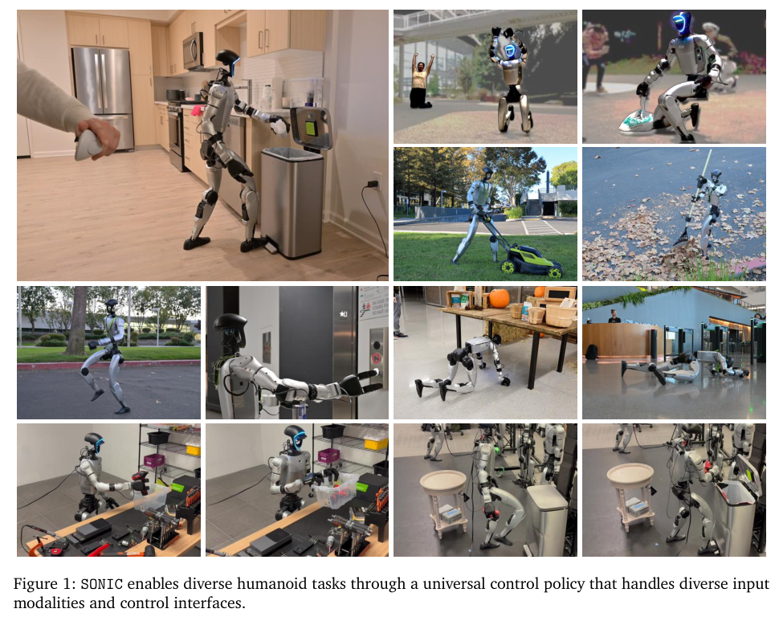
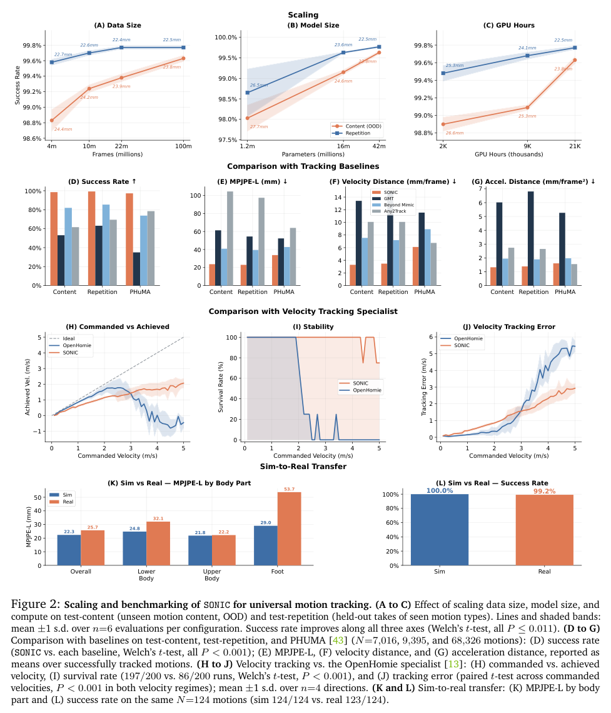

# Zhengyi Luo (罗正宜) — 2025–2026 Humanoid & Embodied AI Research Profile

2026-11-15 · 罗正宜 (Zhengyi Luo) · NVIDIA GEAR · 有来源缺口

[本地原件归档](../../../raw/651099f6a9d2fce9fae2fb242e5eb1d7262dd29b5031a9bdcf3d0aedc273ba32) · 固定材料版本 `digest-material-651099f6a9d2fce9fae2fb242e5eb1d7262dd29b5031a9bdcf3d0aedc273ba32@1` · [一手原站](https://www.zhengyiluo.com/) · [触发线索（zhengyiluo.com）](https://vertexaisearch.cloud.google.com/grounding-api-redirect/AUZIYQEUVPGU-mlnD_tfmAu8tMsCzFclMMq0m1T4FlX5XFzkCcI-OHuDB7kTyMrBz0E0_bkXarL7ylk7khGRpIGmnEX9gpdSpZ4v1DqsK_OcAxYCSQ==)

## 深度拆解与复核

> 口径与利益披露（信源归属）：本档案上游源自罗正宜（Zhengyi "Zen" Luo）个人学术主页（[zhengyiluo.com](https://www.zhengyiluo.com/)）及其在 CMU Robotics Institute（导师 Kris Kitani）与 NVIDIA GEAR Lab（2025 年 5 月加入）主导或共著的 2025–2026 年学术论文序列。作者主页天然筛选已接收顶会与正面 Benchmark 指标（如 Science Robotics、CVPR、ICLR、ICCV、RSS、ICRA），对未泛化失败案例、商业动捕闭源数据成本与集群算力投入存在正样本展示偏差。

### 一、技术演进主线：从真机动力学对齐到百万级规模化全身运动先验

罗正宜的 2025–2026 研究工作完整串联了人形机器人（Humanoid）从底层仿真动力学校准走向视觉端到端操控的四层架构升级，详情可与库内既有访谈导读 [专访罗正宜：关于SONIC全身控制框架的访谈](专访罗正宜%EF%BC%9A关于SONIC全身控制框架的访谈.md) 交叉对照：

1. 物理对齐与统一运动底座（2025 前序）：
   - HOVER（ICRA 2025，[arXiv:2410.21229](https://arxiv.org/abs/2410.21229)）：通过多模式 DAgger 蒸馏将根速度跟踪、关节角跟踪与末端运动学控制统一进单一策略，在 Unitree H1 与 Unitree G1 机载端以 100 Hz 频率运行，往返延迟 15–25 ms（仿真物理子步 1000 Hz）。
   - ASAP（RSS 2025，[arXiv:2502.01143](https://arxiv.org/abs/2502.01143)）：采用两阶段真机残差动力学对齐（Delta Residual Action Model）弥合仿真与物理摩擦/电机响应落差，在 Unitree G1 敏捷跳跃与踢腿等全身技能中将运动追踪误差最多降低 52.7%。
   - UniPhys（ICCV 2025 Highlight，[arXiv:2504.12540](https://arxiv.org/abs/2504.12540)）与 PDC（CVPR 2025 Humanoid Agents Workshop Best Paper，[arXiv:2505.12278](https://arxiv.org/abs/2505.12278)）：前者探索基于 Diffusion 的规划与控制统一模型，后者确立感知即接口（Perception-as-Interface）纯视觉主动注视框架（策略 30 Hz、仿真 120 Hz）。
2. 规模化全身运动基础模型（2025–2026 拐点）：
   - SONIC（Science Robotics 2026 年 8 月，[arXiv:2511.07820](https://arxiv.org/abs/2511.07820)）：将全身运动跟踪从单任务小策略扩增至 1.2M–42M 参数规模，吃进 700 小时、33 类动作、超 100M 帧人类动捕数据并消耗 9,000–21,000 GPU-hours 分布式 PPO 训练；通过 FSQ 统一离散潜空间，让手柄、VR、人类视频与 GR00T N1.5 等 VLA 上层规划直接驱动同一套冻结底层控制器，详见库内 [专访罗正宜：关于SONIC全身控制框架的访谈](专访罗正宜%EF%BC%9A关于SONIC全身控制框架的访谈.md)。
   - BFM-Zero（ICLR 2026，[arXiv:2511.04131](https://arxiv.org/abs/2511.04131)）：基于无监督 RL 与 Forward-Backward (FB) 潜表示构建可提示行为基础模型（Promptable BFM），在 Unitree G1 上实现零样本追踪/目标到达与少样本适配；后续 2026 年 InterEvolve 测试时演化框架在其底座上将 G1 目标条件任务成功率从 8% 抬升至 86.5%。
3. 纯视觉 Pixel-to-Action 真机操控（CVPR & ICLR 2026）：
   - VIRAL（CVPR 2026，[arXiv:2511.15200](https://arxiv.org/abs/2511.15200)）与姊妹篇 Doorman（CVPR 2026，[arXiv:2512.01061](https://arxiv.org/abs/2512.01061)）：基于 Isaac Lab 大规模纯 RGB 视觉 + 本体感知训练，零样本迁移至物理 Unitree G1 完成铰接推拉门等接触密集型长程任务；Doorman 平均比人类遥操作快 7.15 秒（提速最高 31.7%），其中 GRPO 后微调阶段带来 20%–30% 的长程任务成功率增益。
   - PLD（ICLR 2026，[arXiv:2511.00091](https://arxiv.org/abs/2511.00091)）：提出 Probe-Learn-Distill 残差 RL 自演进管线用于 VLA 模型数据生成，在 LIBERO 基准达 99% 成功率、SimplerEnv 提升超 50%，并在 Franka 真机插装与多步操作任务中录得 100% 成功率。

### 二、机制拆解与原位工程复核

✅ 口径核查（本工作台核查）：把罗正宜九篇工作按「控制层与感知层耦合方式」拆开可见一条清晰分水岭——HOVER、ASAP 与 SONIC 均属==强本体状态与动捕先验驱动的底层运动控制器==（Running at 50–100 Hz），解决「站得稳、跟得准」；而 VIRAL、Doorman 与 PLD 则把瓶颈上移至==部分可观测纯 RGB 像素空间与残差策略微调（GRPO / Residual RL）==，解决「看得见接触状态变化并跨过长程死锁」。

⚠️ 边界核查（本工作台推断）：Doorman 超越人类遥操作 31.7% 耗时的对比基准是「存在图像/手柄延迟的人类遥操作员」，且测试集中于门把手与推杆等刚性铰接结构；该指标不能直接外推为机器人全面超越人手在柔顺织物或复杂遮挡环境中的灵巧操作效率。

⚠️ 算力与数据复核（本工作台核查）：SONIC 的 42M 参数与 21,000 GPU-hours 训练消耗表面看似不大，但其前提是依赖 700 小时高精度商业光学动捕数据与 Isaac Lab 万卡级并行刚体仿真底座；对于缺乏高保真全身动捕资产和专属 GPU 集群的中小团队，真正高门槛的并非模型参数量本身，而是==动捕重定向数据管线与真机安全边界校准（Sim-to-Real Safety Envelope）==。

本工作台推断：NVIDIA GEAR Lab 正在把这条技术栈合拢为「上层 VLA/World-Action Model 输出低频语义或潜空间指令，中层 BFM-Zero/VIRAL/Doorman 负责视觉接触反馈，底层 SONIC 冻结控制器提供高鲁棒全身平衡」的三段式分层架构。这一分工将人形控制从每换一个任务重训一套 PPO 奖励函数，推进到类似视觉预训练底座的复用范式。

### 观点与可反驳条件

- ==观点==：罗正宜团队 2025–2026 序列证明，人形机器人全身控制的胜负手已从单任务奖励工程（Reward Engineering）转向「大规模动捕运动先验（SONIC/BFM-Zero）× 像素级视觉强化学习微调（VIRAL/Doorman/PLD）」的分层组合，其中底层运动先验一旦跨越约 100M 帧与千万级参数门槛即可冻结复用，真正决定商业落地速度的是上层像素到动作（Pixel-to-Action）的长程接触稳定性。
- ==推翻条件==：
  1. 若 2027 年底前开源社区或独立第三方实验室在物理 Unitree G1 等量产双足平台上，无法以冻结的 SONIC 类全身底座跨场景复现 >=80% 的开放世界多门型/非标物体操作成功率，而是仍需针对每类新场景重新联合微调底层运动权重，则「底层运动先验可冻结复用」的分层收敛判断被推翻。
  2. 若纯端到端大规模视频-动作模型（VLA/WAM）在无需独立 RL 残差对齐（ASAP/GRPO）与光学动捕先验的条件下，直接以单模型端到端频率（>=50 Hz）在敏捷全身控制与接触操控上同时超越 SONIC + Doorman 组合，则分层式全身运动跟踪底座的必要性将被削弱。

---

## 原文摘录与一手信源存证

> 【信源巡检核心摘要】 罗正宜（NVIDIA GEAR Lab研究科学家，2025年5月加入；CMU博士）个人主页发表更新，涵盖2026年最新论文：SONIC（Science Robotics 2026年8月，超大规模全身运动跟踪控制）、VIRAL与Doorman（CVPR 2026）、PLD与BFM-Zero（ICLR 2026），以及2025年UniPhys（ICCV 2025 Highlight）、PDC（CVPR 2025 Workshop最佳论文）、ASAP（RSS 2025）和HOVER。
> — 原文摘录，文字段落 1；证据 `digest-material-651099f6a9d2fce9fae2fb242e5eb1d7262dd29b5031a9bdcf3d0aedc273ba32-excerpt-1@1`

一手材料：

- Zhengyi Luo (罗正宜) — Personal Academic Homepage & 2025–2026 Publications · 罗正宜 (Zhengyi Luo) · NVIDIA GEAR · [原站](https://www.zhengyiluo.com/) · [主体档案：NVIDIA GEAR Lab](../entities/labs/NVIDIA%20GEAR%20Lab.md) / [主体档案：罗正宜](../entities/people/%E7%BD%97%E6%AD%A3%E5%AE%9C.md) · [本地原件](../../../raw/7036a2b380a7e2882ee3943af41e2fcdcba2658795b702294783444ceb9a62d0)
  材料版本 `digest-material-7036a2b380a7e2882ee3943af41e2fcdcba2658795b702294783444ceb9a62d0@1`；获取方式 `search_web_verified_summary`。
  > Author: Zhengyi ("Zen") Luo — Senior Research Scientist at NVIDIA GEAR Lab (joined May 2025); Ph.D. from Carnegie Mellon University (CMU) Robotics Institute (advised by Prof. Kris Kitani); B.S. — 原文提取
  > 2. VIRAL (CVPR 2026; arXiv:2511.15200): "Visual Sim-to-Real at Scale for Humanoid Loco-Manipulation" — Isaac Lab whole-body visual loco-manipulation policies (RGB + proprioception) with zero-shot transfer to physical Unitree G1. — 原文提取
- SONIC: Supersizing Motion Tracking for Natural Humanoid Whole-Body Control · Zhengyi Luo et al. / Science Robotics · [原站](https://arxiv.org/abs/2511.07820) · [主体档案：NVIDIA GEAR Lab](../entities/labs/NVIDIA%20GEAR%20Lab.md) / [主体档案：罗正宜](../entities/people/%E7%BD%97%E6%AD%A3%E5%AE%9C.md) · [NotebookLM](https://notebook.google.com/notebook/33f0076b-fc09-42cc-9cd9-fecfb847ce1c) · [Drive](https://drive.google.com/file/d/1lh1mp-C2npU2dCE7foHM62SXcgfw0R-T/view?usp=drivesdk)
  材料版本 `digest-material-6580f9223b504c6420eb409bca849bdd968cec17af5c2e7e3c395bb9e1df4267@1`；获取方式 `http_pdf`。
  > Despite the rise of billion-parameter foundation models trained across thousands of graphical processing units (GPUs), similar scaling gains have not been shown for humanoid control. — PDF p.1
  > Over the past decade, artificial intelligence has scaled rapidly: the generative pretrained transformer (GPT) \[1\] family of models is trained on 25,000+ graphical processing units (GPUs) with trillions of tokens; video and image-generation models \[2–6\] leverage thousands of GPUs processing billions of images. — PDF p.1

归属与范围：完成 zhengyiluo.com 一手主页溯源并复用库内已归档 SONIC（arXiv:2511.07820）全本 PDF；补齐罗正宜 2025–2026 年九篇核心论文（SONIC、VIRAL、Doorman、BFM-Zero、PLD、UniPhys、PDC、ASAP、HOVER）的 arXiv 出处、技术演进脉络与 Unitree G1/H1 真机关键量纲，并与库内既有 SONIC 访谈导读建立同目录相对引用；8 篇伴随论文全文 PDF 与第三方硬件独立复现保留来源缺口。

来源缺口：

- `unavailable`：zhengyiluo.com 原始网页 HTML 及 VIRAL (arXiv:2511.15200)、Doorman (arXiv:2512.01061)、BFM-Zero (arXiv:2511.04131)、PLD (arXiv:2511.00091)、UniPhys (arXiv:2504.12540)、PDC (arXiv:2505.12278)、ASAP (arXiv:2502.01143)、HOVER (arXiv:2410.21229) 8 篇伴随论文完整 PDF 尚未本地下载全本，当前仅归档主页检索核验文本与库内既有 SONIC 完整 PDF。 [线索](https://www.zhengyiluo.com/)
- `pending_verification`：各论文报道的 Unitree G1 / H1 真机指标（Doorman 较人类遥操作快 31.7%、ASAP 追踪误差最多降 52.7%、PLD 在 LIBERO 达 99% 与真机 100%、BFM-Zero 经 InterEvolve 升至 86.5%）均源自作者团队实验条件与任务边界，尚缺独立第三方实验室硬件对照复现。

[返回赛道总览](../赛道总览.md#digest-651099f6a9d2fce9) · [返回导读索引](README.md) · [主体档案库](../entities/README.md)
