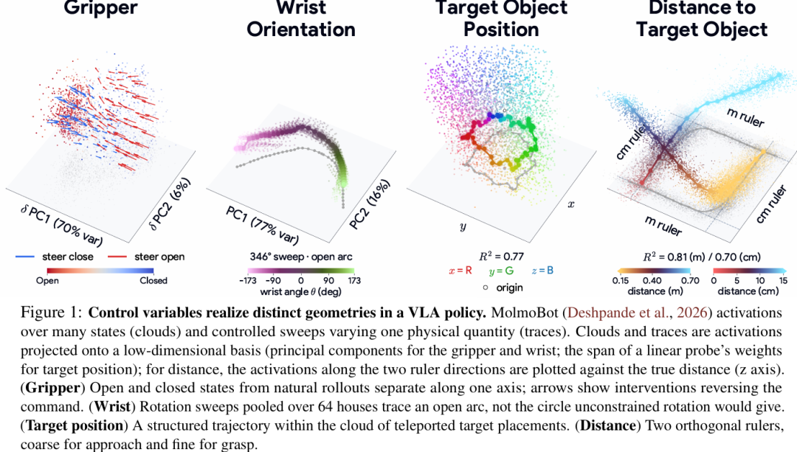
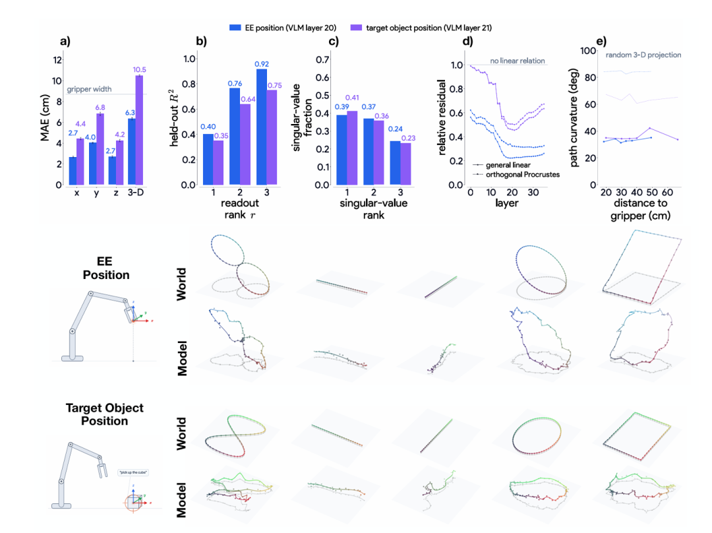
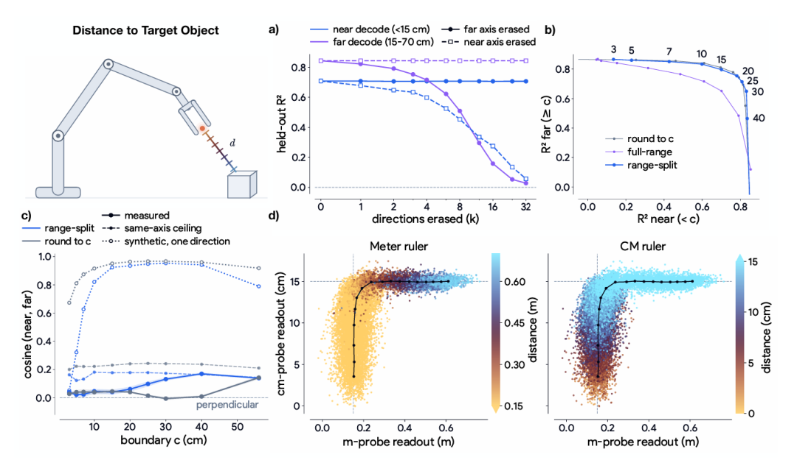
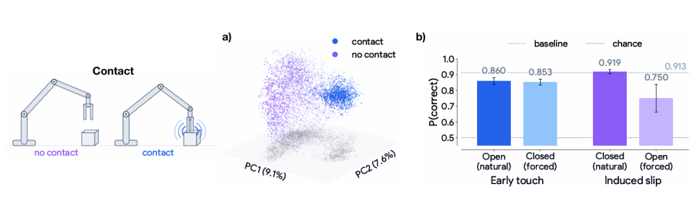
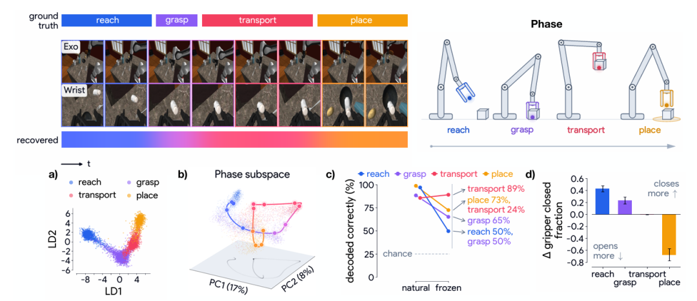
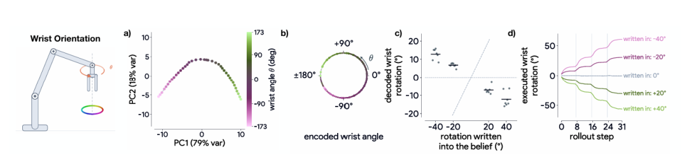
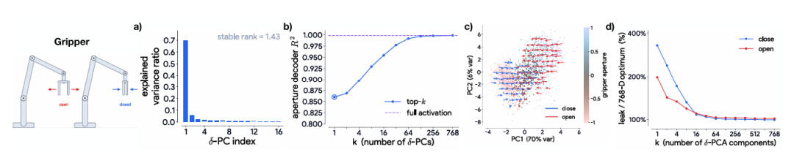
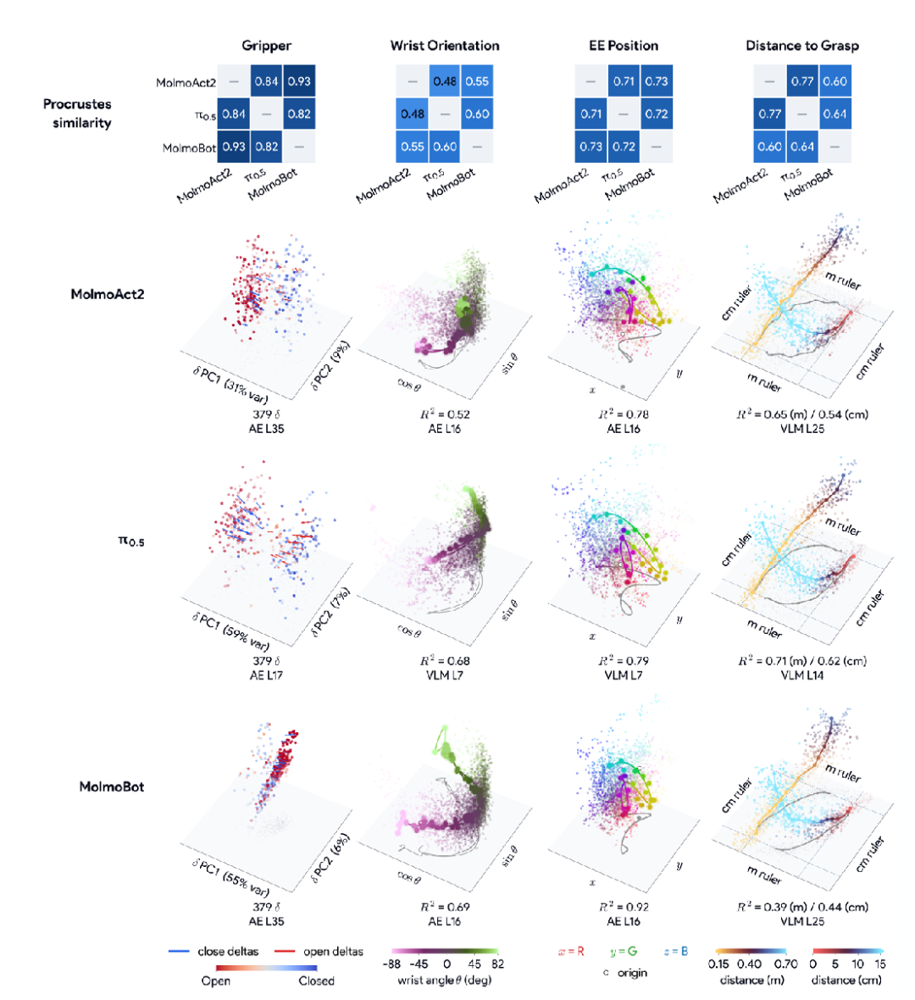

# 【慢科研】VLA如何在内部表示物理世界？

2026-10-16 · arXiv:2610.20840 · Goodfire AI & Harvard/Stanford · 已整理

[本地原件归档](../../../raw/7a8f304705ef4aa6fe127da3930a592bc15a055c9eb3cb84d3705e30a2a229aa) · 固定材料版本 `digest-material-7a8f304705ef4aa6fe127da3930a592bc15a055c9eb3cb84d3705e30a2a229aa@1` · [一手原站](https://arxiv.org/abs/2610.20840) · [触发线索（human five）](https://mp.weixin.qq.com/s/cdTzurPq6TqqSOT6TZHnGA)

> [!IMPORTANT]
> 用户关注点（TG）：看不懂...

## 针对性追查与回应

### 一、 直觉降维与第一性原理导读：先用 3 个直觉问题搞懂这篇论文在干什么

> 给读者的定心丸：这篇论文之所以读起来晦涩，是因为作者把原本非常直观的「给机器人大脑做核磁共振和电击实验」，包装成了微分几何与流形代数的学术黑话（比如「概念实现 $(\mathcal{F}, \epsilon)$-realization」「正交 Procrustes 映射」「拉回引导向量 Pullback Steering」）。只要先抓住下面 3 个第一性原理直觉问题，整篇论文的 8 张实验图就会瞬间变得像看体检报告一样清楚。

#### 1. 问题一（问题本质）：VLA 看着画面抓杯子时，到底是「真懂三维物理的引擎」，还是「背诵像素到关节角的条件反射复读机」？
- 具象比喻（考场学霸 vs 背题机器）：
  - 想象两个都在驾校考过倒车入库的学员。真懂空间几何的学员脑子里有一张三维俯视图：他知道车尾离库角还有 50 厘米 还是 5 厘米，知道方向盘打满一圈会撞上限位死点，知道刹车踩停只是暂停而不是挂挡熄火。
  - 死记硬背的像素复读机根本不知道什么是三维空间：他只是背下了口诀——「当左后视镜下沿刚好压住地上那条白线像素时，右手往死里拧方向盘；当画面不动了，立刻松离合」。一旦考场换了条轮胎印、地面反光变了，或者前车挡了一下让他中途停了 2 秒，复读机就会当场把方向盘拧断或撞墙。
- 具身智能赛道的头号悬案：今天主流的 VLA（Vision-Language-Action，视觉-语言-动作模型，如 OpenVLA、RT-2、$\pi_{0.5}$、MolmoBot、MolmoAct2），本质上是把「在互联网图文上预训练好的视觉语言大模型（VLM，如 SigLIP/DINOv2 + Llama/Gemma/Molmo2）」直接拿来微调输出机械臂关节角度（或接入 Flow Matching 动作生成头 Action Expert）。全行业都在争论一个根本问题：这种端到端网络内部，到底有没有真正构建起三维物理世界的几何坐标系、运动速度和力接触状态，还是只学会了一堆脆弱的统计捷径？

#### 2. 问题二（实验方法）：不拆开重写模型，怎么给正在干活的机器人做「脑电图 / 核磁共振（Probing）」与「脑电极微电流刺激（Steering）」？
- 为什么以前的方法不够用（从「能不能读出」到「神经几何 Neural Geometry」的跃迁）：
  - 以前的可解释性研究主要干两件事：一是插一根线性探针（Linear Probe）进去，看能不能从某一层神经元激活值里用线性回归算出「杯子在哪」；二是用稀疏自编码器（SAE）在线性表征假说（LRH，Linear Representation Hypothesis）下找概念，默认「一个物理概念 = 神经元空间里的一条直线方向」。
  - 本文作者指出一个致命盲区：「能读出来（线性可读性）」不代表「形状是对的（所实现的几何结构 Realized Geometry）」，更不代表「模型真的用它来控制动作」。好比一张被揉成一团的纸，你在某个投影角度也能读出上面的字，但纸本身是弯曲折叠的；如果你顺着一条直线去改神经元，就会直接戳穿纸面，让机器人动作彻底崩坏。
- 本文的三步「脑科学体检法」：
  1. 第一步：受控扫描（Controlled Sweeps）画「神经元地形图」：在仿真器 MolmoSpaces 里固定房间和所有其他变量，只单独改变一个物理量（例如用「上帝之手」把目标方块瞬移到桌面不同坐标，或者把机械臂手腕从 -173° 匀速转到 +173°），记录 VLM 和 Action Expert 第 1 层到第 35 层的神经元激活轨迹，用主成分分析（PCA）、线性判别分析（LDA）或岭回归投影出来，直接看这个物理量在机器人脑子里画出了什么几何形状（是三维网格、圆圈、断弧，还是折线）。
  2. 第二步：分布外反常测试（OOD Teleportation / Freeze）测「是不是真懂」：故意制造训练数据里绝不可能出现的反常物理事件——比如机械臂刚伸出一半，突然把杯子瞬移塞进夹爪里（测试它是不是真懂「接触」），或者在伸手半途强行把机械臂冻住不动（测试它是不是真懂「任务进行到哪一阶段」）。
  3. 第三步：脑电极微电流写入（Activation Intervention / Pullback Steering）测「因果控制权」：顺着刚才测出来的神经元几何轨迹，直接往某一层神经元里注入一个微小的偏移向量，看机器人的动作会不会乖乖跟着变——结果抓出了一个令所有人冷汗直流的现象：你往手腕角度神经元里写入 +20°，机械臂不仅不顺时针转 +20°，反而逆时针倒转 -6° 至 -26°（状态信念反向补偿陷阱）。

#### 3. 问题三（核心发现与赛道杀伤力）：VLA 内部哪些物理量学得很扎实，哪些物理盲区直接判了「纯 VLM 微调出动作」的死刑？
- 本工作台推断（VLA 内部物理世界的「红黑榜」全景总结）：

| 物理/控制变量维度 | VLA 内部表征实测结果（MolmoBot / $\pi_{0.5}$ / MolmoAct2） | 物理直觉翻译：它到底学成了什么样？ | 对具身智能工程落地的直接杀伤力与架构启示 |
| :--- | :--- | :--- | :--- |
| ① 静态 3D 空间位置（夹爪 & 目标物体坐标） | 🟢 表现优异：仅凭 2D 像素，VLM 第 20–21 层自发涌现出正交 3D 欧氏子空间（夹爪 $R^2=0.92$，目标 $R^2=0.75$，单轴误差 2.7–6.8 cm 小于夹爪宽度） | 像一个合格的立体视觉测距仪，能在脑子里把桌面 X/Y/Z 三个方向还原成平直的三维网格 | 证明视觉骨干具备静态 3D 空间感知潜力；但跨入真实世界 OOD 场景时，纯仿真模型的测距精度会腰斩（从 $R^2=0.81$ 跌至 0.39） |
| ② 到目标的距离（标量 $d$） | 🟢 精巧适应：在 15 cm 分界点自发分裂为两把互相垂直（余弦 0.04）的尺子——远距「米尺」（15–70 cm, $R^2=0.81$）与近距「厘米尺」（<15 cm, $R^2=0.70$），呈 L 形折线 | 因为神经元浮点精度有限，一把尺子既量远距又量毫米级抓取会爆表，于是网络聪明地造了「望远镜 + 放大镜」两套正交刻度 | 解释了为什么两阶段策略（粗接近 + 细对准）符合神经几何本能；但 15 cm 切换拐点处一旦深度估计跳变，就会在接近转抓取瞬间卡死 |
| ③ 视觉接触检测（Contact） | 🟡 仅限视觉表象：VLM 第 24 层沿单一线性方向分离接触/未接触（LDA 准确率 91.3%），瞬移提前接触或滑脱仍高于随机（85.3% / 75.0%） | 能靠摄像头「看见夹爪挨着杯子了」，但这只是视觉像素重合检测，完全不包含法向夹持力（N）、切向摩擦力、物体质量与刚度 | 面对插接装配、拧瓶盖或易碎物抓取时，视觉上「挨着了」不等于力学上「抓稳了/对准孔位了」，必须引入 ForceVLA2 / SynDexy C1 毫秒级力触觉闭环 |
| ④ 任务阶段进度（Phase：接近/抓取/搬运/放置） | 🔴 致命幻觉（运动暂停 = 阶段切换）：Action Expert 第 24 层虽能分出 4 个阶段簇，但在伸手接近中途强行冻结机械臂，阶段读出立刻以 50% 概率错判为「抓取」，夹爪闭合指令暴增 +43%；放置中途冻结则夹爪提前张开（闭合率暴跌 -68%） | 抓包「条件反射复读机」铁证：因为模型没有跨动作块的时间记忆，它从人类遥操作数据里学到了一个蠢捷径——「只要手臂停下来不动，就该捏紧或松开夹爪」 | 直接解释了为什么真机部署时稍微遇到遮挡、通信卡顿或减速犹豫，VLA 就会在半空中莫名其妙空捏夹爪，或者把还没放稳的杯子半空松手摔碎 |
| ⑤ 周期性旋转与硬件约束（腕部朝向 Wrist） | 🔴 拓扑撕裂：手腕旋转在物理上是圆环，但因硬件限位 [-173°, +173°] 与原始未回绕关节角输入，Action Expert 第 9 层把它编码成一段开口弧线，物理上仅差 14° 的两端在神经元里相隔万里 | 机器人的「大脑视觉区（VLM）」知道转一圈回到原位是同一个画面，但「小脑运动区（Action Expert）」被关节角数字骗了，把圆环硬生生扯断成两条绝不相通的死胡同 | 当机械臂手腕接近 $\pm 173^\circ$ 奇异点附近时，策略无法理解顺时针微转 14° 的等价关系，极易发生大幅度反向甩腕自锁 |
| ⑥ 状态信念 vs 动作指令（干预方向陷阱） | 🔴 恒温器反向补偿：顺着手腕圆弧往神经元里写入 +20°/+40°，机械臂反而朝反方向旋转 -0.3°/度（持续写入累积反偏 1.0–1.3 倍）；而单方向改夹爪动作又会引发 200%–350% 的机械臂关节乱动泄漏 | 许多神经元编码的是「我以为我现在在哪（状态信念）」，而不是「我要往哪动（动作指令）」。你改它的信念等于骗空调「现在室温已经 30 度了」，空调立刻反向猛吹冷风 | 宣告了传统单方向线性干预（1D SAE / Linear Steering）在机器人控制上的破产——不区分「感知信念 vs 动作输出」、不用多维子空间（16–64 维）隔离，任何在线微调或干预都会引发反向补偿与全身关节乱抖 |

- 一句话打通具身智能架构主线：这篇论文用无可辩驳的神经元铁证证明，当前主流 VLA 虽然在静态视觉里拼出了 3D 位置和双尺度距离尺，但在时间阶段推理（把暂停当成抓取信号）、动力学因果（缺乏力/质量/反事实后果预测）与动作拓扑解耦上依然是一个脆弱的「静态几何 + 运动捷径缝合怪」。这正是为什么全球具身智能主航道正加速从「纯 VLM 直接吐动作」转向 「显式世界—动作模型（WAM，如 DreamZero / Ego4WAM 预测未来物理帧）+ 3D 空间动作价值场（VoxPoser / 3D Diffuser Actor）+ 毫秒级视触力小脑（ForceVLA2 / SynDexy C1）」 的根本原因。

---

### 二、 场景与利益标注及一手论文核心身份穿透

- 场景与利益标注：本篇微信稿由公众号 human five 于 2026 年 10 月 16 日编译发布（触发线索），其直接翻译自 Goodfire AI 联合哈佛大学（Harvard University / Kempner Institute）、斯坦福大学（Stanford University）与加州大学圣塔芭芭拉分校（UC Santa Barbara）于 2026 年 10 月 14 日提交至 arXiv 的一手论文 *A Phenomenology of Neural Geometry in Vision-Language-Action Models*（arXiv:2610.20840，v3 更新于 2026 年 11 月 2 日，正文 10 页、全文含附录共 41 页）。
  - 核心利益相关披露：论文通讯及核心资深作者所在机构 Goodfire AI 是旧金山机械可解释性（Mechanistic Interpretability）独角兽（由 Eric Ho、Daniel Balsam 与前 DeepMind 可解释性负责人 Thomas McGrath 创立，2025 年 4 月获 Menlo Ventures 领投、Anthropic 参投的 5,000 万美元 A 轮，2026 年 2 月刚完成 B Capital 领投的 1.5 亿美元 B 轮融资，估值达 12.5 亿美元，核心商业产品为模型内部编程与调试平台 Ember）。
  - 三连发学术造势组合拳：在 2026 年 10 月同一周内，同一批作者（Mozes Jacobs*、Aiden Swann*、Mathilde Papillon*、Thomas McGrath、Matthew Kowal†、Thomas Fel† 等）在 arXiv 连续发布三篇机器人基础模型可解释性论文——① 本篇神经几何分类学（arXiv:2610.20840）；② 提出用多维块稀疏特征提取器（Block-Sparse Featurizers, BSFs）替代单方向 SAE 实现机器人细粒度控制与数据清洗（arXiv:2610.20767）；③ 利用因果分析裁剪 VLA 跨层注意力以降低推理算力开销（arXiv:2610.20750）。其核心学术与商业叙事是：证明传统一维线性探针与单方向 SAE（基于线性表征假说 LRH）不足以驾驭具身智能模型，从而确立 Goodfire 主推的「多维神经几何（Neural Geometry）+ 块稀疏干预工具链」在具身大模型调试与对齐中的基础设施地位。
- 本工作台核查（被测三大 VLA 模型底座与实验环境 100% 还原）：
  1. 主力解剖对象 MolmoBot（arXiv:2603.16861，Deshpande et al., 2026）：由艾伦人工智能研究所（Allen Institute for AI, Ai2）与华盛顿大学联合开源的仿真优先零样本操作策略。其架构将读取场景相机图像与语言指令的 VLM 骨干（基于 Molmo2），与读取机器人本体感知关节状态、通过 流匹配（Flow Matching） 生成连续动作块（Action Chunks）的 Action Expert 配对；Action Expert 在每一层都对 VLM 进行交叉注意力（Cross-Attention）。它运行于程序化合成仿真环境 MolmoSpaces，允许研究者获取所有物理量的绝对真值并在 rollout 中途任意瞬移物体或冻结关节。
  2. 真机跨模型复现对象 $\pi_{0.5}$ 与 MolmoAct2（⚠️ 补全微信稿排版丢失的公式符号）：微信原文第 1、4、5 节多处出现「使用 [空] 和 MolmoAct2 复现」的排版缺失，经核对一手论文原件与图 8（Figure 8），缺失符号均为 Physical Intelligence（Pi） 发布的开放世界泛化 VLA 模型 $\pi_{0.5}$（arXiv:2504.16054），另一模型为 Ai2 发布的面向真机部署的开源权重模型 MolmoAct2（结合 Molmo2-ER 具身推理 VLM 与逐层 KV-cache 条件化 Flow Matching 动作专家），真机评测数据集为涵盖丰富日常操作轨迹的 DROID 数据集。

---

### 三、 原文形式化定义与七大控制变量神经几何逐层拆解（附 8 张一手实验图手把手导读）

#### 1. 理论地基：区分「概念实现（可读性）」与「所实现的几何结构（流形形状）」（原文第 1–2 节 & 图 1）
- 原文核心形式化定义还原：
  1. 数据生成过程：设潜在世界状态汇集了 $K$ 个控制概念 $z = (z_1, \dots, z_K) \sim \mathcal{P}$，每个概念 $c$ 取值于结构化定义域 $\mathcal{V}_c$（光滑流形内在维度为 $d_c$，如二元夹爪开合 $\{0,1\}$、标量距离 $\mathbb{R}_{\ge 0}$、三维空间位置 $\mathbb{R}^3$、腕部旋转群 $SO(2)/SO(3)$）。生成器 $g$ 将潜在状态渲染为观测 $x \sim g(z)$（如 RGB 图像），网络映射 $f$ 将观测编码为某固定层的激活向量 $h = f(x) \in \mathbb{R}^d$（$N$ 个样本按行堆叠记为矩阵 $X$ 与 $H$）。
  2. 定义 1（概念实现 Concept Realization）：给定读出函数族 $\mathcal{F} = \{r: \mathbb{R}^d \to \mathcal{V}_c\}$（本文主要考察仿射读出函数族 $\mathcal{F}_{\text{aff}}$，对应线性可读性 Linear Readability）与损失函数 $\ell$，若 $\inf_{r \in \mathcal{F}} \mathbb{E}[\ell(r(f(x)), z_c)] \le \epsilon$，则称概念 $c$ 在激活 $h$ 中得到了 $(\mathcal{F}, \epsilon)$-实现。这遵循预测性 $\mathcal{F}$-信息（Predictive $\mathcal{V}$-Information）的操作性原则，仅说明信息能否被轻易提取，既不意味着激活空间与概念定义域同构，也不保证策略在因果上使用了该信息。
  3. 定义 2（所实现的几何结构 Realized Geometry）：固定除概念 $c$ 以外的所有上下文变量 $z_{-c}$，仅改变概念 $c$ 的取值 $v \in \mathcal{V}_c$，定义条件激活映射：
     $$\phi_{c, z_{-c}}(v) = \mathbb{E}_{x \sim g(v, z_{-c})}[f(x)]$$
     该映射在激活空间 $\mathbb{R}^d$ 中描绘出的像集轨迹 $\phi_{c, z_{-c}}(\mathcal{V}_c)$ 及其参数化映射本身，即为概念 $c$ 所实现的几何结构。

- 📊 图 1 手把手读图指南（看懂 VLA 脑子里的 4 种基本几何形状）：
  - 第一列（Gripper 夹爪）：底面两个坐标轴是拉回引导向量的前两个主成分（$\delta$ PC1 占 70% var 方差，$\delta$ PC2 占 6% var）。自然 rollout 中的张开（Open，红点）和闭合（Closed，蓝点）分成左右两团点云；图中的红蓝箭头代表「只需要顺着这根轴推一把，就能让夹爪指令从张开反转为闭合」。
  - 第二列（Wrist Orientation 腕部朝向）：底面是 Action Expert 激活的前两个主成分（PC1 占 77% var，PC2 占 16% var）。颜色从粉紫（-173°）渐变到翠绿（+173°）。按常理，手腕转一圈（360°）应该首尾相接画出一个完整的圆圈；但图中汇总 64 个房屋场景的 346° 旋转扫描，画出来的却是一条两头完全断开的马蹄形开弧（open arc）——说明硬件关节限位直接把神经元里的旋转流形撕开了一个口子。
  - 第三列（Target Object Position 目标物体位置）：投影在岭回归线性探针权重张成的三维空间（$x=\text{R}, y=\text{G}, z=\text{B}$，拟合优度 $R^2 = 0.77$）。彩色实线是让目标物体在桌面上按固定几何轨迹瞬移时，神经元激活同步画出的清晰三维轨迹。
  - 第四列（Distance to Target Object 到目标物体的距离）：底面两个水平轴分别是网络内部学到的两把正交尺子——m ruler（米尺，粗尺度，0.15–0.70 m，$R^2=0.81$）与 cm ruler（厘米尺，细尺度，0–15 cm，$R^2=0.70$），竖轴（高度）是真实物理距离。可以看到：当机械臂离目标很远（冷色调蓝青色）时，激活点只沿着 m ruler 轴滑动；一旦进入 15 cm 以内（暖色调橙红色），激活突然拐弯 90°，改沿着垂直的 cm ruler 轴滑动，在底面投影出一条标准的 L 形折线。

---

#### 2. 空间几何（Spatial Geometry）：仅凭 2D 像素，VLM 如何重建三维欧氏位置与正交双尺度距离尺？（原文第 3.1 节 & 图 2–3）
- 原文实验机制拆解：
  - MolmoBot 的 VLM 骨干完全不接收机器人本体感知（Proprioception）关节角输入，必须纯粹从多视角相机像素中推断三个空间变量：末端执行器位置（EE Position）、目标物体位置（Target Object Position）和到目标的距离（Distance to Target）。
  - 位置编码（图 2）：研究者将机械臂瞬移到工作空间上方不同位姿、将目标方块在支撑面上均匀扫描，记录 VLM 各层激活并针对 $\mathbb{R}^3$ 真实坐标拟合秩受限（Rank-$r$）岭回归探针，在留出（Held-out）房屋场景上测试。
  - 距离编码（图 3）：到目标的距离 $d \in \mathbb{R}_{\ge 0}$ 虽然数学上只是一个一维标量，但策略在远距接近阶段（15–70 cm）需要容忍视觉噪声的大范围引导，在近距抓取阶段（<15 cm）则需要分辨到厘米以内的精细对准。由于神经网络激活的浮点数值表示精度（动态范围与信噪比）有限，单一方向无法同时兼顾米级跨度与厘米级分辨率。

- 📊 图 2 手把手读图指南（检验 VLM 里的三维空间到底是不是真的欧几里得空间）：
  - 上排（a）各轴绝对误差 MAE (cm)：蓝色柱代表末端执行器位置（VLM layer 20），紫色柱代表目标物体位置（VLM layer 21），水平灰线是物理夹爪宽度（gripper width，约 8.8 cm）。可以看到，夹爪位置的 X/Y/Z 单轴误差仅 2.7 cm、4.0 cm、2.7 cm（三维合成误差 6.3 cm），目标位置的 X/Y/Z 单轴误差为 4.4 cm、6.8 cm、4.2 cm（全部低于夹爪宽度，三维合成误差 10.5 cm）——意味着仅看像素，网络对位置的定位精度已经足够让夹爪框住物体。
  - 上排（b）留出集 $R^2$ 随读出秩 $r$ 的变化 &（c）秩为 3 读出的奇异值占比：当只允许探针读 1 个维度（$r=1$）时，夹爪和目标的 $R^2$ 只有 0.40 和 0.35；增加到 2 维（$r=2$）升至 0.76 和 0.64；增加到 3 维（$r=3$）时跃升至 0.92（夹爪）和 0.75（目标），且三个奇异值占比非常均衡（夹爪为 0.39 / 0.37 / 0.24，目标为 0.41 / 0.36 / 0.23），证明模型内部绝不是把三维坐标压扁成一维，而是实打实撑开了一个三维子空间。
  - 上排（d）跨层 Procrustes 线性残差 &（e）路径曲率：图（d）横轴是 VLM 层数（0 到 35 层），纵轴是把真实世界三维平移向量映射到激活位移时的相对残差（越低越接近刚体保距变换）。在 第 20–21 层附近残差降到最低谷（夹爪一般线性映射残差约 0.23、正交 Procrustes 旋转映射残差约 0.31）。图（e）展示真实世界里的直线轨迹在激活子空间里的弯曲程度（path curvature）：随机三维投影的曲率高达 ~85°（乱拐弯），而 VLM 子空间内的轨迹曲率稳定在 33°–42°，说明「现实里走直线，在神经元空间里也基本走直线」（见中排和下排五组 World 真实轨迹与 Model 神经元子空间投影轨迹的一一对应）。

- 📊 图 3 手把手读图指南（看懂为什么「一个距离数字」在脑子里会裂变成两把垂直的尺子）：
  - （a）方向擦除实验（directions erased k）——证明两把尺子互不干扰：横轴是从第 21 层激活中迭代擦除（投影归零）的探针方向数量 $k$（从 0 到 32 个方向），纵轴是留出集解码精度 $R^2$。
    - 看紫色实线：当擦除 32 个「远距离方向」后，远距离（15–70 cm）解码 $R^2$ 从 0.84 暴跌至接近 0；但与此同时，蓝色实线（近距离 <15 cm 解码精度）纹丝不动，始终保持在 0.71。
    - 反过来，当擦除 32 个「近距离方向」时（蓝色虚线从 0.71 跌至 0），远距离解码（紫色虚线）依然稳如泰山停在 0.84。这直接证明：远距和近距根本不在同一个子空间里编码。
  - （b）帕累托前沿寻优 &（c）两把尺子的夹角余弦值 `cosine(near, far)`：
    - 图（b）测试把远近分界点 $c$ 设在 3 cm 到 40 cm 之间时，远距 $R^2$（纵轴）与近距 $R^2$（横轴）的权衡曲线，右上角拐点清晰落在 c = 15 cm（帕累托最优分界点）。
    - 图（c）回应了一个核心质疑：「是不是因为你人为按 15 厘米截断了数据，才把两个探针逼成了垂直？」作者在沿单一方向编码距离的合成激活（synthetic, one direction，顶部灰色/蓝色点线）上做完全相同的截断和分区间拟合，结果两个探针的余弦值高达 0.95（截断目标值 round to c）和 0.92（分区间拟合 range-split），即几乎完全平行。而在真实 MolmoBot 模型中（底部实线 measured），无论用截断法还是分区间拟合，远近两个探针方向的余弦值都只有 0.04（近乎 90° 正交垂直，远低于分半拟合同轴上限 0.18–0.23）。
  - （d）L 形正交双标尺投影（Meter ruler vs CM ruler）：横轴是米尺探针读数（m-probe readout (m)），纵轴是厘米尺探针读数（cm-probe readout (cm)）。左图按远距离（0.15–0.60 m）着色，右图按近距离（0–15 cm）着色。可以看到，黑色均值轨迹先沿着水平横轴从 0.60 m 走到 0.15 m（此时纵轴厘米尺饱和停在 15 cm 不动），一旦跨过 0.15 m 门槛，轨迹立刻发生 90° 垂直折转，改沿纵轴从 15 cm 精细下降到 0 cm（此时横轴米尺饱和锁死在 0.15 m）。
- 本工作台核查（✅ 数学证明严密；⚠️ 揭示纯视觉测距的跨场景校准软肋）：
  - ✅ 正交双标尺的发现极具启发性：它从信息论角度证明，有限位宽的神经网络面对跨数量级控制任务（米级导航 vs 毫米级操作）时，会自发通过子空间正交分解（Orthogonal Subspace Splitting）来避免量化噪声淹没精细控制信号。
  - ⚠️ 本工作台推断（工程隐患）：正因为远近两把尺子在 15 cm 处发生 90° 正交切换，且完全依赖 VLM 从 2D 像素单目/多目推断深度，一旦部署现场的相机焦距、桌面高度或背景纹理变化导致视觉深度估计偏离 3–5 cm，策略就会在「该从米尺切换到厘米尺」的 15 cm 临界区发生子空间切换错位——这直接解释了为什么许多 VLA 在大范围伸手接近阶段看起来很丝滑，却总是在距离物体最后 10–15 cm 的减速对准阶段突然卡顿或抓偏。

---

#### 3. 任务结构（Task Structure）：视觉接触很稳，但「任务阶段」被抓包为脆弱的运动速度假象（原文第 3.2 节 & 图 4–5）
- 原文实验机制拆解：
  - 接触（Contact，图 4）：在 VLM 第 24 层激活上对仿真器真实接触标签拟合二分类线性判别分析（LDA）。为了排除「接触只是任务时间步的巧合代理」，作者设计了两种极端分布外（OOD）反常干预：① 提前接触（Early touch / Closed (forced)）：在机械臂刚伸手、还没到目标位置时，用仿真器把目标方块瞬移塞进夹爪里；② 诱发滑脱（Induced slip / Open (forced)）：在机械臂已经抓住物体搬运途中，突然把物体从夹爪里瞬移抽走。
  - 任务阶段（Phase，图 5）：在 Action Expert 第 24 层激活上对整条抓取放置（Pick-and-Place）轨迹的四个阶段——伸手接近（reach）、抓取（grasp）、搬运（transport）、放置（place）拟合多类别 LDA。随后作者做了一个杀伤力极强的干预实验：在各个阶段中途，强行将机械臂关节冻结静止（frozen）若干步，观察模型内部的阶段读出和实际输出的夹爪动作会发生什么变化。

- 📊 图 4 手把手读图指南（测试机器人到底知不知道「我碰到东西了」）：
  - （a）无监督主成分点云：仅对自然 rollout 的 VLM 第 24 层激活做无监督 PCA（PC1 9.1%, PC2 7.6%），未接触（紫色点）与接触（蓝色点）就已经自然分离成两团。
  - （b）自然状态 vs 强制瞬移干预下的解码准确率 `P(correct)`：顶部虚线 0.913（91.3%）是自然 rollout 整体解码准确率，底部点线 0.5（50%）是瞎猜随机水平（chance）。
    - 左侧两组蓝柱（Early touch 提前接触测试）：自然未接触状态解码准确率为 0.860（86.0%）；当在半途强行把物体瞬移进夹爪制造意外接触（Closed (forced)）时，同一个探针依然以 0.853（85.3%） 的高准确率认出了「已经接触」。
    - 右侧两组紫柱（Induced slip 诱发滑脱测试）：自然抓取接触状态解码准确率为 0.919（91.9%）；当半途把物体从夹爪中强行抽走制造滑脱（Open (forced)）时，探针仍能以 0.750（75.0%） 的准确率（显著高于 50% 随机基线）识别出「失去接触」。

- 📊 图 5 手把手读图指南（全文最震撼的铁证：看 VLA 是怎么被「暂停 1 秒」骗得半空乱抓和摔东西的）：
  - 上排时间轴与下排（a）（b）阶段子空间：一条标准抓取放置任务按顺序分为 reach（蓝，伸手接近）$\to$ grasp（紫，抓取）$\to$ transport（红，搬运）$\to$ place（橙，放置）。在自然状态下（图 5a 的 LDA 投影与图 5b 的前三个主成分 PC1 17%, PC2 8%），四个阶段像接力赛一样形成四个清晰的簇，轨迹顺滑地走完一圈。
  - 下排（c）冻结机械臂后的阶段解码坍塌（natural vs frozen）：看横轴从左（natural 自然运动）到右（frozen 强行把机械臂定住不动）的四条折线：
    - 蓝色折线（reach 伸手接近阶段）：自然状态下解码准确率接近 100%；一旦在伸手半途把机械臂冻住（frozen），准确率瞬间暴跌至 50%，有一半时间被模型内部误判成了 grasp（抓取阶段，reach 50%, grasp 50%）。
    - 橙色折线（place 放置阶段）：冻结后准确率从 100% 跌至 73%，有 24% 被误判为 transport。
  - 下排（d）阶段错判直接引发的灾难性动作后果（$\Delta$ gripper closed fraction）：纵轴是「冻结状态减去自然状态下，策略发出夹爪闭合指令的步数比例变化」。
    - 看第一根蓝色柱（reach）：在伸手接近半途仅仅因为机械臂停住不动，策略下达「夹爪闭合」指令的比例直接飙升了 +43 个百分点（+0.43）——也就是说，机械臂离杯子还有一大截，就因为停顿了一下，它就在半空中提前把夹爪捏上了。
    - 看第四根橙色柱（place）：在放置阶段停住不动，策略下达「夹爪闭合」指令的比例直接暴跌了 -68 个百分点（-0.68，即疯狂下达张开夹爪指令）——哪怕杯子还没放到桌面上，只要手臂一停，它就立刻松开爪子把东西摔下去。
- 本工作台核查（❌ 抓包纯 VLA 架构的致命时序缺陷）：
  - 为什么会发生这种荒唐的错觉：作者一针见血地指出，因为 MolmoBot（以及大多数基于动作块 Action Chunking 的主流 VLA）在每个推理周期不接收历史动作序列，也没有显式的循环时间状态（Recurrent State / Memory），它必须在每个动作块里纯粹靠当前状态去「猜」自己正处于哪个阶段。而在人类遥操作演示数据集中，机械臂只有在「到达目标准备闭合夹爪（Grasp）」和「到达终点准备松开夹爪（Place）」这两个瞬间才会减速停顿。于是网络学到了一条致命的伪因果捷径（Spurious Correlation）：「手臂静止 $\implies$ 阶段转换已到达 $\implies$ 立刻切换夹爪开合状态」。
  - 本工作台推断（对真机部署的直接解释力）：这完美解释了为什么在实验室理想无遮挡条件下成功率 90%+ 的 VLA，一上产线遇到动态避障减速、相机帧率抖动、网络通信延迟或视觉短暂遮挡导致机械臂微停顿时，就会频繁出现「半空空抓」或「半途掉件」的诡异故障。

---

#### 4. 动作几何与「状态信念 vs 动作指令」悖论：为什么你往左改神经元，机械臂反而往右转？（原文第 3.3 节、框 1 & 图 6–7）
- 原文核心概念区分（框 1：State Belief vs. Action Command）：
  - 仅凭探针能从某层神经元读出某个物理量（如腕部角度），根本无法区分这层神经元编码的到底是「状态信念（State Belief）」还是「动作指令（Action）」：
    1. 状态信念（State Belief，相当于机器人的「本体感觉表」 vs 恒温器温度计）：如果神经元编码的是模型「认为当前手腕处于多少度」，那么当你人为往这层神经元里写入 +20° 时，等于篡改了它的传感器读数，骗它说「你的手腕已经多转了 +20°」。由于闭环策略的目标始终是缩小「当前感知状态」与「目标状态」之间的差距，策略就会产生反向补偿效应（Compensation Effect）——立刻下达向反方向旋转的动作指令去「纠偏」。
    2. 动作指令（Action Command，相当于直接踩油门/方向盘电机）：如果神经元直接表示即将下达给电机的控制指令，编辑它才会直接同向改变行为。为了找到纯粹控制单一动作（如只开关夹爪而不晃动机械臂）的编辑方向，必须从输出动作端利用梯度反向传播拉回（Pullback）到激活空间求解引导向量。

- 📊 图 6 手把手读图指南（看硬件限位如何把圆环扯成断弧，以及「改信念引发反向动作」的实证）：
  - （a）腕部滚转扫描的开弧（Open Arc）：固定其他关节，让腕部滚转关节（Wrist Roll）扫过其完整物理行程 -173° 至 +173°（共 346°）。在 Action Expert 第 9 层前两个主成分（PC1 79% var, PC2 18% var）平面上，轨迹并没有闭合成圆，而是形成一条倒 U 形开放弧线。最左端粉点（-173°）和最右端绿点（+173°）在真实三维物理世界里只差 14°，相机拍到的画面也几乎一模一样，但在 Action Expert 神经元空间里却相隔最远（因为 Action Expert 直接吃原始未做周期回绕 unwrapped 的关节角数值；如果在仿真里解除限位转满 360°，VLM 激活会回到起点，而 Action Expert 激活不会回到起点，见原文附录图 22）。
  - （b）MLP 自编码器流形对齐：因为在弯曲开弧上不同位置的切线方向不同，不能直接加一个固定向量来旋转角度。作者训练了一个小型多层感知机（MLP）自编码器，把开弧精确映射到单位圆（encoded wrist angle $0^\circ, \pm 90^\circ, \pm 180^\circ$）上，在圆上旋转 $\Delta \theta$ 后再解码回激活空间，从而构造出严格贴合神经元几何形状的编辑向量。
  - （c）单步干预的反向响应 &（d）持续干预的累积反向旋转：
    - 看图（c）：横轴是写入神经元信念的角度（rotation written into the belief: -40°, -20°, +20°, +40°），纵轴是模型单步解码输出的腕部旋转动作（decoded wrist rotation）。蓝色虚线对角线代表「如果这层是动作指令，写入 +20° 应该输出 +20°」；但真实实验点（7 个留出场景均值）却呈负斜率反比关系——每往神经元里写入 +1°，机械臂输出的旋转动作反而朝相反方向转 -0.3°。
    - 看图（d）：如果在 rollout 的每一步（横轴 rollout step 0–31，竖线为动作块边界）持续写入编辑，反向修正会不断累积——写入 -40°（顶部粉色曲线）反而驱动机械臂执行了约 +55° 的正向旋转；写入 +40°（底部绿色曲线）反而驱动机械臂执行了约 -55° 的反向旋转，最终旋转幅度达到写入角度的 1.0—1.3 倍。

- 📊 图 7 手把手读图指南（为什么改一个最简单的「夹爪开关」，只用一维向量也会让整条机械臂乱抖？）：
  - （a）拉回引导向量的方差解释率 &（b）解码精度：作者在 Action Expert 第 32 层针对 379 个采样状态，通过动作输出梯度优化求解「只把夹爪指令反转（张开变闭合、闭合变张开），同时让机械臂其余关节保持不动」的 768 维拉回引导向量 $\delta$。图（a）显示第一主成分（$\delta$-PC1）独自解释了约 70% 的方差（稳定秩 stable rank = 1.43）；图（b）显示仅用 $\delta$-PC1（$k=1$）就能以 $R^2 \approx 0.86$ 解码夹爪开度（用满 64–768 个分量则逼近紫虚线 1.000）。
  - （c）点云分离与引导向量场：自然激活按夹爪张开（红）与闭合（蓝）分成两团，每一个求解出的引导向量箭头都精准地从当前状态簇指向对面簇。
  - （d）跨关节泄漏率（leak / 768-D optimum (%)）——打破「一维概念就够用」的迷思：横轴是引导向量保留的主成分个数 $k$（从 1 到 768），纵轴是干预夹爪时对机械臂其余关节造成的额外扰动泄漏（以完整 768 维引导向量的最小扰动为 100% 基准）。可以看到：如果只沿着第一主成分（$k=1$）去推夹爪，会让机械臂关节产生高达 200%（张开，红线）到 350%（闭合，蓝线）的连带乱动泄漏；必须把主成分维度增加到 k = 16 至 64 维，才能把对机械臂关节的副反应压回 100% 基线水平。

---

#### 5. 真实世界迁移验证：在 DROID 真机数据上横评 MolmoBot、$\pi_{0.5}$ 与 MolmoAct2（原文第 4 节 & 图 8）
- 原文实验设计：为了验证上述几何结构到底是不是 MolmoSpaces 仿真器或 MolmoBot 单一架构制造的假象，作者取真实世界 DROID 机器人操作数据集中的回合轨迹，在 MolmoBot、$\pi_{0.5}$ 与 MolmoAct2 三个模型上重复了分析（聚焦真机可直接测量的四个变量：夹爪开度 Gripper、腕部朝向 Wrist Orientation、末端执行器位置 EE Position 以及用「到最终抓取点距离」代理的距离 Distance to Grasp）。

- 📊 图 8 手把手读图指南（三大 VLA 模型真机「脑结构」横向大比武）：
  - 顶部热力矩阵（模型两两之间的 Procrustes similarity 几何相似度）：数值越高（越接近 1.0），说明两个不同模型在真机数据上学出的神经元几何形状越一致（打乱变量的随机零假设基线：夹爪和距离仅为 0.00–0.02，腕部和位置仅为 0.11–0.18）：
    1. Gripper（夹爪）跨模型一致性最高：MolmoAct2 与 MolmoBot 相似度高达 0.93，与 $\pi_{0.5}$ 为 0.84，$\pi_{0.5}$ 与 MolmoBot 为 0.82。下方三行第一列展示三个模型各自的 379 个拉回引导向量投影，第一主成分分别解释了 31%（MolmoAct2, AE L35）、59%（$\pi_{0.5}$, AE L17）和 55%（MolmoBot, AE L35）的方差（汇总区间 31%—59%）。
    2. Wrist Orientation（腕部朝向）跨模型一致性最低：两两相似度仅 0.48—0.60，线性解码 $R^2$ 也最弱，分别为 0.52（MolmoAct2, AE L16）、0.68（$\pi_{0.5}$, VLM L7）和 0.69（MolmoBot, AE L16），但三者都清晰呈现出未闭合的弯曲弧线。
    3. EE Position（末端执行器三维位置）高度稳健：两两相似度稳定在 0.71—0.73，三个模型线性解码 $R^2$ 高达 0.78（MolmoAct2, AE L16）、0.79（$\pi_{0.5}$, VLM L7）与 0.92（MolmoBot, AE L16），彩色回合轨迹在三维子空间内平滑跟随机械臂移动。
    4. Distance to Grasp（到抓取点距离的双标尺 L 形结构）全面重现：两两相似度为 0.60—0.77。最关键的看最右侧一列：在全部三个模型中，远距离冷色点（0.15–0.70 m）沿 m ruler 轴展开，近距离暖色点（0–15 cm）分离到垂直的 cm ruler 轴上。
  - 本工作台核查（✅ 证实双尺度距离尺是 VLA 的普适涌现规律；⚠️ 暴露出纯仿真模型在真机上的感知退化）：
    - 请注意图 8 最右下角的一个关键定量细节：在真机 DROID 数据上，经过真机数据训练的 $\pi_{0.5}$（VLM L14）在米尺/厘米尺上的 $R^2$ 高达 0.71 (m) / 0.62 (cm)，MolmoAct2（VLM L25）也达到 0.65 (m) / 0.54 (cm)；而纯在 MolmoSpaces 仿真里训练的 MolmoBot（VLM L25），虽然在自家仿真器里距离 $R^2$ 高达 0.81 (m) / 0.70 (cm)，一旦放到分布外的真实世界 DROID 图像上，其视觉距离标尺的 $R^2$ 直接腰斩跌至 0.39 (m) / 0.44 (cm)。这用精确的数字证明了：纯仿真训练的 VLA 运动头（EE Position 在 AE L16 靠本体感知仍能维持 $R^2=0.92$）虽然保住了自身运动学几何，但其视觉骨干（VLM）对真实世界杂乱背景下的物体三维深度感知仍然存在显著的 Sim-to-Real 退化。

---

### 四、 具身智能策略可解释性与表征架构演进横评

本工作台推断：将本文（arXiv:2610.20840）置于 2024–2026 年具身大模型表征与架构演进全局坐标系中，可以清晰看清「可解释性工具」与「策略控制架构」的两条技术收敛主线：

| 研究流派 / 代表工作 | 核心机构与发布时间 | 核心表征假设与探针工具 | 已证实的能力边界 | 暴露出的核心物理盲区或工程局限 |
| :--- | :--- | :--- | :--- | :--- |
| 第一代：单方向线性探针与稀疏自编码器（SAE under LRH） | Stanford / Berkeley / MIT 等早期 VLA 探针研究（2024–2025） | 遵循线性表征假说（LRH），假设每个物理概念对应激活空间中的单一线性方向 | 证明位置、语义类别与夹爪开合具有线性可读性（Linear Readability），可通过单向量引导粗糙行为 | 忽略多维弯曲流形（如旋转圆弧、双尺度折线），单方向干预会导致 200%–350% 跨关节动作泄漏，且无法区分「状态信念」与「动作指令」 |
| 第二代：多维神经几何与块稀疏特征（本文 arXiv:2610.20840 + 2610.20767） | Goodfire AI $\times$ Harvard $\times$ Stanford $\times$ UCSB（Jacobs\*, Swann\*, Papillon\* et al., 2026.10） | 超越 LRH，形式化定义所实现的几何结构（Realized Geometry），结合受控扫描、正交 Procrustes、拉回梯度与块稀疏特征（BSFs） | 完整测绘 $\pi_{0.5}$ / MolmoBot / MolmoAct2 七大控制概念几何：3D 欧氏位置（$R^2=0.92$）、15 cm 正交双标尺距离（余弦 0.04）、接触方向（91.3%） | 揭穿纯 VLA 的三大内生软肋：① 无时间记忆导致运动冻结误判阶段（+43% 乱闭 / -68% 乱开）；② 未回绕关节角撕裂旋转拓扑；③ Sim-to-Real 视觉测距腰斩（$R^2$ 跌至 0.39/0.44） |
| 架构演进方向 A：世界—动作模型（WAM）与并行轨迹规划 | NVIDIA DreamZero / VFlash、复旦 & 地平线 Ego4WAM、Generalist GEN-1.5（2026） | 不再让 VLM 单帧盲猜阶段，而是显式联合预测未来视频帧（World Dynamics）+ 多步连续动作流 | 迫使网络在潜空间显式建模「动作施加后的反事实物理后果」与连续时序状态，消除单帧静止引发的阶段错觉 | 视频世界模型计算开销大，需配合 VFlash 等单步并行扩散草稿器（提速 12–42 倍）才能满足边缘端实时闭环 |
| 架构演进方向 B：视触力毫秒级小脑闭环 | 清华/中科院 ForceVLA2、瞬恒智能 SynDexy C1、穿戴触觉 UVTA（2026） | 将高层视觉几何规划（S2/S1）与底层 6 轴力矩 + 视触觉 1 ms 高频控制（S0） 解耦 | 补齐纯视觉 VLM 缺失的法向力、切向滑移与微米级接触阻力表征，解决接触遮挡下的插偏、插过头与易碎物捏碎问题 | 高自由度灵巧手与高密度视触觉传感器存在物理寿命（约 30 万次抓握）与跨本体标定成本约束 |

---

### 五、观点与可反驳条件

- ==观点==：本工作台推断，Goodfire AI 与哈佛、斯坦福团队的这篇 arXiv:2610.20840 论文，表面上是为 VLA 模型建立了一套「多维神经几何（Neural Geometry）」可解释性分类体系，实则是对当前「VLM 预训练骨干 + Flow Matching 动作头（Action Expert）」主流范式的一份深度尸检报告。它用定量实验证明了两点核心产业事实：第一，纯视觉 VLA 并非完全不懂几何，它在单帧静态空间上已经自发学会了 3D 欧氏坐标（$R^2=0.75\text{–}0.92$）和 15 cm 正交分界的米尺/厘米尺双标尺结构；第二，纯 VLA 的真正死穴在于「时序动力学失忆」与「输入拓扑畸变」——由于缺乏跨动作块的显式状态记忆与物理动力学约束，模型把「手臂停顿」当成「开关夹爪」的触发信号（导致伸手停顿误闭夹爪 +43%、放置停顿误松夹爪 -68%），并把周期性旋转撕裂成无法闭环的开口弧线。因此，试图仅靠在激活空间做线性探针微调或单方向 SAE 干预来修补纯 VLA，只能解决静态位姿偏差，无法根治动态接触与时序鲁棒性缺陷；具身智能算法主航道必然向「显式预测未来状态的时序世界模型（WAM）+ $SO(3)$ 连续旋转拓扑编码 + 底层视触力状态机闭环」收敛。
- ==推翻条件==：
  1. ① 无记忆纯单帧 VLA 通过规模化预训练消除「冻结误判阶段」幻觉：若未来 12 个月内，不引入循环状态记忆、历史动作上下文或显式世界模型预测的纯单帧输入 VLA 模型，仅凭扩大演示数据规模，在本文图 5c–d 同口径的「伸手接近与放置中途强制冻结机械臂（frozen）」压力测试中，能将阶段解码准确率维持在 90% 以上，且夹爪误闭合/误张开比例偏移压制在 ±5 个百分点以内，则关于「无记忆 VLA 必然依赖运动速度伪捷径推断阶段」的判断将被推翻。
  2. ② 单方向线性干预（1D Linear Steering）实现零泄漏多自由度动作控制：若在 MolmoBot、$\pi_{0.5}$ 或 MolmoAct2 的 Action Expert 层中，仅使用 k = 1 个一维线性方向对夹爪或单个腕部关节进行动作反转引导，就能在不损失目标动作成功率（$>95\%$）的前提下，将对机械臂其余关节的连带运动泄漏率（leak / full-D optimum）从当前的 200%–350% 压低至 105% 以内，则本文关于「动作干预必须匹配多维流形子空间（k = 16–64）」的核心结论将被证伪。
  3. ③ 纯仿真训练 VLA 的视觉距离标尺在零样本真机上追平真机模型：若后续纯仿真合成数据训练的 MolmoBot 迭代版本，在完全不接触真实世界图像的零样本（Zero-Shot）条件下，于真实世界 DROID 数据集上测得的 VLM 远/近距正交标尺解码精度 $R^2$ 从当前的 0.39 (m) / 0.44 (cm) 跃升至 0.70 (m) / 0.60 (cm) 以上（追平真机训练的 $\pi_{0.5}$），则关于「纯仿真 VLA 的视觉骨干深度标尺存在显著 Sim-to-Real 表征退化」的推断将被推翻。

---

## 原文摘录与一手信源存证

> 既有关于 VLA 策略的研究已经证明，可以从激活中线性读取任务相关变量。然而，可读性只能证明某个变量存在，并不能说明其取值所描绘出的形状，而这种形状可能是弯曲的、多维的。
> — 原文摘录，文字段落 1；证据 `digest-material-7a8f304705ef4aa6fe127da3930a592bc15a055c9eb3cb84d3705e30a2a229aa-excerpt-1@1`

> 通过结合受控扫描、自然 rollout、线性探针和激活干预，我们构建了 VLA 模型中七种任务相关概念的分类体系。我们发现，这些概念所实现的几何结构主要是多维的，并受到策略执行动作时所面临约束的塑造。
> — 原文摘录，文字段落 2；证据 `digest-material-7a8f304705ef4aa6fe127da3930a592bc15a055c9eb3cb84d3705e30a2a229aa-excerpt-2@1`

> 例如，物理关节限位使腕部朝向呈现为一段开弧，而不是一个圆；到目标的距离虽然只是一个标量，却在两个正交子空间中得到实现，分别对应接近阶段使用的粗尺度标尺和抓取阶段使用的细尺度标尺。
> — 原文摘录，文字段落 3；证据 `digest-material-7a8f304705ef4aa6fe127da3930a592bc15a055c9eb3cb84d3705e30a2a229aa-excerpt-3@1`

一手材料：

- A Phenomenology of Neural Geometry in Vision-Language-Action Models (arXiv:2610.20840) · Goodfire AI · Harvard University · Stanford University · UC Santa Barbara (arXiv:2610.20840) · [原站](https://arxiv.org/abs/2610.20840) · [主体档案：Physical Intelligence](../entities/companies/Physical%20Intelligence.md) / [主体档案：Goodfire AI](../entities/companies/Goodfire%20AI.md) / [主体档案：Mozes Jacobs](../entities/people/Mozes%20Jacobs.md) · [待上传原件](../../../raw/c258bb5cca57be1832c362a8399b5b2974e4e34f5917a8dc2c6feb64fd7aec52)
  材料版本 `digest-material-c258bb5cca57be1832c362a8399b5b2974e4e34f5917a8dc2c6feb64fd7aec52@1`；获取方式 `notebooklm_indexed_text`。
  > Robotic manipulation is inherently geometric, involving multi-joint kinematic chains operating in 3D Euclidean and \$SO(3)\$ configuration spaces under physical contact constraints and multi-stage task horizons. — 原文提取
  > 3. \*\*Object Contact (Figure 4, VLM Layer 24)\*\*:    - Unsupervised PCA of natural rollout activations in VLM Layer 24 cleanly separates \`contact\` vs \`no contact\` along the top 3 PCs (\`PC1 9.1%\`, \`PC2 7.6%\`). — 原文提取

归属与范围：触发线索为微信公众号「human five」2026-10-16发布的编译长文《【慢科研】VLA如何在内部表示物理世界？》，直接对应Mozes Jacobs\*（哈佛/Goodfire AI）、Aiden Swann\*（斯坦福/Goodfire AI）、Mathilde Papillon\*（UCSB/Goodfire AI）、Thomas McGrath、Matthew Kowal†、Thomas Fel†等人于2026年10月14日发表的一手论文《A Phenomenology of Neural Geometry in Vision-Language-Action Models》（arXiv:2610.20840v3）及同批发布的姊妹篇arXiv:2610.20767、arXiv:2610.20750。已完整提取论文8张核心实验图表落盘至work/views/具身智能/blogs/assets/vla\_internal\_physics\_representation/fig1.png至fig8.png，并在导读最前端提供零门槛直觉降维翻译与逐图读图指南。

来源缺口：

- `not_disclosed`：arXiv:2610.20840主要在MolmoSpaces仿真器与离线DROID真实世界轨迹上完成了表征几何测绘与开环/仿真闭环干预，尚未披露在真实物理机械臂硬件（如Franka/UR5）上实时注入拉回引导向量（Pullback Steering）或状态信念编辑时的闭环控制频率开销、端到端抓取成功率变化及碰撞安全边界数据。

[返回赛道总览](../赛道总览.md#digest-7a8f304705ef4aa6) · [返回导读索引](README.md) · [主体档案库](../entities/README.md)
