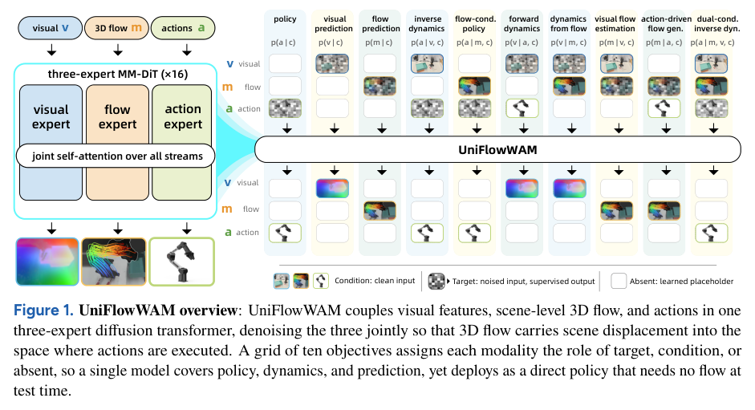
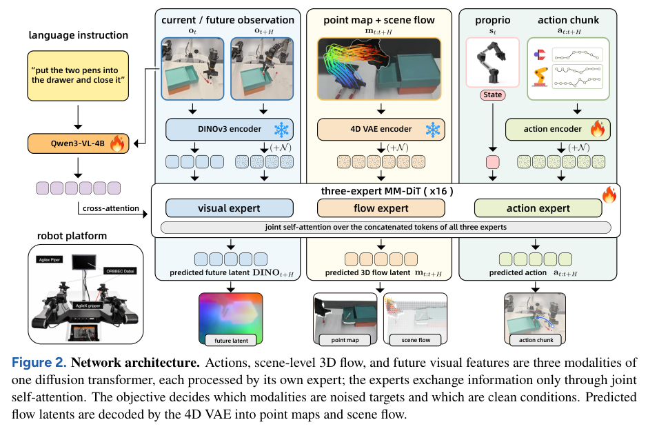

# 上海交大、创智学院、穹彻智能联合发布 UniFlowWAM： 当「流」成为模态

2026-11-02 · SJTU MVIG · 上海创智学院 · 穹彻智能 (arXiv:2610.30991) · 有来源缺口

[本地原件归档](../../../raw/40c9215721a303a76c1e466ca6b7e6b671413260f1d89fccf180cd56e107a9a2) · 固定材料版本 `digest-material-40c9215721a303a76c1e466ca6b7e6b671413260f1d89fccf180cd56e107a9a2@1` · [一手原站](https://arxiv.org/abs/2610.30991)

## 深度拆解与复核

- ==核心结论==：上海交通大学 MVIG 实验室、上海创智学院与 [穹彻智能 Noematrix](../entities/companies/Noematrix%20%28%E7%A9%B9%E5%BD%BB%E6%99%BA%E8%83%BD%29.md)（共同一作 [Jialin Tian](../entities/people/Jialin%20Tian.md)、Zhuofan Li，卢策吾教授与杨理欣教授团队）在 arXiv:2610.30991（2026-10-22）推出 UniFlowWAM。不同于以往把光流/3D 轨迹当作前序中间接口（Im2Flow2Act、PointAction）或推理条件输入（TraceVLA、MolmoAct、LaMP）的做法，UniFlowWAM 在预训练视觉—动作底座 LDA-1B 上新增专属 3D 流专家，构成 16 层三专家 MM-DiT（视觉 DINOv3、3D 场景流 MotionCrafter 4D VAE、动作三模态仅在联合自注意力层借 MM-RoPE 交互），并通过不对称「十目标角色网格」联合训练——部署时直接将流通道置为学到的占位符，无需传感器深度或在线抽流。在 RoboCasa-GR1 上，经过 1,200 小时中训的 UniFlowWAM 11 个随机种子均分达 56.38%（最高 58.9%），较原版 LDA（52.11%）提升 4.27 个百分点；在 LIBERO-Plus 零样本扰动集取得 87.7% 总分（相机视角扰动 96.9%），在 ALOHA 真机四项双臂任务取得 87.0% 平均成功率与 92.3 过程分，大幅领先 π0.5（68.5%）、DreamZero（30.0%）与 LDA（15.5%）；但流表征本身不含力、摩擦与质量物理量，且机器人初始状态扰动仅得 66.0%（落后 π0.5 的 76.8%）。

#### 一、业务切口与核心机制

1. 为什么「视觉语义 + 未来目标图像」仍然漏掉了 4D 场景演进？
   - 在典型世界—动作模型（UWM、UVA、FLARE、LDA）中，未来 DINOv3 视觉特征虽能表达目标画面语义，却不显式描述场景三维点在操作过程中如何平移旋转。UniFlowWAM 借助前馈单目 3D 追踪器 Track4World 配合 SAM 前景分割提取每像素 3D 位置与下一帧位移，再送入冻结的 MotionCrafter 4D VAE 编码为压缩潜变量 m = [E_P; E_F]，从而在纯 RGB 视频训练下注入 4D 几何动力学先验，部署端无需任何深度相机。
   - 团队在第 4.5 节披露了两项证伪试错：其一，仿照 Im2Flow2Act 将 3D 位移映射为 RGB 通道送入冻结 SDXL 图像 VAE 时，重建损失正常但生成的流对所有输入几乎相同（坍缩为数据集平均流），改用 MotionCrafter 4D VAE 才得以解决；其二，尝试对原有 Token 指向流 Token 的注意力 logits 加渐进开门控时，RoboCasa-GR1 21 个种子均值反落后无门控版 3.3 个百分点，最终彻底放弃门控。

2. 三专家 MM-DiT 与十目标不对称角色网格（Role Grid）
   - 架构继承预训练 LDA-1B，由 Qwen3-VL-4B 经交叉注意力提供图文条件，视觉专家（融合当前与未来 DINOv3 槽位）、动作专家从预训练权重出发，流专家从零初始化并在 48 张 NVIDIA H200 GPU（全局批大小 1,536）上基于 214,443 条回合、1.33 亿帧（约 4,200 万个 16 步窗口、合计约 1,200 小时，整合 RoboCOIN 47,050 条、RoboMIND 2.0 140,231 条与 MolmoAct2-BimanualYAM 27,162 条跨 10 种本体数据）执行联合中训。
   - 10 项流匹配训练目标为每个模态赋予「条件（干净输入）、目标（加噪监督）或缺失（可学习占位符）」之一：其中 4 项不含流（policy、visual prediction、inverse dynamics、forward dynamics）完整还原原基底任务防止能力遗忘，另加 flow prediction、flow-cond. policy、dynamics from flow、visual flow estimation、action-driven flow generation 与 dual-cond. inverse dynamics（独为动作保留同时接收流与视觉的双条件目标）。因此推理阶段只需调用直接策略 p(a | c_t)，流与未来视觉均以占位符旁路，零额外抽流延迟。

#### 二、核心数据核查、口径纠偏与工程边界

- 场景与利益披露：论文由上海交通大学 MVIG 实验室、上海创智学院与商业实体穹彻智能（Noematrix）联合发表，并由微信公众号 42号电波（作者 Starc）撰写中文科普长文；穹彻智能正处于 A 轮融资后推动自研具身大脑与世界模型商业落地阶段，需剥离 PR 宣传口径并对照原论文 Table 2、Table 3、Figure 4 与 Table 4 逐项核查长短板。

| 基准测试集与对比模型 | 核心成功率 / 得分 | 关键分项与对照差距 | 复核结论与工程解读 |
| :--- | :--- | :--- | :--- |
| RoboCasa-GR1 (24 任务 · 11 种子) | 56.38% ± 1.47%（最高 58.9%） | 无中训版 54.84% ± 1.00%；原版 LDA 52.11% ± 2.24%（复现 52.76%）；OpenWAM-α 60.5%、LDA-1B 55.4%、FLARE 55.0%、Being-H0.7 49.2%、StarVLA 47.8%、GR00T-N1.6 47.6%、UWM 14.2% | ✅ 弱项增益最显：在原 LDA 低于 50% 的 10 个难任务上平均暴涨 6.47 pp（其余 14 个仅涨 2.71 pp） |
| LIBERO (40 任务) / LIBERO-Plus (10,030 回合) | 98.1%（98.05%） / 87.7%（87.65%） | LIBERO-Plus 超越 π0.5（84.7%）、Track4Action（82.3%）、FLEX-π（80.9%）、LaMP（79.3%）、4D-WAM（71.0%）、LDA（69.5%）、OpenWAM-α（69.2%）、Fast-WAM（65.3%） | ⚠️ 分项严重分化：相机视角扰动 96.9%（第二名 Track4Action 仅 76.6%）、光照 98.0%、噪声 98.1%，但机器人初态扰动仅 66.0%（明显输于 π0.5 76.8% 与 OpenWAM-α 76.1%），布局 81.7% 亦低于 π0.5 86.9% |
| ALOHA 双臂真机 4 任务（50 回合/任务） | 平均成功率 87.0% / 过程分 92.3 | π0.5 68.5% / 77.0；DreamZero 30.0% / 34.5；复现 LDA 15.5% / 17.8（严重机械臂震颤）；分任务：辣椒 94%（96.5）、卷心菜 80%（92.5）、叠毛巾 84%（88.0）、钢笔入抽屉 90%（92.3） | ⚠️ 卷心菜滚落暴露接触短板：80% 成功率 vs 92.5 过程分，因缺乏力/摩擦建模致圆形物体易滑脱但仍能闭盖拿分 |
| Table 4 后训练目标阶梯消融（25 回合/任务） | 辣椒 / 钢笔 / 毛巾：76/76/72 → 94/90/84 | obj-1 仅策略（76/76/72）；obj-4 去流四目标（92/80/76）；obj-7 仅流条件（92/88/76）；obj-10 全十目标（94/90/84，50 回合主实验） | ✅ 边缘分布抗跌实证：辣椒 90° 侧放稀疏区 obj-1 仅 1/5（20%），全十目标守住 80%；但全网格在 LIBERO-Plus 需延长至 170k–200k 步才完全收敛 |

- ⚠️ LIBERO-Plus「机器人初态 66.0%」暴露的运动学流盲区（本工作台核查）：正如 42号电波评论与 Table 3 共同指向，3D 场景流记录的是“像素场景点怎么移动”，对相机视角变化、光照闪烁与传感器高斯噪声拥有压倒性几何不变性（96.9%–98.1%）；但当机械臂自身初始关节姿态或桌面物体排布发生变化时，机器人初态仅 66.0%（输给 π0.5 逾 10 个百分点、甚至低于未加流的 LDA 71.2%）。另外需注意，ALOHA 真机是在 AgileX Cobot Magic（双 6 自由度 PiPER 臂）上针对 4 个任务各自独立采集 50 条演示并分任务微调（per-task specialist），且起始条件在演示覆盖带内按固定阶梯选取，并非跨多任务的单一零样本通才权重。
- ⚠️ 中训规模不对等与离线伪标签噪声（本工作台核查）：基底 LDA 使用约 3 万小时 EI-30k 语料，而 UniFlowWAM 的 3D 流中训仅使用约 1,200 小时（不到 1/20），且依赖离线 Track4World 生成伪标签（论文第 5 节明确承认存在轨迹时序跳变反转及 SAM 掩码丢弃背景上下文的问题），限制了流分支在更复杂遮挡与触碰交互任务上的泛化上限。

#### 三、赛道横向对比与定位

| WAM / 流策略模型 | 「流」在模型中的角色 | 是否需在线抽流 / 深度传感器 | 中训/预训练规模 | 核心强项与现存边界 |
| :--- | :--- | :--- | :--- | :--- |
| UniFlowWAM（本文，SJTU / 穹彻） | 第三对等模态（独立专家 + 10 目标网格，既作条件也作监督目标） | 均不需要（离线 Track4World + 4D VAE，推理置占位符） | 1,200h 流中训（214k 回合，48×H200）接 LDA-1B | ALOHA 真机 87.0%、视角扰动 96.9%；机器人初态扰动 66.0% 偏弱，不含力与摩擦物理量 |
| Track4Action / LaMP | 训练辅助监督信号（Track4Action）或推理条件先验（LaMP） | LaMP 推理时需在线追踪/预测流 | 面向桌面操作策略微调 | LIBERO-Plus 分别为 82.3% 与 79.3%，低于 UniFlowWAM 87.7% |
| OpenWAM-α（arXiv:2609.07398） | 视频与动作双分支协同生成，无显式 3D 场景流模态 | 无需深度/抽流 | 大规模开源模块化 WAM 预训练 | RoboCasa-GR1 达 60.5%、LIBERO 99.3%，但 LIBERO-Plus 跌至 69.2%（视角扰动仅 33.8%） |
| NVIDIA GR00T 2（2026-11） | 像素级未来视频与动作联合流匹配（无显式 3D 点流分支） | 无需深度/抽流 | 402,730h 人类视频 + 23,500h 遥操作 + 10,184h UMI | 跨本体 X-Adapt 与机载 124 ms 极强；像素压缩后同样缺失直接力触感知 |

### 观点与可反驳条件

- ==观点==：==UniFlowWAM 证明了「将 4D 场景流作为独立但部署可旁路的内部训练模态」是一条高性价比的几何正则路径：仅凭 1,200 小时纯单目 RGB 提取的 3D 流中训，就能把自由空间抓放与视角抗扰动性能显著推高（LIBERO-Plus 87.7%、ALOHA 87.0%），且不增加推理延迟==；但纯运动学位移流天然失明于接触力、摩擦与形变物理，在未接入触觉或力矩模态前，其优势上限仍被锁定在「空间轨迹引导」而非「工业紧配合装配」。
- ==推翻条件==：
  1. ① 3 万小时全量预训练消融失效：若后续将 3D 流联合预训练规模从 1,200 小时扩展至与 EI-30k 对等的 3 万小时以上时，在不引入额外流分支的情况下，单纯依靠更大规模多视角视频预测（如 OpenWAM-α 或 GR00T 2 路线）配合简单视角增强即可将 LIBERO-Plus 视角扰动提至 >=95% 且机器人初态保持 >=80%，则显式 4D 场景流模态的长期存在必要性将被削弱。
  2. ② 多任务统一真机微调与接触任务受阻：若第三方在 ALOHA 或更高自由度灵巧手上测试单权重多任务联合微调（非每任务 50 条单独微调），或在插拔/拧盖/扣合等富接触任务上发现 UniFlowWAM 表现不及仅含视触觉输入的纯 VLA 基线 15 个百分点以上，则证明纯运动学 3D 流无法承载接触密集型工业落地。

---

## 原文摘录与一手信源存证

> 近半年来，有关 WAM 的研究越发出现一种趋势，即将物理世界的信号提取为抽象模态，成为数据并进入编码器中，用于具身模型的学习。积水成冰，随着越来越多的团队叩问什么样的编码形式最有利于模型的数据吸收效率，模态已不仅仅局限于世界知识、动作信息，或是世界与动作之间的耦合，而逐渐扩展至了时间、因果关系、未来状态等等。可以说，模态本身也在愈发抽象。
> — 原文摘录，PDF p.1；证据 `digest-material-40c9215721a303a76c1e466ca6b7e6b671413260f1d89fccf180cd56e107a9a2-excerpt-1@1`

> UniFlowWAM 之前，上海交通大学 MVIG 实验室、上海创智学院、穹彻智能发表于ECCV 2026 的 ChronoFlow-Policy 和 LaMP 已经将三维交互流确立为观测理解与动作预测之间的中介信号。UniFlowWAM 便是他们的最新力作。
> — 原文摘录，PDF p.2；证据 `digest-material-40c9215721a303a76c1e466ca6b7e6b671413260f1d89fccf180cd56e107a9a2-excerpt-2@1`

> 上海交通大学视觉与智能（MVIG）实验室联合上海创智学院、穹彻智能最新发布了UniFlowWAM。据悉，这是一种融合视觉语义与 4D 几何的统一世界 — 动作模型，能够将3D 场景流提升为与视觉、动作地位对等的第三种模态。该研究的共同第一作者为 Jialin Tian、 Zhuofan Li ，二人同为上海交通大学 MVIG 实验室成员。
> — 原文摘录，PDF p.2；证据 `digest-material-40c9215721a303a76c1e466ca6b7e6b671413260f1d89fccf180cd56e107a9a2-excerpt-3@1`

一手材料：

- UniFlowWAM: A Unified World-Action Model with Visual Semantics and 4D Geometry · Jialin Tian et al. / arXiv · [原站](https://arxiv.org/abs/2610.30991) · [主体档案：Jialin Tian](../entities/people/Jialin%20Tian.md) / [主体档案：Noematrix (穹彻智能)](../entities/companies/Noematrix%20%28%E7%A9%B9%E5%BD%BB%E6%99%BA%E8%83%BD%29.md) · [NotebookLM](https://notebook.google.com/notebook/cac99041-d3b9-449e-a192-12bb4b1ad391) · [Drive](https://drive.google.com/file/d/1jkBs9HdS8cdEC85-XIGIvsnxjvbMty61/view?usp=drivesdk)
  材料版本 `digest-material-85f119875bdc158100156da280ff1b37209aa32c8c008fe170f2413398c0ecaf@1`；获取方式 `http_pdf`。
  > Robot demonstrations record what the robot saw and what it did. They do not specify how the 3D world changed in between. — PDF p.1
  > A robot manipulates objects by moving its own body. Its action labels only record the commands that its joints or end-effector execute. What those commands do to the scene is left unwritten. — PDF p.1

归属与范围：已复用归档的 arXiv:2610.30991v1 完整 14 页论文 PDF（47,979 字符），逐表核查三专家 MM-DiT、10 目标角色网格（含 4 项基模型任务与 6 项流任务）、约 1,200 小时 / 214,443 回合（RoboCOIN 47,050 + RoboMIND 2.0 140,231 + MolmoAct2-BimanualYAM 27,162）在 48 张 NVIDIA H200 的中训细节，以及 RoboCasa-GR1（56.38% 均值 / 58.9% 峰值 vs LDA 52.11%）、LIBERO（98.1%）、LIBERO-Plus（87.7% 均值 / 相机扰动 96.9% 但机器人初态仅 66.0%）和 AgileX Cobot Magic ALOHA 真机（87.0% 成功率 / 92.3 过程分 vs π0.5 68.5% / DreamZero 30.0% / LDA 15.5%）实测表现。

来源缺口：

- `pending_verification`：UniFlowWAM 当前 3D 流中训规模约 1,200 小时（远低于底座 LDA 的 30,000 小时 EI-30k），依赖 Track4World 离线单目伪标签（存在时序方向反转与 SAM 丢失背景噪声），且 ALOHA 真机评测采用每任务独立采集 50 条演示与固定初始条件带测试，多任务统一权重表现及力控紧配合场景尚未验证。 [线索](https://arxiv.org/abs/2610.30991)
- `unverified_claim`：实体关系入库跳过 (Jialin Tian --produces--\> UniFlowWAM)：谓词 'produces' 不允许 to 实体类型 'company'（仅允许 \['product'\]）
- `unverified_claim`：实体关系入库跳过 (Noematrix --produces--\> UniFlowWAM)：谓词 'produces' 不允许 to 实体类型 'company'（仅允许 \['product'\]）

[返回赛道总览](../赛道总览.md#digest-40c9215721a303a7) · [返回导读索引](README.md) · [主体档案库](../entities/README.md)
