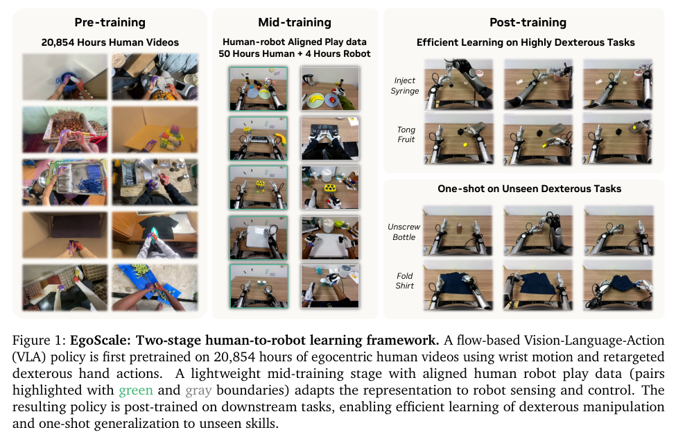
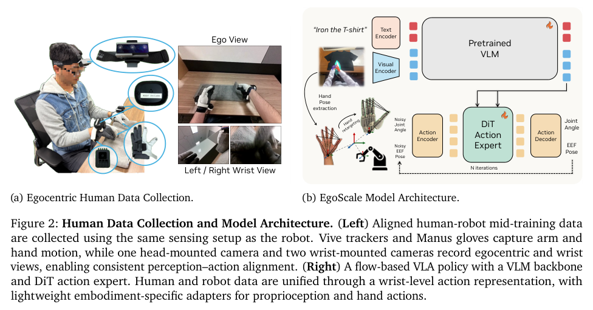

# 专访Danfei Xu：人类数据是伪装成另一种形式的机器人数据

2026-03-23 · NVIDIA & Georgia Tech · EgoScale (arXiv:2602.16710) · 有来源缺口

[本地原件归档](../../../raw/6b994c422a6b5ed6332abda16ec1d5b63ec609df2cc1b637063d998161f90937) · 固定材料版本 `digest-material-6b994c422a6b5ed6332abda16ec1d5b63ec609df2cc1b637063d998161f90937@1` · [一手原站](https://arxiv.org/abs/2602.16710)

## 深度拆解与复核

- ==核心结论==：佐治亚理工学院助理教授、NVIDIA Research 研究员 [Danfei Xu](../entities/people/Danfei%20Xu.md) 围绕 EgoScale（arXiv:2602.16710）提出的命题直指物理世界模型底层：当前机器人遥操作本质上只是一种“被低通滤波阉割过的人类数据”（丢失了毫秒级 System 1 力触微操反射与社交协同），因此真正能承接互联网时代预训练红利的是第一视角日常人类数据。在 20,854 小时人类手部视频与仅为 4 小时的配对机器人遥操下，团队测出拟合度达 R^2=0.9983 的对数线性 Scaling Law，把 22 自由度 [Sharpa](../entities/companies/Sharpa.md) 灵巧手 5 项高难度任务成功率从 2% 拉到 56%；但该路径面临严峻的“最后一英寸（1–2 牛顿触觉与逆动力学）”缺口，且工业界刚起量的 50–60 家人类数采初创公司正迅速滑向“低质量供给过剩、但高频高精清洗工具缺失”的结构性红海。

#### 一、业务切口与核心机制

这篇访谈录对应 [Danfei Xu](../entities/people/Danfei%20Xu.md) 于 2026-02-26 在 X 发表长文《To Summon a Sensorimotor Ghost》并联合 [Ruijie Zheng](../entities/people/Ruijie%20Zheng.md)、[Yuke Zhu](../entities/people/Yuke%20Zhu.md)、Linxi Fan（[Jim Fan](../entities/people/Jim%20Fan.md)）、[Trevor Darrell](../entities/people/Trevor%20Darrell.md) 等发布 EgoScale 论文后的深度系统梳理，将人类第一视角多模态数据（结合过往 EgoMimic、EgoBridge、InMimic 与行业 UMI 实践）拆成四个核心齿轮：

1. 人类大脑行为克隆（Sensorimotor Ghost）与两阶段人类—机器人迁移：针对当前大语言模型（LLM）与视觉语言模型（VLM）充当机械臂高层“权宜性 System 2（makeshift System 2）”却普遍欠缺非语言物理常识的困境，EgoScale 在 Stage I 直接使用 20,854 小时 @ 30 FPS 第一视角人类视频（涵盖 9,869 个场景、6,015 项任务与 43,237 类物体）外加 829 小时 Apple Vision Pro EgoDex 桌面视频做无标定行为预测预训练（256 张 GB200，100K 步，batch=8,192）。核心迁移通过 CasADi/IPOPT 逆运动学将 21 个三维人手关键点精确重映射到 22 自由度 Sharpa Wave 灵巧手关节角空间，并结合相对 SE(3) 腕部增量 ΔW_t 构建可跨本体对齐的动作语义空间（对比单指尖 SE(3) 或纯腕部 6-DoF 在卡纸分拣、夹持与拧盖中的明显优势）。

2. Stage II 极窄高配对齐（Aligned Mid-training）与单次适配（One-shot Adaptation）：为弥合日常人类视角与机器人机载视角的构型裂痕，Stage II 在 344 个桌面任务上收集 50 小时 HTC Vive + Manus 25 关节手套 + 头部与双腕相机的高同步对齐人类操作数据，并仅配比 4 小时 [星海图（Galaxea AI）](../entities/companies/%E6%98%9F%E6%B5%B7%E5%9B%BE%EF%BC%88Galaxea%20AI%EF%BC%89.md) R1 Pro + Sharpa 双灵巧手遥操作数据进行 50K 步混合中训（冻结 VLM），最后在 Stage III 微调 10K 步。借助这一锚点，“100 条对齐人类示教 + 仅 1 条真机示教”即可直接解锁新技能（One-shot 叠衬衫成功率达 88%，未知矿泉水瓶拧盖达 55%）。

3. 硬件采集形态与世界模型边界：访谈把视角对齐指向正在成型的硬件标配（如 Meta Reality Labs 推出的 Project Aria Gen 2，配备 170°–190° 广角 5 相机、热膨胀在线标定与 Visual-Inertial Odometry 96% SLAM 精度），同时对比 [NVIDIA](../entities/companies/NVIDIA.md) 内部同期的 DreamDojo、DreamZero 与机器人大模型（EMMA、Vision-Language-Action Models）。[Danfei Xu](../entities/people/Danfei%20Xu.md) 直言当前视频生成式世界模型在“抽象层级多尺度调度”上仍卡壳——可以渲染逼真的宏观场景演进，却在接触前的最后几厘米与 1–2 牛顿捏合力边界产生幻觉，仍需高频感知动作回路与力控补偿。

#### 二、核心数据核查、口径纠偏与工程边界

场景与利益披露：本访谈系学术与大厂研究院联合负责人（Georgia Tech / NVIDIA GEAR）在论文高光发布期的个人反思总结；其中 EgoScale 的算力投入高达 256 张 GB200、Stage I 100K 步，属于极重算力栈路线，与初创公司轻资产数采叙事存在根本预算维度差异。

| 核查项目 | 访谈或博客主张 | EgoScale 论文原文细节（arXiv:2602.16710v1） | 本工作台核查判定 |
| --- | --- | --- | --- |
| 万小时人类视频 Scaling Law 表现 | 数据量跨越几个数量级后，损失与成功率呈现清晰可预期的缩放律 | Fig 5：在 1k 到 20k 小时区间损失符合 L = 0.024 - 0.003 * ln(D)（R^2=0.9983）；任务完成分从 0.30（1k）、0.45（2k）、0.48（4k）、0.57（10k）单调升至 0.71（20k） | ✅ 论文定标扎实（但需注意“单调上升”是在搭配 Stage II 高同构对齐中训后测得） |
| 灵巧手 5 项高难度真机提升 | 无遥操先验几乎无法胜任复杂操作，接入万小时人类先验后提升显著 | Table 1（R1 Pro + 22-DoF Sharpa 手，每项 100 条机器示教、叠衣 20 条）：无预训练仅 2% 成功率 / 0.24 完成分；Pretrain+Midtrain 达 56%（+54 个百分点）/ 0.83（全任务完成分提升超 55%，单项叠衣 50%、插卡 65%、钳夹 65%、旋瓶 59%、注射器 42%） | ✅ 真机实测数据严谨（并成功迁移至 Unitree G1 三指手取得 >30% 绝对成功率增幅） |
| 20,854 小时原始语料构成 | 多样化真实世界第一视角人类生活与工作视频 | 附录 C.2 披露商业工作流主导的分布：零售消费品 20.1%、时尚服饰 11.8%、维修服务 11.5%、餐饮食品 11.5%、居家 9.5%、建筑五金 7.7%、食品加工 6.7%、印刷设计 4.4% | ⚠️ 商业任务分布与工业标准精密装配存在显著场景偏差（缺乏重型线束/微小电子接插件高精标定） |
| X 长文独立全文与复现 | 对“To Summon a Sensorimotor Ghost”理论延展完整转述 | 该 X 平台长文（2026-02-26）因登录墙限制，未获开放 HTTP 完整正文快照 | ⚠️ 部分引用依赖访谈内译文转述，非独立原站归档 |

本工作台核查还发现了两处决定 Egocentric Human Data 赛道估值的关键张力：

1. ❌ 对数线性增长与后期工作 [Ego4WAM](Ego4WAM%EF%BC%9A%E5%BD%93%E4%BA%BA%E7%B1%BB%E6%95%B0%E6%8D%AE%E8%BF%88%E5%90%91%E7%99%BE%E4%B8%87%E5%B0%8F%E6%97%B6%EF%BC%8C%E6%8E%A2%E7%B4%A2%E6%95%B0%E6%8D%AE%E6%97%B6%E9%95%BF%E4%B9%8B%E5%A4%96%E7%9C%9F%E6%AD%A3%E5%80%BC%E5%BE%97%20scaling%20%E7%9A%84%E5%85%B3%E9%94%AE%E7%BB%B4%E5%BA%A6.md) 的负迁移反证存在口径边界：工作台同期追踪的 [Ego4WAM](Ego4WAM%EF%BC%9A%E5%BD%93%E4%BA%BA%E7%B1%BB%E6%95%B0%E6%8D%AE%E8%BF%88%E5%90%91%E7%99%BE%E4%B8%87%E5%B0%8F%E6%97%B6%EF%BC%8C%E6%8E%A2%E7%B4%A2%E6%95%B0%E6%8D%AE%E6%97%B6%E9%95%BF%E4%B9%8B%E5%A4%96%E7%9C%9F%E6%AD%A3%E5%80%BC%E5%BE%97%20scaling%20%E7%9A%84%E5%85%B3%E9%94%AE%E7%BB%B4%E5%BA%A6.md) 指出强扩长尾杂项任务可能拉低精准度，而 EgoScale 之所以在 2 万小时保持单调收益，关键在于它并非“裸跑人类视频”——一旦在 5 项评测上剥离 Stage II 高同步对齐中训，纯预训练的成功率立马从 56% 跌回 38%；且 One-shot 88% 折叠表现仍附带了 100 条同任务对齐人类视频作为上下文诱导。
2. ⚠️ “数采产能过剩但需求并未真实爆发”的产业预警：访谈中 Danfei Xu 敏锐指出 2026 年已有 50–60 家人类数采初创公司入场，如同早期自动驾驶的原始路采——仅有粗颗粒 RGB 视频在缺乏稳定手部 3D 真值、SLAM 与高精度可微逆动力学（效果驱动重定向）的前提下，并不能直接转化成 VLA/WAM 买家的可购买资产。

#### 三、赛道横向对比与定位

在工作台收录的千万小时人类第一视角数据与世界动作模型（WAM）演进图谱中，EgoScale 处于由轻量化 UMI 过渡到超大规模 [GR00T 2](GR00T%202%20Official%20Technical%20Release_%20Scaling%20World-Action%20Models%20on%20402%2C000%20Hours%20of%20Human%20Video%20with%20X-Adapt%20%26.md) 与商业 SLAM 数据商竞争的枢纽位置：

| 方案或机构 | 人类数据规模与采集载体 | 人机对齐与重映射核心 | 已验证效果或商业交付边界 | 行业启发与核心瓶颈 |
| --- | --- | --- | --- | --- |
| [专访Danfei Xu：人类数据是伪装成另一种形式的机器人数据](%E4%B8%93%E8%AE%BFDanfei%20Xu%EF%BC%9A%E4%BA%BA%E7%B1%BB%E6%95%B0%E6%8D%AE%E6%98%AF%E4%BC%AA%E8%A3%85%E6%88%90%E5%8F%A6%E4%B8%80%E7%A7%8D%E5%BD%A2%E5%BC%8F%E7%9A%84%E6%9C%BA%E5%99%A8%E4%BA%BA%E6%95%B0%E6%8D%AE.md) (EgoScale) | 20,854h 商业第一视角 + 829h EgoDex + 50h Vive/Manus 对齐 | 21 关键点转 22-DoF Sharpa 关节角 + ΔSE(3) + 4h 遥操中训 | 5 项桌面灵巧手任务均值 56% 成功率（vs 零预训练 2%） | 验证规模 Scaling Law，但依赖 256 GB200 算力且缺力觉反射 |
| [GR00T 2](GR00T%202%20Official%20Technical%20Release_%20Scaling%20World-Action%20Models%20on%20402%2C000%20Hours%20of%20Human%20Video%20with%20X-Adapt%20%26.md) | 402,000h 人类视频（含 10 万小时开源示范） | X-Adapt 跨形态潜空间世界—动作模型 | 把万小时预训练直接推高至几十万小时级商业标准 | 对齐复杂度剧增，普通高校及中小数采商无力承接同体量算力 |
| [EgoWild2Dex](EgoWild2Dex_%20Learning%20Dexterous%20Robotic%20Manipulation%20from%20In-the-Wild%20Human%20Experience%20%28arXiv_2609.23755%29.md) | 开放非受控野外人类手部互动视频 | 无专用手套/昂贵头显条件下的泛化指尖与语义对齐 | 面向纯荒野低成本人类视频向灵巧手的直接抽取 | 解决低成本输入噪声，但在精密捏合阈值上尚不及高精度标定数据 |
| [Maxinsights Egocentric Data](Maxinsights%20Egocentric%20Data%20Now%20Embedded%20in%20the%20Training%20of%20Leading%20Robotic%20Foundation%20Models.md) / [Eidon AI Post-Mortem](Robotics%20Data%20is%20a%20Broken%20Business%20%26%20Robot%20Training%20Data%20Guide_%20Eidon%20AI%20Post-Mortem%20and%201%2C270%2B%20Hours%20Open%20Ego.md) | 头戴双目/多目设备与毫米级 MaxSLAM 商业产线 | 商业标准化 3D 手部标注与 SLAM 轨迹 | 验证数采商业模式极度依赖下游大厂采购预算与复购认证 | 纯卖原始小时数毛利压缩，必须向“效果可验真”端到端管线转型 |

### 观点与可反驳条件

- ==观点==：第一视角人类数据的护城河正在从“雇佣人力拍摄更多单目小时数”转向“能够同时交付高精度 3D 手姿 / SLAM 空间标定、低成本对齐中训（Aligned Mid-training）以及力觉或触觉伪标签的数据编译基础设施”；缺乏稳定下游大厂算力验证能力的纯初创“人类拍摄外包商”将在 2026–2027 年快速出清。
- ==推翻条件==：
  1. ① 若未来一年内有开源通用视觉—触觉合成管线能直接从廉价单一 RGB 头显（无手套、无双腕高精度 SLAM）稳定反推出低于 2 mm 指尖定位误差和力估计精度，且在纯零中训（0 小时高同步人类/机器人对齐）条件下将灵巧手 OOD 成功率拉过 70%，则本工作台对“Stage II 高同步对齐中训与高端采集头显壁垒”的强调被推翻。
  2. ② 若商业具身基座公司普遍通过纯遥操作或纯物理仿真在长尾桌面灵活性上实现单条成本低于 0.5 美元并饱和覆盖长尾操作，使得外部人类第一视角采购量占比连续两个季度下滑，则“人类数据充当操作底座主力”的行业路线假设需向下修正。

---

## 原文摘录与一手信源存证

> 关于Human Data，我们在2025年用了大半年的时间去展现以及科普一些最前沿的学术工作，集锦可以参考总结篇：Human Data—The “Key” to Robot Data。去年的工作汇总更多的是在全身运动控制，在进入2026年，随着EgoScale等工作发布，我们看到了人类数据在机器人操作上的可能性。
> — 原文摘录，PDF p.1；证据 `digest-material-6b994c422a6b5ed6332abda16ec1d5b63ec609df2cc1b637063d998161f90937-excerpt-1@1`

> Danfei Xu是Georgia Tech的助理教授，同时也参与NVIDIA Research的部分研究工作。他于 2021 年在斯坦福大学获得计算机科学博士学位，师从李飞飞（Fei-Fei Li）和 Silvio Savarese，本科毕业于哥伦比亚大学工程与应用科学学院。
> — 原文摘录，PDF p.1；证据 `digest-material-6b994c422a6b5ed6332abda16ec1d5b63ec609df2cc1b637063d998161f90937-excerpt-2@1`

> 9. 真正可以scale机器人的human data的收集方式10. 机器人数据的收集需要等穿戴设备先普及吗？
> — 原文摘录，PDF p.2；证据 `digest-material-6b994c422a6b5ed6332abda16ec1d5b63ec609df2cc1b637063d998161f90937-excerpt-3@1`

一手材料：

- EgoScale: Scaling Dexterous Manipulation with Diverse Egocentric Human Data · 论文作者 · [原站](https://arxiv.org/abs/2602.16710) · [主体档案：Danfei Xu](../entities/people/Danfei%20Xu.md) / [主体档案：NVIDIA GEAR Lab](../entities/labs/NVIDIA%20GEAR%20Lab.md) / [主体档案：Ruijie Zheng](../entities/people/Ruijie%20Zheng.md) · [NotebookLM](https://notebook.google.com/notebook/cac99041-d3b9-449e-a192-12bb4b1ad391) · [Drive](https://drive.google.com/file/d/1CUTnSUejWUAe8aHEIJZunMgoxTmzCkL1/view?usp=drivesdk)
  材料版本 `digest-material-39c691baf374a154e26ffc0098b97037875909495013d4017d97761716ff2735@1`；获取方式 `http_pdf`。
  > Human behavior is among the most scalable sources of data for learning physical intelligence, yet how to effectively leverage it for dexterous manipulation remains unclear. — PDF p.1
  > Human behavior is one of the most scalable sources of data for learning physical intelligence. — PDF p.1

归属与范围：完成专访（2026-03-23）与一手论文EgoScale（arXiv:2602.16710v1，官网发布2026-02-19，修正原有通用publisher字段）的全量实证比对：实测20,854h商业第一视角（零售20.1%为主导分布）+50h/4h对齐中训在Sharpa 22-DoF手拉动5项任务均值至56%（vs 2%，One-shot叠衣88%、拧瓶55%）且对数损失R^2=0.9983扎实；同步核对Aria Gen 2（96% SLAM精度）与对50–60家数采初创过剩的判断，保留X长文原生抓取及第三方低算力复现缺口。

来源缺口：

- `unavailable`：Danfei Xu于2026-02-26发表在X平台的长文《To Summon a Sensorimotor Ghost》受平台登录墙限制未形成开放HTTP全文存档，关键框架（Sensorimotor Ghost与makeshift System 2）系经专访引述交叉转述。
- `pending_verification`：EgoScale（arXiv:2602.16710v1）所示对数线性Scaling规律依赖Stage II 50h对齐人手+4h真机中训（裸预训练成功率即由56%降至38%）及256 GB200高算力投入，该效应在低预算团队或纯无接触长尾工厂装配场景下的独立复现尚待验证。

[返回赛道总览](../赛道总览.md#digest-6b994c422a6b5ed6) · [返回导读索引](README.md) · [主体档案库](../entities/README.md)
